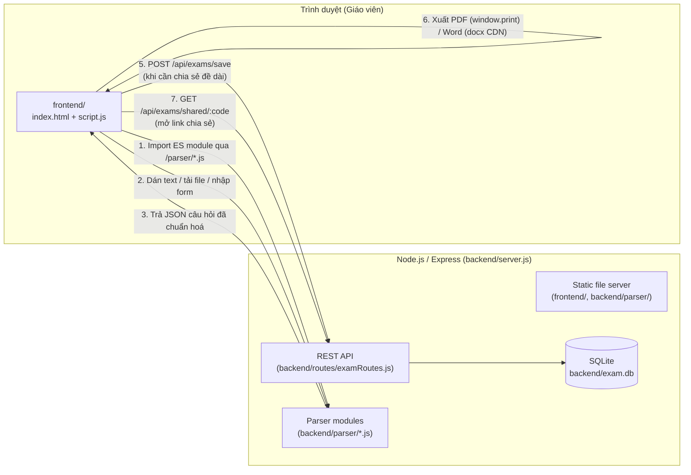
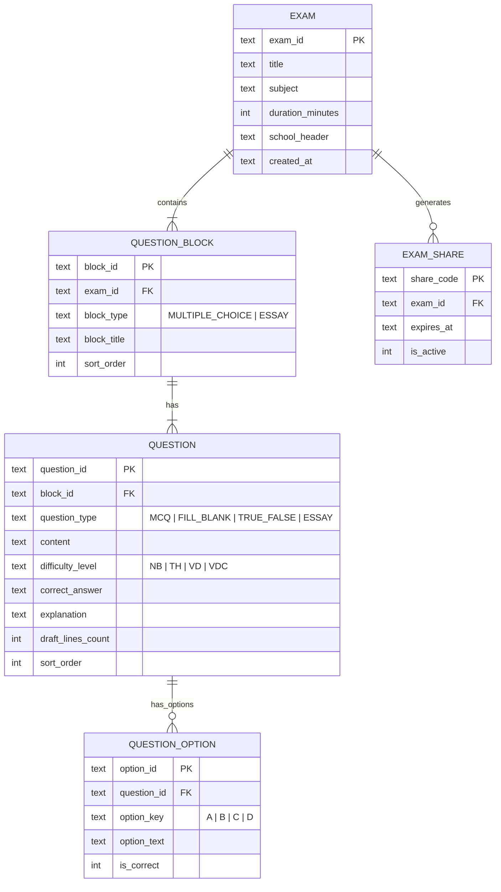

# ExamBuilder

Web App nội bộ giúp **giáo viên** biên soạn đề kiểm tra nhanh — từ nội dung do AI (Gemini Pro) sinh ra, từ tệp có sẵn (JSON/CSV/TXT), hoặc nhập tay qua biểu mẫu — rồi xem trước ở 2 chế độ (Giáo viên / Học sinh), chỉnh sửa trực tiếp trên đề, trộn câu hỏi để sinh nhiều mã đề chống quay cóp, xuất file PDF/Word để in, và chia sẻ đề qua link.

Không có đăng nhập/đăng ký — mở ứng dụng lên là dùng được ngay.

---

## Mục lục

- [1. Giới thiệu & Mục đích](#1-giới-thiệu--mục-đích)
- [2. Kiến trúc tổng thể](#2-kiến-trúc-tổng-thể)
- [3. Kiến trúc chi tiết](#3-kiến-trúc-chi-tiết)
- [4. Tính năng & Đầu ra](#4-tính-năng--đầu-ra)
- [5. Cài đặt & Sử dụng](#5-cài-đặt--sử-dụng)
- [6. Kiểm thử (Testing)](#6-kiểm-thử-testing)
- [7. Giới hạn đã biết](#7-giới-hạn-đã-biết--known-limitations)

---

## 1. Giới thiệu & Mục đích

Soạn một đề kiểm tra thủ công (gõ từng câu, canh dòng nháp cho tự luận, tô đáp án đúng, tách bản học sinh khỏi bản có đáp án...) tốn nhiều thời gian lặp lại mỗi kỳ thi. **ExamBuilder** giải quyết việc đó bằng cách:

1. Chuẩn hoá một **định dạng văn bản** mà AI (Gemini Pro, hoặc bất kỳ LLM nào) có thể sinh ra hàng loạt câu hỏi đúng cấu trúc (xem [`Gemini_Prompt_Unified.txt`](./Gemini_Prompt_Unified.txt)).
2. **Phân tích (parse)** định dạng đó — hoặc tệp JSON/CSV/TXT, hoặc dữ liệu nhập tay — thành cấu trúc đề thi thống nhất.
3. Hiển thị đề ở dạng **block trực quan** (Trắc nghiệm / Tự luận), cho phép giáo viên chỉnh sửa ngay trên bản xem trước, và **bật/tắt "Chế độ Học sinh"** để kiểm tra trước khi in — chế độ này ẩn hoàn toàn đáp án và lời giải.
4. **Xuất** ra PDF (in trực tiếp) / Word (.docx) và **chia sẻ** đề qua một đường link.

## 2. Kiến trúc tổng thể

Ứng dụng là một **Web App 2 tầng** cổ điển: Frontend thuần (không framework) nói chuyện với một Backend Node.js/Express qua REST API, dữ liệu lưu trong SQLite. Phần *phân tích cú pháp* (parser) là các module ES-Module dùng chung, được backend serve tĩnh để **frontend import trực tiếp** — tránh việc phải viết lại logic parse ở hai nơi.



**Điểm thiết kế đáng chú ý:** việc *parse* dữ liệu (bước 1-3) chạy **hoàn toàn ở trình duyệt**, không round-trip qua server — giáo viên bấm "Sinh Đề Kiểm Tra" là thấy kết quả ngay lập tức. Server chỉ được gọi khi cần **lưu bền vững** để tạo link chia sẻ.

## 3. Kiến trúc chi tiết

### 3.1. Cấu trúc thư mục

```
exam-builder/
├── backend/
│   ├── database.js          # Kết nối SQLite + schema (CREATE TABLE, 3NF)
│   ├── errorHandler.js       # Middleware xử lý lỗi toàn cục (JSON đồng nhất)
│   ├── server.js             # Khởi tạo Express, static serving, mount routes
│   ├── parser/                # Module phân tích cú pháp (dùng chung FE/BE, ESM)
│   │   ├── IQuestionParser.js     # "Interface" trừu tượng (Open/Closed Principle)
│   │   ├── TextPromptParser.js    # Parse văn bản thô theo định dạng Gemini prompt
│   │   ├── FileUploadParser.js    # Parse JSON / CSV / TXT / DOCX (mammoth)
│   │   ├── examCodeGenerator.js   # Tron & sinh nhieu ma de (Fisher-Yates + chia quota)
│   │   └── index.js               # Barrel export
│   └── routes/
│       ├── examRoutes.js       # REST API: save / get / share / revoke share / shared
│       └── backgroundRoutes.js # REST API: liệt kê ảnh nền PDF trong resources/backgrounds/
├── frontend/
│   ├── index.html             # Layout: toolbar, 3 tab input, khu preview, prompt reference, modal share
│   ├── style.css              # Biến CSS, layout responsive, @media print (A4), lớp nền PDF (.exam-print-bg)
│   ├── script.js               # State, render đề, chỉnh sửa trực tiếp, export/share, nhiều mã đề, nền PDF
│   └── promptTemplate.js       # Nội dung prompt/ví dụ mẫu nhúng cho khu "Prompt mẫu cho AI"
├── resources/
│   └── backgrounds/            # Ảnh nền PDF (.png/.jpg/.svg) — xem mục 4.1
├── tests/                      # Bộ test Jest + Supertest (xem mục 6)
├── Gemini_Prompt_Unified.txt  # Prompt mẫu để dán vào Gemini Pro sinh câu hỏi
├── babel.config.cjs            # Cấu hình Babel (chỉ dùng để Jest hiểu cú pháp ESM)
└── package.json
```

> Các thư viện xuất/nhập file (`docx` để xuất Word, `mammoth` để đọc `.docx` tải lên) được cài như dependency thường và phục vụ tĩnh qua `/vendor/docx/...` và `/vendor/mammoth/...` — không phụ thuộc CDN ngoài. Không dùng thư viện đọc Excel (`.xlsx`) do các lựa chọn phổ biến trên npm đều có lỗ hổng bảo mật chưa được vá (xem mục 7).

### 3.2. Mô hình dữ liệu (chuẩn hoá 3NF)



Ràng buộc toàn vẹn được thực thi ngay ở tầng CSDL: `PRAGMA foreign_keys = ON`, `ON DELETE CASCADE` cho toàn bộ quan hệ cha–con, và `CHECK` constraint cho các cột enum (`block_type`, `question_type`, `difficulty_level`) — xem `backend/database.js`.

### 3.3. Luồng dữ liệu chính (Sequence)

```mermaid
sequenceDiagram
    actor GV as Giáo viên
    participant UI as script.js
    participant P as Parser (ESM, /parser/*.js)
    participant API as examRoutes.js
    participant DB as SQLite

    GV->>UI: Dán text (định dạng Gemini) / chọn file / điền form
    UI->>P: new TextPromptParser().parse(raw)\nhoặc new FileUploadParser().parse(content, filename)
    P-->>UI: [{ block_type, block_title, questions: [...] }]
    UI->>UI: renderExam() — vẽ card Trắc nghiệm/Tự luận,\ngắn contenteditable + listener đồng bộ state
    GV->>UI: Sửa nội dung / đáp án / số dòng nháp /\nbật "Chế độ Học sinh" / Zoom
    GV->>UI: Bấm "Tạo Link Chia Sẻ"
    alt Đề ngắn (Base64 < ~1.8KB)
        UI->>UI: btoa(JSON.stringify(exam)) → URL ?data=...
    else Đề dài
        UI->>API: POST /api/exams/save
        API->>DB: BEGIN; INSERT EXAM/BLOCK/QUESTION/OPTION; COMMIT
        API-->>UI: { exam_id }
        UI->>API: POST /api/exams/share { exam_id }
        API->>DB: INSERT EXAM_SHARE
        API-->>UI: { share_code } → URL ?code=...
    end
    Note over GV,UI: Mở lại URL ?code=... → GET /api/exams/shared/:code\nrenderExam() ở "Chế độ Học sinh", ẩn panel nhập liệu
```

### 3.4. Vai trò các module cốt lõi

| Module | Vai trò |
|---|---|
| `backend/database.js` | Mở kết nối SQLite (singleton), tạo schema nếu chưa có. Hỗ trợ `EXAM_DB_PATH` (env var) và `closeDb()` để test cô lập bằng CSDL in-memory. |
| `backend/routes/examRoutes.js` | 4 endpoint REST: lưu đề (transaction), đọc đề (join lồng nhau), tạo link chia sẻ, đọc đề theo link chia sẻ. |
| `backend/parser/IQuestionParser.js` | Lớp cơ sở trừu tượng — định nghĩa hợp đồng `parse(rawContent)`. Cho phép thêm định dạng đầu vào mới (Open/Closed Principle) mà không sửa code đã có. |
| `backend/parser/TextPromptParser.js` | Bóc tách văn bản thô theo cấu trúc `===SECTION===` / `[CAU_HOI]` / `Key: value` thành câu hỏi có cấu trúc; validate và ném lỗi kèm vị trí (`Phần X - Câu Y`) khi sai định dạng. |
| `backend/parser/FileUploadParser.js` | Định tuyến theo phần mở rộng tệp: `.json` (validate cấu trúc `blocks`), `.csv` (tự viết CSV parser hỗ trợ dấu phẩy/nháy kép trong field), `.txt` (uỷ quyền lại cho `TextPromptParser`), `.docx` (dùng `mammoth` trích xuất văn bản thô rồi uỷ quyền lại cho `TextPromptParser`). |
| `backend/parser/examCodeGenerator.js` | Xáo (Fisher-Yates) + chia quota `floor(total/q)` cho từng cặp (loại câu hỏi × mức độ) để sinh `q` mã đề không trùng lặp và đồng đều tỉ lệ mức độ; xáo lại thứ tự đáp án A/B/C/D cho từng câu MCQ trong mỗi mã đề. Module thuần (không phụ thuộc DOM) — dùng chung cho frontend qua `/parser/examCodeGenerator.js`. |
| `frontend/script.js` | Toàn bộ state ứng dụng (`state`), render DOM (`renderExamInto`, `renderMCQBody`, `renderEssayBody`...), đồng bộ 2 chiều state ↔ DOM qua `contenteditable`, export PDF/Word (gồm nhiều mã đề nếu có), tạo & đọc link chia sẻ, khu "Prompt mẫu cho AI" (copy 1-click), sinh nhiều mã đề, chọn/bật-tắt nền PDF. |
| `backend/routes/backgroundRoutes.js` | `GET /api/backgrounds` — liệt kê file `.png`/`.jpg`/`.jpeg`/`.svg` trong `resources/backgrounds/` để dropdown "Nền PDF" ở frontend đọc. Thư mục được serve tĩnh tại `/backgrounds/<tên_file>`. |

## 4. Tính năng & Đầu ra

| Tính năng | Input | Output |
|---|---|---|
| **Dán văn bản** (tab 1) | Văn bản thô theo `Gemini_Prompt_Unified.txt` | Đề thi hiển thị ngay trong khu Preview, chia block Trắc nghiệm/Tự luận |
| **Tải file** (tab 2) | Tệp `.json`, `.csv`, `.txt`, hoặc `.docx` | Giống trên; lỗi định dạng báo rõ dòng/cột sai. Với `.docx`, nội dung Word phải theo đúng cấu trúc trong `Gemini_Prompt_Unified.txt` |
| **Nhập Form** (tab 3) | Từng câu hỏi nhập tay (loại câu, mức độ, nội dung, đáp án...) | Danh sách câu hỏi tạm → gộp thành đề khi bấm "Sinh Đề Kiểm Tra" |
| **Chỉnh sửa trực tiếp** | Click vào nội dung/đáp án/lời giải trên bản xem trước | Cập nhật ngay trong `state`, không cần form riêng |
| **Chế độ Học sinh** | Bật công tắc "Chế độ Học sinh" | Ẩn hoàn toàn: đáp án đúng, lời giải, nút chỉnh sửa — chỉ còn đề bài + lựa chọn/dòng nháp |
| **Zoom** | Nút A+/A− | Phóng to/thu nhỏ cỡ chữ bản xem trước (60%–200%) |
| **Xuất PDF** | Bấm "Xuất PDF" | Hộp thoại in của trình duyệt, layout đã tối ưu khổ A4 (`@media print`) |
| **Nền PDF** | Bật công tắc "Nền PDF" trong panel bên trái, chọn ảnh + chỉnh độ mờ | Ảnh nền phủ kín trang A4 phía sau nội dung khi "Xuất PDF"; xem mục 4.1 |
| **Xuất Word** | Bấm "Xuất Word" | Tệp `.docx` tải về, gồm đề bài + (nếu ở Chế độ Giáo viên) đáp án/lời giải |
| **Chia sẻ đề** | Bấm "Tạo Link Chia Sẻ" | Một URL: `?data=<base64>` (đề ngắn) hoặc `?code=<8-hex>` (đề dài, lưu server) — mở lên tự vào Chế độ Học sinh |
| **Thu hồi link** | Bấm "Thu hồi link" trong modal chia sẻ (chỉ khả dụng với link dạng `?code=`) | Link bị vô hiệu hoá vĩnh viễn — mở lại sẽ báo lỗi |
| **Prompt mẫu cho AI** | Khu "Prompt mẫu cho AI" dưới layout chính (badge 4 loại câu hỏi + accordion) | Nút "Copy Prompt"/"Copy Ví dụ" sao chép 1-click vào clipboard, kèm thông báo xác nhận |
| **Trộn & Tạo nhiều mã đề** | Panel "Trộn & Tạo nhiều mã đề" (số mã đề `q`, số bắt đầu, tiền tố) sau khi đã "Sinh Đề Kiểm Tra" | `q` mã đề (tab riêng trong Preview) — câu hỏi chia đều `floor(total/q)` theo từng cặp (loại × mức độ) riêng biệt, nên tỉ lệ Nhận biết/Thông hiểu/Vận dụng/Vận dụng cao trong mỗi loại câu hỏi đồng đều giữa các mã (không mã nào toàn câu dễ/toàn câu khó), không trùng lặp giữa các mã cho tới khi hết nguồn; đáp án trắc nghiệm A/B/C/D được xáo lại độc lập cho từng mã. Xuất PDF/Word tự động gồm tất cả mã đề (ngắt trang giữa các mã) |

### 4.1. Nền PDF (background overlay)

Cho phép chèn một ảnh nền (logo trường, khung viền, watermark "BẢN NHÁP"...) phủ kín trang A4 phía sau nội dung đề thi khi xuất PDF (`window.print()`).

**Thư mục tài nguyên:** `resources/backgrounds/` (tại gốc dự án, ngang hàng `backend/` và `frontend/`). Server serve tĩnh tại `/backgrounds/<tên_file>` và liệt kê qua `GET /api/backgrounds`. Chỉ cần chép ảnh vào thư mục này — không cần khai báo gì thêm, dropdown "Nền PDF" trên giao diện tự đọc danh sách khi tải trang.

**Định dạng hỗ trợ:** `.png`, `.jpg`/`.jpeg`, `.svg`.

**Thông số ảnh khuyến nghị:**

| Thuộc tính | Giá trị khuyến nghị |
|---|---|
| Độ phân giải | 300 DPI |
| Kích thước (px) | 2480 × 3508 (A4 dọc ở 300 DPI) |
| Tỉ lệ khung hình | 210 : 297 (khổ A4) — ảnh lệch tỉ lệ sẽ bị cắt do `background-size: cover` |
| Nền trong suốt | Dùng PNG có kênh alpha nếu ảnh chỉ là logo/watermark/khung viền (không phủ kín màu nền), để không che nội dung phía dưới |
| Độ đậm nội dung ảnh | Ảnh nên nhạt/mảnh — hộp thoại in của trình duyệt còn một lớp "độ mờ" (`opacity`, 5–100%) chỉnh được ngay trên giao diện, nhưng bản thân ảnh gốc càng nhạt thì chữ đề thi càng dễ đọc |

**Bật/tắt & cấu hình:** trong panel nhập liệu (khu vực bên trái, ngay dưới phần tiêu đề đề thi):
1. Bật công tắc **"Nền PDF"**.
2. Chọn ảnh trong dropdown (danh sách lấy từ `resources/backgrounds/`).
3. Kéo thanh **"Độ mờ"** (5–100%) để chỉnh độ đậm nhạt.
4. Bấm **"Xuất PDF"** — ảnh nền sẽ xuất hiện phủ kín từng trang A4 trong hộp thoại in.

Tắt công tắc "Nền PDF" để in không có nền (mặc định). Lựa chọn nền/độ mờ chỉ tồn tại trong phiên làm việc hiện tại (không lưu vào CSDL cùng đề thi).

> **Lưu ý trình duyệt:** một số trình duyệt (Chrome, Edge...) mặc định **không in màu nền/ảnh nền** trừ khi tuỳ chọn "Đồ họa nền" (Background graphics) trong hộp thoại in được bật — ứng dụng đã set `print-color-adjust: exact` ở CSS để giảm thiểu việc này, nhưng người dùng nên kiểm tra tuỳ chọn đó nếu thấy nền không xuất hiện trong PDF.

### Ví dụ Output — 1 câu hỏi sau khi parse

```json
{
  "question_type": "MCQ",
  "content": "2 + 2 bằng bao nhiêu?",
  "difficulty_level": "NB",
  "correct_answer": "B",
  "explanation": "Vì 2 + 2 = 4",
  "options": [
    { "option_key": "A", "option_text": "3", "is_correct": false },
    { "option_key": "B", "option_text": "4", "is_correct": true }
  ],
  "draft_lines_count": 0
}
```

## 5. Cài đặt & Sử dụng

### Yêu cầu

- Node.js ≥ 18 (đã kiểm thử trên Node 24)
- npm

### Cài đặt

```bash
git clone <repository-url>
cd exam-builder
npm install
```

Không cần cấu hình biến môi trường nào để chạy ở chế độ thông thường. SQLite sẽ tự tạo tệp `backend/exam.db` ở lần chạy đầu tiên.

| Biến môi trường | Bắt buộc | Mặc định | Mô tả |
|---|---|---|---|
| `PORT` | Không | `3000` | Cổng HTTP server lắng nghe |
| `EXAM_DB_PATH` | Không | `backend/exam.db` | Đường dẫn tệp CSDL SQLite — dùng `:memory:` khi chạy test |

### Chạy ứng dụng

```bash
npm start
```

Mở trình duyệt tại **http://localhost:3000**.

**Quy trình sử dụng nhanh:**

1. Mở [`Gemini_Prompt_Unified.txt`](./Gemini_Prompt_Unified.txt), copy prompt, thay chủ đề, dán vào Gemini Pro.
2. Copy kết quả AI trả về → dán vào tab **"Dán văn bản"** → bấm **"Sinh Đề Kiểm Tra"**.
3. Kiểm tra/sửa đề ở khu xem trước; bật **"Chế độ Học sinh"** để xem bản không đáp án.
4. Bấm **"Xuất PDF"**/**"Xuất Word"** để in, hoặc **"Tạo Link Chia Sẻ"** để gửi đề qua link.

### Chạy kiểm thử

```bash
npm test              # chạy toàn bộ 197 test case
npm run test:coverage # chạy kèm báo cáo coverage
```

## 6. Kiểm thử (Testing)

Framework: **Jest** (unit + integration) + **Supertest** (test API qua HTTP thật, không mock Express). Chi tiết đầy đủ về từng test case nằm trực tiếp trong code tại thư mục [`tests/`](./tests/).

| File test | Đối tượng | Số ca | Coverage (statements) |
|---|---|---|---|
| `tests/parser/TextPromptParser.test.js` | Parser văn bản thô | 30 | 100% |
| `tests/parser/FileUploadParser.test.js` | Parser JSON/CSV/TXT/DOCX | 32 | 95.4% |
| `tests/parser/IQuestionParser.test.js` | Interface trừu tượng | 2 | 100% |
| `tests/parser/adversarial.test.js` | Fuzz parser: prototype pollution, injection, unicode, hiệu năng | 11 | — |
| `tests/database.test.js` | Schema SQLite, ràng buộc toàn vẹn | 6 | 100% |
| `tests/errorHandler.test.js` | Middleware lỗi toàn cục | 3 | 100% |
| `tests/routes/examRoutes.test.js` | REST API (5 endpoint) | 35 | 96.1% |
| `tests/routes/examRoutes.adversarial.test.js` | Fuzz API: race condition, prototype pollution, mass assignment, boundary | 25 | — |
| **Tổng** | | **142** | **~97%** |

Mỗi bộ test đều bao phủ 4 nhóm kịch bản: **Happy Path**, **Edge Cases**, **Negative Cases** (input sai định dạng/injection), **Exception Handling** (lỗi CSDL giả lập qua `jest.spyOn`, timeout, transaction rollback). Riêng 2 file `*.adversarial.test.js` đi xa hơn: **race condition** (nhiều request ghi CSDL đồng thời), **prototype pollution** (`__proto__` qua JSON/CSV), **mass assignment**, **injection-style content** (công thức Excel, template injection), **unicode cực biên** (emoji, zero-width space, null byte), **sai Content-Type/HTTP verb**, và **payload/hiệu năng biên** (200 câu hỏi, chuỗi 100.000 ký tự). API test dùng **SQLite in-memory** (`EXAM_DB_PATH=:memory:`), tái tạo schema sạch trước mỗi test (`closeDb()` trong `afterEach`) để đảm bảo cô lập hoàn toàn, không phụ thuộc thứ tự chạy.

Các test đánh dấu **`[Da sua]`** hoặc **`[Critical - da sua]`** ghi lại hành vi *trước* và *sau* khi một gap được phát hiện và sửa (regression test), giữ nguyên comment giải thích rủi ro ban đầu để tránh tái phát.

## 7. Giới hạn đã biết / Known Limitations

Trong quá trình viết test đã phát hiện tổng cộng **10 vấn đề** (8 gap ban đầu + 2 phát hiện từ đợt kiểm thử chuyên sâu/adversarial); **tất cả đều đã được xử lý**:

| # | Vấn đề | Mức độ | Trạng thái |
|---|---|---|---|
| 0a | **[Critical]** 2 request `POST /api/exams/save` chạy đồng thời làm **sập toàn bộ server** (unhandled promise rejection) | 🔴 Critical | ✅ Đã sửa — `backend/mutex.js` xếp hàng các giao dịch ghi trên cùng 1 kết nối SQLite; `ROLLBACK` được bọc `try/catch` riêng để không bao giờ trở thành unhandled rejection dù nguyên nhân là gì. Xác nhận bằng test tải 20 request đồng thời (`tests/routes/examRoutes.adversarial.test.js`) |
| 0b | **[Bug hiển thị]** Chuỗi dài không có khoảng trắng (link, chuỗi ký tự liền mạch) làm khung câu hỏi **tràn ngang toàn trang** thay vì xuống dòng | 🟠 Medium | ✅ Đã sửa — thêm `overflow-wrap: break-word` + `min-width: 0` cho các phần tử flex chứa văn bản (`.question-content`, `.option-text`, `.explanation-box`) trong `style.css`. Phát hiện qua kiểm thử UI bằng Playwright với input 2000 ký tự liền mạch |
| 1 | `TextPromptParser`: `Muc_Do` phân biệt hoa/thường tuyệt đối | Low | ✅ Đã sửa — tra `DIFFICULTY_MAP` không phân biệt hoa/thường (cả `TextPromptParser` và `FileUploadParser`) |
| 2 | `TextPromptParser.parse()` không kiểm tra kiểu dữ liệu đầu vào, gây `TypeError` thô | Low | ✅ Đã sửa — kiểm tra `typeof rawContent !== 'string'` |
| 3 | `POST /api/exams/save` không re-validate cấu trúc nghiệp vụ ở tầng server (kể cả trùng `option_key`) | Medium | ✅ Đã sửa — `validateExamPayload()` trong `examRoutes.js`, gồm cả kiểm tra `option_key` trùng lặp |
| 4 | `expires_in_days: 0` bị hiểu nhầm là "không giới hạn" (truthy-check) | Low | ✅ Đã sửa — so sánh tường minh với `undefined`/`null` |
| 5 | Không có API thu hồi (deactivate) link chia sẻ | Low | ✅ Đã sửa — thêm `DELETE /api/exams/share/:code` + nút "Thu hồi link" |
| 6 | JSON body lỗi cú pháp trả về response không đồng nhất định dạng | Low | ✅ Đã sửa — thêm `backend/errorHandler.js` (middleware toàn cục) |
| 7 | Xuất Word phụ thuộc CDN (`unpkg.com/docx`) | Low | ✅ Đã sửa — vendor `docx` cục bộ qua `npm install` + serve tĩnh tại `/vendor/docx` |
| 8 | Chỉ hỗ trợ tải tệp `.json`/`.csv`/`.txt` — chưa hỗ trợ Word/Excel như mô tả ban đầu | Low | ✅ Đã sửa một phần — thêm hỗ trợ `.docx` qua `mammoth` (không phát sinh lỗ hổng mới). **Excel (`.xlsx`) cố ý bỏ qua**: hai thư viện phổ biến nhất trên npm (`xlsx`/SheetJS: lỗ hổng Critical/High chưa có bản vá; `exceljs`: lỗ hổng Moderate qua dependency `uuid`) đều không đạt chuẩn an toàn, và dự án hiện không có nhu cầu đọc Excel |

**Đã xác nhận AN TOÀN qua kiểm thử chuyên sâu (không phải gap, nhưng đáng ghi nhận):**
- Không có prototype pollution qua `__proto__` trong body JSON hoặc cột CSV (test `TC-ADV-P06`, `TC-ADV-P07`, `TC-ADV-03`, `TC-ADV-04`).
- Không có SQL injection (toàn bộ query dùng tham số hoá `?`) — test `TC-API-11`.
- Nội dung dạng công thức Excel (`=cmd|...`, `@SUM(...)`), template injection (`${jndi:...}`, `{{7*7}}`) được lưu/hiển thị nguyên văn dưới dạng chuỗi, không bao giờ bị diễn giải hay thực thi (test `TC-ADV-05`, `TC-ADV-P04`, `TC-ADV-P10`) — bao gồm cả xác nhận trực quan qua trình duyệt thật rằng `<script>` không bị thực thi khi hiển thị (dùng `textContent`, không phải `innerHTML`).
- `share_code`/`exam_id` cực dài hoặc chứa ký tự đại diện SQL LIKE (`%`, `_`) không gây treo hay khớp sai (test `TC-ADV-12`, `TC-ADV-13`).
- Server chịu được tải 200 câu hỏi/1 đề và chuỗi văn bản 100.000 ký tự mà không lỗi hay chậm bất thường (test `TC-ADV-18`, `TC-ADV-P05`, `TC-ADV-P11`).
