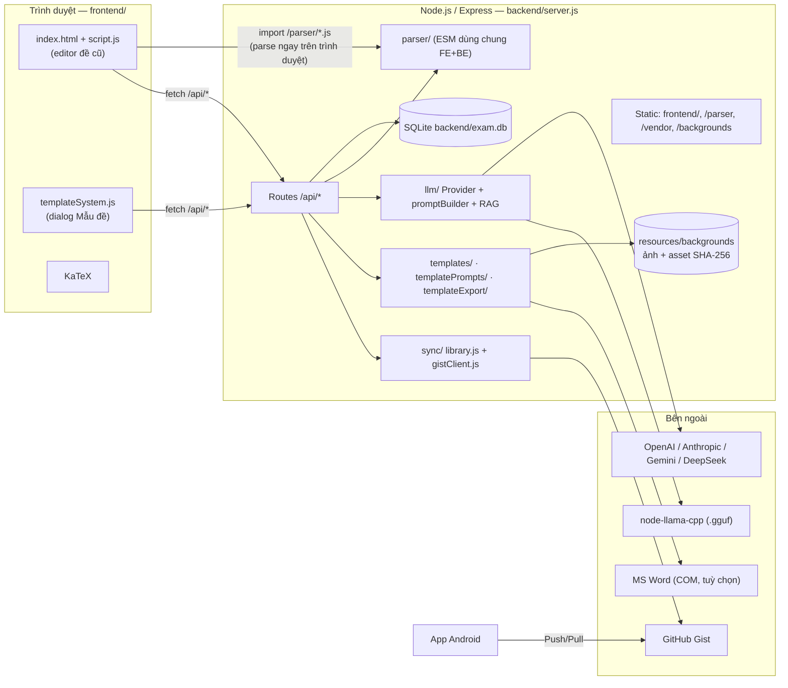
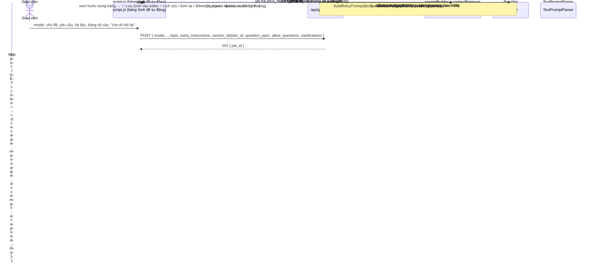
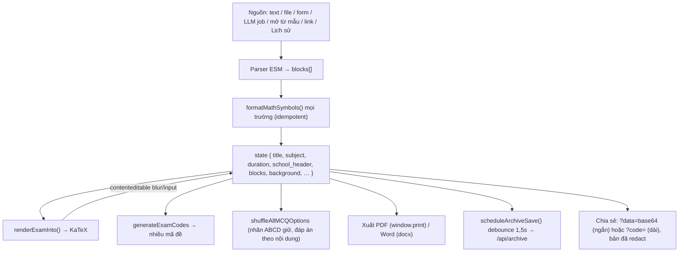
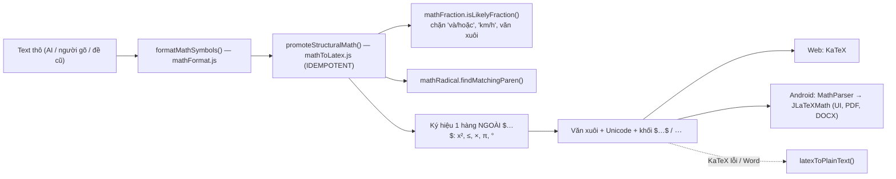
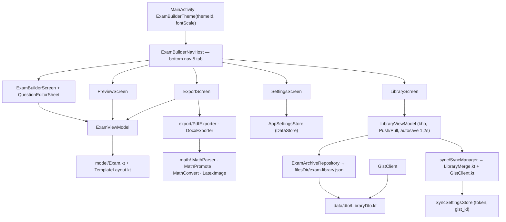
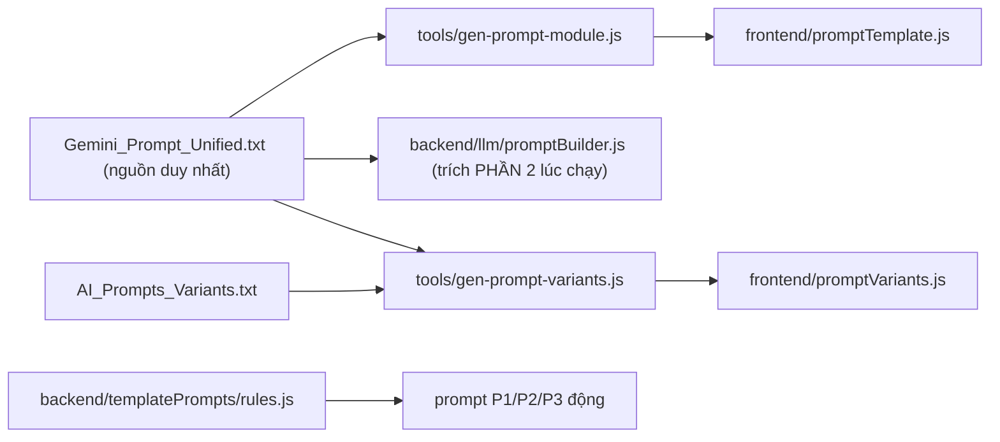

# ExamBuilder — Toàn bộ ngữ cảnh & kiến trúc chi tiết

> Tài liệu tự đủ, dành cho người hoặc AI mới vào dự án: đọc file này là đủ hiểu sản phẩm, kiến trúc, dữ liệu, API, luồng nghiệp vụ, quy ước, trạng thái hiện tại và vấn đề đang mở.
>
> Cập nhật: **14/10/2026** · Nhánh làm việc: `audit/stress-test` (tách từ `feature/chuan-hoa-cong-thuc-toan-latex`) · Nhánh chính: `main`.
> Đối chiếu trực tiếp với mã nguồn tại thời điểm viết, kể cả các thay đổi chưa commit. Tài liệu cũ hơn: [PROJECT_CONTEXT.md](./PROJECT_CONTEXT.md) (11/10), [README.md](./README.md).

---

## Mục lục

1. [Sản phẩm](#1-sản-phẩm)
2. [Tech stack](#2-tech-stack)
3. [Cấu trúc thư mục](#3-cấu-trúc-thư-mục)
4. [Kiến trúc tổng thể](#4-kiến-trúc-tổng-thể)
5. [Backend](#5-backend)
6. [Module LLM & pipeline sinh đề](#6-module-llm--pipeline-sinh-đề)
7. [Template System (Mẫu đề)](#7-template-system-mẫu-đề)
8. [Ảnh nền & tài nguyên](#8-ảnh-nền--tài-nguyên)
9. [Frontend web](#9-frontend-web)
10. [Pipeline chuẩn hoá công thức toán](#10-pipeline-chuẩn-hoá-công-thức-toán)
11. [App Android](#11-app-android)
12. [Mô hình dữ liệu](#12-mô-hình-dữ-liệu)
13. [REST API đầy đủ](#13-rest-api-đầy-đủ)
14. [Các luồng nghiệp vụ](#14-các-luồng-nghiệp-vụ)
15. [Định dạng văn bản đề & hệ thống prompt](#15-định-dạng-văn-bản-đề--hệ-thống-prompt)
16. [Kiểm thử](#16-kiểm-thử)
17. [Quy ước khi sửa code](#17-quy-ước-khi-sửa-code)
18. [Trạng thái hiện tại](#18-trạng-thái-hiện-tại)
19. [Giới hạn & bảo mật](#19-giới-hạn--bảo-mật)
20. [Vấn đề đang mở: giao diện tạo đề khó dùng](#20-vấn-đề-đang-mở-giao-diện-tạo-đề-khó-dùng)

---

## 1. Sản phẩm

**ExamBuilder** giúp **giáo viên Việt Nam** soạn đề kiểm tra nhanh rồi xuất ra PDF/Word. Sản phẩm không có đăng nhập, chạy local trên máy giáo viên, mở là dùng.

| Client | Vị trí | Vai trò |
|---|---|---|
| **Web app** (PC, ứng dụng chính) | `backend/` + `frontend/` | Nhập đề (dán text AI / tải file / form / LLM tự sinh / theo mẫu), xem trước bản GV/HS, sửa trực tiếp, trộn mã đề, xáo đáp án, ảnh nền, xuất PDF/Word, link chia sẻ trong LAN, kho đề, đồng bộ |
| **App Android** (đồng hành, offline) | `Exam builder for adr/` | Soạn, xem trước, xuất PDF/DOCX trên điện thoại, kho đề, Push/Pull |

Hai client trao đổi kho đề qua **một GitHub Gist secret** (file `exambuilder-library.json`).

**Ý tưởng cốt lõi:** chuẩn hoá một **định dạng văn bản đề** (mục 15) để AI nào cũng sinh được (ChatGPT, Claude, Gemini, DeepSeek, Grok…). Parser đọc văn bản đó thành đề có cấu trúc. Vì vậy app luôn có hai đường:
- **Offline / không API key:** copy prompt sang AI ngoài rồi dán kết quả về.
- **Có API key:** app tự gọi LLM.

**Miền nghiệp vụ:**
- 4 loại câu: Trắc nghiệm (MCQ), Đúng/Sai, Điền từ, Tự luận.
- 4 mức độ: Nhận biết (NB), Thông hiểu (TH), Vận dụng (VD), Vận dụng cao (VDC).
- Công thức toán render bằng KaTeX (web) / JLaTeXMath (Android).

**Ngôn ngữ:** UI tiếng Việt có dấu. Comment code và commit message viết tiếng Việt **không dấu**.

---

## 2. Tech stack

| Tầng | Công nghệ |
|---|---|
| Backend | Node.js ≥ 18 (chạy Node 24), Express 4, SQLite (`sqlite` + `sqlite3`), CommonJS |
| Parser dùng chung | ES Modules trong `backend/parser/` (có `package.json` `"type":"module"`), serve tĩnh cho trình duyệt |
| Frontend | HTML/CSS/JS thuần, ES Modules, **không framework, không bundler** |
| Thư viện | `docx` (xuất Word), `mammoth` (đọc .docx), `pdf-parse` (đọc PDF), `katex`, `multer` (upload), `@napi-rs/canvas` (raster ảnh WebP/SVG/PDF → PNG), `node-llama-cpp` (model `.gguf` local) |
| LLM cloud | OpenAI, Anthropic, Gemini, DeepSeek, gọi REST bằng `fetch` (không dùng SDK) |
| Đồng bộ | GitHub Gist API |
| Test | Jest 30 + Supertest; Babel chỉ để Jest đọc ESM |
| Android | Kotlin, Jetpack Compose (Material 3), Navigation-Compose, DataStore, kotlinx-serialization, JLaTeXMath; `minSdk 26`, `targetSdk 36`, version `1.1.0` (code 2) |
| Tiện ích Windows | `Chay_ExamBuilder.bat` (cài deps nếu thiếu, chạy server, mở trình duyệt); `tools/docx-to-pdf.ps1` (Word COM) |

Vendor phục vụ từ `node_modules`, không dùng CDN: `/vendor/docx`, `/vendor/mammoth`, `/vendor/katex`.

---

## 3. Cấu trúc thư mục

```
exam-builder/
├── backend/
│   ├── server.js                 Express app, static, mount routes, errorHandler, /api/network-info
│   ├── database.js               singleton SQLite + schema + migration (EXAM_DB_PATH)
│   ├── examValidation.js         validateExamPayload() cho /exams/save và /archive
│   ├── mutex.js                  withLock() / createLock(): hàng đợi ghi trên 1 kết nối SQLite
│   ├── errorHandler.js           middleware lỗi JSON (có 413 payload quá lớn)
│   ├── network.js                IP LAN cho link chia sẻ
│   ├── parser/  (ESM)            TextPromptParser, FileUploadParser, IQuestionParser,
│   │                             examCodeGenerator, examRedaction, mathFormat, mathToLatex,
│   │                             mathFraction, mathRadical
│   ├── llm/                      ILLMProvider + OpenAI/Anthropic/Gemini/DeepSeek/LocalGguf Provider,
│   │                             ProviderFactory, providerIds, promptBuilder, contextRetriever,
│   │                             errorHint, abort
│   ├── sync/                     library.js (merge thuần), gistClient.js (HTTP)
│   ├── templates/                seeds.js (10 mẫu gốc), repository.js, validation.js, assetManifest.js
│   ├── templatePrompts/          index.js (P1/P2/P3, parse, map slot, diff), rules.js
│   ├── templateExport/           index.js (DOCX theo mẫu), assets.js (ảnh → PNG)
│   ├── documentConvert/          docxToPdf.js (Word COM trên Windows)
│   └── routes/                   exam, archive, sync, generate, settings, model, resource,
│                                 background, template, templatePrompt, templateExport
├── frontend/
│   ├── index.html                layout duy nhất (SPA)
│   ├── script.js     (~2.700 dòng)  editor đề cũ: state, render, nhập, xuất, sinh tự động, kho, sync
│   ├── templateSystem.js (~770 dòng) dialog "Mẫu đề": gallery, editor slot, prompt P1–P3, in theo mẫu
│   ├── examFrames.js             hàm dùng chung mẫu ↔ đề (templateToBlocks, fillTemplateFromBlocks, binding, input xuất DOCX)
│   ├── style.css / templateSystem.css   18 theme, responsive, @media print A4
│   ├── promptTemplate.js         TỰ SINH từ Gemini_Prompt_Unified.txt
│   └── promptVariants.js         TỰ SINH từ AI_Prompts_Variants.txt
├── Exam builder for adr/         dự án Android (Gradle)
├── tests/                        Jest, mirror backend/ (+ tests/audit/ stress test)
├── tools/                        gen-prompt-*.js, export-blueprint.js, smoke-*.cjs, docx-to-pdf.ps1
├── resources/                    backgrounds/ (ảnh nền + asset), image/ (icon, theme)
├── documents/                    tài liệu dự án
├── Gemini_Prompt_Unified.txt     NGUỒN DUY NHẤT của định dạng đề + prompt chuẩn
├── AI_Prompts_Variants.txt       lưu ý/ví dụ riêng cho từng AI
├── PROMPT_HOP_NHAT_CONG_THUC_TOAN.txt   hướng dẫn AI viết công thức
├── prompt_update.txt             nguồn quyết định của Template System (42 câu đã chốt)
└── Chay_ExamBuilder.bat          launcher Windows
```

---

## 4. Kiến trúc tổng thể



**Quyết định thiết kế then chốt:**
1. **Parser là ES Module dùng chung.** `backend/parser/*.js` được serve ở `/parser`, frontend import trực tiếp nên parse được ngay trên trình duyệt, không cần gọi server. Backend dùng lại đúng module đó qua `import()` động từ CommonJS.
2. **Server chỉ làm những việc bắt buộc phải ở server:** lưu bền, gọi LLM (giữ API key phía server), đồng bộ Gist, xử lý file (raster PDF, DOCX theo mẫu).
3. **Một nguồn sự thật cho định dạng đề:** `Gemini_Prompt_Unified.txt`.
4. **Logic port song song Web ↔ Kotlin**, phải đồng bộ từng bước:
   - chuẩn hoá toán: `mathToLatex.js` ↔ `MathPromote.kt`, có vector test chung;
   - merge thư viện: `library.js` ↔ `LibraryMerge.kt`;
   - schema đề: `Exam.kt` / `LibraryDto.kt`.
5. **AI chỉ trả văn bản thuần.** Mọi dữ liệu từ AI đều được parse, validate, ánh xạ rồi người dùng duyệt trước khi áp dụng. AI không tạo ảnh, file hay layout.
6. **App một người dùng.** Job sinh đề lưu trong bộ nhớ; SQLite dùng một kết nối và tuần tự hoá việc ghi bằng mutex.

---

## 5. Backend

### 5.1. Phân tầng

```
server.js
  ├── routes/            tầng HTTP: validate input → gọi domain → JSON { success, ... }
  ├── parser/ (ESM)      domain thuần, không DOM/DB — dùng chung FE/BE
  ├── llm/               adapter LLM (Strategy + Factory)
  ├── templates/ …       domain mẫu đề (thuần) + repository SQLite
  ├── sync/              domain thuần (library.js) + adapter HTTP (gistClient.js)
  ├── examValidation.js  validate đề (kiểu khối/câu/lựa chọn, chặn dữ liệu lạ)
  ├── mutex.js           withLock() chung; createLock() tạo hàng đợi riêng (vd syncLock)
  ├── errorHandler.js    lỗi toàn cục → JSON; 413 khi body > 5 MB
  └── database.js        getDb() giữ promise khởi tạo: mọi request chờ schema + migration xong
```

`server.js` bắt `unhandledRejection` để ghi log thay vì để Node thoát. Lý do: Express 4 không bắt lỗi của handler async.

### 5.2. Design patterns

| Pattern | Ở đâu | Mục đích |
|---|---|---|
| Interface + Open/Closed | `IQuestionParser` → `TextPromptParser`, `FileUploadParser` | Thêm định dạng đầu vào mà không sửa code cũ |
| Strategy + Factory | `ILLMProvider` → 5 provider; `ProviderFactory.createProvider(modelRow, apiKey)`, `listModelsFor()` | Thêm hãng AI = thêm class + đăng ký trong `providerIds.js` |
| Kế thừa adapter | `DeepSeekProvider extends OpenAIProvider` | API tương thích OpenAI, chỉ đổi baseUrl/tham số |
| Delegation | `FileUploadParser`: .txt/.docx → text → `TextPromptParser` | Không lặp logic parse |
| Mutex | `withLock` cho ghi DB; `syncLock` riêng cho Push/Pull | Tránh lồng transaction trên 1 kết nối; sync chậm (do mạng) không chặn việc lưu đề |
| Pure core / thin adapter | `sync/library.js`, `templatePrompts/index.js`, `templates/validation.js` | Test 100% logic không cần mạng/DB |
| Self-correction loop | `generateRoutes.runGeneration` | Sai định dạng hoặc lệch số câu → `buildRetryPrompt`, tổng tối đa 3 lần gọi |
| Async job + polling | `/api/generate/jobs` | Hiện tiến độ, cho Dừng/Huỷ bằng `AbortController` |

### 5.3. Migration

Schema dùng `CREATE TABLE IF NOT EXISTS`. Mọi migration là additive và idempotent. Ví dụ `migrateProviderCheck`: SQLite không sửa được `CHECK`, nên để thêm `deepseek` vào `LLM_SETTINGS`/`LLM_MODEL` phải dựng lại bảng và chép nguyên dữ liệu. Test: `tests/databaseMigration.test.js`.

---

## 6. Module LLM & pipeline sinh đề

### 6.1. Provider

| Provider | Ghi chú |
|---|---|
| `OpenAIProvider` | `fetch` chat completions; **không gửi `temperature`**, vì model reasoning (GPT-5, o-series) trả HTTP 400 nếu nhận tham số này. Có `listModels()` |
| `AnthropicProvider` | Messages API; `listModels()` |
| `GeminiProvider` | REST generateContent; `listModels()` |
| `DeepSeekProvider` | Kế thừa OpenAI, `https://api.deepseek.com`. Model suy luận tính cả phần suy nghĩ vào `max_tokens` nên đặt mức cao; nếu `finish_reason=length` mà nội dung rỗng thì tự thử lại 1 lần bằng `deepseek-chat` |
| `LocalGgufProvider` | `node-llama-cpp` nạp bằng `import()` động, cache session theo file; không huỷ được giữa chừng (bỏ kết quả nếu người dùng đã dừng) |

Mọi provider nhận `{ signal }` để Dừng/Huỷ ngay lập tức. `errorHint.withErrorHint()` thêm gợi ý tiếng Việt cho các lỗi thường gặp (hết credit, sai key, 403/404/429, timeout, mất mạng) mà vẫn giữ thông báo gốc, và không bao giờ chứa key.

### 6.2. Chọn model

`/api/generate` nhận **một trong hai** cách chỉ định model:
- `model_id`: model đã đăng ký trong `LLM_MODEL` (cloud hoặc `.gguf` local);
- `provider` + `model_name`: model cloud "live" lấy từ danh sách của hãng, chỉ cần đã lưu API key.

### 6.3. Prompt (`promptBuilder.js`)

- `buildPrompt({ topic, sectionsContent, questionSpec, extraInstructions, allowQuestions, clarifications })` ghép các phần sau:
  - **PHẦN 2** của `Gemini_Prompt_Unified.txt`, nguyên văn;
  - ngữ cảnh tài liệu;
  - yêu cầu viết tay của giáo viên;
  - bảng số câu (loại × mức độ), đặt cuối và có ưu tiên cao nhất;
  - luật "AI được hỏi lại" kèm các câu hỏi/trả lời trước đó.
- Quy tắc ưu tiên:
  - bảng có số → bảng quyết định cấu trúc;
  - bảng trống → yêu cầu viết tay quyết định số câu;
  - cả hai trống → dùng số câu mặc định của prompt.
- `buildRawPrompt(raw, { sectionsContent })`: dùng cho prompt P1/P2/P3 của mẫu (cả khi sinh theo "Khung đề" ở tab API); có kèm tài liệu tham khảo nếu chọn; trả văn bản thô + `context_info`, không parse.
- `buildRetryPrompt(original, error)`: nhờ AI sửa lỗi định dạng hoặc số câu.

### 6.4. RAG đơn giản (`contextRetriever.selectContext`)

Không dùng embedding, chạy offline.
- Tổng tài liệu ≤ ~60.000 ký tự: gửi nguyên văn.
- Dài hơn: cắt đoạn ~1.200 ký tự, chấm điểm TF-IDF theo từ khoá của chủ đề + yêu cầu (khớp cả có dấu và không dấu), lấy các đoạn điểm cao nhất trong ngân sách, rồi xếp lại theo thứ tự gốc.
- Tick phần nào thì đọc phần đó; không tick phần nào mà chỉ chọn `doc_id` thì đọc toàn bộ tài liệu.

### 6.5. `runGeneration` (dùng chung cho `POST /api/generate` và job)



Mã kết quả:
- `400`: cấu hình sai (thiếu key, bảng số câu sai);
- `404`: không tìm thấy model;
- `499`: người dùng dừng/huỷ;
- `502`: lỗi upstream (có cờ `transient`);
- `422`: vẫn sai định dạng sau 3 lần.

Job lưu trong `Map` ở bộ nhớ, giữ 30 phút sau khi xong. `POST /jobs/:id/cancel` nhận `mode=stop` (giữ yêu cầu để "Tiếp tục") hoặc `mode=cancel` (xoá sạch).

---

## 7. Template System (Mẫu đề)

Đây là hệ thống tách biệt với editor đề cũ, mở bằng nút **Mẫu đề** (dialog do `templateSystem.js` quản lý). Nguồn quyết định là `prompt_update.txt`. Chi tiết nằm ở `TEMPLATE_SYSTEM_*.md`.

### 7.1. Khái niệm

- **Template** = **cấu trúc** (`sections` → `slots`: loại, mức độ, điểm, vùng trả lời) cộng **trình bày** (`appearance`: khổ A4/A5, chiều giấy, lề, font, số cột, header/footer, nền; `pagination`).
- **10 mẫu gốc** `builtin.t01`–`t10` nằm trong code (`seeds.js`), chỉ đọc về cấu trúc nhưng vẫn điền được nội dung. Số câu lần lượt: **6, 11, 14, 19, 20, 5, 10, 4, 12, 11**. Đây là con số do người triển khai chọn, không phải chuẩn bắt buộc.

  | ID | Tên | Cấu trúc |
  |---|---|---|
  | T01 | Đề kiểm tra 15 phút | 4 TN ×0,5 + 2 TL ×4 |
  | T02 | Đề kiểm tra 45 phút | 8 TN + 3 TL |
  | T03 | Đề giữa học kỳ (60') | 12 TN ×0,25 + 2 TL ×3,5 |
  | T04 | Đề cuối học kỳ (90') | 16 TN + 3 TL |
  | T05 | 100% trắc nghiệm | 20 TN |
  | T06 | 100% tự luận | 5 TL |
  | T07 | Kết hợp nhiều dạng | 4 TN + 2 Đ/S + 2 điền + 2 TL |
  | T08 | Toán, nhiều vùng lời giải | 4 TL (ô ly / vùng vẽ) |
  | T09 | Hai cột tiết kiệm giấy | 10 TN (2 cột) + 2 TL |
  | T10 | Ngoại ngữ có đọc hiểu | đọc hiểu + từ vựng + điền + viết |

- **Bản sao (clone)** của người dùng lưu trong `TEMPLATE` + `TEMPLATE_VERSION`. Bản sao được sửa cấu trúc tuỳ ý và có phiên bản riêng.
- **Điểm** lưu dạng chuỗi thập phân 2 chữ số; validator cộng theo đơn vị 0,01. Có nút "Chia đều điểm theo thang điểm đề": phần dư cộng dồn vào các câu cuối.
- ID ổn định: `builtin.t01.s01.q001` (slot), `builtin.t01.s01` (phần).

### 7.2. Prompt động P1/P2/P3 (`templatePrompts/`)

- **P1 FULL_EXAM**: sinh toàn đề theo đúng slot.
- **P2 SELECTED_SLOTS**: chỉ sinh các slot được chọn.
- **P3 REVIEW_REPAIR**: kiểm tra hoặc sửa các câu chọn. Các hành động: `rewrite-one`, `regenerate`, `increase-difficulty`, `decrease-difficulty`, `improve-solution`, `restyle-keep-answer`, `validate-only` (trả báo cáo JSON riêng).
- Có 5 biến thể theo AI: ChatGPT, Claude, Gemini, DeepSeek, Grok.
- Cú pháp `template-text-v1` = cú pháp v1 thêm `Ma_Khung`, `Ma_Phan`, `Diem`.
- Luồng: copy prompt → AI ngoài, **hoặc** gửi qua API của app (job với `raw_prompt`) → dán/nhận text → `prepareTemplateApply` (parse, validate, ánh xạ theo ID, so điểm, phát hiện đổi đáp án) → **diff** → người dùng Apply/Cancel/Undo.
- Nguyên tắc: không ghi đè slot không được chọn, không nhập câu thừa, không cho AI sửa điểm.

### 7.3. Lưu & xuất

- Đề làm từ mẫu mang theo `template_binding` = `{ schema_version, template_id, template_version, template_snapshot, asset_manifest }`, tối đa 1 MiB, đi qua archive và Gist.
- "Mở trong trình soạn đề" chuyển nội dung slot sang editor cũ, giữ nguyên thứ tự A–D và điểm.
- Xuất DOCX theo mẫu (`templateExport/index.js`):
  - 4 chế độ: HS / GV / đáp án / gộp;
  - khổ A4/A5, chiều giấy, lề, header/footer theo `appearance`, số trang, hai cột (T09), đoạn đọc (T10);
  - nhúng nền làm PNG (độ mờ được trộn sẵn), mỗi trang một Word section khi có nền theo trang;
  - slot có vùng toạ độ trên nền được đặt thành ảnh PNG overlay; tràn vùng thì quay lại luồng văn bản và cảnh báo;
  - `MAX-PAGES` chỉ cảnh báo, không cắt nội dung;
  - LaTeX được làm phẳng bằng `latexToPlainText`.
- PDF dùng hộp thoại in của trình duyệt.

---

## 8. Ảnh nền & tài nguyên

`backgroundRoutes.js`; thư mục đổi được qua `EXAM_BACKGROUNDS_DIR` / `EXAM_TEMPLATE_ASSETS_DIR`.

- `GET /api/backgrounds`: mảng tên file, dùng cho dropdown "Nền PDF" của editor cũ.
- `POST /upload`: ảnh PNG/JPG/WebP/SVG ≤ 20 MB. Kiểm tra magic bytes; SVG chỉ cho phép một tập phần tử/thuộc tính hạn chế. File đặt tên theo SHA-256, kèm metadata JSON.
- `POST /import` (`mode=background|structure`): nhận DOCX/PDF.
  - DOCX: kiểm tra ZIP (≤ 2.000 entry, ≤ 50 MB sau giải nén).
  - PDF: ≤ 100 trang.
  - `background`: PDF được raster thành PNG rộng 960 px mỗi trang (mỗi ảnh ≤ 2 MB, tổng ≤ 12 MB). DOCX được chuyển sang PDF qua Word COM (chỉ trên Windows); thiếu Word thì giữ file gốc và trả cảnh báo.
  - `structure`: trả `raw_text` cùng gợi ý phần/câu độ tin cậy thấp, bắt buộc người dùng duyệt.
  - **Không có OCR.**
- Editor cũ:
  - mỗi đề có `background = { file, opacity 0.05–1, fit cover|contain }`; tâm ảnh luôn trùng tâm tờ A4;
  - nút "👁 Xem nền" hiện trang mẫu kèm % ảnh bị cắt;
  - nút "📌 Áp nền vào đề & lưu" gắn nền vào đề đang mở.
- In PDF có nền phụ thuộc tuỳ chọn "Background graphics" của trình duyệt.

---

## 9. Frontend web

### 9.1. Module

| File | Vai trò |
|---|---|
| `index.html` (~660 dòng) | Toàn bộ layout + modal |
| `script.js` (~2.700 dòng) | Editor đề cũ. Các khối theo thứ tự: tabs · nền PDF · khu Prompt mẫu · tab Form · tải file/PDF · sinh đề (parse) · render · toolbar (chế độ HS, zoom) · trộn mã đề · xuất PDF (print) · xuất Word (`docx`) · chia sẻ · sinh đề tự động (job, hỏi lại, xem trước) · cài đặt giao diện · thư viện tài liệu · nạp đề từ link · kho đề (autosave) · đồng bộ Gist |
| `templateSystem.js` | Dialog Mẫu đề, tách biệt state (`ui = { template, selected, templates, dirty, draft }`); chỉ nút "Mở trong trình soạn đề" chuyển dữ liệu sang editor cũ |
| `style.css` | 18 theme `[data-theme]`, biến `--ui-scale`, responsive, `@media print` A4 |

### 9.2. State → DOM (editor cũ)



- **An toàn hiển thị:** nội dung từ người dùng hoặc AI luôn chèn bằng `textContent`; chỉ dùng `innerHTML` cho output của KaTeX (`trust:false`).
- Câu hỏi đánh số liên tục 1..N trên toàn đề. Hiện điểm câu/phần khi câu có `points`.
- **Chế độ Học sinh** ẩn đáp án và lời giải. Link chia sẻ dùng `redactExamForStudent`, nên dữ liệu đáp án không bao giờ được gửi xuống client.
- Link chia sẻ dùng IP LAN (`/api/network-info`) để máy khác trong cùng Wi-Fi mở được.
- Theme và cỡ chữ lưu ở `localStorage` (`eb_theme`, `eb_uiScale`), được áp trước khi vẽ để không nháy màu.

### 9.3. Kiểm kê giao diện hiện tại (quan trọng cho mục 20)

| Khu vực | Thành phần |
|---|---|
| **Toolbar** (9 nút) | Chế độ HS · A−/A+ · 🔀 Xáo đáp án · Tạo link chia sẻ · Xuất PDF · Xuất Word · 💾 Lưu đề · 📚 Lịch sử · Mẫu đề · ⚙️ Cài đặt |
| **Khung nhập — Nền PDF** (6 điều khiển) | công tắc · chọn nền · ⬆️ Tải ảnh nền · cách đặt · 👁 Xem nền · độ mờ · 📌 Áp nền vào đề & lưu |
| **Khung nhập — 4 tab** | *Dán văn bản* (textarea + nút copy prompt nhờ AI chuyển định dạng) · *Tải file* (.txt/.docx/.pdf có chữ) · *Nhập Form* (loại, mức độ, đề bài, A–D, đáp án Đ/S, lời giải, thêm/sửa từng câu) · *Sinh đề tự động* (nút mở bảng lớn) |
| **Bảng Sinh đề tự động** (gọn lại 14/10) | Model · **Khung đề** (Đề tự do / T01–T10 / Mẫu của tôi) · Chủ đề · Yêu cầu cho AI · Tài liệu + nút "📚 Quản lý tài liệu" (dialog riêng) · mục gập "Phần tài liệu AI đọc" · **thẻ tóm tắt cấu trúc** (theo mẫu / theo bảng / theo yêu cầu) · bảng 16 ô gập sau "📊 Chỉnh số câu chi tiết" (ẩn khi chọn mẫu) · "Tùy chọn khác" (Tên đề) · công tắc "Cho AI hỏi lại" · Sinh / Dừng / Tiếp tục / Huỷ · tiến độ · hỏi đáp AI · xem trước + Lưu / Sinh lại / Bỏ |
| **Nút chính** | "Sinh Đề Kiểm Tra" (parse text/form/file) — khác với nút "🚀 Sinh đề" trong bảng tự động |
| **Trộn mã đề** (thu gọn) | Số mã · số bắt đầu · tiền tố · Tạo Mã Đề |
| **Preview** | đề A4 sửa trực tiếp (contenteditable) |
| **Cuối trang** | "Prompt mẫu cho AI": chọn 6 AI, Copy Prompt, Copy Ví dụ, bảng loại câu hỗ trợ |
| **Modal** | Chia sẻ · Cài đặt (18 theme, cỡ chữ, 4 API key, upload .gguf) · Lịch sử (danh sách đề, Push/Pull, token, Gist ID) · Mẫu đề (gallery, editor slot, inspector, prompt P1–P3, nền, xuất) |

---

## 10. Pipeline chuẩn hoá công thức toán

Mục tiêu: mọi cấu trúc toán hai chiều (căn, phân số, căn bậc n, luỹ thừa chồng…) đều được đưa về LaTeX `$...$` rồi render bằng KaTeX/JLaTeXMath, dù AI viết dạng ASCII (`sqrt(3)`, `1/2`, `√(x+1)`) hay LaTeX. Renderer "căn/phân số giả bằng CSS" **đã bị bỏ hoàn toàn**.



**Bất biến:**
- Hàm chuẩn hoá phải idempotent. Nó được gọi khi parse, khi nạp đề cũ, sau mỗi lần sửa một trường và khi render.
- Không bao giờ chạm vào bên trong khối `$…$` có sẵn.
- `MathPromote.kt` phải đồng bộ từng bước với `mathToLatex.js`, chạy chung bộ vector `tests/parser/mathPromoteVectors.json` (Jest + JUnit).

---

## 11. App Android

Kiến trúc MVVM, một module `app`, không phụ thuộc server.



- Kho đề là file JSON (không dùng Room), khớp 1:1 với file Gist.
- PDF xuất bằng `android.graphics.pdf.PdfDocument`; DOCX tự ghi OOXML; công thức được nhúng dạng ảnh.
- Giữ `template_binding` và áp khổ giấy/điểm/vùng trả lời. **Nền và hai cột trên Android chưa làm.**
- 11 theme với mã hex đồng bộ với `style.css`.
- Build: Gradle 8.14.3, JDK 24. `gradle.properties` có `android.overridePathCheck=true` vì đường dẫn chứa ký tự không phải ASCII. Release ký bằng `keystore.properties` (không commit).
- Test: `MathPromoteTest`, `TemplateLayoutTest`, `TemplateBindingDtoTest`, `LibraryMergeTest` (mới, chưa commit).

---

## 12. Mô hình dữ liệu

### 12.1. SQLite (`backend/database.js`)

`PRAGMA foreign_keys = ON`, dùng `ON DELETE CASCADE` và `CHECK` cho các enum.

| Nhóm | Bảng | Ghi chú |
|---|---|---|
| Đề chia sẻ (3NF) | `EXAM` → `QUESTION_BLOCK` → `QUESTION` → `QUESTION_OPTION`; `EXAM_SHARE` (share_code, expires_at, is_active) | Phục vụ link `?code=` |
| Kho đề + đồng bộ | `SAVED_EXAM` (`payload_json`, `updated_at`, `deleted_at` = tombstone); `SYNC_SETTINGS` (1 dòng: token, gist_id, last_synced_at) | Khớp 1:1 với Gist |
| LLM | `LLM_SETTINGS` (provider → api_key; provider ∈ openai, anthropic, gemini, deepseek); `LLM_MODEL` (cloud \| local_gguf) | Key lưu plaintext |
| Tài liệu tham khảo | `RESOURCE_DOCUMENT` → `RESOURCE_SECTION`; `RESOURCE_HISTORY` (không FK, giữ 200 dòng) | Ngữ cảnh RAG |
| Mẫu đề | `TEMPLATE` (current_version, deleted_at); `TEMPLATE_VERSION` (payload_json) | Chỉ chứa bản của người dùng; seed nằm trong code |

### 12.2. Hình dạng đề (dùng chung: parser, state, archive, Gist, Android)

```json
{
  "exam_id": "uuid", "title": "…", "subject": "…", "duration_minutes": 45, "school_header": "…",
  "blocks": [{
    "block_type": "MULTIPLE_CHOICE | ESSAY",
    "block_title": "…",
    "questions": [{
      "question_type": "MCQ | TRUE_FALSE | FILL_BLANK | ESSAY",
      "difficulty_level": "NB | TH | VD | VDC",
      "content": "Tính $\\frac{1}{2} + \\sqrt{3}$",
      "options": [{ "option_key": "A", "option_text": "…", "is_correct": true }],
      "correct_answer": "A",
      "explanation": "…",
      "draft_lines_count": 0,
      "points": "0.50"
    }]
  }],
  "background": { "file": "abc.png", "opacity": 0.12, "fit": "cover" },
  "template_binding": { "schema_version": 1, "template_id": "…", "template_version": 1, "template_snapshot": {}, "asset_manifest": [] },
  "updated_at": "ISO", "deleted_at": null
}
```

`is_correct` luôn được suy ra từ `correct_answer`. Đây là bài học từ một lỗi nghiêm trọng: trước đây xáo đáp án làm sai đáp án đúng.

### 12.3. File Gist `exambuilder-library.json`

```json
{ "schema": "exambuilder/library@1", "updated_at": "ISO", "exams": [ /* đề như trên */ ], "theme": { "theme_id": "ocean", "updated_at": "ISO" } }
```

---

## 13. REST API đầy đủ

Mọi response có dạng `{ success: boolean, ..., error?: string }`. Body JSON tối đa 5 MB.

| Method | Path | Chức năng |
|---|---|---|
| POST | `/api/exams/save` | Lưu đề 3NF (transaction, validate) → `exam_id` |
| GET | `/api/exams/:exam_id` | Đọc đề |
| POST | `/api/exams/share` | Tạo `share_code` (8 hex; `expires_in_days` 0–3650) |
| DELETE | `/api/exams/share/:code` | Thu hồi link |
| GET | `/api/exams/shared/:code` | Đọc đề theo link (**đã redact đáp án**) |
| GET | `/api/archive` | Liệt kê kho đề (ẩn tombstone) |
| GET | `/api/archive/:exam_id` | Payload đầy đủ (gồm `background`, `template_binding`) |
| POST | `/api/archive` | Upsert. Client cũ không gửi `background`/`template_binding` thì giữ giá trị cũ; không hồi sinh đề đã xoá |
| DELETE | `/api/archive/:exam_id` | Xoá mềm |
| GET/POST | `/api/sync/settings` | Token + Gist ID (token luôn bị che khi đọc) |
| POST | `/api/sync/push` · `/api/sync/pull` | Đồng bộ Gist (xem 14.5) |
| GET/POST | `/api/settings/llm` | Đọc (đã che) / lưu API key |
| POST | `/api/settings/llm/test` | Thử kết nối một model |
| POST | `/api/settings/llm/models` | Danh sách model live của hãng |
| GET | `/api/models` | Model đã đăng ký |
| POST | `/api/models/cloud` · `/api/models/local` | Đăng ký model cloud / upload `.gguf` |
| DELETE | `/api/models/:id` | Xoá model (+ file local) |
| GET/POST/DELETE | `/api/resources[/:doc_id]` | Tài liệu tham khảo |
| POST | `/api/resources/:doc_id/sections` · `/sections/upload` | Thêm phần (nhập tay / file .txt .docx .pdf ≤ 20 MB) |
| POST | `/api/resources/extract-pdf-text` | Trích lớp chữ PDF (cho tab Tải file) |
| GET | `/api/resources/history` | Lịch sử thao tác thư viện |
| POST | `/api/generate` | Sinh đề đồng bộ |
| POST | `/api/generate/jobs` | Tạo job sinh đề → 202 `job_id` |
| GET | `/api/generate/jobs/:id` | Tiến độ + kết quả |
| POST | `/api/generate/jobs/:id/cancel` | `mode=stop\|cancel` |
| GET | `/api/backgrounds` · `/assets` · `/assets/:id/file` | Ảnh nền / asset |
| POST | `/api/backgrounds/upload` · `/import` | Upload ảnh / import DOCX-PDF |
| GET | `/api/templates` · `/:id` | Danh sách (seed + bản sao) / chi tiết |
| POST | `/api/templates` · `/validate` · `/:id/clone` | Tạo / kiểm tra / clone |
| PUT / DELETE | `/api/templates/:id` | Sửa (kèm version mong đợi) / xoá |
| POST | `/api/template-prompts/build` | Dựng prompt P1/P2/P3 |
| POST | `/api/template-prompts/prepare` | Parse + validate + map + diff kết quả AI |
| POST | `/api/template-prompts/review-report` | Parse báo cáo P3 validate-only |
| POST | `/api/template-export/analyze` · `/docx` | Phân tích trang / xuất DOCX theo mẫu |
| GET | `/api/network-info` | Cổng + IP LAN |

Static: `/` (frontend), `/parser/*`, `/vendor/{docx,mammoth,katex}/*`, `/backgrounds/*`.

---

## 14. Các luồng nghiệp vụ

### 14.1. Dán đề từ AI ngoài (luồng gốc, không cần key)
1. Ở khu "Prompt mẫu", chọn AI rồi Copy Prompt; thay chủ đề và dán vào AI.
2. Copy kết quả, dán vào tab "Dán văn bản", bấm "Sinh Đề Kiểm Tra".
3. Parser chạy trên trình duyệt → chuẩn hoá toán → render → tự lưu vào Lịch sử.
4. Nếu dán sai định dạng: nút "Copy prompt nhờ AI chuyển sang đúng định dạng" (prompt kèm sẵn nội dung đã dán).

### 14.2. Tải file
`.txt`/`.docx` đi qua `FileUploadParser`. PDF có lớp chữ được trích qua server rồi parse. PDF scan báo rõ là không có OCR và đưa nút copy prompt để nhờ AI ngoài đọc.

### 14.3. Sinh đề tự động bằng LLM
Xem mục 6.5.

### 14.4. Theo mẫu
Mẫu đề → chọn mẫu → điền metadata → prompt P1/P2/P3 (copy hoặc qua API) → dán kết quả → diff → Apply → xuất DOCX theo mẫu, hoặc "Mở trong trình soạn đề".

### 14.5. Trộn mã đề & xáo đáp án
- `generateExamCodes`: nhóm câu theo (loại × mức độ), xáo Fisher-Yates, chia quota `floor(total/q)` mỗi nhóm cho q mã. Tỉ lệ độ khó đều giữa các mã, không trùng câu cho tới khi hết nguồn, A–D xáo độc lập từng mã.
- Xuất PDF/Word gồm tất cả mã đề, mỗi mã ngắt trang.
- 🔀 Xáo đáp án: nhãn ABCD giữ nguyên thứ tự, nội dung đổi chỗ, đáp án đúng đi theo nội dung.

### 14.6. Chia sẻ
- Đề ngắn: `?data=<base64>`, không cần server.
- Đề dài: `/exams/save` → `/exams/share` → `?code=`, có thể thu hồi.
- Cả hai đường đều dùng bản đã redact và mở thẳng vào chế độ Học sinh.
- Chỉ mở được trong cùng mạng LAN; khác mạng thì chưa hỗ trợ.

### 14.7. Đồng bộ PC ↔ Android (`mergeLibraries`)
- Hợp nhất theo `exam_id`. Khi trùng id: **bản mới hơn thắng** theo mốc thời gian (`updated_at`/`deleted_at`); hoà thì bên chính thắng (Push: local, Pull: cloud).
- Mốc thời gian ở tương lai quá 24 giờ bị kẹp về "bây giờ" (chống lệch đồng hồ). Mốc sai định dạng tính là 0.
- Xoá = tombstone. Tombstone > 90 ngày được dọn **sau khi** merge, để bản cũ trên cloud không "hồi sinh" đề đã xoá.
- Theme đồng bộ theo "lần đổi gần nhất thắng"; cỡ chữ không đồng bộ.
- Push/Pull xếp hàng qua `syncLock` riêng, nên việc lưu đề không bị chặn trong lúc chờ mạng.
- `LibraryMerge.kt` phải giữ đúng logic này.

---

## 15. Định dạng văn bản đề & hệ thống prompt

### 15.1. Cú pháp v1 (`TextPromptParser`)

```
=PHAN_1_TRAC_NGHIEM=

[CAU_HOI]
Loai: TN
Muc_Do: Nhan_Biet
De_Bai: Kết quả của phép tính (-5) + 3 là bao nhiêu?
A. -2
B. 2
C. -8
D. 8
Dap_An: A
Loi_Giai: (-5) + 3 = -2

=PHAN_2_TU_LUAN=

[CAU_HOI]
Loai: TU_LUAN
Muc_Do: Van_Dung
De_Bai: Giải phương trình $x^2 - 5x + 6 = 0$.
Dap_An: x = 2 hoặc x = 3
Loi_Giai: ...
So_Dong_Nhap: 6
```

- `Loai`: `TN` \| `DUNG_SAI` \| `DIEN_TU` (chỗ trống `___`) \| `TU_LUAN` (chỉ ở Phần 2).
- `Muc_Do`: `Nhan_Biet` \| `Thong_Hieu` \| `Van_Dung` \| `Van_Dung_Cao` (không phân biệt hoa/thường).
- Lỗi parse báo kèm vị trí "Phần X – Câu Y".
- AI được hỏi lại người dùng bằng khối `[HOI_NGUOI_DUNG]…[/HOI_NGUOI_DUNG]` (chỉ khi không có `[CAU_HOI]` nào).
- Template dùng thêm `Ma_Khung`, `Ma_Phan`, `Diem` (`template-text-v1`).

### 15.2. Nguồn prompt → file sinh tự động



Sau khi sửa bất kỳ file `.txt` nào, chạy `npm run gen:prompt`. Test `promptTemplate.test.js` / `promptVariants.test.js` kiểm tra file sinh ra khớp nguồn.

---

## 16. Kiểm thử

```bash
npm test -- --runInBand     # ~40 suite / 520+ test (lần ghi nhận gần nhất: 40 suite, 521 test đạt)
npm run test:coverage       # coverage backend/
```

- `tests/` có cấu trúc mirror `backend/`: `parser/`, `llm/`, `routes/`, `sync/`, `templates/`, `templatePrompts/`, `templateExport/`, cộng `database*.test.js`, `errorHandler`, `network`.
- Test API dùng SQLite in-memory (`EXAM_DB_PATH=:memory:`) và gọi `closeDb()` sau mỗi test. Provider LLM được test bằng `fetch` giả, không gọi mạng.
- `*.adversarial.test.js` và **`tests/audit/`** (mới, chưa commit): parser DoS, route adversarial (prototype pollution, mass assignment, payload lớn, kiểu dữ liệu lạ), xung đột và race của sync.
- `syncFlow.e2e.test.js`: 2 "thiết bị" (2 DB) đồng bộ qua một Gist giả lập.
- Smoke trình duyệt: `tools/smoke-template-ui.cjs`, `smoke-docx-overlay.cjs`, `smoke-pdf-background-import.cjs` (Chrome headless, dùng DB/thư mục tạm).
- Android: `./gradlew testDebugUnitTest`.

---

## 17. Quy ước khi sửa code

1. **Không sửa tay** `frontend/promptTemplate.js`, `frontend/promptVariants.js`, `documents/PROJECT_BLUEPRINT.md`. Sửa nguồn rồi chạy script sinh.
2. Định dạng đề chỉ sửa ở `Gemini_Prompt_Unified.txt`. Nếu đổi cú pháp thì cập nhật `TextPromptParser` + test + chạy `gen:prompt`.
3. **Giữ đồng bộ Web ↔ Kotlin:**
   - `mathToLatex.js` ↔ `MathPromote.kt` (thêm vector test);
   - `sync/library.js` ↔ `LibraryMerge.kt`;
   - schema đề ↔ `Exam.kt` + `LibraryDto.kt`.
4. Hàm chuẩn hoá toán phải idempotent và không chạm vào khối `$…$` có sẵn.
5. Nội dung từ người dùng/AI → `textContent`; `innerHTML` chỉ dành cho output KaTeX.
6. SQL luôn tham số hoá bằng `?`. Transaction ghi phải bọc `withLock`.
7. API key / token không bao giờ trả đầy đủ về client và không xuất hiện trong log hay test.
8. Backend dùng CommonJS, riêng `backend/parser/` là ESM. Comment viết tiếng Việt **không dấu**; UI/tài liệu viết có dấu.
9. Response luôn có dạng `{ success, ... }`.
10. Migration chỉ được additive và idempotent; đề cũ (v1, không có template/background) phải mở, sửa, xuất, sync được bình thường.
11. AI chỉ trả văn bản; mọi thay đổi từ AI phải qua validate và để người dùng xác nhận.
12. Commit message tiếng Việt không dấu, dạng `TASK X: ...` cho các đợt việc lớn.

---

## 18. Trạng thái hiện tại

**Đã xong (có test):**
- Chuẩn hoá toán web + Kotlin.
- Prompt theo từng AI.
- Model cloud live; DeepSeek.
- Job sinh đề có tiến độ, Dừng/Huỷ, AI hỏi lại, xem trước rồi mới Lưu.
- RAG đơn giản; thư viện tài liệu có lịch sử.
- Template System M1–M7 (10 mẫu, editor, P1/P2/P3, diff/Undo, import nền, DOCX theo mẫu).
- Ảnh nền cho đề cũ; xáo đáp án; điểm câu; link chia sẻ LAN; redact đáp án.

**Đang làm trên nhánh `audit/stress-test` (chưa commit):**
- Siết `examValidation` (kiểu khối/câu/lựa chọn), lỗi 413.
- `createLock` + `syncLock` riêng.
- Archive giữ `background`/`template_binding` khi client cũ không gửi; không hồi sinh tombstone.
- Merge sync theo mốc thời gian, có kẹp lệch đồng hồ, dedupe, `parseLibraryStrict`, dọn tombstone sau khi merge (web + Kotlin).
- `mathToLatex.js` / `MathPromote.kt` chỉnh đồng bộ.
- Test mới: `tests/audit/`, `LibraryMergeTest.kt`.

**Chưa xong / còn mở:**
- Android: nền + hai cột; QA trên thiết bị thật.
- Chưa smoke DeepSeek/OpenAI bằng key thật.
- Link chia sẻ khác mạng (cần tunnel/hosting).
- "Ghép nền bằng AI": chờ chủ dự án quyết, vì trái nguyên tắc "AI không sinh ảnh".
- Ý tưởng lớn: cho học sinh làm bài online. Cần xác thực, phiên thi, bảng bài làm, chấm tự động TN/Đ-S/Điền, và tách bản đề HS ở server.
- **Thiết kế lại UX tạo đề** (mục 20).

---

## 19. Giới hạn & bảo mật

- Không có xác thực: chỉ phù hợp chạy local hoặc trong LAN tin cậy.
- API key LLM và token GitHub lưu **plaintext** (SQLite / DataStore).
- Gist "secret" không được mã hoá: ai có URL đều đọc được toàn bộ đề kèm đáp án. Chỉ nên dùng token có quyền `gist`.
- `Document.txt` (ghi chú cá nhân có token) đã nằm trong `.gitignore`. Không đưa token vào tài liệu hay commit.
- Không OCR; không hỗ trợ `.xlsx`.
- Model `.gguf` cần RAM lớn (7B Q4 ~4–5 GB) và chạy CPU chậm.
- Chuyển DOCX → nền chỉ chạy trên Windows có MS Word.
- Android: đồng bộ thủ công bằng 2 nút; xung đột giải quyết theo cả đề; đề đang soạn có thể mất nếu app bị kill trước khi autosave.
- `npm audit`: còn lỗ hổng trong chuỗi build native của `sqlite3` (chỉ ảnh hưởng lúc build).

---

## 20. Vấn đề đang mở: giao diện tạo đề khó dùng

**Phản hồi của chủ dự án:** giao diện tạo đề khó dùng; muốn chuyển gần như toàn bộ thao tác sang **nhập bằng prompt (ngôn ngữ tự nhiên)**.

**Nguyên nhân quan sát được (xem 9.3):**
- **5 điểm bắt đầu** tạo đề: 4 tab + nút Mẫu đề. Có **2 nút "Sinh đề"** khác nhau.
- Bảng sinh tự động có ~10 trường, cộng 16 ô số và trình quản lý tài liệu nằm lẫn bên trong.
- Phần ảnh nền (6 điều khiển) và trộn mã đề nằm chung khung nhập, dù đây là việc làm sau khi đã có đề.
- Toolbar 9 nút; khu prompt mẫu dài ở cuối trang.
- Editor cũ và Template System là hai thế giới tách biệt, chỉ nối nhau qua "Mở trong trình soạn đề".

**Đã làm (14/10/2026), theo phạm vi chủ dự án chốt:**
- Giữ nguyên: khu Prompt mẫu, Nền PDF, 4 tab nhập, Trộn mã đề, toolbar 9 nút, bước xem trước + Lưu của luồng API, P1/P2/P3 + cài đặt trang trong dialog Mẫu đề.
- Bảng Sinh đề tự động gọn lại (xem 9.3); thư viện tài liệu thành dialog riêng, thông báo hiện ngay trong dialog.
- **Khung đề** trong tab API: chọn mẫu → `/api/template-prompts/build` (P1, biến thể AI theo hãng của model) → job `raw_prompt` (kèm tài liệu) → `/api/template-prompts/prepare` ghép vào slot → xem trước → Lưu (giữ thứ tự A–D, gắn `template_binding`).
- Dialog Mẫu đề bỏ khung "Gửi qua API" và "Tải DOCX" (còn "In / Lưu PDF" theo mẫu).
- Nút **Xuất Word** ở trang chính: đề có `template_binding`, không trộn mã, còn đủ câu của mẫu → hỏi bản in (HS / GV / Đáp án riêng / Đề + đáp án cuối) và xuất qua `/api/template-export/docx`; còn lại xuất kiểu thường.
- Chưa làm: "Sửa bằng AI" từng câu; A5 / 2 cột / đáp án cuối file cho đề tự do (chờ xác nhận).

**Hướng dài hạn từng cân nhắc** (chưa triển khai):
1. Một **ô prompt / chat** làm điểm vào chính. Form cũ chuyển vào mục "Nâng cao".
2. **LLM chỉ lập kế hoạch, code hiện có thực thi.** Thêm endpoint mới (ví dụ `POST /api/assistant/plan`) trả JSON gồm danh sách action: `generate`, `apply_template`, `set_background`, `make_codes`, `shuffle`, `edit_question`, `export`. Frontend gọi lần lượt các route sẵn có (`/api/generate/jobs`, `/api/template-prompts/*`, `examCodeGenerator`, `/api/template-export/docx`…).
3. **Thẻ xác nhận dạng chip** sửa được (Lớp 9 · 45' · 12 câu · Mẫu T03 · 4 mã · Word). Thiếu thông tin thì dùng lại cơ chế `[HOI_NGUOI_DUNG]` đã có.
4. **Sửa đề bằng lệnh** trên câu đang chọn ("câu 3 khó hơn", "đổi câu 5 thành tự luận"). Có thể tái sử dụng P3 `REPAIR_INTENTS` cùng diff/Undo của Template System.
5. Không có API key: gói luồng copy prompt → AI ngoài → dán thành 2 bước ngay trong ô chat.
6. Gọn toolbar: Lưu · Xuất (PDF/Word/Link) · Lịch sử; các thao tác còn lại vào menu "⋯" hoặc gọi bằng lệnh.

**Ràng buộc khi thiết kế lại:**
- Không phá luồng offline (copy/dán).
- Model local yếu vẫn phải dùng được, nên kế hoạch JSON cần validate chặt và có fallback sang form.
- Giữ nguyên các nguyên tắc ở mục 17: AI chỉ trả text, người dùng duyệt trước khi áp dụng, không lộ đáp án ở bản HS.
- Không cần thay stack (vẫn JS thuần).
