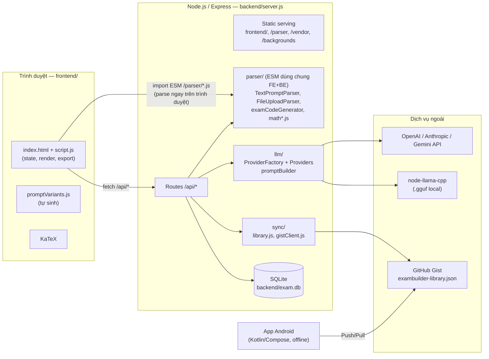
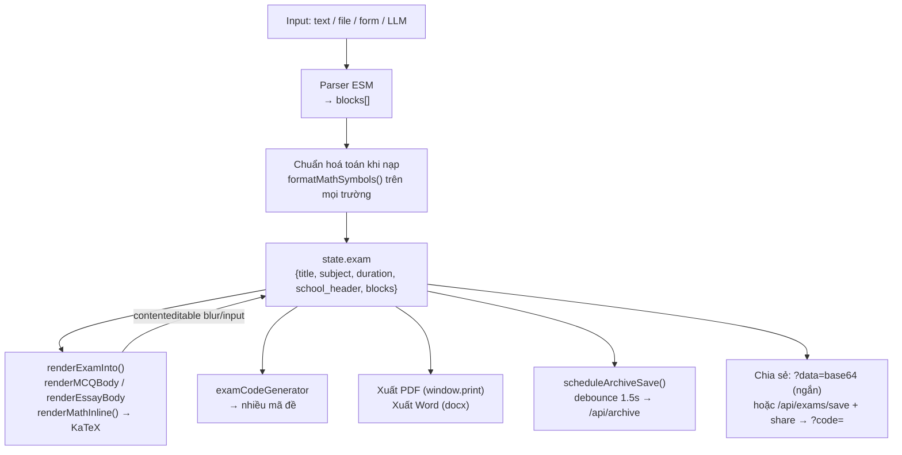
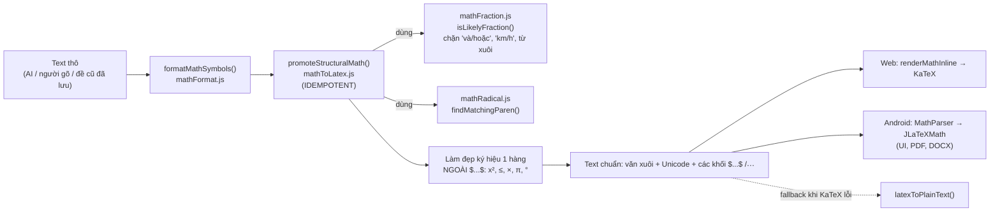
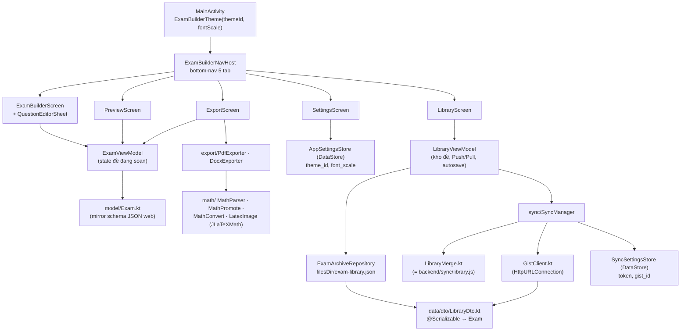
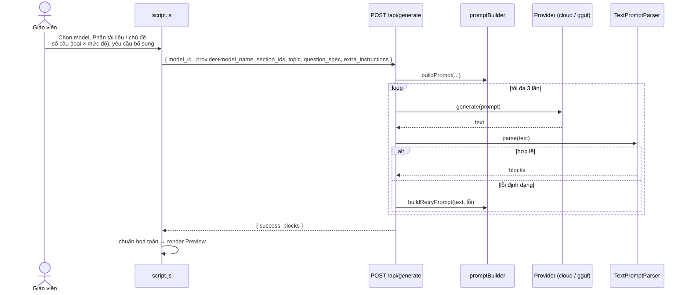
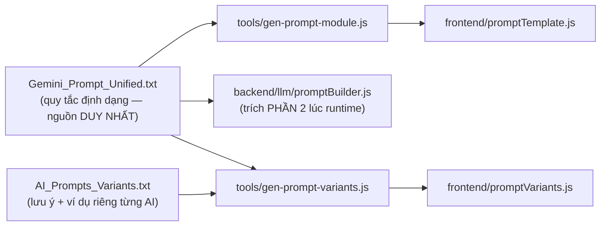

# ExamBuilder — Full Project Context

> Tài liệu "một chỗ đọc là hiểu" cho người (hoặc AI) mới vào dự án: mục tiêu, kiến trúc, luồng dữ liệu,
> quy ước code, trạng thái hiện tại và hướng phát triển.
> Chi tiết sâu hơn: [README.md](./README.md) (web), [Exam builder for adr/README.md](../Exam%20builder%20for%20adr/README.md) (Android).
> Bản dump toàn bộ source: [PROJECT_BLUEPRINT.md](./PROJECT_BLUEPRINT.md) (sinh bằng `node tools/export-blueprint.js`).
>
> Cập nhật: 2026-10-11 · Nhánh: `feature/chuan-hoa-cong-thuc-toan-latex`

---

## Mục lục

1. [Tổng quan](#1-tổng-quan)
2. [Tech stack](#2-tech-stack)
3. [Kiến trúc tổng thể](#3-kiến-trúc-tổng-thể)
4. [Kiến trúc Backend](#4-kiến-trúc-backend)
5. [Kiến trúc Frontend (web)](#5-kiến-trúc-frontend-web)
6. [Pipeline chuẩn hoá công thức toán](#6-pipeline-chuẩn-hoá-công-thức-toán)
7. [Kiến trúc App Android](#7-kiến-trúc-app-android)
8. [Mô hình dữ liệu](#8-mô-hình-dữ-liệu)
9. [REST API](#9-rest-api)
10. [Các luồng nghiệp vụ chính](#10-các-luồng-nghiệp-vụ-chính)
11. [Định dạng văn bản đề & hệ thống prompt](#11-định-dạng-văn-bản-đề--hệ-thống-prompt)
12. [Kiểm thử](#12-kiểm-thử)
13. [Quy ước & quy tắc khi sửa code](#13-quy-ước--quy-tắc-khi-sửa-code)
14. [Trạng thái hiện tại & Roadmap](#14-trạng-thái-hiện-tại--roadmap)
15. [Giới hạn đã biết & bảo mật](#15-giới-hạn-đã-biết--bảo-mật)

---

## 1. Tổng quan

**ExamBuilder** là công cụ giúp **giáo viên** soạn đề kiểm tra nhanh, gồm 2 client dùng chung một định dạng dữ liệu:

| Client | Vị trí | Vai trò |
|---|---|---|
| **Web App** (PC) | `backend/` + `frontend/` | Ứng dụng chính: nhập đề (dán text AI / tải file / form / LLM tự sinh), xem trước GV/HS, sửa trực tiếp, trộn nhiều mã đề, xuất PDF/Word, chia sẻ link, kho đề |
| **App Android** | `Exam builder for adr/` | Bản đồng hành chạy offline: soạn, xem trước, xuất PDF/DOCX trên điện thoại, kho đề |

Hai client trao đổi đề qua **một GitHub Gist secret** (file `exambuilder-library.json`).

**Đặc điểm:**
- Không đăng nhập/đăng ký — chạy local, mở là dùng.
- Ý tưởng cốt lõi: chuẩn hoá một **định dạng văn bản** để bất kỳ AI nào (Gemini, ChatGPT, Claude, DeepSeek, Grok…) sinh ra đề đúng cấu trúc → parser đọc → đề có cấu trúc.
- 4 loại câu: Trắc nghiệm (MCQ), Đúng/Sai, Điền từ, Tự luận. 4 mức độ: Nhận biết / Thông hiểu / Vận dụng / Vận dụng cao.
- Công thức toán hiển thị chuẩn bằng **KaTeX** (web) / **JLaTeXMath** (Android).

---

## 2. Tech stack

| Tầng | Công nghệ |
|---|---|
| Backend | Node.js ≥ 18 (test trên Node 24), Express 4, SQLite (`sqlite` + `sqlite3`) |
| Frontend | HTML/CSS/JS thuần, ES Modules, **không framework, không bundler** |
| Thư viện runtime | `docx` (xuất Word), `mammoth` (đọc .docx), `pdf-parse` (đọc PDF tài liệu tham khảo), `katex` (render toán), `multer` (upload), `node-llama-cpp` (chạy model .gguf local) |
| LLM | OpenAI, Anthropic, Gemini (REST qua `fetch`), model local `.gguf` |
| Đồng bộ | GitHub Gist API |
| Test | Jest 30 + Supertest, Babel (chỉ để Jest hiểu ESM) |
| Android | Kotlin, Jetpack Compose (Material 3), Navigation-Compose, DataStore, kotlinx-serialization, JLaTeXMath; `minSdk 26`, `targetSdk 36`, version `1.1.0` (code 2) |

Vendor phục vụ tĩnh từ `node_modules` (không phụ thuộc CDN): `/vendor/docx`, `/vendor/mammoth`, `/vendor/katex`.

---

## 3. Kiến trúc tổng thể



**Điểm thiết kế then chốt:**

1. **Parser là ES Module dùng chung**: `backend/parser/*.js` được serve tĩnh ở `/parser`, frontend `import` trực tiếp → parse ngay trên trình duyệt (không round-trip). Backend dùng lại chính module đó (dynamic `import()` từ CommonJS trong `generateRoutes.js`). `backend/parser/package.json` khai báo `"type": "module"` cho riêng thư mục này.
2. **Server chỉ dùng khi cần**: lưu bền (kho đề, link chia sẻ dài), gọi LLM (giữ API key server-side), đồng bộ Gist.
3. **Một nguồn sự thật cho định dạng**: `Gemini_Prompt_Unified.txt` → dùng cho cả prompt dán tay, prompt LLM tự động, và module frontend sinh tự động.
4. **Logic port song song Web ↔ Kotlin**: chuẩn hoá toán (`mathToLatex.js` ↔ `MathPromote.kt`) và merge thư viện (`library.js` ↔ `LibraryMerge.kt`) phải giữ đồng bộ từng bước, có vector test chung (`tests/parser/mathPromoteVectors.json`).

---

## 4. Kiến trúc Backend

### 4.1. Phân tầng

```
server.js  (Express app, static, mount routes, errorHandler)
   │
   ├── routes/           ← tầng HTTP: validate input, gọi domain, trả JSON {success, ...}
   │     examRoutes · archiveRoutes · syncRoutes · generateRoutes
   │     settingsRoutes · modelRoutes · resourceRoutes · backgroundRoutes
   │
   ├── parser/  (ESM)    ← domain thuần, không phụ thuộc DOM/DB — dùng chung FE/BE
   ├── llm/              ← adapter LLM (Strategy + Factory)
   ├── sync/             ← domain thuần (library.js) + adapter HTTP (gistClient.js)
   │
   ├── examValidation.js ← validateExamPayload() dùng chung cho /exams/save và /archive
   ├── mutex.js          ← withLock(): xếp hàng transaction ghi trên 1 kết nối SQLite
   ├── errorHandler.js   ← middleware lỗi toàn cục (JSON đồng nhất)
   └── database.js       ← singleton kết nối + tạo schema; EXAM_DB_PATH, closeDb() cho test
```

### 4.2. Design patterns

| Pattern | Ở đâu | Mục đích |
|---|---|---|
| **Interface + Open/Closed** | `parser/IQuestionParser.js` → `TextPromptParser`, `FileUploadParser` | Thêm định dạng đầu vào mới không sửa code cũ |
| **Strategy + Factory** | `llm/ILLMProvider.js` → `OpenAIProvider`, `AnthropicProvider`, `GeminiProvider`, `LocalGgufProvider`; `ProviderFactory.createProvider(modelRow, apiKey)` | Chọn provider theo `source_type`/`provider`; thêm hãng mới chỉ cần thêm class + đăng ký |
| **Delegation** | `FileUploadParser`: `.txt`/`.docx` → trích text → uỷ quyền `TextPromptParser` | Không lặp logic parse |
| **Mutex (async lock)** | `mutex.js#withLock` | Chống crash khi nhiều transaction đồng thời trên 1 connection SQLite |
| **Pure core / thin adapter** | `sync/library.js` (thuần) vs `sync/gistClient.js` (HTTP) | Unit test 100% logic merge không cần mạng |
| **Self-correction loop** | `generateRoutes.js`: LLM → parser → lỗi → `buildRetryPrompt` (tối đa 2 lần retry) | Tăng tỉ lệ ra đề đúng định dạng |

### 4.3. Module LLM

- Mỗi provider có `generate(prompt)`; provider cloud có thêm `listModels()` (mới, chưa commit) → `ProviderFactory.listModelsFor(provider, apiKey)`.
- `promptBuilder.buildPrompt({ topic, sectionsContent, questionSpec, extraInstructions })`: trích **PHẦN 2** của `Gemini_Prompt_Unified.txt` nguyên văn + nội dung các Phần tài liệu + bảng số lượng câu (loại × mức độ) + yêu cầu bổ sung của người dùng.
- `POST /api/generate` nhận **một trong hai** kiểu chọn model:
  - `model_id` — model đã đăng ký trong `LLM_MODEL` (cloud hoặc `.gguf` local), hoặc
  - `provider` + `model_name` — model cloud "live", không cần đăng ký, chỉ cần API key đã lưu.

### 4.4. Thư viện tài liệu tham khảo

`RESOURCE_DOCUMENT` → nhiều `RESOURCE_SECTION` (giáo viên tự chia theo chương/bài). Phần có thể nhập tay hoặc **upload file `.txt` / `.docx` / `.pdf`** (`POST /:doc_id/sections/upload`, multer memory storage, giới hạn 20MB). Nội dung các Phần được chọn làm ngữ cảnh cho prompt.

---

## 5. Kiến trúc Frontend (web)

Single page, không framework. File chính:

| File | Vai trò |
|---|---|
| `frontend/index.html` | Layout: toolbar, các tab nhập (Dán văn bản / Tải file / Nhập form / Sinh đề tự động), khu Preview, khu "Prompt mẫu cho AI", modal Chia sẻ / Cài đặt / Lịch sử |
| `frontend/script.js` (~2100 dòng) | Toàn bộ state + render + sự kiện |
| `frontend/style.css` | Theme engine 18 chủ đề `[data-theme]` (16 sáng + 2 tối), `--ui-scale`, responsive, `@media print` A4 |
| `frontend/promptTemplate.js` | **TỰ SINH** từ `Gemini_Prompt_Unified.txt` |
| `frontend/promptVariants.js` | **TỰ SINH** từ `AI_Prompts_Variants.txt` (6 AI: Gemini, Gemini Pro, ChatGPT, DeepSeek, Claude, Grok) |

**Mô hình state → DOM (trong `script.js`):**



- Hiển thị an toàn: nội dung người dùng/AI luôn chèn bằng `textContent`; `innerHTML` chỉ dùng cho HTML do KaTeX sinh ra (`trust: false`, `throwOnError: false`).
- Đánh số câu **liên tục 1..N** cho cả đề (khớp Android + Word).
- "Chế độ Học sinh" ẩn đáp án, lời giải, nút sửa. Link chia sẻ mở thẳng vào chế độ này.
- Tuỳ chọn giao diện lưu `localStorage` (`eb_theme`, `eb_uiScale`), áp trước khi vẽ để không nháy màu.

---

## 6. Pipeline chuẩn hoá công thức toán

Đây là phần được làm nhiều nhất gần đây (TASK B→E, nhánh hiện tại). Mục tiêu: **mọi cấu trúc toán 2 chiều** (căn, phân số, căn bậc n, luỹ thừa chồng…) dù AI viết ở dạng ASCII (`sqrt(3)`, `1/2`, `√(x+1)`) hay LaTeX đều được quy về `$...$` LaTeX và vẽ bằng KaTeX/JLaTeXMath. **Đã bỏ hoàn toàn renderer "căn/phân số giả bằng CSS"** trên web.



**Bất biến quan trọng:**
- `formatMathSymbols` / `promoteStructuralMath` **idempotent** — chạy lại trên kết quả không đổi gì. Vì vậy được gọi ở cả: lúc parse, lúc nạp đề cũ vào editor (chuẩn hoá đề cũ khi nạp — TASK E), mỗi lần người dùng sửa xong một trường, và lúc render.
- Khối `$...$` / `$$...$$` có sẵn được coi là **kín** — không chạm vào bên trong.
- Bản Kotlin `Exam builder for adr/.../math/MathPromote.kt` (`MathConvert.promoteStructuralMath`) phải **đồng bộ từng bước** với `mathToLatex.js`; cả hai chạy chung bộ vector `tests/parser/mathPromoteVectors.json` (Jest: `mathPromoteVectors.test.js`, JUnit: `MathPromoteTest.kt`).
- Hướng dẫn AI viết công thức đúng chuẩn: `PROMPT_HOP_NHAT_CONG_THUC_TOAN.txt` và mục công thức trong `Gemini_Prompt_Unified.txt`.

---

## 7. Kiến trúc App Android

Kiến trúc **MVVM** một module (`app`), không phụ thuộc server.



- Kho đề: file JSON (không dùng Room — dữ liệu phi quan hệ, khớp 1:1 với file Gist). Autosave debounce 1.2s.
- PDF: `android.graphics.pdf.PdfDocument` (không thư viện ngoài); công thức rasterize qua `LatexImage`.
- DOCX: tự ghi file zip OOXML (`DocxExporter.kt`), công thức nhúng dạng ảnh.
- 11 chủ đề màu (`ui/theme/Palettes.kt`), hex đồng bộ với `style.css`.
- Build: JDK 24, Gradle 8.9+; release ký bằng `keystore.properties` (không commit). `gradle.properties` có `android.overridePathCheck=true` do đường dẫn có ký tự không phải ASCII.

---

## 8. Mô hình dữ liệu

Schema tạo trong `backend/database.js` (`PRAGMA foreign_keys = ON`, `ON DELETE CASCADE`, `CHECK` cho enum). Ba nhóm bảng độc lập (không FK nối nhau):

| Nhóm | Bảng | Ghi chú |
|---|---|---|
| **Đề chia sẻ** (3NF) | `EXAM` → `QUESTION_BLOCK` → `QUESTION` → `QUESTION_OPTION`; `EXAM_SHARE` | Dùng cho link `?code=` (đề dài) |
| **Kho đề + đồng bộ** | `SAVED_EXAM` (phi chuẩn hoá: `payload_json`, `deleted_at` = tombstone), `SYNC_SETTINGS` (1 dòng) | Khớp 1:1 với file Gist |
| **LLM** | `LLM_SETTINGS` (API key theo provider), `LLM_MODEL` (cloud / local_gguf), `RESOURCE_DOCUMENT` → `RESOURCE_SECTION` | |

**Hình dạng đề (dùng chung mọi nơi — parser, state, Gist, Android):**

```json
{
  "title": "…", "subject": "…", "duration_minutes": 45, "school_header": "…",
  "blocks": [
    {
      "block_type": "MULTIPLE_CHOICE | ESSAY",
      "block_title": "…",
      "questions": [
        {
          "question_type": "MCQ | TRUE_FALSE | FILL_BLANK | ESSAY",
          "difficulty_level": "NB | TH | VD | VDC",
          "content": "Tính $\\frac{1}{2} + \\sqrt{3}$",
          "options": [{ "option_key": "A", "option_text": "…", "is_correct": true }],
          "correct_answer": "A",
          "explanation": "…",
          "draft_lines_count": 0
        }
      ]
    }
  ]
}
```

ERD đầy đủ: [README.md §3.2](./README.md#32-mô-hình-dữ-liệu-chuẩn-hoá-3nf).

---

## 9. REST API

Mọi response dạng `{ success: boolean, ... , error?: string }`.

| Method | Path | Chức năng |
|---|---|---|
| POST | `/api/exams/save` | Lưu đề (transaction, `validateExamPayload`) → `exam_id` |
| GET | `/api/exams/:exam_id` | Đọc đề (join lồng nhau) |
| POST | `/api/exams/share` | Tạo `share_code` (8 hex, `expires_in_days` tuỳ chọn) |
| DELETE | `/api/exams/share/:share_code` | Thu hồi link |
| GET | `/api/exams/shared/:share_code` | Đọc đề theo link |
| GET | `/api/archive` | Liệt kê kho đề (ẩn tombstone) |
| GET | `/api/archive/:exam_id` | Payload đầy đủ |
| POST | `/api/archive` | Upsert (không hồi sinh đề đã xoá) |
| DELETE | `/api/archive/:exam_id` | Xoá mềm |
| GET/POST | `/api/sync/settings` | Cấu hình token + Gist ID (token luôn bị che khi đọc) |
| POST | `/api/sync/push` | máy → Gist: `merge(local, cloud)`, tự tạo Gist nếu chưa có |
| POST | `/api/sync/pull` | Gist → máy: `merge(cloud, local)` |
| GET/POST | `/api/settings/llm` | Đọc (che key) / lưu API key |
| POST | `/api/settings/llm/test` | Thử kết nối 1 model |
| POST | `/api/settings/llm/models` | Lấy danh sách model của provider từ API hãng *(mới)* |
| GET | `/api/models` | Liệt kê model đã đăng ký |
| POST | `/api/models/cloud` · `/api/models/local` | Đăng ký model cloud / upload `.gguf` |
| DELETE | `/api/models/:model_id` | Xoá model (+ file nếu local) |
| GET/POST | `/api/resources` | Liệt kê / tạo tài liệu tham khảo |
| POST | `/api/resources/:doc_id/sections` | Thêm Phần (nhập tay) |
| POST | `/api/resources/:doc_id/sections/upload` | Thêm Phần từ file .txt/.docx/.pdf *(mới)* |
| DELETE | `/api/resources/:doc_id` | Xoá tài liệu (CASCADE) |
| POST | `/api/generate` | Sinh đề bằng LLM (prompt → LLM → parser → retry ≤ 2) |
| GET | `/api/backgrounds` | Liệt kê ảnh nền PDF trong `resources/backgrounds/` |

Static: `/` (frontend), `/parser/*`, `/vendor/{docx,mammoth,katex}/*`, `/backgrounds/*`.

---

## 10. Các luồng nghiệp vụ chính

### 10.1. Dán đề từ AI ngoài (luồng chính)
1. Giáo viên mở khu "Prompt mẫu cho AI", chọn AI (6 lựa chọn), copy prompt, thay chủ đề, dán vào AI.
2. Copy kết quả → tab "Dán văn bản" → "Sinh Đề Kiểm Tra".
3. `TextPromptParser` parse ngay trên trình duyệt → chuẩn hoá toán → render → tự lưu vào kho đề.

### 10.2. Sinh đề tự động bằng LLM


### 10.3. Trộn nhiều mã đề
`examCodeGenerator.generateExamCodes`: nhóm câu theo cặp (loại × mức độ), Fisher-Yates, chia quota `floor(total/q)` mỗi nhóm cho `q` mã → tỉ lệ độ khó đồng đều, không trùng câu giữa các mã cho tới khi hết nguồn; xáo A/B/C/D độc lập mỗi mã. Xuất PDF/Word gồm tất cả mã (ngắt trang).

### 10.4. Chia sẻ
- Đề ngắn (base64 < ~1.8KB): `?data=<base64>` — không cần server.
- Đề dài: `/api/exams/save` → `/api/exams/share` → `?code=<8hex>`; có thể thu hồi.

### 10.5. Đồng bộ PC ↔ Android
- Union theo `exam_id`; khi trùng id: **chiều đang chạy thắng** (Push: local thắng; Pull: cloud thắng).
- Xoá = tombstone cục bộ; chỉ lan sang máy khác sau khi Push; dọn tombstone > 90 ngày khi Push.
- Chủ đề màu đồng bộ theo **"lần đổi gần nhất thắng"** (`theme.updated_at`); cỡ chữ không đồng bộ.

---

## 11. Định dạng văn bản đề & hệ thống prompt

### 11.1. Định dạng (do `TextPromptParser` đọc)

```
=PHAN_1_TRAC_NGHIEM=

[CAU_HOI]
Loai: TN
Muc_Do: Nhan_Biet
De_Bai: Kết quả của phép tính (-5) + 3 là bao nhiêu?
A. -2
B. 2
C. -8
D. 8
Dap_An: A
Loi_Giai: (-5) + 3 = -2

=PHAN_2_TU_LUAN=

[CAU_HOI]
Loai: TU_LUAN
Muc_Do: Van_Dung
De_Bai: Giải phương trình $x^2 - 5x + 6 = 0$.
Dap_An: x = 2 hoặc x = 3
Loi_Giai: ...
So_Dong_Nhap: 6
```

- `Loai`: `TN` | `DUNG_SAI` | `DIEN_TU` (chỗ trống `___`) | `TU_LUAN` (chỉ ở Phần 2).
- `Muc_Do`: `Nhan_Biet` | `Thong_Hieu` | `Van_Dung` | `Van_Dung_Cao` (không phân biệt hoa/thường).
- Lỗi parse báo kèm vị trí "Phần X – Câu Y".

### 11.2. Nguồn prompt → file sinh tự động



Chạy `npm run gen:prompt` sau khi sửa bất kỳ file `.txt` nào. Test `promptTemplate.test.js` / `promptVariants.test.js` kiểm tra file sinh khớp nguồn và ví dụ mẫu parse được.

---

## 12. Kiểm thử

```bash
npm test                 # ~355+ test case (Jest + Supertest)
npm run test:coverage    # coverage cho backend/ (~97% statements, LLM ~72%)
```

- Cấu trúc `tests/` mirror `backend/`: `parser/`, `llm/`, `routes/`, `sync/`, + `database.test.js`, `errorHandler.test.js`.
- Test API dùng SQLite in-memory (`EXAM_DB_PATH=:memory:`), `closeDb()` sau mỗi test.
- `*.adversarial.test.js`: race condition, prototype pollution, mass assignment, injection, unicode biên, payload lớn.
- `syncFlow.e2e.test.js`: 2 "thiết bị" (2 DB) đồng bộ qua 1 Gist giả lập.
- Test ghi chú `[Da sua]` / `[Critical - da sua]` = regression test cho bug đã sửa.
- Android: `app/src/test/.../MathPromoteTest.kt` chạy cùng vector với web.

---

## 13. Quy ước & quy tắc khi sửa code

1. **Không sửa tay** `frontend/promptTemplate.js`, `frontend/promptVariants.js`, `documents/PROJECT_BLUEPRINT.md` — sửa nguồn rồi chạy script sinh.
2. **Định dạng đề chỉ sửa ở `Gemini_Prompt_Unified.txt`**; nếu đổi cú pháp thì phải cập nhật `TextPromptParser` + test + chạy `gen:prompt`.
3. **Giữ đồng bộ Web ↔ Kotlin**: đổi `mathToLatex.js` → đổi `MathPromote.kt` + thêm vector vào `mathPromoteVectors.json`; đổi `sync/library.js` → đổi `LibraryMerge.kt`; đổi schema đề → đổi `model/Exam.kt` + `LibraryDto.kt`.
4. **Hàm chuẩn hoá toán phải idempotent** và không chạm vào khối `$...$` có sẵn.
5. **An toàn hiển thị**: nội dung người dùng/AI → `textContent`; chỉ `innerHTML` cho output KaTeX.
6. **SQL** luôn tham số hoá `?`; transaction ghi bọc `withLock`.
7. **API key / token** không bao giờ trả full về client (che khi đọc).
8. Code backend: CommonJS (`require`), trừ `backend/parser/` là ESM. Comment trong code viết **tiếng Việt không dấu**; UI/README viết có dấu.
9. Response API luôn `{ success, ... }`; lỗi qua `errorHandler` hoặc trả `{ success: false, error }`.
10. Commit message tiếng Việt không dấu, dạng `TASK X: ...` cho các đợt việc lớn.

---

## 14. Trạng thái hiện tại & Roadmap

### 14.1. Lịch sử gần đây (nhánh `feature/chuan-hoa-cong-thuc-toan-latex`)
- `32ded02` TASK B+C — hoàn thiện bộ chuẩn hoá công thức toán (web) + chốt chặn
- `6c712d7` TASK D — port bộ chuẩn hoá sang Kotlin + đẩy dây (APK)
- `c76844b` TASK E — chuẩn hoá công thức toán đề cũ khi nạp (web + APK)
- `155a8c4` Bỏ hoàn toàn renderer "căn/phân số giả bằng CSS" — chỉ dùng KaTeX
- `990dac9` APK: versionCode 2, versionName 1.1.0

### 14.2. Thay đổi đang làm dở (chưa commit)
- **Prompt riêng cho từng AI**: `AI_Prompts_Variants.txt` + `tools/gen-prompt-variants.js` → `frontend/promptVariants.js`; UI tab chọn AI; test `promptVariants.test.js`.
- **Model cloud "live"**: `listModels()` cho 3 provider, `POST /api/settings/llm/models`, `/api/generate` nhận `provider + model_name` — lưu API key là thấy toàn bộ model của hãng trong dropdown.
- **Yêu cầu bổ sung cho AI** (`extra_instructions`) trong tab Sinh đề tự động.
- **Upload Phần tài liệu từ file** `.txt/.docx/.pdf` (thêm dependency `pdf-parse`).
- `tools/export-blueprint.js` → `documents/PROJECT_BLUEPRINT.md`.

### 14.3. Ý tưởng tiếp theo (từ ghi chú của chủ dự án)
1. **Đề kiểm tra theo template**: khung đề có sẵn + các khuôn mẫu để dán nội dung kèm số dòng; tải được background template; kèm prompt để AI ngoài sinh đề khớp template.
2. **Cho học sinh làm bài online**: 2 web song song (giáo viên / học sinh), gửi đề – nhận bài, học sinh làm trực tuyến, tải đề về PDF/DOC.

Hệ quả kiến trúc cần cân nhắc cho (2): hiện chưa có xác thực/định danh người dùng, server đang chạy local; cần thêm khái niệm phiên thi, bảng bài làm, chấm tự động cho TN/Đúng-Sai/Điền từ, và tách bản đề học sinh (không gửi đáp án xuống client).

### 14.4. Template System đang triển khai (11/10/2026)

Nguồn quyết định là `prompt_update.txt`; trạng thái chi tiết và bằng chứng test ở [TEMPLATE_SYSTEM_PROGRESS.md](./TEMPLATE_SYSTEM_PROGRESS.md). M1 có 10 seed gốc ID `builtin.t01`–`builtin.t10` chỉ đọc, clone riêng lưu phiên bản trong SQLite; số câu do executor chọn và công bố trong `backend/templates/seeds.js`. Web có nút **Mẫu đề** mở gallery/editor danh sách, preview chọn slot và prompt động P1/P2/P3 cho năm AI ngoài. Nội dung AI vẫn là text thuần; route `templatePromptRoutes.js` parse/validate/map theo slot ID trước khi người dùng xác nhận.

`template_binding` lưu snapshot nhỏ cùng đề qua archive và Gist; Android DTO giữ trường đó, áp giấy/điểm/vùng trả lời và cảnh báo khi chưa áp được nền/hai cột. DOCX theo mẫu do `templateExportRoutes.js` tạo, nhúng PNG/JPEG có quản lý và lấy header/footer từ `appearance.header/footer`; PDF dùng hộp thoại in của trình duyệt. Tài nguyên ảnh/Word/PDF đi qua `backgroundRoutes.js`; nhận diện cấu trúc chỉ dùng text native và luôn cần duyệt. Không có OCR. PDF import-as-background raster tối đa 10 trang đầu thành PNG; DOCX nhập làm nền chưa raster hóa, vùng tọa độ tay chưa áp đầy đủ vào file xuất; giới hạn trang DOCX là ước lượng. Android đã build APK debug và chạy 5 unit test thành công bằng Gradle 8.14.3; chưa kiểm trên thiết bị thật. Luồng LLM API cũ có lỗi được người dùng báo nhưng chưa có ca tái hiện/key thật; xem `LLM_API_DIAGNOSTICS.md`.

---

## 15. Giới hạn đã biết & bảo mật

- Không có xác thực — chỉ phù hợp chạy local/nội bộ.
- API key LLM và GitHub token lưu **plaintext** (SQLite / DataStore). Gist "secret" **không mã hoá** — ai có URL đọc được toàn bộ đề kèm đáp án. Dùng token chỉ quyền `gist`.
- Ghi chú cá nhân (`Document.txt`) đã được `.gitignore` vì có token — **không đưa token vào tài liệu/commit**.
- `npm audit`: lỗ hổng trong chuỗi build native của `sqlite3` (chỉ lúc build) — nên nâng `sqlite3` 6.x ở một đợt riêng.
- Không hỗ trợ `.xlsx` (thư viện phổ biến có lỗ hổng chưa vá).
- Model `.gguf` local: cần RAM lớn (7B Q4 ~4–5GB), chạy CPU chậm, lần đầu cần mạng để tải binary.
- Android: đồng bộ thủ công 2 nút; xung đột giải quyết theo cả đề (không theo dòng); đề đang soạn dở có thể mất nếu kill app trước autosave.
- In PDF nền ảnh phụ thuộc tuỳ chọn "Background graphics" của trình duyệt.
