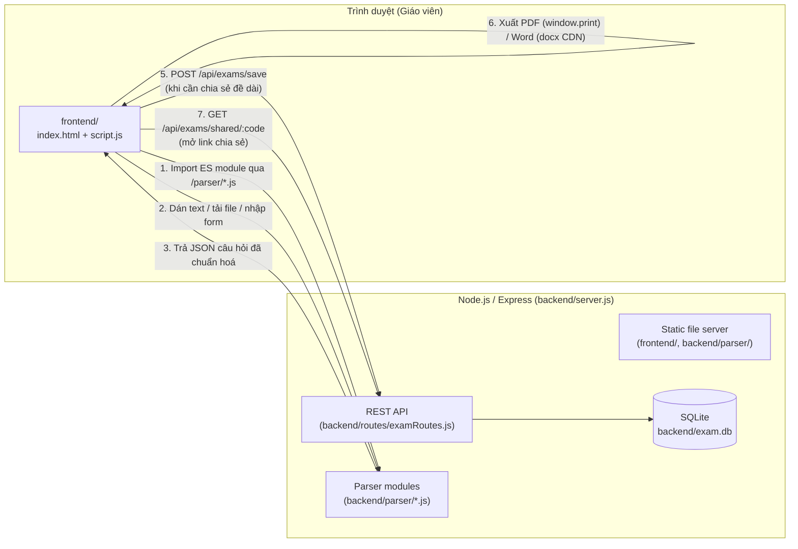
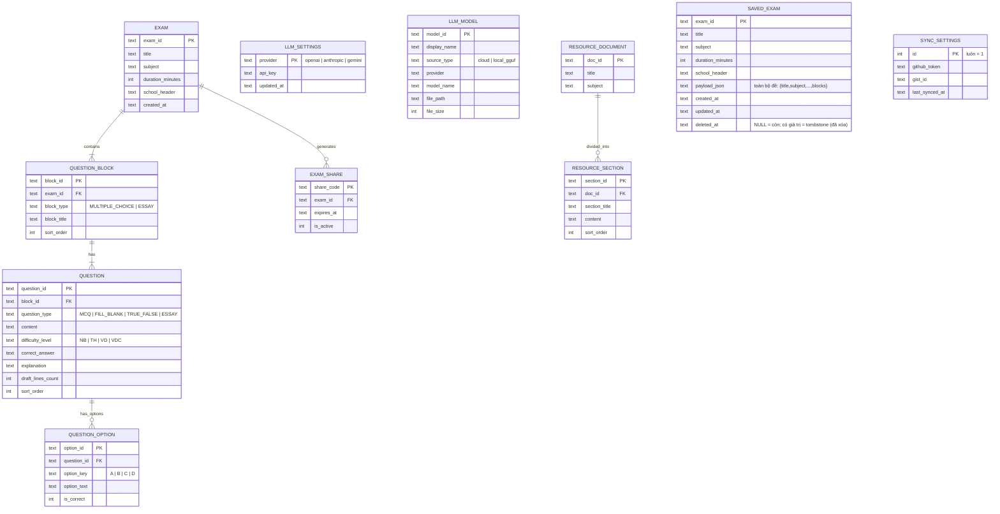

# ExamBuilder

Web App nội bộ giúp **giáo viên** biên soạn đề kiểm tra nhanh — từ nội dung do AI (Gemini Pro) sinh ra, từ tệp có sẵn (JSON/CSV/TXT), hoặc nhập tay qua biểu mẫu — rồi xem trước ở 2 chế độ (Giáo viên / Học sinh), chỉnh sửa trực tiếp trên đề, trộn câu hỏi để sinh nhiều mã đề chống quay cóp, xuất file PDF/Word để in, và chia sẻ đề qua link.

Không có đăng nhập/đăng ký — mở ứng dụng lên là dùng được ngay.

## Mẫu đề (bản đang phát triển)

Chạy `npm start`, mở `http://localhost:3000`, chọn **Mẫu đề** trên thanh công cụ. Có đúng 10 mẫu gốc với số câu cố định; bấm **Tạo bản sao tùy chỉnh** để thêm/xóa/sắp xếp câu rồi lưu. Bên dưới mẫu có ba nhóm prompt (toàn đề, slot chọn, kiểm tra/sửa) và bộ chọn ChatGPT, Claude, Gemini, DeepSeek, Grok. Bấm **Copy Prompt**, dùng AI ngoài để sinh **văn bản**, dán kết quả vào ô kiểm tra, xem diff rồi xác nhận áp dụng. Không cần API key cho luồng này.

Có thể tải ảnh nền PNG/JPG/WebP/SVG, nhập DOCX/PDF theo chế độ nhận diện text native và duyệt nội dung hoặc lưu tệp làm tài nguyên nền. PDF scan không được OCR; các vùng cần điền phải xử lý thủ công. Ảnh nền hiển thị trong preview web; tối đa 10 trang PDF đầu có thể chuyển thành PNG nền, nhưng vị trí vùng điền nhập tay chưa được áp đầy đủ khi xuất. DOCX nhập làm nền hiện chỉ lưu tệp gốc, chưa raster hóa. Bản DOCX theo mẫu có HS/GV/đáp án và thiết lập giấy; ảnh PNG/JPEG đã quản lý được nhúng làm nền hoặc minh họa, còn WebP/SVG và nền riêng trang giữa/cuối có fallback/cảnh báo. Giới hạn trang mới là ước lượng. **In / Lưu PDF** dùng hộp thoại in trình duyệt, cần kiểm tra bản in thật trước khi phát đề. Android giữ snapshot template, điểm và cấu hình giấy; nền/hai cột vẫn dùng fallback. Theo dõi phần đã hoàn tất và phần còn thiếu trong [TEMPLATE_SYSTEM_PROGRESS.md](./TEMPLATE_SYSTEM_PROGRESS.md).

---

## Mục lục

- [1. Giới thiệu & Mục đích](#1-giới-thiệu--mục-đích)
- [2. Kiến trúc tổng thể](#2-kiến-trúc-tổng-thể)
- [3. Kiến trúc chi tiết](#3-kiến-trúc-chi-tiết)
- [4. Tính năng & Đầu ra](#4-tính-năng--đầu-ra)
- [5. Cài đặt & Sử dụng](#5-cài-đặt--sử-dụng)
- [6. Kiểm thử (Testing)](#6-kiểm-thử-testing)
- [7. Giới hạn đã biết](#7-giới-hạn-đã-biết--known-limitations)

---

## 1. Giới thiệu & Mục đích

Soạn một đề kiểm tra thủ công (gõ từng câu, canh dòng nháp cho tự luận, tô đáp án đúng, tách bản học sinh khỏi bản có đáp án...) tốn nhiều thời gian lặp lại mỗi kỳ thi. **ExamBuilder** giải quyết việc đó bằng cách:

1. Chuẩn hoá một **định dạng văn bản** mà AI (Gemini Pro, hoặc bất kỳ LLM nào) có thể sinh ra hàng loạt câu hỏi đúng cấu trúc (xem [`Gemini_Prompt_Unified.txt`](../Gemini_Prompt_Unified.txt)).
2. **Phân tích (parse)** định dạng đó — hoặc tệp JSON/CSV/TXT, hoặc dữ liệu nhập tay — thành cấu trúc đề thi thống nhất.
3. Hiển thị đề ở dạng **block trực quan** (Trắc nghiệm / Tự luận), cho phép giáo viên chỉnh sửa ngay trên bản xem trước, và **bật/tắt "Chế độ Học sinh"** để kiểm tra trước khi in — chế độ này ẩn hoàn toàn đáp án và lời giải.
4. **Xuất** ra PDF (in trực tiếp) / Word (.docx) và **chia sẻ** đề qua một đường link. Link chia sẻ là bản **học sinh**: từ 13/10/2026 cả link `?data=` lẫn `GET /api/exams/shared/:code` đều bỏ đáp án, lời giải, `is_correct` và snapshot template (`backend/parser/examRedaction.js`); bản lưu của giáo viên không bị thay đổi.

## 2. Kiến trúc tổng thể

Ứng dụng là một **Web App 2 tầng** cổ điển: Frontend thuần (không framework) nói chuyện với một Backend Node.js/Express qua REST API, dữ liệu lưu trong SQLite. Phần *phân tích cú pháp* (parser) là các module ES-Module dùng chung, được backend serve tĩnh để **frontend import trực tiếp** — tránh việc phải viết lại logic parse ở hai nơi.



**Điểm thiết kế đáng chú ý:** việc *parse* dữ liệu (bước 1-3) chạy **hoàn toàn ở trình duyệt**, không round-trip qua server — giáo viên bấm "Sinh Đề Kiểm Tra" là thấy kết quả ngay lập tức. Server chỉ được gọi khi cần **lưu bền vững** để tạo link chia sẻ.

## 3. Kiến trúc chi tiết

### 3.1. Cấu trúc thư mục

```
exam-builder/
├── backend/
│   ├── database.js          # Kết nối SQLite + schema (CREATE TABLE, 3NF)
│   ├── errorHandler.js       # Middleware xử lý lỗi toàn cục (JSON đồng nhất)
│   ├── examValidation.js     # validateExamPayload() dùng chung: /api/exams/save + /api/archive
│   ├── mutex.js              # withLock() xếp hàng giao dịch ghi trên 1 kết nối SQLite
│   ├── server.js             # Khởi tạo Express, static serving, mount routes
│   ├── parser/                # Module phân tích cú pháp (dùng chung FE/BE, ESM)
│   │   ├── IQuestionParser.js     # "Interface" trừu tượng (Open/Closed Principle)
│   │   ├── TextPromptParser.js    # Parse văn bản thô theo định dạng Gemini prompt
│   │   ├── FileUploadParser.js    # Parse JSON / CSV / TXT / DOCX (mammoth)
│   │   ├── examCodeGenerator.js   # Tron & sinh nhieu ma de (Fisher-Yates + chia quota)
│   │   └── index.js               # Barrel export
│   ├── llm/                   # Module sinh đề tự động bằng LLM (xem mục 4.2)
│   │   ├── ILLMProvider.js        # "Interface" trừu tượng — hợp đồng generate(prompt)
│   │   ├── OpenAIProvider.js      # Gọi OpenAI Chat Completions API
│   │   ├── AnthropicProvider.js   # Gọi Anthropic Messages API
│   │   ├── GeminiProvider.js      # Gọi Google Generative Language API
│   │   ├── LocalGgufProvider.js   # Chạy model .gguf local qua node-llama-cpp
│   │   ├── ProviderFactory.js     # Chọn đúng provider theo model đã đăng ký (Open/Closed)
│   │   └── promptBuilder.js       # Ghép prompt từ Gemini_Prompt_Unified.txt + ngữ cảnh + yêu cầu
│   ├── sync/                  # Đồng bộ kho đề qua GitHub Gist (xem mục 4.3)
│   │   ├── library.js             # Thuần: rows <-> library, mergeLibraries (primary thắng), purge tombstone
│   │   └── gistClient.js          # Gọi GitHub Gist API (get/create/update file thư viện) qua fetch
│   └── routes/
│       ├── examRoutes.js       # REST API: save / get / share / revoke share / shared
│       ├── backgroundRoutes.js # REST API: liệt kê ảnh nền PDF trong resources/backgrounds/
│       ├── settingsRoutes.js   # REST API: cấu hình API key LLM (đọc/lưu/kiểm tra kết nối)
│       ├── modelRoutes.js      # REST API: đăng ký model cloud / tải lên model .gguf local
│       ├── resourceRoutes.js   # REST API: thư viện tài liệu tham khảo + các phần chia nhỏ
│       ├── generateRoutes.js   # REST API: sinh đề tự động (prompt -> LLM -> parser)
│       ├── archiveRoutes.js    # REST API: kho đề (lịch sử) — list / get / upsert / xóa mềm
│       └── syncRoutes.js       # REST API: cấu hình Gist + push (máy->cloud) / pull (cloud->máy)
├── frontend/
│   ├── index.html             # Layout: toolbar, tab input, khu preview, prompt reference, modal share/cài đặt/lịch sử
│   ├── style.css              # Theme engine: 18 chủ đề [data-theme] (16 sáng + 2 tối) + --ui-scale, responsive, @media print
│   ├── script.js               # State, render đề (số câu liên tục), sửa trực tiếp, export/share, nhiều mã đề, kho đề, giao diện
│   ├── promptTemplate.js       # TỰ SINH từ Gemini_Prompt_Unified.txt (tools/gen-prompt-module.js) — đừng sửa tay
│   └── promptVariants.js      # TỰ SINH từ AI_Prompts_Variants.txt (tools/gen-prompt-variants.js) — đừng sửa tay; 1 prompt/AI (Gemini/Gemini Pro/ChatGPT/DeepSeek/Claude/Grok)
├── resources/
│   ├── backgrounds/            # Ảnh nền PDF (.png/.jpg/.svg) — xem mục 4.1
│   └── image/                  # icon.png + gen-android-icons.js (sinh app icon Android)
├── tools/
│   ├── gen-prompt-module.js   # Sinh lại frontend/promptTemplate.js từ Gemini_Prompt_Unified.txt
│   └── gen-prompt-variants.js # Sinh lại frontend/promptVariants.js từ AI_Prompts_Variants.txt + quy tắc dùng chung
├── tests/                      # Bộ test Jest + Supertest (xem mục 6)
├── Gemini_Prompt_Unified.txt  # META-PROMPT: nguồn DUY NHẤT của quy tắc định dạng (dùng chung cho mọi AI)
├── AI_Prompts_Variants.txt    # Nguồn riêng theo từng AI: câu giới thiệu, lưu ý riêng, ví dụ mẫu (môn học khác nhau)
├── babel.config.cjs            # Cấu hình Babel (chỉ dùng để Jest hiểu cú pháp ESM)
└── package.json
```

> **Prompt là một meta-prompt hợp nhất.** [`Gemini_Prompt_Unified.txt`](../Gemini_Prompt_Unified.txt)
> đặc tả đầy đủ định dạng đầu ra mà `backend/parser/TextPromptParser.js` đọc được: 2 phần
> `=PHAN_1_TRAC_NGHIEM=` / `=PHAN_2_TU_LUAN=`, thẻ `[CAU_HOI]`, các trường
> `Loai/Muc_Do/De_Bai/Dap_An/Loi_Giai/So_Dong_Nhap`, ràng buộc từng loại câu (TN/DUNG_SAI/DIEN_TU/TU_LUAN),
> cách viết công thức toán (ASCII đơn giản hoặc `$...$` LaTeX), và quy tắc "chỉ xuất nội dung, không
> markdown, không khối mã". `PHẦN 2` được `promptBuilder.js` trích nguyên văn cho luồng "Sinh đề tự động",
> và `tools/gen-prompt-module.js` (`npm run gen:prompt`) sinh lại `frontend/promptTemplate.js` từ nó —
> **chỉ sửa prompt ở file `.txt`.**
>
> **Mỗi AI dán tay còn có một prompt riêng.** Khu "Prompt mẫu cho AI" trên frontend cho chọn giữa
> Gemini (thường) / Gemini Pro / ChatGPT / DeepSeek / Claude / Grok — cùng dùng chung quy tắc định
> dạng ở trên, nhưng mỗi AI có thêm 1 đoạn lưu ý riêng (đối phó xu hướng riêng của AI đó, ví dụ ChatGPT
> hay tự bọc khối mã, DeepSeek hay lộ phần suy luận `<think>`, Gemini Pro tận dụng ngữ cảnh dài) và
> 1 ví dụ mẫu riêng (mỗi AI một môn học khác nhau để minh hoạ prompt dùng được cho mọi môn). Nguồn ở
> [`AI_Prompts_Variants.txt`](../AI_Prompts_Variants.txt),
> sinh lại `frontend/promptVariants.js` bằng `tools/gen-prompt-variants.js` (đã gộp vào `npm run gen:prompt`)
> — **chỉ sửa ở file `.txt`, không hand-edit `promptVariants.js`.**

> Các thư viện xuất/nhập file (`docx` để xuất Word, `mammoth` để đọc `.docx` tải lên) được cài như dependency thường và phục vụ tĩnh qua `/vendor/docx/...` và `/vendor/mammoth/...` — không phụ thuộc CDN ngoài. Không dùng thư viện đọc Excel (`.xlsx`) do các lựa chọn phổ biến trên npm đều có lỗ hổng bảo mật chưa được vá (xem mục 7).

### 3.2. Mô hình dữ liệu (chuẩn hoá 3NF)



`LLM_SETTINGS`/`LLM_MODEL`/`RESOURCE_DOCUMENT`/`RESOURCE_SECTION` phục vụ module sinh đề tự động (mục 4.2); `SAVED_EXAM`/`SYNC_SETTINGS` phục vụ kho đề + đồng bộ Gist (mục 4.3). Cả 2 nhóm đều độc lập với 5 bảng đề thi ở trên — không có khóa ngoại nào nối chúng với nhau. `SAVED_EXAM` cố ý phi chuẩn hoá (lưu cả đề dưới dạng `payload_json`) để khớp 1:1 với file trên Gist và tránh việc dựng lại quan hệ lồng nhau ở mỗi lần đồng bộ.

Ràng buộc toàn vẹn được thực thi ngay ở tầng CSDL: `PRAGMA foreign_keys = ON`, `ON DELETE CASCADE` cho toàn bộ quan hệ cha–con, và `CHECK` constraint cho các cột enum (`block_type`, `question_type`, `difficulty_level`) — xem `backend/database.js`.

### 3.3. Luồng dữ liệu chính (Sequence)

```mermaid
sequenceDiagram
    actor GV as Giáo viên
    participant UI as script.js
    participant P as Parser (ESM, /parser/*.js)
    participant API as examRoutes.js
    participant DB as SQLite

    GV->>UI: Dán text (định dạng Gemini) / chọn file / điền form
    UI->>P: new TextPromptParser().parse(raw)\nhoặc new FileUploadParser().parse(content, filename)
    P-->>UI: [{ block_type, block_title, questions: [...] }]
    UI->>UI: renderExam() — vẽ card Trắc nghiệm/Tự luận,\ngắn contenteditable + listener đồng bộ state
    GV->>UI: Sửa nội dung / đáp án / số dòng nháp /\nbật "Chế độ Học sinh" / Zoom
    GV->>UI: Bấm "Tạo Link Chia Sẻ"
    alt Đề ngắn (Base64 < ~1.8KB)
        UI->>UI: btoa(JSON.stringify(exam)) → URL ?data=...
    else Đề dài
        UI->>API: POST /api/exams/save
        API->>DB: BEGIN; INSERT EXAM/BLOCK/QUESTION/OPTION; COMMIT
        API-->>UI: { exam_id }
        UI->>API: POST /api/exams/share { exam_id }
        API->>DB: INSERT EXAM_SHARE
        API-->>UI: { share_code } → URL ?code=...
    end
    Note over GV,UI: Mở lại URL ?code=... → GET /api/exams/shared/:code\nrenderExam() ở "Chế độ Học sinh", ẩn panel nhập liệu
```

### 3.4. Vai trò các module cốt lõi

| Module | Vai trò |
|---|---|
| `backend/database.js` | Mở kết nối SQLite (singleton), tạo schema nếu chưa có. Hỗ trợ `EXAM_DB_PATH` (env var) và `closeDb()` để test cô lập bằng CSDL in-memory. |
| `backend/routes/examRoutes.js` | 4 endpoint REST: lưu đề (transaction), đọc đề (join lồng nhau), tạo link chia sẻ, đọc đề theo link chia sẻ. |
| `backend/parser/IQuestionParser.js` | Lớp cơ sở trừu tượng — định nghĩa hợp đồng `parse(rawContent)`. Cho phép thêm định dạng đầu vào mới (Open/Closed Principle) mà không sửa code đã có. |
| `backend/parser/TextPromptParser.js` | Bóc tách văn bản thô theo cấu trúc `===SECTION===` / `[CAU_HOI]` / `Key: value` thành câu hỏi có cấu trúc; validate và ném lỗi kèm vị trí (`Phần X - Câu Y`) khi sai định dạng. |
| `backend/parser/FileUploadParser.js` | Định tuyến theo phần mở rộng tệp: `.json` (validate cấu trúc `blocks`), `.csv` (tự viết CSV parser hỗ trợ dấu phẩy/nháy kép trong field), `.txt` (uỷ quyền lại cho `TextPromptParser`), `.docx` (dùng `mammoth` trích xuất văn bản thô rồi uỷ quyền lại cho `TextPromptParser`). |
| `backend/parser/examCodeGenerator.js` | Xáo (Fisher-Yates) + chia quota `floor(total/q)` cho từng cặp (loại câu hỏi × mức độ) để sinh `q` mã đề không trùng lặp và đồng đều tỉ lệ mức độ; xáo lại thứ tự đáp án A/B/C/D cho từng câu MCQ trong mỗi mã đề. Module thuần (không phụ thuộc DOM) — dùng chung cho frontend qua `/parser/examCodeGenerator.js`. |
| `frontend/script.js` | Toàn bộ state ứng dụng (`state`), render DOM (`renderExamInto`, `renderMCQBody`, `renderEssayBody`...), đồng bộ 2 chiều state ↔ DOM qua `contenteditable`, export PDF/Word (gồm nhiều mã đề nếu có), tạo & đọc link chia sẻ, khu "Prompt mẫu cho AI" (copy 1-click), sinh nhiều mã đề, chọn/bật-tắt nền PDF. **Kho đề:** `scheduleArchiveSave()` tự lưu mọi đề (debounce 1.5s + `beforeunload`) vào `/api/archive`; modal "📚 Lịch sử" liệt kê / mở lại / xóa đề, và cấu hình + chạy Push/Pull đồng bộ Gist. |
| `backend/routes/backgroundRoutes.js` | `GET /api/backgrounds` — liệt kê file `.png`/`.jpg`/`.jpeg`/`.svg` trong `resources/backgrounds/` để dropdown "Nền PDF" ở frontend đọc. Thư mục được serve tĩnh tại `/backgrounds/<tên_file>`. |
| `backend/llm/ProviderFactory.js` | Chọn đúng lớp provider (`OpenAIProvider`/`AnthropicProvider`/`GeminiProvider`/`LocalGgufProvider`) theo `source_type`/`provider` của model đã đăng ký — thêm provider mới không cần sửa code gọi (Open/Closed Principle), theo đúng pattern của `IQuestionParser`. |
| `backend/llm/promptBuilder.js` | Trích đoạn hướng dẫn định dạng từ `Gemini_Prompt_Unified.txt`, ghép với nội dung các Phần tài liệu đã chọn và yêu cầu số lượng câu hỏi thành 1 prompt hoàn chỉnh; cũng dựng lại prompt kèm thông báo lỗi khi cần LLM tự sửa định dạng. |
| `backend/routes/generateRoutes.js` | `POST /api/generate` — endpoint "1 nút bấm ra đề": ghép prompt, gọi provider đã chọn, chạy kết quả qua `TextPromptParser` (dynamic import từ CommonJS, xem mục 4.2), tự động thử lại tối đa 2 lần nếu LLM trả sai định dạng. |
| `backend/routes/settingsRoutes.js` | REST API cấu hình API key LLM: đọc (luôn che key), lưu (upsert theo provider), và kiểm tra kết nối thử với 1 model cụ thể. |
| `backend/routes/modelRoutes.js` | REST API quản lý model: liệt kê, đăng ký model cloud, tải lên file `.gguf` (multipart qua `multer`, lưu vào `resources/models/`), xóa model (kèm xóa file nếu là model local). |
| `backend/routes/resourceRoutes.js` | REST API thư viện tài liệu tham khảo: tạo tài liệu, thêm Phần vào tài liệu, liệt kê, xóa tài liệu (CASCADE xóa Phần). |
| `backend/routes/archiveRoutes.js` | REST API kho đề (lịch sử): `GET /api/archive` (liệt kê, ẩn tombstone), `GET /:id` (payload đầy đủ), `POST` (upsert — có `exam_id` thì cập nhật tại chỗ, không thì tạo mới; **không hồi sinh** đề đã xóa), `DELETE /:id` (xóa mềm, đặt `deleted_at`). |
| `backend/routes/syncRoutes.js` | REST API đồng bộ Gist: `GET/POST /api/sync/settings` (token che khi đọc), `POST /api/sync/push` (máy → cloud: `merge(local, cloud)` → ghi Gist + ghi ngược về máy; tự tạo Gist nếu chưa có `gist_id`), `POST /api/sync/pull` (cloud → máy: `merge(cloud, local)` → ghi về máy). Chủ đề màu gửi/nhận qua body (`{ theme: { id, updated_at } }`) vì web lưu ở `localStorage`. Ghi ngược vào `SAVED_EXAM` bọc `withLock` + transaction. |
| `backend/sync/library.js` | Module thuần (unit-test được): `rowsToLibrary`/`libraryToRows` chuyển đổi 2 chiều giữa dòng `SAVED_EXAM` và file thư viện; `mergeLibraries(primary, secondary)` hợp nhất theo `exam_id` với quy tắc **"primary thắng"** tuyệt đối khi trùng id (union toàn bộ id); `purgeOldTombstones` bỏ tombstone > 90 ngày; `pickNewerTheme` chọn chủ đề màu theo **"lần đổi gần nhất thắng"** (không theo chiều). Chuẩn hoá mọi mốc thời gian về ISO 8601 UTC. |
| `backend/sync/gistClient.js` | Gọi GitHub Gist API bằng `fetch` toàn cục (Node ≥ 18): đọc / tạo / ghi đè file `exambuilder-library.json` trong 1 gist secret. Xử lý file bị cắt (`truncated` → tải `raw_url`) và dịch lỗi HTTP 401/403/404/429 sang thông báo tiếng Việt. |

## 4. Tính năng & Đầu ra

| Tính năng | Input | Output |
|---|---|---|
| **Dán văn bản** (tab 1) | Văn bản thô theo `Gemini_Prompt_Unified.txt` | Đề thi hiển thị ngay trong khu Preview, chia block Trắc nghiệm/Tự luận |
| **Tải file** (tab 2) | Tệp `.json`, `.csv`, `.txt`, hoặc `.docx` | Giống trên; lỗi định dạng báo rõ dòng/cột sai. Với `.docx`, nội dung Word phải theo đúng cấu trúc trong `Gemini_Prompt_Unified.txt` |
| **Nhập Form** (tab 3) | Từng câu hỏi nhập tay (loại câu, mức độ, nội dung, đáp án...) | Danh sách câu hỏi tạm → gộp thành đề khi bấm "Sinh Đề Kiểm Tra" |
| **Chỉnh sửa trực tiếp** | Click vào nội dung/đáp án/lời giải trên bản xem trước | Cập nhật ngay trong `state`, không cần form riêng. Đánh số câu **liên tục 1..N** cho cả đề (khớp bản Android + xuất Word). Lời giải hiển thị **mỗi câu một dòng** cho dễ đọc |
| **Bung câu** | Bấm vào số "Câu N" ở khu Xem trước | Thẻ câu đó giãn to, nổi bật, lời giải format rõ ràng; bấm lại thu gọn |
| **Chế độ Học sinh** | Bật công tắc "Chế độ Học sinh" | Ẩn hoàn toàn: đáp án đúng, lời giải, nút chỉnh sửa — chỉ còn đề bài + lựa chọn/dòng nháp |
| **Zoom** | Nút A+/A− | Phóng to/thu nhỏ cỡ chữ bản xem trước (60%–200%) |
| **Giao diện** | ⚙️ Cài đặt → "🎨 Giao diện" | **18 chủ đề màu** (16 nền sáng: Xanh lạnh / Biển / Đồng cỏ / Oải hương / Kem trái cây / Ban ngày / Hè / Thu / Đông / Nho / Mận / Cà phê / Thạch anh / Đào / Hoa hồng / Mật ong · 2 nền tối: **Xanh đêm / Rừng đêm**) — bảng màu chắt lọc từ 19 ảnh trong `resources/image/theme/` (2 ảnh trùng nhau), **mọi cặp chữ/nền đạt WCAG AA** (đã kiểm bằng script). Mỗi chủ đề tự là sáng hoặc tối (không có công tắc "chế độ tối" riêng). 4 mức **cỡ chữ**. `data-theme` trên `<html>` + `localStorage` (`eb_theme` / `eb_uiScale`), áp trước khi vẽ (không nháy màu), chuyển mượt |
| **Xuất PDF** | Bấm "Xuất PDF" | Hộp thoại in của trình duyệt, layout đã tối ưu khổ A4 (`@media print`) |
| **Nền PDF** | Bật công tắc "Nền PDF" trong panel bên trái, chọn ảnh + chỉnh độ mờ | Ảnh nền phủ kín trang A4 phía sau nội dung khi "Xuất PDF"; xem mục 4.1 |
| **Xuất Word** | Bấm "Xuất Word" | Tệp `.docx` tải về, gồm đề bài + (nếu ở Chế độ Giáo viên) đáp án/lời giải |
| **Chia sẻ đề** | Bấm "Tạo Link Chia Sẻ" | Một URL: `?data=<base64>` (đề ngắn) hoặc `?code=<8-hex>` (đề dài, lưu server) — mở lên tự vào Chế độ Học sinh |
| **Thu hồi link** | Bấm "Thu hồi link" trong modal chia sẻ (chỉ khả dụng với link dạng `?code=`) | Link bị vô hiệu hoá vĩnh viễn — mở lại sẽ báo lỗi |
| **Prompt mẫu cho AI** | Khu "Prompt mẫu cho AI" dưới layout chính (badge 4 loại câu hỏi + accordion) | Tab chọn AI (Gemini/Gemini Pro/ChatGPT/DeepSeek/Claude/Grok) — mỗi tab 1 prompt + ví dụ riêng; nút "Copy Prompt"/"Copy Ví dụ" sao chép 1-click vào clipboard, kèm thông báo xác nhận |
| **Trộn & Tạo nhiều mã đề** | Panel "Trộn & Tạo nhiều mã đề" (số mã đề `q`, số bắt đầu, tiền tố) sau khi đã "Sinh Đề Kiểm Tra" | `q` mã đề (tab riêng trong Preview) — câu hỏi chia đều `floor(total/q)` theo từng cặp (loại × mức độ) riêng biệt, nên tỉ lệ Nhận biết/Thông hiểu/Vận dụng/Vận dụng cao trong mỗi loại câu hỏi đồng đều giữa các mã (không mã nào toàn câu dễ/toàn câu khó), không trùng lặp giữa các mã cho tới khi hết nguồn; đáp án trắc nghiệm A/B/C/D được xáo lại độc lập cho từng mã. Xuất PDF/Word tự động gồm tất cả mã đề (ngắt trang giữa các mã) |
| **Sinh đề tự động bằng LLM** | Tab "Sinh đề tự động": chọn model (đã cấu hình ở "⚙️ Cài đặt"), chọn tài liệu/Phần tham khảo hoặc nhập chủ đề, nhập số câu theo loại × mức độ | Đề được LLM sinh ra, tự parse và hiển thị ngay trong Preview như các cách nhập khác — xem chi tiết mục 4.2 |
| **Kho đề (lịch sử) + Đồng bộ Gist** | Nút "📚 Lịch sử" trên toolbar. Mọi đề vừa sinh/sửa **tự động** vào kho. Cấu hình 1 GitHub token (quyền `gist`) + 1 Gist ID dùng chung cho PC và Android | Danh sách đề đã lưu (mở lại / xóa cục bộ); **⬆️ Đẩy lên** (máy → Gist) / **⬇️ Kéo về** (Gist → máy) để chuyển đề qua lại giữa web PC và app Android — xem chi tiết mục 4.3 |

### 4.1. Nền PDF (background overlay)

Cho phép chèn một ảnh nền (logo trường, khung viền, watermark "BẢN NHÁP"...) phủ kín trang A4 phía sau nội dung đề thi khi xuất PDF (`window.print()`).

**Thư mục tài nguyên:** `resources/backgrounds/` (tại gốc dự án, ngang hàng `backend/` và `frontend/`). Server serve tĩnh tại `/backgrounds/<tên_file>` và liệt kê qua `GET /api/backgrounds`. Chỉ cần chép ảnh vào thư mục này — không cần khai báo gì thêm, dropdown "Nền PDF" trên giao diện tự đọc danh sách khi tải trang.

**Định dạng hỗ trợ:** `.png`, `.jpg`/`.jpeg`, `.svg`.

**Thông số ảnh khuyến nghị:**

| Thuộc tính | Giá trị khuyến nghị |
|---|---|
| Độ phân giải | 300 DPI |
| Kích thước (px) | 2480 × 3508 (A4 dọc ở 300 DPI) |
| Tỉ lệ khung hình | 210 : 297 (khổ A4) — ảnh lệch tỉ lệ sẽ bị cắt do `background-size: cover` |
| Nền trong suốt | Dùng PNG có kênh alpha nếu ảnh chỉ là logo/watermark/khung viền (không phủ kín màu nền), để không che nội dung phía dưới |
| Độ đậm nội dung ảnh | Ảnh nên nhạt/mảnh — hộp thoại in của trình duyệt còn một lớp "độ mờ" (`opacity`, 5–100%) chỉnh được ngay trên giao diện, nhưng bản thân ảnh gốc càng nhạt thì chữ đề thi càng dễ đọc |

**Bật/tắt & cấu hình:** trong panel nhập liệu (khu vực bên trái, ngay dưới phần tiêu đề đề thi):
1. Bật công tắc **"Nền PDF"**.
2. Chọn ảnh trong dropdown (danh sách lấy từ `resources/backgrounds/`).
3. Kéo thanh **"Độ mờ"** (5–100%) để chỉnh độ đậm nhạt.
4. Bấm **"Xuất PDF"** — ảnh nền sẽ xuất hiện phủ kín từng trang A4 trong hộp thoại in.

Tắt công tắc "Nền PDF" để in không có nền (mặc định). Lựa chọn nền/độ mờ chỉ tồn tại trong phiên làm việc hiện tại (không lưu vào CSDL cùng đề thi).

> **Lưu ý trình duyệt:** một số trình duyệt (Chrome, Edge...) mặc định **không in màu nền/ảnh nền** trừ khi tuỳ chọn "Đồ họa nền" (Background graphics) trong hộp thoại in được bật — ứng dụng đã set `print-color-adjust: exact` ở CSS để giảm thiểu việc này, nhưng người dùng nên kiểm tra tuỳ chọn đó nếu thấy nền không xuất hiện trong PDF.

### 4.2. Sinh đề tự động bằng LLM (module cộng thêm)

Cho phép giáo viên bấm 1 nút để LLM tự sinh câu hỏi thay vì phải tự tay copy prompt sang Gemini/ChatGPT rồi dán kết quả về. Module này cộng thêm vào kiến trúc sẵn có, không sửa luồng dán tay/tải file/nhập form hiện tại.

**Luồng hoạt động:**
1. Trong modal **"⚙️ Cài đặt"**: nhập API key cho OpenAI/Anthropic/Gemini (lưu server-side, không bao giờ trả full key về trình duyệt), đăng ký model cloud (tên model API + tên hiển thị), hoặc tải lên model chạy local dạng `.gguf` (chạy qua [`node-llama-cpp`](https://github.com/withcatai/node-llama-cpp) ngay trong tiến trình Node — không cần cài thêm phần mềm ngoài).
2. (Tùy chọn) Trong tab **"Sinh đề tự động"**, mở khu **"📚 Quản lý thư viện tài liệu"**: tạo 1 tài liệu tham khảo, tự chia thành các **Phần** (giáo viên tự đặt ranh giới nội dung, ví dụ theo chương/bài).
3. Chọn **Model**, chọn tài liệu + các **Phần** muốn dùng làm ngữ cảnh (hoặc bỏ trống và chỉ nhập **Chủ đề**), nhập số lượng câu hỏi theo từng loại × mức độ trong bảng, bấm **"🚀 Sinh đề tự động"**.
4. Backend ghép prompt (tái sử dụng nguyên văn phần hướng dẫn định dạng trong [`Gemini_Prompt_Unified.txt`](../Gemini_Prompt_Unified.txt) + nội dung các Phần đã chọn + yêu cầu số lượng) → gọi provider đã chọn → chạy kết quả qua `TextPromptParser` (parser y hệt luồng dán tay) → nếu sai định dạng, tự động gửi lại lỗi cho LLM xin sửa (tối đa 2 lần) → trả đề về, hiển thị ngay trong Preview như các cách nhập khác.

**Giới hạn cần biết khi dùng model local (`.gguf`):**

| Giới hạn | Chi tiết |
|---|---|
| Định dạng file | Chỉ nhận `.gguf` (định dạng llama.cpp) — model dạng khác (vd `safetensors` từ HuggingFace) cần convert trước bằng công cụ ngoài |
| RAM | Model 7B quantize Q4 chiếm khoảng 4-5GB RAM khi nạp — máy chạy server cần đủ RAM trống |
| Tốc độ | Mặc định chạy CPU-only, chậm hơn đáng kể so với gọi API cloud (có thể vài chục giây tới vài phút) |
| Lần dùng đầu tiên | `node-llama-cpp` tải binary native tương ứng hệ điều hành về khi gọi model local lần đầu — cần có kết nối mạng ở lần đó |

API key và model đã đăng ký lưu trong 2 bảng `LLM_SETTINGS`/`LLM_MODEL` (SQLite, xem mục 3.2); file `.gguf` tải lên lưu tại `resources/models/` (git-ignored, có thể đổi qua biến môi trường `LLM_MODELS_DIR`).

### 4.3. Kho đề (lịch sử) & Đồng bộ PC ↔ Android qua GitHub Gist

Web PC và app Android (`Exam builder for adr/`) mỗi bên giữ một **kho đề** cục bộ tự tích lũy mọi đề đã soạn, và trao đổi đề với nhau qua **một GitHub Gist secret** đóng vai trò kho chung trên mây.

**Kho đề (tự động lưu):** ngay khi bấm "Sinh Đề Kiểm Tra" đề được ghi vào bảng `SAVED_EXAM` (bấm lại trong 30 giây coi là tinh chỉnh cùng đề — cập nhật tại chỗ). Sửa trực tiếp trên bản xem trước cũng tự lưu (debounce 1.5 giây) hoặc trước khi đóng tab. Không có nút "lưu" thủ công. Nút **"📚 Lịch sử"** trên toolbar mở modal liệt kê các đề đang lưu (tiêu đề · môn · thời điểm sửa) — **Mở** lại để soạn tiếp, hoặc **Xóa**.

**Xóa là cục bộ + có thể phục hồi:** bấm "Xóa" chỉ đánh dấu đề là *tombstone* trên máy này (ẩn khỏi danh sách, giữ lại bản ghi). Nó chỉ biến mất trên máy khác sau khi bạn **Đẩy lên**. Nếu xóa nhầm và **chưa** Đẩy lên, bấm **Kéo về** để lấy lại.

**Cấu hình (một lần, mỗi thiết bị):** trong modal "📚 Lịch sử", mở khu gập **"☁️ Đồng bộ sang thiết bị khác"**
(mặc định gập lại để ưu tiên danh sách đề; tự mở sẵn nếu đã có Token). Token và Gist ID được **khóa**
sau khi lưu (chỉ hiện nhãn trạng thái ✅/⚠️); muốn đổi phải bấm nút "Thay đổi" — panel tương ứng mới hiện ra.
1. Bấm **🔑 Thay đổi Token** → dán **GitHub Personal Access Token** (chỉ cần quyền **`gist`**) → **Lưu Token**.
2. Bấm **🆔 Thay đổi Gist ID**:
   - *Thiết bị đầu tiên:* bấm **🆕 Tạo Gist ID mới** — app tạo một gist secret mới, đẩy kho đề lên, và điền Gist ID.
   - *Thiết bị sau:* dán **cùng Gist ID** đó vào ô rồi **Lưu Gist ID**, sau đó **⬇️ Kéo về**.

Sau đó chỉ còn 2 nút chính: **⬆️ Đẩy lên** / **⬇️ Kéo về**.

**Hai thao tác, một chiều mỗi lần:**

| Thao tác | Hướng | Quy tắc hợp nhất | Dùng khi |
|---|---|---|---|
| **⬆️ Đẩy lên (Push)** | máy → Gist | `merge(local, cloud)` — **bản trên máy thắng** khi trùng đề; đề chỉ có trên cloud vẫn được giữ | Chốt các thay đổi (kể cả xóa) của máy này lên kho chung |
| **⬇️ Kéo về (Pull)** | Gist → máy | `merge(cloud, local)` — **bản trên cloud thắng** khi trùng đề; đề chỉ có trên máy vẫn được giữ | Lấy đề từ thiết bị khác về, hoặc khôi phục đề vừa lỡ xóa cục bộ |

Hợp nhất là **union theo `exam_id`**: không đề nào bị mất trừ khi tombstone của nó "thắng" theo chiều đang chạy. Sau `Push` + `Pull` ở cả hai máy thì hai kho khớp nhau. Tombstone quá 90 ngày được dọn khi Push.

**Chủ đề màu cũng được đồng bộ** cùng file này, nhưng theo quy tắc khác: **"lần đổi gần nhất thắng"** (so `theme.updated_at`, không theo chiều Push/Pull). Đổi theme ở máy nào sau cùng thì lần Push/Pull kế tiếp sẽ kéo theme đó về các máy khác. **Cỡ chữ KHÔNG đồng bộ** — vẫn riêng từng thiết bị (điện thoại có thể để chữ to hơn màn hình PC). Theme lạ (client cũ gặp theme của bản mới hơn) tự hiển thị màu mặc định.

**File trên Gist** — `exambuilder-library.json`:

```json
{
  "schema": "exambuilder/library@1",
  "updated_at": "2026-09-01T10:00:00.000Z",
  "theme": { "id": "midnight", "updated_at": "2026-09-02T10:00:00.000Z" },
  "exams": [
    { "exam_id": "…", "title": "…", "subject": "…", "duration_minutes": 45,
      "school_header": "…", "blocks": [ … ],
      "created_at": "…", "updated_at": "…", "deleted_at": null }
  ]
}
```

> ⚠️ **Bảo mật — đọc kỹ.** Token GitHub lưu **plaintext** trong bảng `SYNC_SETTINGS` (web) / DataStore (Android), cùng mức bảo vệ với API key LLM. Gist ở dạng **secret nhưng KHÔNG mã hóa**: bất kỳ ai có URL Gist (và cả GitHub) đều đọc được **toàn bộ đề kèm đáp án đúng**. Hãy dùng token **chỉ có quyền `gist`**, coi URL Gist + token là thông tin nhạy cảm (không commit, không chia sẻ), và revoke token trên GitHub nếu nghi bị lộ.

### Ví dụ Output — 1 câu hỏi sau khi parse

```json
{
  "question_type": "MCQ",
  "content": "2 + 2 bằng bao nhiêu?",
  "difficulty_level": "NB",
  "correct_answer": "B",
  "explanation": "Vì 2 + 2 = 4",
  "options": [
    { "option_key": "A", "option_text": "3", "is_correct": false },
    { "option_key": "B", "option_text": "4", "is_correct": true }
  ],
  "draft_lines_count": 0
}
```

## 5. Cài đặt & Sử dụng

### Yêu cầu

- Node.js ≥ 18 (đã kiểm thử trên Node 24)
- npm

### Cài đặt

```bash
git clone <repository-url>
cd exam-builder
npm install
```

Không cần cấu hình biến môi trường nào để chạy ở chế độ thông thường. SQLite sẽ tự tạo tệp `backend/exam.db` ở lần chạy đầu tiên.

| Biến môi trường | Bắt buộc | Mặc định | Mô tả |
|---|---|---|---|
| `PORT` | Không | `3000` | Cổng HTTP server lắng nghe |
| `EXAM_DB_PATH` | Không | `backend/exam.db` | Đường dẫn tệp CSDL SQLite — dùng `:memory:` khi chạy test |
| `LLM_MODELS_DIR` | Không | `resources/models` | Thư mục lưu file model `.gguf` tải lên qua "⚙️ Cài đặt" — dùng thư mục tạm khi chạy test |

### Chạy ứng dụng

```bash
npm start
```

Mở trình duyệt tại **http://localhost:3000**.

**Quy trình sử dụng nhanh:**

1. Mở [`Gemini_Prompt_Unified.txt`](../Gemini_Prompt_Unified.txt), copy prompt, thay chủ đề, dán vào Gemini Pro.
2. Copy kết quả AI trả về → dán vào tab **"Dán văn bản"** → bấm **"Sinh Đề Kiểm Tra"**.
3. Kiểm tra/sửa đề ở khu xem trước; bật **"Chế độ Học sinh"** để xem bản không đáp án.
4. Bấm **"Xuất PDF"**/**"Xuất Word"** để in, hoặc **"Tạo Link Chia Sẻ"** để gửi đề qua link.

### Chạy kiểm thử

```bash
npm test              # chạy toàn bộ ~339 test case
npm run test:coverage # chạy kèm báo cáo coverage
```

## 6. Kiểm thử (Testing)

Framework: **Jest** (unit + integration) + **Supertest** (test API qua HTTP thật, không mock Express). Chi tiết đầy đủ về từng test case nằm trực tiếp trong code tại thư mục [`tests/`](../tests/).

| File test | Đối tượng | Số ca | Coverage (statements) |
|---|---|---|---|
| `tests/parser/TextPromptParser.test.js` | Parser văn bản thô | 30 | 100% |
| `tests/parser/FileUploadParser.test.js` | Parser JSON/CSV/TXT/DOCX | 32 | 95.4% |
| `tests/parser/IQuestionParser.test.js` | Interface trừu tượng | 2 | 100% |
| `tests/parser/adversarial.test.js` | Fuzz parser: prototype pollution, injection, unicode, hiệu năng | 11 | — |
| `tests/database.test.js` | Schema SQLite, ràng buộc toàn vẹn (gồm `SAVED_EXAM` / `SYNC_SETTINGS`) | 9 | 100% |
| `tests/errorHandler.test.js` | Middleware lỗi toàn cục | 3 | 100% |
| `tests/routes/examRoutes.test.js` | REST API (5 endpoint) | 35 | 96.1% |
| `tests/routes/examRoutes.adversarial.test.js` | Fuzz API: race condition, prototype pollution, mass assignment, boundary | 25 | — |
| `tests/llm/promptBuilder.test.js` | Ghép prompt từ template + ngữ cảnh + yêu cầu số lượng | 8 | 100% |
| `tests/llm/promptTemplate.test.js` | Meta-prompt: `promptTemplate.js` đồng bộ với `Gemini_Prompt_Unified.txt`, giữ đủ mốc định dạng, LaTeX không hỏng, và ví dụ PHẦN 3 parse được đủ 4 loại câu | 5 | — |
| `tests/llm/promptVariants.test.js` | `promptVariants.js` (6 AI): đủ 6 bien the, moi bien the chua nguyen van quy tac dinh dang dung chung + doan luu y rieng khac nhau, LaTeX khong hong, va vi du rieng cua tung AI deu parse duoc du 4 loai cau | 11 | — |
| `tests/llm/ProviderFactory.test.js` | Chọn đúng provider theo model đã đăng ký | 9 | 100% |
| `tests/routes/settingsRoutes.test.js` | REST API cấu hình API key LLM (đọc/lưu/kiểm tra kết nối) | 11 | — |
| `tests/routes/modelRoutes.test.js` | REST API quản lý model (cloud + upload `.gguf` local) | 11 | — |
| `tests/routes/resourceRoutes.test.js` | REST API thư viện tài liệu tham khảo | 8 | — |
| `tests/routes/generateRoutes.test.js` | REST API sinh đề tự động, gồm vòng lặp tự sửa định dạng | 9 | — |
| `tests/sync/library.test.js` | Module thuần đồng bộ: `mergeLibraries` (primary thắng, union, tombstone 2 chiều), `rowsToLibrary`/`libraryToRows` round-trip, `purgeOldTombstones`, `pickNewerTheme`/`sanitizeTheme` (theme "lần đổi gần nhất thắng") | 25 | 100% |
| `tests/sync/gistClient.test.js` | Wiring HTTP thật với GitHub Gist API (mock server cục bộ): header Bearer, `public:false`, round-trip content, map lỗi 401/404 | 6 | 100% |
| `tests/sync/syncFlow.e2e.test.js` | E2E 2 "thiết bị" (2 CSDL riêng) đồng bộ qua 1 Gist bằng `gistClient` thật: PC Push tạo Gist → Android Pull → Android xóa + Push → PC Pull thấy đề biến mất; + đồng bộ chủ đề màu | 2 | — |
| `tests/routes/archiveRoutes.test.js` | REST API kho đề: upsert/cập nhật tại chỗ, xóa mềm ẩn khỏi list, không hồi sinh đề đã xóa, validate, lỗi CSDL | 11 | — |
| `tests/routes/syncRoutes.test.js` | REST API đồng bộ: che token, Push tạo Gist khi chưa có id, `merge(local,cloud)` / `merge(cloud,local)`, khôi phục đề đã xóa qua Pull, đồng bộ chủ đề màu qua body, lỗi GitHub → 502 | 14 | — |
| **Tổng** | | **~355** | **~97%** (module LLM: ~72% statements — phần chưa phủ chủ yếu là các nhánh lỗi `LocalGgufProvider`/`node-llama-cpp` cố ý không test bằng model thật) |

Mỗi bộ test đều bao phủ 4 nhóm kịch bản: **Happy Path**, **Edge Cases**, **Negative Cases** (input sai định dạng/injection), **Exception Handling** (lỗi CSDL giả lập qua `jest.spyOn`, timeout, transaction rollback). Riêng 2 file `*.adversarial.test.js` đi xa hơn: **race condition** (nhiều request ghi CSDL đồng thời), **prototype pollution** (`__proto__` qua JSON/CSV), **mass assignment**, **injection-style content** (công thức Excel, template injection), **unicode cực biên** (emoji, zero-width space, null byte), **sai Content-Type/HTTP verb**, và **payload/hiệu năng biên** (200 câu hỏi, chuỗi 100.000 ký tự). API test dùng **SQLite in-memory** (`EXAM_DB_PATH=:memory:`), tái tạo schema sạch trước mỗi test (`closeDb()` trong `afterEach`) để đảm bảo cô lập hoàn toàn, không phụ thuộc thứ tự chạy.

Các test đánh dấu **`[Da sua]`** hoặc **`[Critical - da sua]`** ghi lại hành vi *trước* và *sau* khi một gap được phát hiện và sửa (regression test), giữ nguyên comment giải thích rủi ro ban đầu để tránh tái phát.

## 7. Giới hạn đã biết / Known Limitations

Trong quá trình viết test đã phát hiện tổng cộng **10 vấn đề** (8 gap ban đầu + 2 phát hiện từ đợt kiểm thử chuyên sâu/adversarial); **tất cả đều đã được xử lý**:

| # | Vấn đề | Mức độ | Trạng thái |
|---|---|---|---|
| 0a | **[Critical]** 2 request `POST /api/exams/save` chạy đồng thời làm **sập toàn bộ server** (unhandled promise rejection) | 🔴 Critical | ✅ Đã sửa — `backend/mutex.js` xếp hàng các giao dịch ghi trên cùng 1 kết nối SQLite; `ROLLBACK` được bọc `try/catch` riêng để không bao giờ trở thành unhandled rejection dù nguyên nhân là gì. Xác nhận bằng test tải 20 request đồng thời (`tests/routes/examRoutes.adversarial.test.js`) |
| 0b | **[Bug hiển thị]** Chuỗi dài không có khoảng trắng (link, chuỗi ký tự liền mạch) làm khung câu hỏi **tràn ngang toàn trang** thay vì xuống dòng | 🟠 Medium | ✅ Đã sửa — thêm `overflow-wrap: break-word` + `min-width: 0` cho các phần tử flex chứa văn bản (`.question-content`, `.option-text`, `.explanation-box`) trong `style.css`. Phát hiện qua kiểm thử UI bằng Playwright với input 2000 ký tự liền mạch |
| 1 | `TextPromptParser`: `Muc_Do` phân biệt hoa/thường tuyệt đối | Low | ✅ Đã sửa — tra `DIFFICULTY_MAP` không phân biệt hoa/thường (cả `TextPromptParser` và `FileUploadParser`) |
| 2 | `TextPromptParser.parse()` không kiểm tra kiểu dữ liệu đầu vào, gây `TypeError` thô | Low | ✅ Đã sửa — kiểm tra `typeof rawContent !== 'string'` |
| 3 | `POST /api/exams/save` không re-validate cấu trúc nghiệp vụ ở tầng server (kể cả trùng `option_key`) | Medium | ✅ Đã sửa — `validateExamPayload()` trong `examRoutes.js`, gồm cả kiểm tra `option_key` trùng lặp |
| 4 | `expires_in_days: 0` bị hiểu nhầm là "không giới hạn" (truthy-check) | Low | ✅ Đã sửa — so sánh tường minh với `undefined`/`null` |
| 5 | Không có API thu hồi (deactivate) link chia sẻ | Low | ✅ Đã sửa — thêm `DELETE /api/exams/share/:code` + nút "Thu hồi link" |
| 6 | JSON body lỗi cú pháp trả về response không đồng nhất định dạng | Low | ✅ Đã sửa — thêm `backend/errorHandler.js` (middleware toàn cục) |
| 7 | Xuất Word phụ thuộc CDN (`unpkg.com/docx`) | Low | ✅ Đã sửa — vendor `docx` cục bộ qua `npm install` + serve tĩnh tại `/vendor/docx` |
| 8 | Chỉ hỗ trợ tải tệp `.json`/`.csv`/`.txt` — chưa hỗ trợ Word/Excel như mô tả ban đầu | Low | ✅ Đã sửa một phần — thêm hỗ trợ `.docx` qua `mammoth` (không phát sinh lỗ hổng mới). **Excel (`.xlsx`) cố ý bỏ qua**: hai thư viện phổ biến nhất trên npm (`xlsx`/SheetJS: lỗ hổng Critical/High chưa có bản vá; `exceljs`: lỗ hổng Moderate qua dependency `uuid`) đều không đạt chuẩn an toàn, và dự án hiện không có nhu cầu đọc Excel |
| 9 | `npm audit` báo 7 lỗ hổng (1 Critical, 4 High) trong chuỗi build native của `sqlite3` (`node-gyp`/`tar`/`cacache`/`make-fetch-happen`) | 🟠 đang mở | ⚠️ Có sẵn từ trước module LLM, không phát sinh bởi `multer`/`node-llama-cpp`. Chỉ ảnh hưởng lúc **build** package (không chạy ở runtime phục vụ request), nhưng nên nâng cấp `sqlite3` lên `6.0.1` (breaking change, cần kiểm thử lại toàn bộ tầng CSDL) ở một đợt riêng thay vì gộp vào tính năng này |

**Đã xác nhận AN TOÀN qua kiểm thử chuyên sâu (không phải gap, nhưng đáng ghi nhận):**
- Không có prototype pollution qua `__proto__` trong body JSON hoặc cột CSV (test `TC-ADV-P06`, `TC-ADV-P07`, `TC-ADV-03`, `TC-ADV-04`).
- Không có SQL injection (toàn bộ query dùng tham số hoá `?`) — test `TC-API-11`.
- Nội dung dạng công thức Excel (`=cmd|...`, `@SUM(...)`), template injection (`${jndi:...}`, `{{7*7}}`) được lưu/hiển thị nguyên văn dưới dạng chuỗi, không bao giờ bị diễn giải hay thực thi (test `TC-ADV-05`, `TC-ADV-P04`, `TC-ADV-P10`) — bao gồm cả xác nhận trực quan qua trình duyệt thật rằng `<script>` không bị thực thi khi hiển thị (dùng `textContent`, không phải `innerHTML`).
- `share_code`/`exam_id` cực dài hoặc chứa ký tự đại diện SQL LIKE (`%`, `_`) không gây treo hay khớp sai (test `TC-ADV-12`, `TC-ADV-13`).
- Server chịu được tải 200 câu hỏi/1 đề và chuỗi văn bản 100.000 ký tự mà không lỗi hay chậm bất thường (test `TC-ADV-18`, `TC-ADV-P05`, `TC-ADV-P11`).
