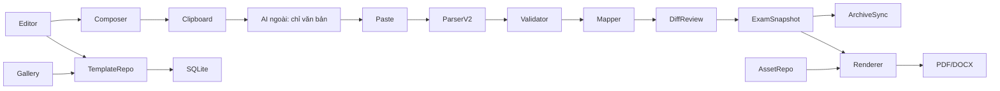

# ADR — kiến trúc template trên ExamBuilder hiện có

Ngày lập: 11/10/2026. Trạng thái: hợp đồng thiết kế M0; chưa phải bằng chứng M1–M7 đã chạy.

## Nguồn sự thật và điểm nối đã kiểm tra

| Chức năng hiện có | Mã nguồn thực | Cách nối template |
| --- | --- | --- |
| SQLite | `backend/database.js` | Migration additive; bảng template/revision/asset độc lập, không sửa ngầm bảng EXAM/QUESTION |
| Dán AI | `backend/parser/TextPromptParser.js` | Adapter cú pháp v2 → validate/map slot; giữ parser v1 cho đề cũ |
| Prompt cũ | `Gemini_Prompt_Unified.txt`, `backend/llm/promptBuilder.js`, `tools/gen-prompt-module.js` | Quy tắc cú pháp chung; composer template động dùng manifest; sinh lại module frontend, không sửa tay |
| Biến thể AI cũ | `AI_Prompts_Variants.txt`, `tools/gen-prompt-variants.js` | Registry có cấu trúc cho 5 tên bắt buộc; Gemini Pro là biến thể Gemini nếu cần |
| Tạo đề qua API | `backend/routes/generateRoutes.js`, `backend/llm/ProviderFactory.js` | Luồng tùy chọn, không chặn Copy/Dán offline |
| Archive/Gist | `backend/routes/archiveRoutes.js`, `backend/sync/library.js`, `backend/sync/gistClient.js` | Snapshot nhỏ và asset manifest; version schema; giữ payload v1 |
| Giao diện | `frontend/index.html`, `frontend/script.js`, `frontend/style.css` | Gallery + editor danh sách/inspector + preview liên kết |
| Android | `Exam builder for adr/app/src/main/` | DTO versioned, đọc v1/v2, text fallback khi thiếu asset |

`documents/PROJECT_BLUEPRINT.md` là file sinh bằng `tools/export-blueprint.js`; không sửa tay. Nhánh đang làm: `feature/chuan-hoa-cong-thuc-toan-latex`; tại M0 có các sửa đổi chưa commit ở LLM, giao diện, test và tài liệu. Không reset hay ghi đè các thay đổi đó.

## Kiểm kê phụ thuộc M0

`package.json` đang dùng Express 4, SQLite (`sqlite`/`sqlite3`), `docx`, `mammoth`, `pdf-parse`, `multer`, `katex` và `node-llama-cpp`; test dùng Jest/Supertest. Frontend là HTML/CSS/JavaScript thuần, Android là dự án Kotlin/Compose trong `Exam builder for adr/`. Chưa cần đổi stack để làm editor danh sách, prompt, parser hay migration. Phụ thuộc DOCX/PDF hiện có không đồng nghĩa mọi layout import/export đã được xác minh; các bước thực tế phải theo `TEMPLATE_SYSTEM_TEST_PLAN.md`. Không thêm OCR dependency trong phạm vi hiện tại.

## Ranh giới thành phần



Template là **cấu trúc** (`sections`, `slots`, `points`, `response_space`) cộng **trình bày** (`page`, `background_refs`, layout). Exam snapshot giữ nội dung riêng với `template_id` và `template_revision`; không sửa một mẫu gốc để điền đề. Clone có ID/revision riêng, liên kết `derived_from` chỉ để truy vết. Stable ID giữ khi reorder, ID mới khi clone thêm slot; không tái sử dụng ID đã xóa.

## Hợp đồng JSON đang dùng ở M1 (lựa chọn kỹ thuật)

```json
{
  "schema_version": 1,
  "template_id": "builtin.t09",
  "template_version": 1,
  "display_name": "Đề hai cột, tiết kiệm giấy",
  "origin": "builtin",
  "is_builtin": true,
  "defaults": { "total_points": "10.00", "duration_minutes": 45 },
  "appearance": { "paper": "A4", "orientation": "portrait", "columns": 2 },
  "pagination": { "mode": "auto", "max_pages": null },
  "sections": [{ "section_id": "builtin.t09.s01", "title": "Phần 1. Trắc nghiệm", "kind": "MULTIPLE_CHOICE", "declared_points": "5.00", "slots": [{
    "slot_id": "builtin.t09.s01.q001", "position": 0, "question_type": "MCQ", "difficulty_level": "NB", "points": "0.50",
    "answer_space": { "kind": "none", "lines": 0, "min_lines": 0, "max_lines": 0, "auto_expand": false },
    "content": null, "assets": []
  }] }]
}
```

Ví dụ rút gọn từ `backend/templates/seeds.js`, bỏ các trường còn lại và 9 slot khác ở phần đầu để dễ đọc. T09 thực có 10 câu trắc nghiệm và 2 câu tự luận, tổng 10 điểm. Điểm được lưu chuỗi thập phân hai chữ số, validator cộng bằng đơn vị 0,01. Bản sao chỉnh sửa có `template_version`; bản đề cần trỏ revision hoặc giữ snapshot đầy đủ để mở khi template đã thay đổi/xóa. API trả `{ success, ... }` như các route hiện có.

## Migration và đồng bộ

1. Đã thêm bảng template và phiên bản theo migration idempotent; seed gốc nằm trong code và không tạo bản trùng khi khởi động. Không thay/đổi tên bảng v1, không xóa dữ liệu.
2. Đề v1 vẫn đi đường cũ. Đề áp mẫu có `template_binding` gồm `schema_version`, `template_id`, `template_version`, `template_snapshot`, `asset_manifest`; archive giới hạn binding 1 MiB và trả lại khi mở.
3. `backend/sync/library.js` đã giữ `template_binding` trong serialize/merge Gist; Android `LibraryDto.kt`/`Exam.kt` giữ trường tùy chọn. Android xuất qua block cũ với cảnh báo layout/nền chưa tương đương.
4. Asset nhị phân lưu ngoài Gist theo SHA-256 và MIME; bản archive/Gist chỉ giữ tham chiếu. Upload ảnh có kiểm tra signature và SVG hạn chế; import DOCX/PDF text native vẫn phải duyệt. Nền/ảnh chưa được nhúng đầy đủ trong xuất file.

## Kiểm soát tính đúng

Validator kiểm ID/version, danh sách slot, loại, điểm và tổng; parser không tự tạo slot. Mapper ưu tiên ID, chỉ đề xuất thứ tự nếu không mơ hồ, không ghi đè nội dung ngoài selection. Transaction khi apply; trước/sau có diff và Undo. Render bản HS chặn đáp án ở mọi lớp, không chỉ ẩn CSS. MAX-PAGES báo vị trí tràn mà không cắt hoặc ép chữ. Import DOCX/PDF native text là best effort; scan đi đường nền/manual, không OCR.

## Asset/import backend đang có ở M4

`backend/routes/backgroundRoutes.js` giữ `GET /api/backgrounds` dạng mảng tên file cho UI cũ. API mới: `GET /api/backgrounds/assets`, `POST /api/backgrounds/upload` (multipart `file`, ảnh PNG/JPG/WebP/SVG giới hạn), `POST /api/backgrounds/import` (multipart `file` DOCX/PDF + `mode=background|structure`) và `GET /api/backgrounds/assets/:id/file`. File tối đa 20 MB, kiểm magic và SVG theo tập phần tử/thuộc tính hạn chế, đặt tên theo SHA-256, lưu metadata JSON; đường dẫn thư mục có thể đổi bằng `EXAM_BACKGROUNDS_DIR`/`EXAM_TEMPLATE_ASSETS_DIR` cho test. DOCX được kiểm thư mục ZIP, tối đa 2.000 entry/20 MB mỗi entry/50 MB giải nén cộng dồn và giải nén có giới hạn trước Mammoth. PDF giới hạn 100 trang; text trích xuất của hai định dạng giới hạn 1 MB. `structure` trả `raw_text`, gợi ý phần/câu độ tin cậy thấp và `review_required`; scan không có text trả cảnh báo, không OCR. `background` luôn lưu file gốc, trả `manual_regions: []`; với PDF, render tối đa 100 trang đầu thành PNG rộng 960 px và trả `background_pages` có page number, asset ID, SHA-256, MIME, kích thước và URL. Mỗi PNG tối đa 2 MB, tổng tối đa 12 MB và cao tối đa 2400 px; lỗi render hoặc trang vượt giới hạn có cảnh báo và file gốc vẫn còn. DOCX background tùy chọn dùng `backend/documentConvert/docxToPdf.js` và `tools/docx-to-pdf.ps1` gọi Microsoft Word COM trên Windows (ẩn cửa sổ, chỉ đọc, tắt macro), xuất PDF tạm rồi tái sử dụng giới hạn raster PDF tối đa 100 trang. Máy không có Word hoặc chuyển đổi lỗi vẫn lưu file gốc và trả cảnh báo để tải file/đánh dấu vùng thủ công. Chuyển đổi Office chỉ có trên Windows; Linux/macOS giữ fallback gốc.

## Xuất DOCX theo mẫu (M5)

`backend/templateExport/index.js` dựng header/footer từ `appearance.header`/`appearance.footer` khi template có cấu hình đó: `enabled` quyết định có xuất hay không, `fields` quyết định nội dung (school/exam_title ở header, page_number ở footer), có thể ghi đè bằng `metadata.header`/`metadata.footer`. Template không có cấu hình giữ hành vi cũ (header chỉ khi có metadata, footer luôn có số trang). Nền một ảnh hỗ trợ `apply_to` `all` và `first`. Khi có manifest ảnh trang, mỗi trang xuất thành một Word section nên hỗ trợ nền đầu/giữa/cuối khác nhau; file thiếu ảnh vẫn giữ nội dung và báo cảnh báo. `backend/templateExport/assets.js` dùng `@napi-rs/canvas` chuyển WebP/SVG đã kiểm tra sang PNG (tối đa 20 MP, cạnh 10.000 px, đầu ra 2.400 px/5 MiB) trước khi nhúng DOCX. Slot có vùng tọa độ hợp lệ trên trang nền được render thành PNG trong suốt, đặt tuyệt đối theo tọa độ trang và giữ nội dung trong alt text; vì Word không giữ text flow tuyệt đối ổn định, hệ thống cảnh báo phần đó không còn chỉnh sửa trực tiếp như đoạn văn. Nếu nội dung vượt vùng, câu trở lại luồng văn bản editable và phát cảnh báo để không cắt chữ.
